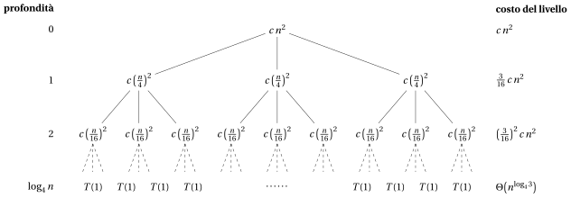
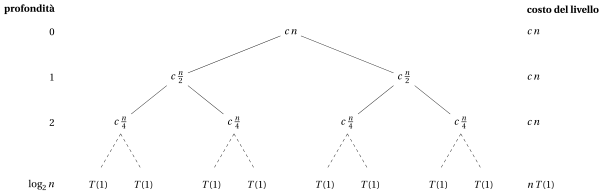
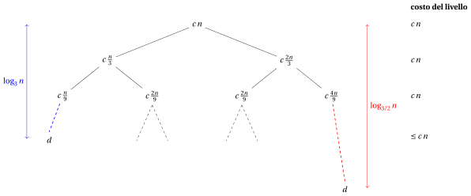
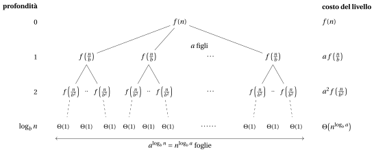

# Equazioni di ricorrenza

<div class="info-capitolo" markdown>

**Parte 2 · Analisi e ricorsione · Capitolo 11** · [:material-file-pdf-box: Dispensa, volume 2 (PDF)](../pdf/dispensa-2-analisi-ricorsione.pdf) · [:material-pencil: Esercizi](../esercizi/es-11-ricorrenze.md)

</div>

## Introduzione

Nel capitolo <em>Ricorsione</em> abbiamo contato i passi di un algoritmo ricorsivo riga per riga, e abbiamo osservato che il numero di passi eseguiti da una chiamata dipende dal numero di passi eseguiti dalle sue chiamate ricorsive, che sono chiamate dello <em>stesso</em> algoritmo su un input <em>più piccolo</em>. La quantità che vogliamo calcolare è quindi definita in termini di se stessa: questa è una <strong>equazione di ricorrenza</strong>.

In questo capitolo definiamo prima le equazioni di ricorrenza e mostriamo da dove nascono (Sezione [11.1](#sez-sec-recurrences)). Poi studiamo tre metodi per risolverle, cioè per ottenerne la forma chiusa o almeno l'ordine di grandezza:

- il <strong>metodo di espansione</strong> (Sezione [11.2](#sez-sec-expansion)), che srotola l'equazione fino a raggiungere la condizione al contorno;

- il <strong>metodo di sostituzione</strong> (Sezione [11.3](#sez-sec-substitution)), che dimostra per induzione una limitazione ipotizzata;

- il <strong>metodo dell'albero di ricorsione</strong> (Sezione [11.4](#sez-sec-recursionTree)), che visualizza i costi di tutte le chiamate e li somma livello per livello.

Infine (Sezione [11.5](#sez-sec-towardsMaster)) disegniamo l'albero di ricorsione di una generica equazione divide et impera: i tre comportamenti che vi osserviamo sono il punto di partenza del capitolo <em>Il Master theorem</em>.

## 11.1 Equazioni di ricorrenza { #sez-sec-recurrences }

<a id="box-1-defRecurrence"></a>

!!! definizione "Definizione 11.1: equazione di ricorrenza"

    Una <strong>equazione di ricorrenza</strong> (o semplicemente <strong>ricorrenza</strong>) è un'equazione (o una disequazione) che descrive una funzione $T:\N\to\R$ in termini dei suoi valori su input più piccoli.

- Ogni ricorrenza ha delle <strong>condizioni al contorno</strong>, che danno il valore della funzione quando la dimensione dell'input è piccola, cioè quando $n$ raggiunge (o è inferiore a) un valore specifico $n_0$. Precisamente, le condizioni al contorno sono

    $$
    T(n)=g(n) \qquad \text{se } n\le n_0,
    $$

    dove $g(n)$ è il valore della funzione per i valori piccoli di $n$. Tipicamente $n_0=1$ e la condizione al contorno è $T(1)=\Theta(1)$.

- <strong>Risolvere una ricorrenza</strong> significa determinare una forma chiusa di $T(n)$ o, almeno, il suo <span style="color:#e03131">ordine di grandezza</span>, cioè una funzione $h(n)$ tale che $T(n)=\Theta(h(n))$ (oppure $T(n)=O(h(n))$, oppure $T(n)=\Omega(h(n))$).

<a id="box-2-exRecFirst"></a>

!!! esempio "Esempio 11.1: Una prima ricorrenza"

    Consideriamo la ricorrenza

    $$
    T(n)=
    \begin{cases}
    1 & \text{se } n=1\\
    T(n-1)+n & \text{se } n>1
    \end{cases}
    $$

    La condizione al contorno è $T(1)=1$ (qui $n_0=1$); per $n>1$ ogni valore si ottiene dal precedente:

    - $T(1)=1$ (condizione al contorno);

    - $T(2)=T(1)+2=1+2=3$;

    - $T(3)=T(2)+3=3+3=6$;

    - $T(4)=T(3)+4=6+4=10$.

    La ricorrenza definisce $T(n)$ per ogni $n\in\N$, $n\ge 1$, ma calcolare $T(n)$ in questo modo richiede $n-1$ addizioni. Nell'[Esempio 11.4](#box-7-exRecExpQuadratic) la risolviamo e otteniamo la forma chiusa $T(n)=\frac{n(n+1)}{2}$.

### 11.1.1 Ricorrenze e algoritmi ricorsivi

!!! chiave ""

    Le ricorrenze sono lo strumento naturale per determinare la complessità asintotica degli <strong>algoritmi ricorsivi</strong>.

    In questo capitolo le ricorrenze sono oggetti matematici, e usiamo una generica funzione $T(n)$. Quando analizziamo un algoritmo ricorsivo, la funzione descritta dalla ricorrenza è il numero di passi $S(n)$ eseguiti nel caso peggiore su un input di parametro di dimensione $n$ (si veda il capitolo <em>Ricorsione</em>): il numero di passi di una chiamata è il numero di passi eseguiti dalla chiamata stessa più il numero di passi eseguiti dalle sue chiamate ricorsive.

- Consideriamo il seguente algoritmo ricorsivo che calcola la somma degli elementi di un array.

!!! algoritmo "Algoritmo: RecursiveSum"

    <div class="pseudocodice" markdown="0">
    <div class="pc-io"><span class="pc-kw">Input:</span> <span>Un array <span class="arithmatex">&#92;(a&#91;1..n&#93;&#92;)</span> di <span class="arithmatex">&#92;(n&#92;ge 1&#92;)</span> numeri interi</span></div>
    <div class="pc-io"><span class="pc-kw">Output:</span> <span>La somma <span class="arithmatex">&#92;(a&#91;1&#93;+a&#91;2&#93;+&#92;cdots+a&#91;n&#93;&#92;)</span></span></div>
    <div class="pc-sep"></div>
    <div class="pc-riga pc-vuota"><span class="pc-n"></span><span class="pc-corpo"></span></div>
    <div class="pc-riga"><span class="pc-n">1</span><span class="pc-corpo"><span class="pc-t"><strong>function</strong> RecursiveSum(a, n)</span></span></div>
    <div class="pc-riga" id="riga-11-ricorrenze-line-rsum-a"><span class="pc-n">2</span><span class="pc-corpo"><span class="pc-l"></span><span class="pc-t"><strong>if</strong> <span class="arithmatex">&#92;(n = 1&#92;)</span> <strong>then</strong></span></span></div>
    <div class="pc-riga" id="riga-11-ricorrenze-line-rsum-b"><span class="pc-n">3</span><span class="pc-corpo"><span class="pc-l"></span><span class="pc-l"></span><span class="pc-t"><strong>return</strong> <span class="arithmatex">&#92;(a&#91;1&#93;&#92;)</span></span></span></div>
    <div class="pc-riga"><span class="pc-n">4</span><span class="pc-corpo"><span class="pc-l"></span><span class="pc-t"><strong>end</strong></span></span></div>
    <div class="pc-riga" id="riga-11-ricorrenze-line-rsum-c"><span class="pc-n">5</span><span class="pc-corpo"><span class="pc-l"></span><span class="pc-t"><span class="arithmatex">&#92;(s :=&#92;)</span> RecursiveSum(<span class="arithmatex">&#92;(a, n-1&#92;)</span>)</span></span></div>
    <div class="pc-riga" id="riga-11-ricorrenze-line-rsum-d"><span class="pc-n">6</span><span class="pc-corpo"><span class="pc-l"></span><span class="pc-t"><strong>return</strong> <span class="arithmatex">&#92;(s + a&#91;n&#93;&#92;)</span></span></span></div>
    <div class="pc-riga"><span class="pc-n">7</span><span class="pc-corpo"><span class="pc-t"><strong>end</strong></span></span></div>
    </div>

<a id="box-3-exRecSumSteps"></a>

!!! esempio "Esempio 11.2: La ricorrenza di <code>RecursiveSum</code>"

    Sia $S(n)$ il numero di passi eseguiti da <code>RecursiveSum</code> su un array di dimensione $n$. Contiamo le esecuzioni di ciascuna riga.

    - Se $n=1$, le righe [2](#riga-11-ricorrenze-line-rsum-a) e [3](#riga-11-ricorrenze-line-rsum-b) sono eseguite una volta: $S(1)=2$.

    - Se $n>1$, le righe [2](#riga-11-ricorrenze-line-rsum-a), [5](#riga-11-ricorrenze-line-rsum-c) e [6](#riga-11-ricorrenze-line-rsum-d) sono eseguite una volta ($3$ passi), e inoltre la chiamata ricorsiva alla riga [5](#riga-11-ricorrenze-line-rsum-c) esegue $S(n-1)$ passi.

    Quindi

    $$
    S(n)=
    \begin{cases}
    2 & \text{se } n=1\\
    S(n-1)+3 & \text{se } n>1
    \end{cases}
    $$

    Per esempio, $S(2)=2+3=5$, $S(3)=5+3=8$ e $S(4)=8+3=11$. Nell'[Esempio 11.3](#box-6-exRecExpLinear) mostriamo che $S(n)=3n-1=\Theta(n)$.

- Lo stesso algoritmo, scritto in C++, è la seguente funzione del codice del corso. In C++ l'array è indicizzato a partire da $0$, quindi i suoi elementi sono <code>a[0]</code>, …, <code>a[n-1]</code>, e l'ultimo elemento è <code>a[n-1]</code>.

```cpp
// somma di a[0..n-1] per decremento di uno: profondità della ricorsione Theta(n)
long long sumRecDecrease(int *a, int n)
{
	if (n == 0)
	{
		return 0;
	}

	return sumRecDecrease(a, n - 1) + a[n - 1];
}
```

- La funzione C++ si ferma sull'array <strong>vuoto</strong> ($n=0$, somma $0$) invece che a $n=1$: accetta anche $n=0$, ed esegue una chiamata in più rispetto allo pseudocodice. La ricorrenza ha la stessa forma $S(n)=S(n-1)+\text{costante}$, e l'ordine di grandezza non cambia. Sull'array $3,1,4,1,5,9,2,6$ la funzione restituisce $31$.

### 11.1.2 Diverse forme di ricorrenze

La forma della ricorrenza rispecchia il modo in cui l'algoritmo suddivide il suo input. Le forme più comuni sono le seguenti.

- <strong>Divide et impera.</strong> Un algoritmo ricorsivo divide il problema in $a$ sottoproblemi, ciascuno di dimensione $n/b$, li risolve ricorsivamente e ne combina le soluzioni. Ne risulta una ricorrenza della forma

    $$
    T(n)=a\,T\left(\frac{n}{b}\right)+f(n).
    $$

    Per esempio, l'algoritmo <code>MergeSort</code> (studiato nel capitolo <em>Algoritmi ricorsivi</em>) dà luogo a

    $$
    T(n)=2T(n/2)+\Theta(n).
    $$

- <strong>Suddivisione non uniforme.</strong> Un algoritmo ricorsivo può dividere il problema in sottoproblemi di dimensioni diverse. Per esempio, se l'input è diviso in una parte $1/3$ e una parte $2/3$, otteniamo la ricorrenza

    $$
    T(n)=T\left(\frac{n}{3}\right)+T\left(\frac{2n}{3}\right)+f(n),
    $$

    dove $f(n)$ è il tempo richiesto per dividere il problema e per combinare le soluzioni dei sottoproblemi.

- <strong>Decrementa e conquista.</strong> I sottoproblemi non sono necessariamente una frazione costante del problema originale. Per esempio, un algoritmo ricorsivo può creare un solo sottoproblema contenente un elemento in meno del problema originale (come <code>RecursiveSum</code>). Ne risulta la ricorrenza

    $$
    T(n)=T(n-1)+f(n).
    $$

- <strong>Più sottoproblemi di dimensione $n-1$.</strong> Per esempio, l'algoritmo che risolve il rompicapo della <em>Torre di Hanoi</em> con $n$ dischi sposta $n-1$ dischi, poi un disco, poi di nuovo $n-1$ dischi, dando luogo alla ricorrenza

    $$
    T(n)=2\,T(n-1)+1,
    $$

    la cui soluzione è esponenziale in $n$ (si veda l'[Esempio 11.5](#box-8-exRecExpHanoi)).

<a id="box-4-defStandardForm"></a>

!!! definizione "Definizione 11.2: ricorrenza in forma standard"

    Una ricorrenza è in <strong>forma standard</strong> se può essere scritta come

    \begin{equation*}
    T(n)=a\,T\left(\frac{n}{b}\right)+f(n) \label{eq:rec:standardForm} \tag{11.1}
    \end{equation*}

    dove

    - $n$ è la dimensione dell'input (tipicamente $n\in\N$);

    - $a\ge 1$ è il numero di sottoproblemi da risolvere;

    - $\frac{n}{b}$ è la dimensione di ciascun sottoproblema ($b>1$);

    - $f(n)$ è il tempo richiesto per dividere il problema e per combinare le soluzioni dei sottoproblemi.

- Includendo le condizioni al contorno, una ricorrenza in forma standard è

    $$
    T(n)=
    \begin{cases}
    g(1) & \text{se } n=1\\
    a\,T\left(\frac{n}{b}\right)+f(n) & \text{se } n>1
    \end{cases}
    $$

    dove $g(1)$ è il tempo richiesto per risolvere un sottoproblema di dimensione $1$, tipicamente $g(1)=\Theta(1)$.

- Occasionalmente incontreremo ricorrenze che non sono uguaglianze ma disuguaglianze, come

    $$
    T(n)\le a\,T\left(\frac{n}{b}\right)+f(n).
    $$

    Poiché una tale ricorrenza fornisce soltanto una <strong>limitazione superiore</strong> per $T(n)$, la sua soluzione è data in notazione $O$ anziché in notazione $\Theta$.

- Analogamente, se la disuguaglianza è invertita,

    $$
    T(n)\ge a\,T\left(\frac{n}{b}\right)+f(n),
    $$

    la ricorrenza fornisce soltanto una <strong>limitazione inferiore</strong> per $T(n)$, e la sua soluzione è data in notazione $\Omega$.

### 11.1.3 Metodi per risolvere le ricorrenze

- In questo capitolo studiamo tre metodi per risolvere le ricorrenze:

    1. Il <strong>metodo di espansione</strong> (detto anche di iterazione o di srotolamento): si sostituisce ripetutamente la ricorrenza in se stessa fino a raggiungere la condizione al contorno, e si calcola la sommatoria che ne risulta.

    2. Il <strong>metodo di sostituzione</strong>: si ipotizza una limitazione e poi si usa l'induzione matematica per dimostrare che l'ipotesi è corretta.

    3. Il <strong>metodo dell'albero di ricorsione</strong>: si converte la ricorrenza in un albero i cui nodi rappresentano i costi sostenuti ai vari livelli della ricorsione, e si limitano le sommatorie che ne risultano.

- Nel capitolo <em>Il Master theorem</em> studiamo un quarto metodo, il <strong>Master theorem</strong>, che fornisce direttamente la soluzione delle ricorrenze in forma standard $\eqref{eq:rec:standardForm}$.

Prima di applicare i metodi fissiamo due punti tecnici: quali dettagli di una ricorrenza si possono trascurare, e quali sommatorie compaiono più spesso.

### 11.1.4 Aspetti tecnici nelle ricorrenze

- Spesso trascuriamo alcuni dettagli tecnici quando enunciamo e risolviamo le ricorrenze.

- <strong>Parti intere inferiori e superiori.</strong> Consideriamo la ricorrenza

    $$
    T(n)=
    \begin{cases}
    \Theta(1) & \text{se } n=1\\
    2\,T\left(\frac{n}{2}\right)+\Theta(n) & \text{se } n>1
    \end{cases}
    $$

    Quando $n$ è dispari, i due sottoproblemi non possono avere entrambi dimensione $n/2$ (che non è un numero intero): tipicamente, hanno dimensioni $\lceil n/2\rceil$ e $\lfloor n/2\rfloor$. La ricorrenza precisa è quindi

    $$
    T(n)=
    \begin{cases}
    \Theta(1) & \text{se } n=1\\
    T\left(\lceil n/2\rceil\right)+T\left(\lfloor n/2\rfloor\right)+\Theta(n) & \text{se } n>1
    \end{cases}
    $$

    Le due ricorrenze hanno la stessa soluzione asintotica. Poiché ci interessa l'ordine di grandezza, le parti intere inferiori e superiori si possono di solito omettere.

- <strong>Potenze esatte.</strong> Per lo stesso motivo, quando risolviamo una ricorrenza in forma standard $\eqref{eq:rec:standardForm}$ supponiamo spesso che $n$ sia una <strong>potenza esatta di $b$</strong>, cioè $n=b^k$ per qualche $k\in\N$. In questo modo tutte le dimensioni dei sottoproblemi $n/b, n/b^2,\dots,1$ sono intere. Nell'esempio precedente supponiamo $n=2^k$.

- <strong>Condizioni al contorno.</strong> Le condizioni al contorno sono un'altra classe di dettagli che tipicamente ignoriamo. Poiché il tempo di esecuzione di un algoritmo su un input di dimensione costante è una costante, le ricorrenze che nascono dall'analisi degli algoritmi soddisfano in generale

    $$
    T(n)=\Theta(1) \qquad \text{per valori piccoli di } n.
    $$

    Di conseguenza, per comodità, ometteremo in generale le condizioni al contorno e supporremo che $T(n)$ sia costante per $n$ piccolo. Cambiare il valore di $T(1)$ cambia tipicamente la soluzione esatta, ma non il suo ordine di grandezza.

!!! chiave ""

    Omettere parti intere, condizioni al contorno e supporre che $n$ sia una potenza esatta di $b$ semplifica i calcoli. Quando è richiesta una dimostrazione rigorosa (per esempio nel metodo di sostituzione), questi dettagli devono essere trattati esplicitamente.

### 11.1.5 Sommatorie utili

Tutti e tre i metodi terminano con una sommatoria: i costi delle singole chiamate vanno sommati. Le formule seguenti sono usate in tutto il capitolo.

<a id="box-5-obsRecSums"></a>

!!! teorema "Osservazione 11.3: sommatorie e logaritmi utili"

    - La <em><span style="color:#1971c2">serie aritmetica</span></em>: per ogni $n\ge 1$

        \begin{equation*}
        \sum_{i=1}^{n} i = 1+2+\cdots+n=\frac{n(n+1)}{2}. \label{eq:rec:arith} \tag{11.2}
        \end{equation*}

    - La <em><span style="color:#1971c2">serie geometrica</span></em>: per ogni numero reale $x\neq 1$ e ogni $k\in\N$

        \begin{equation*}
        \sum_{i=0}^{k} x^i = 1+x+x^2+\cdots+x^k=\frac{x^{k+1}-1}{x-1}. \label{eq:rec:geomFinite} \tag{11.3}
        \end{equation*}

        In particolare, per $x=2$,

        \begin{equation*}
        \sum_{i=0}^{k-1} 2^i = 2^k-1. \label{eq:rec:geomTwo} \tag{11.4}
        \end{equation*}

    - La <em><span style="color:#1971c2">serie geometrica infinita decrescente</span></em>: per ogni numero reale $x$ con $|x|<1$

        \begin{equation*}
        \sum_{i=0}^{\infty} x^i = \frac{1}{1-x}. \label{eq:rec:geomInfinite} \tag{11.5}
        \end{equation*}

    - Due proprietà dei logaritmi: per ogni $a,b,n>0$ (con $b\neq 1$)

        \begin{equation*}
        a^{\log_b n}=n^{\log_b a}, \qquad \log_b n=\frac{\log_2 n}{\log_2 b}. \label{eq:rec:logProps} \tag{11.6}
        \end{equation*}

??? dimostrazione "Dimostrazione"

    <em>Serie aritmetica.</em> Scrivendo la somma due volte, una in ordine crescente e una in ordine decrescente, e sommando termine a termine, otteniamo $n$ coppie, ciascuna con somma $n+1$: il doppio della somma è $n(n+1)$.

    <em>Serie geometrica.</em> Moltiplicando la somma per $x-1$, tutti i termini intermedi si semplificano:

    $$
    (x-1)\sum_{i=0}^{k}x^i=\sum_{i=1}^{k+1}x^i-\sum_{i=0}^{k}x^i=x^{k+1}-1 ,
    $$

    e dividiamo per $x-1\neq 0$. Per $x=2$ e $k-1$ al posto di $k$ otteniamo $2^k-1$.

    <em>Serie infinita.</em> Se $|x|<1$, allora $x^{k+1}\to 0$ per $k\to\infty$, e la somma finita tende a $\frac{0-1}{x-1}=\frac{1}{1-x}$.

    <em>Logaritmi.</em> $a^{\log_b n}=\big(b^{\log_b a}\big)^{\log_b n}=\big(b^{\log_b n}\big)^{\log_b a}=n^{\log_b a}$. Inoltre $n=b^{\log_b n}$ dà $\log_2 n=\log_b n\cdot\log_2 b$. <span class="qed">□</span>

- Poiché tutti i termini sono positivi quando $0<x<1$, ogni somma finita $\sum_{i=0}^{k} x^i$ è minore di $\frac{1}{1-x}$: la serie infinita dà una <strong>limitazione superiore</strong> per una somma geometrica finita che non dipende da $k$.

- La seconda proprietà dei logaritmi mostra che logaritmi in basi diverse differiscono per un fattore costante; quindi, dentro $\Theta$, $O$ e $\Omega$ la base del logaritmo è irrilevante.

## 11.2 Il metodo di espansione { #sez-sec-expansion }

Il modo più diretto per risolvere una ricorrenza è applicarla ripetutamente: ogni applicazione sostituisce un valore di $T$ con un valore su un argomento più piccolo, e dopo abbastanza applicazioni resta soltanto la condizione al contorno.

!!! chiave ""

    Nel <strong>metodo di espansione</strong> (detto anche <strong>iterazione</strong> o <strong>srotolamento</strong>):

    1. si sostituisce la ricorrenza in se stessa alcune volte, fino a riconoscere lo schema generale dopo $k$ sostituzioni;

    2. si sceglie $k$ in modo che l'argomento raggiunga la condizione al contorno;

    3. si calcola (o si limita) la sommatoria che ne risulta.

- Il metodo fornisce una forma chiusa esatta quando la sommatoria si può calcolare. Lo schema riconosciuto al passo 1 si può dimostrare rigorosamente per induzione su $k$.

Cominciamo con le ricorrenze di tipo decrementa e conquista, $T(n-1)+f(n)$, e poi passiamo a quelle di tipo divide et impera, $a\,T(n/2)+f(n)$.

<a id="box-6-exRecExpLinear"></a>

!!! esempio "Esempio 11.3: $T(n)=T(n-1)+c$"

    Siano $c,d>0$ costanti e

    $$
    T(n)=
    \begin{cases}
    d & \text{se } n=1\\
    T(n-1)+c & \text{se } n>1
    \end{cases}
    $$

    - <em>Passo 1 (espansione).</em>

        \begin{align*}
        T(n) &= T(n-1)+c\\
        &= \big(T(n-2)+c\big)+c = T(n-2)+2c\\
        &= \big(T(n-3)+c\big)+2c = T(n-3)+3c\\
        &\;\;\vdots\\
        &= T(n-k)+k\,c.
        \end{align*}

    - <em>Passo 2 (condizione al contorno).</em> La condizione al contorno è raggiunta quando $n-k=1$, cioè $k=n-1$.

    - <em>Passo 3 (somma).</em>

        $$
        T(n)=T(1)+(n-1)\,c=c\,n+(d-c)=\Theta(n).
        $$

    Per <code>RecursiveSum</code> ([Esempio 11.2](#box-3-exRecSumSteps)) abbiamo $c=3$ e $d=2$, quindi

    $$
    S(n)=3(n-1)+2=3n-1=\Theta(n),
    $$

    che dà $S(2)=5$, $S(3)=8$, $S(4)=11$, come calcolato direttamente dalla ricorrenza.

<a id="box-7-exRecExpQuadratic"></a>

!!! esempio "Esempio 11.4: $T(n)=T(n-1)+n$"

    Sia

    $$
    T(n)=
    \begin{cases}
    1 & \text{se } n=1\\
    T(n-1)+n & \text{se } n>1
    \end{cases}
    $$

    - <em>Passo 1 (espansione).</em>

        \begin{align*}
        T(n) &= T(n-1)+n\\
        &= T(n-2)+(n-1)+n\\
        &= T(n-3)+(n-2)+(n-1)+n\\
        &\;\;\vdots\\
        &= T(n-k)+(n-k+1)+\cdots+(n-1)+n.
        \end{align*}

    - <em>Passo 2 (condizione al contorno).</em> $n-k=1$, cioè $k=n-1$.

    - <em>Passo 3 (somma).</em> Usando la serie aritmetica $\eqref{eq:rec:arith}$,

        $$
        T(n)=T(1)+2+3+\cdots+n=1+2+\cdots+n=\frac{n(n+1)}{2}=\Theta(n^2).
        $$

        Infatti,

        $$
        \lim_{n\to\infty}\frac{n(n+1)/2}{n^2}=\lim_{n\to\infty}\frac{1}{2}\left(1+\frac{1}{n}\right)=\frac{1}{2}\in\R_{>0}.
        $$

    La forma chiusa dà $T(1)=1$, $T(2)=3$, $T(3)=6$, $T(4)=10$, i valori dell'[Esempio 11.1](#box-2-exRecFirst).

<a id="box-8-exRecExpHanoi"></a>

!!! esempio "Esempio 11.5: $T(n)=2T(n-1)+1$: la Torre di Hanoi"

    Sia

    $$
    T(n)=
    \begin{cases}
    1 & \text{se } n=1\\
    2\,T(n-1)+1 & \text{se } n>1
    \end{cases}
    $$

    - <em>Passo 1 (espansione).</em>

        \begin{align*}
        T(n) &= 2\,T(n-1)+1\\
        &= 2\big(2\,T(n-2)+1\big)+1 = 2^2\,T(n-2)+2+1\\
        &= 2^2\big(2\,T(n-3)+1\big)+2+1 = 2^3\,T(n-3)+2^2+2+1\\
        &\;\;\vdots\\
        &= 2^k\,T(n-k)+\sum_{i=0}^{k-1}2^i.
        \end{align*}

    - <em>Passo 2 (condizione al contorno).</em> $n-k=1$, cioè $k=n-1$.

    - <em>Passo 3 (somma).</em> Usando $\eqref{eq:rec:geomTwo}$,

        $$
        T(n)=2^{n-1}\,T(1)+\left(2^{n-1}-1\right)=2^{n-1}+2^{n-1}-1=2^n-1=\Theta(2^n).
        $$

    Questo è il numero di mosse necessarie per risolvere il rompicapo della Torre di Hanoi con $n$ dischi: il tempo di esecuzione è <strong>esponenziale</strong> in $n$. La funzione <code>hanoi</code> del codice del corso conta le sue mosse; eseguendola otteniamo

    <div class="tabella" markdown="0"><table>
    <tr>
    <th><span class="arithmatex">&#92;(n&#92;)</span></th>
    <th>1</th>
    <th>2</th>
    <th>3</th>
    <th>4</th>
    <th>5</th>
    <th>6</th>
    <th>7</th>
    <th>8</th>
    <th>10</th>
    </tr>
    <tr>
    <td>mosse</td>
    <td>1</td>
    <td>3</td>
    <td>7</td>
    <td>15</td>
    <td>31</td>
    <td>63</td>
    <td>127</td>
    <td>255</td>
    <td>1023</td>
    </tr>
    </table></div>

    cioè esattamente $2^n-1$ mosse.

Le due ricorrenze seguenti dimezzano la dimensione del problema a ogni chiamata. Per evitare le parti intere supponiamo che $n$ sia una potenza esatta di $2$.

<a id="box-9-exRecExpLog"></a>

!!! esempio "Esempio 11.6: $T(n)=T(n/2)+c$"

    Siano $c,d>0$ costanti, sia $n=2^k$ una potenza esatta di $2$, e

    $$
    T(n)=
    \begin{cases}
    d & \text{se } n=1\\
    T\left(\frac{n}{2}\right)+c & \text{se } n>1
    \end{cases}
    $$

    - <em>Passo 1 (espansione).</em>

        $$
        T(n) = T\left(\frac{n}{2}\right)+c
        = T\left(\frac{n}{2^2}\right)+2c
        = T\left(\frac{n}{2^3}\right)+3c
        = \cdots
        = T\left(\frac{n}{2^j}\right)+j\,c.
        $$

    - <em>Passo 2 (condizione al contorno).</em> $\frac{n}{2^j}=1$, cioè $j=\log_2 n$.

    - <em>Passo 3 (somma).</em>

        $$
        T(n)=T(1)+c\log_2 n=c\log_2 n+d=\Theta(\log_2 n).
        $$

    Questa ricorrenza descrive, per esempio, la versione ricorsiva di <code>BinarySearch</code>: a ogni chiamata la dimensione del sotto-array è dimezzata.

<a id="box-10-exRecExpNlogN"></a>

!!! esempio "Esempio 11.7: $T(n)=2T(n/2)+n$"

    Sia $n=2^k$ una potenza esatta di $2$ e

    $$
    T(n)=
    \begin{cases}
    1 & \text{se } n=1\\
    2\,T\left(\frac{n}{2}\right)+n & \text{se } n>1
    \end{cases}
    $$

    - <em>Passo 1 (espansione).</em>

        \begin{align*}
        T(n) &= 2\,T\left(\frac{n}{2}\right)+n\\
        &= 2\left(2\,T\left(\frac{n}{2^2}\right)+\frac{n}{2}\right)+n = 2^2\,T\left(\frac{n}{2^2}\right)+2n\\
        &= 2^2\left(2\,T\left(\frac{n}{2^3}\right)+\frac{n}{2^2}\right)+2n = 2^3\,T\left(\frac{n}{2^3}\right)+3n\\
        &\;\;\vdots\\
        &= 2^j\,T\left(\frac{n}{2^j}\right)+j\,n.
        \end{align*}

    - <em>Passo 2 (condizione al contorno).</em> $j=\log_2 n$, in modo che $2^j=n$.

    - <em>Passo 3 (somma).</em>

        $$
        T(n)=n\,T(1)+n\log_2 n=n\log_2 n+n=\Theta(n\log_2 n).
        $$

    Verifica: dalla ricorrenza $T(2)=2+2=4$, $T(4)=8+4=12$, $T(8)=24+8=32$, e dalla forma chiusa $T(8)=8\cdot 3+8=32$.

!!! chiave ""

    Il metodo di espansione funziona bene quando la ricorrenza ha un <strong>solo termine ricorsivo</strong>. Con più termini ricorsivi di dimensioni diverse (per esempio $T(n/3)+T(2n/3)$) l'espansione diventa rapidamente ingestibile: in questi casi il metodo dell'albero di ricorsione (Sezione [11.4](#sez-sec-recursionTree)) è più conveniente.

## 11.3 Il metodo di sostituzione { #sez-sec-substitution }

Il metodo di espansione richiede dimensioni esatte dei sottoproblemi: con le parti intere lo schema non è più pulito. Quando abbiamo già un'idea della soluzione, un approccio più robusto è <em>dimostrarla</em> per induzione.

!!! chiave ""

    Il <strong>metodo di sostituzione</strong> comprende due passi:

    1. <strong>ipotizzare</strong> la forma della soluzione (per esempio $T(n)\le c\,n\log_2 n$, con $c$ una costante incognita);

    2. usare l'<strong>induzione matematica</strong> per trovare le costanti e mostrare che la soluzione funziona.

- Il nome deriva dal fatto che, nel passo induttivo, <em>sostituiamo</em> la limitazione ipotizzata ai valori della funzione sugli input più piccoli.

- Il metodo è molto potente, ma richiede una buona ipotesi. L'ipotesi può venire dall'esperienza (ricorrenze simili), dal metodo di espansione o da un albero di ricorsione.

- Possiamo usare il metodo di sostituzione per dimostrare separatamente limitazioni superiori ($O$) e inferiori ($\Omega$). Insieme danno $\Theta$.

- Poiché la notazione asintotica richiede la limitazione solo per $n\ge n_0$, siamo liberi di scegliere $n_0$: questo è utile quando la limitazione non vale per i valori più piccoli di $n$.

### 11.3.1 Un esempio con le parti intere: limitazione superiore

- Consideriamo la ricorrenza

    \begin{equation*}
    T(n)=
    \begin{cases}
    1 & \text{se } n=1\\
    2\,T\left(\lfloor n/2\rfloor\right)+n & \text{se } n>1
    \end{cases} \label{eq:rec:subsMain} \tag{11.7}
    \end{equation*}

- Dall'[Esempio 11.7](#box-10-exRecExpNlogN) (dove $n$ è una potenza di $2$) ipotizziamo $T(n)=O(n\log_2 n)$. Vogliamo dimostrare che esistono costanti $c>0$ e $n_0$ tali che

    $$
    T(n)\le c\,n\log_2 n \qquad \text{per ogni } n\ge n_0.
    $$

<strong>Passo induttivo.</strong>  Supponiamo che la limitazione valga per tutti i valori $m$ con $n_0\le m<n$, in particolare per $m=\lfloor n/2\rfloor$ (questo richiede $\lfloor n/2\rfloor\ge n_0$):

$$
T\left(\lfloor n/2\rfloor\right)\le c\,\lfloor n/2\rfloor\log_2\lfloor n/2\rfloor.
$$

Sostituendo nella ricorrenza:

\begin{align*}
T(n) &\le 2\,c\,\lfloor n/2\rfloor\log_2\lfloor n/2\rfloor+n\\
&\le 2\,c\,\frac{n}{2}\log_2\frac{n}{2}+n && \text{(poiché } \lfloor n/2\rfloor\le n/2\text{)}\\
&= c\,n\log_2 n-c\,n\log_2 2+n\\
&= c\,n\log_2 n-c\,n+n\\
&\le c\,n\log_2 n,
\end{align*}

dove l'ultimo passaggio vale purché $c\ge 1$.

<strong>Casi base.</strong>  L'induzione richiede che la limitazione valga per le condizioni al contorno. Tuttavia, per $n=1$:

$$
T(1)=1 > c\cdot 1\cdot\log_2 1=0,
$$

per ogni $c$. Quindi la limitazione <em>non vale</em> per $n=1$. Sfruttiamo la libertà di scegliere $n_0$: dimostriamo la limitazione per $n\ge n_0=2$.

- Per $n\ge 4$ si ha $\lfloor n/2\rfloor\ge 2$, quindi il passo induttivo usa soltanto valori di $T$ su argomenti $\ge 2$.

- Per $n=2$ e $n=3$ si ha $\lfloor n/2\rfloor=1$, quindi il passo induttivo userebbe $T(1)$, che non soddisfa la limitazione. Pertanto $n=2$ e $n=3$ devono essere trattati come <strong>casi base</strong>.

Dalla ricorrenza, $T(2)=2\,T(1)+2=4$ e $T(3)=2\,T(1)+3=5$. Ci serve

$$
4\le c\cdot 2\log_2 2=2c \qquad\text{e}\qquad 5\le c\cdot 3\log_2 3.
$$

Entrambe valgono per $c\ge 2$ (poiché $3\log_2 3\approx 4.75$, si ha $2\cdot 3\log_2 3\approx 9.51\ge 5$).

<a id="box-11-obsRecSubsUpper"></a>

!!! teorema "Osservazione 11.4: limitazione superiore per $2T(\lfloor n/2\rfloor)+n$"

    La funzione $T(n)$ definita in $\eqref{eq:rec:subsMain}$ soddisfa $T(n)\le 2\,n\log_2 n$ per ogni $n\ge 2$. Quindi $T(n)=O(n\log_2 n)$.

??? dimostrazione "Dimostrazione"

    Sia $c=2$. Procediamo per induzione forte su $n\ge 2$.

    <em>Casi base</em> $n=2,3$: $T(2)=4\le 2\cdot 2\cdot\log_2 2=4$ e $T(3)=5\le 2\cdot 3\log_2 3\approx 9.51$.

    <em>Passo induttivo</em> $n\ge 4$: abbiamo $2\le\lfloor n/2\rfloor<n$, quindi per l'ipotesi induttiva $T(\lfloor n/2\rfloor)\le 2\lfloor n/2\rfloor\log_2\lfloor n/2\rfloor$. Allora

    $$
    T(n)\le 4\lfloor n/2\rfloor\log_2\lfloor n/2\rfloor+n\le 2n\log_2\frac{n}{2}+n=2n\log_2 n-2n+n\le 2n\log_2 n. \qedhere
    $$

    <p class="qed-riga"><span class="qed">□</span></p>

### 11.3.2 Un esempio con le parti intere: limitazione inferiore

- Dimostriamo ora $T(n)=\Omega(n\log_2 n)$ per la stessa ricorrenza $\eqref{eq:rec:subsMain}$. Cerchiamo una costante $d>0$ tale che $T(n)\ge d\,n\log_2 n$ per ogni $n\ge 1$.

- Per la limitazione inferiore, la parte intera lavora contro di noi: servono limitazioni inferiori per $\lfloor n/2\rfloor$. Per ogni $n\ge 2$:

    $$
    2\lfloor n/2\rfloor\ge n-1 \qquad\text{e}\qquad \lfloor n/2\rfloor\ge \frac{n}{3}.
    $$

    La prima vale perché $\lfloor n/2\rfloor\ge (n-1)/2$. La seconda vale per $n=2$ ($1\ge 2/3$) e, per $n\ge 3$, perché $(n-1)/2\ge n/3$ è equivalente a $n\ge 3$.

<strong>Passo induttivo</strong>  ($n\ge 2$). Supponiamo $T(\lfloor n/2\rfloor)\ge d\lfloor n/2\rfloor\log_2\lfloor n/2\rfloor$. Poiché $\lfloor n/2\rfloor\ge 1$, il fattore $\log_2\lfloor n/2\rfloor$ è non negativo, e

\begin{align*}
T(n) &\ge 2\,d\,\lfloor n/2\rfloor\log_2\lfloor n/2\rfloor+n\\
&\ge d\,(n-1)\log_2\frac{n}{3}+n\\
&= d\,n\log_2 n-d\,n\log_2 3-d\log_2 n+d\log_2 3+n\\
&\ge d\,n\log_2 n+\Big(n-d\,n\log_2 3-d\log_2 n\Big).
\end{align*}

Poiché $\log_2 n\le n$, il termine fra parentesi è almeno $n\,(1-d\log_2 3-d)$, che è non negativo se

$$
d\le\frac{1}{1+\log_2 3}\approx 0.387.
$$

Scegliamo $d=\frac{1}{4}$.

<strong>Caso base</strong>  ($n=1$): $T(1)=1\ge \frac{1}{4}\cdot 1\cdot\log_2 1=0$. ✓

<a id="box-12-obsRecSubsLower"></a>

!!! teorema "Osservazione 11.5: limitazione inferiore per $2T(\lfloor n/2\rfloor)+n$"

    La funzione $T(n)$ definita in $\eqref{eq:rec:subsMain}$ soddisfa $T(n)\ge \frac{1}{4}\,n\log_2 n$ per ogni $n\ge 1$. Quindi $T(n)=\Omega(n\log_2 n)$.

??? dimostrazione "Dimostrazione"

    Per induzione forte su $n\ge 1$, con $d=\frac{1}{4}$. Per $n=1$, $T(1)=1\ge 0$. Per $n\ge 2$ abbiamo $1\le\lfloor n/2\rfloor<n$, quindi l'ipotesi induttiva vale per $\lfloor n/2\rfloor$, e il calcolo del passo induttivo precedente dà

    $$
    T(n)\ge \tfrac{1}{4}\,n\log_2 n+n\left(1-\tfrac{1}{4}\log_2 3-\tfrac{1}{4}\right)\ge \tfrac{1}{4}\,n\log_2 n ,
    $$

    poiché $1-\frac{1}{4}(1+\log_2 3)\approx 0.35>0$. <span class="qed">□</span>

!!! chiave ""

    Dalle Osservazioni [11.4](#box-11-obsRecSubsUpper) e [Osservazione 11.5](#box-12-obsRecSubsLower), la soluzione di $\eqref{eq:rec:subsMain}$ è

    $$
    T(n)=\Theta(n\log_2 n).
    $$

    La parte intera non cambia l'ordine di grandezza trovato per $n$ potenza di $2$. Numericamente, per ogni $n$ con $2\le n<200\,000$ il rapporto $\frac{T(n)}{n\log_2 n}$ è compreso tra $0.83$ e $2$.

### 11.3.3 Quando l'ipotesi va rafforzata

- A volte l'ipotesi è corretta, ma l'induzione non funziona perché l'ipotesi induttiva <em>non è abbastanza forte</em>. Consideriamo

    \begin{equation*}
    T(n)=
    \begin{cases}
    1 & \text{se } n=1\\
    2\,T\left(\lfloor n/2\rfloor\right)+1 & \text{se } n>1
    \end{cases} \label{eq:rec:subsStrength} \tag{11.8}
    \end{equation*}

- Per $n$ potenza di $2$ si trova facilmente $T(n)=2n-1$ (per esempio $T(2)=3$, $T(4)=7$, $T(8)=15$), quindi ipotizziamo $T(n)=O(n)$, cioè $T(n)\le c\,n$.

- <strong>Tentativo ingenuo.</strong> Sostituendo l'ipotesi,

    $$
    T(n)\le 2\,c\,\lfloor n/2\rfloor+1\le c\,n+1,
    $$

    che <span style="color:#e03131">non</span> implica $T(n)\le c\,n$ per nessuna scelta di $c$. L'induzione fallisce, per un termine di ordine inferiore (la costante $1$).

- <strong>Ipotesi rafforzata.</strong> È allettante provare un'ipotesi più grande, come $c\,n^2$, ma non serve. Invece <em>sottraiamo</em> un termine di ordine inferiore: ipotizziamo

    $$
    T(n)\le c\,n-d,
    $$

    con $d\ge 0$ una costante. Allora

    $$
    T(n)\le 2\big(c\,\lfloor n/2\rfloor-d\big)+1\le c\,n-2d+1\le c\,n-d,
    $$

    dove l'ultimo passaggio vale purché $d\ge 1$.

- <strong>Caso base.</strong> $T(1)=1\le c-d$: con $d=1$ serve $c\ge 2$.

<a id="box-13-obsRecSubsStrength"></a>

!!! teorema "Osservazione 11.6: ipotesi rafforzata per $2T(\lfloor n/2\rfloor)+1$"

    La funzione $T(n)$ definita in $\eqref{eq:rec:subsStrength}$ soddisfa $n\le T(n)\le 2n-1$ per ogni $n\ge 1$. Quindi $T(n)=\Theta(n)$.

??? dimostrazione "Dimostrazione"

    Per induzione forte su $n$. Per $n=1$: $1\le T(1)=1\le 2\cdot 1-1$. Per $n\ge 2$, abbiamo $1\le\lfloor n/2\rfloor<n$ e, per l'ipotesi induttiva, $\lfloor n/2\rfloor\le T(\lfloor n/2\rfloor)\le 2\lfloor n/2\rfloor-1$.

    <em>Limitazione superiore</em>: $T(n)\le 2\big(2\lfloor n/2\rfloor-1\big)+1=4\lfloor n/2\rfloor-1\le 2n-1$.

    <em>Limitazione inferiore</em>: $T(n)\ge 2\lfloor n/2\rfloor+1\ge (n-1)+1=n$. <span class="qed">□</span>

!!! chiave ""

    Quando l'induzione fallisce soltanto a causa di un <strong>termine di ordine inferiore</strong>, non aumentare l'ipotesi: <strong>sottrai un termine di ordine inferiore</strong> da essa (per esempio $c\,n-d$ invece di $c\,n$, oppure $c\,n^2-d\,n$ invece di $c\,n^2$). L'ipotesi più forte fa funzionare l'induzione.

- <strong>Evitare le trappole.</strong> Nel tentativo ingenuo sarebbe <span style="color:#e03131">sbagliato</span> concludere “$T(n)\le c\,n+1=O(n)$, fatto”. L'induzione deve dimostrare <em>esattamente</em> la forma dell'ipotesi induttiva, $T(n)\le c\,n$, con la <em>stessa</em> costante $c$; altrimenti la costante crescerebbe a ogni passo della ricorsione.

### 11.3.4 Cambio di variabile

A volte una manipolazione algebrica, come un cambio di variabile, trasforma una ricorrenza sconosciuta in una nota, la cui soluzione può allora essere riutilizzata.

<a id="box-14-exRecChangeVar"></a>

!!! esempio "Esempio 11.8: $T(n)=2T(\lfloor\sqrt{n}\rfloor)+\log_2 n$"

    Consideriamo

    $$
    T(n)=2\,T\left(\lfloor\sqrt{n}\rfloor\right)+\log_2 n,
    $$

    con condizione al contorno $T(2)=1$.

    - <em>Passo 1 (ridenominazione).</em> Ignorando l'arrotondamento (cioè supponendo che $n=2^{2^k}$, in modo che tutte le radici quadrate siano potenze esatte di $2$), poniamo $m=\log_2 n$, cioè $n=2^m$ e $\sqrt{n}=2^{m/2}$:

        $$
        T(2^m)=2\,T\left(2^{m/2}\right)+m.
        $$

    - <em>Passo 2 (nuova funzione).</em> Definiamo $R(m)=T(2^m)$ e otteniamo

        $$
        R(m)=2\,R\left(\frac{m}{2}\right)+m,
        $$

        che è la ricorrenza dell'[Esempio 11.7](#box-10-exRecExpNlogN). Poiché $T(2)=1$, si ha $R(1)=1$, e quindi

        $$
        R(m)=m\log_2 m+m.
        $$

    - <em>Passo 3 (ritorno a $T$).</em> Con $m=\log_2 n$:

        $$
        T(n)=R(\log_2 n)=\log_2 n\cdot\log_2\log_2 n+\log_2 n=\Theta(\log_2 n\cdot\log_2\log_2 n).
        $$

    Verifica: $T(4)=2\,T(2)+2=4$ e $R(2)=2\cdot 1+2=4$; $T(16)=2\,T(4)+4=12$ e $R(4)=4\cdot 2+4=12$.

## 11.4 Il metodo dell'albero di ricorsione { #sez-sec-recursionTree }

Il metodo di sostituzione dimostra un'ipotesi, ma non la produce. L'albero di ricorsione è lo strumento che produce buone ipotesi, e in molti casi fornisce direttamente la soluzione.

- In un <span style="color:#e03131">albero di ricorsione</span>, ogni nodo rappresenta il costo di un singolo sottoproblema da qualche parte nell'insieme delle invocazioni ricorsive della funzione. I figli di un nodo sono i sottoproblemi da esso generati.

- Può essere usato per risolvere le ricorrenze, cioè per determinarne la complessità asintotica, oppure per produrre una buona ipotesi da verificare con il metodo di sostituzione.

- <span style="color:#1971c2">Idea principale</span>: sommiamo i costi all'interno di ciascun livello dell'albero per ottenere un insieme di costi per livello, e poi sommiamo tutti i costi per livello per determinare il costo totale di tutti i livelli della ricorsione.

!!! chiave ""

    Nel <strong>metodo dell'albero di ricorsione</strong> determiniamo:

    1. la dimensione dei sottoproblemi e il numero di nodi a ciascuna profondità $i$;

    2. il costo di ciascun livello (numero di nodi $\times$ costo di ciascun nodo);

    3. la profondità dell'albero (quando la dimensione del sottoproblema raggiunge la condizione al contorno) e il costo delle foglie;

    4. la somma dei costi di tutti i livelli.

Applichiamo il metodo a quattro ricorrenze, che mostrano i tre possibili comportamenti dei costi per livello (decrescente, costante, crescente) e il caso di un albero sbilanciato.

### 11.4.1 Costi decrescenti per livello: $T(n)=3T(n/4)+c\,n^2$

- Consideriamo la ricorrenza ($c>0$ una costante)

    $$
    T(n)=3\,T\left(\frac{n}{4}\right)+c\,n^2.
    $$

    Per comodità supponiamo che $n$ sia una potenza esatta di $4$, in modo che tutte le dimensioni dei sottoproblemi siano intere.

<a id="box-15-fig-treeThreeQuarter"></a>

{ .fig loading=lazy style="width:100%" }

<p class="didascalia"><strong>Figura 11.1:</strong> Albero di ricorsione di <span class="arithmatex">&#92;(T(n)=3T(n/4)+c&#92;,n^2&#92;)</span>: ogni nodo ha tre figli, la dimensione del sottoproblema è divisa per <span class="arithmatex">&#92;(4&#92;)</span> a ogni livello, e le foglie si trovano a profondità <span class="arithmatex">&#92;(&#92;log&#95;4 n&#92;)</span>.</p>

- Il termine $c\,n^2$ alla radice rappresenta il costo al livello più alto della ricorsione (divisione e combinazione).

- I tre sottoalberi della radice rappresentano i costi sostenuti dai sottoproblemi di dimensione $\frac{n}{4}$; alla profondità successiva la dimensione diventa $\frac{n}{16}$, e così via.

- Le foglie rappresentano i punti in cui la ricorsione “tocca il fondo”, cioè in cui si raggiunge il <em>caso base</em> della ricorsione.

<a id="box-16-exRecTreeThreeQuarter"></a>

!!! esempio "Esempio 11.9: Risolvere $T(n)=3T(n/4)+c\,n^2$ con l'albero di ricorsione"

    - <em>Passo 1 (dimensioni e nodi).</em> La dimensione del sottoproblema di ciascun nodo a profondità $i$ è $\frac{n}{4^i}$. Ogni livello ha $3$ volte più nodi del livello precedente, quindi il numero di nodi a profondità $i$ è $3^i$.

    - <em>Passo 2 (costo di un livello).</em> Ogni nodo a profondità $i$ ($i=0,1,2,\dots,\log_4 n-1$) ha un costo di $c\left(\frac{n}{4^i}\right)^2$. Moltiplicando, il costo complessivo di tutti i nodi a profondità $i$ è

        $$
        3^i\,c\left(\frac{n}{4^i}\right)^2=\left(\frac{3}{16}\right)^i c\,n^2.
        $$

    - <em>Passo 3 (profondità e foglie).</em> La dimensione del sottoproblema raggiunge $1$ quando $\frac{n}{4^i}=1$, cioè quando $i=\log_4 n$. Di conseguenza, l'albero ha $\log_4 n+1$ livelli (alle profondità $0,1,2,\dots,\log_4 n$). Il livello più basso ha, usando $\eqref{eq:rec:logProps}$,

        $$
        3^{\log_4 n}=n^{\log_4 3}
        $$

        nodi (le foglie dell'albero), ciascuno con un costo costante $T(1)$. Il costo totale del livello più basso è

        $$
        n^{\log_4 3}\,T(1)=\Theta\left(n^{\log_4 3}\right).
        $$

    - <em>Passo 4 (somma).</em> Sommando i costi di tutti i livelli otteniamo

        \begin{align*}
        T(n) &= c\,n^2+\frac{3}{16}\,c\,n^2+\left(\frac{3}{16}\right)^2 c\,n^2+\cdots+\left(\frac{3}{16}\right)^{\log_4 n-1} c\,n^2+\Theta\left(n^{\log_4 3}\right)\\
        &= \sum_{i=0}^{\log_4 n-1}\left(\frac{3}{16}\right)^i c\,n^2+\Theta\left(n^{\log_4 3}\right).
        \end{align*}

        Usando la serie geometrica $\eqref{eq:rec:geomFinite}$ otteniamo il valore esatto

        $$
        T(n)=\frac{16}{13}\left(1-\left(\frac{3}{16}\right)^{\log_4 n}\right)c\,n^2+\Theta\left(n^{\log_4 3}\right).
        $$

    <strong>Limitazione superiore.</strong> È più semplice limitare la somma finita con la serie geometrica infinita decrescente $\eqref{eq:rec:geomInfinite}$:

    \begin{align*}
    T(n) &< \sum_{i=0}^{\infty}\left(\frac{3}{16}\right)^i c\,n^2+\Theta\left(n^{\log_4 3}\right)
    = \frac{1}{1-\frac{3}{16}}\;c\,n^2+\Theta\left(n^{\log_4 3}\right)\\
    &= \frac{16}{13}\;c\,n^2+\Theta\left(n^{\log_4 3}\right)
    = O(n^2),
    \end{align*}

    poiché $\log_4 3\approx 0.79<2$, quindi $n^{\log_4 3}=O(n^2)$.

    <strong>Limitazione inferiore.</strong> Tutti i termini della somma sono non negativi, e la sola radice costa $c\,n^2$. Quindi

    $$
    T(n)\ge c\,n^2=\Omega(n^2).
    $$

    <strong>Verifica numerica</strong> ($c=1$, $T(1)=1$): la ricorrenza dà $T(4)=19$, $T(16)=313$, $T(64)=5035$, i valori della formula esatta qui sopra, e $\frac{T(n)}{n^2}=1.1875,\ 1.2227,\ 1.2292$, che si avvicinano a $\frac{16}{13}\approx 1.2308$.

!!! chiave ""

    La soluzione di $T(n)=3T(n/4)+c\,n^2$ è $T(n)=\Theta(n^2)$. I costi dei livelli decrescono geometricamente: il costo totale è dominato dal costo della <strong>radice</strong>.

### 11.4.2 Costi costanti per livello: $T(n)=2T(n/2)+c\,n$

- Consideriamo la ricorrenza ($c>0$ una costante), che descrive algoritmi come <code>MergeSort</code>:

    $$
    T(n)=2\,T\left(\frac{n}{2}\right)+c\,n,
    $$

    dove $n$ è una potenza esatta di $2$.

<a id="box-17-fig-treeMerge"></a>

{ .fig loading=lazy style="width:90%" }

<p class="didascalia"><strong>Figura 11.2:</strong> Albero di ricorsione di <span class="arithmatex">&#92;(T(n)=2T(n/2)+c&#92;,n&#92;)</span>: ogni livello ha costo totale <span class="arithmatex">&#92;(c&#92;,n&#92;)</span>.</p>

<a id="box-18-exRecTreeMerge"></a>

!!! esempio "Esempio 11.10: Risolvere $T(n)=2T(n/2)+c\,n$ con l'albero di ricorsione"

    - <em>Passi 1 e 2.</em> A profondità $i$ ci sono $2^i$ nodi, ciascuno corrispondente a un sottoproblema di dimensione $\frac{n}{2^i}$ e con costo $c\,\frac{n}{2^i}$. Il costo di ciascun livello è quindi

        $$
        2^i\,c\,\frac{n}{2^i}=c\,n.
        $$

    - <em>Passo 3.</em> La dimensione del sottoproblema raggiunge $1$ a profondità $\log_2 n$. Il livello più basso ha $2^{\log_2 n}=n$ foglie, con costo totale $n\,T(1)=\Theta(n)$.

    - <em>Passo 4.</em> Sommando i costi di tutti i livelli:

        $$
        T(n)=\sum_{i=0}^{\log_2 n-1}c\,n+n\,T(1)=c\,n\log_2 n+n\,T(1)=\Theta(n\log_2 n).
        $$

    Per $c=1$ e $T(1)=1$ otteniamo di nuovo $T(n)=n\log_2 n+n$ ([Esempio 11.7](#box-10-exRecExpNlogN)).

!!! chiave ""

    La soluzione di $T(n)=2T(n/2)+c\,n$ è $T(n)=\Theta(n\log_2 n)$. Tutti i livelli hanno lo <strong>stesso costo</strong> $c\,n$, e ci sono $\Theta(\log_2 n)$ livelli.

### 11.4.3 Un albero sbilanciato: $T(n)=T(n/3)+T(2n/3)+c\,n$

- Consideriamo la ricorrenza ($c,d>0$ costanti), definita per ogni numero reale $n>0$:

    $$
    T(n)=
    \begin{cases}
    d & \text{se } 0<n<1\\
    T\left(\frac{n}{3}\right)+T\left(\frac{2n}{3}\right)+c\,n & \text{se } n\ge 1
    \end{cases}
    $$

    (Lavorare con dimensioni reali ci permette di evitare le parti intere inferiori e superiori.)

<a id="box-19-fig-treeUnbalanced"></a>

{ .fig loading=lazy style="width:90%" }

<p class="didascalia"><strong>Figura 11.3:</strong> Albero di ricorsione di <span class="arithmatex">&#92;(T(n)=T(n/3)+T(2n/3)+c&#92;,n&#92;)</span>: il cammino più corto dalla radice a una foglia (blu) ha lunghezza circa <span class="arithmatex">&#92;(&#92;log&#95;3 n&#92;)</span>, il più lungo (rosso) circa <span class="arithmatex">&#92;(&#92;log&#95;{3/2} n&#92;)</span>.</p>

- Ogni nodo interno di dimensione $s$ ha due figli di dimensioni $\frac{s}{3}$ e $\frac{2s}{3}$, la cui somma è $s$. Quindi le dimensioni dei nodi a una data profondità sommano al più a $n$ (esattamente $n$ se il livello è completo).

- Il <strong>cammino più corto</strong> dalla radice a una foglia è quello più a sinistra: $n\to\frac{n}{3}\to\frac{n}{9}\to\cdots$. Un nodo a profondità $i$ su questo cammino ha dimensione $\frac{n}{3^i}$, che è $\ge 1$ finché $i\le\log_3 n$.

- Il <strong>cammino più lungo</strong> è quello più a destra: $n\to\frac{2n}{3}\to\frac{4n}{9}\to\cdots$. Un nodo a profondità $i$ su questo cammino ha dimensione $\left(\frac{2}{3}\right)^i n$, che è $\ge 1$ finché $i\le\log_{3/2} n$.

- A differenza degli esempi precedenti, l'albero <strong>non è completo</strong>: le foglie si trovano a profondità diverse, comprese (approssimativamente) tra $\log_3 n$ e $\log_{3/2} n$.

<a id="box-20-exRecTreeUnbalanced"></a>

!!! esempio "Esempio 11.11: Limitazioni per l'albero sbilanciato"

    <strong>Limitazione superiore.</strong>

    - <em>Nodi interni.</em> Ogni nodo a profondità $i$ ha dimensione al più $\left(\frac{2}{3}\right)^i n$; un nodo interno ha dimensione $\ge 1$, quindi i nodi interni compaiono solo a profondità $i\le\log_{3/2} n$. A ciascuna profondità, i nodi interni hanno dimensione totale al più $n$, quindi il loro costo totale è al più $c\,n$. Pertanto il costo dei nodi interni è al più

        $$
        c\,n\left(\log_{3/2} n+1\right).
        $$

    - <em>Foglie.</em> Una foglia ha dimensione $<1$, ma il suo genitore ha dimensione $\ge 1$, quindi una foglia ha dimensione $\ge\frac{1}{3}$. Le dimensioni di tutte le foglie sommano esattamente a $n$ (ogni nodo interno ripartisce la sua dimensione tra i suoi figli). Quindi ci sono al più $3n$ foglie, con costo totale al più $3\,d\,n=O(n)$.

    - Pertanto

        $$
        T(n)\le c\,n\left(\log_{3/2} n+1\right)+3\,d\,n=O(n\log_2 n),
        $$

        poiché $\log_{3/2} n=\frac{\log_2 n}{\log_2(3/2)}$ differisce da $\log_2 n$ per un fattore costante $\eqref{eq:rec:logProps}$.

    <strong>Limitazione inferiore.</strong>

    - Ogni nodo a profondità $i$ ha dimensione almeno $\frac{n}{3^i}$. Quindi, per ogni profondità $i\le\log_3 n$, <em>tutti</em> i nodi a profondità $i$ hanno dimensione $\ge 1$: sono nodi interni, il livello è completo ($2^i$ nodi) e le loro dimensioni sommano esattamente a $n$. Il costo di ciascuno di questi livelli è esattamente $c\,n$.

    - Ci sono $\lfloor\log_3 n\rfloor+1\ge\log_3 n$ tali livelli (profondità $0,1,\dots,\lfloor\log_3 n\rfloor$), quindi

        $$
        T(n)\ge c\,n\log_3 n=\Omega(n\log_2 n).
        $$

    <strong>Verifica numerica</strong> ($c=d=1$): calcolando $T(n)$ esattamente dalla ricorrenza, $T(100)\approx 929.2$ e $T(1000)\approx 13\,002.3$; entrambi i valori sono compresi tra la limitazione inferiore $n\log_3 n$ ($419.2$ e $6\,287.7$) e la limitazione superiore $n(\log_{3/2} n+1)+3n$ ($1\,535.8$ e $21\,036.6$).

!!! chiave ""

    La soluzione di $T(n)=T(n/3)+T(2n/3)+c\,n$ è $T(n)=\Theta(n\log_2 n)$. Ogni livello costa al più $c\,n$; la limitazione superiore usa il <strong>cammino più lungo</strong> ($\log_{3/2} n$) e quella inferiore usa il <strong>cammino più corto</strong> ($\log_3 n$). Entrambi sono $\Theta(\log_2 n)$.

- <strong>Osservazione.</strong> Se l'albero fosse un albero binario completo di altezza $\log_{3/2} n$, avrebbe $2^{\log_{3/2} n}=n^{\log_{3/2} 2}\approx n^{1.71}$ foglie, che è $\omega(n\log_2 n)$. L'argomento precedente mostra che l'albero è lontano dall'essere completo: il numero effettivo di foglie è $O(n)$. Quando le foglie non sono facili da contare, un approccio sicuro è usare l'albero di ricorsione solo per <em>ipotizzare</em> la soluzione e poi dimostrarla con il metodo di sostituzione.

### 11.4.4 Costi crescenti per livello: $T(n)=4T(n/2)+n$

<a id="box-21-exRecTreeFour"></a>

!!! esempio "Esempio 11.12: Risolvere $T(n)=4T(n/2)+n$ con l'albero di ricorsione"

    Consideriamo la ricorrenza

    $$
    T(n)=
    \begin{cases}
    1 & \text{se } n=1\\
    4\,T\left(\frac{n}{2}\right)+n & \text{se } n>1
    \end{cases}
    $$

    dove $n$ è una potenza esatta di $2$.

    - <em>Passi 1 e 2.</em> A profondità $i$ ci sono $4^i$ nodi, ciascuno di dimensione $\frac{n}{2^i}$ e costo $\frac{n}{2^i}$. Il costo del livello è

        $$
        4^i\,\frac{n}{2^i}=2^i\,n.
        $$

    - <em>Passo 3.</em> La dimensione raggiunge $1$ a profondità $\log_2 n$, dove ci sono $4^{\log_2 n}=n^2$ foglie:

        <div class="tabella" markdown="0"><table>
        <tr>
        <th>profondità</th>
        <th>numero di nodi</th>
        <th>costo di ciascun nodo</th>
        <th>costo del livello</th>
        </tr>
        <tr>
        <td><span class="arithmatex">&#92;(0&#92;)</span></td>
        <td><span class="arithmatex">&#92;(1&#92;)</span></td>
        <td><span class="arithmatex">&#92;(n&#92;)</span></td>
        <td><span class="arithmatex">&#92;(n&#92;)</span></td>
        </tr>
        <tr>
        <td><span class="arithmatex">&#92;(1&#92;)</span></td>
        <td><span class="arithmatex">&#92;(4&#92;)</span></td>
        <td><span class="arithmatex">&#92;(n/2&#92;)</span></td>
        <td><span class="arithmatex">&#92;(2n&#92;)</span></td>
        </tr>
        <tr>
        <td><span class="arithmatex">&#92;(2&#92;)</span></td>
        <td><span class="arithmatex">&#92;(16&#92;)</span></td>
        <td><span class="arithmatex">&#92;(n/4&#92;)</span></td>
        <td><span class="arithmatex">&#92;(4n&#92;)</span></td>
        </tr>
        <tr>
        <td><span class="arithmatex">&#92;(&#92;vdots&#92;)</span></td>
        <td><span class="arithmatex">&#92;(&#92;vdots&#92;)</span></td>
        <td><span class="arithmatex">&#92;(&#92;vdots&#92;)</span></td>
        <td><span class="arithmatex">&#92;(&#92;vdots&#92;)</span></td>
        </tr>
        <tr>
        <td><span class="arithmatex">&#92;(i&#92;)</span></td>
        <td><span class="arithmatex">&#92;(4^i&#92;)</span></td>
        <td><span class="arithmatex">&#92;(n/2^i&#92;)</span></td>
        <td><span class="arithmatex">&#92;(2^i n&#92;)</span></td>
        </tr>
        <tr>
        <td><span class="arithmatex">&#92;(&#92;vdots&#92;)</span></td>
        <td><span class="arithmatex">&#92;(&#92;vdots&#92;)</span></td>
        <td><span class="arithmatex">&#92;(&#92;vdots&#92;)</span></td>
        <td><span class="arithmatex">&#92;(&#92;vdots&#92;)</span></td>
        </tr>
        <tr>
        <td><span class="arithmatex">&#92;(&#92;log&#95;2 n&#92;)</span></td>
        <td><span class="arithmatex">&#92;(4^{&#92;log&#95;2 n}=n^2&#92;)</span></td>
        <td><span class="arithmatex">&#92;(T(1)=1&#92;)</span></td>
        <td><span class="arithmatex">&#92;(n^2&#92;)</span></td>
        </tr>
        </table></div>

    - <em>Passo 4.</em> I costi <em>crescono</em> geometricamente scendendo lungo l'albero. Usando $\eqref{eq:rec:geomTwo}$,

        $$
        T(n)=\sum_{i=0}^{\log_2 n-1}2^i\,n+n^2=n\left(2^{\log_2 n}-1\right)+n^2=n(n-1)+n^2=2n^2-n.
        $$

    Quindi $T(n)=2n^2-n=\Theta(n^2)$: infatti $\lim_{n\to\infty}\frac{2n^2-n}{n^2}=2\in\R_{>0}$. Verifica: $T(2)=4+2=6$, $T(4)=24+4=28$, $T(8)=112+8=120=2\cdot 64-8$.

!!! chiave ""

    La soluzione di $T(n)=4T(n/2)+n$ è $T(n)=\Theta(n^2)$. I costi dei livelli crescono geometricamente: il costo totale è dominato dalle <strong>foglie</strong>, il cui numero è $4^{\log_2 n}=n^{\log_2 4}=n^2$.

## 11.5 Verso il Master theorem { #sez-sec-towardsMaster }

I tre alberi bilanciati della sezione precedente sono istanze della stessa figura. Disegniamo ora l'albero di ricorsione di una generica ricorrenza in forma standard $\eqref{eq:rec:standardForm}$

$$
T(n)=
\begin{cases}
\Theta(1) & \text{se } n=1\\
a\,T\left(\frac{n}{b}\right)+f(n) & \text{se } n>1
\end{cases}
$$

con $a\ge 1$, $b>1$ costanti e $n$ potenza esatta di $b$.

<a id="box-22-fig-treeGeneral"></a>

{ .fig loading=lazy style="width:100%" }

<p class="didascalia"><strong>Figura 11.4:</strong> Albero di ricorsione di una ricorrenza in forma standard <span class="arithmatex">&#92;(T(n)=a&#92;,T(n/b)+f(n)&#92;)</span>, per <span class="arithmatex">&#92;(n&#92;)</span> potenza esatta di <span class="arithmatex">&#92;(b&#92;)</span>.</p>

- A profondità $j$ ci sono $a^j$ nodi, ciascuno corrispondente a un sottoproblema di dimensione $\frac{n}{b^j}$ con costo $f\left(\frac{n}{b^j}\right)$. Il costo del livello è

    $$
    a^j\,f\left(\frac{n}{b^j}\right).
    $$

- La dimensione del sottoproblema raggiunge $1$ a profondità $\log_b n$. Il numero di foglie è, per $\eqref{eq:rec:logProps}$,

    $$
    a^{\log_b n}=n^{\log_b a},
    $$

    e il loro costo totale è $\Theta\left(n^{\log_b a}\right)$.

- Sommando i costi di tutti i livelli:

    \begin{equation*}
    T(n)=\Theta\left(n^{\log_b a}\right)+\sum_{j=0}^{\log_b n-1}a^j\,f\left(\frac{n}{b^j}\right). \label{eq:rec:generalTree} \tag{11.9}
    \end{equation*}

- La soluzione dipende da come i costi dei livelli $a^j f(n/b^j)$ evolvono al variare di $j$, cioè dal confronto tra $f(n)$ (il costo della radice) e $n^{\log_b a}$ (il costo delle foglie). Ci sono tre possibili comportamenti, tutti già incontrati:

    1. <strong>Dominano le foglie</strong>: i costi dei livelli crescono geometricamente scendendo lungo l'albero, e $T(n)=\Theta\left(n^{\log_b a}\right)$.

        Esempio: $T(n)=4T(n/2)+n$, con $n^{\log_2 4}=n^2$ foglie, $T(n)=\Theta(n^2)$ ([Esempio 11.12](#box-21-exRecTreeFour)).

    2. <strong>Tutti i livelli hanno (circa) lo stesso costo</strong>: il costo di ciascuno dei $\log_b n+1$ livelli è $\Theta\left(n^{\log_b a}\right)$, e $T(n)=\Theta\left(n^{\log_b a}\log_2 n\right)$.

        Esempio: $T(n)=2T(n/2)+c\,n$, con $n^{\log_2 2}=n$, $T(n)=\Theta(n\log_2 n)$ ([Esempio 11.10](#box-18-exRecTreeMerge)).

    3. <strong>Domina la radice</strong>: i costi dei livelli decrescono geometricamente scendendo lungo l'albero, e $T(n)=\Theta(f(n))$.

        Esempio: $T(n)=3T(n/4)+c\,n^2$, con $f(n)=c\,n^2$, $T(n)=\Theta(n^2)$ ([Esempio 11.9](#box-16-exRecTreeThreeQuarter)).

!!! chiave ""

    Il <strong>Master theorem</strong>, studiato nel capitolo <em>Il Master theorem</em>, rende precisi questi tre comportamenti. Confronta $f(n)$ con $n^{\log_b a}$ e fornisce direttamente la soluzione di una ricorrenza in forma standard, senza disegnare l'albero di ricorsione.

## 11.6 Riepilogo: quale metodo quando { #sez-sec-recSummary }

!!! chiave ""

    - <strong>Metodo di espansione</strong>: ricorrenze con un <em>solo</em> termine ricorsivo, per esempio $T(n-1)+f(n)$, $2T(n-1)+1$, $T(n/2)+c$, $2T(n/2)+n$. Fornisce la forma chiusa esatta quando la sommatoria che ne risulta si può calcolare (serie aritmetica o geometrica).

    - <strong>Metodo di sostituzione</strong>: quando abbiamo un'ipotesi e vogliamo una dimostrazione <em>rigorosa</em>, in particolare con parti intere e condizioni al contorno esplicite. Si dimostrano $O$ e $\Omega$ separatamente; i casi base si trattano scegliendo $n_0$; se l'induzione fallisce per un termine di ordine inferiore, si sottrae un termine di ordine inferiore dall'ipotesi. Si può combinare con un cambio di variabile.

    - <strong>Metodo dell'albero di ricorsione</strong>: per visualizzare i costi e ottenere un'ipotesi; ideale quando i termini ricorsivi hanno <em>dimensioni diverse</em> (alberi sbilanciati, come $T(n/3)+T(2n/3)+c\,n$). Si calcolano il costo per livello, la profondità, il numero di foglie, e si somma usando la serie geometrica.

    - <strong>Master theorem</strong> (capitolo <em>Il Master theorem</em>): ricorrenze in <em>forma standard</em> $a\,T(n/b)+f(n)$; dà la risposta direttamente confrontando $f(n)$ con $n^{\log_b a}$. Non si applica a $T(n-1)+f(n)$ né alle suddivisioni sbilanciate.
