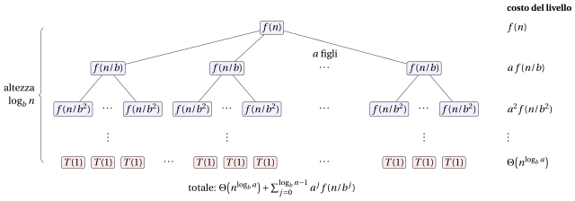

# Il Master theorem

<div class="info-capitolo" markdown>

**Parte 2 · Analisi e ricorsione · Capitolo 12** · [:material-file-pdf-box: Dispensa, volume 2 (PDF)](../pdf/dispensa-2-analisi-ricorsione.pdf) · [:material-pencil: Esercizi](../esercizi/es-12-master-theorem.md)

</div>

## Introduzione

Nel capitolo <em>Equazioni di ricorrenza</em> abbiamo risolto ricorrenze per espansione, per sostituzione e con gli alberi di ricorsione. Ogni metodo richiede qualche calcolo, e per le ricorrenze divide et impera il calcolo è sempre lo stesso: disegnare l'albero, sommare i costi dei livelli, confrontare la radice con le foglie. Alla fine di quel capitolo abbiamo osservato tre possibili comportamenti: dominano le foglie, tutti i livelli costano uguale, oppure domina la radice.

Il <strong>Master theorem</strong> trasforma questi tre comportamenti in un risultato pronto all'uso. In questo capitolo

- richiamiamo le ricorrenze in forma standard e gli algoritmi che le producono (Sezione [12.1](#sez-sec-standardForm));

- enunciamo il teorema e ne spieghiamo i tre casi (Sezione [12.2](#sez-sec-theorem));

- lo applichiamo con uno schema fisso in cinque passi a molti esempi (Sezione [12.3](#sez-sec-applying)), e mostriamo le situazioni in cui non può essere applicato (Sezione [12.4](#sez-sec-notApply));

- lo dimostriamo (Sezione [12.5](#sez-sec-proof)), prima per potenze esatte di $b$ e poi per ogni numero naturale.

## 12.1 Ricorrenze in forma standard { #sez-sec-standardForm }

- Nel capitolo <em>Equazioni di ricorrenza</em> abbiamo visto che il numero di passi eseguiti da un algoritmo ricorsivo è descritto naturalmente da una <strong>equazione di ricorrenza</strong>, cioè un'equazione che esprime il valore di una funzione su un input di dimensione $n$ in termini dei suoi valori su input più piccoli.

- Una grande famiglia di algoritmi <em>divide et impera</em> produce ricorrenze di una forma molto specifica, detta <strong>forma standard</strong>:

    $$
    \blue{T(n) = a\, T\left(\frac{n}{b}\right) + f(n)}
    $$

    dove:

    - $n$ è la dimensione dell'input;

    - $a$ è il <strong>numero di sottoproblemi</strong> generati da ciascuna chiamata ricorsiva (<span style="color:#1971c2">$a \ge 1$</span>, costante);

    - $\frac{n}{b}$ è la <strong>dimensione di ciascun sottoproblema</strong> (<span style="color:#1971c2">$b > 1$</span>, costante); quando $n/b$ non è un numero naturale si intende $\lfloor n/b \rfloor$ oppure $\lceil n/b \rceil$;

    - $f(n)$ è il <strong>costo di dividere</strong> il problema negli $a$ sottoproblemi <strong>e di combinare</strong> le loro soluzioni (tutto ciò che viene fatto al di fuori delle chiamate ricorsive). Supponiamo sempre che $f(n)$ sia <strong>asintoticamente positiva</strong>, cioè $f(n)>0$ per ogni $n$ sufficientemente grande.

- Per $n$ sufficientemente piccolo (per esempio $n=1$) la ricorsione si ferma e $T(n)=\Theta(1)$: risolvere un problema di dimensione costante richiede un numero costante di passi. Per questo motivo il caso base di solito non viene nemmeno scritto.

!!! chiave ""

    In questo capitolo una ricorrenza è un <strong>oggetto matematico</strong>: usiamo una generica funzione $T(n)$. Quando analizziamo un algoritmo ricorsivo, la funzione descritta dalla ricorrenza è il numero di passi $S(n)$ eseguiti nel caso peggiore su un input di parametro di dimensione $n$; il tempo di esecuzione nel caso peggiore $T(|I|)$ si ottiene poi da $S(n)$ esattamente come nel capitolo <em>Tempo di esecuzione</em>.

- Esempi di ricorrenze in forma standard (saranno tutte risolte nella Sezione [12.3](#sez-sec-applying)):

    <div class="tabella" markdown="0"><table>
    <tr>
    <th>Algoritmo</th>
    <th>Ricorrenza</th>
    <th><span class="arithmatex">&#92;(a&#92;)</span></th>
    <th><span class="arithmatex">&#92;(b&#92;)</span></th>
    <th><span class="arithmatex">&#92;(f(n)&#92;)</span></th>
    </tr>
    <tr>
    <td>Ricerca binaria (ricorsiva)</td>
    <td><span class="arithmatex">&#92;(T(n)=T(n/2)+1&#92;)</span></td>
    <td><span class="arithmatex">&#92;(1&#92;)</span></td>
    <td><span class="arithmatex">&#92;(2&#92;)</span></td>
    <td><span class="arithmatex">&#92;(1&#92;)</span></td>
    </tr>
    <tr>
    <td>Somma di un array (ricorsiva)</td>
    <td><span class="arithmatex">&#92;(T(n)=2T(n/2)+1&#92;)</span></td>
    <td><span class="arithmatex">&#92;(2&#92;)</span></td>
    <td><span class="arithmatex">&#92;(2&#92;)</span></td>
    <td><span class="arithmatex">&#92;(1&#92;)</span></td>
    </tr>
    <tr>
    <td>Merge sort</td>
    <td><span class="arithmatex">&#92;(T(n)=2T(n/2)+n&#92;)</span></td>
    <td><span class="arithmatex">&#92;(2&#92;)</span></td>
    <td><span class="arithmatex">&#92;(2&#92;)</span></td>
    <td><span class="arithmatex">&#92;(n&#92;)</span></td>
    </tr>
    <tr>
    <td>Moltiplicazione di Karatsuba</td>
    <td><span class="arithmatex">&#92;(T(n)=3T(n/2)+n&#92;)</span></td>
    <td><span class="arithmatex">&#92;(3&#92;)</span></td>
    <td><span class="arithmatex">&#92;(2&#92;)</span></td>
    <td><span class="arithmatex">&#92;(n&#92;)</span></td>
    </tr>
    <tr>
    <td>Moltiplicazione di matrici di Strassen</td>
    <td><span class="arithmatex">&#92;(T(n)=7T(n/2)+n^2&#92;)</span></td>
    <td><span class="arithmatex">&#92;(7&#92;)</span></td>
    <td><span class="arithmatex">&#92;(2&#92;)</span></td>
    <td><span class="arithmatex">&#92;(n^2&#92;)</span></td>
    </tr>
    </table></div>

- Il <strong>Master theorem</strong> fornisce l'ordine di grandezza di $T(n)$ per la maggior parte delle ricorrenze in forma standard, direttamente da $a$, $b$ e $f(n)$, senza alcun calcolo sulla ricorsione.

## 12.2 Il Master theorem { #sez-sec-theorem }

<a id="box-1-theoMaster"></a>

!!! teorema "Teorema 12.1: Master theorem"

    Siano $a \ge 1$ e $b>1$ costanti, sia $f(n)$ una funzione asintoticamente positiva, e sia $T(n)$ definita sui numeri naturali dalla ricorrenza

    $$
    T(n) = a\, T\left(\frac{n}{b}\right) + f(n),
    $$

    dove $n/b$ è interpretato come $\lfloor n/b\rfloor$ oppure $\lceil n/b\rceil$, e $T(n)=\Theta(1)$ per $n$ sufficientemente piccolo. Allora $T(n)$ ha le seguenti limitazioni asintotiche.

    - **<span style="color:#e03131">Caso 1:</span>** se $f(n) = O\big(n^{\log_b a - \epsilon}\big)$ per qualche costante $\epsilon>0$, allora

        $$
        \blue{T(n)=\Theta\big(n^{\log_b a}\big)};
        $$

    - **<span style="color:#e03131">Caso 2:</span>** se $f(n) = \Theta\big(n^{\log_b a}\log^k n\big)$ per qualche costante $k\ge 0$, allora

        $$
        \blue{T(n)=\Theta\big(n^{\log_b a}\log^{k+1} n\big)};
        $$

    - **<span style="color:#e03131">Caso 3:</span>** se $f(n) = \Omega\big(n^{\log_b a + \epsilon}\big)$ per qualche costante $\epsilon>0$, e se

        $$
        a\, f\left(\frac{n}{b}\right) \le c\, f(n)
        $$

        per qualche costante $c<1$ e per ogni $n$ sufficientemente grande (<strong>condizione di regolarità</strong>), allora

        $$
        \blue{T(n)=\Theta\big(f(n)\big)}.
        $$

- Questo è l'enunciato classico del teorema (come nel libro di testo di Cormen, Leiserson, Rivest e Stein, <em>Introduction to Algorithms</em>), con il <strong>caso 2 esteso</strong>: per $k=0$ si ottiene l'enunciato di base “se $f(n)=\Theta(n^{\log_b a})$ allora $T(n)=\Theta(n^{\log_b a}\log n)$”.

- La dimostrazione è data nella Sezione [12.5](#sez-sec-proof).

### 12.2.1 Regola pratica

- In ciascuno dei tre casi confrontiamo la funzione $f(n)$ con la funzione

    $$
    n^{\log_b a},
    $$

    che (come vedremo nel [Lemma 12.3](#box-21-lemMasterTree)) è il numero di foglie dell'albero di ricorsione. Come regola pratica, si controlli:

    $$
    n^{\log_b a } \quad  \begin{cases}
    \text{polinomialmente più grande di } f(n) & \longrightarrow \quad \text{\red{caso 1}:}\quad T(n)=\Theta\big(n^{\log_b a}\big)\\[2mm]
    \text{dello stesso ordine di } f(n) \text{ (a meno di } \log^k n) &\longrightarrow \quad \text{\red{caso 2}:}\quad T(n)=\Theta\big(n^{\log_b a}\log^{k+1} n\big) \\[2mm]
    \text{polinomialmente più piccolo di } f(n) & \longrightarrow \quad \text{\red{caso 3}:}\quad T(n)=\Theta\big(f(n)\big)
    \end{cases}
    $$

    e si determini di conseguenza l'ordine di grandezza di $T(n)$ (se possibile).

- <strong>Intuitivamente, la più grande tra le due funzioni determina la soluzione della ricorrenza.</strong>

- <strong>Polinomialmente</strong> più piccola (più grande) significa più piccola (più grande) <strong>di un fattore $n^{\epsilon}$</strong> per qualche costante $\epsilon>0$. Per esempio:

    - $n$ è polinomialmente più piccolo di $n^2$ (fattore $n^1$), e $n^{2}$ è polinomialmente più piccolo di $n^{2.1}$ (fattore $n^{0.1}$);

    - $n$ è più piccolo di $n\log n$, ma <strong>non</strong> polinomialmente più piccolo: per ogni $\epsilon>0$

        $$
        \lim_{n\to\infty}\frac{n\log n}{n^{1+\epsilon}}=\lim_{n\to\infty}\frac{\log n}{n^{\epsilon}} = 0^+,
        $$

        quindi $n\log n$ cresce più lentamente di $n\cdot n^{\epsilon}$, qualunque $\epsilon>0$ scegliamo.

### 12.2.2 Intuizione

- Srotolando la ricorrenza (si veda l'albero di ricorsione nella [Figura 12.1](#box-20-fig-masterTree)) il costo totale è

    $$
    T(n) = \underbrace{\Theta\big(n^{\log_b a}\big)}_{\text{costo delle foglie}} \; + \; \underbrace{\sum_{j=0}^{\log_b n -1} a^j f\left(\frac{n}{b^j}\right)}_{\text{costo dei livelli interni}}
    $$

    dove il livello $j$ dell'albero contiene $a^j$ sottoproblemi di dimensione $n/b^j$.

- Consideriamo il caso semplice $f(n)=n^d$. Il costo del livello $j$ è

    $$
    a^j \left(\frac{n}{b^j}\right)^{d} = n^d\left(\frac{a}{b^d}\right)^{j},
    $$

    quindi i costi dei livelli formano una <strong>progressione geometrica di ragione</strong> $a/b^d$. Poiché $a/b^d>1 \iff d<\log_b a$:

    - <span style="color:#e03131">caso 1</span> ($d<\log_b a$): i costi dei livelli <strong>crescono</strong> geometricamente dalla radice alle foglie; il totale è dominato dalle foglie, cioè da $n^{\log_b a}$;

    - <span style="color:#e03131">caso 2</span> ($d=\log_b a$): tutti i $\log_b n$ livelli hanno <strong>lo stesso costo</strong> $n^{d}=n^{\log_b a}$; il totale è $n^{\log_b a}$ per il numero di livelli, cioè $n^{\log_b a}\log n$;

    - <span style="color:#e03131">caso 3</span> ($d>\log_b a$): i costi dei livelli <strong>decrescono</strong> geometricamente; il totale è dominato dalla radice, cioè da $f(n)$.

### 12.2.3 I vuoti tra i casi

- I tre casi <strong>non coprono tutte le possibili funzioni</strong> $f(n)$.

    - C'è un vuoto tra il caso 1 e il caso 2 quando $f(n)$ è più piccola di $n^{\log_b a}$ ma <strong>non polinomialmente più piccola</strong> (e non della forma $n^{\log_b a}\log^k n$ con $k\ge0$), per esempio $f(n)=n^{\log_b a}/\log n$.

    - C'è un vuoto tra il caso 2 e il caso 3 quando $f(n)$ è più grande di $n^{\log_b a}$ ma <strong>non polinomialmente più grande</strong> (e non della forma $n^{\log_b a}\log^k n$), per esempio $f(n)=n^{\log_b a}\, 2^{\sqrt{\log_2 n}}$.

    - Il caso 3 non si applica anche quando $f(n)$ è polinomialmente più grande di $n^{\log_b a}$ ma la <strong>condizione di regolarità</strong> non vale.

- In queste situazioni il Master theorem <strong>non può essere usato</strong>, e la ricorrenza deve essere risolta con altre tecniche (albero di ricorsione, iterazione, metodo di sostituzione), si veda la Sezione [12.4](#sez-sec-notApply).

### 12.2.4 Una nota sulla base dei logaritmi

- Poiché $\log_c n = \dfrac{\log_2 n}{\log_2 c}$ per ogni base $c>1$, abbiamo

    $$
    \log_c^k n = \frac{1}{\log_2^k c}\,\log_2^k n = \Theta\big(\log_2^k n\big).
    $$

    Quindi, <strong>dentro $\Theta$, $O$ e $\Omega$ la base del logaritmo è irrilevante</strong>: nel caso 2 scriviamo semplicemente $\log^k n$.

- Al contrario, la base $b$ nell'<strong>esponente</strong> $n^{\log_b a}$ è essenziale: per esempio $n^{\log_2 4}=n^2$ mentre $n^{\log_4 4}=n$, e $n^{2}\neq\Theta(n)$.

!!! chiave ""

    - Il Master theorem confronta il costo della radice, $f(n)$, con il numero di foglie dell'albero di ricorsione, $n^{\log_b a}$: la più grande tra le due determina $T(n)$; quando sono dello stesso ordine (a meno di $\log^k n$) compare un ulteriore fattore $\log n$.

    - “Più grande” e “più piccola” devono essere <strong>polinomiali</strong> (di un fattore $n^\epsilon$); nel caso 3 deve valere anche la <strong>condizione di regolarità</strong>.

    - Quando $f(n)$ cade in un vuoto tra i casi, il teorema non dà alcuna risposta.

## 12.3 Applicare il Master theorem { #sez-sec-applying }

!!! chiave ""

    Per risolvere una ricorrenza con il Master theorem seguiamo sempre questo schema:

    1. <strong>identificare</strong> $a$, $b$ e $f(n)$ (e controllare che $a\ge 1$, $b>1$ siano costanti e $f(n)$ sia asintoticamente positiva);

    2. <strong>calcolare</strong> $n^{\log_b a}$;

    3. <strong>confrontare</strong> $n^{\log_b a}$ con $f(n)$ e ipotizzare il caso;

    4. <strong>verificare</strong> l'ipotesi del caso: trovare $\epsilon>0$ (caso 1 o 3), trovare $k\ge0$ (caso 2), e controllare la condizione di regolarità (caso 3);

    5. <strong>concludere</strong>.

Cominciamo con tre ricorrenze, una per ciascun caso, e poi risolviamo le ricorrenze degli algoritmi elencati nella Sezione [12.1](#sez-sec-standardForm).

<a id="box-2-exMasterSixteen"></a>

!!! esempio "Esempio 12.1: $T(n)=16\,T(n/4)+n$"

    1. $a=16$, $b=4$, $f(n)=n$.

    2. $n^{\log_b a}=n^{\log_4 16}=n^2$.

    3. $n^2$ è polinomialmente più grande di $f(n)=n$ $\longrightarrow$ <span style="color:#e03131">caso 1</span>.

    4. $f(n)=n=O\big(n^{2-\epsilon}\big)$ con $\epsilon=1$.

    5. $T(n)=\Theta\big(n^{\log_4 16}\big)=\Theta(n^2)$.

<a id="box-3-exMasterEightCube"></a>

!!! esempio "Esempio 12.2: $T(n)=8\,T(n/2)+n^3$"

    1. $a=8$, $b=2$, $f(n)=n^3$.

    2. $n^{\log_b a}=n^{\log_2 8}=n^3$.

    3. $n^3$ e $f(n)=n^3$ hanno lo stesso ordine $\longrightarrow$ <span style="color:#e03131">caso 2</span>.

    4. $f(n)=n^3=\Theta\big(n^{3}\log^k n\big)$ con $k=0$.

    5. $T(n)=\Theta\big(n^{3}\log^{k+1} n\big)=\Theta(n^3\log n)$.

<a id="box-4-exMasterEightThird"></a>

!!! esempio "Esempio 12.3: $T(n)=8\,T(n/3)+n^2$"

    1. $a=8$, $b=3$, $f(n)=n^2$.

    2. $n^{\log_b a}=n^{\log_3 8}\approx n^{1.893}$.

    3. $n^{1.893}$ è polinomialmente più piccolo di $f(n)=n^2$ $\longrightarrow$ <span style="color:#e03131">caso 3</span>.

    4. $f(n)=n^2=\Omega\big(n^{\log_3 8+\epsilon}\big)$ per ogni $0<\epsilon\le 2-\log_3 8\approx 0.107$.<br> Condizione di regolarità: cerchiamo una costante $c<1$ tale che, per ogni $n$ grande,

        $$
        8\, f\left(\frac{n}{3}\right) \le c\, f(n)
        \quad\Longleftrightarrow\quad
        8\left(\frac{n}{3}\right)^2 \le c\, n^2
        \quad\Longleftrightarrow\quad
        \frac{8}{9}\, n^2 \le c\, n^2 ,
        $$

        che vale per ogni $c$ con $\frac{8}{9}\le c<1$, per esempio $c=\frac{8}{9}$.

    5. $T(n)=\Theta(n^2)$.

<a id="box-5-exMasterBinarySearch"></a>

!!! esempio "Esempio 12.4: Ricerca binaria: $T(n)=T(n/2)+1$"

    1. $a=1$, $b=2$, $f(n)=1$.

    2. $n^{\log_b a}=n^{\log_2 1}=n^0=1$.

    3. $1$ e $f(n)=1$ hanno lo stesso ordine $\longrightarrow$ <span style="color:#e03131">caso 2</span>.

    4. $f(n)=1=\Theta\big(n^{0}\log^k n\big)$ con $k=0$.

    5. $T(n)=\Theta\big(n^{0}\log n\big)=\Theta(\log n)$.

<a id="box-6-exMasterMergeSort"></a>

!!! esempio "Esempio 12.5: Merge sort (ordinamento per fusione): $T(n)=2\,T(n/2)+n$"

    1. $a=2$, $b=2$, $f(n)=n$.

    2. $n^{\log_b a}=n^{\log_2 2}=n$.

    3. $n$ e $f(n)=n$ hanno lo stesso ordine $\longrightarrow$ <span style="color:#e03131">caso 2</span>.

    4. $f(n)=n=\Theta\big(n\log^k n\big)$ con $k=0$.

    5. $T(n)=\Theta(n\log n)$.

<a id="box-7-exMasterArraySum"></a>

!!! esempio "Esempio 12.6: Somma di un array: $T(n)=2\,T(n/2)+1$"

    1. $a=2$, $b=2$, $f(n)=1$.

    2. $n^{\log_b a}=n^{\log_2 2}=n$.

    3. $n$ è polinomialmente più grande di $f(n)=1$ $\longrightarrow$ <span style="color:#e03131">caso 1</span>.

    4. $f(n)=1=O\big(n^{1-\epsilon}\big)$ con $\epsilon=1$ (infatti $n^{1-1}=n^0=1$).

    5. $T(n)=\Theta(n)$.

    La funzione C++ <code>sumRecHalving</code> del codice del corso è un algoritmo di questo tipo: somma il sotto-array <code>a[l..r]</code> (indici a partire da $0$) dividendolo in due metà.

    ```cpp
    long long sumRecHalving(int *a, int l, int r)
    {
    	if (l == r)
    	{
    		return a[l];
    	}

    	int mid = l + (r - l) / 2;

    	return sumRecHalving(a, l, mid) + sumRecHalving(a, mid + 1, r);
    }
    ```

    Ogni chiamata esegue una quantità costante di lavoro al di fuori delle chiamate ricorsive, e il numero totale di chiamate è $\Theta(n)$: contandole con una copia strumentata della funzione, su $n=8$, $1000$ e $2^{20}=1\,048\,576$ elementi otteniamo $15$, $1\,999$ e $2\,097\,151$ chiamate, cioè esattamente $2n-1$.

<a id="box-8-exMasterKaratsuba"></a>

!!! esempio "Esempio 12.7: Karatsuba: $T(n)=3\,T(n/2)+n$"

    1. $a=3$, $b=2$, $f(n)=n$.

    2. $n^{\log_b a}=n^{\log_2 3}\approx n^{1.585}$.

    3. $n^{1.585}$ è polinomialmente più grande di $f(n)=n$ $\longrightarrow$ <span style="color:#e03131">caso 1</span>.

    4. $f(n)=n=O\big(n^{\log_2 3-\epsilon}\big)$ con $\epsilon=\log_2 3-1\approx 0.585>0$.

    5. $T(n)=\Theta\big(n^{\log_2 3}\big)\approx\Theta\big(n^{1.585}\big)$: l'algoritmo di Karatsuba è asintoticamente più veloce della moltiplicazione scolastica $\Theta(n^2)$.

<a id="box-9-exMasterStrassen"></a>

!!! esempio "Esempio 12.8: Strassen: $T(n)=7\,T(n/2)+n^2$"

    1. $a=7$, $b=2$, $f(n)=n^2$.

    2. $n^{\log_b a}=n^{\log_2 7}\approx n^{2.807}$.

    3. $n^{2.807}$ è polinomialmente più grande di $f(n)=n^2$ $\longrightarrow$ <span style="color:#e03131">caso 1</span>.

    4. $f(n)=n^2=O\big(n^{\log_2 7-\epsilon}\big)$ con $\epsilon=\log_2 7-2\approx 0.807>0$.

    5. $T(n)=\Theta\big(n^{\log_2 7}\big)\approx\Theta\big(n^{2.807}\big)$, meglio del $\Theta(n^3)$ della moltiplicazione di matrici standard (la cui ricorrenza divide et impera è $T(n)=8T(n/2)+n^2$).

<a id="box-10-exMasterNLogN"></a>

!!! esempio "Esempio 12.9: $T(n)=2\,T(n/2)+n\log n$"

    1. $a=2$, $b=2$, $f(n)=n\log n$.

    2. $n^{\log_b a}=n^{\log_2 2}=n$.

    3. $f(n)=n\log n$ è più grande di $n$, ma solo di un fattore $\log n$, non polinomialmente $\longrightarrow$ non è il caso 3; ha la forma $n^{\log_b a}\log^k n$ $\longrightarrow$ <span style="color:#e03131">caso 2</span>.

    4. $f(n)=n\log n=\Theta\big(n\log^k n\big)$ con $k=1$.

    5. $T(n)=\Theta\big(n\log^{2} n\big)$.

<a id="box-11-exMasterThreeQuarter"></a>

!!! esempio "Esempio 12.10: $T(n)=3\,T(n/4)+n\log n$"

    1. $a=3$, $b=4$, $f(n)=n\log n$ (logaritmo in base 2).

    2. $n^{\log_b a}=n^{\log_4 3}\approx n^{0.792}$.

    3. $n^{0.792}$ è polinomialmente più piccolo di $f(n)=n\log n$ $\longrightarrow$ <span style="color:#e03131">caso 3</span>.

    4. Poiché $n\log n\ge n$ per $n\ge 2$, abbiamo $f(n)=\Omega\big(n^{\log_4 3+\epsilon}\big)$ con $\epsilon=1-\log_4 3\approx 0.208$.<br> Condizione di regolarità: per ogni $n\ge 4$,

        $$
        3\, f\left(\frac{n}{4}\right) = 3\, \frac{n}{4}\,\log\frac{n}{4} \le \frac{3}{4}\, n\log n = c\, f(n)
        \qquad\text{con } c=\frac{3}{4}<1,
        $$

        perché $\log(n/4)\le \log n$.

    5. $T(n)=\Theta(n\log n)$.

<a id="box-12-exMasterTwoThirds"></a>

!!! esempio "Esempio 12.11: $T(n)=T(2n/3)+1$"

    1. $a=1$, $b=\frac{3}{2}$ (infatti $\frac{2n}{3}=\frac{n}{3/2}$), $f(n)=1$. Si noti che $b$ non deve necessariamente essere un intero.

    2. $n^{\log_b a}=n^{\log_{3/2} 1}=n^0=1$.

    3. $1$ e $f(n)=1$ hanno lo stesso ordine $\longrightarrow$ <span style="color:#e03131">caso 2</span>.

    4. $f(n)=1=\Theta\big(n^{0}\log^k n\big)$ con $k=0$.

    5. $T(n)=\Theta(\log n)$.

- Una <strong>verifica numerica</strong>. Per ciascuna delle ricorrenze precedenti con $b$ intero abbiamo calcolato $T(n)$ esattamente dalla ricorrenza, con $T(1)=1$ e $n=b^L$, e l'abbiamo divisa per l'ordine di grandezza $g(n)$ dato dal teorema (logaritmi in base $2$). Il rapporto resta compreso tra due costanti positive, come garantisce il teorema, e si avvicina al limite indicato nell'ultima colonna.

<div class="tabella" markdown="0"><table>
<tr>
<th>Ricorrenza</th>
<th><span class="arithmatex">&#92;(g(n)&#92;)</span></th>
<th><span class="arithmatex">&#92;(L=5&#92;)</span></th>
<th><span class="arithmatex">&#92;(L=10&#92;)</span></th>
<th><span class="arithmatex">&#92;(L=20&#92;)</span></th>
<th>limite</th>
</tr>
<tr>
<td><span class="arithmatex">&#92;(16&#92;,T(n/4)+n&#92;)</span></td>
<td><span class="arithmatex">&#92;(n^2&#92;)</span></td>
<td>1.3330</td>
<td>1.3333</td>
<td>1.3333</td>
<td><span class="arithmatex">&#92;(4/3&#92;)</span></td>
</tr>
<tr>
<td><span class="arithmatex">&#92;(8&#92;,T(n/2)+n^3&#92;)</span></td>
<td><span class="arithmatex">&#92;(n^3&#92;log n&#92;)</span></td>
<td>1.2000</td>
<td>1.1000</td>
<td>1.0500</td>
<td><span class="arithmatex">&#92;(1&#92;)</span></td>
</tr>
<tr>
<td><span class="arithmatex">&#92;(8&#92;,T(n/3)+n^2&#92;)</span></td>
<td><span class="arithmatex">&#92;(n^2&#92;)</span></td>
<td>4.5606</td>
<td>6.5364</td>
<td>8.2414</td>
<td><span class="arithmatex">&#92;(9&#92;)</span></td>
</tr>
<tr>
<td><span class="arithmatex">&#92;(T(n/2)+1&#92;)</span></td>
<td><span class="arithmatex">&#92;(&#92;log n&#92;)</span></td>
<td>1.2000</td>
<td>1.1000</td>
<td>1.0500</td>
<td><span class="arithmatex">&#92;(1&#92;)</span></td>
</tr>
<tr>
<td><span class="arithmatex">&#92;(2&#92;,T(n/2)+n&#92;)</span></td>
<td><span class="arithmatex">&#92;(n&#92;log n&#92;)</span></td>
<td>1.2000</td>
<td>1.1000</td>
<td>1.0500</td>
<td><span class="arithmatex">&#92;(1&#92;)</span></td>
</tr>
<tr>
<td><span class="arithmatex">&#92;(2&#92;,T(n/2)+1&#92;)</span></td>
<td><span class="arithmatex">&#92;(n&#92;)</span></td>
<td>1.9688</td>
<td>1.9990</td>
<td>2.0000</td>
<td><span class="arithmatex">&#92;(2&#92;)</span></td>
</tr>
<tr>
<td><span class="arithmatex">&#92;(3&#92;,T(n/2)+n&#92;)</span></td>
<td><span class="arithmatex">&#92;(n^{&#92;log&#95;2 3}&#92;)</span></td>
<td>2.7366</td>
<td>2.9653</td>
<td>2.9994</td>
<td><span class="arithmatex">&#92;(3&#92;)</span></td>
</tr>
<tr>
<td><span class="arithmatex">&#92;(7&#92;,T(n/2)+n^2&#92;)</span></td>
<td><span class="arithmatex">&#92;(n^{&#92;log&#95;2 7}&#92;)</span></td>
<td>2.2521</td>
<td>2.3284</td>
<td>2.3333</td>
<td><span class="arithmatex">&#92;(7/3&#92;)</span></td>
</tr>
<tr>
<td><span class="arithmatex">&#92;(2&#92;,T(n/2)+n&#92;log n&#92;)</span></td>
<td><span class="arithmatex">&#92;(n&#92;log^2 n&#92;)</span></td>
<td>0.6400</td>
<td>0.5600</td>
<td>0.5275</td>
<td><span class="arithmatex">&#92;(1/2&#92;)</span></td>
</tr>
<tr>
<td><span class="arithmatex">&#92;(3&#92;,T(n/4)+n&#92;log n&#92;)</span></td>
<td><span class="arithmatex">&#92;(n&#92;log n&#92;)</span></td>
<td>2.1933</td>
<td>2.8704</td>
<td>3.4020</td>
<td><span class="arithmatex">&#92;(4&#92;)</span></td>
</tr>
</table></div>

- Per il merge sort, per esempio, $T(2^{L})=2^{L}(L+1)$, quindi $T(n)=n\log_2 n+n$ e $\frac{T(n)}{n\log_2 n}=1+\frac{1}{L}$. Nel caso 3 la convergenza è lenta: il rapporto tende a $\frac{1}{1-c}$ ($9$ per $c=\frac{8}{9}$, $4$ per $c=\frac{3}{4}$), la limitazione che compare nella dimostrazione del teorema.

!!! chiave ""

    Il teorema dà l'<strong>ordine di grandezza</strong>, non la costante: nella tabella i rapporti tendono a costanti diverse, ma non crescono né svaniscono mai.

## 12.4 Quando il Master theorem non si applica { #sez-sec-notApply }

- Prima di applicare il teorema, si controlli sempre che valgano <strong>tutte</strong> le sue ipotesi. Ecco situazioni tipiche in cui il teorema <strong>non può</strong> essere applicato.

<a id="box-13-exMasterGap"></a>

!!! esempio "Esempio 12.12: Un vuoto tra il caso 1 e il caso 2: $T(n)=2\,T(n/2)+n/\log_2 n$"

    - $a=2$, $b=2$, $f(n)=n/\log_2 n$, e $n^{\log_b a}=n$.

    - <strong>Non è il caso 1</strong>: $f(n)$ è più piccola di $n$, ma non polinomialmente più piccola. Per ogni $\epsilon>0$

        $$
        \lim_{n\to\infty}\frac{n/\log_2 n}{n^{1-\epsilon}}=\lim_{n\to\infty}\frac{n^{\epsilon}}{\log_2 n}=+\infty,
        $$

        quindi $f(n)\neq O(n^{1-\epsilon})$.

    - <strong>Non è il caso 2</strong>: $f(n)=n\log^{-1} n$ richiederebbe $k=-1<0$.

    - <strong>Non è il caso 3</strong>: $f(n)$ è più piccola di $n$.

    - <strong>Soluzione con l'albero di ricorsione</strong> ([Lemma 12.3](#box-21-lemMasterTree)), per $n=2^L$ e $T(1)=1$: il livello $j$ costa

        $$
        2^j\,\frac{n/2^j}{\log_2(n/2^j)}=\frac{n}{L-j},
        \qquad\text{quindi}\qquad
        T(n)=n+\sum_{j=0}^{L-1}\frac{n}{L-j}=n+n\sum_{i=1}^{L}\frac{1}{i}=n\,(1+H_L),
        $$

        dove $H_L=\sum_{i=1}^{L}\frac1i$ è l'$L$-esimo numero armonico. Poiché $\ln(L+1)\le H_L\le 1+\ln L$ (confronto con $\int \frac{dx}{x}$), $H_L=\Theta(\log L)$ e

        $$
        T(n)=\Theta(n\log\log n).
        $$

<a id="box-14-exMasterNotStandard"></a>

!!! esempio "Esempio 12.13: Non in forma standard: $T(n)=T(n-1)+n$"

    - Il sottoproblema ha dimensione $n-1$, non $n/b$ con $b>1$ costante: la ricorrenza <strong>non è in forma standard</strong>.

    - Soluzione per iterazione (con $T(1)=1$):

        $$
        T(n)=n+(n-1)+\dots+2+T(1)=\sum_{i=1}^{n} i=\frac{n(n+1)}{2}=\Theta(n^2).
        $$

<a id="box-15-exMasterUnequal"></a>

!!! esempio "Esempio 12.14: Sottoproblemi di dimensioni diverse: $T(n)=T(n/3)+T(2n/3)+n$"

    - I due sottoproblemi hanno <strong>dimensioni diverse</strong> $n/3$ e $2n/3$: la ricorrenza non è della forma $a\,T(n/b)+f(n)$.

    - Albero di ricorsione: ogni livello completo ha dimensione totale $n$, quindi costo $n$. Il cammino più corto dalla radice a una foglia (sempre $n/3$) ha lunghezza $\log_3 n$, il più lungo (sempre $2n/3$) ha lunghezza $\log_{3/2} n$. Pertanto i primi $\log_3 n$ livelli sono completi (costo $\ge n\log_3 n$), e ci sono al più $\log_{3/2} n+1$ livelli, ciascuno di costo al più $n$. Quindi

        $$
        T(n)=\Theta(n\log n).
        $$

<a id="box-16-exMasterANotConst"></a>

!!! esempio "Esempio 12.15: $a$ non è costante: $T(n)=2^n\,T(n/2)+n^n$"

    - Il numero di sottoproblemi $a=2^n$ <strong>dipende da $n$</strong>: il Master theorem richiede che $a$ sia una costante.

<a id="box-17-exMasterALessOne"></a>

!!! esempio "Esempio 12.16: $a<1$: $T(n)=0.5\,T(n/2)+1/n$"

    - Qui $a=0.5<1$: il teorema richiede $a\ge 1$ (deve esserci almeno un sottoproblema).

<a id="box-18-exMasterRegularityFails"></a>

!!! esempio "Esempio 12.17: La condizione di regolarità non vale: $T(n)=T(n/2)+n(2-\cos n)$"

    - $a=1$, $b=2$, $n^{\log_b a}=n^0=1$, $f(n)=n(2-\cos n)$. Poiché $1\le 2-\cos n\le 3$, abbiamo $n\le f(n)\le 3n$, quindi

        $$
        f(n)=\Theta(n)=\Omega\big(n^{0+\epsilon}\big)\quad\text{con }\epsilon=1:
        $$

        $f(n)$ è polinomialmente più grande di $n^{\log_b a}$, e ci aspetteremmo il caso 3.

    - <strong>La condizione di regolarità non vale.</strong> Prendiamo $n=2m$ pari. Allora

        $$
        \frac{a\,f(n/2)}{f(n)}=\frac{m\,(2-\cos m)}{2m\,(2-\cos 2m)}=\frac{2-\cos m}{2\,(2-\cos 2m)}.
        $$

        Se $\cos m\le -0.9$, allora $2-\cos m\ge 2.9$ e $\cos 2m=2\cos^2 m-1\ge 2\cdot 0.81-1=0.62$, quindi $2(2-\cos 2m)\le 2.76$ e il rapporto è $>1$. Poiché $\pi$ è irrazionale, i valori $m \bmod 2\pi$ ($m\in\N$) sono densi in $[0,2\pi)$, quindi esistono <strong>infiniti</strong> $m$ con $\cos m\le -0.9$ (per esempio $m=3,9,16,22,28,\dots$). Per $m=22$: $\cos 22\approx-0.99996$, $\cos 44\approx 0.99984$, e il rapporto è $\approx 1.4997$.<br> Quindi non esiste alcuna costante $c<1$ tale che $a f(n/2)\le c f(n)$ per ogni $n$ grande: il <strong>caso 3 non può essere applicato</strong>.

    - Ciononostante la ricorrenza può essere risolta direttamente (con $n/2$ che significa $\lfloor n/2\rfloor$): srotolandola,

        $$
        n\le f(n)\le T(n)\le \sum_{j\ge 0} 3\,\frac{n}{2^j}+T(1)=6n+T(1),
        \qquad\text{quindi}\qquad T(n)=\Theta(n).
        $$

## 12.5 Dimostrazione del Master theorem { #sez-sec-proof }

- Seguiamo la dimostrazione classica, che ha due parti:

    1. supponiamo prima che $n$ sia una <strong>potenza esatta di $b$</strong>, cioè $n=b^L$ per qualche $L\in\N$; allora tutte le dimensioni dei sottoproblemi $n/b, n/b^2,\dots$ sono potenze esatte di $b$ e non servono parti intere inferiori o superiori (Lemmi [12.3](#box-21-lemMasterTree), [Lemma 12.4](#box-23-lemMasterSum) e [Lemma 12.5](#box-27-lemMasterPowers));

    2. estendiamo poi il risultato a ogni numero naturale $n$, quando $n/b$ è $\lceil n/b\rceil$ oppure $\lfloor n/b\rfloor$ (Sezione [12.5.5](#sez-sec-floorsCeilings)).

### 12.5.1 Impostazione

- In tutta la dimostrazione poniamo

    $$
    \blue{p=\log_b a}, \qquad\text{in modo che}\qquad b^p=a \quad\text{e}\quad p\ge 0 \ (\text{poiché } a\ge1).
    $$

- Per $n$ potenza esatta di $b$ consideriamo la ricorrenza

    \begin{equation*}
    \label{eq:recPowers}
    T(n)=\begin{cases}
    d & \text{se } n=1,\\
    a\,T(n/b)+f(n) & \text{se } n=b^i,\ i\ge 1,
    \end{cases} \tag{12.1}
    \end{equation*}

    dove $d>0$ è una costante (questo è il significato di $T(1)=\Theta(1)$).

- Supponiamo $f(m)>0$ per ogni $m\ge1$. Questo è sempre vero quando $f$ conta i passi di un algoritmo; in generale, poiché $f$ è asintoticamente positiva, solo un numero finito di valori è coinvolto e cambiano solo le costanti della dimostrazione.

- Le ipotesi dei tre casi valgono “per ogni $n$ sufficientemente grande”, cioè per $n\ge n_0$. La seguente osservazione ci permette di usarle per <strong>ogni</strong> potenza esatta di $b$ almeno uguale a $b$.

<a id="box-19-obsMasterAllPowers"></a>

!!! teorema "Osservazione 12.2: dalle potenze grandi a tutte le potenze"

    Siano $f(m)>0$ e $h(m)>0$ per ogni potenza esatta $m\ge b$ di $b$. Se esistono costanti $c>0$ e $n_0$ tali che $f(m)\le c\,h(m)$ (risp. $f(m)\ge c\,h(m)$) per tutte le potenze esatte $m\ge n_0$, allora esiste una costante $c'>0$ tale che $f(m)\le c'\,h(m)$ (risp. $f(m)\ge c'\,h(m)$) per <strong>tutte</strong> le potenze esatte $m\ge b$ di $b$.

??? dimostrazione "Dimostrazione"

    Ci sono solo un numero finito di potenze esatte di $b$ nell'intervallo $[b,n_0)$. Sia

    $$
    c'=\max\left\{c,\ \max_{b\le m<n_0}\frac{f(m)}{h(m)}\right\}
    \qquad\left(\text{risp. } c'=\min\left\{c,\ \min_{b\le m<n_0}\frac{f(m)}{h(m)}\right\}>0\right),
    $$

    dove $m$ varia tra le potenze esatte di $b$. Allora $f(m)\le c'h(m)$ (risp. $\ge$) sia per $m<n_0$, per la scelta di $c'$, sia per $m\ge n_0$, poiché $c\le c'$ (risp. $c\ge c'$). <span class="qed">□</span>

- La applicheremo con $h(m)=m^{p-\epsilon}$ e $h(m)=m^{p}\log_b^k m$, che sono positive per $m\ge b$ (si noti che $\log_b m\ge 1$ per $m\ge b$).

### 12.5.2 L'albero di ricorsione

<a id="box-20-fig-masterTree"></a>

{ .fig loading=lazy  }

<p class="didascalia"><strong>Figura 12.1:</strong> Albero di ricorsione di <span class="arithmatex">&#92;(T(n)=aT(n/b)+f(n)&#92;)</span> per <span class="arithmatex">&#92;(n&#92;)</span> potenza esatta di <span class="arithmatex">&#92;(b&#92;)</span>. Ogni nodo interno ha <span class="arithmatex">&#92;(a&#92;)</span> figli; il livello <span class="arithmatex">&#92;(j&#92;)</span> ha <span class="arithmatex">&#92;(a^j&#92;)</span> nodi, ciascuno un sottoproblema di dimensione <span class="arithmatex">&#92;(n/b^j&#92;)</span> e costo <span class="arithmatex">&#92;(f(n/b^j)&#92;)</span>; le foglie sono a profondità <span class="arithmatex">&#92;(&#92;log&#95;b n&#92;)</span>.</p>

- La radice (livello $0$) è un problema di dimensione $n$; costa $f(n)$ e genera $a$ sottoproblemi di dimensione $n/b$.

- Per induzione, il livello $j$ contiene $a^j$ nodi, ciascuno un sottoproblema di dimensione $n/b^j$ e costo $f(n/b^j)$: il costo totale del livello $j$ è $a^j f(n/b^j)$.

- La dimensione del sottoproblema raggiunge $1$ quando $n/b^j=1$, cioè a profondità $j=\log_b n$: le foglie sono gli $a^{\log_b n}$ nodi del livello $\log_b n$, ciascuno di costo $T(1)=d$.

<a id="box-21-lemMasterTree"></a>

!!! teorema "Lemma 12.3: Costo dell'albero di ricorsione"

    Siano $a\ge1$ e $b>1$ costanti e sia $f(n)>0$ per $n\ge1$. Per ogni $n$ potenza esatta di $b$, la soluzione della ricorrenza $\eqref{eq:recPowers}$ è

    $$
    T(n)=d\,n^{\log_b a}+\sum_{j=0}^{\log_b n-1}a^j f\left(\frac{n}{b^j}\right)
    =\Theta\big(n^{\log_b a}\big)+\sum_{j=0}^{\log_b n-1}a^j f\left(\frac{n}{b^j}\right).
    $$

??? dimostrazione "Dimostrazione"

    Sia $n=b^L$. Dimostriamo prima per induzione su $i\in\{0,1,\dots,L\}$ che

    \begin{equation*}
    \label{eq:unfold}
    T(n)=a^{i}\,T\left(\frac{n}{b^{i}}\right)+\sum_{j=0}^{i-1}a^j f\left(\frac{n}{b^j}\right). \tag{12.2}
    \end{equation*}

    Per $i=0$ la somma è vuota e $\eqref{eq:unfold}$ diventa $T(n)=T(n)$. Supponiamo che $\eqref{eq:unfold}$ valga per qualche $i<L$. Poiché $n/b^{i}=b^{L-i}$ con $L-i\ge1$, la ricorrenza dà $T(n/b^{i})=a\,T(n/b^{i+1})+f(n/b^{i})$, quindi

    $$
    T(n)=a^{i}\Big(a\,T\big(\tfrac{n}{b^{i+1}}\big)+f\big(\tfrac{n}{b^{i}}\big)\Big)+\sum_{j=0}^{i-1}a^j f\big(\tfrac{n}{b^j}\big)
    =a^{i+1}\,T\big(\tfrac{n}{b^{i+1}}\big)+\sum_{j=0}^{i}a^j f\big(\tfrac{n}{b^j}\big),
    $$

    che è $\eqref{eq:unfold}$ per $i+1$. Per $i=L=\log_b n$ si ha $T(n/b^L)=T(1)=d$, quindi

    $$
    T(n)=d\,a^{\log_b n}+\sum_{j=0}^{\log_b n-1}a^j f\left(\frac{n}{b^j}\right).
    $$

    Resta da mostrare che $a^{\log_b n}=n^{\log_b a}$. Scrivendo $a=b^{\log_b a}$ e $n=b^{\log_b n}$,

    $$
    a^{\log_b n}=\big(b^{\log_b a}\big)^{\log_b n}=b^{\log_b a\,\cdot\,\log_b n}=\big(b^{\log_b n}\big)^{\log_b a}=n^{\log_b a}.
    $$

    Infine, $d>0$ è una costante, quindi $d\,n^{\log_b a}=\Theta(n^{\log_b a})$. <span class="qed">□</span>

- Il primo termine è il costo delle <strong>foglie</strong>: ci sono esattamente $n^{\log_b a}$ foglie. La somma è il costo dei <strong>nodi interni</strong> (livelli $0,\dots,\log_b n-1$).

<a id="box-22-exMasterTreeCheck"></a>

!!! esempio "Esempio 12.18: [Lemma 12.3](#box-21-lemMasterTree) per $T(n)=2T(n/2)+n$, $T(1)=1$, $n=8$"

    Qui $a=2$, $b=2$, $f(n)=n$, $d=1$, $\log_2 8=3$.

    <div class="tabella" markdown="0"><table>
    <tr>
    <th>livello <span class="arithmatex">&#92;(j&#92;)</span></th>
    <th>nodi <span class="arithmatex">&#92;(a^j&#92;)</span></th>
    <th>dimensione <span class="arithmatex">&#92;(n/b^j&#92;)</span></th>
    <th>costo per nodo</th>
    <th>costo del livello</th>
    </tr>
    <tr>
    <td>0</td>
    <td>1</td>
    <td>8</td>
    <td><span class="arithmatex">&#92;(f(8)=8&#92;)</span></td>
    <td>8</td>
    </tr>
    <tr>
    <td>1</td>
    <td>2</td>
    <td>4</td>
    <td><span class="arithmatex">&#92;(f(4)=4&#92;)</span></td>
    <td>8</td>
    </tr>
    <tr>
    <td>2</td>
    <td>4</td>
    <td>2</td>
    <td><span class="arithmatex">&#92;(f(2)=2&#92;)</span></td>
    <td>8</td>
    </tr>
    <tr>
    <td>3 (foglie)</td>
    <td><span class="arithmatex">&#92;(8=8^{&#92;log&#95;2 2}&#92;)</span></td>
    <td>1</td>
    <td><span class="arithmatex">&#92;(T(1)=1&#92;)</span></td>
    <td>8</td>
    </tr>
    <tr>
    <td></td>
    <td></td>
    <td></td>
    <td>totale</td>
    <td>32</td>
    </tr>
    </table></div>

    Il [Lemma 12.3](#box-21-lemMasterTree) dà $T(8)=1\cdot 8^{\log_2 2}+(8+8+8)=8+24=32$. Direttamente dalla ricorrenza:

    $$
    T(2)=2\cdot1+2=4,\qquad T(4)=2\cdot4+4=12,\qquad T(8)=2\cdot12+8=32. \quad\checkmark
    $$

### 12.5.3 Limitare la somma

- Per il [Lemma 12.3](#box-21-lemMasterTree), per risolvere la ricorrenza ci serve l'ordine di grandezza di

    $$
    \blue{g(n)=\sum_{j=0}^{\log_b n-1}a^j f\left(\frac{n}{b^j}\right)}.
    $$

- Un'identità chiave, usata molte volte: poiché $b^p=a$,

    \begin{equation*}
    \label{eq:keyIdentity}
    a^j\left(\frac{n}{b^j}\right)^{p}=\frac{a^j}{(b^{p})^j}\,n^{p}=\frac{a^j}{a^j}\,n^p=n^{p}
    \qquad\text{per ogni } j. \tag{12.3}
    \end{equation*}

- Nella somma, $j\le \log_b n-1$, quindi le dimensioni $m=n/b^j$ sono potenze esatte di $b$ con $m\ge b$: per l'[Osservazione 12.2](#box-19-obsMasterAllPowers), le limitazioni su $f$ dei casi 1 e 2 si possono usare per tutte.

<a id="box-23-lemMasterSum"></a>

!!! teorema "Lemma 12.4: Limitazioni sulla somma"

    Siano $a\ge1$ e $b>1$ costanti, $p=\log_b a$, sia $f(m)>0$ per $m\ge1$, e sia $g(n)$ definita, per $n$ potenza esatta di $b$, come sopra. Allora:

    1. se $f(n)=O(n^{p-\epsilon})$ per qualche costante $\epsilon>0$, allora $g(n)=O(n^{p})$;

    2. se $f(n)=\Theta(n^{p}\log^k n)$ per qualche costante $k\ge0$, allora $g(n)=\Theta(n^{p}\log^{k+1} n)$;

    3. se $f(n)=\Omega(n^{p+\epsilon})$ per qualche costante $\epsilon>0$, e $a\,f(n/b)\le c\,f(n)$ per qualche costante $c<1$ e per tutte le potenze esatte $n\ge n_0$, allora $g(n)=\Theta(f(n))$.

??? dimostrazione "Dimostrazione (Dimostrazione del caso 1)"

    Per l'[Osservazione 12.2](#box-19-obsMasterAllPowers) esiste una costante $c>0$ tale che $f(m)\le c\,m^{p-\epsilon}$ per ogni potenza esatta $m\ge b$. Quindi, usando $\eqref{eq:keyIdentity}$,

    $$
    g(n)\le c\sum_{j=0}^{\log_b n-1}a^j\left(\frac{n}{b^j}\right)^{p-\epsilon}
    = c\sum_{j=0}^{\log_b n-1}a^j\left(\frac{n}{b^j}\right)^{p}\left(\frac{b^j}{n}\right)^{\epsilon}
    = c\, n^{p-\epsilon}\sum_{j=0}^{\log_b n-1}\big(b^{\epsilon}\big)^j .
    $$

    Questa è una serie geometrica finita di ragione $b^\epsilon>1$ (poiché $b>1$ e $\epsilon>0$):

    $$
    \sum_{j=0}^{\log_b n-1}\big(b^{\epsilon}\big)^j=\frac{(b^\epsilon)^{\log_b n}-1}{b^\epsilon-1}
    =\frac{(b^{\log_b n})^{\epsilon}-1}{b^\epsilon-1}=\frac{n^\epsilon-1}{b^\epsilon-1}.
    $$

    Pertanto

    $$
    0< g(n)\le c\, n^{p-\epsilon}\,\frac{n^\epsilon-1}{b^\epsilon-1}\le \frac{c}{b^\epsilon-1}\,n^{p},
    $$

    e poiché $\frac{c}{b^\epsilon-1}$ è una costante positiva, $g(n)=O(n^{p})$. <span class="qed">□</span>

<a id="box-24-exMasterSumCaseOne"></a>

!!! esempio "Esempio 12.19: Caso 1 del [Lemma 12.4](#box-23-lemMasterSum): $T(n)=16T(n/4)+n$, $n=64$"

    Qui $p=\log_4 16=2$, $f(m)=m=m^{2-1}$, quindi $c=1$, $\epsilon=1$. I livelli interni costano

    $$
    g(64)=1\cdot 64+16\cdot16+256\cdot 4=64+256+1024=1344:
    $$

    i costi crescono del fattore $b^\epsilon=4$ da un livello al successivo (sono dominati dai livelli più profondi). La formula della dimostrazione dà esattamente $n^{p-\epsilon}\frac{n^\epsilon-1}{b^\epsilon-1}=64\cdot\frac{63}{3}=1344$, e la limitazione $\frac{c}{b^\epsilon-1}n^p=\frac{4096}{3}\approx 1365.3$ vale. Aggiungendo le foglie, $T(64)=4096+1344=5440$ con $T(1)=1$.

??? dimostrazione "Dimostrazione (Dimostrazione del caso 2)"

    Poiché $\log^k n$ e $\log_b^k n$ differiscono per un fattore costante, l'ipotesi è $f(n)=\Theta(n^p\log_b^k n)$. Per l'[Osservazione 12.2](#box-19-obsMasterAllPowers) esistono costanti $c_1,c_2>0$ tali che

    $$
    c_1\,m^p\log_b^k m\le f(m)\le c_2\,m^p\log_b^k m\qquad\text{per ogni potenza esatta } m\ge b.
    $$

    Sia $L=\log_b n$. Per il termine $j$ della somma, $m=n/b^j$ e $\log_b m=L-j$; per $\eqref{eq:keyIdentity}$,

    $$
    a^j\left(\frac{n}{b^j}\right)^{p}\log_b^k\frac{n}{b^j}=n^p\,(L-j)^k .
    $$

    Quindi, ponendo $i=L-j$ (al variare di $j$ da $0$ a $L-1$, $i$ va da $L$ a $1$),

    $$
    c_1\,n^p\, S_k(L)\ \le\ g(n)\ \le\ c_2\,n^p\, S_k(L),
    \qquad\text{dove}\quad S_k(L)=\sum_{i=1}^{L}i^k .
    $$

    Dimostriamo ora che $\big(\tfrac{L}{2}\big)^{k+1}\le S_k(L)\le L^{k+1}$, cioè $S_k(L)=\Theta(L^{k+1})$.

    - <em>Limitazione superiore</em>: ciascuno dei $L$ termini soddisfa $i^k\le L^k$ (poiché $k\ge 0$), quindi $S_k(L)\le L\cdot L^k=L^{k+1}$.

    - <em>Limitazione inferiore</em>: teniamo solo i termini con $i\ge \lceil L/2\rceil$ (tutti i termini sono non negativi). Ce ne sono $L-\lceil L/2\rceil+1\ge L/2$ e ciascuno è almeno $(L/2)^k$. Quindi $S_k(L)\ge \frac{L}{2}\left(\frac{L}{2}\right)^k=\left(\frac{L}{2}\right)^{k+1}$.

    Pertanto

    $$
    \frac{c_1}{2^{k+1}}\,n^p\log_b^{k+1}n\ \le\ g(n)\ \le\ c_2\,n^p\log_b^{k+1}n,
    $$

    cioè $g(n)=\Theta(n^p\log_b^{k+1}n)=\Theta(n^p\log^{k+1}n)$. <span class="qed">□</span>

<a id="box-25-exMasterSumCaseTwo"></a>

!!! esempio "Esempio 12.20: Caso 2 del [Lemma 12.4](#box-23-lemMasterSum): $2T(n/2)+n$ e $2T(n/2)+n\log_2 n$, $n=16$"

    Qui $p=\log_2 2=1$ e $L=\log_2 16=4$.

    - $f(n)=n$ ($k=0$): ogni livello costa $2^j\cdot\frac{16}{2^j}=16=n^p$, quindi $g(16)=4\cdot 16=64=n\,S_0(4)$, con $S_0(4)=4=L$.

    - $f(n)=n\log_2 n$ ($k=1$): il livello $j$ costa $n^p(L-j)=16\,(4-j)$:

        $$
        g(16)=64+48+32+16=160=16\,(4+3+2+1)=n\,S_1(4).
        $$

        Le limitazioni della dimostrazione danno $\left(\frac{L}{2}\right)^{2}=4\le S_1(4)=10\le L^2=16$, quindi $64\le g(16)\le 256$.

??? dimostrazione "Dimostrazione (Dimostrazione del caso 3)"

    <em>Limitazione inferiore</em>. Tutti i termini di $g(n)$ sono positivi e il termine $j=0$ è $f(n)$: quindi $g(n)\ge f(n)$.

    <em>Limitazione superiore</em>. Sia $L=\log_b n$. Dimostriamo prima, per induzione su $j$, che

    \begin{equation*}
    \label{eq:regIter}
    a^j f\left(\frac{n}{b^j}\right)\le c^j f(n)\qquad\text{per ogni } j\ge 0 \text{ tale che } \frac{n}{b^{j-1}}\ge n_0 . \tag{12.4}
    \end{equation*}

    Per $j=0$ è un'uguaglianza. Sia $j\ge1$ con $n/b^{j-1}\ge n_0$. Allora anche $n/b^{j-2}\ge n_0$, quindi l'ipotesi induttiva vale per $j-1$; applicando la condizione di regolarità alla potenza esatta $n/b^{j-1}\ge n_0$,

    $$
    a^j f\left(\frac{n}{b^j}\right)=a^{j-1}\left[a\, f\left(\frac{n/b^{j-1}}{b}\right)\right]\le a^{j-1}\,c\, f\left(\frac{n}{b^{j-1}}\right)\le c\cdot c^{j-1}f(n)=c^j f(n).
    $$

    Dividiamo $g(n)$ nei termini che soddisfano $n/b^{j-1}\ge n_0$ (livelli <em>alti</em>) e negli altri (livelli <em>bassi</em>).

    - Livelli alti: per $\eqref{eq:regIter}$ e la serie geometrica infinita di ragione $0<c<1$,

        $$
        \sum_{\text{alti}}a^jf\left(\frac{n}{b^j}\right)\le f(n)\sum_{j=0}^{\infty}c^j=\frac{f(n)}{1-c}.
        $$

    - Livelli bassi: se $n/b^{j-1}<n_0$, allora $m=n/b^j<n_0$ è una potenza esatta di $b$ con $m\ge b$, quindi $f(m)\le M$, dove $M$ è il massimo di $f$ sulle (finite) potenze esatte di $b$ in $[b,n_0)$. Inoltre $a^j\le a^{L}=n^p$ ([Lemma 12.3](#box-21-lemMasterTree)), e il numero di livelli bassi è al più $h=\lceil\log_b n_0\rceil$ (corrispondono a $m=b,b^2,\dots$ con $m<n_0$). Quindi

        $$
        \sum_{\text{bassi}}a^jf\left(\frac{n}{b^j}\right)\le h\,M\,n^p .
        $$

    Infine, $f(n)=\Omega(n^{p+\epsilon})$ implica $n^p=O(f(n))$ (infatti $n^p\le n^{p+\epsilon}$). Pertanto $g(n)\le \frac{f(n)}{1-c}+hMn^p=O(f(n))$, e insieme alla limitazione inferiore $g(n)=\Theta(f(n))$. <span class="qed">□</span>

<a id="box-26-exMasterSumCaseThree"></a>

!!! esempio "Esempio 12.21: Caso 3 del [Lemma 12.4](#box-23-lemMasterSum): $T(n)=8T(n/3)+n^2$, $n=27$"

    Qui $p=\log_3 8\approx1.893$, $c=\frac{8}{9}$ e la condizione di regolarità vale per ogni $n$ (quindi $n_0=1$, e non ci sono livelli bassi). Il livello $j$ costa $8^j\left(\frac{27}{3^j}\right)^2=729\left(\frac{8}{9}\right)^j$:

    $$
    g(27)=729+648+576=1953,
    \qquad
    f(27)=729\le g(27)\le\frac{f(27)}{1-8/9}=6561 .
    $$

    I costi dei livelli decrescono geometricamente (sono dominati dalla radice). Con $T(1)=1$: $T(27)=8^{3}+1953=512+1953=2465$.

### 12.5.4 Dimostrazione per potenze esatte di $b$

<a id="box-27-lemMasterPowers"></a>

!!! teorema "Lemma 12.5: Master theorem per potenze esatte"

    I tre casi del [Teorema 12.1](#box-1-theoMaster) valgono per la ricorrenza $\eqref{eq:recPowers}$, cioè quando $n$ varia tra le potenze esatte di $b$.

??? dimostrazione "Dimostrazione"

    Per il [Lemma 12.3](#box-21-lemMasterTree), $T(n)=\Theta(n^{p})+g(n)$, con $g(n)>0$. Usiamo il [Lemma 12.4](#box-23-lemMasterSum).

    - **<span style="color:#e03131">Caso 1:</span>** $g(n)=O(n^p)$, quindi $\Theta(n^p)\le T(n)\le \Theta(n^p)+O(n^p)$, cioè $T(n)=\Theta(n^{p})=\Theta(n^{\log_b a})$.

    - **<span style="color:#e03131">Caso 2:</span>** $g(n)=\Theta(n^p\log^{k+1}n)$. Poiché $n^p=O(n^p\log^{k+1}n)$, le foglie sono trascurabili: $T(n)=\Theta(n^p\log^{k+1}n)=\Theta(n^{\log_b a}\log^{k+1}n)$.

    - **<span style="color:#e03131">Caso 3:</span>** $g(n)=\Theta(f(n))$. Poiché $f(n)=\Omega(n^{p+\epsilon})$, abbiamo $n^p=O(f(n))$, quindi di nuovo le foglie sono trascurabili: $T(n)=\Theta(f(n))$.

    <p class="qed-riga"><span class="qed">□</span></p>

### 12.5.5 Parti intere inferiori e superiori { #sez-sec-floorsCeilings }

- Consideriamo ora ogni numero naturale $n$. Trattiamo in dettaglio la ricorrenza con le parti intere superiori,

    \begin{equation*}
    \label{eq:recCeil}
    T(n)=a\,T\big(\lceil n/b\rceil\big)+f(n)\quad\text{per } n\ge n',
    \qquad d_1\le T(n)\le d_2\quad\text{per } 1\le n<n', \tag{12.5}
    \end{equation*}

    dove $n'$ e $0<d_1\le d_2$ sono costanti, e $f(n)>0$ per ogni $n\ge1$. Nel caso 3 la condizione di regolarità si legge $a\,f(\lceil n/b\rceil)\le c\,f(n)$ per ogni $n\ge n_0$.

- <strong>Aumentare la soglia.</strong> I valori $T(m)$ per $1\le m<N$ sono un numero finito di numeri positivi per ogni costante $N\ge n'$. Quindi, sostituendo $d_1$ con il loro minimo e $d_2$ con il loro massimo, possiamo supporre che la ricorrenza sia usata solo per $n\ge N$, dove scegliamo

    $$
    N\ge \max\left\{n',\ n_0,\ \frac{2b-1}{b-1}\right\}.
    $$

    Allora le ipotesi su $f$ (e la condizione di regolarità) valgono per ogni argomento $\ge N$.

- <strong>Dimensioni dei sottoproblemi.</strong> A profondità $j$ dell'albero di ricorsione tutti i sottoproblemi hanno la stessa dimensione $n_j$, dove

    $$
    n_0^{*}=n,\qquad n_j=\big\lceil n_{j-1}/b\big\rceil\quad (j\ge1)
    $$

    (scriviamo $n_0^{*}$ per la dimensione a profondità $0$ per evitare confusione con la soglia $n_0$).

<a id="box-28-lemMasterCeilSizes"></a>

!!! teorema "Lemma 12.6: Dimensioni con le parti intere superiori"

    Per ogni $j\ge0$:

    $$
    \frac{n}{b^j}\ \le\ n_j\ <\ \frac{n}{b^j}+\frac{b}{b-1}.
    $$

??? dimostrazione "Dimostrazione"

    Per induzione su $j$. Per $j=0$, $n_0^*=n$. Per $j\ge1$, usando $x\le\lceil x\rceil<x+1$ e l'ipotesi induttiva,

    \begin{gather*}
    n_j\ge \frac{n_{j-1}}{b}\ge\frac{n}{b^j},\\
    n_j<\frac{n_{j-1}}{b}+1<\frac{1}{b}\left(\frac{n}{b^{j-1}}+\frac{b}{b-1}\right)+1=\frac{n}{b^j}+\frac{1}{b-1}+1=\frac{n}{b^j}+\frac{b}{b-1}. \qedhere
    \end{gather*}

    <p class="qed-riga"><span class="qed">□</span></p>

<a id="box-29-lemMasterCeil"></a>

!!! teorema "Lemma 12.7: Master theorem con le parti intere superiori"

    I tre casi del [Teorema 12.1](#box-1-theoMaster) valgono per la ricorrenza $\eqref{eq:recCeil}$, per ogni numero naturale $n$.

??? dimostrazione "Dimostrazione"

    Sia $n\ge N$ e $L=\log_b n$ (un numero reale, non necessariamente intero).

    <em>Passo 1: profondità dell'albero.</em> Sia $D$ il più piccolo $j$ tale che $n_j<N$ (la profondità alla quale la ricorsione si ferma). Per $j\ge L$, il [Lemma 12.6](#box-28-lemMasterCeilSizes) dà $n_j<1+\frac{b}{b-1}=\frac{2b-1}{b-1}\le N$; quindi $D\le\lceil L\rceil<L+1$. Per $j\le L-\log_b N$, $n_j\ge n/b^j\ge N$; quindi $D>L-\log_b N$. Dunque

    $$
    L-\log_b N< D< L+1 .
    $$

    <em>Passo 2: srotolamento.</em> Esattamente come nella dimostrazione del [Lemma 12.3](#box-21-lemMasterTree) (la ricorrenza vale a ogni dimensione $n_j\ge N$, cioè per $j<D$),

    $$
    T(n)=a^{D}\,T(n_D)+\sum_{j=0}^{D-1}a^j f(n_j).
    $$

    Poiché $d_1\le T(n_D)\le d_2$ e, per il Passo 1, $\frac{n^p}{N^p}=a^{L-\log_b N}\le a^{D}\le a^{L+1}=a\,n^p$, il primo termine è $\Theta(n^p)$.

    <em>Passo 3: limitazione di $g(n)=\sum_{j=0}^{D-1}a^jf(n_j)$.</em> Sia $m_j=n/b^j$. Per $0\le j\le D-1$ si ha $j<L$, quindi $m_j>1$, e per il [Lemma 12.6](#box-28-lemMasterCeilSizes)

    \begin{equation*}
    \label{eq:sandwichCeil}
    m_j\le n_j< m_j+\frac{b}{b-1}< C\,m_j,\qquad C=\frac{2b-1}{b-1}, \tag{12.6}
    \end{equation*}

    mentre $n_j\ge N$, quindi le limitazioni su $f$ valgono in $n_j$. Ricordiamo che $a^jm_j^p=n^p$ per $\eqref{eq:keyIdentity}$.

    - **<span style="color:#e03131">Caso 1:</span>** $f(n_j)\le c\,n_j^{p-\epsilon}\le c\,C'\,m_j^{p-\epsilon}$ con $C'=\max\{1,C^{p-\epsilon}\}$ (se $p-\epsilon\ge0$ si usa $n_j<Cm_j$, altrimenti $n_j\ge m_j$). Come nel [Lemma 12.4](#box-23-lemMasterSum),

        $$
        g(n)\le cC'n^{p-\epsilon}\sum_{j=0}^{D-1}(b^\epsilon)^j\le cC'n^{p-\epsilon}\frac{b^{\epsilon D}}{b^\epsilon-1}\le cC'n^{p-\epsilon}\frac{b^{\epsilon}n^{\epsilon}}{b^\epsilon-1}=O(n^p).
        $$

    - **<span style="color:#e03131">Caso 2:</span>** Limitazione superiore: $\log_b n_j<\log_b C+\log_b m_j\le\log_b C+L$, quindi

        $$
        a^jf(n_j)\le c_2\,a^j\,C^pm_j^p\,(L+\log_b C)^k=c_2C^p\,n^p(L+\log_b C)^k,
        $$

        e sommando i $D<L+1$ termini, $g(n)\le c_2C^pn^p(L+1)(L+\log_bC)^k=O(n^p\log^{k+1}n)$.<br> Limitazione inferiore: $n_j\ge m_j>1$ dà $a^jf(n_j)\ge c_1a^jm_j^p\log_b^km_j=c_1n^p(L-j)^k$. Per $n$ abbastanza grande $D-1\ge L/2$ (perché $D>L-\log_bN$), quindi tenendo solo i termini $0\le j\le L/2$ (almeno $L/2$ termini, ciascuno $\ge (L/2)^k$),

        $$
        g(n)\ge c_1n^p\left(\frac{L}{2}\right)^{k+1}=\Omega(n^p\log^{k+1}n).
        $$

    - **<span style="color:#e03131">Caso 3:</span>** $g(n)\ge f(n)$ (termine $j=0$). Per $1\le j\le D-1$ si ha $n_{j-1}\ge N\ge n_0$, quindi la condizione di regolarità dà $a\,f(n_j)=a\,f(\lceil n_{j-1}/b\rceil)\le c\,f(n_{j-1})$; per induzione (come in $\eqref{eq:regIter}$) $a^jf(n_j)\le c^jf(n)$, quindi $g(n)\le\frac{f(n)}{1-c}$ e $g(n)=\Theta(f(n))$.

    <em>Passo 4: conclusione.</em> $T(n)=\Theta(n^p)+g(n)$ con le stesse limitazioni su $g(n)$ del [Lemma 12.4](#box-23-lemMasterSum); i tre casi seguono esattamente come nella dimostrazione del [Lemma 12.5](#box-27-lemMasterPowers). <span class="qed">□</span>

- <strong>Parti intere inferiori.</strong> Per $T(n)=a\,T(\lfloor n/b\rfloor)+f(n)$ la dimostrazione è la stessa, con $n_j=\lfloor n_{j-1}/b\rfloor$ e le limitazioni

    $$
    \frac{n}{b^j}-\frac{b}{b-1}<n_j\le\frac{n}{b^j}
    $$

    (dimostrate come il [Lemma 12.6](#box-28-lemMasterCeilSizes), usando $x-1<\lfloor x\rfloor\le x$). Scegliendo anche $N\ge\max\{b,\frac{2b}{b-1}\}$, per $j<D$ si ottiene $m_j\ge n_j\ge N$, quindi $\frac{b}{b-1}\le\frac{m_j}{2}$ e $\frac{m_j}{2}<n_j\le m_j$, che sostituisce $\eqref{eq:sandwichCeil}$; inoltre $L-\log_b\!\big(N+\frac{b}{b-1}\big)\le D\le L-\log_bN+1$. Cambiano solo le costanti.

- Questo completa la dimostrazione del [Teorema 12.1](#box-1-theoMaster). $\blacksquare$

<a id="box-30-exMasterMergeFloorCeil"></a>

!!! esempio "Esempio 12.22: $T(n)=T(\lceil n/2\rceil)+T(\lfloor n/2\rfloor)+n$, $T(1)=1$"

    Questa è l'esatta ricorrenza del merge sort su un array di lunghezza qualunque $n$. Non ha la forma $aT(\lceil n/b\rceil)+f(n)$, ma è <strong>compresa</strong> tra due ricorrenze di quella forma:

    $$
    U(n)=2\,U(\lceil n/2\rceil)+n,\qquad W(n)=2\,W(\lfloor n/2\rfloor)+n,\qquad U(1)=W(1)=1 .
    $$

    - $U$ e $W$ sono non decrescenti (per induzione forte: se $n<n''$ allora $\lceil n/2\rceil\le\lceil n''/2\rceil$ e il termine aggiunto $n$ è minore).

    - Per induzione forte, $W(n)\le T(n)\le U(n)$: per $n\ge2$, usando che $U$ è non decrescente e $\lfloor n/2\rfloor\le\lceil n/2\rceil$,

        $$
        T(n)\le U(\lceil n/2\rceil)+U(\lfloor n/2\rfloor)+n\le 2\,U(\lceil n/2\rceil)+n=U(n),
        $$

        e simmetricamente $T(n)\ge 2\,W(\lfloor n/2\rfloor)+n=W(n)$.

    - Per il [Lemma 12.7](#box-29-lemMasterCeil) (caso 2, $k=0$) e la sua versione con le parti intere inferiori, $U(n)=\Theta(n\log n)$ e $W(n)=\Theta(n\log n)$. Quindi $T(n)=\Theta(n\log n)$ per <strong>ogni</strong> $n$, non solo per le potenze di 2.

    Numericamente: $T(1000)=10976$ e $T(10^6)=20951424$, con $\frac{T(n)}{n\log_2 n}\approx 1.101$ e $\approx1.051$, rispettivamente.

### 12.5.6 La condizione di regolarità

- Nel caso 3 l'ipotesi $f(n)=\Omega(n^{p+\epsilon})$ è in realtà implicata dalla condizione di regolarità (per $f$ positiva). Questo spiega perché, in pratica, basta controllare la condizione di regolarità.

<a id="box-31-obsRegularityImplies"></a>

!!! teorema "Osservazione 12.8: la regolarità implica la crescita polinomiale"

    Siano $a\ge1$, $b>1$, $p=\log_b a$, e sia $f(m)>0$ per ogni potenza esatta $m$ di $b$. Se $a\,f(n/b)\le c\,f(n)$ per qualche costante $0<c<1$ e per tutte le potenze esatte $n\ge n_0$ di $b$, allora

    $$
    f(n)=\Omega\big(n^{p+\epsilon}\big)\qquad\text{con}\qquad \epsilon=\log_b\frac{a}{c}-\log_b a=-\log_b c>0 .
    $$

??? dimostrazione "Dimostrazione"

    Poiché $0<c<1$, $\epsilon=-\log_b c>0$ e $\frac{a}{c}>a\ge 1$. La condizione di regolarità si può riscrivere come

    $$
    f(n)\ge\frac{a}{c}\,f\left(\frac{n}{b}\right)\qquad\text{per ogni potenza esatta } n\ge n_0 .
    $$

    Sia $n\ge n_0$ una potenza esatta di $b$, e sia $j\ge0$ il numero di volte in cui possiamo applicare questa disuguaglianza, cioè il più piccolo $j$ tale che $m=n/b^j$ soddisfa $m<b\,n_0$ (quindi $n_0\le m<b\,n_0$ quando $n\ge n_0$; ogni dimensione intermedia $n/b^i$, $i<j$, è $\ge b n_0 \ge n_0$). Applicando la disuguaglianza $j$ volte,

    $$
    f(n)\ge\left(\frac{a}{c}\right)^{j}f\left(\frac{n}{b^j}\right)\ge\left(\frac{a}{c}\right)^{j}\mu ,
    $$

    dove $\mu>0$ è il minimo di $f$ sulle (finite) potenze esatte di $b$ in $[n_0,bn_0)$. Poiché $b^j=n/m>\frac{n}{bn_0}$ e $\frac{a}{c}=b^{\log_b(a/c)}$ con $\log_b(a/c)>0$,

    $$
    \left(\frac{a}{c}\right)^{j}=\big(b^{j}\big)^{\log_b(a/c)}>\left(\frac{n}{bn_0}\right)^{\log_b(a/c)} .
    $$

    Infine $\log_b(a/c)=\log_b a-\log_b c=p+\epsilon$, quindi

    $$
    f(n)\ge \frac{\mu}{(bn_0)^{p+\epsilon}}\;n^{p+\epsilon}\qquad\text{per ogni potenza esatta } n\ge n_0,
    $$

    cioè $f(n)=\Omega(n^{p+\epsilon})$. <span class="qed">□</span>

- Per esempio, nell'[Esempio 12.3](#box-4-exMasterEightThird) ($8T(n/3)+n^2$, $c=8/9$) l'osservazione dà $\epsilon=-\log_3\frac{8}{9}=2-\log_3 8\approx0.107$, esattamente il massimo $\epsilon$ trovato lì.

- Il viceversa è falso: nell'[Esempio 12.17](#box-18-exMasterRegularityFails), $f(n)=\Omega(n^{p+1})$ ma la condizione di regolarità non vale.

## 12.6 Riepilogo

!!! chiave ""

    <strong>Come risolvere una ricorrenza $T(n)$.</strong>

    1. È in forma standard $T(n)=a\,T(n/b)+f(n)$ con costanti $a\ge1$, $b>1$ e $f(n)$ asintoticamente positiva?

        - <strong>No</strong> $\longrightarrow$ si usi un altro metodo: iterazione, albero di ricorsione, sostituzione.

        - <strong>Sì</strong> $\longrightarrow$ si calcoli $n^{\log_b a}$ e lo si confronti con $f(n)$.

    2. $f(n)=O(n^{\log_b a-\epsilon})$ per qualche $\epsilon>0$ (polinomialmente più piccola)?<br> $\longrightarrow$ <span style="color:#e03131">caso 1</span>: $\blue{T(n)=\Theta(n^{\log_b a})}$.

    3. $f(n)=\Theta(n^{\log_b a}\log^k n)$ per qualche $k\ge0$?<br> $\longrightarrow$ <span style="color:#e03131">caso 2</span>: $\blue{T(n)=\Theta(n^{\log_b a}\log^{k+1}n)}$.

    4. $f(n)=\Omega(n^{\log_b a+\epsilon})$ per qualche $\epsilon>0$ (polinomialmente più grande)? Si controlli la condizione di regolarità $a\,f(n/b)\le c\,f(n)$ con $c<1$:

        - vale $\longrightarrow$ <span style="color:#e03131">caso 3</span>: $\blue{T(n)=\Theta(f(n))}$;

        - non vale $\longrightarrow$ il teorema non si applica.

    5. Nessuno dei precedenti (un <strong>vuoto</strong>, per esempio $f(n)=n^{\log_b a}/\log n$) $\longrightarrow$ il teorema non si applica: si usi l'albero di ricorsione $T(n)=\Theta(n^{\log_b a})+\sum_{j=0}^{\log_b n-1}a^jf(n/b^j)$ ([Lemma 12.3](#box-21-lemMasterTree)).

    Base dei logaritmi: irrilevante in $\log^k n$, essenziale in $n^{\log_b a}$.

<!-- laboratorio-interattivo: sezione generata da interattivi.py -->

## Laboratorio interattivo { #laboratorio-interattivo }

L'algoritmo del capitolo, un passo alla volta: muovi i cursori e premi ▶.
Tutti i grafici del corso sono nel [laboratorio interattivo](../laboratorio/index.md#cap-12).

<div class="gi" data-grafico="master"></div>
