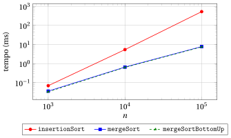
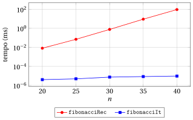

# Algoritmi ricorsivi e iterativi a confronto

**Parte 4 · Analisi e ricorsione · Capitolo 18** · [:material-file-pdf-box: Dispensa, volume 4 (PDF)](../pdf/dispensa-4-analisi-ricorsione.pdf) · [:material-pencil: Esercizi](../esercizi/es-18-ricorsivo-iterativo.md)

## Introduzione

Nei capitoli precedenti abbiamo studiato diversi algoritmi ricorsivi (capitolo «Ricorsione»: fattoriale, numeri di Fibonacci, MCD ricorsivo, potenza veloce, Torre di Hanoi; capitolo «Algoritmi ricorsivi»: somma di un array, Merge Sort, ricerca binaria ricorsiva, sotto-array di somma massima) e li abbiamo analizzati con le equazioni di ricorrenza e con il Master theorem. In questo capitolo rispondiamo a una domanda molto pratica:

<strong>quando conviene progettare un algoritmo ricorsivo, e quando no?</strong>

Vedremo che la risposta non dipende dalla ricorsione in sé, ma da <strong>come</strong> il problema viene scomposto in sottoproblemi:

- se il problema viene suddiviso in pochi sottoproblemi <strong>indipendenti</strong> di dimensione $n/b$ (divide et impera), la ricorsione può dare un grande guadagno asintotico;

- se il problema viene solo ridotto dalla dimensione $n$ alla dimensione $n-1$, la ricorsione non dà alcun guadagno in tempo e costa memoria;

- se i sottoproblemi si <strong>sovrappongono</strong>, un algoritmo ricorsivo ingenuo può essere esponenzialmente più lento di uno iterativo.

Il capitolo spiega innanzitutto i costi che ogni chiamata ricorsiva comporta, poi confronta algoritmi ricorsivi e iterativi per i problemi del corso, studia una a una le tre situazioni precedenti, e si chiude con i tempi di esecuzione misurati delle implementazioni in <code>C++</code> e con alcune linee guida.

## 18.1 Ricorsione e iterazione

!!! chiave ""

    Ogni algoritmo ricorsivo può essere trasformato in uno iterativo (che usa una <strong>pila esplicita</strong> per memorizzare le chiamate in sospeso), e ogni algoritmo iterativo può essere scritto in modo ricorsivo (ogni ciclo può essere sostituito da una funzione che chiama se stessa).

    Ricorsione e iterazione hanno la <strong>stessa potenza espressiva</strong>: ciò che cambia dall'una all'altra è il <strong>numero di passi</strong> e la <strong>quantità di memoria</strong> necessari per risolvere il problema.

### 18.1.1 I costi nascosti della ricorsione

- Ogni volta che una funzione viene chiamata, il calcolatore crea un <strong>frame</strong> (o <em>record di attivazione</em>) nella <strong>pila delle chiamate</strong> (<em>call stack</em>), un'area di memoria riservata al programma. Il frame contiene:

    - i parametri della chiamata;

    - le variabili locali della chiamata;

    - l'indirizzo di ritorno, cioè il punto della funzione chiamante da cui riprende l'esecuzione quando la chiamata termina.

- Il frame viene rimosso dalla pila solo quando la chiamata termina. Di conseguenza, durante l'esecuzione di un algoritmo ricorsivo, tutte le chiamate che sono iniziate e non ancora terminate mantengono il loro frame nella pila.

- Questo produce tre costi nascosti, che non compaiono in un ciclo:

    1. <strong>Sovraccarico delle chiamate</strong>: creare e rimuovere un frame, copiare i parametri e saltare alla funzione e tornare indietro richiedono un numero costante di passi aggiuntivi per ogni chiamata. Questo non cambia l'ordine di crescita del tempo di esecuzione, ma rende un algoritmo ricorsivo più lento di un ciclo equivalente di un fattore costante.

    2. <strong>Memoria</strong>: la memoria usata dalla pila delle chiamate è proporzionale al massimo numero di chiamate <em>contemporaneamente</em> attive, cioè alla <strong>profondità</strong> della ricorsione (l'altezza dell'albero di ricorsione più uno, studiata in dettaglio più avanti in questo capitolo).

    3. <strong>Stack overflow</strong>: la pila delle chiamate ha una dimensione fissa e piuttosto piccola. Su Linux la dimensione predefinita è tipicamente $8$ MB (comando <code>ulimit -s</code> $\Rightarrow$ $8192$ KB), su Windows è tipicamente $1$ MB. Se la profondità della ricorsione è troppo grande, la pila si esaurisce e il programma va in <strong>crash</strong> (in <code>C++</code> con un <em>segmentation fault</em>). In Python il limite predefinito è di sole $1000$ chiamate annidate.

!!! esempio "Esempio 18.1: una somma lineare ricorsiva che va in crash"

    - Consideriamo l'algoritmo ricorsivo per decremento di uno che calcola la somma di un array $a[1..n]$ come $\texttt{SumDecrease}(a,n)=\texttt{SumDecrease}(a,n-1)+a[n]$, con caso base $\texttt{SumDecrease}(a,0)=0$ (la somma per decremento di uno del capitolo «Algoritmi ricorsivi», con caso base $n=0$ invece di $n=1$).

    - Le chiamate $\texttt{SumDecrease}(a,n), \texttt{SumDecrease}(a,n-1), \dots, \texttt{SumDecrease}(a,0)$ sono tutte attive contemporaneamente: la profondità della ricorsione è $n+1$.

    - Con $n=10^7$ e un frame di circa $32$ byte, la pila dovrebbe contenere circa

        $$
        10^7\cdot 32 = 3.2\cdot 10^8 \text{ byte} \approx 320 \text{ MB},
        $$

        cioè $40$ volte gli $8$ MB predefiniti.

    - Il programma va in crash, benché l'array stesso ($4\cdot 10^7$ byte $=40$ MB) stia comodamente in memoria e la somma iterativa calcoli il risultato in circa $3$ millisecondi. Nell'esperimento alla fine del capitolo misuriamo che, con una pila di $8$ MB, il crash avviene già per $n\approx 7\cdot 10^5$.

### 18.1.2 Dalla ricorsione all'iterazione con una pila esplicita

- Un algoritmo ricorsivo può sempre essere trasformato in uno iterativo gestendo <strong>esplicitamente</strong> una pila che contiene i parametri delle chiamate ancora da eseguire.

- Come esempio, questa è una versione iterativa della somma ricorsiva per dimezzamento <code>RecursiveSum</code> del capitolo «Algoritmi ricorsivi», che calcola la somma di $a[l..r]$ come la somma di $a[l..mid]$ più la somma di $a[mid+1..r]$:

!!! algoritmo "Algoritmo: SumExplicitStack"

    

    
Input: Un array &#92;(a&#91;1..n&#93;&#92;) di &#92;(n &#92;ge 1&#92;) numeri interi

    
Output: La somma &#92;(a&#91;1&#93;+a&#91;2&#93;+&#92;cdots+a&#91;n&#93;&#92;)

    

    

    
1<strong>function</strong> SumExplicitStack(a, n)

    
2&#92;(s := 0&#92;)

    
3&#92;(P :=&#92;) pila vuota// sotto-array in sospeso

    
4inserisci &#92;((1,n)&#92;) in &#92;(P&#92;)

    
5<strong>while</strong> &#92;(P&#92;) non è vuota <strong>do</strong>

    
6&#92;((l,r) :=&#92;) estrai da &#92;(P&#92;)

    
7<strong>if</strong> &#92;(l = r&#92;) <strong>then</strong>

    
8&#92;(s &#92;leftarrow s + a&#91;l&#93;&#92;)// caso base

    
9<strong>else</strong>

    
10&#92;(mid := &#92;lfloor (l+r)/2 &#92;rfloor&#92;)

    
11inserisci &#92;((mid+1,r)&#92;) in &#92;(P&#92;)

    
12inserisci &#92;((l,mid)&#92;) in &#92;(P&#92;)

    
13<strong>end</strong>

    
14<strong>end</strong>

    
15<strong>return</strong> &#92;(s&#92;)

    
16<strong>end</strong>

    

Esegui in Colab:

- La pila $P$ svolge esattamente il ruolo della pila delle chiamate: contiene i sotto-array ancora da sommare. La sua dimensione massima è dello stesso ordine della profondità della ricorsione, cioè $\Theta(\log_2 n)$.

!!! esempio "Esempio 18.2: SumExplicitStack su quattro elementi"

    Eseguiamo <code>SumExplicitStack</code>$(a,4)$ con $a=[4,7,1,9]$. Ogni elemento riporta la coppia estratta da $P$, ciò che viene fatto, e il contenuto di $P$ dopo (la cima della pila è a destra):

    - estrai $(1,4)$: $mid=2$, inserisci $(3,4)$ e $(1,2)$ $\Rightarrow$ $P=[(3,4),(1,2)]$, $s=0$;

    - estrai $(1,2)$: $mid=1$, inserisci $(2,2)$ e $(1,1)$ $\Rightarrow$ $P=[(3,4),(2,2),(1,1)]$, $s=0$;

    - estrai $(1,1)$: caso base, $s=4$ $\Rightarrow$ $P=[(3,4),(2,2)]$;

    - estrai $(2,2)$: caso base, $s=11$ $\Rightarrow$ $P=[(3,4)]$;

    - estrai $(3,4)$: $mid=3$, inserisci $(4,4)$ e $(3,3)$ $\Rightarrow$ $P=[(4,4),(3,3)]$, $s=11$;

    - estrai $(3,3)$: caso base, $s=12$ $\Rightarrow$ $P=[(4,4)]$;

    - estrai $(4,4)$: caso base, $s=21$ $\Rightarrow$ $P$ è vuota.

    L'algoritmo restituisce $21=4+7+1+9$. I sotto-array vengono elaborati nello stesso ordine delle chiamate di <code>RecursiveSum</code>$(a,1,4)$, e $P$ non contiene mai più di $3$ coppie.

!!! chiave ""

    Simulare la ricorsione con una pila esplicita <strong>non</strong> cambia l'ordine di crescita del numero di passi e della memoria: elimina solo il sovraccarico delle chiamate e sposta la pila dalla (piccola) pila delle chiamate alla (grande) memoria principale.

    Un vero guadagno in tempo o in memoria può venire solo da un <strong>algoritmo diverso</strong>, non dalla sostituzione meccanica della ricorsione con l'iterazione (o viceversa).

## 18.2 Confronto in sintesi

- La tabella seguente confronta, per i problemi studiati nel corso, il miglior algoritmo iterativo del corso con quello ricorsivo.

- Il <strong>tempo</strong> è il numero di passi $S(n)$ nel caso peggiore (le operazioni aritmetiche sui numeri contano come un passo, come nel capitolo «Tempo di esecuzione»); lo <strong>spazio</strong> è la memoria usata <strong>in aggiunta all'input</strong>, compresa la pila delle chiamate.

- L'esito si riferisce all'algoritmo ricorsivo: <strong>GUADAGNO</strong> se è asintoticamente più veloce, <strong>UGUALE</strong> se ha lo stesso tempo di esecuzione, <strong>PERDITA</strong> se è peggiore in tempo o in spazio.

<table>
<tr>
<th><strong>Problema</strong></th>
<th><strong>Iterativo</strong></th>
<th><strong>tempo</strong></th>
<th><strong>spazio</strong></th>
<th><strong>Ricorsivo</strong></th>
<th><strong>tempo</strong></th>
<th><strong>spazio</strong></th>
<th><strong>Esito</strong></th>
</tr>
<tr>
<td>Ordinamento</td>
<td>Insertion, Selection, Exchange Sort</td>
<td>&#92;(&#92;Theta(n^2)&#92;)</td>
<td>&#92;(&#92;Theta(1)&#92;)</td>
<td>Merge Sort</td>
<td>&#92;(&#92;Theta(n&#92;log&#95;2 n)&#92;)</td>
<td>&#92;(&#92;Theta(n)&#92;)</td>
<td><strong>GUADAGNO</strong> in tempo (divide et impera), pagato con &#92;(&#92;Theta(n)&#92;) di memoria</td>
</tr>
<tr>
<td>Potenza &#92;(x^n&#92;)</td>
<td>&#92;(n&#92;) moltiplicazioni</td>
<td>&#92;(&#92;Theta(n)&#92;)</td>
<td>&#92;(&#92;Theta(1)&#92;)</td>
<td>Potenza veloce</td>
<td>&#92;(&#92;Theta(&#92;log&#95;2 n)&#92;)</td>
<td>&#92;(&#92;Theta(&#92;log&#95;2 n)&#92;)</td>
<td><strong>GUADAGNO</strong>, che deriva dal dimezzamento di &#92;(n&#92;): anche l'algoritmo iterativo square-and-multiply è &#92;(&#92;Theta(&#92;log&#95;2 n)&#92;), con spazio &#92;(&#92;Theta(1)&#92;)</td>
</tr>
<tr>
<td>Sotto-array di somma massima</td>
<td>Forza bruta</td>
<td>&#92;(&#92;Theta(n^2)&#92;)</td>
<td>&#92;(&#92;Theta(1)&#92;)</td>
<td>Divide et impera</td>
<td>&#92;(&#92;Theta(n&#92;log&#95;2 n)&#92;)</td>
<td>&#92;(&#92;Theta(&#92;log&#95;2 n)&#92;)</td>
<td><strong>GUADAGNO</strong> rispetto alla forza bruta, ma l'algoritmo iterativo di Kadane, con tempo &#92;(&#92;Theta(n)&#92;) e spazio &#92;(&#92;Theta(1)&#92;), batte entrambi</td>
</tr>
<tr>
<td>Prodotto di interi di &#92;(n&#92;) cifre</td>
<td>Metodo scolastico</td>
<td>&#92;(&#92;Theta(n^2)&#92;)</td>
<td>&#92;(&#92;Theta(n)&#92;)</td>
<td>Karatsuba</td>
<td>&#92;(&#92;Theta(n^{&#92;log&#95;2 3})&#92;)</td>
<td>&#92;(&#92;Theta(n)&#92;)</td>
<td><strong>GUADAGNO</strong>: &#92;(S(n)=3S(n/2)+&#92;Theta(n)&#92;), &#92;(n^{&#92;log&#95;2 3}&#92;approx n^{1.585}&#92;)</td>
</tr>
<tr>
<td>Somma di un array</td>
<td>Ciclo</td>
<td>&#92;(&#92;Theta(n)&#92;)</td>
<td>&#92;(&#92;Theta(1)&#92;)</td>
<td>Dimezzamento   Decr. di uno</td>
<td>&#92;(&#92;Theta(n)&#92;)   &#92;(&#92;Theta(n)&#92;)</td>
<td>&#92;(&#92;Theta(&#92;log&#95;2 n)&#92;)   &#92;(&#92;Theta(n)&#92;)</td>
<td><strong>UGUALE</strong> tempo, <strong>PERDITA</strong> in spazio</td>
</tr>
<tr>
<td>Ricerca binaria</td>
<td>Ciclo</td>
<td>&#92;(&#92;Theta(&#92;log&#95;2 n)&#92;)</td>
<td>&#92;(&#92;Theta(1)&#92;)</td>
<td>Ricerca binaria ricorsiva</td>
<td>&#92;(&#92;Theta(&#92;log&#95;2 n)&#92;)</td>
<td>&#92;(&#92;Theta(&#92;log&#95;2 n)&#92;)</td>
<td><strong>UGUALE</strong> tempo, <strong>PERDITA</strong> in spazio; ricorsione in coda, si può eliminare</td>
</tr>
<tr>
<td>Fattoriale, ricerca lineare</td>
<td>Ciclo</td>
<td>&#92;(&#92;Theta(n)&#92;)</td>
<td>&#92;(&#92;Theta(1)&#92;)</td>
<td>Decremento di uno</td>
<td>&#92;(&#92;Theta(n)&#92;)</td>
<td>&#92;(&#92;Theta(n)&#92;)</td>
<td><strong>UGUALE</strong> tempo, <strong>PERDITA</strong> in spazio, rischio di stack overflow</td>
</tr>
<tr>
<td>MCD (Euclide)</td>
<td>Ciclo</td>
<td>&#92;(&#92;Theta(&#92;log m)&#92;)</td>
<td>&#92;(&#92;Theta(1)&#92;)</td>
<td>MCD ricorsivo</td>
<td>&#92;(&#92;Theta(&#92;log m)&#92;)</td>
<td>&#92;(&#92;Theta(&#92;log m)&#92;)</td>
<td><strong>UGUALE</strong>: ricorsione in coda, la profondità è solo logaritmica</td>
</tr>
<tr>
<td>Numeri di Fibonacci</td>
<td>Ciclo con due variabili</td>
<td>&#92;(&#92;Theta(n)&#92;)</td>
<td>&#92;(&#92;Theta(1)&#92;)</td>
<td>Ricorsione ingenua</td>
<td>&#92;(&#92;Theta(&#92;varphi^n)&#92;)</td>
<td>&#92;(&#92;Theta(n)&#92;)</td>
<td>enorme <strong>PERDITA</strong>: sottoproblemi sovrapposti; la memoizzazione lo riporta a &#92;(&#92;Theta(n)&#92;)</td>
</tr>
<tr>
<td>Torre di Hanoi</td>
<td>Esistono versioni iterative</td>
<td>&#92;(&#92;Theta(2^n)&#92;)</td>
<td>&#92;(&#92;Theta(n)&#92;)</td>
<td>Hanoi ricorsivo</td>
<td>&#92;(&#92;Theta(2^n)&#92;)</td>
<td>&#92;(&#92;Theta(n)&#92;)</td>
<td><strong>UGUALE</strong>: servono comunque &#92;(2^n-1&#92;) mosse; la ricorsione è la descrizione naturale</td>
</tr>
</table>

- Nella tabella, $\varphi=\frac{1+\sqrt5}{2}\approx 1.618$ è la sezione aurea e $m=\min(a,b)$ per l'MCD di $a$ e $b$.

- Le quattro righe del primo blocco sono i casi in cui la ricorsione <strong>conviene</strong>: in tutti il problema viene suddiviso in sottoproblemi di dimensione $n/2$ (sezione successiva).

- Le righe del secondo blocco sono i casi in cui la ricorsione <strong>sostituisce</strong> soltanto un ciclo: nessun guadagno in tempo, una perdita in memoria (sezione «Spazio»).

- La riga di Fibonacci è il caso in cui la ricorsione ingenua è un <strong>disastro</strong>, perché gli stessi sottoproblemi vengono risolti più e più volte (sezione «Quando i sottoproblemi si sovrappongono»).

## 18.3 Il divide et impera dà il guadagno, non la ricorsione in sé { #sez-sec-dc }

- Il numero di passi di un algoritmo ricorsivo è descritto da un'equazione di ricorrenza. Nel corso compaiono due famiglie di equazioni di ricorrenza:

    - <strong>decremento di uno</strong>: il problema di dimensione $n$ viene ridotto a <strong>un</strong> problema di dimensione $n-1$,

        $$
        S(n)=S(n-1)+f(n);
        $$

    - <strong>divide et impera</strong>: il problema di dimensione $n$ viene suddiviso in $a$ problemi di dimensione $n/b$,

        $$
        S(n)=a\,S(n/b)+f(n), \qquad a\ge 1,~b>1.
        $$

### 18.3.1 Decremento di uno: la ricorsione è un ciclo sotto mentite spoglie

!!! teorema "Osservazione 18.1: equazioni di ricorrenza per decremento di uno"

    Sia $S(n)=S(n-1)+f(n)$ per $n\ge 1$, con $S(0)=d$. Allora

    $$
    S(n)=d+\sum_{i=1}^{n}f(i).
    $$

    In particolare, se $f(n)=c$ per una costante $c>0$, allora $S(n)=c\,n+d=\Theta(n)$.

??? dimostrazione "Dimostrazione"

    Per induzione su $n$. Per $n=0$ la somma è vuota e $S(0)=d$. Se la formula vale per $n-1$, allora

    $$
    S(n)=S(n-1)+f(n)=d+\sum_{i=1}^{n-1}f(i)+f(n)=d+\sum_{i=1}^{n}f(i).
    $$

    Se $f(i)=c$ per ogni $i$, allora $\sum_{i=1}^{n}c=c\,n$ e $S(n)=c\,n+d$. Poiché $\lim_{n\to\infty}\frac{c\,n+d}{n}=c\in\R_{>0}$, si ha $S(n)=\Theta(n)$. □

- La formula $S(n)=d+\sum_{i=1}^{n}f(i)$ è <strong>esattamente</strong> il numero di passi di un ciclo che esegue, per $i=1,2,\dots,n$, un corpo di costo $f(i)$. La ricorsione per decremento di uno svolge lo stesso lavoro di un ciclo:

    - fattoriale, ricerca lineare e somma di un array per decremento di uno: $S(n)=S(n-1)+\Theta(1)=\Theta(n)$, come il ciclo corrispondente;

    - un insertion sort ricorsivo (ordinare $a[1..n-1]$ ricorsivamente, poi inserire $a[n]$): $S(n)=S(n-1)+\Theta(n)=\Theta(n^2)$, come l'<code>InsertionSort</code> iterativo.

- In tutti questi casi l'algoritmo ricorsivo ha lo stesso ordine di crescita del tempo di esecuzione di quello iterativo, più il sovraccarico delle chiamate e una profondità di ricorsione $\Theta(n)$.

### 18.3.2 Divide et impera: da dove viene il guadagno

- Il Merge Sort suddivide l'array in due metà, le ordina ricorsivamente e le fonde in $\Theta(n)$ passi:

    $$
    S(n)=2S(n/2)+\Theta(n)=\Theta(n\log_2 n)
    $$

    per il caso 2 del Master theorem. Il guadagno rispetto a $\Theta(n^2)$ deriva dal fatto che le due metà sono <strong>bilanciate</strong> e <strong>indipendenti</strong>: l'albero di ricorsione ha solo $\Theta(\log_2 n)$ livelli, e ogni livello costa $\Theta(n)$.

- La stessa suddivisione si può organizzare <strong>senza ricorsione</strong>: si fondono prima coppie di sotto-array di lunghezza $1$, poi coppie di sotto-array di lunghezza $2$, poi di lunghezza $4$, e così via. Questo è il Merge Sort <strong>bottom-up</strong>. Usa la procedura <code>Merge</code>$(a,l,m,r)$ del capitolo «Algoritmi ricorsivi», che fonde i sotto-array ordinati $a[l..m]$ e $a[m+1..r]$ in $\Theta(r-l+1)$ passi.

!!! algoritmo "Algoritmo: MergeSortBottomUp"

    

    
Input: Un array &#92;(a&#91;1..n&#93;&#92;) di &#92;(n&#92;) numeri naturali

    
Output: L'array &#92;(a&#92;) ordinato in ordine non decrescente

    

    

    
1<strong>function</strong> MergeSortBottomUp(a, n)

    
2&#92;(width := 1&#92;)

    
3<strong>while</strong> &#92;(width &lt; n&#92;) <strong>do</strong>

    
4&#92;(l := 1&#92;)

    
5<strong>while</strong> &#92;(l + width &#92;le n&#92;) <strong>do</strong>

    
6&#92;(m := l + width - 1&#92;)

    
7&#92;(r := &#92;min(l + 2&#92;cdot width - 1,~ n)&#92;)

    
8<code>Merge</code>&#92;((a, l, m, r)&#92;)

    
9&#92;(l &#92;leftarrow l + 2&#92;cdot width&#92;)

    
10<strong>end</strong>

    
11&#92;(width &#92;leftarrow 2&#92;cdot width&#92;)

    
12<strong>end</strong>

    
13<strong>end</strong>

    

Esegui in Colab:

!!! esempio "Esempio 18.3: Merge Sort bottom-up"

    Consideriamo $a=[5,2,4,6,1,3]$ ($n=6$).

    - $width=1$: si fondono $a[1..1]$ con $a[2..2]$, $a[3..3]$ con $a[4..4]$, $a[5..5]$ con $a[6..6]$ $\Rightarrow$ $a=[2,5,4,6,1,3]$.

    - $width=2$: si fondono $a[1..2]$ con $a[3..4]$; per $l=5$ si ha $l+width=7>6$, quindi $a[5..6]$ resta com'è $\Rightarrow$ $a=[2,4,5,6,1,3]$.

    - $width=4$: si fondono $a[1..4]$ con $a[5..6]$ $\Rightarrow$ $a=[1,2,3,4,5,6]$.

    - $width=8\ge 6$: ci si ferma.

    L'algoritmo esegue $3=\lceil \log_2 6\rceil$ passate.

!!! teorema "Osservazione 18.2: Merge Sort bottom-up"

    Per $n\ge 2$, <code>MergeSortBottomUp</code> esegue $\lceil \log_2 n\rceil$ passate del ciclo esterno e il suo numero di passi nel caso peggiore è

    $$
    S(n)=\Theta(n\log_2 n),
    $$

    lo stesso del Merge Sort ricorsivo. Inoltre, non usa la pila delle chiamate.

??? dimostrazione "Dimostrazione"

    Sia $n\ge 2$. Nel ciclo esterno $width$ assume i valori $1,2,4,\dots,2^{p-1}$, dove $p$ è il più piccolo intero con $2^{p}\ge n$, cioè $p=\lceil\log_2 n\rceil$.

    <em>Limite superiore</em>. In una passata, le chiamate a <code>Merge</code> (riga [8](#riga-18-ricorsivo-iterativo-line-rvi-bu-c)) lavorano su sotto-array disgiunti, quindi la loro lunghezza totale è al più $n$ e il loro costo totale è $O(n)$. Il ciclo interno viene eseguito al più $\frac{n}{2\cdot width}+1\le n$ volte, ogni volta con un numero costante di altri passi. Quindi ogni passata costa $O(n)$ e $S(n)=O(n\lceil\log_2 n\rceil)=O(n\log_2 n)$.

    <em>Limite inferiore</em>. Il ciclo interno si ferma quando $l+width>n$, quindi gli elementi che non vengono fusi in una passata sono al più $width$. Nelle passate con $width\le n/2$, vengono fusi almeno $n-width\ge n/2$ elementi, con $\Omega(n)$ passi. Queste passate sono quelle con $width=2^t$, $t=0,1,\dots,\lfloor\log_2 n\rfloor-1$, cioè $\lfloor\log_2 n\rfloor$ passate. Quindi $S(n)=\Omega(n\lfloor\log_2 n\rfloor)=\Omega(n\log_2 n)$.

    Quindi $S(n)=\Theta(n\log_2 n)$. L'algoritmo non contiene chiamate ricorsive, quindi l'unica memoria aggiuntiva è quella usata da <code>Merge</code>, cioè $\Theta(n)$. □

!!! chiave ""

    Il guadagno del Merge Sort rispetto agli algoritmi di ordinamento $\Theta(n^2)$ è una conseguenza della strategia <strong>divide et impera</strong> (metà bilanciate, fuse in tempo lineare), non della ricorsione: la versione iterativa bottom-up ha lo stesso tempo di esecuzione $\Theta(n\log_2 n)$.

### 18.3.3 Potenza veloce: il guadagno viene dal dimezzamento

- La potenza veloce ricorsiva del capitolo «Ricorsione» calcola $x^n=\left(x^{\lfloor n/2\rfloor}\right)^2$ se $n$ è pari, e $x^n=\left(x^{\lfloor n/2\rfloor}\right)^2\cdot x$ se $n$ è dispari, con $S(n)=S(\lfloor n/2\rfloor)+\Theta(1)=\Theta(\log_2 n)$.

- Il dimezzamento dell'esponente si può realizzare anche con un ciclo, leggendo i bit di $n$ dal meno significativo (<strong>square-and-multiply</strong>):

!!! algoritmo "Algoritmo: PowerIt"

    

    
Input: Un numero &#92;(x&#92;) e un numero naturale &#92;(n&#92;)

    
Output: La potenza &#92;(x^n&#92;)

    

    

    
1<strong>function</strong> PowerIt(x, n)

    
2&#92;(p := 1&#92;)

    
3&#92;(y := x&#92;)

    
4&#92;(k := n&#92;)

    
5<strong>while</strong> &#92;(k &gt; 0&#92;) <strong>do</strong>

    
6<strong>if</strong> &#92;(k&#92;) è dispari <strong>then</strong>

    
7&#92;(p &#92;leftarrow p&#92;cdot y&#92;)

    
8<strong>end</strong>

    
9&#92;(y &#92;leftarrow y&#92;cdot y&#92;)

    
10&#92;(k &#92;leftarrow &#92;lfloor k/2&#92;rfloor&#92;)

    
11<strong>end</strong>

    
12<strong>return</strong> &#92;(p&#92;)

    
13<strong>end</strong>

    

Esegui in Colab:

- All'inizio di ogni iterazione si ha $p\cdot y^{k}=x^n$ (vale all'inizio con $p=1$, $y=x$, $k=n$, ed è preservata da ogni iterazione); quando $k=0$ si ottiene $p=x^n$.

!!! esempio "Esempio 18.4: square-and-multiply con $n=13$"

    Eseguiamo <code>PowerIt</code>$(x,13)$, dove $13=(1101)_2$. Ogni elemento riporta i valori alla fine di un'iterazione:

    - $k=13$ è dispari: $p=x$, $y=x^2$, $k=6$;

    - $k=6$ è pari: $p=x$, $y=x^4$, $k=3$;

    - $k=3$ è dispari: $p=x\cdot x^4=x^5$, $y=x^8$, $k=1$;

    - $k=1$ è dispari: $p=x^5\cdot x^8=x^{13}$, $y=x^{16}$, $k=0$.

    Le iterazioni moltiplicano $p$ per $x$, $x^4$ e $x^8$ (i bit di $13$ uguali a $1$), e $p=x^{1+4+8}=x^{13}$ dopo $4=\lfloor\log_2 13\rfloor+1$ iterazioni.

!!! teorema "Osservazione 18.3: iterazioni di PowerIt"

    Per $n\ge 1$, <code>PowerIt</code> esegue esattamente $\lfloor \log_2 n\rfloor+1$ iterazioni, quindi $S(n)=\Theta(\log_2 n)$, e usa $\Theta(1)$ di memoria aggiuntiva.

??? dimostrazione "Dimostrazione"

    Ogni iterazione sostituisce $k$ con $\lfloor k/2\rfloor$, cioè elimina il bit meno significativo della rappresentazione binaria di $k$. Quindi il numero di iterazioni è il numero di cifre binarie di $n$, che è $\lfloor\log_2 n\rfloor+1$ (capitolo «Rappresentazione dei numeri»). Ogni iterazione esegue un numero costante di passi, quindi $S(n)=\Theta(\log_2 n)$. Vengono usate solo le tre variabili $p$, $y$, $k$. □

### 18.3.4 Sotto-array di somma massima: un algoritmo iterativo migliore

- Per il problema del sotto-array di somma massima (capitolo «Algoritmi ricorsivi») l'algoritmo divide et impera, con $S(n)=2S(n/2)+\Theta(n)=\Theta(n\log_2 n)$, migliora l'algoritmo di forza bruta $\Theta(n^2)$.

- Tuttavia, un algoritmo <strong>iterativo</strong> più astuto, dovuto a Kadane, risolve il problema in $\Theta(n)$ passi. Per ogni posizione $i$ mantiene la somma massima $cur$ di un sotto-array che <strong>termina</strong> in posizione $i$: tale sotto-array o è il solo $a[i]$, oppure estende il miglior sotto-array che termina in $i-1$. Questa è una versione compatta dell'algoritmo <code>Kadane</code> del capitolo «Algoritmi ricorsivi», che restituisce solo la somma massima:

!!! algoritmo "Algoritmo: Kadane"

    

    
Input: Un array &#92;(a&#91;1..n&#93;&#92;) di &#92;(n&#92;ge 1&#92;) numeri interi

    
Output: La somma massima di un sotto-array non vuoto &#92;(a&#91;l..r&#93;&#92;)

    

    

    
1<strong>function</strong> Kadane(a, n)

    
2&#92;(best := a&#91;1&#93;&#92;)

    
3&#92;(cur := a&#91;1&#93;&#92;)// miglior somma di un sotto-array che termina in &#92;(i&#92;)

    
4&#92;(i := 2&#92;)

    
5<strong>while</strong> &#92;(i &#92;le n&#92;) <strong>do</strong>

    
6&#92;(cur &#92;leftarrow &#92;max(a&#91;i&#93;,~ cur + a&#91;i&#93;)&#92;)

    
7&#92;(best &#92;leftarrow &#92;max(best,~ cur)&#92;)

    
8&#92;(i &#92;leftarrow i+1&#92;)

    
9<strong>end</strong>

    
10<strong>return</strong> &#92;(best&#92;)

    
11<strong>end</strong>

    

Esegui in Colab:

- Il ciclo viene eseguito $n-1$ volte con un numero costante di passi: $S(n)=\Theta(n)$, con $\Theta(1)$ di memoria aggiuntiva.

- Il divide et impera è una potente <strong>tecnica di progetto</strong>, ma non è sempre la migliore: un guadagno rispetto alla forza bruta non significa che l'algoritmo ricorsivo sia ottimo.

### 18.3.5 Moltiplicazione di interi: Karatsuba

- Due interi di $n$ cifre si moltiplicano con il metodo scolastico in $\Theta(n^2)$ passi sulle cifre.

- Suddividendo ciascun numero in due metà di $n/2$ cifre, il prodotto richiede quattro prodotti di numeri di $n/2$ cifre. Karatsuba ha osservato che bastano <strong>tre</strong> prodotti (più addizioni e scorrimenti, che costano $\Theta(n)$):

    $$
    S(n)=3S(n/2)+\Theta(n).
    $$

- Qui $a=3$, $b=2$, $f(n)=\Theta(n)$ e $n^{\log_2 3}\approx n^{1.585}$; poiché $f(n)=O(n^{\log_2 3-\varepsilon})$ per $\varepsilon=0.5$, il caso 1 del Master theorem dà $S(n)=\Theta(n^{\log_2 3})$, asintoticamente migliore di $\Theta(n^2)$.

!!! chiave ""

    <strong>Punti chiave.</strong> Una ricorsione per decremento di uno svolge lo stesso lavoro di un ciclo. Una ricorsione divide et impera può essere asintoticamente più veloce dei semplici algoritmi iterativi (Merge Sort, potenza veloce, Karatsuba), ma il guadagno deriva dalla scomposizione in sottoproblemi indipendenti e bilanciati, e la stessa scomposizione si può spesso organizzare con un ciclo (Merge Sort bottom-up, square-and-multiply). Il miglior algoritmo per un problema può addirittura essere iterativo (Kadane).

## 18.4 Quando i sottoproblemi si sovrappongono { #sez-sec-overlap }

- Nel divide et impera i sottoproblemi sono <strong>disgiunti</strong>: le due metà del Merge Sort non hanno alcun elemento in comune. Quando i sottoproblemi si <strong>sovrappongono</strong>, un algoritmo ricorsivo ingenuo risolve molte volte lo stesso sottoproblema.

- I numeri di Fibonacci sono definiti da $F(0)=0$, $F(1)=1$ e $F(n)=F(n-1)+F(n-2)$ per $n\ge 2$. La traduzione diretta della definizione è:

!!! algoritmo "Algoritmo: FibRec"

    

    
Input: Un numero naturale &#92;(n&#92;)

    
Output: Il numero di Fibonacci &#92;(F(n)&#92;)

    

    

    
1<strong>function</strong> FibRec(n)

    
2<strong>if</strong> &#92;(n &#92;le 1&#92;) <strong>then</strong>

    
3<strong>return</strong> &#92;(n&#92;)

    
4<strong>end</strong>

    
5<strong>return</strong> &#92;(&#92;texttt{FibRec}(n-1) + &#92;texttt{FibRec}(n-2)&#92;)

    
6<strong>end</strong>

    

Esegui in Colab:

!!! esempio "Esempio 18.5: l'albero di ricorsione di FibRec$(5)$"

    Questo è l'albero di ricorsione di $\texttt{FibRec}(5)$ (ogni nodo è una chiamata, etichettata con il suo parametro). Il sotto-albero di $\texttt{FibRec}(3)$ viene calcolato due volte, la chiamata $\texttt{FibRec}(2)$ tre volte:

    { .fig loading=lazy  }

    L'albero ha $15$ nodi, mentre servono solo $6$ valori diversi $F(0),F(1),\dots,F(5)$.

!!! teorema "Osservazione 18.4: numero di chiamate di FibRec"

    Per ogni $n\ge 0$, il numero di chiamate eseguite da $\texttt{FibRec}(n)$ è

    $$
    C(n)=2F(n+1)-1.
    $$

??? dimostrazione "Dimostrazione"

    Le chiamate soddisfano $C(0)=C(1)=1$ e $C(n)=1+C(n-1)+C(n-2)$ per $n\ge 2$. Dimostriamo la formula per induzione forte. Casi base: $C(0)=1=2F(1)-1$ e $C(1)=1=2F(2)-1$. Se la formula vale per $n-1$ e $n-2$, allora

    $$
    C(n)=1+\big(2F(n)-1\big)+\big(2F(n-1)-1\big)=2\big(F(n)+F(n-1)\big)-1=2F(n+1)-1. \qedhere
    $$

    
□

!!! teorema "Osservazione 18.5: crescita dei numeri di Fibonacci"

    Sia $\varphi=\frac{1+\sqrt5}{2}$. Per ogni $n\ge 1$,

    $$
    \varphi^{n-2}\le F(n)\le \varphi^{n-1}.
    $$

    Quindi $F(n)=\Theta(\varphi^n)$ e il numero di passi di <code>FibRec</code> è $S(n)=\Theta(C(n))=\Theta(\varphi^n)$.

??? dimostrazione "Dimostrazione"

    Il numero $\varphi$ soddisfa $\varphi^2=\varphi+1$. Casi base: $\varphi^{-1}\approx 0.618\le F(1)=1\le\varphi^0=1$ e $\varphi^{0}=1\le F(2)=1\le\varphi\approx 1.618$. Per $n\ge 3$, per induzione forte,

    $$
    F(n)=F(n-1)+F(n-2)\ge \varphi^{n-3}+\varphi^{n-4}=\varphi^{n-4}(\varphi+1)=\varphi^{n-4}\varphi^2=\varphi^{n-2},
    $$

    e allo stesso modo $F(n)\le\varphi^{n-2}+\varphi^{n-3}=\varphi^{n-3}(\varphi+1)=\varphi^{n-1}$. Di conseguenza, $\varphi^{-2}\varphi^n\le F(n)\le\varphi^{-1}\varphi^n$, cioè $F(n)=\Theta(\varphi^n)$. Ogni chiamata esegue un numero costante di passi (oltre alle sue sotto-chiamate), quindi $S(n)=\Theta(C(n))=\Theta(2F(n+1)-1)=\Theta(\varphi^{n})$. □

- Per esempio, $\texttt{FibRec}(40)$ esegue $2F(41)-1=331\,160\,281$ chiamate per calcolare $F(40)=102\,334\,155$, e $\texttt{FibRec}(50)$ esegue $2F(51)-1=40\,730\,022\,147$ chiamate.

### 18.4.1 Memoizzazione

- Lo spreco di <code>FibRec</code> si elimina memorizzando in una tabella $memo[0..n]$ i valori già calcolati (<strong>memoizzazione</strong>): prima di calcolare $F(k)$ si verifica se è già nella tabella.

!!! algoritmo "Algoritmo: FibMemo"

    

    
Input: Un numero naturale &#92;(n&#92;) e una tabella &#92;(memo&#91;0..n&#93;&#92;) le cui voci sono tutte <em>non definite</em>

    
Output: Il numero di Fibonacci &#92;(F(n)&#92;)

    

    

    
1<strong>function</strong> FibMemo(n, memo)

    
2<strong>if</strong> &#92;(n &#92;le 1&#92;) <strong>then</strong>

    
3<strong>return</strong> &#92;(n&#92;)

    
4<strong>end</strong>

    
5<strong>if</strong> &#92;(memo&#91;n&#93;&#92;) è <em>non definita</em> <strong>then</strong>

    
6&#92;(memo&#91;n&#93; &#92;leftarrow &#92;texttt{FibMemo}(n-1, memo) + &#92;texttt{FibMemo}(n-2, memo)&#92;)

    
7<strong>end</strong>

    
8<strong>return</strong> &#92;(memo&#91;n&#93;&#92;)

    
9<strong>end</strong>

    

Esegui in Colab:

!!! teorema "Osservazione 18.6: numero di chiamate di FibMemo"

    Per ogni $n\ge 2$, $\texttt{FibMemo}(n,memo)$ (con tutte le voci di $memo$ non definite) esegue esattamente $2n-1$ chiamate. Quindi $S(n)=\Theta(n)$; la memoria usata è $\Theta(n)$ (la tabella e la pila delle chiamate).

??? dimostrazione "Dimostrazione"

    Sia $M(k)$ il numero di chiamate eseguite da $\texttt{FibMemo}(k,memo)$ quando le voci $memo[0..k]$ non sono definite. Per $k=2$ la chiamata ne effettua due, entrambe casi base: $M(2)=3$. Per $k\ge 3$ la chiamata effettua la chiamata $\texttt{FibMemo}(k-1,memo)$, che esegue $M(k-1)$ chiamate e riempie $memo[2..k-1]$; poi effettua la chiamata $\texttt{FibMemo}(k-2,memo)$, che trova $memo[k-2]$ già definita (oppure è un caso base se $k-2\le 1$) e termina subito. Quindi $M(k)=1+M(k-1)+1=M(k-1)+2$, e per l'[Osservazione 18.1](#box-3-obsRviDecreaseByOne) $M(n)=M(2)+2(n-2)=2n-1$. Ogni chiamata esegue un numero costante di passi, quindi $S(n)=\Theta(n)$. La tabella ha $n+1$ voci e la profondità della ricorsione è $n$. □

### 18.4.2 L'algoritmo iterativo

- Calcolando i valori $F(2),F(3),\dots,F(n)$ in ordine crescente, ogni valore richiede solo i due precedenti. Non serve nemmeno la tabella: bastano due variabili.

!!! algoritmo "Algoritmo: FibIt"

    

    
Input: Un numero naturale &#92;(n&#92;)

    
Output: Il numero di Fibonacci &#92;(F(n)&#92;)

    

    

    
1<strong>function</strong> FibIt(n)

    
2<strong>if</strong> &#92;(n &#92;le 1&#92;) <strong>then</strong>

    
3<strong>return</strong> &#92;(n&#92;)

    
4<strong>end</strong>

    
5&#92;(prev := 0&#92;)// &#92;(F(i-2)&#92;)

    
6&#92;(curr := 1&#92;)// &#92;(F(i-1)&#92;)

    
7&#92;(i := 2&#92;)

    
8<strong>while</strong> &#92;(i &#92;le n&#92;) <strong>do</strong>

    
9&#92;(next := prev + curr&#92;)

    
10&#92;(prev &#92;leftarrow curr&#92;)

    
11&#92;(curr &#92;leftarrow next&#92;)

    
12&#92;(i &#92;leftarrow i+1&#92;)

    
13<strong>end</strong>

    
14<strong>return</strong> &#92;(curr&#92;)

    
15<strong>end</strong>

    

Esegui in Colab:

- Il ciclo viene eseguito $n-1$ volte: $S(n)=\Theta(n)$, con $\Theta(1)$ di memoria aggiuntiva.

!!! chiave ""

    
<table>
    <tr>
    <th>Algoritmo</th>
    <th>tempo</th>
    <th>spazio</th>
    </tr>
    <tr>
    <td><code>FibRec</code> (ricorsione ingenua)</td>
    <td>&#92;(&#92;Theta(&#92;varphi^n)&#92;)</td>
    <td>&#92;(&#92;Theta(n)&#92;)</td>
    </tr>
    <tr>
    <td><code>FibMemo</code> (ricorsione + memoizzazione)</td>
    <td>&#92;(&#92;Theta(n)&#92;)</td>
    <td>&#92;(&#92;Theta(n)&#92;)</td>
    </tr>
    <tr>
    <td><code>FibIt</code> (iterazione, bottom-up)</td>
    <td>&#92;(&#92;Theta(n)&#92;)</td>
    <td>&#92;(&#92;Theta(1)&#92;)</td>
    </tr>
    </table>

    Quando i sottoproblemi si sovrappongono, la tecnica giusta è risolvere ogni sottoproblema <strong>una sola volta</strong> e memorizzarne il valore: top-down con la memoizzazione, oppure bottom-up con un ciclo. Questa è l'idea della <strong>programmazione dinamica</strong>, che verrà studiata più avanti nel corso.

## 18.5 Spazio { #sez-sec-space }

Le sezioni precedenti hanno confrontato i numeri di passi. Passiamo ora alla seconda risorsa, la memoria, che per un algoritmo ricorsivo è governata dalla profondità della ricorsione.

### 18.5.1 Profondità della ricorsione

!!! definizione "Definizione 18.7: profondità della ricorsione"

    La <strong>profondità della ricorsione</strong> $D(n)$ di un algoritmo ricorsivo su un input con parametro di dimensione $n$ è il massimo numero di chiamate attive contemporaneamente durante l'esecuzione. È il numero di nodi del cammino più lungo dalla radice a una foglia dell'albero di ricorsione, cioè l'altezza dell'albero più uno.

- Quando le chiamate vengono eseguite una dopo l'altra, sono attive solo le chiamate sul cammino dalla radice alla chiamata corrente. Quindi, se ogni frame ha dimensione costante, la memoria usata dalla pila delle chiamate è $\Theta(D(n))$.

- La profondità <strong>non</strong> è il numero di chiamate: <code>FibRec</code>$(n)$ esegue $\Theta(\varphi^n)$ chiamate, ma al più $n$ di esse sono attive contemporaneamente.

<table>
<tr>
<th>Algoritmo</th>
<th>caso base</th>
<th>profondità &#92;(D(n)&#92;)</th>
<th>&#92;(D(10^6)&#92;)</th>
</tr>
<tr>
<td>Fattoriale, somma lineare (decr. di uno)</td>
<td>&#92;(n=0&#92;)</td>
<td>&#92;(n+1&#92;)</td>
<td>&#92;(1&#92;,000&#92;,001&#92;)</td>
</tr>
<tr>
<td>Torre di Hanoi con &#92;(n&#92;) dischi</td>
<td>&#92;(n=0&#92;)</td>
<td>&#92;(n+1&#92;)</td>
<td>&#92;(1&#92;,000&#92;,001&#92;)</td>
</tr>
<tr>
<td><code>FibRec</code>&#92;((n)&#92;), &#92;(n&#92;ge 1&#92;)</td>
<td>&#92;(n&#92;le 1&#92;)</td>
<td>&#92;(n&#92;)</td>
<td>&#92;(1&#92;,000&#92;,000&#92;)</td>
</tr>
<tr>
<td>Somma, Merge Sort, sotto-array (dimezzam.)</td>
<td>&#92;(l=r&#92;)</td>
<td>&#92;(&#92;lceil&#92;log&#95;2 n&#92;rceil+1&#92;)</td>
<td>&#92;(21&#92;)</td>
</tr>
<tr>
<td>Ricerca binaria ricorsiva (caso peggiore)</td>
<td>&#92;(l&gt;r&#92;)</td>
<td>&#92;(&#92;lfloor&#92;log&#95;2 n&#92;rfloor+2&#92;)</td>
<td>&#92;(21&#92;)</td>
</tr>
<tr>
<td>Potenza veloce &#92;(x^n&#92;), &#92;(n&#92;ge 1&#92;)</td>
<td>&#92;(n=0&#92;)</td>
<td>&#92;(&#92;lfloor&#92;log&#95;2 n&#92;rfloor+2&#92;)</td>
<td>&#92;(21&#92;)</td>
</tr>
<tr>
<td>MCD ricorsivo&#92;((a,b)&#92;)</td>
<td>&#92;(b=0&#92;)</td>
<td>&#92;(&#92;Theta(&#92;log&#92;min(a,b))&#92;)</td>
<td>–</td>
</tr>
</table>

- Per gli algoritmi per dimezzamento, il sotto-array più grande al livello $t$ dell'albero di ricorsione ha $\lceil n/2^t\rceil$ elementi, e raggiunge la dimensione $1$ per $t=\lceil\log_2 n\rceil$; per la potenza veloce, l'esponente assume i valori $n,\lfloor n/2\rfloor,\dots,1,0$, che sono $\lfloor\log_2 n\rfloor+2$.

- Una profondità $\Theta(\log_2 n)$ non è mai un problema in pratica ($21$ frame per $n=10^6$, $31$ per $n=10^9$). Una profondità $\Theta(n)$ è un vero rischio di stack overflow per $n$ grande.

### 18.5.2 Ricorsione in coda e sua eliminazione

!!! definizione "Definizione 18.8: ricorsione in coda"

    Una chiamata ricorsiva è una <strong>chiamata in coda</strong> (<em>tail call</em>) se è l'ultima operazione eseguita dalla funzione, e il suo risultato viene restituito così com'è, senza ulteriori calcoli. Un algoritmo ricorsivo è <strong>ricorsivo in coda</strong> (<em>tail recursive</em>) se tutte le sue chiamate ricorsive sono chiamate in coda.

- L'MCD ricorsivo (restituisce $\texttt{GCD}(b, a \bmod b)$) e la ricerca binaria ricorsiva (restituisce il risultato della ricerca in una metà) sono ricorsivi in coda.

- Il fattoriale ($n\cdot\texttt{Fact}(n-1)$), la somma per decremento di uno ($\texttt{SumDecrease}(a,n-1)+a[n]$) e <code>FibRec</code> <strong>non</strong> sono ricorsivi in coda: dopo che la chiamata ricorsiva termina resta ancora una moltiplicazione o un'addizione da eseguire, quindi il frame deve essere mantenuto.

- In una chiamata in coda, il frame della funzione chiamante non serve più: dopo la chiamata non resta nulla da fare. Quindi la chiamata può essere sostituita da un <strong>aggiornamento dei parametri</strong> seguito da un salto all'inizio della funzione, cioè da un ciclo.

!!! chiave ""

    <strong>Eliminazione meccanica della ricorsione in coda</strong>

    1. Racchiudere il corpo della funzione in un ciclo <strong>while</strong> la cui condizione è la negazione della condizione del caso base.

    2. Sostituire ogni chiamata in coda $f(e_1,\dots,e_k)$ con l'assegnazione <strong>simultanea</strong> dei nuovi valori $e_1,\dots,e_k$ ai parametri (usare variabili temporanee quando un nuovo valore dipende da un parametro che viene modificato).

    3. Spostare il return del caso base dopo il ciclo.

!!! esempio "Esempio 18.6: MCD ricorsivo $\Rightarrow$ MCD iterativo"

    

    

<strong>Algoritmo:</strong> GCDRec

    
1<strong>function</strong> GCDRec(a, b)

    
2<strong>if</strong> &#92;(b = 0&#92;) <strong>then</strong>

    
3<strong>return</strong> &#92;(a&#92;)

    
4<strong>end</strong>

    
5<strong>return</strong> &#92;(&#92;texttt{GCDRec}(b,~ a &#92;bmod b)&#92;)

    
6<strong>end</strong>

    

    
Esegui in Colab:

    

    

    

<strong>Algoritmo:</strong> GCDIt

    
1<strong>function</strong> GCDIt(a, b)

    
2<strong>while</strong> &#92;(b &#92;neq 0&#92;) <strong>do</strong>

    
3&#92;(r := a &#92;bmod b&#92;)

    
4&#92;(a &#92;leftarrow b&#92;)

    
5&#92;(b &#92;leftarrow r&#92;)

    
6<strong>end</strong>

    
7<strong>return</strong> &#92;(a&#92;)

    
8<strong>end</strong>

    

    
Esegui in Colab:

    

    - Condizione di base $b=0$ $\Rightarrow$ condizione del ciclo $b\neq 0$.

    - Chiamata in coda $\texttt{GCDRec}(b, a\bmod b)$ $\Rightarrow$ $(a,b)\leftarrow(b, a\bmod b)$; la variabile temporanea $r$ è necessaria perché $a\bmod b$ deve essere calcolato con il <em>vecchio</em> valore di $a$.

    - Con $(a,b)=(252,105)$ entrambi gli algoritmi passano per le coppie $(252,105)$, $(105,42)$, $(42,21)$, $(21,0)$ e restituiscono $21$: quattro chiamate contro tre iterazioni.

!!! esempio "Esempio 18.7: ricerca binaria ricorsiva $\Rightarrow$ ricerca binaria iterativa"

    

    

<strong>Algoritmo:</strong> RecBinarySearch

    
1<strong>function</strong> RecBS(a, l, r, m)

    
2<strong>if</strong> &#92;(l &gt; r&#92;) <strong>then</strong>

    
3<strong>return</strong> &#92;(-1&#92;)

    
4<strong>end</strong>

    
5&#92;(mid := l + &#92;lfloor (r-l)/2 &#92;rfloor&#92;)

    
6<strong>if</strong> &#92;(a&#91;mid&#93; = m&#92;) <strong>then</strong>

    
7<strong>return</strong> &#92;(mid&#92;)

    
8<strong>end</strong>

    
9<strong>if</strong> &#92;(a&#91;mid&#93; &lt; m&#92;) <strong>then</strong>

    
10<strong>return</strong> &#92;(&#92;texttt{RecBS}(a, mid+1, r, m)&#92;)

    
11<strong>else</strong>

    
12<strong>return</strong> &#92;(&#92;texttt{RecBS}(a, l, mid-1, m)&#92;)

    
13<strong>end</strong>

    
14<strong>end</strong>

    

    
Esegui in Colab:

    

    

    

<strong>Algoritmo:</strong> ItBinarySearch

    
1<strong>function</strong> ItBS(a, l, r, m)

    
2<strong>while</strong> &#92;(l &#92;le r&#92;) <strong>do</strong>

    
3&#92;(mid := l + &#92;lfloor (r-l)/2 &#92;rfloor&#92;)

    
4<strong>if</strong> &#92;(a&#91;mid&#93; = m&#92;) <strong>then</strong>

    
5<strong>return</strong> &#92;(mid&#92;)

    
6<strong>end</strong>

    
7<strong>if</strong> &#92;(a&#91;mid&#93; &lt; m&#92;) <strong>then</strong>

    
8&#92;(l &#92;leftarrow mid+1&#92;)

    
9<strong>else</strong>

    
10&#92;(r &#92;leftarrow mid-1&#92;)

    
11<strong>end</strong>

    
12<strong>end</strong>

    
13<strong>return</strong> &#92;(-1&#92;)

    
14<strong>end</strong>

    

    
Esegui in Colab:

    

    - Condizione di base $l>r$ $\Rightarrow$ condizione del ciclo $l\le r$.

    - Il secondo caso base ($a[mid]=m$) resta dentro il ciclo come <strong>return</strong>.

    - Chiamata in coda $\texttt{RecBS}(a,mid+1,r,m)$ $\Rightarrow$ $l\leftarrow mid+1$; chiamata in coda $\texttt{RecBS}(a,l,mid-1,m)$ $\Rightarrow$ $r\leftarrow mid-1$ (i parametri che non cambiano non vengono assegnati).

    - Chiamando $\texttt{ItBS}(a,1,n,m)$ otteniamo esattamente la <code>BinarySearch</code> iterativa del capitolo «Ricerca lineare e binaria».

!!! teorema "Osservazione 18.9: eliminazione della ricorsione in coda"

    Sia $f$ un algoritmo ricorsivo in coda le cui chiamate eseguono un numero costante di passi (oltre alla chiamata ricorsiva) e usano frame di dimensione costante, e sia $g$ l'algoritmo iterativo ottenuto con l'eliminazione meccanica della ricorsione in coda. Allora $g$ restituisce lo stesso risultato di $f$, il suo numero di passi è dello stesso ordine di quello di $f$, e usa $\Theta(1)$ di memoria aggiuntiva invece di $\Theta(D(n))$.

??? dimostrazione "Dimostrazione"

    Siano $p_1,p_2,\dots,p_k$ i valori dei parametri nelle successive chiamate di $f$, dove $p_k$ soddisfa una condizione di base. La $j$-esima iterazione del ciclo di $g$ inizia con i parametri uguali a $p_j$ ed esegue le stesse operazioni della chiamata di $f$ con parametri $p_j$, tranne che la chiamata in coda è sostituita dall'assegnazione di $p_{j+1}$. Quindi $g$ passa per gli stessi valori $p_1,\dots,p_k$ e restituisce, alla fine, ciò che restituisce la chiamata con parametri $p_k$; poiché ogni chiamata di $f$ restituisce così com'è il valore della successiva, questo è anche il risultato di $f$. Le $k$ chiamate di $f$ e le $k-1$ iterazioni di $g$ (più il test finale e il return) eseguono gli stessi passi a meno di una costante per chiamata, quindi i due numeri di passi sono dello stesso ordine. Infine, $g$ usa solo i parametri e un numero costante di variabili temporanee. □

- Una funzione che non è ricorsiva in coda può talvolta essere resa ricorsiva in coda con un parametro aggiuntivo (un <strong>accumulatore</strong>) che porta il risultato parziale: per esempio $\texttt{FactAcc}(n,acc)$ restituisce $acc$ se $n=0$ e $\texttt{FactAcc}(n-1, n\cdot acc)$ altrimenti, e $n!=\texttt{FactAcc}(n,1)$. La sua eliminazione dà il solito ciclo $acc\leftarrow acc\cdot n$, $n\leftarrow n-1$.

- I compilatori ottimizzanti spesso eliminano automaticamente le chiamate in coda: per esempio, <code>g++</code> 15.2 con l'opzione <code>-O2</code> elimina le chiamate ricorsive delle funzioni <code>C++</code> <code>gcdRec</code> e <code>binarySearchRec</code> del codice del corso, mentre con <code>-O0</code> le mantiene. Tuttavia, lo standard <code>C++</code> non lo garantisce, e Python e Java non lo fanno mai. Per essere sicuri che la memoria sia $\Theta(1)$, si scriva il ciclo.

!!! chiave ""

    <strong>Punti chiave sullo spazio.</strong> La pila delle chiamate usa una memoria proporzionale alla profondità della ricorsione, non al numero di chiamate. Una profondità logaritmica è innocua; una profondità lineare (decremento di uno) rischia lo stack overflow. La ricorsione in coda può essere eliminata meccanicamente, ottenendo un ciclo con $\Theta(1)$ di memoria aggiuntiva.

## 18.7 Esperimento { #sez-sec-experiment }

L'analisi asintotica prevede come cresce il numero di passi con $n$. Verifichiamo ora queste previsioni su un calcolatore reale.

### 18.7.1 Impostazione sperimentale

- I tempi di esecuzione sono stati misurati l'11 ottobre 2026 su un calcolatore con processore Intel Core i5-14500T (20 CPU logiche, frequenza massima $4.8$ GHz), con sistema operativo Ubuntu 26.04 LTS (kernel Linux 7.0), usando il codice <code>C++</code> del corso compilato con <code>g++</code> 15.2.0 e l'opzione <code>-O2</code>. La dimensione predefinita della pila è $8$ MB (<code>ulimit -s</code> $\Rightarrow$ $8192$ KB).

- La funzione <code>runRecursionExperiments</code> del file <code>Experiments.cpp</code> misura il tempo reale di ogni calcolo e lo ripete finché non sono trascorsi almeno $0.2$ secondi (e almeno $3$ ripetizioni); ogni tempo nelle tabelle è la media sulle ripetizioni.

    - <strong>Ordinamento</strong>: array di $n=10^3$, $10^4$ e $10^5$ interi casuali tra $1$ e $10^6$ (seme $12345$), ordinati con <code>insertionSort</code>, con il <code>mergeSort</code> ricorsivo e con <code>mergeSortBottomUp</code>.

    - <strong>Fibonacci</strong>: <code>fibonacciRec</code>$(n)$ e <code>fibonacciIt</code>$(n)$ per $n=20,25,30,35,40$; le chiamate di <code>fibonacciRec</code> sono contate da un contatore nel codice; <code>fibonacciIt</code> viene ripetuta a blocchi di $10^5$ chiamate.

    - <strong>Somma di un array</strong>: <code>sumIt</code>, <code>sumRecHalving</code> e <code>sumRecDecrease</code> su array di $n=10^5$, $10^6$ e $10^7$ interi casuali tra $1$ e $100$, con il limite della pila rimosso (<code>ulimit -s unlimited</code>); un'esecuzione separata verifica se <code>sumRecDecrease</code> termina con la pila predefinita di $8$ MB.

!!! chiave ""

    I tempi misurati dipendono dalla macchina, dal compilatore e dalle sue opzioni, dagli altri programmi in esecuzione e dalla memoria cache. Non vanno confrontati in termini assoluti: ciò che conta è <strong>come crescono</strong> con $n$, che è previsto dall'analisi asintotica ed è lo stesso su ogni macchina.

### 18.7.2 Ordinamento: Insertion Sort contro Merge Sort

<table>
<tr>
<th>&#92;(n&#92;)</th>
<th><code>insertionSort</code></th>
<th><code>mergeSort</code> (ricorsivo)</th>
<th><code>mergeSortBottomUp</code></th>
</tr>
<tr>
<td>&#92;(10^3&#92;)</td>
<td>&#92;(0.0695&#92;) ms</td>
<td>&#92;(0.0361&#92;) ms</td>
<td>&#92;(0.0332&#92;) ms</td>
</tr>
<tr>
<td>&#92;(10^4&#92;)</td>
<td>&#92;(5.38&#92;) ms</td>
<td>&#92;(0.654&#92;) ms</td>
<td>&#92;(0.629&#92;) ms</td>
</tr>
<tr>
<td>&#92;(10^5&#92;)</td>
<td>&#92;(525&#92;) ms</td>
<td>&#92;(7.76&#92;) ms</td>
<td>&#92;(7.43&#92;) ms</td>
</tr>
</table>

- Da $n=10^4$ a $n=10^5$ il tempo dell'Insertion Sort viene moltiplicato per circa $98$, vicino al fattore $100$ previsto da $\Theta(n^2)$, mentre il tempo del Merge Sort viene moltiplicato per circa $12$, vicino al fattore previsto da $\Theta(n\log_2 n)$:

    $$
    10\cdot\frac{\log_2 10^5}{\log_2 10^4}=12.5 .
    $$

    (Da $n=10^3$ a $n=10^4$ i fattori sono più piccoli, circa $77$ e $18$: per array piccoli i costi costanti e la memoria cache pesano ancora sulla misura.)

- Per $n=10^5$ il Merge Sort è circa $70$ volte più veloce. La versione ricorsiva e quella bottom-up hanno praticamente lo stesso tempo: il guadagno è dovuto al divide et impera, non alla ricorsione.

{ .fig loading=lazy  }

<strong>Figura 18.1:</strong> Tempi di esecuzione misurati dei tre algoritmi di ordinamento (scale logaritmiche su entrambi gli assi).

- In un grafico con scale logaritmiche su entrambi gli assi una potenza $n^k$ è una retta di pendenza $k$: la retta dell'Insertion Sort ha pendenza vicina a $2$, le rette del Merge Sort una pendenza leggermente maggiore di $1$.

### 18.7.3 Fibonacci: ricorsione ingenua contro iterazione

<table>
<tr>
<th>&#92;(n&#92;)</th>
<th>&#92;(F(n)&#92;)</th>
<th>chiamate di <code>fibonacciRec</code></th>
<th><code>fibonacciRec</code></th>
<th><code>fibonacciIt</code></th>
</tr>
<tr>
<td>&#92;(20&#92;)</td>
<td>&#92;(6&#92;,765&#92;)</td>
<td>&#92;(21&#92;,891&#92;)</td>
<td>&#92;(0.00808&#92;) ms</td>
<td>&#92;(4.0&#92;) ns</td>
</tr>
<tr>
<td>&#92;(25&#92;)</td>
<td>&#92;(75&#92;,025&#92;)</td>
<td>&#92;(242&#92;,785&#92;)</td>
<td>&#92;(0.0699&#92;) ms</td>
<td>&#92;(4.8&#92;) ns</td>
</tr>
<tr>
<td>&#92;(30&#92;)</td>
<td>&#92;(832&#92;,040&#92;)</td>
<td>&#92;(2&#92;,692&#92;,537&#92;)</td>
<td>&#92;(0.764&#92;) ms</td>
<td>&#92;(7.4&#92;) ns</td>
</tr>
<tr>
<td>&#92;(35&#92;)</td>
<td>&#92;(9&#92;,227&#92;,465&#92;)</td>
<td>&#92;(29&#92;,860&#92;,703&#92;)</td>
<td>&#92;(9.15&#92;) ms</td>
<td>&#92;(8.4&#92;) ns</td>
</tr>
<tr>
<td>&#92;(40&#92;)</td>
<td>&#92;(102&#92;,334&#92;,155&#92;)</td>
<td>&#92;(331&#92;,160&#92;,281&#92;)</td>
<td>&#92;(93.8&#92;) ms</td>
<td>&#92;(9.5&#92;) ns</td>
</tr>
</table>

- Il numero di chiamate è stato contato con un contatore nel codice e coincide con $2F(n+1)-1$ ([Osservazione 18.4](#box-9-obsRviFibCalls)).

- Quando $n$ aumenta di $5$, il tempo di <code>fibonacciRec</code> viene moltiplicato per un fattore compreso tra circa $9$ e $12$, in accordo con $\varphi^5\approx 11.09$. Il tempo di <code>fibonacciIt</code> resta di pochi nanosecondi.

- Estrapolando con il fattore $\varphi$ per ogni unità di $n$ dal tempo misurato per $n=40$:

    - <code>fibonacciRec</code>$(50)$ richiede circa $93.8\cdot\varphi^{10}\approx 11\,500$ ms, cioè circa $12$ secondi;

    - <code>fibonacciRec</code>$(60)$ richiede circa $93.8\cdot\varphi^{20}$ ms, cioè circa $24$ minuti;

    - <code>fibonacciRec</code>$(100)$ richiede circa $93.8\cdot\varphi^{60}$ ms, cioè circa $10\,000$ anni.

- Il compilatore ottimizza il codice (con <code>-O2</code> fonde più livelli della ricorsione in una singola chiamata di funzione), quindi il tempo per chiamata, circa $93.8$ ms$/331\,160\,281\approx 0.28$ ns, è minore di quanto ci si aspetterebbe: questo cambia la costante, non la crescita esponenziale.

{ .fig loading=lazy  }

<strong>Figura 18.2:</strong> Tempi di esecuzione misurati degli algoritmi di Fibonacci ricorsivo e iterativo (scala logaritmica sull'asse verticale).

- In un grafico semi-logaritmico una funzione esponenziale è una retta: la pendenza della retta rossa è circa $\log_{10}\varphi\approx 0.21$ per ogni unità di $n$.

### 18.7.4 Somma di un array: tempo e pila

<table>
<tr>
<th>&#92;(n&#92;)</th>
<th><code>sumIt</code></th>
<th><code>sumRecHalving</code></th>
<th><code>sumRecDecrease</code></th>
<th><code>sumRecDecrease</code>, pila &#92;(8&#92;) MB</th>
</tr>
<tr>
<td>&#92;(10^5&#92;)</td>
<td>&#92;(0.0215&#92;) ms</td>
<td>&#92;(0.0960&#92;) ms</td>
<td>&#92;(0.207&#92;) ms</td>
<td>OK</td>
</tr>
<tr>
<td>&#92;(10^6&#92;)</td>
<td>&#92;(0.210&#92;) ms</td>
<td>&#92;(0.910&#92;) ms</td>
<td>&#92;(2.24&#92;) ms</td>
<td>crash</td>
</tr>
<tr>
<td>&#92;(10^7&#92;)</td>
<td>&#92;(2.69&#92;) ms</td>
<td>&#92;(9.01&#92;) ms</td>
<td>&#92;(34.9&#92;) ms</td>
<td>crash</td>
</tr>
</table>

- I tre algoritmi hanno lo stesso ordine di crescita $\Theta(n)$: quando $n$ viene moltiplicato per $10$, tutti i tempi vengono moltiplicati per circa $10$ (tra $9.5$ e $16$; da $n=10^6$ a $n=10^7$ l'array non sta più nella memoria cache e i fattori aumentano).

- Le versioni ricorsive sono più lente di un fattore costante (circa $3$–$4.5$ per la versione per dimezzamento, circa $10$–$13$ per la versione per decremento di uno): questo è il sovraccarico delle chiamate.

- Con la pila predefinita di $8$ MB, <code>sumRecDecrease</code> va in crash (segmentation fault) per $n=10^6$ e $n=10^7$; i tempi della tabella sono stati misurati rimuovendo il limite con il comando <code>ulimit -s unlimited</code>.

- Per bisezione su $n$ (con una precisione di $10^3$) abbiamo trovato che, con $8$ MB, il massimo $n$ che non va in crash è circa $6.97\cdot 10^5$ con <code>-O2</code>, e circa $2.62\cdot 10^5$ senza ottimizzazione (<code>-O0</code>). Senza ottimizzazione ogni chiamata usa un frame di $32$ byte:

    $$
    \frac{8\cdot 2^{20}}{32}=262\,144 .
    $$

    Con <code>-O2</code> il compilatore fonde quattro livelli della ricorsione in una singola chiamata con un frame di $48$ byte, quindi

    $$
    \frac{8\cdot 2^{20}}{48}\cdot 4\approx 6.99\cdot 10^5 :
    $$

    l'ottimizzazione cambia la costante, non la profondità $\Theta(n)$.

- <code>sumRecHalving</code> usa solo $\lceil\log_2 n\rceil+1\le 25$ frame per $n\le 10^7$ e non va mai in crash; <code>sumIt</code> non usa alcun frame.

## 18.8 Linee guida

!!! chiave ""

    <strong>Usare la ricorsione</strong> quando:

    - il problema si suddivide in pochi sottoproblemi <strong>indipendenti</strong> di dimensione $n/b$ (divide et impera), in modo che il Master theorem dia un tempo di esecuzione migliore di quello degli algoritmi iterativi (Merge Sort, potenza veloce, Karatsuba);

    - la descrizione ricorsiva è quella naturale e comunque non è possibile alcun guadagno asintotico (Torre di Hanoi, e più avanti le visite di alberi e grafi);

    - la profondità della ricorsione è piccola, tipicamente $\Theta(\log_2 n)$.

    <strong>Evitare la ricorsione</strong> quando:

    - il problema diminuisce solo da $n$ a $n-1$ con lavoro aggiuntivo costante: la ricorsione è un ciclo sotto mentite spoglie, con lo stesso tempo di esecuzione, un sovraccarico delle chiamate, $\Theta(n)$ di memoria di pila e un rischio di stack overflow (fattoriale, somma lineare, ricerca lineare);

    - i sottoproblemi si <strong>sovrappongono</strong>: la ricorsione ingenua ripete gli stessi calcoli e può essere esponenziale (Fibonacci); si usi la memoizzazione o, meglio, un ciclo bottom-up (programmazione dinamica).

    <strong>Considerare sempre lo spazio</strong>: la pila delle chiamate usa una memoria proporzionale alla profondità della ricorsione. La ricorsione in coda può essere eliminata meccanicamente, ottenendo un ciclo con $\Theta(1)$ di memoria aggiuntiva.

    <strong>Considerare sempre il miglior algoritmo iterativo</strong>: un algoritmo ricorsivo può migliorare la forza bruta ed essere comunque battuto da un ciclo più astuto (l'algoritmo di Kadane per il sotto-array di somma massima).
