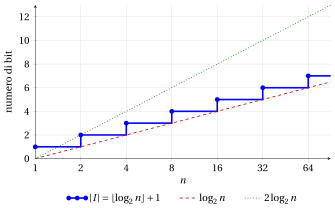

# Dimensione dell'input

**Parte 4 · Analisi degli algoritmi · Capitolo 11** · [:material-file-pdf-box: Dispensa, volume 4 (PDF)](../pdf/dispensa-4-analisi.pdf) · [:material-pencil: Esercizi](../esercizi/es-11-dimensione-input.md)

## Introduzione

Per confrontare due algoritmi che risolvono lo stesso problema contiamo quante operazioni eseguono. Questo numero cresce con l'input: ordinare un array di un milione di componenti richiede più tempo che ordinare un array di dieci componenti, e verificare se un numero di venti cifre è primo richiede più tempo che verificarlo per un numero di due cifre. Per rendere preciso questo discorso serve una misura di quanto sia <em>grande</em> un input.

In questo capitolo fissiamo questa misura: la <strong>dimensione dell'input</strong> è il numero di bit necessari per scrivere l'input in binario, come nel capitolo «Rappresentazione dei numeri». Procediamo così:

- definiamo la dimensione dell'input e richiamiamo la notazione asintotica usata per descriverne l'ordine di crescita (capitolo 9 «Notazione asintotica»);

- calcoliamo la dimensione dell'input, e il suo ordine di crescita, quando l'input è un numero naturale, due numeri naturali, oppure un array di numeri naturali;

- mostriamo perché la distinzione è importante: lo stesso numero di passi può essere piccolo o enorme rispetto alla dimensione dell'input, a seconda che il parametro $n$ sia il <em>valore</em> di un numero o il <em>numero di componenti</em> di un array.

## 11.1 Dimensione dell'input

!!! definizione "Definizione 11.1: dimensione dell'input"

    La <strong>dimensione dell'input</strong> $|I|$ di un algoritmo è il <strong>numero totale di bit necessari per rappresentare in binario una data istanza di input $I$</strong>.

- La dimensione dell'input è una funzione che associa a ogni istanza di input un numero naturale, pari al numero totale di bit necessari per rappresentare in binario l'istanza di input.

- Consideriamo algoritmi le cui istanze di input sono costituite da uno o più numeri naturali, oppure da array di numeri naturali.

- Nel capitolo «Rappresentazione dei numeri» abbiamo visto che il numero minimo di cifre necessarie per scrivere un numero naturale $n \ge 1$ in base $2$ è $\lfloor \log_2 n \rfloor + 1$. Equivalentemente, un numero naturale $n$ si scrive con esattamente $k$ bit se e solo se

    $$
    2^{k-1} \le n \le 2^{k}-1.
    $$

!!! esempio "Esempio 11.1: il numero di bit di alcune istanze di input"

    - Un numero naturale, $n = 37$. Poiché $2^5 = 32 \le 37 < 64 = 2^6$, si ha $\lfloor \log_2 37 \rfloor = 5$, e

        $$
        37 = (100101)_2, \qquad |I| = \lfloor \log_2 37 \rfloor + 1 = 6.
        $$

    - Due numeri naturali, $n = 37$ e $m = 200$. Poiché $2^7 = 128 \le 200 < 256 = 2^8$, il numero $200 = (11001000)_2$ richiede $8$ bit, e

        $$
        |I| = 6 + 8 = 14.
        $$

    - L'array $a = [6, 1, 3, 8]$. Le sue componenti sono $6 = (110)_2$, $1 = (1)_2$, $3 = (11)_2$ e $8 = (1000)_2$, e

        $$
        |I| = 3 + 1 + 2 + 4 = 10.
        $$

La dimensione esatta dell'input dipende dai valori specifici dell'istanza. Nell'analisi degli algoritmi ci interessa come essa <em>cresce</em>, e per questo usiamo la notazione asintotica.

## 11.2 Notazione asintotica: un richiamo

La notazione asintotica è definita e studiata nel capitolo 9 «Notazione asintotica». Qui richiamiamo soltanto le definizioni e i due fatti che si usano in questo capitolo. Come là, $f$ e $g$ sono funzioni definite sui numeri naturali $n \ge 1$ e a valori reali non negativi, e la notazione confronta i loro ordini di crescita per tutti gli $n$ sufficientemente grandi.

!!! chiave ""

    - $f(n) = O\big(g(n)\big)$ (<strong>limite superiore</strong>) se esistono $c \in \R_{>0}$ e $n_1 \in \N$ tali che

        $$
        0 \le f(n) \le c\, g(n), \qquad \forall n \ge n_1;
        $$

    - $f(n) = \Omega\big(g(n)\big)$ (<strong>limite inferiore</strong>) se esistono $c \in \R_{>0}$ e $n_1 \in \N$ tali che

        $$
        0 \le c\, g(n) \le f(n), \qquad \forall n \ge n_1;
        $$

    - $f(n) = \Theta\big(g(n)\big)$ (<strong>entrambi</strong>) se esistono $c_1, c_2 \in \R_{>0}$ e $n_1 \in \N$ tali che

        $$
        0 \le c_1\, g(n) \le f(n) \le c_2\, g(n), \qquad \forall n \ge n_1.
        $$

- Per dimostrare una di queste affermazioni <strong>si determinano</strong> le costanti ($c$, oppure $c_1$ e $c_2$) e la soglia $n_1$.

- Per funzioni di due parametri, come $f(n,m)$, le definizioni sono le stesse, con le disuguaglianze richieste per ogni $n \ge n_1$ e ogni $m \ge m_1$.

- I due fatti seguenti sono dimostrati nel capitolo 9 «Notazione asintotica».

!!! teorema "Osservazione 11.2: $\Theta$ equivale a $O$ e $\Omega$"

    Si ha $f(n) = \Theta\big(g(n)\big)$ se e solo se $f(n) = O\big(g(n)\big)$ e $f(n) = \Omega\big(g(n)\big)$.

!!! teorema "Proposizione 11.3: criterio del limite"

    Sia $g(n) > 0$ per ogni $n \ge 1$. Se

    $$
    \lim_{n \to \infty} \frac{f(n)}{g(n)} = L \in \R_{>0},
    $$

    allora $f(n) = \Theta\big(g(n)\big)$.

## 11.3 Istanza di input costituita da un numero naturale

Partiamo dall'input più semplice: un solo numero naturale.

- Se l'input è costituito da un solo numero naturale $n \ge 1$, la dimensione dell'input è

    $$
    |I|=\lfloor \log_2 n \rfloor +1,
    $$

    che è il numero minimo di bit necessari per rappresentare $n$ in binario.

!!! teorema "Osservazione 11.4: dimensione dell'input di un numero naturale"

    Si ha

    \begin{equation*}
    \label{is:eqone}
    \lfloor \log_2 n \rfloor +1=\Theta(\log_2 n). \tag{11.1}
    \end{equation*}

??? dimostrazione "Dimostrazione"

    Per dimostrare il risultato, determiniamo $c_1,c_2 \in \R_{>0}$ e $n_1 \in \N$ tali che

    $$
    0 \le c_1 \log_2 n \le \lfloor \log_2 n \rfloor +1 \le c_2 \log_2 n,
    \qquad \forall n \ge n_1.
    $$

    Poiché $x < \lfloor x \rfloor + 1$ per ogni numero reale $x$, si ha

    $$
    \log_2 n \le \lfloor \log_2 n \rfloor +1, \qquad \forall n \ge 1.
    $$

    Inoltre, poiché $\lfloor x \rfloor \le x$ per ogni numero reale $x$, e $\log_2 n \ge 1$ per ogni $n \ge 2$, si ha

    $$
    \lfloor \log_2 n \rfloor +1 \le \log_2 n +1 \le 2\log_2 n,
    \qquad \forall n \ge 2.
    $$

    Quindi, scegliendo $c_1=1$, $c_2=2$ e $n_1=2$, otteniamo

    $$
    0 \le \log_2 n \le \lfloor \log_2 n \rfloor +1 \le 2\log_2 n,
    \qquad \forall n \ge 2.
    $$

    
□

!!! chiave ""

    Se l'input di un algoritmo è costituito da un solo numero naturale $n \ge 1$, la dimensione dell'input soddisfa:

    $$
    |I|=\Theta(\log_2 n).
    $$

{ .fig loading=lazy  }

<strong>Figura 11.1:</strong> La dimensione dell'input &#92;(|I| = &#92;lfloor &#92;log&#95;2 n &#92;rfloor + 1&#92;) di un numero naturale &#92;(n&#92;) (asse orizzontale in scala logaritmica): aumenta di un bit a ogni potenza di &#92;(2&#92;), e per &#92;(n &#92;ge 2&#92;) è compresa fra &#92;(&#92;log&#95;2 n&#92;) e &#92;(2&#92;log&#95;2 n&#92;), come afferma l'[Osservazione 11.4](#box-5-obsOneNumber).

!!! esempio "Esempio 11.2: i limiti per un numero naturale"

    Per $n = 37$ si ha $|I| = 6$ ([Esempio 11.1](#box-2-is-exbits)) e $\log_2 37 \approx 5.21$. Le disuguaglianze della dimostrazione dell'[Osservazione 11.4](#box-5-obsOneNumber) diventano

    $$
    \log_2 37 \approx 5.21 \;\le\; |I| = 6 \;\le\; 2\log_2 37 \approx 10.42 .
    $$

    Per $n = 1$ si ha $|I| = 1$ ma $\log_2 1 = 0$: per questo la soglia della dimostrazione è $n_1 = 2$.

## 11.4 Istanza di input costituita da due numeri naturali

Quando l'input è costituito da due numeri, vanno scritti i bit di entrambi.

- Se l'input è costituito da due numeri naturali $n,m \ge 1$, la dimensione dell'input è

    $$
    |I|=\big(\lfloor \log_2 n \rfloor +1\big)+\big(\lfloor \log_2 m \rfloor +1\big),
    $$

    che è il numero minimo di bit necessari per rappresentare in binario sia $n$ sia $m$.

!!! teorema "Osservazione 11.5: dimensione dell'input di due numeri naturali"

    Si ha

    \begin{equation*}
    \label{is:eqtwosum}
    \big(\lfloor \log_2 n \rfloor +1\big)+\big(\lfloor \log_2 m \rfloor +1\big)
    =\Theta(\log_2 n+\log_2 m). \tag{11.2}
    \end{equation*}

??? dimostrazione "Dimostrazione"

    Per dimostrare il risultato, determiniamo $c_1,c_2 \in \R_{>0}$ e $n_1,m_1 \in \N$ tali che

    $$
    0 \le c_1(\log_2 n+\log_2 m)
    \le
    \big(\lfloor \log_2 n \rfloor +1\big)+\big(\lfloor \log_2 m \rfloor +1\big)
    \le
    c_2(\log_2 n+\log_2 m)
    $$

    per ogni $n \ge n_1$ e $m \ge m_1$.

    Abbiamo

    $$
    \log_2 n \le \lfloor \log_2 n \rfloor +1,
    \qquad
    \log_2 m \le \lfloor \log_2 m \rfloor +1,
    \qquad \forall n,m \ge 1.
    $$

    Quindi

    $$
    \log_2 n+\log_2 m
    \le
    \big(\lfloor \log_2 n \rfloor +1\big)+\big(\lfloor \log_2 m \rfloor +1\big),
    \qquad \forall n,m \ge 1.
    $$

    Inoltre

    $$
    \lfloor \log_2 n \rfloor +1 \le \log_2 n+1,
    \qquad
    \lfloor \log_2 m \rfloor +1 \le \log_2 m+1.
    $$

    Dunque

    $$
    \big(\lfloor \log_2 n \rfloor +1\big)+\big(\lfloor \log_2 m \rfloor +1\big)
    \le
    (\log_2 n+1)+(\log_2 m+1).
    $$

    Se $n,m \ge 2$, allora $\log_2 n \ge 1$ e $\log_2 m \ge 1$, quindi

    $$
    \log_2 n+1 \le 2\log_2 n,
    \qquad
    \log_2 m+1 \le 2\log_2 m.
    $$

    Pertanto

    $$
    \big(\lfloor \log_2 n \rfloor +1\big)+\big(\lfloor \log_2 m \rfloor +1\big)
    \le
    2(\log_2 n+\log_2 m),
    \qquad \forall n,m \ge 2.
    $$

    Quindi, scegliendo $c_1=1$, $c_2=2$, $n_1=2$ e $m_1=2$, otteniamo

    $$
    0 \le \log_2 n+\log_2 m
    \le
    \big(\lfloor \log_2 n \rfloor +1\big)+\big(\lfloor \log_2 m \rfloor +1\big)
    \le
    2(\log_2 n+\log_2 m),
    \qquad \forall n,m \ge 2.
    $$

    
□

!!! chiave ""

    Se l'input di un algoritmo è costituito da due numeri naturali $n,m \ge 1$, la dimensione dell'input soddisfa:

    $$
    |I|=\Theta(\underbrace{\log_2 n+\log_2 m}_{\log_2 (nm)}).
    $$

La somma dei due logaritmi può essere sostituita dal logaritmo del maggiore dei due numeri: il numero maggiore richiede almeno metà dei bit dell'istanza.

!!! teorema "Osservazione 11.6: dimensione dell'input di due numeri naturali e loro massimo"

    Si ha

    \begin{equation*}
    \label{is:eqtwomax}
    \big(\lfloor \log_2 n \rfloor +1\big)+\big(\lfloor \log_2 m \rfloor +1\big)
    =\Theta(\log_2 M), \tag{11.3}
    \end{equation*}

    dove

    $$
    M=\max\{n,m\}.
    $$

??? dimostrazione "Dimostrazione"

    Per dimostrare il risultato, determiniamo $c_1,c_2 \in \R_{>0}$ e $n_1,m_1 \in \N$ tali che

    $$
    0 \le c_1\log_2 M
    \le
    \big(\lfloor \log_2 n \rfloor +1\big)+\big(\lfloor \log_2 m \rfloor +1\big)
    \le
    c_2\log_2 M, \qquad \forall n \ge n_1, ~ m \ge m_1.
    $$

    Poiché uno dei due numeri è uguale a $M$, si ha

    $$
    \lfloor \log_2 M \rfloor +1
    \le
    \big(\lfloor \log_2 n \rfloor +1\big)+\big(\lfloor \log_2 m \rfloor +1\big).
    $$

    Inoltre,

    $$
    \log_2 M \le \lfloor \log_2 M \rfloor +1,
    \qquad \forall M \ge 1.
    $$

    Quindi,

    $$
    \log_2 M
    \le
    \big(\lfloor \log_2 n \rfloor +1\big)+\big(\lfloor \log_2 m \rfloor +1\big),
    \qquad \forall n,m \ge 1.
    $$

    D'altra parte, poiché $n \le M$ e $m \le M$, si ha

    $$
    \lfloor \log_2 n \rfloor +1 \le \lfloor \log_2 M \rfloor +1,
    \qquad
    \lfloor \log_2 m \rfloor +1 \le \lfloor \log_2 M \rfloor +1.
    $$

    Dunque

    $$
    \big(\lfloor \log_2 n \rfloor +1\big)+\big(\lfloor \log_2 m \rfloor +1\big)
    \le
    2\big(\lfloor \log_2 M \rfloor +1\big).
    $$

    Se $M \ge 2$, allora $\log_2 M \ge 1$, quindi

    $$
    \lfloor \log_2 M \rfloor +1 \le \log_2 M +1 \le 2\log_2 M.
    $$

    Pertanto,

    $$
    \big(\lfloor \log_2 n \rfloor +1\big)+\big(\lfloor \log_2 m \rfloor +1\big)
    \le
    4\log_2 M,
    \qquad \forall M \ge 2.
    $$

    Quindi, scegliendo $c_1=1$, $c_2=4$, $n_1=2$ e $m_1=2$ (che danno $M \ge 2$), otteniamo

    $$
    0 \le \log_2 M
    \le
    \big(\lfloor \log_2 n \rfloor +1\big)+\big(\lfloor \log_2 m \rfloor +1\big)
    \le
    4\log_2 M,
    \qquad \forall n,m \ge 2.
    $$

    
□

!!! chiave ""

    Se l'input di un algoritmo è costituito da due numeri naturali $n,m \ge 1$, la dimensione dell'input soddisfa:

    $$
    |I|=\Theta\big(\log_2 M\big),
    $$

    dove

    $$
    M=\max\{n,m\}.
    $$

!!! esempio "Esempio 11.3: i limiti per due numeri naturali"

    Per $n = 37$ e $m = 200$ si ha $|I| = 14$ ([Esempio 11.1](#box-2-is-exbits)), $M = 200$, e

    $$
    \log_2 37 + \log_2 200 \approx 12.85, \qquad \log_2 200 \approx 7.64 .
    $$

    Le disuguaglianze delle dimostrazioni delle Osservazioni [11.5](#box-8-obsTwoSum) e [Osservazione 11.6](#box-9-obsTwoMax) diventano

    $$
    12.85 \le 14 \le 2 \cdot 12.85 = 25.71
    \qquad \text{e} \qquad
    7.64 \le 14 \le 4 \cdot 7.64 = 30.58 ,
    $$

    dove tutti i valori sono arrotondati a due cifre decimali.

## 11.5 Istanza di input costituita da un array di numeri naturali

La maggior parte degli algoritmi del corso riceve un array. La sua dimensione dell'input dipende sia dal numero $n$ di componenti sia dai loro valori.

- Se l'istanza di input è costituita da un array $a[1..n]$ di $n$ numeri naturali, con $a[i]\ge 1$ per ogni $i \in \{1,2,\dots,n\}$, la dimensione dell'input è

    $$
    |I|=\sum_{i=1}^{n}\big(\lfloor \log_2 a[i] \rfloor +1\big),
    $$

    che è il numero minimo di bit necessari per rappresentare in binario tutte le componenti dell'array.

### 11.5.1 Un limite superiore

!!! teorema "Osservazione 11.7: limite superiore sulla dimensione dell'input di un array"

    Dato un array $a[1..n]$ di $n$ numeri naturali, con $a[i]\ge 1$ per ogni $i \in \{1,2,\dots,n\}$, si ha

    \begin{equation*}
    \label{is:eqarrayupper}
    \sum_{i=1}^{n}\big(\lfloor \log_2 a[i] \rfloor +1\big)
    =
    O\big(n(1+\log_2 M)\big), \tag{11.4}
    \end{equation*}

    dove

    $$
    M=\max\big\{a[1],a[2],\dots,a[n]\big\}.
    $$

??? dimostrazione "Dimostrazione"

    Per dimostrare il risultato, determiniamo $c \in \R_{>0}$ e $n_1 \in \N$ tali che

    $$
    0 \le \sum_{i=1}^{n}\big(\lfloor \log_2 a[i] \rfloor +1\big)
    \le
    c\,n\bigl(1+\log_2 M\bigr),
    \qquad \forall n \ge n_1.
    $$

    Poiché $a[i] \le M$ per ogni $i \in \{1,2,\dots,n\}$, si ha

    $$
    \lfloor \log_2 a[i] \rfloor +1 \le \lfloor \log_2 M \rfloor +1,
    \qquad \forall i \in \{1,2,\dots,n\}.
    $$

    Quindi,

    $$
    \sum_{i=1}^{n}\big(\lfloor \log_2 a[i] \rfloor +1\big)
    \le
    \sum_{i=1}^{n}\big(\lfloor \log_2 M \rfloor +1\big)
    =
    n\big(\lfloor \log_2 M \rfloor +1\big).
    $$

    Inoltre, si ha

    $$
    \lfloor \log_2 M \rfloor +1 \le \log_2 M +1.
    $$

    Dunque,

    $$
    \sum_{i=1}^{n}\big(\lfloor \log_2 a[i] \rfloor +1\big)
    \le
    n\bigl(1+\log_2 M\bigr),
    \qquad \forall n \ge 1.
    $$

    Quindi, scegliendo $c=1$ e $n_1=1$, otteniamo

    $$
    0 \le \sum_{i=1}^{n}\big(\lfloor \log_2 a[i] \rfloor +1\big)
    \le
    n\bigl(1+\log_2 M\bigr),
    \qquad \forall n \ge 1.
    $$

    
□

!!! chiave ""

    Se l'input di un algoritmo è costituito da un array $a[1..n]$ di $n$ numeri naturali, con $a[i]\ge 1$ per ogni $i \in \{1,2,\dots,n\}$, allora la dimensione dell'input soddisfa

    $$
    |I|=O\big(n(1+\log_2 M)\big),
    $$

    dove

    $$
    M=\max\big\{a[1],a[2],\dots,a[n]\big\}.
    $$

Il limite superiore $n(1+\log_2 M)$ conta ogni componente come se fosse grande quanto il massimo. Quando solo poche componenti sono grandi, è una forte sovrastima, e il limite non può essere sostituito da $\Theta$.

!!! esempio "Esempio 11.4: il limite superiore non è stretto"

    Dato un array $a[1..n]$ di $n$ numeri naturali, con $a[i]\ge 1$ per ogni $i \in \{1,2,\dots,n\}$, per dimostrare che, in generale,

    $$
    \sum_{i=1}^{n}\big(\lfloor \log_2 a[i] \rfloor +1\big)
    \neq
    \Theta\big(n(1+\log_2 M)\big),
    \qquad
    M=\max\{a[1],a[2],\dots,a[n]\},
    $$

    è sufficiente fornire un controesempio.

    - Consideriamo la famiglia di array definita da

        $$
        a[1]=M,
        \qquad
        a[2]=a[3]=\cdots=a[n]=1,
        $$

        con $M\ge 2$.

    - Per questi array, la dimensione dell'input è

        $$
        |I|
        =
        \sum_{i=1}^{n}\big(\lfloor \log_2 a[i] \rfloor +1\big)
        =
        (\lfloor \log_2 M \rfloor +1)+(n-1)(\lfloor \log_2 1 \rfloor +1).
        $$

        Poiché $\lfloor \log_2 1 \rfloor +1 = 1$, otteniamo

        $$
        |I|
        =
        (\lfloor \log_2 M \rfloor +1)+(n-1)
        =
        n+\lfloor \log_2 M \rfloor.
        $$

    - Scegliamo ora $M=2^n$, in modo che $\log_2 M=n$. Allora

        $$
        |I| = n + n = 2n,
        \qquad \text{mentre} \qquad
        n(1+\log_2 M)=n(1+n)=n^2+n.
        $$

    - Se avessimo $2n = \Theta(n^2+n)$, esisterebbero $c_1 \in \R_{>0}$ e $n_1 \in \N$ tali che $c_1(n^2+n) \le 2n$ per ogni $n \ge n_1$, cioè $c_1(n+1) \le 2$ per ogni $n \ge n_1$, il che è falso per $n$ abbastanza grande.

    Quindi, per questa famiglia di array, $|I|\neq \Theta\big(n(1+\log_2 M)\big)$.

- Se $M\ge 2$, allora $\log_2 M \ge 1$, e quindi $1+\log_2 M \le 2\log_2 M$. Dunque

    $$
    n(1+\log_2 M)\le 2n\log_2 M,
    $$

    e la dimensione dell'input soddisfa

    $$
    |I|=O\big(n\log_2 M\big).
    $$

- Se $M=1$, allora tutte le componenti dell'array sono uguali a $1$, e quindi

    $$
    |I|=\sum_{i=1}^{n}(\lfloor \log_2 1 \rfloor +1)=n.
    $$

### 11.5.2 Un limite inferiore

Ogni componente dell'array richiede almeno un bit. Questa semplice osservazione dà un limite inferiore che vale per ogni array.

!!! teorema "Osservazione 11.8: limite inferiore sulla dimensione dell'input di un array"

    Dato un array $a[1..n]$ di $n$ numeri naturali, con $a[i]\ge 1$ per ogni $i \in \{1,2,\dots,n\}$, si ha

    \begin{equation*}
    \label{is:eqarraylower}
    \sum_{i=1}^{n}\big(\lfloor \log_2 a[i] \rfloor +1\big)
    =
    \Omega\big(n\big). \tag{11.5}
    \end{equation*}

??? dimostrazione "Dimostrazione"

    Per dimostrare il risultato, determiniamo $c \in \R_{>0}$ e $n_1 \in \N$ tali che

    $$
    0 \le c\,n \le \sum_{i=1}^{n}\big(\lfloor \log_2 a[i] \rfloor +1\big),
    \qquad \forall n \ge n_1.
    $$

    Poiché $a[i]\ge 1$ per ogni $i \in \{1,2,\dots,n\}$, si ha

    $$
    \lfloor \log_2 a[i] \rfloor +1 \ge \lfloor \log_2 1 \rfloor +1 = 1,
    \qquad \forall i \in \{1,2,\dots,n\}.
    $$

    Quindi,

    $$
    \sum_{i=1}^{n}\big(\lfloor \log_2 a[i] \rfloor +1\big)
    \ge
    \sum_{i=1}^{n}1
    =
    n.
    $$

    Quindi, scegliendo $c=1$ e $n_1=1$, otteniamo

    $$
    0 \le n \le \sum_{i=1}^{n}\big(\lfloor \log_2 a[i] \rfloor +1\big),
    \qquad \forall n \ge 1.
    $$

    
□

!!! chiave ""

    Se l'input di un algoritmo è costituito da un array $a[1..n]$ di $n$ numeri naturali, con $a[i]\ge 1$ per ogni $i \in \{1,2,\dots,n\}$, allora la dimensione dell'input soddisfa

    $$
    |I|=\Omega\big(n\big).
    $$

!!! esempio "Esempio 11.5: i limiti per un array"

    Per l'array $a = [6, 1, 3, 8]$ dell'[Esempio 11.1](#box-2-is-exbits) si ha $n = 4$, $|I| = 10$ e $M = 8$. Il limite inferiore dell'[Osservazione 11.8](#box-13-obsArrayLower) e il limite superiore dell'[Osservazione 11.7](#box-11-obsArrayUpper) danno

    $$
    n = 4 \;\le\; |I| = 10 \;\le\; n(1 + \log_2 M) = 4\,(1 + 3) = 16 .
    $$

### 11.5.3 Componenti di dimensione costante

In molte applicazioni le componenti dell'array sono memorizzate con un numero fisso di bit, indipendente da $n$. In questo caso i due limiti coincidono.

!!! teorema "Corollario 11.9: componenti di dimensione costante"

    Dato un array $a[1..n]$ di $n$ numeri naturali, con $a[i]\ge 1$ per ogni $i \in \{1,2,\dots,n\}$, se tutte le componenti dell'array possono essere rappresentate usando al più un numero costante fissato di bit, allora

    $$
    |I|=\Theta(n).
    $$

??? dimostrazione "Dimostrazione"

    Per ipotesi esiste una costante $c \in \N$ tale che

    $$
    \lfloor \log_2 a[i] \rfloor +1 \le c,
    \qquad \forall i \in \{1,2,\dots,n\}.
    $$

    Quindi,

    $$
    |I|
    =
    \sum_{i=1}^{n}\big(\lfloor \log_2 a[i] \rfloor +1\big)
    \le
    \sum_{i=1}^{n} c
    =
    cn,
    \qquad \forall n \ge 1,
    $$

    e dunque $|I|=O(n)$. Per l'[Osservazione 11.8](#box-13-obsArrayLower) si ha anche $|I|=\Omega(n)$, e quindi, per l'[Osservazione 11.2](#box-3-obsThetaOOmega),

    $$
    |I|=\Theta(n).
    $$

    
□

### 11.5.4 Due varianti dell'input array

- Se l'input è costituito da un numero naturale $n \ge 1$ e da un array $a[1..n]$ di $n$ numeri naturali, con $a[i]\ge 1$ per ogni $i \in \{1,2,\dots,n\}$, la dimensione dell'input è

    $$
    |I|=\big(\lfloor \log_2 n \rfloor +1\big)+\sum_{i=1}^{n}\big(\lfloor \log_2 a[i] \rfloor +1\big).
    $$

    Sia

    $$
    M=\max\{n,a[1],a[2],\dots,a[n]\}.
    $$

    Allora si ha

    $$
    \lfloor \log_2 n \rfloor +1 \le 1+\log_2 M,
    $$

    e, per ogni $i \in \{1,2,\dots,n\}$,

    $$
    \lfloor \log_2 a[i] \rfloor +1 \le 1+\log_2 M.
    $$

    Quindi,

    $$
    |I|
    \le
    (1+\log_2 M)+n(1+\log_2 M)
    =
    (n+1)(1+\log_2 M).
    $$

    Dunque

    $$
    |I|=O\big((n+1)(1+\log_2 M)\big).
    $$

    Poiché $n+1\le 2n$ per ogni $n\ge 1$, otteniamo anche

    $$
    |I|=O\big(n(1+\log_2 M)\big).
    $$

    Inoltre, se $M\ge 2$, allora

    $$
    1+\log_2 M \le 2\log_2 M,
    $$

    e quindi

    $$
    |I|=O\big(n\log_2 M\big).
    $$

    Il limite inferiore $|I| = \Omega(n)$ continua a valere, poiché i soli bit dell'array sono almeno $n$.

- Se le componenti dell'array possono essere $0$, la dimensione dell'input è

    $$
    |I|=\sum_{i=1}^{n}\big(\lfloor \log_2(\max\{1,a[i]\}) \rfloor +1\big),
    $$

    così che ogni componente uguale a $0$ contribuisce esattamente con $1$ bit. In questo caso, se poniamo

    $$
    M=\max\{1,a[1],a[2],\dots,a[n]\},
    $$

    le formule precedenti diventano

    $$
    |I|=O\big(n(1+\log_2 M)\big),
    $$

    e, se $M\ge 2$,

    $$
    |I|=O(n\log_2 M).
    $$

    Inoltre, continua a valere

    $$
    |I|=\Omega(n),
    $$

    poiché ogni componente contribuisce con almeno $1$ bit.

    In particolare, se tutte le componenti dell'array possono essere rappresentate usando al più un numero costante fissato di bit, allora

    $$
    |I|=\Theta(n).
    $$

## 11.6 Dimensione dell'input e numero di passi

Possiamo ora spiegare perché la dimensione dell'input si misura in bit. Il tempo richiesto da un algoritmo si stima contando i suoi <strong>passi</strong>: nello pseudocodice, un passo è l'esecuzione di una riga, e la condizione di un ciclo <strong>while</strong> conta come un passo ogni volta che viene valutata. Il numero di passi viene calcolato prima come funzione $S(n)$ di un parametro naturale $n$ dell'input, e poi espresso come funzione della dimensione dell'input $|I|$.

!!! definizione "Definizione 11.10: tempo di esecuzione nel caso peggiore"

    Il <strong>tempo di esecuzione nel caso peggiore</strong> $T(|I|)$ di un algoritmo è il massimo numero di passi eseguiti dall'algoritmo su un qualsiasi input $I$ di una data dimensione $|I|$.

!!! definizione "Definizione 11.11: algoritmi polinomiali ed esponenziali"

    Un algoritmo è <strong>polinomiale</strong> se il suo tempo di esecuzione nel caso peggiore soddisfa $T(|I|)=O(|I|^k)$ per una qualche costante $k \in \N$.

    Un algoritmo è <strong>esponenziale</strong> se il suo tempo di esecuzione nel caso peggiore soddisfa $T(|I|)=2^{\Theta(|I|)}$, cioè se esistono $c_1, c_2 \in \R_{>0}$ e $k_1 \in \N$ tali che

    $$
    2^{c_1 |I|} \le T(|I|) \le 2^{c_2 |I|}, \qquad \forall |I| \ge k_1.
    $$

Il parametro $n$ può avere due ruoli molto diversi. Può essere il <strong>valore</strong> di un numero dato in input, oppure il <strong>numero di componenti</strong> di un array dato in input. L'osservazione seguente mostra come $n$ è legato a $|I|$ nei due casi.

!!! teorema "Osservazione 11.12: valore di un numero e numero di componenti di un array"

    1. Se l'input è costituito da un solo numero naturale $n \ge 1$, allora

        $$
        2^{|I|-1} \le n \le 2^{|I|} - 1:
        $$

        il valore $n$ è esponenziale nella dimensione dell'input.

    2. Se l'input è costituito da un array $a[1..n]$ di $n$ numeri naturali (ed eventualmente dal numero $n$), allora

        $$
        n \le |I|:
        $$

        il numero di componenti $n$ è al più lineare nella dimensione dell'input.

??? dimostrazione "Dimostrazione"

    1. Poiché $|I| = \lfloor \log_2 n \rfloor + 1$, si ha $\lfloor \log_2 n \rfloor = |I| - 1$, cioè

        $$
        |I| - 1 \le \log_2 n < |I|.
        $$

        La funzione $x \mapsto 2^x$ è strettamente crescente, quindi $2^{|I|-1} \le n < 2^{|I|}$. Poiché $n$ è un intero, $n \le 2^{|I|}-1$.

    2. Ogni componente dell'array contribuisce con almeno un bit alla dimensione dell'input ([Osservazione 11.8](#box-13-obsArrayLower), e lo stesso vale per le componenti uguali a $0$), quindi $|I| \ge n$. □

Quando un numero di passi è limitato da esponenziali con fattori costanti, i fattori costanti possono essere assorbiti nell'esponente.

!!! teorema "Osservazione 11.13: fattori costanti nell'esponente"

    Siano $a_1, a_2, b_1, b_2 \in \R_{>0}$. Se una funzione $T$ soddisfa

    $$
    a_1\, 2^{b_1 x} \le T(x) \le a_2\, 2^{b_2 x}
    $$

    per ogni numero naturale $x$ sufficientemente grande, allora $T(x) = 2^{\Theta(x)}$.

??? dimostrazione "Dimostrazione"

    Scriviamo i fattori costanti come potenze di $2$: $a_1 = 2^{\log_2 a_1}$ e $a_2 = 2^{\log_2 a_2}$. Allora

    $$
    a_2\, 2^{b_2 x} = 2^{b_2 x + \log_2 a_2} \le 2^{2 b_2 x}
    \qquad \text{ogni volta che} \qquad b_2 x \ge \log_2 a_2,
    $$

    e

    $$
    a_1\, 2^{b_1 x} = 2^{b_1 x + \log_2 a_1} \ge 2^{\frac{b_1}{2} x}
    \qquad \text{ogni volta che} \qquad \frac{b_1}{2}\, x \ge -\log_2 a_1 .
    $$

    Entrambe le condizioni valgono per ogni $x$ sufficientemente grande. Quindi, con $c_1 = \frac{b_1}{2}$ e $c_2 = 2b_2$, otteniamo $2^{c_1 x} \le T(x) \le 2^{c_2 x}$ per ogni $x$ sufficientemente grande, cioè $T(x) = 2^{\Theta(x)}$. □

!!! esempio "Esempio 11.6: la somma delle componenti di un array"

    Consideriamo il seguente algoritmo, che calcola la somma delle componenti di un array.

    !!! algoritmo "Algoritmo: SumArray"

        

        
Input: Un array &#92;(a&#91;1..n&#93;&#92;) di &#92;(n &#92;ge 1&#92;) numeri naturali

        
Output: &#92;(a&#91;1&#93;+a&#91;2&#93;+&#92;cdots+a&#91;n&#93;&#92;)

        

        

        
1<strong>function</strong> SumArray(a, n)

        
2&#92;(s := 0&#92;)

        
3&#92;(i := 1&#92;)

        
4<strong>while</strong> &#92;(i &#92;leq n&#92;) <strong>do</strong>

        
5&#92;(s &#92;leftarrow s + a&#91;i&#93;&#92;)

        
6&#92;(i &#92;leftarrow i + 1&#92;)

        
7<strong>end</strong>

        
8<strong>return</strong> &#92;(s&#92;)

        
9<strong>end</strong>

        

    
Esegui in Colab:

    - <strong>Passo 1: numero di passi.</strong> Le righe [2](#riga-11-dimensione-input-is-sa1), [3](#riga-11-dimensione-input-is-sa2) e [8](#riga-11-dimensione-input-is-sa6) sono eseguite $1$ volta ciascuna; la condizione alla riga [4](#riga-11-dimensione-input-is-sa3) è valutata $n+1$ volte (l'ultima volta è falsa); le righe [5](#riga-11-dimensione-input-is-sa4) e [6](#riga-11-dimensione-input-is-sa5) sono eseguite $n$ volte ciascuna. Quindi

        $$
        S(n) = 3 + (n+1) + 2n = 3n + 4,
        $$

        per ogni array di $n$ componenti, qualunque siano i suoi valori.

    - <strong>Passo 2: da $n$ a $|I|$.</strong> Per l'[Osservazione 11.12](#box-18-obsValueEntries), ogni input di dimensione $|I|$ ha $n \le |I|$ componenti, quindi richiede al più $3|I| + 4$ passi. L'array di $|I|$ componenti tutte uguali a $1$ ha dimensione dell'input $|I|$ e richiede esattamente $3|I| + 4$ passi. Dunque

        $$
        T(|I|) = 3|I| + 4 = O(|I|).
        $$

    - <strong>Passo 3: conclusione.</strong> <code>SumArray</code> è polinomiale (lineare) nella dimensione dell'input.

    Se invece lo stesso ciclo andasse da $1$ al <em>valore</em> di un numero $n$ dato in input, i $\Theta(n)$ passi sarebbero esponenziali nella dimensione dell'input, perché $n$ può arrivare a $2^{|I|}-1$ ([Osservazione 11.12](#box-18-obsValueEntries)).

!!! chiave ""

    <strong>Punti chiave del capitolo</strong>

    - La dimensione dell'input $|I|$ è il numero di bit necessari per scrivere in binario l'istanza di input.

    - Un numero naturale $n$: $|I| = \lfloor \log_2 n \rfloor + 1 = \Theta(\log_2 n)$. Due numeri naturali $n, m$: $|I| = \Theta(\log_2 n + \log_2 m) = \Theta(\log_2 \max\{n,m\})$.

    - Un array di $n$ numeri naturali: $|I| = \Omega(n)$ e $|I| = O\big(n(1+\log_2 M)\big)$, con $M$ la componente massima; il limite superiore in generale non è stretto. Se le componenti hanno un numero costante di bit, $|I| = \Theta(n)$.

    - Lo stesso numero di passi $S(n)$ può essere polinomiale o esponenziale in $|I|$: il valore di un numero è esponenziale nella sua dimensione dell'input, mentre il numero di componenti di un array è al più la sua dimensione dell'input.
