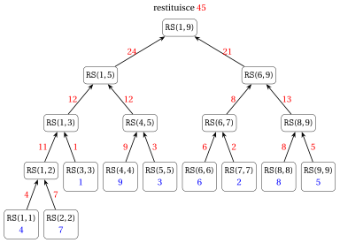
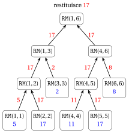
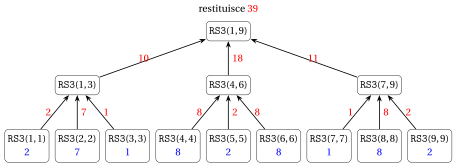
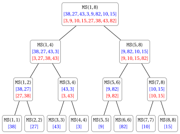
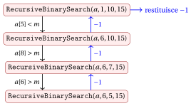
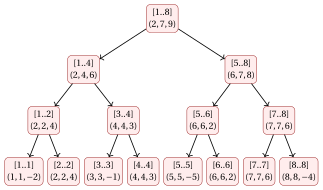

# Esercizi · Algoritmi ricorsivi

**Esercizi · Capitolo 17** · ogni soluzione si apre con un clic · [:material-book-open-variant: Capitolo 17](../analisi-ricorsione/17-algoritmi-ricorsivi.md) · [:material-file-pdf-box: Eserciziario, volume 4 (PDF)](../pdf/esercizi-4-analisi-ricorsione.pdf)

Negli esercizi di questo capitolo i passi si contano come nel capitolo «Algoritmi ricorsivi»: ogni riga di pseudocodice eseguita conta come un passo, e una riga che contiene una chiamata conta un passo più i passi della funzione chiamata. Si usano i seguenti risultati del capitolo.

!!! nota ""

    <strong>Numero di passi</strong> su un array (o sotto-array) di $n$ elementi:

    
<table>
    <tr>
    <td><code>SumIterative</code>&#92;((a,n)&#92;)</td>
    <td>&#92;(3n+4&#92;)</td>
    </tr>
    <tr>
    <td><code>RecursiveSum</code>&#92;((a,1,n)&#92;)</td>
    <td>&#92;(7n-5&#92;), con &#92;(2n-1&#92;) chiamate e profondità &#92;(&#92;lceil&#92;log&#95;2 n&#92;rceil+1&#92;)</td>
    </tr>
    <tr>
    <td><code>RecursiveSumLinear</code>&#92;((a,n)&#92;)</td>
    <td>&#92;(3n-1&#92;), con &#92;(n&#92;) chiamate e profondità &#92;(n&#92;)</td>
    </tr>
    <tr>
    <td><code>Merge</code>&#92;((a,l,m,r)&#92;), &#92;(n=r-l+1&#92;)</td>
    <td>&#92;(6n+t+11&#92;), dove &#92;(t&#92;) è il numero di confronti e &#92;(&#92;min&#92;{n&#95;1,n&#95;2&#92;}&#92;le t&#92;le n-1&#92;)</td>
    </tr>
    <tr>
    <td><code>RecursiveBinarySearch</code>&#92;((a,1,n,m)&#92;)</td>
    <td>&#92;(S(0)=2&#92;), &#92;(S(n)=S(&#92;lfloor n/2&#92;rfloor)+5&#92;) per &#92;(n&#92;ge 1&#92;)</td>
    </tr>
    <tr>
    <td><code>BruteForceMaximumSubarray</code>&#92;((a,n)&#92;)</td>
    <td>&#92;(2n^2+7n+6+3U&#92;), dove &#92;(U&#92;) è il numero di aggiornamenti di &#92;(best&#92;)</td>
    </tr>
    </table>

!!! nota ""

    <strong>Master theorem.</strong> Sia $S(n)=a\,S(n/b)+f(n)$, con $a\ge 1$ e $b>1$ costanti e $f(n)$ asintoticamente positiva.

    1. Se $f(n)=O\big(n^{\log_b a-\varepsilon}\big)$ per una qualche costante $\varepsilon>0$, allora $S(n)=\Theta\big(n^{\log_b a}\big)$.

    2. Se $f(n)=\Theta\big(n^{\log_b a}\log^k n\big)$ per una qualche costante $k\ge 0$, allora $S(n)=\Theta\big(n^{\log_b a}\log^{k+1} n\big)$.

    3. Se $f(n)=\Omega\big(n^{\log_b a+\varepsilon}\big)$ per una qualche costante $\varepsilon>0$, e $a\,f(n/b)\le c\,f(n)$ per una qualche costante $c<1$ e per ogni $n$ sufficientemente grande, allora $S(n)=\Theta\big(f(n)\big)$.

!!! esercizio "Esercizio 17.1: Algoritmi ricorsivi (E1)"

    Consideriamo l'algoritmo ricorsivo <code>RecursiveSum</code>:

    

<strong>Algoritmo:</strong> RecursiveSum

    
Input: Un array &#92;(a&#92;) e due indici &#92;(l &#92;le r&#92;)

    
Output: La somma &#92;(a&#91;l&#93;+a&#91;l+1&#93;+&#92;cdots+a&#91;r&#93;&#92;)

    

    

    
1<strong>function</strong> RecursiveSum(a, l, r)

    
2<strong>if</strong> &#92;(l = r&#92;) <strong>then</strong>

    
3<strong>return</strong> &#92;(a&#91;l&#93;&#92;)

    
4<strong>end</strong>

    
5&#92;(m := &#92;lfloor (l+r)/2 &#92;rfloor&#92;)

    
6&#92;(s&#95;1 :=&#92;) RecursiveSum&#92;((a, l, m)&#92;)

    
7&#92;(s&#95;2 :=&#92;) RecursiveSum&#92;((a, m+1, r)&#92;)

    
8<strong>return</strong> &#92;(s&#95;1 + s&#95;2&#92;)

    
9<strong>end</strong>

    

    e l'array di $n=9$ elementi

    $$
    a = [4, 7, 1, 9, 3, 6, 2, 8, 5].
    $$

    **Domande**

    1. Disegnare l'albero delle chiamate di <code>RecursiveSum</code>$(a,1,9)$, indicando per ogni chiamata gli indici $(l,r)$ e il valore restituito al padre.

    2. Elencare le chiamate nell'ordine in cui <strong>terminano</strong>.

    3. Quante chiamate vengono eseguite in totale? Quante addizioni? Quanti passi (contando ogni riga eseguita come un passo)? Confrontare con le formule generali $2n-1$, $n-1$ e $7n-5$.

    4. Qual è il massimo numero di chiamate contemporaneamente attive (la profondità della ricorsione)? Quali chiamate sono attive in quel momento? Confrontare con la formula $\lceil \log_2 n\rceil+1$.

??? soluzione "Soluzione"

    1. La radice <code>RS</code>$(1,9)$ calcola $m=\lfloor 10/2\rfloor=5$; la metà sinistra $a[1..5]$ ha $\lceil 9/2\rceil=5$ elementi e la metà destra $a[6..9]$ ha $\lfloor 9/2\rfloor=4$ elementi. Procedendo allo stesso modo per ogni chiamata, otteniamo il seguente albero delle chiamate (in blu gli elementi restituiti dai casi base, in rosso i valori restituiti ai padri):

        { .fig loading=lazy  }

        I valori di $m$ calcolati dalle chiamate interne sono:

        
<table>
        <tr>
        <th>chiamata</th>
        <th>&#92;((1,9)&#92;)</th>
        <th>&#92;((1,5)&#92;)</th>
        <th>&#92;((1,3)&#92;)</th>
        <th>&#92;((1,2)&#92;)</th>
        <th>&#92;((4,5)&#92;)</th>
        <th>&#92;((6,9)&#92;)</th>
        <th>&#92;((6,7)&#92;)</th>
        <th>&#92;((8,9)&#92;)</th>
        </tr>
        <tr>
        <td>&#92;(m&#92;)</td>
        <td>5</td>
        <td>3</td>
        <td>2</td>
        <td>1</td>
        <td>4</td>
        <td>7</td>
        <td>6</td>
        <td>8</td>
        </tr>
        <tr>
        <td>valore restituito</td>
        <td>45</td>
        <td>24</td>
        <td>12</td>
        <td>11</td>
        <td>12</td>
        <td>21</td>
        <td>8</td>
        <td>13</td>
        </tr>
        </table>

        L'algoritmo restituisce $45=4+7+1+9+3+6+2+8+5$.

    2. Le chiamate vengono eseguite in profondità, e una chiamata termina solo dopo che sono terminati entrambi i suoi figli. L'ordine di terminazione è:

        $$
        \begin{array}{l}
        (1,1),\ (2,2),\ (1,2),\ (3,3),\ (1,3),\ (4,4),\ (5,5),\ (4,5),\ (1,5),\\
        (6,6),\ (7,7),\ (6,7),\ (8,8),\ (9,9),\ (8,9),\ (6,9),\ (1,9).
        \end{array}
        $$

    3. L'albero delle chiamate ha $9$ foglie (una per ogni elemento) e $8$ nodi interni:

        - numero di chiamate: $17 = 2\cdot 9-1$;

        - numero di addizioni: una per ogni nodo interno, cioè $8=9-1$;

        - numero di passi: ogni foglia esegue $2$ righe e ogni nodo interno $5$ righe, quindi il totale è $9\cdot 2+8\cdot 5 = 58 = 7\cdot 9-5$.

    4. L'albero delle chiamate ha altezza $4$ (le foglie <code>RS</code>$(1,1)$ e <code>RS</code>$(2,2)$ sono al livello $4$), quindi il massimo numero di chiamate contemporaneamente attive è $5$. Per esempio, quando viene eseguita <code>RS</code>$(1,1)$, le chiamate attive sono

        $$
        \texttt{RS}(1,9),\quad \texttt{RS}(1,5),\quad \texttt{RS}(1,3),\quad \texttt{RS}(1,2),\quad \texttt{RS}(1,1).
        $$

        Questo è in accordo con la formula: $\lceil \log_2 9\rceil+1 = 4+1 = 5$, poiché $2^3=8<9\le 16=2^4$.

        Si noti che le foglie non sono tutte allo stesso livello: <code>RS</code>$(3,3)$, per esempio, è al livello $3$. Le foglie più profonde si raggiungono seguendo sempre la metà più grande (quella sinistra): $9\to 5\to 3\to 2\to 1$.

!!! esercizio "Esercizio 17.2: Algoritmi ricorsivi (E2)"

    Consideriamo i tre algoritmi che calcolano la somma degli elementi di un array $a[1..n]$, $n\ge 1$, studiati nel capitolo «Algoritmi ricorsivi»:

    - <code>SumIterative</code>$(a,n)$ (un ciclo);

    - <code>RecursiveSum</code>$(a,1,n)$ (divide et impera, $m=\lfloor (l+r)/2\rfloor$, caso base $l=r$);

    - <code>RecursiveSumLinear</code>$(a,n)$ (decremento di uno: restituisce <code>RecursiveSumLinear</code>$(a,n-1)+a[n]$, caso base $n=1$).

    Il loro numero di passi è richiamato nell'introduzione agli esercizi.

    **Domande**

    1. Per <code>RecursiveSum</code>, sia $A(n)$ il numero di addizioni eseguite su un array di $n$ elementi. Scrivere un'equazione di ricorrenza per $A(n)$ e dimostrare per induzione forte che $A(n)=n-1$.

    2. Completare la seguente tabella, dove <em>chiamate</em> è il numero totale di chiamate (per <code>SumIterative</code> scrivere $-$) e <em>profondità</em> è il massimo numero di chiamate contemporaneamente attive:

        
<table>
        <tr>
        <th></th>
        <th colspan="3">&#92;(n=10&#92;)</th>
        <th colspan="3">&#92;(n=100&#92;)</th>
        <th colspan="3">&#92;(n=1000&#92;)</th>
        </tr>
        <tr>
        <td></td>
        <td>passi</td>
        <td>chiamate</td>
        <td>profondità</td>
        <td>passi</td>
        <td>chiamate</td>
        <td>profondità</td>
        <td>passi</td>
        <td>chiamate</td>
        <td>profondità</td>
        </tr>
        <tr>
        <td><code>SumIterative</code></td>
        <td></td>
        <td></td>
        <td></td>
        <td></td>
        <td></td>
        <td></td>
        <td></td>
        <td></td>
        <td></td>
        </tr>
        <tr>
        <td><code>RecursiveSum</code></td>
        <td></td>
        <td></td>
        <td></td>
        <td></td>
        <td></td>
        <td></td>
        <td></td>
        <td></td>
        <td></td>
        </tr>
        <tr>
        <td><code>RecursiveSumLinear</code></td>
        <td></td>
        <td></td>
        <td></td>
        <td></td>
        <td></td>
        <td></td>
        <td></td>
        <td></td>
        <td></td>
        </tr>
        </table>

    3. Consideriamo la seguente variante di <code>RecursiveSum</code>, che tratta come caso base anche i sotto-array di due elementi: se $r-l+1\le 2$ restituisce $a[l]$ (se $l=r$) oppure $a[l]+a[r]$ (se $r=l+1$); altrimenti procede come <code>RecursiveSum</code>. Quante chiamate e quante addizioni esegue per $n=8$? E per $n=2^k$, $k\ge 1$?

    4. Spiegare perché <em>ogni</em> algoritmo che calcola la somma di $n$ numeri sommandoli due alla volta esegue esattamente $n-1$ addizioni.

??? soluzione "Soluzione"

    1. Una chiamata su un elemento non esegue alcuna addizione; una chiamata su $n\ge 2$ elementi esegue un'addizione ($s_1+s_2$) più le addizioni delle sue due chiamate ricorsive:

        $$
        A(n)=
        \begin{cases}
        0 & \text{se } n=1,\\
        A(\lceil n/2\rceil)+A(\lfloor n/2\rfloor)+1 & \text{se } n\ge 2.
        \end{cases}
        $$

        <strong>Caso base</strong> ($n=1$): $A(1)=0=1-1$.

        <strong>Passo induttivo</strong> ($n\ge 2$): supponiamo $A(k)=k-1$ per ogni $1\le k<n$. Poiché $1\le\lfloor n/2\rfloor\le\lceil n/2\rceil<n$,

        $$
        A(n) = \big(\lceil n/2\rceil-1\big)+\big(\lfloor n/2\rfloor-1\big)+1 = \lceil n/2\rceil+\lfloor n/2\rfloor-1 = n-1.
        $$

    2. Usiamo le formule del capitolo «Algoritmi ricorsivi» (si veda anche l'introduzione agli esercizi):

        - <code>SumIterative</code>: $3n+4$ passi, nessuna chiamata ricorsiva;

        - <code>RecursiveSum</code>: $7n-5$ passi, $2n-1$ chiamate, profondità $\lceil\log_2 n\rceil+1$;

        - <code>RecursiveSumLinear</code>: $3n-1$ passi, $n$ chiamate (su $n, n-1,\dots,1$ elementi), profondità $n$ (tutte le chiamate sono attive quando si raggiunge il caso base).

        Poiché $2^3<10\le 2^4$, $2^6<100\le 2^7$ e $2^9<1000\le 2^{10}$, si ha $\lceil\log_2 10\rceil=4$, $\lceil\log_2 100\rceil=7$ e $\lceil\log_2 1000\rceil=10$. Quindi:

        
<table>
        <tr>
        <th></th>
        <th colspan="3">&#92;(n=10&#92;)</th>
        <th colspan="3">&#92;(n=100&#92;)</th>
        <th colspan="3">&#92;(n=1000&#92;)</th>
        </tr>
        <tr>
        <td></td>
        <td>passi</td>
        <td>chiamate</td>
        <td>profondità</td>
        <td>passi</td>
        <td>chiamate</td>
        <td>profondità</td>
        <td>passi</td>
        <td>chiamate</td>
        <td>profondità</td>
        </tr>
        <tr>
        <td><code>SumIterative</code></td>
        <td>34</td>
        <td>&#92;(-&#92;)</td>
        <td>&#92;(-&#92;)</td>
        <td>304</td>
        <td>&#92;(-&#92;)</td>
        <td>&#92;(-&#92;)</td>
        <td>3004</td>
        <td>&#92;(-&#92;)</td>
        <td>&#92;(-&#92;)</td>
        </tr>
        <tr>
        <td><code>RecursiveSum</code></td>
        <td>65</td>
        <td>19</td>
        <td>5</td>
        <td>695</td>
        <td>199</td>
        <td>8</td>
        <td>6995</td>
        <td>1999</td>
        <td>11</td>
        </tr>
        <tr>
        <td><code>RecursiveSumLinear</code></td>
        <td>29</td>
        <td>10</td>
        <td>10</td>
        <td>299</td>
        <td>100</td>
        <td>100</td>
        <td>2999</td>
        <td>1000</td>
        <td>1000</td>
        </tr>
        </table>

        Tutti e tre gli algoritmi eseguono $\Theta(n)$ passi, ma la memoria aggiuntiva (proporzionale alla profondità) è rispettivamente $\Theta(1)$, $\Theta(\log_2 n)$ e $\Theta(n)$.

    3. Per $n=8$ i sotto-array hanno dimensioni $8\to 4,4\to 2,2,2,2$: le chiamate su $2$ elementi sono casi base. L'albero delle chiamate ha $1+2+4=7$ chiamate: $3$ chiamate interne (una addizione ciascuna) e $4$ casi base su due elementi (una addizione ciascuno), per un totale di $3+4=7$ addizioni.

        Per $n=2^k$, l'albero ha livelli $0,1,\dots,k-1$, con $2^i$ chiamate al livello $i$ su sotto-array di $2^{k-i}$ elementi; le chiamate al livello $k-1$ sono i casi base su $2$ elementi. Il numero di chiamate è

        $$
        \sum_{i=0}^{k-1}2^i = 2^k-1 = n-1
        $$

        (circa la metà delle $2n-1$ chiamate di <code>RecursiveSum</code>). Il numero di addizioni è ancora $(2^{k-1}-1)+2^{k-1} = 2^k-1 = n-1$: una per ciascuna delle $2^{k-1}-1$ chiamate interne e una per ciascuno dei $2^{k-1}$ casi base.

    4. Ogni addizione prende due numeri (elementi dell'array o somme parziali) e li sostituisce con un unico numero (la loro somma). All'inizio ci sono $n$ numeri, alla fine ce n'è uno solo (la somma totale), e ogni addizione diminuisce il conteggio esattamente di uno. Quindi servono esattamente $n-1$ addizioni, indipendentemente dall'ordine in cui vengono eseguite (iterativo, divide et impera, decremento di uno, …).

!!! esercizio "Esercizio 17.3: Algoritmi ricorsivi (E3)"

    Dato un array $a[1..n]$ di $n\ge 1$ numeri interi, consideriamo il problema di determinare il valore massimo nell'array. Vogliamo risolverlo con un algoritmo ricorsivo <strong>divide et impera</strong> <code>RecursiveMax</code>$(a,l,r)$, seguendo lo stesso schema di <code>RecursiveSum</code>$(a,l,r)$, e applicarlo all'array

    $$
    a = [5, 17, 2, 11, 17, 8].
    $$

    **Domande**

    1. Scrivere lo pseudocodice di <code>RecursiveMax</code>$(a,l,r)$, che restituisce il massimo di $a[l..r]$ (caso base $l=r$, indice centrale $m=\lfloor (l+r)/2\rfloor$).

    2. Disegnare l'albero delle chiamate di <code>RecursiveMax</code>$(a,1,6)$ per l'array dato, con il valore restituito da ogni chiamata. Quante chiamate e quanti confronti tra elementi vengono eseguiti?

    3. Dimostrare per induzione forte che <code>RecursiveMax</code>$(a,l,r)$ restituisce $\max\{a[l],\dots,a[r]\}$.

    4. Scrivere l'equazione di ricorrenza per il numero di passi $S(n)$ di <code>RecursiveMax</code> e risolverla con il Master theorem. Poi calcolare $S(n)$ esattamente.

    5. Determinare il tempo di esecuzione nel caso peggiore $T(|I|)$, supponendo che ogni elemento usi un numero costante di bit, e confrontare l'algoritmo con l'algoritmo iterativo <code>FindMaximum</code> del capitolo «Tempo di esecuzione».

??? soluzione "Soluzione"

    1. Il massimo di $a[l..r]$ è il maggiore tra i massimi delle due metà:

        !!! algoritmo "Algoritmo: RecursiveMax"

            

            
Input: Un array &#92;(a&#92;) e due indici &#92;(l &#92;le r&#92;)

            
Output: Il valore massimo in &#92;(a&#91;l..r&#93;&#92;)

            

            

            
1<strong>function</strong> RecursiveMax(a, l, r)

            
2<strong>if</strong> &#92;(l = r&#92;) <strong>then</strong>

            
3<strong>return</strong> &#92;(a&#91;l&#93;&#92;)

            
4<strong>end</strong>

            
5&#92;(m := &#92;lfloor (l+r)/2 &#92;rfloor&#92;)

            
6&#92;(x&#95;1 :=&#92;) RecursiveMax&#92;((a, l, m)&#92;)

            
7&#92;(x&#95;2 :=&#92;) RecursiveMax&#92;((a, m+1, r)&#92;)

            
8<strong>if</strong> &#92;(x&#95;1 &#92;ge x&#95;2&#92;) <strong>then</strong>

            
9<strong>return</strong> &#92;(x&#95;1&#92;)

            
10<strong>else</strong>

            
11<strong>return</strong> &#92;(x&#95;2&#92;)

            
12<strong>end</strong>

            
13<strong>end</strong>

            

    2. La radice calcola $m=\lfloor 7/2\rfloor=3$. Questo è l'albero delle chiamate, in cui <code>RM</code>$(l,r)$ indica la chiamata <code>RecursiveMax</code>$(a,l,r)$ e i valori restituiti sono in rosso:

        { .fig loading=lazy  }

        I confronti eseguiti alla riga [8](#riga-es-17-algoritmi-ricorsivi-rmax-f) sono:

        
<table>
        <tr>
        <th>chiamata</th>
        <th>&#92;(x&#95;1&#92;)</th>
        <th>&#92;(x&#95;2&#92;)</th>
        <th>valore restituito</th>
        </tr>
        <tr>
        <td><code>RM</code>&#92;((1,2)&#92;)</td>
        <td>5</td>
        <td>17</td>
        <td>&#92;(5&lt;17&#92;Rightarrow 17&#92;)</td>
        </tr>
        <tr>
        <td><code>RM</code>&#92;((1,3)&#92;)</td>
        <td>17</td>
        <td>2</td>
        <td>&#92;(17&#92;ge 2&#92;Rightarrow 17&#92;)</td>
        </tr>
        <tr>
        <td><code>RM</code>&#92;((4,5)&#92;)</td>
        <td>11</td>
        <td>17</td>
        <td>&#92;(11&lt;17&#92;Rightarrow 17&#92;)</td>
        </tr>
        <tr>
        <td><code>RM</code>&#92;((4,6)&#92;)</td>
        <td>17</td>
        <td>8</td>
        <td>&#92;(17&#92;ge 8&#92;Rightarrow 17&#92;)</td>
        </tr>
        <tr>
        <td><code>RM</code>&#92;((1,6)&#92;)</td>
        <td>17</td>
        <td>17</td>
        <td>&#92;(17&#92;ge 17&#92;Rightarrow 17&#92;)</td>
        </tr>
        </table>

        Ci sono $11=2\cdot 6-1$ chiamate e $5=6-1$ confronti (uno per ogni chiamata interna). Il massimo è $17$.

    3. Usiamo l'induzione forte su $k=r-l+1\ge 1$.

        <strong>Caso base</strong> ($k=1$): $l=r$ e l'algoritmo restituisce $a[l]=\max\{a[l]\}$.

        <strong>Passo induttivo</strong> ($k\ge 2$): supponiamo che l'enunciato valga per tutti i sotto-array con meno di $k$ elementi. Le due metà $a[l..m]$ e $a[m+1..r]$ hanno $\lceil k/2\rceil$ e $\lfloor k/2\rfloor$ elementi, entrambi compresi tra $1$ e $k-1$; per l'ipotesi induttiva

        $$
        x_1=\max\{a[l],\dots,a[m]\}, \qquad x_2=\max\{a[m+1],\dots,a[r]\}.
        $$

        Ogni elemento di $a[l..r]$ appartiene a una delle due metà, quindi è al più $\max\{x_1,x_2\}$; inoltre $\max\{x_1,x_2\}$ è un elemento di $a[l..r]$. Quindi $\max\{a[l],\dots,a[r]\}=\max\{x_1,x_2\}$, che è esattamente il valore restituito dalle righe [8](#riga-es-17-algoritmi-ricorsivi-rmax-f)–[11](#riga-es-17-algoritmi-ricorsivi-rmax-h).

    4. Se $n=1$, vengono eseguite le righe [2](#riga-es-17-algoritmi-ricorsivi-rmax-a) e [3](#riga-es-17-algoritmi-ricorsivi-rmax-b): $S(1)=2$. Se $n\ge 2$:

        - Le righe [2](#riga-es-17-algoritmi-ricorsivi-rmax-a), [5](#riga-es-17-algoritmi-ricorsivi-rmax-c), [8](#riga-es-17-algoritmi-ricorsivi-rmax-f) vengono eseguite $1$ volta ciascuna

        - La riga [6](#riga-es-17-algoritmi-ricorsivi-rmax-d) viene eseguita $1$ volta, più i $S(\lceil n/2\rceil)$ passi della chiamata

        - La riga [7](#riga-es-17-algoritmi-ricorsivi-rmax-e) viene eseguita $1$ volta, più i $S(\lfloor n/2\rfloor)$ passi della chiamata

        - una sola delle righe [9](#riga-es-17-algoritmi-ricorsivi-rmax-g) e [11](#riga-es-17-algoritmi-ricorsivi-rmax-h) viene eseguita $1$ volta

        Quindi

        $$
        S(n)=
        \begin{cases}
        2 & \text{se } n=1,\\
        S(\lceil n/2\rceil)+S(\lfloor n/2\rfloor)+6 & \text{se } n\ge 2,
        \end{cases}
        \qquad\text{cioè}\qquad S(n)=2\,S(n/2)+c.
        $$

        <strong>Master theorem</strong>:

        - $a=2$, $b=2$, $f(n)=c$;

        - $n^{\log_b a}=n^{\log_2 2}=n$;

        - $f(n)=c$ cresce polinomialmente più lentamente di $n$ $\rightarrow$ caso 1;

        - $f(n)=c=O(n^{1-\varepsilon})$ con $\varepsilon=1$;

        - $S(n)=\Theta(n^{\log_2 2})=\Theta(n)$.

        <strong>Valore esatto</strong>: come per <code>RecursiveSum</code>, l'albero delle chiamate ha $n$ foglie (costo $2$ ciascuna) e $n-1$ nodi interni (costo $6$ ciascuno), quindi

        $$
        S(n)=2n+6(n-1)=8n-6.
        $$

        (Si può verificare per induzione forte: $S(1)=2=8-6$ e $S(n)=(8\lceil n/2\rceil-6)+(8\lfloor n/2\rfloor-6)+6=8n-6$.) Per l'array dato, $S(6)=42$.

    5. Poiché $|I|=\Theta(n)$ e $S(n)=8n-6=\Theta(n)$, esattamente come nel capitolo «Algoritmi ricorsivi» otteniamo

        !!! chiave ""

            Il tempo di esecuzione nel caso peggiore di <code>RecursiveMax</code> è $T(|I|)=\Theta(|I|)$.

        <code>FindMaximum</code> esegue $4n-1$ passi nel caso peggiore: entrambi gli algoritmi sono lineari ed eseguono $n-1$ confronti tra elementi. L'algoritmo ricorsivo esegue più passi ($8n-6$) e usa $\Theta(\log_2 n)$ di memoria aggiuntiva per la pila delle chiamate, contro $\Theta(1)$ di <code>FindMaximum</code>.

!!! esercizio "Esercizio 17.4: Algoritmi ricorsivi (E4)"

    Consideriamo il seguente algoritmo ricorsivo, che suddivide il sotto-array $a[l..r]$ in <strong>tre</strong> parti:

    

<strong>Algoritmo:</strong> RecursiveSum3

    
Input: Un array &#92;(a&#92;) e due indici &#92;(l &#92;le r&#92;)

    
Output: La somma &#92;(a&#91;l&#93;+a&#91;l+1&#93;+&#92;cdots+a&#91;r&#93;&#92;)

    

    

    
1<strong>function</strong> RecursiveSum3(a, l, r)

    
2<strong>if</strong> &#92;(r-l+1 &#92;le 2&#92;) <strong>then</strong>

    
3<strong>if</strong> &#92;(l = r&#92;) <strong>then</strong> <strong>return</strong> &#92;(a&#91;l&#93;&#92;)

    
4<strong>return</strong> &#92;(a&#91;l&#93;+a&#91;r&#93;&#92;)

    
5<strong>end</strong>

    
6&#92;(s := &#92;lfloor (r-l+1)/3 &#92;rfloor&#92;)

    
7&#92;(m&#95;1 := l+s-1&#92;)

    
8&#92;(m&#95;2 := m&#95;1+s&#92;)

    
9&#92;(x&#95;1 :=&#92;) RecursiveSum3&#92;((a, l, m&#95;1)&#92;)

    
10&#92;(x&#95;2 :=&#92;) RecursiveSum3&#92;((a, m&#95;1+1, m&#95;2)&#92;)

    
11&#92;(x&#95;3 :=&#92;) RecursiveSum3&#92;((a, m&#95;2+1, r)&#92;)

    
12<strong>return</strong> &#92;(x&#95;1+x&#95;2+x&#95;3&#92;)

    
13<strong>end</strong>

    

    e l'array di $n=9$ elementi $a=[2, 7, 1, 8, 2, 8, 1, 8, 2]$.

    **Domande**

    1. Mostrare che, per $n=r-l+1\ge 3$, le tre parti sono non vuote e hanno meno di $n$ elementi. Quali sono le loro dimensioni?

    2. Disegnare l'albero delle chiamate di <code>RecursiveSum3</code>$(a,1,9)$ con il valore restituito da ogni chiamata.

    3. Scrivere l'equazione di ricorrenza per il numero di passi $S(n)$ e risolverla con il Master theorem.

    4. Supponiamo $n=3^k$, $k\ge 1$. Calcolare il numero di chiamate, il numero di addizioni e la profondità della ricorsione, e confrontarli con quelli di <code>RecursiveSum</code>.

??? soluzione "Soluzione"

    1. Siano $n=r-l+1\ge 3$ e $s=\lfloor n/3\rfloor\ge 1$. Le tre parti sono

        $$
        a[l..m_1] \ (s \text{ elementi}),\qquad a[m_1+1..m_2]\ (s \text{ elementi}),\qquad a[m_2+1..r]\ (n-2s \text{ elementi}).
        $$

        Poiché $s\ge 1$, le prime due parti sono non vuote e hanno $s\le n/3<n$ elementi. Scrivendo $n=3s+\rho$ con $\rho\in\{0,1,2\}$, la terza parte ha $n-2s=s+\rho$ elementi, con $1\le s\le s+\rho<3s+\rho=n$. Quindi anche la terza parte è non vuota e più piccola di $n$, e tutte le dimensioni sono circa $n/3$ (differiscono al più di $2$).

    2. La radice ha $n=9$, $s=3$, $m_1=3$, $m_2=6$; ogni parte ha $3$ elementi, che vengono suddivisi ancora in parti di un elemento:

        { .fig loading=lazy  }

        Per esempio, <code>RS3</code>$(4,6)$ calcola $s=1$, $m_1=4$, $m_2=5$ e restituisce $8+2+8=18$. L'algoritmo restituisce $10+18+11=39$, che è la somma degli elementi. Ci sono $13$ chiamate e $4\cdot 2=8$ addizioni.

    3. Per $n\le 2$, vengono eseguite le righe [2](#riga-es-17-algoritmi-ricorsivi-rs3-a), [3](#riga-es-17-algoritmi-ricorsivi-rs3-b) e (se $n=2$) [4](#riga-es-17-algoritmi-ricorsivi-rs3-c): $S(1)=2$, $S(2)=3$. Per $n\ge 3$, le righe [2](#riga-es-17-algoritmi-ricorsivi-rs3-a), [6](#riga-es-17-algoritmi-ricorsivi-rs3-d), [7](#riga-es-17-algoritmi-ricorsivi-rs3-e), [8](#riga-es-17-algoritmi-ricorsivi-rs3-f), [12](#riga-es-17-algoritmi-ricorsivi-rs3-j) vengono eseguite una volta, e le righe [9](#riga-es-17-algoritmi-ricorsivi-rs3-g), [10](#riga-es-17-algoritmi-ricorsivi-rs3-h), [11](#riga-es-17-algoritmi-ricorsivi-rs3-i) una volta ciascuna più i passi delle tre chiamate:

        $$
        S(n) = S(s)+S(s)+S(n-2s)+8, \qquad s=\lfloor n/3\rfloor,
        $$

        che, ignorando le parti intere inferiori, scriviamo come

        $$
        S(n)=3\,S(n/3)+c.
        $$

        <strong>Master theorem</strong>:

        - $a=3$, $b=3$, $f(n)=c$;

        - $n^{\log_b a}=n^{\log_3 3}=n$;

        - $f(n)=c$ cresce polinomialmente più lentamente di $n$ $\rightarrow$ caso 1;

        - $f(n)=c=O(n^{1-\varepsilon})$ con $\varepsilon=1$;

        - $S(n)=\Theta(n^{\log_3 3})=\Theta(n)$.

        Come previsto, suddividere in tre parti invece che in due non cambia l'ordine di crescita: ogni elemento deve essere letto almeno una volta.

    4. Per $n=3^k$, ogni chiamata su $3^{j}$ elementi, $j\ge 1$, effettua tre chiamate su $3^{j-1}$ elementi, e le chiamate su $3^0=1$ elemento sono casi base. Il livello $i$ dell'albero delle chiamate contiene $3^i$ chiamate, per $i=0,1,\dots,k$:

        - <strong>chiamate</strong>: $\displaystyle\sum_{i=0}^{k}3^i=\frac{3^{k+1}-1}{2}=\frac{3n-1}{2}$ (per $n=9$: $13$, come nella domanda 2), contro le $2n-1$ di <code>RecursiveSum</code>;

        - <strong>addizioni</strong>: ciascuna delle $\frac{3n-1}{2}-n=\frac{n-1}{2}$ chiamate interne esegue $2$ addizioni, per un totale di $n-1$, come <code>RecursiveSum</code> (ogni algoritmo che somma due numeri alla volta richiede $n-1$ addizioni);

        - <strong>profondità della ricorsione</strong>: l'altezza dell'albero è $k=\log_3 n$, quindi la profondità è $\log_3 n+1$ (per $n=9$: $3$), contro $\lceil\log_2 n\rceil+1$ di <code>RecursiveSum</code>. Poiché $\log_3 n=\frac{\log_2 n}{\log_2 3}\approx 0.63\,\log_2 n$, la profondità è minore di un fattore costante, ma è comunque $\Theta(\log n)$.

!!! esercizio "Esercizio 17.5: Algoritmi ricorsivi (E5)"

    Consideriamo il seguente array di $n=8$ numeri naturali:

    $$
    a = [38, 27, 43, 3, 9, 82, 10, 15].
    $$

    L'array viene ordinato dalla chiamata <code>MergeSort</code>$(a,1,8)$ dell'algoritmo studiato nel capitolo «Algoritmi ricorsivi» (con $m=\lfloor (l+r)/2\rfloor$ e la procedura <code>Merge</code>$(a,l,m,r)$).

    **Domande**

    1. Disegnare l'albero delle chiamate di <code>MergeSort</code>$(a,1,8)$, indicando per ogni chiamata gli indici $(l,r)$, il sotto-array ricevuto e il sotto-array ordinato prodotto.

    2. Elencare le chiamate di <code>Merge</code> nell'ordine in cui vengono eseguite, e dare il contenuto dell'array $a$ dopo ciascuna di esse.

    3. Per ogni chiamata di <code>Merge</code>, dare il numero di confronti tra elementi (riga $L[i]\le R[j]$). Qual è il numero totale di confronti?

    4. Quante chiamate di <code>MergeSort</code> e quante chiamate di <code>Merge</code> vengono eseguite? Generalizzare a un array di $n=2^k$ elementi.

??? soluzione "Soluzione"

    1. Poiché $n=8$ è una potenza di $2$, ogni sotto-array viene suddiviso in due metà della stessa dimensione. In ogni nodo, in blu il sotto-array ricevuto e in rosso il sotto-array ordinato prodotto:

        { .fig loading=lazy  }

    2. Le chiamate di <code>Merge</code> vengono eseguite in profondità, dopo le due chiamate ricorsive del corrispondente <code>MergeSort</code> (in rosso il sotto-array modificato):

        
<table>
        <tr>
        <th>chiamata</th>
        <th>sotto-array fusi</th>
        <th>array &#92;(a&#92;) dopo la chiamata</th>
        </tr>
        <tr>
        <td><code>Merge</code>&#92;((a,1,1,2)&#92;)</td>
        <td>&#92;(&#91;38&#93;&#92;), &#92;(&#91;27&#93;&#92;)</td>
        <td>&#92;(&#91;&#92;red{27,38},43,3,9,82,10,15&#93;&#92;)</td>
        </tr>
        <tr>
        <td><code>Merge</code>&#92;((a,3,3,4)&#92;)</td>
        <td>&#92;(&#91;43&#93;&#92;), &#92;(&#91;3&#93;&#92;)</td>
        <td>&#92;(&#91;27,38,&#92;red{3,43},9,82,10,15&#93;&#92;)</td>
        </tr>
        <tr>
        <td><code>Merge</code>&#92;((a,1,2,4)&#92;)</td>
        <td>&#92;(&#91;27,38&#93;&#92;), &#92;(&#91;3,43&#93;&#92;)</td>
        <td>&#92;(&#91;&#92;red{3,27,38,43},9,82,10,15&#93;&#92;)</td>
        </tr>
        <tr>
        <td><code>Merge</code>&#92;((a,5,5,6)&#92;)</td>
        <td>&#92;(&#91;9&#93;&#92;), &#92;(&#91;82&#93;&#92;)</td>
        <td>&#92;(&#91;3,27,38,43,&#92;red{9,82},10,15&#93;&#92;)</td>
        </tr>
        <tr>
        <td><code>Merge</code>&#92;((a,7,7,8)&#92;)</td>
        <td>&#92;(&#91;10&#93;&#92;), &#92;(&#91;15&#93;&#92;)</td>
        <td>&#92;(&#91;3,27,38,43,9,82,&#92;red{10,15}&#93;&#92;)</td>
        </tr>
        <tr>
        <td><code>Merge</code>&#92;((a,5,6,8)&#92;)</td>
        <td>&#92;(&#91;9,82&#93;&#92;), &#92;(&#91;10,15&#93;&#92;)</td>
        <td>&#92;(&#91;3,27,38,43,&#92;red{9,10,15,82}&#93;&#92;)</td>
        </tr>
        <tr>
        <td><code>Merge</code>&#92;((a,1,4,8)&#92;)</td>
        <td>&#92;(&#91;3,27,38,43&#93;&#92;), &#92;(&#91;9,10,15,82&#93;&#92;)</td>
        <td>&#92;(&#91;&#92;red{3,9,10,15,27,38,43,82}&#93;&#92;)</td>
        </tr>
        </table>

    3. I confronti di ciascuna <code>Merge</code> sono:

        - <code>Merge</code>$(a,1,1,2)$: $38\le 27$? No. Poi si copia $L$. <strong>1</strong> confronto.

        - <code>Merge</code>$(a,3,3,4)$: $43\le 3$? No. <strong>1</strong> confronto.

        - <code>Merge</code>$(a,1,2,4)$, $L=[27,38]$, $R=[3,43]$: $27\le 3$? No; $27\le 43$? Sì; $38\le 43$? Sì; poi $L$ è esaurito e si copia $43$. <strong>3</strong> confronti.

        - <code>Merge</code>$(a,5,5,6)$: $9\le 82$? Sì. <strong>1</strong> confronto.

        - <code>Merge</code>$(a,7,7,8)$: $10\le 15$? Sì. <strong>1</strong> confronto.

        - <code>Merge</code>$(a,5,6,8)$, $L=[9,82]$, $R=[10,15]$: $9\le 10$? Sì; $82\le 10$? No; $82\le 15$? No; poi $R$ è esaurito e si copia $82$. <strong>3</strong> confronti.

        - <code>Merge</code>$(a,1,4,8)$, $L=[3,27,38,43]$, $R=[9,10,15,82]$:

            
<table>
            <tr>
            <th>&#92;(k&#92;)</th>
            <th>&#92;(i&#92;)</th>
            <th>&#92;(j&#92;)</th>
            <th>&#92;(L&#91;i&#93;&#92;)</th>
            <th>&#92;(R&#91;j&#93;&#92;)</th>
            <th>azione</th>
            </tr>
            <tr>
            <td>1</td>
            <td>1</td>
            <td>1</td>
            <td>3</td>
            <td>9</td>
            <td>&#92;(3&#92;le 9&#92;): &#92;(a&#91;1&#93;&#92;leftarrow 3&#92;)</td>
            </tr>
            <tr>
            <td>2</td>
            <td>2</td>
            <td>1</td>
            <td>27</td>
            <td>9</td>
            <td>&#92;(27&gt;9&#92;): &#92;(a&#91;2&#93;&#92;leftarrow 9&#92;)</td>
            </tr>
            <tr>
            <td>3</td>
            <td>2</td>
            <td>2</td>
            <td>27</td>
            <td>10</td>
            <td>&#92;(27&gt;10&#92;): &#92;(a&#91;3&#93;&#92;leftarrow 10&#92;)</td>
            </tr>
            <tr>
            <td>4</td>
            <td>2</td>
            <td>3</td>
            <td>27</td>
            <td>15</td>
            <td>&#92;(27&gt;15&#92;): &#92;(a&#91;4&#93;&#92;leftarrow 15&#92;)</td>
            </tr>
            <tr>
            <td>5</td>
            <td>2</td>
            <td>4</td>
            <td>27</td>
            <td>82</td>
            <td>&#92;(27&#92;le 82&#92;): &#92;(a&#91;5&#93;&#92;leftarrow 27&#92;)</td>
            </tr>
            <tr>
            <td>6</td>
            <td>3</td>
            <td>4</td>
            <td>38</td>
            <td>82</td>
            <td>&#92;(38&#92;le 82&#92;): &#92;(a&#91;6&#93;&#92;leftarrow 38&#92;)</td>
            </tr>
            <tr>
            <td>7</td>
            <td>4</td>
            <td>4</td>
            <td>43</td>
            <td>82</td>
            <td>&#92;(43&#92;le 82&#92;): &#92;(a&#91;7&#93;&#92;leftarrow 43&#92;)</td>
            </tr>
            <tr>
            <td>8</td>
            <td>5</td>
            <td>4</td>
            <td>–</td>
            <td>82</td>
            <td>&#92;(L&#92;) esaurito: &#92;(a&#91;8&#93;&#92;leftarrow 82&#92;)</td>
            </tr>
            </table>

            <strong>7</strong> confronti.

        Il numero totale di confronti è $1+1+3+1+1+3+7=17$. Ogni <code>Merge</code> di $n'$ elementi esegue al più $n'-1$ confronti; qui ogni <code>Merge</code> raggiunge questo massimo ($1,1,3,1,1,3,7$), quindi questo array è un <strong>caso peggiore</strong> per il numero di confronti del Merge Sort con $n=8$: $17=8\log_2 8-8+1$.

    4. L'albero delle chiamate ha $8$ foglie e $7$ nodi interni: ci sono $15=2\cdot 8-1$ chiamate di <code>MergeSort</code> e $7=8-1$ chiamate di <code>Merge</code> (una per ogni nodo interno).

        Per $n=2^k$, il livello $i$ dell'albero delle chiamate contiene $2^i$ chiamate, per $i=0,1,\dots,k$, quindi il numero di chiamate di <code>MergeSort</code> è $\sum_{i=0}^{k}2^i=2^{k+1}-1=2n-1$. Le foglie sono le $n$ chiamate su un elemento (che non chiamano <code>Merge</code>), quindi il numero di chiamate di <code>Merge</code> è $2n-1-n=n-1$.

!!! esercizio "Esercizio 17.6: Algoritmi ricorsivi (E6)"

    Consideriamo l'array di $n=9$ elementi

    $$
    a=[2, 5, 8, 13, 20, 3, 4, 9, 21],
    $$

    in cui $a[1..5]$ e $a[6..9]$ sono ordinati, e la chiamata <code>Merge</code>$(a,1,5,9)$ della procedura <code>Merge</code> studiata nel capitolo «Algoritmi ricorsivi». Il numero di passi di <code>Merge</code> su $n$ elementi è richiamato nell'introduzione agli esercizi ($t$ è il numero di iterazioni del primo ciclo while).

    **Domande**

    1. Dare i valori di $n_1$, $n_2$, $L$ e $R$.

    2. Tracciare l'esecuzione di <code>Merge</code>$(a,1,5,9)$ in una tabella con colonne $k$, $i$, $j$, $L[i]$, $R[j]$, confronto e azione.

    3. Quanti confronti tra elementi vengono eseguiti? Quanti elementi vengono copiati dal primo ciclo while e quanti dagli altri due cicli? Quanti passi vengono eseguiti?

    4. Ripetere la domanda 3 (senza la tabella) se la parte destra viene sostituita da $[22,23,24,25]$ e da $[0,1,1,1]$, cioè per $a=[2,5,8,13,20,22,23,24,25]$ e per $a=[2,5,8,13,20,0,1,1,1]$.

??? soluzione "Soluzione"

    1. $n_1=m-l+1=5-1+1=5$ e $n_2=r-m=9-5=4$. I due cicli for di <code>Merge</code> copiano le due parti ordinate:

        $$
        L=[2,5,8,13,20], \qquad R=[3,4,9,21].
        $$

    2. Inizialmente $i=1$, $j=1$, $k=1$. Una riga per ogni elemento copiato in $a$:

        
<table>
        <tr>
        <th>&#92;(k&#92;)</th>
        <th>&#92;(i&#92;)</th>
        <th>&#92;(j&#92;)</th>
        <th>&#92;(L&#91;i&#93;&#92;)</th>
        <th>&#92;(R&#91;j&#93;&#92;)</th>
        <th>confronto</th>
        <th>azione</th>
        </tr>
        <tr>
        <td>1</td>
        <td>1</td>
        <td>1</td>
        <td>2</td>
        <td>3</td>
        <td>&#92;(2&#92;le 3&#92;)</td>
        <td>&#92;(a&#91;1&#93;&#92;leftarrow 2&#92;), &#92;(i=2&#92;)</td>
        </tr>
        <tr>
        <td>2</td>
        <td>2</td>
        <td>1</td>
        <td>5</td>
        <td>3</td>
        <td>&#92;(5&gt;3&#92;)</td>
        <td>&#92;(a&#91;2&#93;&#92;leftarrow 3&#92;), &#92;(j=2&#92;)</td>
        </tr>
        <tr>
        <td>3</td>
        <td>2</td>
        <td>2</td>
        <td>5</td>
        <td>4</td>
        <td>&#92;(5&gt;4&#92;)</td>
        <td>&#92;(a&#91;3&#93;&#92;leftarrow 4&#92;), &#92;(j=3&#92;)</td>
        </tr>
        <tr>
        <td>4</td>
        <td>2</td>
        <td>3</td>
        <td>5</td>
        <td>9</td>
        <td>&#92;(5&#92;le 9&#92;)</td>
        <td>&#92;(a&#91;4&#93;&#92;leftarrow 5&#92;), &#92;(i=3&#92;)</td>
        </tr>
        <tr>
        <td>5</td>
        <td>3</td>
        <td>3</td>
        <td>8</td>
        <td>9</td>
        <td>&#92;(8&#92;le 9&#92;)</td>
        <td>&#92;(a&#91;5&#93;&#92;leftarrow 8&#92;), &#92;(i=4&#92;)</td>
        </tr>
        <tr>
        <td>6</td>
        <td>4</td>
        <td>3</td>
        <td>13</td>
        <td>9</td>
        <td>&#92;(13&gt;9&#92;)</td>
        <td>&#92;(a&#91;6&#93;&#92;leftarrow 9&#92;), &#92;(j=4&#92;)</td>
        </tr>
        <tr>
        <td>7</td>
        <td>4</td>
        <td>4</td>
        <td>13</td>
        <td>21</td>
        <td>&#92;(13&#92;le 21&#92;)</td>
        <td>&#92;(a&#91;7&#93;&#92;leftarrow 13&#92;), &#92;(i=5&#92;)</td>
        </tr>
        <tr>
        <td>8</td>
        <td>5</td>
        <td>4</td>
        <td>20</td>
        <td>21</td>
        <td>&#92;(20&#92;le 21&#92;)</td>
        <td>&#92;(a&#91;8&#93;&#92;leftarrow 20&#92;), &#92;(i=6&#92;)</td>
        </tr>
        <tr>
        <td>9</td>
        <td>6</td>
        <td>4</td>
        <td>–</td>
        <td>21</td>
        <td>&#92;(L&#92;) esaurito</td>
        <td>&#92;(a&#91;9&#93;&#92;leftarrow 21&#92;), &#92;(j=5&#92;)</td>
        </tr>
        </table>

        Dopo l'$8$-a iterazione $i=6>n_1$: il primo ciclo while termina, il ciclo che copia il resto di $L$ viene saltato, e il ciclo che copia il resto di $R$ copia $R[4]=21$. Il risultato è

        $$
        a=[2,3,4,5,8,9,13,20,21].
        $$

    3. Ci sono $t=8$ confronti, che è il massimo valore possibile $n-1=8$. Il primo ciclo while copia $8$ elementi, il ciclo su $L$ copia $0$ elementi e il ciclo su $R$ copia $1$ elemento. Il numero di passi è

        $$
        6n+t+11 = 6\cdot 9+8+11 = 73.
        $$

    4. <strong>Parte destra $[22,23,24,25]$.</strong> Tutti gli elementi di $L$ sono minori di $R[1]=22$: il primo ciclo while copia $2,5,8,13,20$ con i confronti $2\le 22$, $5\le 22$, $8\le 22$, $13\le 22$, $20\le 22$, e si ferma perché $L$ è esaurito. Il ciclo su $R$ copia $22,23,24,25$. Quindi $t=5$ confronti ($5$ elementi copiati dal primo ciclo, $4$ dal ciclo su $R$) e $6\cdot 9+5+11=70$ passi.

        <strong>Parte destra $[0,1,1,1]$.</strong> Tutti gli elementi di $R$ sono minori di $L[1]=2$: il primo ciclo while copia $0,1,1,1$ con i confronti $2\le 0$, $2\le 1$, $2\le 1$, $2\le 1$ (tutti falsi), e si ferma perché $R$ è esaurito. Il ciclo su $L$ copia $2,5,8,13,20$. Quindi $t=4$ confronti ($4$ elementi copiati dal primo ciclo, $5$ dal ciclo su $L$) e $6\cdot 9+4+11=69$ passi. Questo è il minimo numero possibile di confronti, $\min\{n_1,n_2\}=4$.

        In tutti i casi il numero di passi è compreso tra $6n+11=65$ e $7n+10=73$: <code>Merge</code> è lineare nel numero di elementi, qualunque siano i loro valori.

!!! esercizio "Esercizio 17.7: Algoritmi ricorsivi (E7)"

    Consideriamo la procedura <code>Merge</code>$(a,l,m,r)$ studiata nel capitolo «Algoritmi ricorsivi», che fonde i sotto-array ordinati $a[l..m]$ ($n_1$ elementi) e $a[m+1..r]$ ($n_2$ elementi), con $n_1,n_2\ge 1$. Sia $C$ il numero di <strong>confronti tra elementi</strong> ($L[i]\le R[j]$) eseguiti da <code>Merge</code>, e sia $C_\text{MS}(n)$ il numero totale di confronti eseguiti da <code>MergeSort</code> su un array di $n$ elementi.

    **Domande**

    1. Dimostrare che $\min\{n_1,n_2\}\le C\le n_1+n_2-1$.

    2. Mostrare che entrambi i limiti sono raggiunti: per $n_1=n_2=4$, dare due sotto-array ordinati per i quali <code>Merge</code> effettua $4$ confronti e due per i quali ne effettua $7$.

    3. Sia $n=2^k$. Scrivere equazioni di ricorrenza per il minimo $B(n)$ e per il massimo $W(n)$ di $C_\text{MS}(n)$ su tutti gli array di $n$ elementi, e risolverle.

    4. Per $n=8$, verificare le formule con gli array $[1,2,3,4,5,6,7,8]$ e $[1,5,3,7,2,6,4,8]$. Che cosa succede con l'array $[8,7,6,5,4,3,2,1]$?

??? soluzione "Soluzione"

    1. Ogni iterazione del primo ciclo while esegue esattamente un confronto e copia esattamente un elemento in $a$; gli altri due cicli non eseguono confronti. Quindi $C=t$, il numero di iterazioni del primo ciclo while.

        - <strong>Limite inferiore.</strong> Il ciclo termina solo quando $i>n_1$ oppure $j>n_2$, cioè quando tutti gli elementi di $L$ o tutti gli elementi di $R$ sono stati copiati dal ciclo. Quindi $t\ge n_1$ oppure $t\ge n_2$, e in entrambi i casi $t\ge\min\{n_1,n_2\}$.

        - <strong>Limite superiore.</strong> Ogni iterazione aumenta $i$ o $j$ di uno, e prima dell'ultima iterazione valgono sia $i\le n_1$ sia $j\le n_2$. Quando il ciclo termina, esattamente uno dei due array è esaurito, mentre l'altro contiene ancora almeno un elemento (non era esaurito prima dell'ultima iterazione, e l'ultima iterazione ha copiato un elemento del primo array). Quindi il ciclo copia al più $n_1+n_2-1$ elementi: $t\le n_1+n_2-1$.

    2. <strong>$4$ confronti</strong>: tutti gli elementi di una parte sono minori di tutti gli elementi dell'altra, per esempio $L=[1,2,3,4]$ e $R=[5,6,7,8]$. I confronti sono $1\le 5$, $2\le 5$, $3\le 5$, $4\le 5$; poi $L$ è esaurito e $5,6,7,8$ vengono copiati senza confronti.

        <strong>$7$ confronti</strong>: gli elementi delle due parti si alternano, per esempio $L=[1,3,5,7]$ e $R=[2,4,6,8]$. I confronti sono

        $$
        1\le 2,\ \ 3\le 2,\ \ 3\le 4,\ \ 5\le 4,\ \ 5\le 6,\ \ 7\le 6,\ \ 7\le 8,
        $$

        dopodiché $L$ è esaurito e viene copiato senza confronti solo $8$.

    3. Sia $n=2^k$. <code>MergeSort</code> esegue i confronti delle due chiamate ricorsive su $n/2$ elementi più quelli della <code>Merge</code> finale con $n_1=n_2=n/2$, e le chiamate su un elemento non eseguono alcun confronto.

        - <strong>Minimo.</strong> Per la domanda 1, la <code>Merge</code> finale esegue almeno $n/2$ confronti, ed esattamente $n/2$ se le due metà sono, per esempio, una interamente minore dell'altra (cosa che accade se l'array è ordinato, a tutti i livelli della ricorsione). Quindi

            $$
            B(1)=0,\qquad B(n)=2\,B(n/2)+\frac{n}{2}.
            $$

        - <strong>Massimo.</strong> La <code>Merge</code> finale esegue al più $n-1$ confronti, ed esattamente $n-1$ se gli elementi delle due metà ordinate si alternano. Quindi

            $$
            W(1)=0,\qquad W(n)=2\,W(n/2)+n-1.
            $$

            (Che il massimo venga raggiunto contemporaneamente a tutti i livelli è mostrato dall'esempio della domanda 4.)

        Risolviamo le equazioni di ricorrenza con l'albero di ricorsione: il livello $i$, $i=0,\dots,k-1$, ha $2^i$ chiamate su $n/2^i$ elementi.

        $$
        B(n)=\sum_{i=0}^{k-1}2^i\cdot\frac{n}{2^{i+1}}=\sum_{i=0}^{k-1}\frac{n}{2}=\frac{n}{2}\log_2 n,
        $$

        $$
        W(n)=\sum_{i=0}^{k-1}2^i\left(\frac{n}{2^i}-1\right)=k\,n-\sum_{i=0}^{k-1}2^i=n\log_2 n-(2^k-1)=n\log_2 n-n+1.
        $$

        In entrambi i casi $C_\text{MS}(n)=\Theta(n\log_2 n)$: anche il caso migliore di <code>MergeSort</code> è $\Theta(n\log n)$ (al contrario, il caso migliore di <code>InsertionSort</code> è lineare).

    4. Per $n=8$ ($k=3$) le formule danno $B(8)=4\cdot 3=12$ e $W(8)=24-8+1=17$.

        - $[1,2,3,4,5,6,7,8]$ (ordinato): le quattro fusioni di coppie eseguono $1$ confronto ciascuna, le due fusioni di quadruple ($[1,2]$ con $[3,4]$, $[5,6]$ con $[7,8]$) $2$ ciascuna, e la fusione finale di $[1,2,3,4]$ con $[5,6,7,8]$ esegue $4$ confronti: $4\cdot 1+2\cdot 2+4=12=B(8)$.

        - $[1,5,3,7,2,6,4,8]$: le coppie $[1,5]$, $[3,7]$, $[2,6]$, $[4,8]$ sono già ordinate ($1$ confronto ciascuna); poi $[1,5]$ e $[3,7]$ si alternano, dando $[1,3,5,7]$ con $3$ confronti, e $[2,6]$ e $[4,8]$ si alternano, dando $[2,4,6,8]$ con $3$ confronti; infine $[1,3,5,7]$ e $[2,4,6,8]$ si alternano ($7$ confronti, si veda la domanda 2). Totale: $4\cdot 1+2\cdot 3+7=17=W(8)$.

        - $[8,7,6,5,4,3,2,1]$ (invertito): ogni fusione combina due metà in cui tutti gli elementi di $R$ sono minori di tutti gli elementi di $L$. Ogni fusione esegue $\min\{n_1,n_2\}$ confronti, esattamente come per l'array ordinato: $4\cdot 1+2\cdot 2+4=12=B(8)$. L'array invertito, che è il caso peggiore di <code>InsertionSort</code>, è un caso migliore per il numero di confronti di <code>MergeSort</code>.

!!! esercizio "Esercizio 17.8: Algoritmi ricorsivi (E8)"

    Consideriamo la seguente variante <strong>a 3 vie</strong> del Merge Sort, che suddivide $a[l..r]$ in tre parti e usa due volte la procedura <code>Merge</code> del capitolo «Algoritmi ricorsivi» (<code>Merge</code> funziona correttamente anche quando la sua parte destra è vuota, cioè $n_2=0$):

    

<strong>Algoritmo:</strong> MergeSort3

    
Input: Un array &#92;(a&#92;) e due indici &#92;(l&#92;), &#92;(r&#92;)

    
Output: Il sotto-array &#92;(a&#91;l..r&#93;&#92;) ordinato in ordine non decrescente

    

    

    
1<strong>function</strong> MergeSort3(a, l, r)

    
2<strong>if</strong> &#92;(l &lt; r&#92;) <strong>then</strong>

    
3&#92;(m&#95;1 := &#92;lfloor (2l+r)/3 &#92;rfloor&#92;)

    
4&#92;(m&#95;2 := &#92;lfloor (l+2r)/3 &#92;rfloor&#92;)

    
5MergeSort3&#92;((a, l, m&#95;1)&#92;)

    
6MergeSort3&#92;((a, m&#95;1+1, m&#95;2)&#92;)

    
7MergeSort3&#92;((a, m&#95;2+1, r)&#92;)

    
8Merge&#92;((a, l, m&#95;1, m&#95;2)&#92;)

    
9Merge&#92;((a, l, m&#95;2, r)&#92;)

    
10<strong>end</strong>

    
11<strong>end</strong>

    

    Consideriamo inoltre l'array $a=[24, 5, 17, 9, 31, 2, 12, 20, 7]$ di $n=9$ elementi.

    **Domande**

    1. Applicare <code>MergeSort3</code>$(a,1,9)$ all'array dato: dare le tre parti della prima chiamata, le parti ordinate restituite dalle tre chiamate ricorsive, e il risultato di ciascuna delle due chiamate finali di <code>Merge</code>.

    2. Spiegare che cosa fanno le righe [8](#riga-es-17-algoritmi-ricorsivi-ms3-g) e [9](#riga-es-17-algoritmi-ricorsivi-ms3-h), e mostrare che insieme eseguono $\Theta(n)$ passi, dove $n=r-l+1$.

    3. Scrivere l'equazione di ricorrenza per il numero di passi $S(n)$ di <code>MergeSort3</code> e risolverla con il Master theorem. <code>MergeSort3</code> è asintoticamente più veloce di <code>MergeSort</code>?

    4. Sia $n=3^k$. Confrontare il massimo numero di confronti tra elementi eseguiti a ciascun livello della ricorsione e il numero di livelli con quelli di <code>MergeSort</code>. Quale algoritmo esegue meno confronti nel caso peggiore, per $n$ grande?

??? soluzione "Soluzione"

    1. Nella prima chiamata $l=1$, $r=9$: $m_1=\lfloor 11/3\rfloor=3$ e $m_2=\lfloor 19/3\rfloor=6$. Le tre parti sono

        $$
        a[1..3]=[24,5,17],\qquad a[4..6]=[9,31,2],\qquad a[7..9]=[12,20,7].
        $$

        Ogni parte ha $3$ elementi; per esempio, per $a[1..3]$: $m_1=\lfloor 5/3\rfloor=1$ e $m_2=\lfloor 7/3\rfloor=2$, quindi viene suddivisa in tre parti di un elemento. Le tre chiamate ricorsive restituiscono

        $$
        a[1..3]=[5,17,24],\qquad a[4..6]=[2,9,31],\qquad a[7..9]=[7,12,20],
        $$

        cioè $a=[5,17,24,2,9,31,7,12,20]$. Poi:

        - <code>Merge</code>$(a,1,3,6)$ fonde $[5,17,24]$ e $[2,9,31]$ in $a[1..6]=[2,5,9,17,24,31]$; ora $a=[2,5,9,17,24,31,7,12,20]$;

        - <code>Merge</code>$(a,1,6,9)$ fonde $[2,5,9,17,24,31]$ e $[7,12,20]$: $a=[2,5,7,9,12,17,20,24,31]$.

    2. Dopo le tre chiamate ricorsive, $a[l..m_1]$, $a[m_1+1..m_2]$ e $a[m_2+1..r]$ sono ordinati. La riga [8](#riga-es-17-algoritmi-ricorsivi-ms3-g) fonde le prime due parti, in modo che $a[l..m_2]$ sia ordinato; la riga [9](#riga-es-17-algoritmi-ricorsivi-ms3-h) fonde $a[l..m_2]$ con la terza parte, in modo che $a[l..r]$ sia ordinato.

        <code>Merge</code> su $n'$ elementi esegue tra $6n'+11$ e $7n'+10$ passi. La prima chiamata lavora su $n'=m_2-l+1\le n$ elementi e la seconda su $n'=n$ elementi, quindi le due chiamate insieme eseguono almeno $6n+11$ e al più $2(7n+10)=14n+20$ passi: $\Theta(n)$.

    3. Per $n\ge 2$, le righe [2](#riga-es-17-algoritmi-ricorsivi-ms3-a)–[9](#riga-es-17-algoritmi-ricorsivi-ms3-h) vengono eseguite una volta ciascuna ($8$ passi), più i passi di tre chiamate ricorsive su circa $n/3$ elementi, più i $\Theta(n)$ passi delle due chiamate di <code>Merge</code>:

        $$
        S(n)=3\,S(n/3)+\Theta(n).
        $$

        <strong>Master theorem</strong>:

        - $a=3$, $b=3$, $f(n)=\Theta(n)$;

        - $n^{\log_b a}=n^{\log_3 3}=n$;

        - $f(n)$ e $n^{\log_b a}$ crescono allo stesso modo $\rightarrow$ caso 2;

        - $f(n)=\Theta(n)=\Theta(n^{\log_3 3}\log^0 n)$ con $k=0$;

        - $S(n)=\Theta(n^{\log_3 3}\log n)=\Theta(n\log n)$.

        <code>MergeSort3</code> <strong>non</strong> è asintoticamente più veloce di <code>MergeSort</code>: entrambi eseguono $\Theta(n\log n)$ passi. L'albero di ricorsione di <code>MergeSort3</code> ha solo $\log_3 n+1$ livelli invece di $\log_2 n+1$, ma

        $$
        \log_3 n=\frac{\log_2 n}{\log_2 3},
        $$

        e i due logaritmi differiscono solo per un fattore costante, che scompare all'interno di $\Theta$.

    4. Per $n=3^k$, ogni chiamata su $n'=3^j\ge 3$ elementi li suddivide in tre parti di $n'/3$ elementi. La prima <code>Merge</code> lavora su $2n'/3$ elementi ed esegue al più $2n'/3-1$ confronti, la seconda lavora su $n'$ elementi ed esegue al più $n'-1$ confronti: al più $\frac{5}{3}n'-2$ confronti per chiamata. Sommando sulle $3^i$ chiamate del livello $i$ (con $n'=n/3^i$), ogni livello esegue meno di $\frac{5}{3}n$ confronti, e ci sono $k=\log_3 n$ livelli con <code>Merge</code>. Nel caso peggiore:

        - <code>MergeSort3</code>: circa $\displaystyle\frac{5}{3}\,n\log_3 n=\frac{5}{3\log_2 3}\,n\log_2 n\approx 1.05\,n\log_2 n$ confronti;

        - <code>MergeSort</code>: circa $n\log_2 n$ confronti

        (il valore esatto per <code>MergeSort</code> è $n\log_2 n-n+1$ quando $n$ è una potenza di $2$). I livelli sono meno, ma ogni livello è più costoso: per $n$ grande, <code>MergeSort3</code> esegue circa il $5\%$ di confronti <strong>in più</strong> nel caso peggiore. Entrambi sono $\Theta(n\log n)$.

!!! esercizio "Esercizio 17.9: Algoritmi ricorsivi (E9)"

    Per sotto-array piccoli <code>InsertionSort</code> è in pratica più veloce di <code>MergeSort</code>. Consideriamo il seguente algoritmo <strong>ibrido</strong>, in cui $k\ge 1$ è un parametro e <code>InsertionSort</code>$(a,l,r)$ è l'Insertion Sort applicato al sotto-array $a[l..r]$ (esegue $\Theta(p^2)$ passi nel caso peggiore su $p$ elementi):

    

<strong>Algoritmo:</strong> HybridMergeSort

    
Input: Un array &#92;(a&#92;), due indici &#92;(l&#92;le r&#92;) e un parametro &#92;(k&#92;ge 1&#92;)

    
Output: Il sotto-array &#92;(a&#91;l..r&#93;&#92;) ordinato in ordine non decrescente

    

    

    
1<strong>function</strong> HybridMergeSort(a, l, r, k)

    
2<strong>if</strong> &#92;(r-l+1 &#92;le k&#92;) <strong>then</strong>

    
3InsertionSort&#92;((a, l, r)&#92;)

    
4<strong>else</strong>

    
5&#92;(m := &#92;lfloor (l+r)/2 &#92;rfloor&#92;)

    
6HybridMergeSort&#92;((a, l, m, k)&#92;)

    
7HybridMergeSort&#92;((a, m+1, r, k)&#92;)

    
8Merge&#92;((a, l, m, r)&#92;)

    
9<strong>end</strong>

    
10<strong>end</strong>

    

    **Domande**

    1. Applicare <code>HybridMergeSort</code>$(a,1,8,2)$ all'array $a=[7,2,9,4,3,8,6,1]$: elencare, in ordine, le chiamate delle procedure <code>InsertionSort</code> e <code>Merge</code>, con i loro risultati.

    2. Sia $n=k\cdot 2^h$ per un numero naturale $h$. Mostrare che le chiamate di <code>InsertionSort</code> vengono eseguite su $n/k$ sotto-array di esattamente $k$ elementi, e che eseguono $\Theta(nk)$ passi in totale nel caso peggiore.

    3. Mostrare che le chiamate di <code>Merge</code> eseguono $\Theta\big(n\log_2(n/k)\big)$ passi in totale.

    4. Concludere che il numero di passi di <code>HybridMergeSort</code> nel caso peggiore è

        $$
        S(n)=\Theta\big(nk+n\log(n/k)\big),
        $$

        e discutere i casi estremi $k=1$ e $k=n$.

    5. Qual è il massimo ordine di crescita di $k$, in funzione di $n$, per cui <code>HybridMergeSort</code> esegue ancora $\Theta(n\log n)$ passi?

??? soluzione "Soluzione"

    1. Con $k=2$, i sotto-array con al più $2$ elementi vengono ordinati da <code>InsertionSort</code>. La chiamata su $a[1..8]$ ($m=4$) chiama $a[1..4]$ ($m=2$) e $a[5..8]$ ($m=6$), che chiamano i sotto-array di due elementi. In ordine:

        
<table>
        <tr>
        <th>chiamata</th>
        <th>sotto-array</th>
        <th>risultato</th>
        </tr>
        <tr>
        <td><code>InsertionSort</code>&#92;((a,1,2)&#92;)</td>
        <td>&#92;(&#91;7,2&#93;&#92;)</td>
        <td>&#92;(&#91;2,7&#93;&#92;)</td>
        </tr>
        <tr>
        <td><code>InsertionSort</code>&#92;((a,3,4)&#92;)</td>
        <td>&#92;(&#91;9,4&#93;&#92;)</td>
        <td>&#92;(&#91;4,9&#93;&#92;)</td>
        </tr>
        <tr>
        <td><code>Merge</code>&#92;((a,1,2,4)&#92;)</td>
        <td>&#92;(&#91;2,7&#93;&#92;), &#92;(&#91;4,9&#93;&#92;)</td>
        <td>&#92;(&#91;2,4,7,9&#93;&#92;)</td>
        </tr>
        <tr>
        <td><code>InsertionSort</code>&#92;((a,5,6)&#92;)</td>
        <td>&#92;(&#91;3,8&#93;&#92;)</td>
        <td>&#92;(&#91;3,8&#93;&#92;)</td>
        </tr>
        <tr>
        <td><code>InsertionSort</code>&#92;((a,7,8)&#92;)</td>
        <td>&#92;(&#91;6,1&#93;&#92;)</td>
        <td>&#92;(&#91;1,6&#93;&#92;)</td>
        </tr>
        <tr>
        <td><code>Merge</code>&#92;((a,5,6,8)&#92;)</td>
        <td>&#92;(&#91;3,8&#93;&#92;), &#92;(&#91;1,6&#93;&#92;)</td>
        <td>&#92;(&#91;1,3,6,8&#93;&#92;)</td>
        </tr>
        <tr>
        <td><code>Merge</code>&#92;((a,1,4,8)&#92;)</td>
        <td>&#92;(&#91;2,4,7,9&#93;&#92;), &#92;(&#91;1,3,6,8&#93;&#92;)</td>
        <td>&#92;(&#91;1,2,3,4,6,7,8,9&#93;&#92;)</td>
        </tr>
        </table>

        Ci sono $4=n/k$ chiamate di <code>InsertionSort</code> e $3$ chiamate di <code>Merge</code>, contro le $7$ chiamate di <code>Merge</code> di <code>MergeSort</code> su $8$ elementi.

    2. Sia $n=k\cdot 2^h$. Una chiamata su $k\cdot 2^j$ elementi con $j\ge 1$ ha più di $k$ elementi, quindi suddivide il sotto-array in due metà di $k\cdot 2^{j-1}$ elementi ciascuna. Quindi l'albero di ricorsione ha livelli $0,1,\dots,h$: il livello $i$ contiene $2^i$ chiamate su $n/2^i=k\cdot 2^{h-i}$ elementi, e le chiamate del livello $h$, su esattamente $k$ elementi, sono le foglie, che chiamano <code>InsertionSort</code>. Ci sono $2^h=n/k$ foglie.

        Nel caso peggiore <code>InsertionSort</code> su $k$ elementi esegue $\frac{3k^2+9k-8}{2}=\Theta(k^2)$ passi (si veda il capitolo «Tempo di esecuzione»). Questo accade su ogni foglia contemporaneamente, per esempio se l'intero array è ordinato in ordine decrescente (allora ogni sotto-array delle foglie è in ordine decrescente). In totale:

        $$
        \frac{n}{k}\cdot\Theta(k^2)=\Theta(nk).
        $$

    3. Le chiamate di <code>Merge</code> sono eseguite dai nodi interni, cioè ai livelli $0,1,\dots,h-1$. Al livello $i$ ci sono $2^i$ chiamate di <code>Merge</code>, ciascuna su $n/2^i$ elementi. Poiché <code>Merge</code> su $n'$ elementi esegue tra $6n'+11$ e $7n'+10$ passi, le chiamate al livello $i$ eseguono tra

        $$
        2^i\Big(6\frac{n}{2^i}+11\Big)\ge 6n
        \qquad\text{e}\qquad
        2^i\Big(7\frac{n}{2^i}+10\Big)=7n+10\cdot 2^i\le 17n
        $$

        passi (poiché $2^i\le 2^h=n/k\le n$). Ogni livello costa $\Theta(n)$ e ci sono $h=\log_2(n/k)$ livelli con <code>Merge</code>, quindi il totale è

        $$
        \Theta\big(n\log_2(n/k)\big).
        $$

    4. I passi di <code>HybridMergeSort</code> sono quelli delle foglie (domanda 2), più quelli dei nodi interni (domanda 3), più un numero costante di passi (righe [2](#riga-es-17-algoritmi-ricorsivi-hms-a)–[8](#riga-es-17-algoritmi-ricorsivi-hms-f)) per ciascuna delle $2^{h+1}-1<2n$ chiamate, che è $O(n)$ e viene assorbito dagli altri termini. Nel caso peggiore,

        $$
        S(n)=\Theta(nk)+\Theta\big(n\log(n/k)\big)=\Theta\big(nk+n\log(n/k)\big).
        $$

        - $k=1$: le foglie contengono un elemento, <code>InsertionSort</code> non fa nulla di significativo e l'algoritmo è <code>MergeSort</code>: $S(n)=\Theta(n+n\log n)=\Theta(n\log n)$.

        - $k=n$: c'è una sola foglia, l'intero array viene ordinato da <code>InsertionSort</code> e non c'è alcuna fusione: $S(n)=\Theta(n^2+n\log 1)=\Theta(n^2)$.

    5. Poiché $\log(n/k)\le \log n$, si ha sempre $n\log(n/k)=O(n\log n)$. Quindi $S(n)=\Theta(n\log n)$ se e solo se, inoltre, $nk=O(n\log n)$, cioè

        $$
        k=O(\log n).
        $$

        Infatti, se $k=\Theta(\log n)$, allora $nk=\Theta(n\log n)$ e $n\log(n/k)=n\log n-n\log k\le n\log n$, quindi $S(n)=\Theta(n\log n)$. Se $k$ cresce più velocemente di $\log n$ (per esempio $k=\sqrt n$), il termine $nk$ domina e $S(n)$ cresce più velocemente di $n\log n$.

        Quindi il massimo ordine di crescita ammissibile è $k=\Theta(\log n)$. In pratica, $k$ si sceglie sperimentalmente (valori tipici sono tra $8$ e $32$), come la dimensione massima per cui, sul calcolatore dato, l'Insertion Sort è più veloce del Merge Sort.

!!! esercizio "Esercizio 17.10: Algoritmi ricorsivi (E10)"

    Consideriamo il seguente array ordinato di $n=10$ elementi:

    $$
    a = [1, 4, 7, 10, 13, 17, 21, 25, 30, 34]
    $$

    e l'algoritmo <code>RecursiveBinarySearch</code>$(a,left,right,m)$, con prima chiamata <code>RecursiveBinarySearch</code>$(a,1,10,m)$ e indice centrale

    $$
    mid = left + \left\lfloor \frac{right-left}{2}\right\rfloor .
    $$

    **Domande**

    1. Applicare l'algoritmo di ricerca binaria ricorsiva per i seguenti valori di $m$:

        1. $m = 21$

        2. $m = 1$

        3. $m = 34$

        4. $m = 15$

        5. $m = 40$

        Per ogni ricerca, riportare una riga per ogni chiamata, indicando i valori di $left$, $right$, $mid$, $a[mid]$ e l'azione eseguita, e dare il valore restituito.

    2. Disegnare l'albero delle chiamate per $m=15$, indicando i valori restituiti da ogni chiamata.

    3. Per ogni ricerca, contare il numero di chiamate su un intervallo non vuoto e il numero totale di chiamate. Confrontare questi numeri con il limite $\lfloor \log_2 n \rfloor + 1$ sul numero di chiamate su un intervallo non vuoto.

??? soluzione "Soluzione"

    1. 1. Ricerca di $m = 21$, prima chiamata <code>RecursiveBinarySearch</code>$(a,1,10,21)$:

            
<table>
            <tr>
            <th>chiamata</th>
            <th>&#92;(left&#92;)</th>
            <th>&#92;(right&#92;)</th>
            <th>&#92;(mid&#92;)</th>
            <th>&#92;(a&#91;mid&#93;&#92;)</th>
            <th>azione</th>
            </tr>
            <tr>
            <td>&#92;(1&#92;)</td>
            <td>1</td>
            <td>10</td>
            <td>5</td>
            <td>13</td>
            <td>&#92;(a&#91;mid&#93; &lt; m&#92;) &#92;(&#92;Rightarrow&#92;) chiama &#92;(left=6&#92;), &#92;(right=10&#92;)</td>
            </tr>
            <tr>
            <td>&#92;(2&#92;)</td>
            <td>6</td>
            <td>10</td>
            <td>8</td>
            <td>25</td>
            <td>&#92;(a&#91;mid&#93; &gt; m&#92;) &#92;(&#92;Rightarrow&#92;) chiama &#92;(left=6&#92;), &#92;(right=7&#92;)</td>
            </tr>
            <tr>
            <td>&#92;(3&#92;)</td>
            <td>6</td>
            <td>7</td>
            <td>6</td>
            <td>17</td>
            <td>&#92;(a&#91;mid&#93; &lt; m&#92;) &#92;(&#92;Rightarrow&#92;) chiama &#92;(left=7&#92;), &#92;(right=7&#92;)</td>
            </tr>
            <tr>
            <td>&#92;(4&#92;)</td>
            <td>7</td>
            <td>7</td>
            <td>7</td>
            <td>21</td>
            <td>&#92;(a&#91;mid&#93; = m&#92;) &#92;(&#92;Rightarrow&#92;) Trovato! Ritorna &#92;(7&#92;)</td>
            </tr>
            </table>

            Il valore $7$ viene restituito lungo le chiamate: l'elemento 21 viene trovato all'indice 7.

        2. Ricerca di $m = 1$, prima chiamata <code>RecursiveBinarySearch</code>$(a,1,10,1)$:

            
<table>
            <tr>
            <th>chiamata</th>
            <th>&#92;(left&#92;)</th>
            <th>&#92;(right&#92;)</th>
            <th>&#92;(mid&#92;)</th>
            <th>&#92;(a&#91;mid&#93;&#92;)</th>
            <th>azione</th>
            </tr>
            <tr>
            <td>&#92;(1&#92;)</td>
            <td>1</td>
            <td>10</td>
            <td>5</td>
            <td>13</td>
            <td>&#92;(a&#91;mid&#93; &gt; m&#92;) &#92;(&#92;Rightarrow&#92;) chiama &#92;(left=1&#92;), &#92;(right=4&#92;)</td>
            </tr>
            <tr>
            <td>&#92;(2&#92;)</td>
            <td>1</td>
            <td>4</td>
            <td>2</td>
            <td>4</td>
            <td>&#92;(a&#91;mid&#93; &gt; m&#92;) &#92;(&#92;Rightarrow&#92;) chiama &#92;(left=1&#92;), &#92;(right=1&#92;)</td>
            </tr>
            <tr>
            <td>&#92;(3&#92;)</td>
            <td>1</td>
            <td>1</td>
            <td>1</td>
            <td>1</td>
            <td>&#92;(a&#91;mid&#93; = m&#92;) &#92;(&#92;Rightarrow&#92;) Trovato! Ritorna &#92;(1&#92;)</td>
            </tr>
            </table>

            L'elemento 1 viene trovato all'indice 1.

        3. Ricerca di $m = 34$, prima chiamata <code>RecursiveBinarySearch</code>$(a,1,10,34)$:

            
<table>
            <tr>
            <th>chiamata</th>
            <th>&#92;(left&#92;)</th>
            <th>&#92;(right&#92;)</th>
            <th>&#92;(mid&#92;)</th>
            <th>&#92;(a&#91;mid&#93;&#92;)</th>
            <th>azione</th>
            </tr>
            <tr>
            <td>&#92;(1&#92;)</td>
            <td>1</td>
            <td>10</td>
            <td>5</td>
            <td>13</td>
            <td>&#92;(a&#91;mid&#93; &lt; m&#92;) &#92;(&#92;Rightarrow&#92;) chiama &#92;(left=6&#92;), &#92;(right=10&#92;)</td>
            </tr>
            <tr>
            <td>&#92;(2&#92;)</td>
            <td>6</td>
            <td>10</td>
            <td>8</td>
            <td>25</td>
            <td>&#92;(a&#91;mid&#93; &lt; m&#92;) &#92;(&#92;Rightarrow&#92;) chiama &#92;(left=9&#92;), &#92;(right=10&#92;)</td>
            </tr>
            <tr>
            <td>&#92;(3&#92;)</td>
            <td>9</td>
            <td>10</td>
            <td>9</td>
            <td>30</td>
            <td>&#92;(a&#91;mid&#93; &lt; m&#92;) &#92;(&#92;Rightarrow&#92;) chiama &#92;(left=10&#92;), &#92;(right=10&#92;)</td>
            </tr>
            <tr>
            <td>&#92;(4&#92;)</td>
            <td>10</td>
            <td>10</td>
            <td>10</td>
            <td>34</td>
            <td>&#92;(a&#91;mid&#93; = m&#92;) &#92;(&#92;Rightarrow&#92;) Trovato! Ritorna &#92;(10&#92;)</td>
            </tr>
            </table>

            L'elemento 34 viene trovato all'indice 10.

        4. Ricerca di $m = 15$, prima chiamata <code>RecursiveBinarySearch</code>$(a,1,10,15)$:

            
<table>
            <tr>
            <th>chiamata</th>
            <th>&#92;(left&#92;)</th>
            <th>&#92;(right&#92;)</th>
            <th>&#92;(mid&#92;)</th>
            <th>&#92;(a&#91;mid&#93;&#92;)</th>
            <th>azione</th>
            </tr>
            <tr>
            <td>&#92;(1&#92;)</td>
            <td>1</td>
            <td>10</td>
            <td>5</td>
            <td>13</td>
            <td>&#92;(a&#91;mid&#93; &lt; m&#92;) &#92;(&#92;Rightarrow&#92;) chiama &#92;(left=6&#92;), &#92;(right=10&#92;)</td>
            </tr>
            <tr>
            <td>&#92;(2&#92;)</td>
            <td>6</td>
            <td>10</td>
            <td>8</td>
            <td>25</td>
            <td>&#92;(a&#91;mid&#93; &gt; m&#92;) &#92;(&#92;Rightarrow&#92;) chiama &#92;(left=6&#92;), &#92;(right=7&#92;)</td>
            </tr>
            <tr>
            <td>&#92;(3&#92;)</td>
            <td>6</td>
            <td>7</td>
            <td>6</td>
            <td>17</td>
            <td>&#92;(a&#91;mid&#93; &gt; m&#92;) &#92;(&#92;Rightarrow&#92;) chiama &#92;(left=6&#92;), &#92;(right=5&#92;)</td>
            </tr>
            <tr>
            <td>&#92;(4&#92;)</td>
            <td>6</td>
            <td>5</td>
            <td>\-</td>
            <td>\-</td>
            <td>&#92;(left &gt; right&#92;) &#92;(&#92;Rightarrow&#92;) Non trovato! Ritorna &#92;(-1&#92;)</td>
            </tr>
            </table>

            L'elemento 15 non è nell'array (restituisce $-1$).

        5. Ricerca di $m = 40$, prima chiamata <code>RecursiveBinarySearch</code>$(a,1,10,40)$:

            
<table>
            <tr>
            <th>chiamata</th>
            <th>&#92;(left&#92;)</th>
            <th>&#92;(right&#92;)</th>
            <th>&#92;(mid&#92;)</th>
            <th>&#92;(a&#91;mid&#93;&#92;)</th>
            <th>azione</th>
            </tr>
            <tr>
            <td>&#92;(1&#92;)</td>
            <td>1</td>
            <td>10</td>
            <td>5</td>
            <td>13</td>
            <td>&#92;(a&#91;mid&#93; &lt; m&#92;) &#92;(&#92;Rightarrow&#92;) chiama &#92;(left=6&#92;), &#92;(right=10&#92;)</td>
            </tr>
            <tr>
            <td>&#92;(2&#92;)</td>
            <td>6</td>
            <td>10</td>
            <td>8</td>
            <td>25</td>
            <td>&#92;(a&#91;mid&#93; &lt; m&#92;) &#92;(&#92;Rightarrow&#92;) chiama &#92;(left=9&#92;), &#92;(right=10&#92;)</td>
            </tr>
            <tr>
            <td>&#92;(3&#92;)</td>
            <td>9</td>
            <td>10</td>
            <td>9</td>
            <td>30</td>
            <td>&#92;(a&#91;mid&#93; &lt; m&#92;) &#92;(&#92;Rightarrow&#92;) chiama &#92;(left=10&#92;), &#92;(right=10&#92;)</td>
            </tr>
            <tr>
            <td>&#92;(4&#92;)</td>
            <td>10</td>
            <td>10</td>
            <td>10</td>
            <td>34</td>
            <td>&#92;(a&#91;mid&#93; &lt; m&#92;) &#92;(&#92;Rightarrow&#92;) chiama &#92;(left=11&#92;), &#92;(right=10&#92;)</td>
            </tr>
            <tr>
            <td>&#92;(5&#92;)</td>
            <td>11</td>
            <td>10</td>
            <td>\-</td>
            <td>\-</td>
            <td>&#92;(left &gt; right&#92;) &#92;(&#92;Rightarrow&#92;) Non trovato! Ritorna &#92;(-1&#92;)</td>
            </tr>
            </table>

            L'elemento 40 non è nell'array (restituisce $-1$).

    2. Ogni chiamata effettua al più una chiamata ricorsiva, quindi l'albero delle chiamate è un cammino. Per $m=15$ (frecce nere: chiamate ricorsive; frecce blu: valori restituiti):

        { .fig loading=lazy  }

        L'ultima chiamata è sull'intervallo vuoto $left=6$, $right=5$ e restituisce $-1$; ogni altra chiamata restituisce, invariato, il valore restituito dalla sua chiamata ricorsiva.

    3. Per $n=10$ si ha $\lfloor \log_2 10 \rfloor + 1 = 3+1 = 4$, poiché $2^3 = 8 \le 10 < 16 = 2^4$.

        
<table>
        <tr>
        <th>&#92;(m&#92;)</th>
        <th>chiamate su un intervallo non vuoto</th>
        <th>chiamate totali</th>
        </tr>
        <tr>
        <td>21</td>
        <td>4</td>
        <td>4</td>
        </tr>
        <tr>
        <td>1</td>
        <td>3</td>
        <td>3</td>
        </tr>
        <tr>
        <td>34</td>
        <td>4</td>
        <td>4</td>
        </tr>
        <tr>
        <td>15</td>
        <td>3</td>
        <td>4</td>
        </tr>
        <tr>
        <td>40</td>
        <td>4</td>
        <td>5</td>
        </tr>
        </table>

        In ogni ricerca il numero di chiamate su un intervallo non vuoto è al più $4$, come previsto dal limite. Per $m=40>a[10]$ l'algoritmo prosegue sempre nella metà destra, il limite $4$ viene raggiunto, e segue ancora una chiamata sull'intervallo vuoto: il numero totale di chiamate è $\lfloor \log_2 10 \rfloor + 2 = 5$, che è il massimo possibile per $n=10$.

!!! esercizio "Esercizio 17.11: Algoritmi ricorsivi (E11)"

    Consideriamo l'algoritmo <code>RecursiveBinarySearch</code>$(a,left,right,m)$ applicato a un array ordinato $a[1..n]$, con prima chiamata <code>RecursiveBinarySearch</code>$(a,1,n,m)$. Il suo numero di passi nel caso peggiore $S(n)$ soddisfa l'equazione di ricorrenza richiamata nell'introduzione agli esercizi.

    **Domande**

    1. Determinare il massimo numero di chiamate su un intervallo non vuoto e il massimo numero totale di chiamate (compresa l'ultima chiamata su un intervallo vuoto) per un array di $n = 1000$ elementi. Dare un esempio di valore $m$ per cui il massimo viene raggiunto, se $a[i] = 2i$ per $i=1,\dots,1000$.

    2. Rispondere alle stesse domande per $n = 10^6$.

    3. Calcolare $S(1000)$ e $S(10^6)$.

    4. Determinare il più piccolo $n$ per cui, nel caso peggiore, l'algoritmo effettua $21$ chiamate su un intervallo non vuoto.

    5. Qual è il massimo numero di chiamate contemporaneamente presenti nella pila delle chiamate per $n=10^6$? Confrontare con il numero di elementi esaminati da una ricerca lineare nel caso peggiore.

??? soluzione "Soluzione"

    1. Il massimo numero di chiamate su un intervallo non vuoto è $\lfloor \log_2 n \rfloor + 1$, e il massimo numero totale di chiamate è $\lfloor \log_2 n \rfloor + 2$. Per $n = 1000$:

        $$
        2^9 = 512 \le 1000 < 1024 = 2^{10} \quad\Longrightarrow\quad \lfloor \log_2 1000 \rfloor = 9 .
        $$

        Quindi:

        - massimo numero di chiamate su un intervallo non vuoto: $9+1 = 10$;

        - massimo numero totale di chiamate: $9+2 = 11$.

        Il massimo viene raggiunto, per esempio, da ogni $m > a[1000] = 2000$, ad esempio $m = 2001$: l'algoritmo prosegue sempre nella metà destra, le cui dimensioni sono

        $$
        1000,\ 500,\ 250,\ 125,\ 62,\ 31,\ 15,\ 7,\ 3,\ 1,\ 0,
        $$

        cioè $10$ intervalli non vuoti seguiti da quello vuoto.

    2. Per $n = 10^6$:

        $$
        2^{19} = 524\,288 \le 10^6 < 1\,048\,576 = 2^{20} \quad\Longrightarrow\quad \lfloor \log_2 10^6 \rfloor = 19 .
        $$

        Quindi:

        - massimo numero di chiamate su un intervallo non vuoto: $19+1 = 20$;

        - massimo numero totale di chiamate: $19+2 = 21$.

        Anche qui, il massimo viene raggiunto da ogni $m > a[n]$.

    3. Per espansione, $S(n) = 5\big(\lfloor \log_2 n \rfloor + 1\big) + 2$ per $n \ge 1$. Quindi

        $$
        S(1000) = 5\cdot 10 + 2 = 52, \qquad S(10^6) = 5 \cdot 20 + 2 = 102 .
        $$

        Moltiplicare per $1000$ la dimensione dell'array fa solo raddoppiare (approssimativamente) il numero di passi.

    4. Serve $\lfloor \log_2 n \rfloor + 1 = 21$, cioè $\lfloor \log_2 n \rfloor = 20$, cioè

        $$
        2^{20} \le n < 2^{21}.
        $$

        Il più piccolo $n$ di questo tipo è $n = 2^{20} = 1\,048\,576$. Infatti, per $n = 2^{20}-1$ si ha $\lfloor \log_2 n \rfloor = 19$ e solo $20$ chiamate su un intervallo non vuoto.

    5. Nessuna chiamata termina prima che sia terminata la sua chiamata ricorsiva; quindi, quando è in esecuzione la chiamata più profonda, tutte le chiamate del cammino sono nella pila delle chiamate. Per $n = 10^6$ ci sono al più $21$ chiamate contemporaneamente nella pila delle chiamate (memoria aggiuntiva $\Theta(\log n)$).

        Una ricerca lineare esamina, nel caso peggiore, tutti i $10^6$ elementi dell'array, mentre la ricerca binaria ricorsiva ne esamina al più $20$ (uno per ogni chiamata su un intervallo non vuoto).

!!! esercizio "Esercizio 17.12: Algoritmi ricorsivi (E12)"

    Consideriamo il seguente algoritmo di <strong>ricerca ternaria</strong>, che suddivide l'intervallo $a[left..right]$ in tre parti usando due indici $m_1$ e $m_2$.

    

<strong>Algoritmo:</strong> TernarySearch

    
Input: Un array &#92;(a&#91;1..n&#93;&#92;) ordinato in ordine non decrescente, due indici &#92;(left&#92;), &#92;(right&#92;), un valore da cercare &#92;(m&#92;)

    
Output: Un indice &#92;(i&#92;) con &#92;(a&#91;i&#93;=m&#92;), oppure &#92;(-1&#92;) se &#92;(m&#92;) non è in &#92;(a&#91;left..right&#93;&#92;)

    

    

    
1<strong>function</strong> TernarySearch(a, left, right, m)

    
2<strong>if</strong> &#92;(left &gt; right&#92;) <strong>then</strong>

    
3<strong>return</strong> &#92;(-1&#92;)

    
4<strong>end</strong>

    
5&#92;(d := &#92;lfloor (right-left)/3 &#92;rfloor&#92;)

    
6&#92;(m&#95;1 := left + d&#92;)

    
7&#92;(m&#95;2 := right - d&#92;)

    
8<strong>if</strong> &#92;(a&#91;m&#95;1&#93; = m&#92;) <strong>then</strong>

    
9<strong>return</strong> &#92;(m&#95;1&#92;)

    
10<strong>end</strong>

    
11<strong>if</strong> &#92;(a&#91;m&#95;2&#93; = m&#92;) <strong>then</strong>

    
12<strong>return</strong> &#92;(m&#95;2&#92;)

    
13<strong>end</strong>

    
14<strong>if</strong> &#92;(m &lt; a&#91;m&#95;1&#93;&#92;) <strong>then</strong>

    
15<strong>return</strong> TernarySearch(&#92;(a&#92;), &#92;(left&#92;), &#92;(m&#95;1-1&#92;), &#92;(m&#92;))

    
16<strong>end</strong>

    
17<strong>if</strong> &#92;(m &gt; a&#91;m&#95;2&#93;&#92;) <strong>then</strong>

    
18<strong>return</strong> TernarySearch(&#92;(a&#92;), &#92;(m&#95;2+1&#92;), &#92;(right&#92;), &#92;(m&#92;))

    
19<strong>end</strong>

    
20<strong>return</strong> TernarySearch(&#92;(a&#92;), &#92;(m&#95;1+1&#92;), &#92;(m&#95;2-1&#92;), &#92;(m&#92;))

    
21<strong>end</strong>

    

    **Domande**

    1. Sia $n = right-left+1 \ge 1$. Mostrare che ciascuno dei tre sotto-intervalli su cui si può effettuare una chiamata ricorsiva ha al più $\lfloor n/3 \rfloor$ elementi, e scrivere un'equazione di ricorrenza per il numero di passi nel caso peggiore $S(n)$.

    2. Risolvere l'equazione di ricorrenza $S(n) = S(n/3) + c$ con il Master theorem.

    3. Mostrare che il numero di chiamate su un intervallo non vuoto è al più $\lfloor \log_3 n \rfloor + 1$. Calcolare questo limite per $n = 10^6$ e confrontarlo con il limite corrispondente per la ricerca binaria ricorsiva.

    4. Ogni chiamata della ricerca binaria ricorsiva confronta $m$ con elementi dell'array al più $2$ volte ($a[mid]=m$ e $a[mid]<m$), mentre ogni chiamata della ricerca ternaria lo fa al più $4$ volte. Confrontare il massimo numero di confronti dei due algoritmi per $n=10^6$ e per $n \to \infty$. La ricerca ternaria è più veloce della ricerca binaria?

??? soluzione "Soluzione"

    1. Siano $n = right-left+1 \ge 1$ e $n-1 = right-left = 3d+s$ con $d = \lfloor (n-1)/3 \rfloor$ e $s \in \{0,1,2\}$. I tre sotto-intervalli hanno le seguenti dimensioni:

        - $a[left..m_1-1]$: $m_1 - left = d$ elementi;

        - $a[m_2+1..right]$: $right - m_2 = d$ elementi;

        - $a[m_1+1..m_2-1]$: $m_2 - m_1 - 1 = (n-1) - 2d - 1 = d + s - 1$ elementi (se questo numero è negativo, l'intervallo è vuoto).

        Poiché $d = \lfloor (n-1)/3 \rfloor \le \lfloor n/3 \rfloor$, le prime due dimensioni sono al più $\lfloor n/3 \rfloor$. Per l'intervallo centrale:

        - se $s \in \{0,1\}$, allora $d+s-1 \le d \le \lfloor n/3 \rfloor$;

        - se $s = 2$, allora $n = 3d+3$, quindi $\lfloor n/3 \rfloor = d+1 = d+s-1$.

        Quindi ogni sotto-intervallo ha al più $\lfloor n/3 \rfloor$ elementi. Per esempio, per $n = 9$: $d=2$, $s=2$, e i tre sotto-intervalli hanno $2$, $3$, $2$ elementi, con $\lfloor 9/3 \rfloor = 3$.

        Ogni chiamata esegue un numero costante di passi oltre alla chiamata ricorsiva, e effettua al più una chiamata ricorsiva. Quindi, il numero di passi nel caso peggiore soddisfa

        $$
        S(n) = S\big(\lfloor n/3 \rfloor\big) + c \qquad (n \ge 1), \qquad S(0) = c_0,
        $$

        per certe costanti $c, c_0 > 0$.

    2. Applichiamo il Master theorem a $S(n) = S(n/3) + c$:

        - <strong>Identificare</strong>: $a = 1$, $b = 3$, $f(n) = c$.

        - <strong>Calcolare</strong>: $n^{\log_b a} = n^{\log_3 1} = n^0 = 1$.

        - <strong>Confrontare</strong>: $f(n) = c = \Theta(1) = \Theta\big(n^{\log_3 1}\log^0 n\big)$.

        - <strong>Verificare</strong>: vale il caso 2 del Master theorem con $k=0$.

        - <strong>Concludere</strong>:

            $$
            S(n) = \Theta\big(n^{\log_3 1}\log^{1} n\big) = \Theta(\log n).
            $$

        La ricerca ternaria ha lo stesso ordine di crescita della ricerca binaria: la base del logaritmo è irrilevante all'interno di $\Theta$, poiché $\log_3 n = \log_2 n / \log_2 3$.

    3. Sia $n_i$ la dimensione dell'intervallo della $i$-esima chiamata ($n_1=n$). Per la domanda 1, $n_{i+1} \le \lfloor n_i/3 \rfloor$, e per induzione $n_i \le \lfloor n/3^{i-1} \rfloor$ (usando $\lfloor \lfloor x/3^{i-1} \rfloor /3 \rfloor = \lfloor x/3^{i} \rfloor$). Se la $i$-esima chiamata è su un intervallo non vuoto, allora $n_i \ge 1$, quindi $3^{i-1} \le n$, cioè $i - 1 \le \log_3 n$ e, poiché $i-1$ è un intero,

        $$
        i \le \lfloor \log_3 n \rfloor + 1 .
        $$

        Per $n = 10^6$: $3^{12} = 531\,441 \le 10^6 < 1\,594\,323 = 3^{13}$, quindi $\lfloor \log_3 10^6 \rfloor = 12$ e la ricerca ternaria effettua al più

        $$
        12 + 1 = 13
        $$

        chiamate su un intervallo non vuoto (e questo valore viene raggiunto per $n=10^6$). La ricerca binaria ricorsiva effettua al più $\lfloor \log_2 10^6 \rfloor + 1 = 19+1 = 20$ di tali chiamate. La ricerca ternaria effettua meno chiamate.

    4. Massimo numero di confronti con elementi dell'array per $n=10^6$:

        $$
        \text{ricerca binaria: } 2 \cdot 20 = 40, \qquad \text{ricerca ternaria: } 4 \cdot 13 = 52 .
        $$

        Per $n \to \infty$ i due limiti si comportano come $2\log_2 n$ e $4 \log_3 n$, e

        $$
        \lim_{n\to\infty} \frac{4\log_3 n}{2 \log_2 n} = \frac{4}{2\log_2 3} = \frac{2}{\log_2 3} \approx 1.26 .
        $$

        Sebbene la ricerca ternaria effettui meno chiamate, ogni chiamata è più costosa, e in totale esegue circa il $26\%$ di confronti in più della ricerca binaria nel caso peggiore. Entrambi gli algoritmi sono $\Theta(\log n)$: la ricerca ternaria <strong>non</strong> è asintoticamente più veloce, e in pratica è leggermente più lenta.

!!! esercizio "Esercizio 17.13: Algoritmi ricorsivi (E13)"

    Consideriamo l'array ordinato con duplicati

    $$
    a = [2, 4, 4, 4, 4, 7, 9, 9, 9, 12]
    $$

    e il seguente algoritmo, la cui prima chiamata è <code>FirstOccurrence</code>$(a,1,n,m)$.

    

<strong>Algoritmo:</strong> FirstOccurrence

    
Input: Un array &#92;(a&#91;1..n&#93;&#92;) ordinato in ordine non decrescente, due indici &#92;(left&#92;), &#92;(right&#92;), un valore da cercare &#92;(m&#92;)

    
Output: Il più piccolo indice &#92;(i &#92;in &#92;{left,&#92;dots,right&#92;}&#92;) con &#92;(a&#91;i&#93;=m&#92;), oppure &#92;(-1&#92;) se &#92;(m&#92;) non è in &#92;(a&#91;left..right&#93;&#92;)

    

    

    
1<strong>function</strong> FirstOccurrence(a, left, right, m)

    
2<strong>if</strong> &#92;(left &gt; right&#92;) <strong>then</strong>

    
3<strong>return</strong> &#92;(-1&#92;)

    
4<strong>end</strong>

    
5&#92;(mid := left + &#92;lfloor (right-left)/2 &#92;rfloor&#92;)

    
6<strong>if</strong> &#92;(a&#91;mid&#93; &lt; m&#92;) <strong>then</strong>

    
7<strong>return</strong> FirstOccurrence(&#92;(a&#92;), &#92;(mid+1&#92;), &#92;(right&#92;), &#92;(m&#92;))

    
8<strong>end</strong>

    
9<strong>if</strong> &#92;(a&#91;mid&#93; &gt; m&#92;) <strong>then</strong>

    
10<strong>return</strong> FirstOccurrence(&#92;(a&#92;), &#92;(left&#92;), &#92;(mid-1&#92;), &#92;(m&#92;))

    
11<strong>end</strong>

    
12&#92;(r :=&#92;) FirstOccurrence(&#92;(a&#92;), &#92;(left&#92;), &#92;(mid-1&#92;), &#92;(m&#92;))// &#92;(a&#91;mid&#93;=m&#92;)

    
13<strong>if</strong> &#92;(r = -1&#92;) <strong>then</strong>

    
14<strong>return</strong> &#92;(mid&#92;)

    
15<strong>end</strong>

    
16<strong>return</strong> &#92;(r&#92;)

    
17<strong>end</strong>

    

    **Domande**

    1. Applicare <code>RecursiveBinarySearch</code>$(a,1,10,m)$ per $m=4$ e $m=9$. Restituisce la prima occorrenza di $m$?

    2. Applicare <code>FirstOccurrence</code>$(a,1,10,m)$ per $m = 4$, $m = 9$ e $m = 5$. Per ogni ricerca, riportare una riga per ogni chiamata e il valore restituito da ciascuna chiamata.

    3. Dimostrare per induzione forte su $k = right-left+1$ che <code>FirstOccurrence</code> è corretto.

    4. Scrivere l'equazione di ricorrenza per il numero di passi nel caso peggiore $S(n)$ e risolverla.

    5. Uno studente propone un algoritmo diverso: trovare un'occorrenza qualsiasi $i$ di $m$ con <code>RecursiveBinarySearch</code>, poi spostarsi a sinistra finché $i > 1$ e $a[i-1] = m$. Determinare il suo numero di passi nel caso peggiore.

    6. <code>FirstOccurrence</code> è ricorsivo in coda?

??? soluzione "Soluzione"

    1. Ricerca di $m=4$ con <code>RecursiveBinarySearch</code>$(a,1,10,4)$:

        
<table>
        <tr>
        <th>chiamata</th>
        <th>&#92;(left&#92;)</th>
        <th>&#92;(right&#92;)</th>
        <th>&#92;(mid&#92;)</th>
        <th>&#92;(a&#91;mid&#93;&#92;)</th>
        <th>azione</th>
        </tr>
        <tr>
        <td>&#92;(1&#92;)</td>
        <td>1</td>
        <td>10</td>
        <td>5</td>
        <td>4</td>
        <td>&#92;(a&#91;mid&#93; = m&#92;) &#92;(&#92;Rightarrow&#92;) Trovato! Ritorna &#92;(5&#92;)</td>
        </tr>
        </table>

        Ricerca di $m=9$ con <code>RecursiveBinarySearch</code>$(a,1,10,9)$:

        
<table>
        <tr>
        <th>chiamata</th>
        <th>&#92;(left&#92;)</th>
        <th>&#92;(right&#92;)</th>
        <th>&#92;(mid&#92;)</th>
        <th>&#92;(a&#91;mid&#93;&#92;)</th>
        <th>azione</th>
        </tr>
        <tr>
        <td>&#92;(1&#92;)</td>
        <td>1</td>
        <td>10</td>
        <td>5</td>
        <td>4</td>
        <td>&#92;(a&#91;mid&#93; &lt; m&#92;) &#92;(&#92;Rightarrow&#92;) chiama &#92;(left=6&#92;), &#92;(right=10&#92;)</td>
        </tr>
        <tr>
        <td>&#92;(2&#92;)</td>
        <td>6</td>
        <td>10</td>
        <td>8</td>
        <td>9</td>
        <td>&#92;(a&#91;mid&#93; = m&#92;) &#92;(&#92;Rightarrow&#92;) Trovato! Ritorna &#92;(8&#92;)</td>
        </tr>
        </table>

        Gli indici restituiti sono $5$ e $8$, mentre le prime occorrenze sono all'indice $2$ (per $m=4$) e $7$ (per $m=9$). <code>RecursiveBinarySearch</code> restituisce <strong>un'</strong>occorrenza, non necessariamente la prima.

    2. Ricerca di $m=4$ con <code>FirstOccurrence</code>$(a,1,10,4)$:

        
<table>
        <tr>
        <th>chiamata</th>
        <th>&#92;(left&#92;)</th>
        <th>&#92;(right&#92;)</th>
        <th>&#92;(mid&#92;)</th>
        <th>&#92;(a&#91;mid&#93;&#92;)</th>
        <th>azione</th>
        <th>restituisce</th>
        </tr>
        <tr>
        <td>&#92;(1&#92;)</td>
        <td>1</td>
        <td>10</td>
        <td>5</td>
        <td>4</td>
        <td>&#92;(a&#91;mid&#93; = m&#92;) &#92;(&#92;Rightarrow&#92;) &#92;(r&#92;) := chiama &#92;(1&#92;), &#92;(4&#92;)</td>
        <td>&#92;(r=2&#92;) &#92;(&#92;Rightarrow&#92;) &#92;(2&#92;)</td>
        </tr>
        <tr>
        <td>&#92;(2&#92;)</td>
        <td>1</td>
        <td>4</td>
        <td>2</td>
        <td>4</td>
        <td>&#92;(a&#91;mid&#93; = m&#92;) &#92;(&#92;Rightarrow&#92;) &#92;(r&#92;) := chiama &#92;(1&#92;), &#92;(1&#92;)</td>
        <td>&#92;(r=-1&#92;) &#92;(&#92;Rightarrow&#92;) &#92;(mid = 2&#92;)</td>
        </tr>
        <tr>
        <td>&#92;(3&#92;)</td>
        <td>1</td>
        <td>1</td>
        <td>1</td>
        <td>2</td>
        <td>&#92;(a&#91;mid&#93; &lt; m&#92;) &#92;(&#92;Rightarrow&#92;) chiama &#92;(2&#92;), &#92;(1&#92;)</td>
        <td>&#92;(-1&#92;)</td>
        </tr>
        <tr>
        <td>&#92;(4&#92;)</td>
        <td>2</td>
        <td>1</td>
        <td>\-</td>
        <td>\-</td>
        <td>&#92;(left &gt; right&#92;)</td>
        <td>&#92;(-1&#92;)</td>
        </tr>
        </table>

        I valori restituiti si calcolano dal basso verso l'alto: la chiamata 4 restituisce $-1$, la chiamata 3 restituisce $-1$, la chiamata 2 riceve $r=-1$ e restituisce il proprio $mid=2$, la chiamata 1 riceve $r = 2 \neq -1$ e restituisce $2$. La prima occorrenza di $4$ è all'indice $2$.

        Ricerca di $m=9$ con <code>FirstOccurrence</code>$(a,1,10,9)$:

        
<table>
        <tr>
        <th>chiamata</th>
        <th>&#92;(left&#92;)</th>
        <th>&#92;(right&#92;)</th>
        <th>&#92;(mid&#92;)</th>
        <th>&#92;(a&#91;mid&#93;&#92;)</th>
        <th>azione</th>
        <th>restituisce</th>
        </tr>
        <tr>
        <td>&#92;(1&#92;)</td>
        <td>1</td>
        <td>10</td>
        <td>5</td>
        <td>4</td>
        <td>&#92;(a&#91;mid&#93; &lt; m&#92;) &#92;(&#92;Rightarrow&#92;) chiama &#92;(6&#92;), &#92;(10&#92;)</td>
        <td>&#92;(7&#92;)</td>
        </tr>
        <tr>
        <td>&#92;(2&#92;)</td>
        <td>6</td>
        <td>10</td>
        <td>8</td>
        <td>9</td>
        <td>&#92;(a&#91;mid&#93; = m&#92;) &#92;(&#92;Rightarrow&#92;) &#92;(r&#92;) := chiama &#92;(6&#92;), &#92;(7&#92;)</td>
        <td>&#92;(r=7&#92;) &#92;(&#92;Rightarrow&#92;) &#92;(7&#92;)</td>
        </tr>
        <tr>
        <td>&#92;(3&#92;)</td>
        <td>6</td>
        <td>7</td>
        <td>6</td>
        <td>7</td>
        <td>&#92;(a&#91;mid&#93; &lt; m&#92;) &#92;(&#92;Rightarrow&#92;) chiama &#92;(7&#92;), &#92;(7&#92;)</td>
        <td>&#92;(7&#92;)</td>
        </tr>
        <tr>
        <td>&#92;(4&#92;)</td>
        <td>7</td>
        <td>7</td>
        <td>7</td>
        <td>9</td>
        <td>&#92;(a&#91;mid&#93; = m&#92;) &#92;(&#92;Rightarrow&#92;) &#92;(r&#92;) := chiama &#92;(7&#92;), &#92;(6&#92;)</td>
        <td>&#92;(r=-1&#92;) &#92;(&#92;Rightarrow&#92;) &#92;(mid=7&#92;)</td>
        </tr>
        <tr>
        <td>&#92;(5&#92;)</td>
        <td>7</td>
        <td>6</td>
        <td>\-</td>
        <td>\-</td>
        <td>&#92;(left &gt; right&#92;)</td>
        <td>&#92;(-1&#92;)</td>
        </tr>
        </table>

        La prima occorrenza di $9$ è all'indice $7$.

        Ricerca di $m=5$ con <code>FirstOccurrence</code>$(a,1,10,5)$:

        
<table>
        <tr>
        <th>chiamata</th>
        <th>&#92;(left&#92;)</th>
        <th>&#92;(right&#92;)</th>
        <th>&#92;(mid&#92;)</th>
        <th>&#92;(a&#91;mid&#93;&#92;)</th>
        <th>azione</th>
        <th>restituisce</th>
        </tr>
        <tr>
        <td>&#92;(1&#92;)</td>
        <td>1</td>
        <td>10</td>
        <td>5</td>
        <td>4</td>
        <td>&#92;(a&#91;mid&#93; &lt; m&#92;) &#92;(&#92;Rightarrow&#92;) chiama &#92;(6&#92;), &#92;(10&#92;)</td>
        <td>&#92;(-1&#92;)</td>
        </tr>
        <tr>
        <td>&#92;(2&#92;)</td>
        <td>6</td>
        <td>10</td>
        <td>8</td>
        <td>9</td>
        <td>&#92;(a&#91;mid&#93; &gt; m&#92;) &#92;(&#92;Rightarrow&#92;) chiama &#92;(6&#92;), &#92;(7&#92;)</td>
        <td>&#92;(-1&#92;)</td>
        </tr>
        <tr>
        <td>&#92;(3&#92;)</td>
        <td>6</td>
        <td>7</td>
        <td>6</td>
        <td>7</td>
        <td>&#92;(a&#91;mid&#93; &gt; m&#92;) &#92;(&#92;Rightarrow&#92;) chiama &#92;(6&#92;), &#92;(5&#92;)</td>
        <td>&#92;(-1&#92;)</td>
        </tr>
        <tr>
        <td>&#92;(4&#92;)</td>
        <td>6</td>
        <td>5</td>
        <td>\-</td>
        <td>\-</td>
        <td>&#92;(left &gt; right&#92;)</td>
        <td>&#92;(-1&#92;)</td>
        </tr>
        </table>

        L'elemento $5$ non è nell'array (restituisce $-1$).

    3. Dimostriamo che, per $1 \le left \le right+1 \le n+1$, <code>FirstOccurrence</code>$(a,left,right,m)$ restituisce il più piccolo indice $i\in\{left,\dots,right\}$ con $a[i]=m$, oppure $-1$ se non ce ne sono. Induzione forte su $k = right-left+1$.

        <strong>Caso base</strong> $k=0$: l'intervallo è vuoto, $m$ non compare, e l'algoritmo restituisce $-1$.

        <strong>Passo induttivo</strong> $k \ge 1$: supponiamo l'enunciato vero per tutte le dimensioni $k'<k$. Si ha $left \le mid \le right$, e ogni chiamata ricorsiva è su un intervallo di dimensione $right-mid$ oppure $mid-left$, entrambe minori di $k$.

        - Se $a[mid] < m$: tutti gli elementi $a[left..mid]$ sono $< m$ (array ordinato), quindi le occorrenze di $m$ in $a[left..right]$ sono esattamente quelle in $a[mid+1..right]$, e la più piccola viene restituita dalla chiamata ricorsiva (ipotesi induttiva).

        - Se $a[mid] > m$: tutti gli elementi $a[mid..right]$ sono $> m$, quindi le occorrenze sono esattamente quelle in $a[left..mid-1]$, e concludiamo come sopra.

        - Se $a[mid] = m$: $mid$ è un'occorrenza, quindi la prima occorrenza è in $a[left..mid-1]$ oppure è $mid$. Per l'ipotesi induttiva, $r$ è la prima occorrenza in $a[left..mid-1]$, oppure $-1$ se non ce ne sono. Nel primo caso l'algoritmo restituisce $r$ (riga [16](#riga-es-17-algoritmi-ricorsivi-line-exfo-k)), nel secondo caso restituisce $mid$ (riga [14](#riga-es-17-algoritmi-ricorsivi-line-exfo-j)). Entrambi sono corretti.

    4. Sia $n = right-left+1$. Ogni chiamata esegue un numero costante di passi (al più $7$: righe [2](#riga-es-17-algoritmi-ricorsivi-line-exfo-a), [5](#riga-es-17-algoritmi-ricorsivi-line-exfo-c), [6](#riga-es-17-algoritmi-ricorsivi-line-exfo-d), [9](#riga-es-17-algoritmi-ricorsivi-line-exfo-f), [12](#riga-es-17-algoritmi-ricorsivi-line-exfo-h), [13](#riga-es-17-algoritmi-ricorsivi-line-exfo-i) e [14](#riga-es-17-algoritmi-ricorsivi-line-exfo-j) oppure [16](#riga-es-17-algoritmi-ricorsivi-line-exfo-k)) e effettua <strong>al più una</strong> chiamata ricorsiva, su un intervallo di $\lfloor (n-1)/2 \rfloor$ oppure $\lfloor n/2 \rfloor$ elementi. Quindi

        $$
        S(n) = S\big(\lfloor n/2 \rfloor\big) + c \quad (n\ge 1), \qquad S(0) = c_0 .
        $$

        Per il caso 2 del Master theorem ($a=1$, $b=2$, $f(n)=c=\Theta(n^{\log_2 1}\log^0 n)$, $k=0$):

        $$
        S(n) = \Theta(\log n).
        $$

        Come per <code>RecursiveBinarySearch</code>, ci sono al più $\lfloor \log_2 n\rfloor+1$ chiamate su un intervallo non vuoto (qui $\lfloor \log_2 10\rfloor+1=4$; la ricerca di $m=9$ lo raggiunge). Si noti che <code>FirstOccurrence</code> non si ferma mai quando trova $m$: la ricorsione termina sempre con una chiamata su un intervallo vuoto.

    5. Consideriamo l'array $a[1..n]$ con tutti gli elementi uguali a $m$. <code>RecursiveBinarySearch</code> restituisce immediatamente $i = mid = 1 + \lfloor (n-1)/2 \rfloor$. Poi l'algoritmo si sposta a sinistra $i-1 = \lfloor (n-1)/2 \rfloor$ volte, fino a $i = 1$. Ogni spostamento costa un numero costante di passi, quindi il numero di passi nel caso peggiore è

        $$
        \Theta(\log n) + \Theta(n) = \Theta(n).
        $$

        L'algoritmo proposto è lineare nel caso peggiore, mentre <code>FirstOccurrence</code> è logaritmico.

    6. No. Le chiamate ricorsive delle righe [7](#riga-es-17-algoritmi-ricorsivi-line-exfo-e) e [10](#riga-es-17-algoritmi-ricorsivi-line-exfo-g) sono chiamate in coda, ma la chiamata della riga [12](#riga-es-17-algoritmi-ricorsivi-line-exfo-h) non lo è: dopo che termina, l'algoritmo deve ancora verificare $r = -1$ (riga [13](#riga-es-17-algoritmi-ricorsivi-line-exfo-i)). L'algoritmo può essere reso ricorsivo in coda passando il miglior candidato trovato finora come parametro aggiuntivo $best$ (inizialmente $-1$): quando $a[mid] = m$, chiama <code>FirstOccurrence</code>$(a,left,mid-1,m,mid)$, e l'intervallo vuoto restituisce $best$ invece di $-1$.

!!! esercizio "Esercizio 17.14: Algoritmi ricorsivi (E14)"

    Consideriamo l'array di $n = 5$ numeri interi

    $$
    a = [2, -4, 3, -1, 2]
    $$

    e l'algoritmo <code>BruteForceMaximumSubarray</code>$(a,n)$, che esamina tutte le coppie $(l,r)$ con $1 \le l \le r \le n$ nell'ordine $(1,1), (1,2), \dots, (1,n), (2,2), \dots, (n,n)$, partendo da $best = a[1]$ e aggiornando $best$, $bl$, $br$ solo quando $sum > best$. Il suo numero di passi su un array di $n$ elementi, in funzione del numero $U$ di aggiornamenti di $best$, è richiamato nell'introduzione agli esercizi.

    **Domande**

    1. Quanti sotto-array ha $a$?

    2. Applicare l'algoritmo di forza bruta ad $a$. Per ogni coppia $(l,r)$, riportare la somma di $a[l..r]$ e se $best$ viene aggiornato. Quale terna $(bl,br,best)$ viene restituita?

    3. Calcolare il numero esatto di passi eseguiti dall'algoritmo su $a$.

    4. Per $n = 1000$, dare un limite inferiore e un limite superiore al numero di passi eseguiti dall'algoritmo su un qualunque input di dimensione $n$.

??? soluzione "Soluzione"

    1. I sotto-array sono le coppie $(l,r)$ con $1 \le l \le r \le 5$:

        $$
        \frac{n(n+1)}{2} = \frac{5 \cdot 6}{2} = 15 .
        $$

    2. Inizialmente $best = a[1] = 2$, $bl = br = 1$.

        
<table>
        <tr>
        <th>&#92;(l&#92;)</th>
        <th>&#92;(r&#92;)</th>
        <th>&#92;(sum&#92;) di &#92;(a&#91;l..r&#93;&#92;)</th>
        <th>azione</th>
        </tr>
        <tr>
        <td>1</td>
        <td>1</td>
        <td>&#92;(2&#92;)</td>
        <td>&#92;(sum &#92;le best = 2&#92;)</td>
        </tr>
        <tr>
        <td>1</td>
        <td>2</td>
        <td>&#92;(-2&#92;)</td>
        <td></td>
        </tr>
        <tr>
        <td>1</td>
        <td>3</td>
        <td>&#92;(1&#92;)</td>
        <td></td>
        </tr>
        <tr>
        <td>1</td>
        <td>4</td>
        <td>&#92;(0&#92;)</td>
        <td></td>
        </tr>
        <tr>
        <td>1</td>
        <td>5</td>
        <td>&#92;(2&#92;)</td>
        <td>&#92;(sum &#92;le best = 2&#92;)</td>
        </tr>
        <tr>
        <td>2</td>
        <td>2</td>
        <td>&#92;(-4&#92;)</td>
        <td></td>
        </tr>
        <tr>
        <td>2</td>
        <td>3</td>
        <td>&#92;(-1&#92;)</td>
        <td></td>
        </tr>
        <tr>
        <td>2</td>
        <td>4</td>
        <td>&#92;(-2&#92;)</td>
        <td></td>
        </tr>
        <tr>
        <td>2</td>
        <td>5</td>
        <td>&#92;(0&#92;)</td>
        <td></td>
        </tr>
        <tr>
        <td>3</td>
        <td>3</td>
        <td>&#92;(3&#92;)</td>
        <td>&#92;(sum &gt; best&#92;) &#92;(&#92;Rightarrow&#92;) &#92;(best=3&#92;), &#92;(bl=3&#92;), &#92;(br=3&#92;)</td>
        </tr>
        <tr>
        <td>3</td>
        <td>4</td>
        <td>&#92;(2&#92;)</td>
        <td></td>
        </tr>
        <tr>
        <td>3</td>
        <td>5</td>
        <td>&#92;(4&#92;)</td>
        <td>&#92;(sum &gt; best&#92;) &#92;(&#92;Rightarrow&#92;) &#92;(best=4&#92;), &#92;(bl=3&#92;), &#92;(br=5&#92;)</td>
        </tr>
        <tr>
        <td>4</td>
        <td>4</td>
        <td>&#92;(-1&#92;)</td>
        <td></td>
        </tr>
        <tr>
        <td>4</td>
        <td>5</td>
        <td>&#92;(1&#92;)</td>
        <td></td>
        </tr>
        <tr>
        <td>5</td>
        <td>5</td>
        <td>&#92;(2&#92;)</td>
        <td></td>
        </tr>
        </table>

        L'algoritmo restituisce $(3,5,4)$: il sotto-array di somma massima è $a[3..5] = [3,-1,2]$ con somma $4$. Si noti che l'intero array ha somma $2$ e il sotto-array $a[1..1]$ ha somma $2$: poiché il confronto è stretto, non causano mai un aggiornamento.

    3. Ci sono $U = 2$ aggiornamenti (coppie $(3,3)$ e $(3,5)$). Con $n = 5$:

        $$
        2\cdot 5^2 + 7 \cdot 5 + 6 + 3 \cdot 2 = 50 + 35 + 6 + 6 = 97 \text{ passi.}
        $$

    4. Il numero di aggiornamenti soddisfa $0 \le U \le n(n+1)/2$. Quindi il numero di passi è almeno

        $$
        2\cdot 1000^2 + 7\cdot 1000 + 6 = 2\,007\,006
        $$

        e al più

        $$
        2\,007\,006 + 3 \cdot \frac{1000 \cdot 1001}{2} = 2\,007\,006 + 1\,501\,500 = 3\,508\,506 .
        $$

        In entrambi i casi il numero di passi è circa $2$–$3.5$ milioni: l'algoritmo è $\Theta(n^2)$ su ogni input, non solo nel caso peggiore.

!!! esercizio "Esercizio 17.15: Algoritmi ricorsivi (E15)"

    Consideriamo l'array di $n=8$ numeri interi

    $$
    a = [-1, 3, -2, 4, -6, 1, 5, -3]
    $$

    e l'algoritmo <code>FindMaxCrossingSubarray</code>$(a,l,mid,r)$, che scorre $i = mid, mid-1, \dots, l$ calcolando le somme di $a[i..mid]$, e $j = mid+1, \dots, r$ calcolando le somme di $a[mid+1..j]$, tenendo la migliore di ciascuna (confronto stretto, valori iniziali $-\infty$).

    **Domande**

    1. Calcolare <code>FindMaxCrossingSubarray</code>$(a,1,4,8)$ passo per passo.

    2. Calcolare <code>FindMaxCrossingSubarray</code>$(a,5,6,8)$ passo per passo.

    3. Il sotto-array trovato nella domanda 1 è un sotto-array di somma massima di $a$? Giustificare la risposta.

    4. Quante iterazioni eseguono i cicli nelle domande 1 e 2? Perché il sotto-array restituito nella domanda 1 è obbligato a contenere $a[4]$ e $a[5]$, anche se $a[5] = -6$?

??? soluzione "Soluzione"

    1. $l = 1$, $mid = 4$, $r = 8$.

        Ciclo sinistro ($i$ da $4$ a $1$ in discesa):

        
<table>
        <tr>
        <th>&#92;(i&#92;)</th>
        <th>&#92;(a&#91;i&#93;&#92;)</th>
        <th>&#92;(sum&#92;)</th>
        <th>&#92;(leftsum&#92;)</th>
        <th>&#92;(maxleft&#92;)</th>
        </tr>
        <tr>
        <td>4</td>
        <td>4</td>
        <td>4</td>
        <td>4</td>
        <td>4</td>
        </tr>
        <tr>
        <td>3</td>
        <td>&#92;(-2&#92;)</td>
        <td>2</td>
        <td>4</td>
        <td>4</td>
        </tr>
        <tr>
        <td>2</td>
        <td>3</td>
        <td>5</td>
        <td>5</td>
        <td>2</td>
        </tr>
        <tr>
        <td>1</td>
        <td>&#92;(-1&#92;)</td>
        <td>4</td>
        <td>5</td>
        <td>2</td>
        </tr>
        </table>

        Ciclo destro ($j$ da $5$ a $8$):

        
<table>
        <tr>
        <th>&#92;(j&#92;)</th>
        <th>&#92;(a&#91;j&#93;&#92;)</th>
        <th>&#92;(sum&#92;)</th>
        <th>&#92;(rightsum&#92;)</th>
        <th>&#92;(maxright&#92;)</th>
        </tr>
        <tr>
        <td>5</td>
        <td>&#92;(-6&#92;)</td>
        <td>&#92;(-6&#92;)</td>
        <td>&#92;(-6&#92;)</td>
        <td>5</td>
        </tr>
        <tr>
        <td>6</td>
        <td>1</td>
        <td>&#92;(-5&#92;)</td>
        <td>&#92;(-5&#92;)</td>
        <td>6</td>
        </tr>
        <tr>
        <td>7</td>
        <td>5</td>
        <td>0</td>
        <td>0</td>
        <td>7</td>
        </tr>
        <tr>
        <td>8</td>
        <td>&#92;(-3&#92;)</td>
        <td>&#92;(-3&#92;)</td>
        <td>0</td>
        <td>7</td>
        </tr>
        </table>

        L'algoritmo restituisce $(maxleft, maxright, leftsum+rightsum) = (2, 7, 5+0) = (2,7,5)$: il sotto-array $a[2..7] = [3,-2,4,-6,1,5]$ con somma $5$.

    2. $l = 5$, $mid = 6$, $r = 8$.

        
<table>
        <tr>
        <th>&#92;(i&#92;)</th>
        <th>&#92;(a&#91;i&#93;&#92;)</th>
        <th>&#92;(sum&#92;)</th>
        <th>&#92;(leftsum&#92;)</th>
        <th>&#92;(maxleft&#92;)</th>
        </tr>
        <tr>
        <td>6</td>
        <td>1</td>
        <td>1</td>
        <td>1</td>
        <td>6</td>
        </tr>
        <tr>
        <td>5</td>
        <td>&#92;(-6&#92;)</td>
        <td>&#92;(-5&#92;)</td>
        <td>1</td>
        <td>6</td>
        </tr>
        </table>

        
<table>
        <tr>
        <th>&#92;(j&#92;)</th>
        <th>&#92;(a&#91;j&#93;&#92;)</th>
        <th>&#92;(sum&#92;)</th>
        <th>&#92;(rightsum&#92;)</th>
        <th>&#92;(maxright&#92;)</th>
        </tr>
        <tr>
        <td>7</td>
        <td>5</td>
        <td>5</td>
        <td>5</td>
        <td>7</td>
        </tr>
        <tr>
        <td>8</td>
        <td>&#92;(-3&#92;)</td>
        <td>2</td>
        <td>5</td>
        <td>7</td>
        </tr>
        </table>

        L'algoritmo restituisce $(6, 7, 1+5) = (6,7,6)$: il sotto-array $a[6..7] = [1,5]$ con somma $6$.

    3. No. Il sotto-array $a[6..7]$ trovato nella domanda 2 ha somma $6 > 5$. In effetti, $a[6..7]$ è un sotto-array di somma massima di $a$: il sotto-array di somma massima si trova interamente nella metà destra $a[5..8]$ e <strong>non</strong> attraversa il punto medio $mid = 4$.

        <code>FindMaxCrossingSubarray</code> trova solo il miglior sotto-array <strong>tra quelli che attraversano il punto medio</strong>. Ecco perché <code>FindMaximumSubarray</code> risolve ricorsivamente anche le due metà e restituisce il migliore dei tre candidati: qui la metà sinistra $a[1..4]$ dà $a[2..4]$ con somma $3-2+4=5$, la metà destra $a[5..8]$ dà $a[6..7]$ con somma $6$, il sotto-array che attraversa il punto medio ha somma $5$, e la risposta è $a[6..7]$ con somma $6$.

    4. Nella domanda 1 i cicli eseguono $(mid-l+1) + (r-mid) = 4+4 = 8 = r-l+1$ iterazioni; nella domanda 2 eseguono $2+2 = 4 = r-l+1$ iterazioni. In generale, <code>FindMaxCrossingSubarray</code> esegue esattamente $n = r-l+1$ iterazioni, quindi $\Theta(n)$ passi.

        Per definizione, un sotto-array che attraversa il punto medio è $a[i..j]$ con $i \le mid < j$: contiene sempre sia $a[mid]$ sia $a[mid+1]$. Infatti, il ciclo sinistro parte da $i = mid$ e il ciclo destro da $j = mid+1$, e sia $leftsum$ sia $rightsum$ vengono aggiornati alla prima iterazione (valori iniziali $-\infty$). I sotto-array che non contengono $a[5] = -6$ sono considerati dalle chiamate ricorsive sulle due metà.

!!! esercizio "Esercizio 17.16: Algoritmi ricorsivi (E16)"

    Consideriamo l'array di $n = 8$ numeri interi

    $$
    a = [-2, 4, -1, 3, -5, 2, 6, -4]
    $$

    e l'algoritmo divide et impera <code>FindMaximumSubarray</code>$(a,l,r)$, con prima chiamata <code>FindMaximumSubarray</code>$(a,1,8)$, $mid = \lfloor (l+r)/2 \rfloor$, e parità risolte a favore della metà sinistra, poi della metà destra.

    **Domande**

    1. Disegnare l'albero delle chiamate, indicando per ogni chiamata $[l..r]$ la terna $(i,j,s)$ che restituisce.

    2. Per ogni chiamata su almeno due elementi, riportare le terne restituite dalle due chiamate ricorsive e da <code>FindMaxCrossingSubarray</code>, e la terna restituita.

    3. Mostrare il calcolo di <code>FindMaxCrossingSubarray</code> nella prima chiamata.

    4. Quante chiamate di <code>FindMaximumSubarray</code> vengono eseguite? Quante iterazioni vengono eseguite, in totale, dai cicli di tutte le chiamate di <code>FindMaxCrossingSubarray</code>? Confrontare con $n \log_2 n$.

??? soluzione "Soluzione"

    1. Albero delle chiamate (ogni nodo: il sotto-array $[l..r]$ e la terna restituita $(i,j,s)$):

        { .fig loading=lazy  }

    2. Risultati delle chiamate su almeno due elementi (candidati sinistro, destro e che attraversa il punto medio, e terna restituita):

        
<table>
        <tr>
        <th>chiamata</th>
        <th>&#92;(mid&#92;)</th>
        <th>sinistra</th>
        <th>destra</th>
        <th>attraversante</th>
        <th>restituita</th>
        </tr>
        <tr>
        <td>&#92;(&#91;1..8&#93;&#92;)</td>
        <td>4</td>
        <td>&#92;((2,4,6)&#92;)</td>
        <td>&#92;((6,7,8)&#92;)</td>
        <td>&#92;((2,7,9)&#92;)</td>
        <td>&#92;((2,7,9)&#92;)</td>
        </tr>
        <tr>
        <td>&#92;(&#91;1..4&#93;&#92;)</td>
        <td>2</td>
        <td>&#92;((2,2,4)&#92;)</td>
        <td>&#92;((4,4,3)&#92;)</td>
        <td>&#92;((2,4,6)&#92;)</td>
        <td>&#92;((2,4,6)&#92;)</td>
        </tr>
        <tr>
        <td>&#92;(&#91;5..8&#93;&#92;)</td>
        <td>6</td>
        <td>&#92;((6,6,2)&#92;)</td>
        <td>&#92;((7,7,6)&#92;)</td>
        <td>&#92;((6,7,8)&#92;)</td>
        <td>&#92;((6,7,8)&#92;)</td>
        </tr>
        <tr>
        <td>&#92;(&#91;1..2&#93;&#92;)</td>
        <td>1</td>
        <td>&#92;((1,1,-2)&#92;)</td>
        <td>&#92;((2,2,4)&#92;)</td>
        <td>&#92;((1,2,2)&#92;)</td>
        <td>&#92;((2,2,4)&#92;)</td>
        </tr>
        <tr>
        <td>&#92;(&#91;3..4&#93;&#92;)</td>
        <td>3</td>
        <td>&#92;((3,3,-1)&#92;)</td>
        <td>&#92;((4,4,3)&#92;)</td>
        <td>&#92;((3,4,2)&#92;)</td>
        <td>&#92;((4,4,3)&#92;)</td>
        </tr>
        <tr>
        <td>&#92;(&#91;5..6&#93;&#92;)</td>
        <td>5</td>
        <td>&#92;((5,5,-5)&#92;)</td>
        <td>&#92;((6,6,2)&#92;)</td>
        <td>&#92;((5,6,-3)&#92;)</td>
        <td>&#92;((6,6,2)&#92;)</td>
        </tr>
        <tr>
        <td>&#92;(&#91;7..8&#93;&#92;)</td>
        <td>7</td>
        <td>&#92;((7,7,6)&#92;)</td>
        <td>&#92;((8,8,-4)&#92;)</td>
        <td>&#92;((7,8,2)&#92;)</td>
        <td>&#92;((7,7,6)&#92;)</td>
        </tr>
        </table>

        Per esempio, nella chiamata $[1..4]$ il sotto-array che attraversa il punto medio si calcola così: ciclo sinistro $i=2$: $sum=4$; $i=1$: $sum = 2$, quindi $leftsum = 4$, $maxleft = 2$; ciclo destro $j=3$: $sum=-1$; $j=4$: $sum = 2$, quindi $rightsum = 2$, $maxright = 4$; risultato $(2,4,6)$. Nella chiamata $[5..8]$: $leftsum = 2$ ($maxleft = 6$), $rightsum = 6$ ($maxright = 7$), risultato $(6,7,8)$.

    3. Prima chiamata: $l=1$, $mid=4$, $r=8$.

        
<table>
        <tr>
        <th>&#92;(i&#92;)</th>
        <th>&#92;(a&#91;i&#93;&#92;)</th>
        <th>&#92;(sum&#92;)</th>
        <th>&#92;(leftsum&#92;)</th>
        <th>&#92;(maxleft&#92;)</th>
        </tr>
        <tr>
        <td>4</td>
        <td>3</td>
        <td>3</td>
        <td>3</td>
        <td>4</td>
        </tr>
        <tr>
        <td>3</td>
        <td>&#92;(-1&#92;)</td>
        <td>2</td>
        <td>3</td>
        <td>4</td>
        </tr>
        <tr>
        <td>2</td>
        <td>4</td>
        <td>6</td>
        <td>6</td>
        <td>2</td>
        </tr>
        <tr>
        <td>1</td>
        <td>&#92;(-2&#92;)</td>
        <td>4</td>
        <td>6</td>
        <td>2</td>
        </tr>
        </table>

        
<table>
        <tr>
        <th>&#92;(j&#92;)</th>
        <th>&#92;(a&#91;j&#93;&#92;)</th>
        <th>&#92;(sum&#92;)</th>
        <th>&#92;(rightsum&#92;)</th>
        <th>&#92;(maxright&#92;)</th>
        </tr>
        <tr>
        <td>5</td>
        <td>&#92;(-5&#92;)</td>
        <td>&#92;(-5&#92;)</td>
        <td>&#92;(-5&#92;)</td>
        <td>5</td>
        </tr>
        <tr>
        <td>6</td>
        <td>2</td>
        <td>&#92;(-3&#92;)</td>
        <td>&#92;(-3&#92;)</td>
        <td>6</td>
        </tr>
        <tr>
        <td>7</td>
        <td>6</td>
        <td>3</td>
        <td>3</td>
        <td>7</td>
        </tr>
        <tr>
        <td>8</td>
        <td>&#92;(-4&#92;)</td>
        <td>&#92;(-1&#92;)</td>
        <td>3</td>
        <td>7</td>
        </tr>
        </table>

        Il sotto-array che attraversa il punto medio è $a[2..7] = [4,-1,3,-5,2,6]$ con somma $6+3 = 9$. Poiché $9 > 6$ (sinistra) e $9 > 8$ (destra), l'algoritmo restituisce $(2,7,9)$: il sotto-array di somma massima è $a[2..7]$ con somma $9$. Si noti che contiene l'elemento negativo $a[5]=-5$.

    4. L'albero delle chiamate ha $n = 8$ foglie e $n-1 = 7$ nodi interni: $2n-1 = 15$ chiamate di <code>FindMaximumSubarray</code>, e $7$ chiamate di <code>FindMaxCrossingSubarray</code>.

        Una chiamata di <code>FindMaxCrossingSubarray</code> su $a[l..r]$ esegue $r-l+1$ iterazioni. Le chiamate di ciascun livello dell'albero ricoprono l'intero array una volta:

        - livello 0: $[1..8]$ $\Rightarrow$ $8$ iterazioni;

        - livello 1: $[1..4]$, $[5..8]$ $\Rightarrow$ $4 + 4 = 8$ iterazioni;

        - livello 2: $[1..2]$, $[3..4]$, $[5..6]$, $[7..8]$ $\Rightarrow$ $2+2+2+2 = 8$ iterazioni.

        In totale $3 \cdot 8 = 24$ iterazioni, che è esattamente $n\log_2 n = 8 \cdot 3 = 24$. Questo è il termine $c\,n\log_2 n$ dell'albero di ricorsione, che dà $S(n) = \Theta(n\log n)$.

!!! esercizio "Esercizio 17.17: Algoritmi ricorsivi (E17)"

    Consideriamo i due array

    $$
    a = [-2, 1, -3, 4, -1, 2, 1, -5, 4] \qquad\text{e}\qquad b = [-8, -3, -6, -2, -5, -4]
    $$

    e l'algoritmo iterativo <code>Kadane</code>$(a,n)$: parte con $best := a[1]$, $bl := br := 1$, $cur := a[1]$, $cl := 1$ e, per $i = 2, \dots, n$, esegue

    - se $cur < 0$: $cur \leftarrow a[i]$, $cl \leftarrow i$ (ripartenza); altrimenti $cur \leftarrow cur + a[i]$ (estensione);

    - se $cur > best$: $best \leftarrow cur$, $bl \leftarrow cl$, $br \leftarrow i$.

    Restituisce $(bl, br, best)$.

    **Domande**

    1. Applicare <code>Kadane</code> all'array $a$, riportando per ogni $i$ l'azione eseguita e i valori di $cur$, $cl$, $best$, $bl$, $br$.

    2. Applicare <code>Kadane</code> all'array $b$, i cui elementi sono tutti negativi.

    3. Che cosa restituiscono su $b$ l'algoritmo di forza bruta e l'algoritmo divide et impera <code>FindMaximumSubarray</code>? (Per l'algoritmo divide et impera, riportare i tre candidati della prima chiamata.) Dimostrare che, se tutti gli elementi di un array sono negativi, ogni sotto-array di somma massima è formato da un solo elemento.

    4. Una variante diffusa dell'algoritmo inizializza $cur := 0$ e $best := 0$ e, per $i = 1, \dots, n$, esegue $cur \leftarrow \max\{0, cur + a[i]\}$ e $best \leftarrow \max\{best, cur\}$. Che cosa restituisce su $a$ e su $b$? Quale problema risolve?

??? soluzione "Soluzione"

    1. Esecuzione su $a = [-2, 1, -3, 4, -1, 2, 1, -5, 4]$ (riga $i=1$: inizializzazione; le altre righe riportano i valori alla fine dell'iterazione con indice $i$):

        
<table>
        <tr>
        <th>&#92;(i&#92;)</th>
        <th>&#92;(a&#91;i&#93;&#92;)</th>
        <th>azione</th>
        <th>&#92;(cur&#92;)</th>
        <th>&#92;(cl&#92;)</th>
        <th>&#92;(best&#92;)</th>
        <th>&#92;((bl,br)&#92;)</th>
        </tr>
        <tr>
        <td>1</td>
        <td>&#92;(-2&#92;)</td>
        <td>inizializzazione</td>
        <td>&#92;(-2&#92;)</td>
        <td>1</td>
        <td>&#92;(-2&#92;)</td>
        <td>&#92;((1,1)&#92;)</td>
        </tr>
        <tr>
        <td>2</td>
        <td>1</td>
        <td>ripartenza (&#92;(cur = -2 &lt; 0&#92;))</td>
        <td>1</td>
        <td>2</td>
        <td><strong>1</strong></td>
        <td>&#92;((2,2)&#92;)</td>
        </tr>
        <tr>
        <td>3</td>
        <td>&#92;(-3&#92;)</td>
        <td>estensione</td>
        <td>&#92;(-2&#92;)</td>
        <td>2</td>
        <td>1</td>
        <td>&#92;((2,2)&#92;)</td>
        </tr>
        <tr>
        <td>4</td>
        <td>4</td>
        <td>ripartenza (&#92;(cur = -2 &lt; 0&#92;))</td>
        <td>4</td>
        <td>4</td>
        <td><strong>4</strong></td>
        <td>&#92;((4,4)&#92;)</td>
        </tr>
        <tr>
        <td>5</td>
        <td>&#92;(-1&#92;)</td>
        <td>estensione</td>
        <td>3</td>
        <td>4</td>
        <td>4</td>
        <td>&#92;((4,4)&#92;)</td>
        </tr>
        <tr>
        <td>6</td>
        <td>2</td>
        <td>estensione</td>
        <td>5</td>
        <td>4</td>
        <td><strong>5</strong></td>
        <td>&#92;((4,6)&#92;)</td>
        </tr>
        <tr>
        <td>7</td>
        <td>1</td>
        <td>estensione</td>
        <td>6</td>
        <td>4</td>
        <td><strong>6</strong></td>
        <td>&#92;((4,7)&#92;)</td>
        </tr>
        <tr>
        <td>8</td>
        <td>&#92;(-5&#92;)</td>
        <td>estensione</td>
        <td>1</td>
        <td>4</td>
        <td>6</td>
        <td>&#92;((4,7)&#92;)</td>
        </tr>
        <tr>
        <td>9</td>
        <td>4</td>
        <td>estensione</td>
        <td>5</td>
        <td>4</td>
        <td>6</td>
        <td>&#92;((4,7)&#92;)</td>
        </tr>
        </table>

        L'algoritmo restituisce $(4,7,6)$: il sotto-array di somma massima è $a[4..7] = [4,-1,2,1]$ con somma $6$.

    2. Esecuzione su $b = [-8, -3, -6, -2, -5, -4]$:

        
<table>
        <tr>
        <th>&#92;(i&#92;)</th>
        <th>&#92;(b&#91;i&#93;&#92;)</th>
        <th>azione</th>
        <th>&#92;(cur&#92;)</th>
        <th>&#92;(cl&#92;)</th>
        <th>&#92;(best&#92;)</th>
        <th>&#92;((bl,br)&#92;)</th>
        </tr>
        <tr>
        <td>1</td>
        <td>&#92;(-8&#92;)</td>
        <td>inizializzazione</td>
        <td>&#92;(-8&#92;)</td>
        <td>1</td>
        <td>&#92;(-8&#92;)</td>
        <td>&#92;((1,1)&#92;)</td>
        </tr>
        <tr>
        <td>2</td>
        <td>&#92;(-3&#92;)</td>
        <td>ripartenza</td>
        <td>&#92;(-3&#92;)</td>
        <td>2</td>
        <td>&#92;(&#92;mathbf{-3}&#92;)</td>
        <td>&#92;((2,2)&#92;)</td>
        </tr>
        <tr>
        <td>3</td>
        <td>&#92;(-6&#92;)</td>
        <td>ripartenza</td>
        <td>&#92;(-6&#92;)</td>
        <td>3</td>
        <td>&#92;(-3&#92;)</td>
        <td>&#92;((2,2)&#92;)</td>
        </tr>
        <tr>
        <td>4</td>
        <td>&#92;(-2&#92;)</td>
        <td>ripartenza</td>
        <td>&#92;(-2&#92;)</td>
        <td>4</td>
        <td>&#92;(&#92;mathbf{-2}&#92;)</td>
        <td>&#92;((4,4)&#92;)</td>
        </tr>
        <tr>
        <td>5</td>
        <td>&#92;(-5&#92;)</td>
        <td>ripartenza</td>
        <td>&#92;(-5&#92;)</td>
        <td>5</td>
        <td>&#92;(-2&#92;)</td>
        <td>&#92;((4,4)&#92;)</td>
        </tr>
        <tr>
        <td>6</td>
        <td>&#92;(-4&#92;)</td>
        <td>ripartenza</td>
        <td>&#92;(-4&#92;)</td>
        <td>6</td>
        <td>&#92;(-2&#92;)</td>
        <td>&#92;((4,4)&#92;)</td>
        </tr>
        </table>

        Poiché $cur$ è sempre negativo, l'algoritmo riparte a ogni iterazione: $cur = b[i]$, e $best$ è semplicemente il massimo elemento visto finora. L'algoritmo restituisce $(4,4,-2)$: il sotto-array di somma massima è il singolo elemento $b[4] = -2$.

    3. L'algoritmo di forza bruta esamina tutti i sotto-array e restituisce anch'esso $(4,4,-2)$.

        L'algoritmo divide et impera, nella prima chiamata $[1..6]$ con $mid = 3$, ottiene:

        - metà sinistra $[1..3]$: $(2,2,-3)$;

        - metà destra $[4..6]$: $(4,4,-2)$;

        - sotto-array che attraversa il punto medio: ciclo sinistro $i=3$: $sum=-6$, $i=2$: $-9$, $i=1$: $-17$, quindi $leftsum = -6$ ($maxleft = 3$); ciclo destro $j=4$: $sum=-2$, $j=5$: $-7$, $j=6$: $-11$, quindi $rightsum = -2$ ($maxright = 4$); risultato $(3,4,-8)$.

        Il migliore dei tre è $(4,4,-2)$. Tutti e tre gli algoritmi restituiscono $b[4..4]$ con somma $-2$.

        <strong>Dimostrazione della proprietà.</strong> Siano tutti gli elementi negativi, e sia $a[l..r]$ un sotto-array con almeno due elementi ($l<r$). Allora

        $$
        \sum_{k=l}^{r} a[k] = a[l] + \sum_{k=l+1}^{r} a[k] < a[l],
        $$

        perché $\sum_{k=l+1}^{r} a[k]$ è una somma di numeri negativi. Quindi il sotto-array di un solo elemento $a[l..l]$ ha somma maggiore, e $a[l..r]$ non è un sotto-array di somma massima. Quindi ogni sotto-array di somma massima ha un elemento, ed è un elemento massimo dell'array.

    4. La variante calcola la massima somma di un sotto-array <strong>ammettendo il sotto-array vuoto</strong> (la cui somma è $0$): riportare $cur$ a $0$ significa «iniziare un nuovo sotto-array, vuoto».

        - Su $a$: $cur$ assume i valori $0, 1, 0, 4, 3, 5, 6, 1, 5$, e l'algoritmo restituisce $best = 6$, come prima, poiché il sotto-array di somma massima ha somma positiva.

        - Su $b$: $cur$ viene riportato a $0$ a ogni iterazione, e l'algoritmo restituisce $best = 0$, che è la somma del sotto-array vuoto. Questa <strong>non</strong> è una risposta corretta al nostro problema, in cui un sotto-array deve essere non vuoto ($l \le r$): la risposta corretta è $-2$.

        Nell'interpretazione sull'azione, la variante risponde alla domanda «qual è il massimo profitto se possiamo anche <strong>non comprare</strong> affatto?»: se il prezzo scende ogni giorno, la scelta migliore è non comprare (profitto $0$). Le due versioni coincidono ogni volta che l'array contiene almeno un elemento non negativo.
