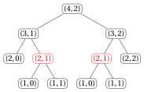

# Esercizi · Algoritmi ricorsivi e iterativi a confronto

**Esercizi · Capitolo 18** · ogni soluzione si apre con un clic · [:material-book-open-variant: Capitolo 18: Algoritmi ricorsivi e iterativi a confronto](../ricorsione/18-ricorsivo-iterativo.md) · [:material-file-pdf-box: Eserciziario, volume 5 (PDF)](../pdf/esercizi-5-ricorsione.pdf)

!!! esercizio "Esercizio 18.1: Algoritmi ricorsivi contro iterativi (E1)"

    Consideriamo i seguenti due algoritmi ricorsivi.

    

<strong>Algoritmo:</strong> GCDRec

    
Input: Due numeri naturali &#92;(a&#92;) e &#92;(b&#92;), non entrambi uguali a &#92;(0&#92;)

    
Output: Il massimo comune divisore di &#92;(a&#92;) e &#92;(b&#92;)

    

    

    
1<strong>function</strong> GCDRec(a, b)

    
2<strong>if</strong> &#92;(b = 0&#92;) <strong>then</strong>

    
3<strong>return</strong> &#92;(a&#92;)

    
4<strong>end</strong>

    
5<strong>return</strong> &#92;(&#92;texttt{GCDRec}(b,~ a &#92;bmod b)&#92;)

    
6<strong>end</strong>

    

    

<strong>Algoritmo:</strong> RecBinarySearch

    
Input: Un sotto-array ordinato &#92;(a&#91;l..r&#93;&#92;) e un valore da cercare &#92;(m&#92;)

    
Output: Un indice di &#92;(m&#92;) in &#92;(a&#91;l..r&#93;&#92;), oppure &#92;(-1&#92;) se &#92;(m&#92;) non è presente

    

    

    
1<strong>function</strong> RecBS(a, l, r, m)

    
2<strong>if</strong> &#92;(l &gt; r&#92;) <strong>then</strong>

    
3<strong>return</strong> &#92;(-1&#92;)

    
4<strong>end</strong>

    
5&#92;(mid := l + &#92;lfloor (r-l)/2 &#92;rfloor&#92;)

    
6<strong>if</strong> &#92;(a&#91;mid&#93; = m&#92;) <strong>then</strong>

    
7<strong>return</strong> &#92;(mid&#92;)

    
8<strong>end</strong>

    
9<strong>if</strong> &#92;(a&#91;mid&#93; &lt; m&#92;) <strong>then</strong>

    
10<strong>return</strong> &#92;(&#92;texttt{RecBS}(a, mid+1, r, m)&#92;)

    
11<strong>else</strong>

    
12<strong>return</strong> &#92;(&#92;texttt{RecBS}(a, l, mid-1, m)&#92;)

    
13<strong>end</strong>

    
14<strong>end</strong>

    

    **Domande**

    1. <code>GCDRec</code> e <code>RecBS</code> sono ricorsivi in coda? Giustificare la risposta.

    2. Trasformare <code>GCDRec</code> in un algoritmo iterativo equivalente <code>GCDIt</code>, applicando passo per passo l'eliminazione meccanica della ricorsione in coda. Poi eseguire entrambi gli algoritmi con $(a,b)=(1071,462)$, elencando i valori dei parametri in ogni chiamata e in ogni iterazione.

    3. Trasformare <code>RecBS</code> in un algoritmo iterativo equivalente <code>ItBS</code>. Poi eseguire entrambi gli algoritmi sull'array $a=[2,5,8,12,16,23,38,56,72,91]$ (con $l=1$, $r=10$) per $m=23$ e per $m=4$.

    4. Confrontare le versioni ricorsiva e iterativa dei due algoritmi in termini di tempo e spazio. In particolare, determinare la profondità della ricorsione di <code>GCDRec</code>$(89,55)$ e la massima profondità della ricorsione di <code>RecBS</code> su un array di $n=10^6$ elementi.

??? soluzione "Soluzione"

    1. Entrambi gli algoritmi sono ricorsivi in coda.

        - In <code>GCDRec</code> l'unica chiamata ricorsiva è alla riga [5](#riga-es-18-ricorsivo-iterativo-exrvione-c): il suo risultato viene restituito così com'è, senza alcuna ulteriore operazione.

        - In <code>RecBS</code> le chiamate ricorsive sono alle righe [10](#riga-es-18-ricorsivo-iterativo-exrvione-e) e [12](#riga-es-18-ricorsivo-iterativo-exrvione-f): in entrambi i casi il risultato della chiamata viene restituito così com'è.

        Quindi, dopo ogni chiamata ricorsiva, nella funzione chiamante non resta nulla da fare: il suo frame non serve più, e la chiamata può essere sostituita da un aggiornamento dei parametri.

    2. Applichiamo le tre regole dell'eliminazione meccanica della ricorsione in coda.

        - La condizione del caso base è $b=0$ (riga [2](#riga-es-18-ricorsivo-iterativo-exrvione-a)): la condizione del ciclo è $b\neq 0$.

        - La chiamata in coda $\texttt{GCDRec}(b,\, a\bmod b)$ diventa  l'assegnazione simultanea $(a,b)\leftarrow(b, a\bmod b)$. Poiché il nuovo valore di $b$ deve essere calcolato con il vecchio valore di $a$, usiamo una variabile temporanea $r$.

        - Il return del caso base (<strong>return</strong> $a$, riga [3](#riga-es-18-ricorsivo-iterativo-exrvione-b)) viene spostato dopo il ciclo.

        !!! algoritmo "Algoritmo: GCDIt"

            

            
1<strong>function</strong> GCDIt(a, b)

            
2<strong>while</strong> &#92;(b &#92;neq 0&#92;) <strong>do</strong>

            
3&#92;(r := a &#92;bmod b&#92;)

            
4&#92;(a &#92;leftarrow b&#92;)

            
5&#92;(b &#92;leftarrow r&#92;)

            
6<strong>end</strong>

            
7<strong>return</strong> &#92;(a&#92;)

            
8<strong>end</strong>

            

        Esecuzione con $(a,b)=(1071,462)$:

        
<table>
        <tr>
        <th colspan="4"><code>GCDRec</code></th>
        <th colspan="4"><code>GCDIt</code></th>
        </tr>
        <tr>
        <td>chiamata</td>
        <td>&#92;(a&#92;)</td>
        <td>&#92;(b&#92;)</td>
        <td>&#92;(a &#92;bmod b&#92;)</td>
        <td>iterazione</td>
        <td>&#92;(a&#92;)</td>
        <td>&#92;(b&#92;)</td>
        <td>&#92;(r&#92;)</td>
        </tr>
        <tr>
        <td>1</td>
        <td>1071</td>
        <td>462</td>
        <td>147</td>
        <td>1</td>
        <td>1071</td>
        <td>462</td>
        <td>147</td>
        </tr>
        <tr>
        <td>2</td>
        <td>462</td>
        <td>147</td>
        <td>21</td>
        <td>2</td>
        <td>462</td>
        <td>147</td>
        <td>21</td>
        </tr>
        <tr>
        <td>3</td>
        <td>147</td>
        <td>21</td>
        <td>0</td>
        <td>3</td>
        <td>147</td>
        <td>21</td>
        <td>0</td>
        </tr>
        <tr>
        <td>4</td>
        <td>21</td>
        <td>0</td>
        <td>–</td>
        <td>fine</td>
        <td>21</td>
        <td>0</td>
        <td>–</td>
        </tr>
        </table>

        Entrambi gli algoritmi passano per le stesse coppie $(1071,462)$, $(462,147)$, $(147,21)$, $(21,0)$ e restituiscono $21$. <code>GCDRec</code> esegue $4$ chiamate (tutte attive contemporaneamente quando si raggiunge il caso base); <code>GCDIt</code> esegue $3$ iterazioni.

    3. La condizione del caso base $l>r$ diventa la condizione del ciclo $l\le r$; il secondo caso base ($a[mid]=m$) resta dentro il ciclo come un return; la chiamata in coda alla riga [10](#riga-es-18-ricorsivo-iterativo-exrvione-e) diventa $l\leftarrow mid+1$ e la chiamata in coda alla riga [12](#riga-es-18-ricorsivo-iterativo-exrvione-f) diventa $r\leftarrow mid-1$ (i parametri $a$ e $m$ non cambiano); il return di $-1$ viene spostato dopo il ciclo.

        !!! algoritmo "Algoritmo: ItBinarySearch"

            

            
1<strong>function</strong> ItBS(a, l, r, m)

            
2<strong>while</strong> &#92;(l &#92;le r&#92;) <strong>do</strong>

            
3&#92;(mid := l + &#92;lfloor (r-l)/2 &#92;rfloor&#92;)

            
4<strong>if</strong> &#92;(a&#91;mid&#93; = m&#92;) <strong>then</strong>

            
5<strong>return</strong> &#92;(mid&#92;)

            
6<strong>end</strong>

            
7<strong>if</strong> &#92;(a&#91;mid&#93; &lt; m&#92;) <strong>then</strong>

            
8&#92;(l &#92;leftarrow mid+1&#92;)

            
9<strong>else</strong>

            
10&#92;(r &#92;leftarrow mid-1&#92;)

            
11<strong>end</strong>

            
12<strong>end</strong>

            
13<strong>return</strong> &#92;(-1&#92;)

            
14<strong>end</strong>

            

        I due algoritmi passano per gli stessi valori di $(l,r)$; per <code>RecBS</code> ogni riga è una chiamata, per <code>ItBS</code> ogni riga è un'iterazione (l'ultima riga con $l>r$ è il test finale del ciclo).

        - $m=23$:

            
<table>
            <tr>
            <th>chiamata / iterazione</th>
            <th>&#92;(l&#92;)</th>
            <th>&#92;(r&#92;)</th>
            <th>&#92;(mid&#92;)</th>
            <th>&#92;(a&#91;mid&#93;&#92;)</th>
            </tr>
            <tr>
            <td>1</td>
            <td>1</td>
            <td>10</td>
            <td>5</td>
            <td>&#92;(16&lt;23&#92;) &#92;(&#92;Rightarrow&#92;) &#92;(l=6&#92;)</td>
            </tr>
            <tr>
            <td>2</td>
            <td>6</td>
            <td>10</td>
            <td>8</td>
            <td>&#92;(56&gt;23&#92;) &#92;(&#92;Rightarrow&#92;) &#92;(r=7&#92;)</td>
            </tr>
            <tr>
            <td>3</td>
            <td>6</td>
            <td>7</td>
            <td>6</td>
            <td>&#92;(23=m&#92;) &#92;(&#92;Rightarrow&#92;) restituisce &#92;(6&#92;)</td>
            </tr>
            </table>

        - $m=4$:

            
<table>
            <tr>
            <th>chiamata / iterazione</th>
            <th>&#92;(l&#92;)</th>
            <th>&#92;(r&#92;)</th>
            <th>&#92;(mid&#92;)</th>
            <th>&#92;(a&#91;mid&#93;&#92;)</th>
            </tr>
            <tr>
            <td>1</td>
            <td>1</td>
            <td>10</td>
            <td>5</td>
            <td>&#92;(16&gt;4&#92;) &#92;(&#92;Rightarrow&#92;) &#92;(r=4&#92;)</td>
            </tr>
            <tr>
            <td>2</td>
            <td>1</td>
            <td>4</td>
            <td>2</td>
            <td>&#92;(5&gt;4&#92;) &#92;(&#92;Rightarrow&#92;) &#92;(r=1&#92;)</td>
            </tr>
            <tr>
            <td>3</td>
            <td>1</td>
            <td>1</td>
            <td>1</td>
            <td>&#92;(2&lt;4&#92;) &#92;(&#92;Rightarrow&#92;) &#92;(l=2&#92;)</td>
            </tr>
            <tr>
            <td>4</td>
            <td>2</td>
            <td>1</td>
            <td>–</td>
            <td>&#92;(l&gt;r&#92;) &#92;(&#92;Rightarrow&#92;) restituisce &#92;(-1&#92;)</td>
            </tr>
            </table>

        Per $m=23$ <code>RecBS</code> esegue $3$ chiamate e <code>ItBS</code> $3$ iterazioni; per $m=4$ <code>RecBS</code> esegue $4$ chiamate e <code>ItBS</code> $3$ iterazioni più il test finale.

    4. <strong>Tempo.</strong> Le versioni iterative passano per esattamente gli stessi valori dei parametri di quelle ricorsive, con un numero costante di passi per ogni chiamata / iterazione. Quindi il numero di passi ha lo stesso ordine di crescita: $\Theta(\log\min(a,b))$ nel caso peggiore per l'MCD e $\Theta(\log_2 n)$ nel caso peggiore per la ricerca binaria. Le versioni ricorsive pagano soltanto il sovraccarico (costante) delle chiamate.

        <strong>Spazio.</strong> Le versioni iterative usano $\Theta(1)$ di memoria aggiuntiva (i parametri e le variabili $r$ o $mid$). Nelle versioni ricorsive tutte le chiamate restano attive finché non si raggiunge il caso base, quindi la pila contiene tanti frame quanti sono la profondità della ricorsione.

        - <code>GCDRec</code>$(89,55)$ passa per le coppie

            $$
            (89,55),(55,34),(34,21),(21,13),(13,8),(8,5),(5,3),(3,2),(2,1),(1,0),
            $$

            quindi la profondità della ricorsione è $10$. Numeri di Fibonacci consecutivi sono il caso peggiore dell'algoritmo di Euclide: la profondità è $\Theta(\log\min(a,b))$.

        - Per <code>RecBS</code> su $n$ elementi la profondità massima è $\lfloor\log_2 n\rfloor+2$ (le dimensioni dei sotto-array sono al più $n,\lfloor n/2\rfloor,\dots,1$, più l'ultima chiamata sul sotto-array vuoto). Per $n=10^6$: $\lfloor\log_2 10^6\rfloor+2=19+2=21$.

        !!! chiave ""

            Per entrambi gli algoritmi, la ricorsione non dà <strong>alcun guadagno</strong> in tempo e una (piccola, logaritmica) <strong>perdita</strong> in spazio. Poiché sono ricorsivi in coda, la ricorsione può essere eliminata meccanicamente, ottenendo cicli con $\Theta(1)$ di memoria aggiuntiva.

!!! esercizio "Esercizio 18.2: Algoritmi ricorsivi contro iterativi (E2)"

    Consideriamo i seguenti algoritmi ricorsivi e dimensioni dell'input.

    - **(a)** $\texttt{Fact}(n)$: restituisce $1$ se $n=0$, altrimenti $n\cdot\texttt{Fact}(n-1)$; con $n=1000$.

    - **(b)** $\texttt{SumDecrease}(a,n)$: restituisce $0$ se $n=0$, altrimenti $\texttt{SumDecrease}(a,n-1)+a[n]$; con $n=10^6$.

    - **(c)** $\texttt{SumHalving}(a,l,r)$: restituisce $a[l]$ se $l=r$, altrimenti $\texttt{SumHalving}(a,l,mid)+\texttt{SumHalving}(a,mid+1,r)$ con $mid=\lfloor(l+r)/2\rfloor$; su un array di $n=10^6$ elementi.

    - **(d)** Merge Sort su un array di $n=1000$ elementi (caso base: sotto-array di un elemento).

    - **(e)** Torre di Hanoi con $n=20$ dischi (caso base: $0$ dischi).

    - **(f)** $\texttt{FibRec}(n)$: restituisce $n$ se $n\le 1$, altrimenti $\texttt{FibRec}(n-1)+\texttt{FibRec}(n-2)$; con $n=30$.

    - **(g)** Potenza veloce ricorsiva $x^n$ (caso base: $n=0$; chiamata ricorsiva su $\lfloor n/2\rfloor$); con $n=10^9$.

    Supponiamo che ogni frame della pila occupi $48$ byte e che la pila delle chiamate abbia una dimensione di $8$ MB $=8\cdot 2^{20}=8\,388\,608$ byte.

    **Domande**

    1. Determinare la profondità della ricorsione di ciascun algoritmo per la dimensione dell'input data.

    2. Determinare la memoria occupata dalla pila delle chiamate al suo massimo, e dire quali esecuzioni causano uno stack overflow.

    3. Determinare il massimo $n$ per cui $\texttt{SumDecrease}(a,n)$ non causa uno stack overflow, e la profondità di $\texttt{SumHalving}$ per lo stesso $n$.

    4. Per $\texttt{FibRec}(30)$, confrontare la profondità della ricorsione con il numero totale di chiamate. Il problema di questo algoritmo è lo spazio o il tempo?

??? soluzione "Soluzione"

    1. La profondità della ricorsione è il massimo numero di chiamate attive contemporaneamente, cioè il numero di chiamate sul cammino più lungo dalla radice a una foglia dell'albero di ricorsione.

        - **(a)** Le chiamate attive sono $\texttt{Fact}(1000),\texttt{Fact}(999),\dots,\texttt{Fact}(0)$: profondità $n+1=1001$.

        - **(b)** Le chiamate attive sono $\texttt{SumDecrease}(a,10^6),\dots,\texttt{SumDecrease}(a,0)$: profondità $n+1=1\,000\,001$.

        - **(c)** Il sotto-array più grande al livello $t$ dell'albero ha $\lceil n/2^t\rceil$ elementi, che diventa $1$ per $t=\lceil\log_2 n\rceil$. Profondità $\lceil\log_2 n\rceil+1$; poiché $2^{19}=524\,288<10^6\le 2^{20}=1\,048\,576$, si ha $\lceil\log_2 10^6\rceil=20$ e la profondità è $21$.

        - **(d)** Come in (c): $\lceil\log_2 1000\rceil+1=10+1=11$ (poiché $2^9=512<1000\le 2^{10}=1024$).

        - **(e)** Le chiamate attive sono $\texttt{Hanoi}(20),\texttt{Hanoi}(19),\dots,\texttt{Hanoi}(0)$: profondità $n+1=21$.

        - **(f)** Il cammino più lungo è $\texttt{FibRec}(30),\texttt{FibRec}(29),\dots,\texttt{FibRec}(1)$: profondità $n=30$.

        - **(g)** L'esponente assume i valori $n,\lfloor n/2\rfloor,\dots,1,0$, cioè la profondità è $\lfloor\log_2 n\rfloor+2$. Poiché $2^{29}=536\,870\,912\le 10^9<2^{30}$, si ha $\lfloor\log_2 10^9\rfloor=29$ e la profondità è $31$.

    2. La memoria della pila al suo massimo è $48$ byte per la profondità:

        
<table>
        <tr>
        <th></th>
        <th>algoritmo</th>
        <th>profondità</th>
        <th>pila (byte)</th>
        <th>overflow?</th>
        </tr>
        <tr>
        <td>(a)</td>
        <td><code>Fact</code>&#92;((1000)&#92;)</td>
        <td>&#92;(1&#92;,001&#92;)</td>
        <td>&#92;(48&#92;,048&#92;)</td>
        <td>no</td>
        </tr>
        <tr>
        <td>(b)</td>
        <td><code>SumDecrease</code>, &#92;(n=10^6&#92;)</td>
        <td>&#92;(1&#92;,000&#92;,001&#92;)</td>
        <td>&#92;(48&#92;,000&#92;,048&#92;)</td>
        <td>sì</td>
        </tr>
        <tr>
        <td>(c)</td>
        <td><code>SumHalving</code>, &#92;(n=10^6&#92;)</td>
        <td>&#92;(21&#92;)</td>
        <td>&#92;(1&#92;,008&#92;)</td>
        <td>no</td>
        </tr>
        <tr>
        <td>(d)</td>
        <td>Merge Sort, &#92;(n=1000&#92;)</td>
        <td>&#92;(11&#92;)</td>
        <td>&#92;(528&#92;)</td>
        <td>no</td>
        </tr>
        <tr>
        <td>(e)</td>
        <td>Hanoi, &#92;(n=20&#92;)</td>
        <td>&#92;(21&#92;)</td>
        <td>&#92;(1&#92;,008&#92;)</td>
        <td>no</td>
        </tr>
        <tr>
        <td>(f)</td>
        <td><code>FibRec</code>&#92;((30)&#92;)</td>
        <td>&#92;(30&#92;)</td>
        <td>&#92;(1&#92;,440&#92;)</td>
        <td>no</td>
        </tr>
        <tr>
        <td>(g)</td>
        <td>potenza veloce, &#92;(n=10^9&#92;)</td>
        <td>&#92;(31&#92;)</td>
        <td>&#92;(1&#92;,488&#92;)</td>
        <td>no</td>
        </tr>
        </table>

        Solo (b) causa uno stack overflow: $48\,000\,048>8\,388\,608$ byte (circa $46$ MB contro $8$ MB).

    3. La pila contiene al più $\lfloor 8\,388\,608/48\rfloor=174\,762$ frame. $\texttt{SumDecrease}(a,n)$ richiede $n+1$ frame, quindi non va in overflow se e solo se

        $$
        n+1\le 174\,762 \quad\Longleftrightarrow\quad n\le 174\,761.
        $$

        Per $n=174\,761$, poiché $2^{17}=131\,072<n\le 2^{18}=262\,144$, $\texttt{SumHalving}$ ha profondità $\lceil\log_2 n\rceil+1=18+1=19$, cioè $912$ byte di pila. Entrambi gli algoritmi eseguono $\Theta(n)$ passi: la versione per dimezzamento usa una pila esponenzialmente più piccola.

    4. $\texttt{FibRec}(30)$ ha profondità $30$ (solo $1\,440$ byte di pila), ma esegue

        $$
        2F(31)-1=2\cdot 1\,346\,269-1=2\,692\,537
        $$

        chiamate. Il problema di <code>FibRec</code> è il <strong>tempo</strong>, $\Theta(\varphi^n)$, non lo spazio, $\Theta(n)$: la profondità della ricorsione e il numero di chiamate sono due quantità molto diverse.

        !!! chiave ""

            Una profondità della ricorsione $\Theta(\log_2 n)$ non è mai un problema in pratica; una profondità $\Theta(n)$ (decremento di uno) causa uno stack overflow già per $n$ dell'ordine di $10^5$–$10^6$, mentre il ciclo corrispondente usa $\Theta(1)$ di memoria.

!!! esercizio "Esercizio 18.3: Algoritmi ricorsivi contro iterativi (E3)"

    Consideriamo i seguenti quattro algoritmi ricorsivi.

    

    

<strong>Algoritmo:</strong> A: MaxDecrease

    
1<strong>function</strong> MaxDec(a, n)

    
2<strong>if</strong> &#92;(n = 1&#92;) <strong>then</strong>

    
3<strong>return</strong> &#92;(a&#91;1&#93;&#92;)

    
4<strong>end</strong>

    
5<strong>return</strong> &#92;(&#92;max(&#92;texttt{MaxDec}(a, n-1),~ a&#91;n&#93;)&#92;)

    
6<strong>end</strong>

    

    

    

    

<strong>Algoritmo:</strong> B: MaxHalving

    
1<strong>function</strong> MaxHalf(a, l, r)

    
2<strong>if</strong> &#92;(l = r&#92;) <strong>then</strong>

    
3<strong>return</strong> &#92;(a&#91;l&#93;&#92;)

    
4<strong>end</strong>

    
5&#92;(mid := &#92;lfloor (l+r)/2 &#92;rfloor&#92;)

    
6<strong>return</strong> &#92;(&#92;max(&#92;texttt{MaxHalf}(a,l,mid),&#92;)  &#92;(&#92;texttt{MaxHalf}(a,mid+1,r))&#92;)

    
7<strong>end</strong>

    

    

    

    

<strong>Algoritmo:</strong> C: PowerDecrease

    
1<strong>function</strong> PowDec(x, n)

    
2<strong>if</strong> &#92;(n = 0&#92;) <strong>then</strong>

    
3<strong>return</strong> &#92;(1&#92;)

    
4<strong>end</strong>

    
5<strong>return</strong> &#92;(x&#92;cdot &#92;texttt{PowDec}(x, n-1)&#92;)

    
6<strong>end</strong>

    

    

    

    

<strong>Algoritmo:</strong> D: Tribonacci

    
1<strong>function</strong> Trib(n)

    
2<strong>if</strong> &#92;(n &#92;le 2&#92;) <strong>then</strong>

    
3<strong>return</strong> &#92;(&#92;lfloor n/2 &#92;rfloor&#92;)

    
4<strong>end</strong>

    
5<strong>return</strong> &#92;(&#92;texttt{Trib}(n-1)+&#92;texttt{Trib}(n-2)&#92;)  &#92;(+&#92;,&#92;texttt{Trib}(n-3)&#92;)

    
6<strong>end</strong>

    

    

    <code>MaxDec</code> e <code>MaxHalf</code> calcolano il massimo di un array $a[1..n]$ (<code>MaxHalf</code> si chiama come $\texttt{MaxHalf}(a,1,n)$); <code>PowDec</code> calcola $x^n$; <code>Trib</code> calcola i numeri di Tribonacci $T(0)=0$, $T(1)=0$, $T(2)=1$, $T(n)=T(n-1)+T(n-2)+T(n-3)$.

    **Domande**

    Per ciascuno dei quattro algoritmi:

    1. scrivere l'equazione di ricorrenza del numero di passi $S(n)$ e determinarne l'ordine di crescita;

    2. determinare la profondità della ricorsione e la memoria aggiuntiva usata;

    3. indicare il miglior algoritmo iterativo visto nel corso per lo stesso problema, con il suo tempo e il suo spazio;

    4. decidere se la ricorsione guadagna, è equivalente o perde, giustificando la risposta.

??? soluzione "Soluzione"

    ### A: MaxDecrease

    1. Ogni chiamata esegue un numero costante $c$ di passi oltre alla chiamata ricorsiva su $n-1$ elementi:

        $$
        S(n)=S(n-1)+c,\qquad S(1)=d.
        $$

        Srotolando, $S(n)=d+c\,(n-1)=\Theta(n)$.

    2. Le chiamate $\texttt{MaxDec}(a,n),\dots,\texttt{MaxDec}(a,1)$ sono tutte attive contemporaneamente: profondità $n$, memoria aggiuntiva $\Theta(n)$. L'algoritmo non è ricorsivo in coda (il massimo viene calcolato dopo che la chiamata termina).

    3. <code>FindMaximum</code> (capitolo «Tempo di esecuzione»): un ciclo con $S(n)=4n-1=\Theta(n)$ passi e $\Theta(1)$ di memoria aggiuntiva.

    4. <strong>UGUALE</strong> tempo, <strong>PERDITA</strong> in spazio: la ricorsione per decremento di uno è un ciclo sotto mentite spoglie, con un sovraccarico delle chiamate e un rischio di stack overflow per $n$ grande.

    ### B: MaxHalving

    1. Due chiamate ricorsive sulle metà, più un numero costante di passi:

        $$
        S(n)=2S(n/2)+\Theta(1).
        $$

        Master theorem: $a=2$, $b=2$, $f(n)=\Theta(1)$; $n^{\log_b a}=n^{\log_2 2}=n$. Poiché $f(n)=\Theta(1)=O(n^{1-\varepsilon})$ con $\varepsilon=1$, il caso 1 dà $S(n)=\Theta(n)$.

    2. Profondità $\lceil\log_2 n\rceil+1$, memoria aggiuntiva $\Theta(\log_2 n)$.

    3. Di nuovo <code>FindMaximum</code>: tempo $\Theta(n)$, spazio $\Theta(1)$.

    4. <strong>UGUALE</strong> tempo, piccola <strong>PERDITA</strong> in spazio ($\Theta(\log_2 n)$). Il divide et impera qui non aiuta: l'albero di ricorsione ha $2n-1$ nodi, ciascuno con lavoro costante, quindi il lavoro totale è ancora $\Theta(n)$. Nessun algoritmo può fare di meglio, perché ogni elemento deve essere esaminato almeno una volta. Il divide et impera dà un guadagno solo quando riduce il lavoro totale, come nel Merge Sort, in cui la combinazione delle metà costa $\Theta(n)$ invece dei $\Theta(n^2)$ degli algoritmi iterativi.

    ### C: PowerDecrease

    1. $S(n)=S(n-1)+c$, $S(0)=d$ $\Rightarrow$ $S(n)=c\,n+d=\Theta(n)$.

    2. Profondità $n+1$ (chiamate con esponente $n,n-1,\dots,0$), memoria aggiuntiva $\Theta(n)$.

    3. Il ciclo con $n$ moltiplicazioni ha tempo $\Theta(n)$ e spazio $\Theta(1)$; l'algoritmo iterativo square-and-multiply <code>PowerIt</code> ha tempo $\Theta(\log_2 n)$ e spazio $\Theta(1)$.

    4. <strong>PERDITA</strong>: stesso tempo del semplice ciclo e $\Theta(n)$ di memoria; rispetto al ciclo square-and-multiply è addirittura esponenzialmente più lento in termini di $\log_2 n$. La ricorsione conviene per la potenza solo quando <strong>dimezza</strong> l'esponente (potenza veloce): $S(n)=S(n/2)+\Theta(1)=\Theta(\log_2 n)$.

    ### D: Tribonacci

    1. Sia $C(n)$ il numero di chiamate; allora $C(0)=C(1)=C(2)=1$ e

        $$
        C(n)=1+C(n-1)+C(n-2)+C(n-3),\qquad n\ge 3,
        $$

        e $S(n)=\Theta(C(n))$, poiché ogni chiamata esegue un numero costante di passi. La funzione $C$ è non decrescente, quindi per $n\ge 3$

        $$
        C(n)\ge 3\,C(n-3)\ge 3^2C(n-6)\ge\cdots\ge 3^{\lfloor n/3\rfloor}.
        $$

        Quindi $S(n)=\Omega(3^{n/3})=\Omega(1.442^n)$: l'algoritmo è esponenziale. (Per esempio $C(10)=289$, $C(20)=128\,287$, $C(25)=2\,700\,421$.) Allo stesso modo, $C(n)\le 3C(n-1)+1$ dà $S(n)=O(3^n)$.

    2. Il cammino più lungo nell'albero di ricorsione è $\texttt{Trib}(n),\texttt{Trib}(n-1),\dots,\texttt{Trib}(2)$: profondità $n-1$, memoria aggiuntiva $\Theta(n)$.

    3. Un ciclo che calcola $T(3),T(4),\dots,T(n)$ tenendo solo gli ultimi tre valori in tre variabili: tempo $\Theta(n)$ e spazio $\Theta(1)$.

    4. Enorme <strong>PERDITA</strong>: i sottoproblemi si <strong>sovrappongono</strong> (per esempio $\texttt{Trib}(n-1)$ e $\texttt{Trib}(n-2)$ chiamano entrambe $\texttt{Trib}(n-3)$), quindi gli stessi valori vengono ricalcolati un numero esponenziale di volte. La memoizzazione o il ciclo bottom-up (programmazione dinamica) riportano il tempo a $\Theta(n)$.

    !!! chiave ""

        
<table>
        <tr>
        <th></th>
        <th colspan="2">ricorsivo</th>
        <th>miglior iterativo</th>
        <th>esito</th>
        </tr>
        <tr>
        <td></td>
        <td>tempo</td>
        <td>spazio</td>
        <td>tempo, spazio</td>
        <td></td>
        </tr>
        <tr>
        <td>A</td>
        <td>&#92;(&#92;Theta(n)&#92;)</td>
        <td>&#92;(&#92;Theta(n)&#92;)</td>
        <td>&#92;(&#92;Theta(n)&#92;), &#92;(&#92;Theta(1)&#92;)</td>
        <td>stesso tempo, perdita in spazio</td>
        </tr>
        <tr>
        <td>B</td>
        <td>&#92;(&#92;Theta(n)&#92;)</td>
        <td>&#92;(&#92;Theta(&#92;log&#95;2 n)&#92;)</td>
        <td>&#92;(&#92;Theta(n)&#92;), &#92;(&#92;Theta(1)&#92;)</td>
        <td>stesso tempo, piccola perdita</td>
        </tr>
        <tr>
        <td>C</td>
        <td>&#92;(&#92;Theta(n)&#92;)</td>
        <td>&#92;(&#92;Theta(n)&#92;)</td>
        <td>&#92;(&#92;Theta(&#92;log&#95;2 n)&#92;), &#92;(&#92;Theta(1)&#92;)</td>
        <td>perdita</td>
        </tr>
        <tr>
        <td>D</td>
        <td>esponenziale</td>
        <td>&#92;(&#92;Theta(n)&#92;)</td>
        <td>&#92;(&#92;Theta(n)&#92;), &#92;(&#92;Theta(1)&#92;)</td>
        <td>enorme perdita</td>
        </tr>
        </table>

!!! esercizio "Esercizio 18.4: Algoritmi ricorsivi contro iterativi (E4)"

    I coefficienti binomiali soddisfano, per $0<k<n$, l'equazione di ricorrenza (regola di Pascal)

    $$
    \binom{n}{k}=\binom{n-1}{k-1}+\binom{n-1}{k},\qquad \binom{n}{0}=\binom{n}{n}=1.
    $$

    Consideriamo il seguente algoritmo ricorsivo.

    

<strong>Algoritmo:</strong> BinomRec

    
Input: Due numeri naturali &#92;(n&#92;) e &#92;(k&#92;) con &#92;(0&#92;le k&#92;le n&#92;)

    
Output: Il coefficiente binomiale &#92;(&#92;binom{n}{k}&#92;)

    

    

    
1<strong>function</strong> BinomRec(n, k)

    
2<strong>if</strong> &#92;(k = 0&#92;) <strong>or</strong> &#92;(k = n&#92;) <strong>then</strong>

    
3<strong>return</strong> &#92;(1&#92;)

    
4<strong>end</strong>

    
5<strong>return</strong> &#92;(&#92;texttt{BinomRec}(n-1, k-1) + &#92;texttt{BinomRec}(n-1, k)&#92;)

    
6<strong>end</strong>

    

    **Domande**

    1. Disegnare l'albero di ricorsione di $\texttt{BinomRec}(4,2)$, contare le chiamate e indicare i sottoproblemi che vengono risolti più di una volta.

    2. Dimostrare che il numero di chiamate eseguite da $\texttt{BinomRec}(n,k)$ è $N(n,k)=2\binom{n}{k}-1$.

    3. Calcolare $N(10,5)$, $N(30,15)$ e $N(40,20)$, e stimare il tempo richiesto da $\texttt{BinomRec}(40,20)$ su un calcolatore che esegue $10^9$ chiamate al secondo.

    4. Scrivere una versione con memoizzazione <code>BinomMemo</code> e dimostrare che, per $0<k<n$, esegue esattamente $2k(n-k)+1$ chiamate. Calcolare questo numero per i tre casi della domanda 3.

    5. Scrivere un algoritmo iterativo che calcola $\binom{n}{k}$ riga per riga (triangolo di Pascal), e darne il tempo e lo spazio.

??? soluzione "Soluzione"

    1. Ogni nodo è una chiamata, etichettata con $(n,k)$; le foglie sono casi base ($k=0$ oppure $k=n$) e restituiscono $1$.

        { .fig loading=lazy  }

        L'albero ha $11$ nodi, cioè $11$ chiamate, e $6=\binom{4}{2}$ foglie. Il sottoproblema $(2,1)$ viene risolto due volte (e così le sue sotto-chiamate $(1,0)$ e $(1,1)$).

    2. Ogni chiamata è o una foglia (caso base, restituisce $1$) o un nodo interno con esattamente due figli. Il valore restituito da una chiamata è la somma dei valori restituiti dalle foglie del suo sotto-albero, cioè il numero delle sue foglie. Quindi l'albero di $\texttt{BinomRec}(n,k)$ ha $\binom{n}{k}$ foglie.

        In un albero in cui ogni nodo interno ha esattamente due figli, il numero di nodi interni è il numero di foglie meno uno (per induzione: una singola foglia ha $0$ nodi interni; unendo due alberi di questo tipo con $L_1$ e $L_2$ foglie sotto una nuova radice si ottengono $(L_1-1)+(L_2-1)+1=(L_1+L_2)-1$ nodi interni). Quindi

        $$
        N(n,k)=\binom{n}{k}+\left(\binom{n}{k}-1\right)=2\binom{n}{k}-1.
        $$

        Per esempio $N(4,2)=2\cdot 6-1=11$, come nella domanda 1.

    3.

        $$
        N(10,5)=2\cdot 252-1=503,\qquad N(30,15)=2\cdot 155\,117\,520-1=310\,235\,039,
        $$

        $$
        N(40,20)=2\cdot 137\,846\,528\,820-1=275\,693\,057\,639.
        $$

        A $10^9$ chiamate al secondo, $\texttt{BinomRec}(40,20)$ richiede circa $275.7$ secondi, cioè più di $4.5$ minuti, per calcolare un numero che si può ottenere con qualche centinaio di addizioni (si vedano le domande 4 e 5). Poiché $\binom{2m}{m}\ge \frac{4^m}{2m+1}$, il numero di chiamate cresce in modo esponenziale.

    4. Memorizziamo i valori già calcolati in una tabella $memo$, indicizzata dalla coppia $(i,j)$:

        !!! algoritmo "Algoritmo: BinomMemo"

            

            
Input: Numeri naturali &#92;(0&#92;le k&#92;le n&#92;) e una tabella &#92;(memo&#92;) le cui voci sono tutte <em>non definite</em>

            
Output: Il coefficiente binomiale &#92;(&#92;binom{n}{k}&#92;)

            

            

            
1<strong>function</strong> BinomMemo(n, k, memo)

            
2<strong>if</strong> &#92;(k = 0&#92;) <strong>or</strong> &#92;(k = n&#92;) <strong>then</strong>

            
3<strong>return</strong> &#92;(1&#92;)

            
4<strong>end</strong>

            
5<strong>if</strong> &#92;(memo&#91;n&#93;&#91;k&#93;&#92;) è <em>non definita</em> <strong>then</strong>

            
6&#92;(memo&#91;n&#93;&#91;k&#93; &#92;leftarrow &#92;texttt{BinomMemo}(n-1,k-1,memo)+&#92;texttt{BinomMemo}(n-1,k,memo)&#92;)

            
7<strong>end</strong>

            
8<strong>return</strong> &#92;(memo&#91;n&#93;&#91;k&#93;&#92;)

            
9<strong>end</strong>

            

        <em>Numero di chiamate.</em> A partire da $(n,k)$, una chiamata raggiunge le coppie $(n-s,\,k-t)$, dove $s$ è il numero di passi verso il basso e $t\le s$ è il numero di questi passi in cui $k$ diminuisce. Sia $u=s-t$ il numero di passi in cui $k$ non diminuisce. Una coppia è <strong>interna</strong> (non è un caso base) se $k-t\ge 1$ e $(n-s)-(k-t)\ge 1$, cioè

        $$
        0\le t\le k-1 \qquad\text{e}\qquad 0\le u\le n-k-1,
        $$

        quindi ci sono esattamente $k(n-k)$ sottoproblemi interni, e tutti vengono raggiunti. Il corpo di ciascun sottoproblema interno (le due chiamate ricorsive) viene eseguito solo la <strong>prima</strong> volta che viene chiamato; le volte successive il valore viene letto da $memo$. Ogni chiamata, tranne la prima, è effettuata dal corpo di un sottoproblema interno, che effettua esattamente $2$ chiamate. Quindi il numero di chiamate è

        $$
        1+2k(n-k).
        $$

        Per i tre casi:

        $$
        (10,5):~1+2\cdot 25=51,\qquad (30,15):~1+2\cdot 225=451,\qquad (40,20):~1+2\cdot 400=801,
        $$

        contro le $503$, $310\,235\,039$ e $275\,693\,057\,639$ chiamate di <code>BinomRec</code>. Il tempo è $\Theta(k(n-k))$ e la memoria è $\Theta(k(n-k))$ per la tabella più $\Theta(n)$ per la pila (profondità $\le n$).

    5. La riga $i$ del triangolo di Pascal si calcola dalla riga $i-1$. Tenendo un solo array $c[0..k]$ e aggiornandolo da destra a sinistra (in modo che $c[j-1]$ contenga ancora il valore della riga precedente quando si aggiorna $c[j]$):

        !!! algoritmo "Algoritmo: BinomIt"

            

            
Input: Due numeri naturali &#92;(n&#92;) e &#92;(k&#92;) con &#92;(0&#92;le k&#92;le n&#92;)

            
Output: Il coefficiente binomiale &#92;(&#92;binom{n}{k}&#92;)

            

            

            
1<strong>function</strong> BinomIt(n, k)

            
2&#92;(c&#91;0&#93; := 1&#92;); &#92;(c&#91;1..k&#93; := 0&#92;)

            
3&#92;(i := 1&#92;)

            
4<strong>while</strong> &#92;(i &#92;le n&#92;) <strong>do</strong>

            
5&#92;(j := &#92;min(i,k)&#92;)

            
6<strong>while</strong> &#92;(j &#92;ge 1&#92;) <strong>do</strong>

            
7&#92;(c&#91;j&#93; &#92;leftarrow c&#91;j&#93; + c&#91;j-1&#93;&#92;)

            
8&#92;(j &#92;leftarrow j-1&#92;)

            
9<strong>end</strong>

            
10&#92;(i &#92;leftarrow i+1&#92;)

            
11<strong>end</strong>

            
12<strong>return</strong> &#92;(c&#91;k&#93;&#92;)

            
13<strong>end</strong>

            

        Dopo la $i$-esima iterazione del ciclo esterno, $c[j]=\binom{i}{j}$ per $0\le j\le \min(i,k)$. Il ciclo interno viene eseguito al più $k$ volte per ciascuna delle $n$ righe: tempo $O(n\,k)$ (e $\Theta(nk)$ quando $k\le n/2$), memoria aggiuntiva $\Theta(k)$, nessuna ricorsione. Per $(40,20)$ l'algoritmo esegue $\sum_{i=1}^{40}\min(i,20)=210+400=610$ addizioni.

        !!! chiave ""

            La ricorsione ingenua è esponenziale perché i sottoproblemi si sovrappongono; la memoizzazione (top-down) e il triangolo di Pascal iterativo (bottom-up) risolvono ogni sottoproblema una sola volta, con un numero polinomiale di passi. Questa è l'idea della programmazione dinamica.

!!! esercizio "Esercizio 18.5: Algoritmi ricorsivi contro iterativi (E5)"

    Consideriamo i due seguenti algoritmi per i numeri di Fibonacci ($F(0)=0$, $F(1)=1$, $F(n)=F(n-1)+F(n-2)$).

    

    

<strong>Algoritmo:</strong> FibRec

    
1<strong>function</strong> FibRec(n)

    
2<strong>if</strong> &#92;(n &#92;le 1&#92;) <strong>then</strong>

    
3<strong>return</strong> &#92;(n&#92;)

    
4<strong>end</strong>

    
5<strong>return</strong> &#92;(&#92;texttt{FibRec}(n-1)&#92;) &#92;(+&#92;,&#92;texttt{FibRec}(n-2)&#92;)

    
6<strong>end</strong>

    

    

    

    

<strong>Algoritmo:</strong> FibIt

    
1<strong>function</strong> FibIt(n)

    
2<strong>if</strong> &#92;(n &#92;le 1&#92;) <strong>then</strong>

    
3<strong>return</strong> &#92;(n&#92;)

    
4<strong>end</strong>

    
5&#92;(prev := 0&#92;)

    
6&#92;(curr := 1&#92;)

    
7&#92;(i := 2&#92;)

    
8<strong>while</strong> &#92;(i &#92;le n&#92;) <strong>do</strong>

    
9&#92;(next := prev + curr&#92;)

    
10&#92;(prev &#92;leftarrow curr&#92;)

    
11&#92;(curr &#92;leftarrow next&#92;)

    
12&#92;(i &#92;leftarrow i+1&#92;)

    
13<strong>end</strong>

    
14<strong>return</strong> &#92;(curr&#92;)

    
15<strong>end</strong>

    

    

    Supponiamo che ogni riga eseguita conti come un passo (la riga [5](#riga-es-18-ricorsivo-iterativo-exrvifive-c) conta come un passo, oltre ai passi delle due sotto-chiamate) e che il calcolatore esegua $10^9$ passi al secondo.

    **Domande**

    1. Determinare il numero esatto di passi $S_{it}(n)$ eseguiti da <code>FibIt</code> per $n\ge 2$.

    2. Determinare il numero esatto di passi $S_{rec}(n)$ eseguiti da <code>FibRec</code>, usando il fatto che <code>FibRec</code>$(n)$ esegue $2F(n+1)-1$ chiamate.

    3. Stimare i tempi di esecuzione dei due algoritmi per $n=50$, sapendo che

        $$
        F(51)=20\,365\,011\,074.
        $$

    4. Stimare il tempo di esecuzione di <code>FibRec</code> per $n=60$ e $n=100$, sapendo che

        $$
        F(61)=2\,504\,730\,781\,961 \qquad\text{e}\qquad F(101)\approx 5.73\cdot 10^{20}.
        $$

    5. Determinare il massimo $n$ per cui <code>FibRec</code> termina entro un'ora, sapendo che

        $$
        F(58)=591\,286\,729\,879\qquad\text{e}\qquad F(59)=956\,722\,026\,041.
        $$

??? soluzione "Soluzione"

    1. Per $n\ge 2$ il numero di volte che ciascuna riga di <code>FibIt</code> viene eseguita è:

        - La riga [2](#riga-es-18-ricorsivo-iterativo-exrvifive-d) viene eseguita $1$ volta (il return nella riga successiva non viene eseguito)

        - Le righe [5](#riga-es-18-ricorsivo-iterativo-exrvifive-e), [6](#riga-es-18-ricorsivo-iterativo-exrvifive-f), [7](#riga-es-18-ricorsivo-iterativo-exrvifive-g) vengono eseguite $1$ volta ciascuna

        - La riga [8](#riga-es-18-ricorsivo-iterativo-exrvifive-h) viene eseguita $n$ volte ($i=2,3,\dots,n+1$)

        - Le righe [9](#riga-es-18-ricorsivo-iterativo-exrvifive-i), [10](#riga-es-18-ricorsivo-iterativo-exrvifive-j), [11](#riga-es-18-ricorsivo-iterativo-exrvifive-k), [12](#riga-es-18-ricorsivo-iterativo-exrvifive-l) vengono eseguite $n-1$ volte ciascuna

        - La riga [14](#riga-es-18-ricorsivo-iterativo-exrvifive-m) viene eseguita $1$ volta

        Quindi

        $$
        S_{it}(n)=1+3+n+4(n-1)+1=5n+1=\Theta(n).
        $$

    2. Ogni chiamata di <code>FibRec</code> esegue esattamente $2$ passi propri: la riga [2](#riga-es-18-ricorsivo-iterativo-exrvifive-a) e poi o la riga [3](#riga-es-18-ricorsivo-iterativo-exrvifive-b) (caso base) o la riga [5](#riga-es-18-ricorsivo-iterativo-exrvifive-c). Poiché $\texttt{FibRec}(n)$ esegue $2F(n+1)-1$ chiamate,

        $$
        S_{rec}(n)=2\big(2F(n+1)-1\big)=4F(n+1)-2=\Theta(\varphi^n).
        $$

    3. Per $n=50$:

        $$
        S_{it}(50)=5\cdot 50+1=251 \text{ passi}\quad\Longrightarrow\quad \frac{251}{10^9}\text{ s}=251\text{ ns},
        $$

        $$
        S_{rec}(50)=4\cdot 20\,365\,011\,074-2=81\,460\,044\,294 \text{ passi}\quad\Longrightarrow\quad \approx 81.5 \text{ s}.
        $$

        L'algoritmo ricorsivo è circa $3\cdot 10^8$ volte più lento.

    4. Per $n=60$:

        $$
        S_{rec}(60)=4\cdot 2\,504\,730\,781\,961-2=10\,018\,923\,127\,842\text{ passi}\quad\Longrightarrow\quad\approx 10\,019\text{ s}\approx 2.8\text{ ore}.
        $$

        Per $n=100$:

        $$
        S_{rec}(100)\approx 4\cdot 5.73\cdot 10^{20}\approx 2.29\cdot 10^{21}\text{ passi}\quad\Longrightarrow\quad\approx 2.29\cdot 10^{12}\text{ s}.
        $$

        Poiché un anno ha circa $3.156\cdot 10^7$ secondi, questo corrisponde a circa $7.3\cdot 10^4$ anni. Nel frattempo, <code>FibIt</code>$(100)$ esegue $501$ passi, cioè circa mezzo microsecondo.

    5. Un'ora corrisponde a $3600\cdot 10^9=3.6\cdot 10^{12}$ passi. Servono

        $$
        4F(n+1)-2\le 3.6\cdot 10^{12}\quad\Longleftrightarrow\quad F(n+1)\le 9\cdot 10^{11}+0.5.
        $$

        Poiché $F(58)=591\,286\,729\,879\le 9\cdot 10^{11}<F(59)=956\,722\,026\,041$, la condizione vale per $n+1\le 58$. Il massimo $n$ è $n=57$, con

        $$
        S_{rec}(57)=4\cdot 591\,286\,729\,879-2=2\,365\,146\,919\,514\text{ passi}\approx 39\text{ minuti},
        $$

        mentre $n=58$ richiede già $4F(59)-2\approx 3.83\cdot 10^{12}$ passi, cioè circa $64$ minuti. Ogni volta che $n$ aumenta di $1$, il tempo di <code>FibRec</code> viene moltiplicato per circa $\varphi\approx 1.618$: un calcolatore $10$ volte più veloce permetterebbe di aumentare $n$ solo di $\log_\varphi 10\approx 4.8$.

        !!! chiave ""

            Con un algoritmo esponenziale, calcolatori più veloci non aiutano: la dimensione dei problemi risolvibili cresce solo di una costante additiva. L'algoritmo iterativo, con $5n+1$ passi, calcola $F(57)$ in meno di $0.3$ microsecondi.
