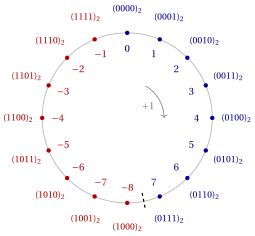

# Rappresentazione dei numeri

**Parte 1 · Fondamenti e algoritmi di base · Capitolo 1** · [:material-file-pdf-box: Dispensa, volume 1 (PDF)](../pdf/dispensa-1-fondamenti.pdf) · [:material-pencil: Esercizi](../esercizi/es-01-rappresentazione-numeri.md)

## Introduzione

Un algoritmo manipola dati e, prima di poter descrivere come funziona un algoritmo, dobbiamo stabilire come questi dati vengono scritti. Per i numeri questa domanda ha una risposta precisa: un calcolatore memorizza ogni numero come una sequenza finita di simboli, e con un dato numero di simboli si possono scrivere soltanto un numero finito di numeri. Questo semplice fatto ha conseguenze importanti: ogni rappresentazione ha un <strong>intervallo di rappresentazione</strong>, al di fuori del quale i numeri non possono essere memorizzati, e la rappresentazione dei numeri reali è, in generale, solo approssimata.

In questo capitolo studiamo tre rappresentazioni:

- la rappresentazione dei <strong>numeri naturali</strong> in un sistema di numerazione posizionale in base $b$, in particolare il sistema binario usato dai calcolatori;

- la rappresentazione dei <strong>numeri interi</strong>, prima in modulo e segno e poi in complemento a due, che è la rappresentazione usata dai calcolatori moderni;

- la rappresentazione dei <strong>numeri reali</strong> in virgola mobile, secondo lo standard IEEE 754.

Per ogni rappresentazione calcoliamo il numero più grande e quello più piccolo che si possono rappresentare con un dato numero di cifre, e il numero minimo di cifre necessarie per rappresentare un dato numero.

## 1.1 Rappresentazione dei numeri naturali

### 1.1.1 Sistemi di numerazione posizionali

Siamo abituati a scrivere i numeri nel sistema decimale, dove la stessa cifra ha un valore diverso a seconda della posizione in cui compare: in $555$ le tre cifre sono uguali, ma valgono $500$, $50$ e $5$. Questa è l'idea di sistema di numerazione posizionale.

!!! definizione "Definizione 1.1: sistema di numerazione posizionale"

    Un <strong>sistema di numerazione posizionale</strong> è un modo di codificare i numeri naturali mediante una <strong>sequenza di cifre</strong>, in cui ogni cifra (singolo simbolo) contribuisce in modo diverso a seconda della sua posizione.

!!! definizione "Definizione 1.2: base di un sistema di numerazione posizionale"

    Il numero di cifre diverse di un sistema di numerazione posizionale si chiama <strong>base</strong> $b$ del sistema.

- La base $b$ di un sistema di numerazione posizionale deve essere maggiore o uguale a due.

- Il sistema unario non è un sistema di numerazione posizionale: i numeri naturali si rappresentano ripetendo la cifra $1$ tante volte quanto necessario (ad esempio, $3$ si rappresenta come $111$).

- Alcuni dei principali sistemi di numerazione posizionali sono:

    
<table>
    <tr>
    <th>Sistema di numerazione posizionale</th>
    <th>base &#92;(b&#92;)</th>
    <th>cifre diverse</th>
    </tr>
    <tr>
    <td>Sistema binario</td>
    <td>2</td>
    <td>&#92;(0,~1&#92;)</td>
    </tr>
    <tr>
    <td>Sistema ottale</td>
    <td>8</td>
    <td>&#92;(0,~1,~2,~3,~4,~5,~6,~7&#92;)</td>
    </tr>
    <tr>
    <td>Sistema decimale</td>
    <td>10</td>
    <td>&#92;(0,~1,~2,~3,~4,~5,~6,~7,~8,~9&#92;)</td>
    </tr>
    <tr>
    <td>Sistema esadecimale</td>
    <td>16</td>
    <td>&#92;(0,~1,~2,~3,~4,~5,~6,~7,~8,~9,~A,~B,~C,~D,~E,~F&#92;)</td>
    </tr>
    </table>

- Nel sistema esadecimale le sei lettere $A$, $B$, $C$, $D$, $E$, $F$ sono cifre, con i valori $10$, $11$, $12$, $13$, $14$, $15$.

!!! definizione "Definizione 1.3: sequenza di cifre"

    Una <strong>sequenza di $k$ cifre</strong> che rappresenta un numero naturale in base $b$ si indica con:

    \begin{equation*}
    \left(
    \begin{matrix}
    d_{k-1} & d_{k-2} & \dots & d_2 & d_1 & d_0
    \end{matrix}
    \right)_b \tag{1.1}
    \end{equation*}

    dove le posizioni si contano da destra a sinistra, partendo da $0$ e crescendo fino a $k-1$. La <strong>cifra meno significativa</strong> (LSD, <em>Least Significant Digit</em>) è $d_0$. La <strong>cifra più significativa</strong> (MSD, <em>Most Significant Digit</em>) è $d_{k-1}$.

La cifra in posizione $i$ viene moltiplicata per la potenza $i$-esima della base. Sommando tutti questi contributi si ottiene il numero rappresentato dalla sequenza.

!!! chiave ""

    Data una sequenza di $k$ cifre in un sistema di numerazione posizionale in base $b$, il numero naturale che essa rappresenta in base dieci è dato dalla seguente sequenza di cifre:

    \begin{equation*}
    \label{eq:value}
    \left(~\sum_{i=0}^{k-1} d_i \; b^i ~\right)_{10} \tag{1.2}
    \end{equation*}

!!! esempio "Esempio 1.1: sequenze di cifre"

    Il numero cento scritto nei quattro sistemi di numerazione posizionali della tabella precedente. Il valore di ogni sequenza si calcola con la formula $\eqref{eq:value}$, posizione per posizione, partendo dalla cifra meno significativa $d_0$.

    
<table>
    <tr>
    <th>Sequenza di cifre</th>
    <th>&#92;(b&#92;)</th>
    <th>&#92;(k&#92;)</th>
    <th>rappresentazione decimale</th>
    </tr>
    <tr>
    <td>&#92;((100)&#95;2&#92;)</td>
    <td>&#92;(2&#92;)</td>
    <td>&#92;(3&#92;)</td>
    <td>&#92;((0 &#92;cdot 2^0 + 0 &#92;cdot 2^1 + 1 &#92;cdot 2^2)&#95;{10} = (4)&#95;{10}&#92;)</td>
    </tr>
    <tr>
    <td>&#92;((1100100)&#95;2&#92;)</td>
    <td>&#92;(2&#92;)</td>
    <td>&#92;(7&#92;)</td>
    <td>&#92;((0 &#92;cdot 2^0 + 0 &#92;cdot 2^1 + 1 &#92;cdot 2^2 + 0 &#92;cdot 2^3 + 0 &#92;cdot 2^4 + 1 &#92;cdot 2^5 + 1 &#92;cdot 2^6)&#95;{10}&#92;)</td>
    </tr>
    <tr>
    <td></td>
    <td></td>
    <td></td>
    <td>&#92;(= (4 + 32 + 64)&#95;{10} = (100)&#95;{10}&#92;)</td>
    </tr>
    <tr>
    <td>&#92;((144)&#95;8&#92;)</td>
    <td>&#92;(8&#92;)</td>
    <td>&#92;(3&#92;)</td>
    <td>&#92;((4 &#92;cdot 8^0 + 4 &#92;cdot 8^1 + 1 &#92;cdot 8^2)&#95;{10} = (4 + 32 + 64)&#95;{10} = (100)&#95;{10}&#92;)</td>
    </tr>
    <tr>
    <td>&#92;((100)&#95;{10}&#92;)</td>
    <td>&#92;(10&#92;)</td>
    <td>&#92;(3&#92;)</td>
    <td>&#92;((0 &#92;cdot 10^0 + 0 &#92;cdot 10^1 + 1 &#92;cdot 10^2)&#95;{10} = (100)&#95;{10}&#92;)</td>
    </tr>
    <tr>
    <td>&#92;((64)&#95;{16}&#92;)</td>
    <td>&#92;(16&#92;)</td>
    <td>&#92;(2&#92;)</td>
    <td>&#92;((4 &#92;cdot 16^0 + 6 &#92;cdot 16^1)&#95;{10} = (4 + 96)&#95;{10} = (100)&#95;{10}&#92;)</td>
    </tr>
    </table>

    La stessa sequenza di cifre $100$ rappresenta numeri diversi in basi diverse, e lo stesso numero richiede più cifre quando la base è più piccola.

!!! esempio "Esempio 1.2: tutte le sequenze di quattro cifre binarie"

    Con $k=4$ cifre binarie possiamo scrivere $2^4 = 16$ sequenze diverse, che rappresentano i numeri naturali da $0$ a $15$:

    
<table>
    <tr>
    <th>Sequenza di cifre</th>
    <th>&#92;(b&#92;)</th>
    <th>&#92;(k&#92;)</th>
    <th>rappresentazione decimale</th>
    </tr>
    <tr>
    <td>&#92;((0000)&#95;2&#92;)</td>
    <td>&#92;(2&#92;)</td>
    <td>&#92;(4&#92;)</td>
    <td>&#92;((0 &#92;cdot 2^3 + 0 &#92;cdot 2^2 + 0 &#92;cdot 2^1 + 0 &#92;cdot 2^0)&#95;{10} = (0)&#95;{10}&#92;)</td>
    </tr>
    <tr>
    <td>&#92;((0001)&#95;2&#92;)</td>
    <td>&#92;(2&#92;)</td>
    <td>&#92;(4&#92;)</td>
    <td>&#92;((0 &#92;cdot 2^3 + 0 &#92;cdot 2^2 + 0 &#92;cdot 2^1 + 1 &#92;cdot 2^0)&#95;{10} = (1)&#95;{10}&#92;)</td>
    </tr>
    <tr>
    <td>&#92;((0010)&#95;2&#92;)</td>
    <td>&#92;(2&#92;)</td>
    <td>&#92;(4&#92;)</td>
    <td>&#92;((0 &#92;cdot 2^3 + 0 &#92;cdot 2^2 + 1 &#92;cdot 2^1 + 0 &#92;cdot 2^0)&#95;{10} = (2)&#95;{10}&#92;)</td>
    </tr>
    <tr>
    <td>&#92;((0011)&#95;2&#92;)</td>
    <td>&#92;(2&#92;)</td>
    <td>&#92;(4&#92;)</td>
    <td>&#92;((0 &#92;cdot 2^3 + 0 &#92;cdot 2^2 + 1 &#92;cdot 2^1 + 1 &#92;cdot 2^0)&#95;{10} = (3)&#95;{10}&#92;)</td>
    </tr>
    <tr>
    <td>&#92;((0100)&#95;2&#92;)</td>
    <td>&#92;(2&#92;)</td>
    <td>&#92;(4&#92;)</td>
    <td>&#92;((0 &#92;cdot 2^3 + 1 &#92;cdot 2^2 + 0 &#92;cdot 2^1 + 0 &#92;cdot 2^0)&#95;{10} = (4)&#95;{10}&#92;)</td>
    </tr>
    <tr>
    <td>&#92;((0101)&#95;2&#92;)</td>
    <td>&#92;(2&#92;)</td>
    <td>&#92;(4&#92;)</td>
    <td>&#92;((0 &#92;cdot 2^3 + 1 &#92;cdot 2^2 + 0 &#92;cdot 2^1 + 1 &#92;cdot 2^0)&#95;{10} = (5)&#95;{10}&#92;)</td>
    </tr>
    <tr>
    <td>&#92;((0110)&#95;2&#92;)</td>
    <td>&#92;(2&#92;)</td>
    <td>&#92;(4&#92;)</td>
    <td>&#92;((0 &#92;cdot 2^3 + 1 &#92;cdot 2^2 + 1 &#92;cdot 2^1 + 0 &#92;cdot 2^0)&#95;{10} = (6)&#95;{10}&#92;)</td>
    </tr>
    <tr>
    <td>&#92;((0111)&#95;2&#92;)</td>
    <td>&#92;(2&#92;)</td>
    <td>&#92;(4&#92;)</td>
    <td>&#92;((0 &#92;cdot 2^3 + 1 &#92;cdot 2^2 + 1 &#92;cdot 2^1 + 1 &#92;cdot 2^0)&#95;{10} = (7)&#95;{10}&#92;)</td>
    </tr>
    <tr>
    <td>&#92;((1000)&#95;2&#92;)</td>
    <td>&#92;(2&#92;)</td>
    <td>&#92;(4&#92;)</td>
    <td>&#92;((1 &#92;cdot 2^3 + 0 &#92;cdot 2^2 + 0 &#92;cdot 2^1 + 0 &#92;cdot 2^0)&#95;{10} = (8)&#95;{10}&#92;)</td>
    </tr>
    <tr>
    <td>&#92;((1001)&#95;2&#92;)</td>
    <td>&#92;(2&#92;)</td>
    <td>&#92;(4&#92;)</td>
    <td>&#92;((1 &#92;cdot 2^3 + 0 &#92;cdot 2^2 + 0 &#92;cdot 2^1 + 1 &#92;cdot 2^0)&#95;{10} = (9)&#95;{10}&#92;)</td>
    </tr>
    <tr>
    <td>&#92;((1010)&#95;2&#92;)</td>
    <td>&#92;(2&#92;)</td>
    <td>&#92;(4&#92;)</td>
    <td>&#92;((1 &#92;cdot 2^3 + 0 &#92;cdot 2^2 + 1 &#92;cdot 2^1 + 0 &#92;cdot 2^0)&#95;{10} = (10)&#95;{10}&#92;)</td>
    </tr>
    <tr>
    <td>&#92;((1011)&#95;2&#92;)</td>
    <td>&#92;(2&#92;)</td>
    <td>&#92;(4&#92;)</td>
    <td>&#92;((1 &#92;cdot 2^3 + 0 &#92;cdot 2^2 + 1 &#92;cdot 2^1 + 1 &#92;cdot 2^0)&#95;{10} = (11)&#95;{10}&#92;)</td>
    </tr>
    <tr>
    <td>&#92;((1100)&#95;2&#92;)</td>
    <td>&#92;(2&#92;)</td>
    <td>&#92;(4&#92;)</td>
    <td>&#92;((1 &#92;cdot 2^3 + 1 &#92;cdot 2^2 + 0 &#92;cdot 2^1 + 0 &#92;cdot 2^0)&#95;{10} = (12)&#95;{10}&#92;)</td>
    </tr>
    <tr>
    <td>&#92;((1101)&#95;2&#92;)</td>
    <td>&#92;(2&#92;)</td>
    <td>&#92;(4&#92;)</td>
    <td>&#92;((1 &#92;cdot 2^3 + 1 &#92;cdot 2^2 + 0 &#92;cdot 2^1 + 1 &#92;cdot 2^0)&#95;{10} = (13)&#95;{10}&#92;)</td>
    </tr>
    <tr>
    <td>&#92;((1110)&#95;2&#92;)</td>
    <td>&#92;(2&#92;)</td>
    <td>&#92;(4&#92;)</td>
    <td>&#92;((1 &#92;cdot 2^3 + 1 &#92;cdot 2^2 + 1 &#92;cdot 2^1 + 0 &#92;cdot 2^0)&#95;{10} = (14)&#95;{10}&#92;)</td>
    </tr>
    <tr>
    <td>&#92;((1111)&#95;2&#92;)</td>
    <td>&#92;(2&#92;)</td>
    <td>&#92;(4&#92;)</td>
    <td>&#92;((1 &#92;cdot 2^3 + 1 &#92;cdot 2^2 + 1 &#92;cdot 2^1 + 1 &#92;cdot 2^0)&#95;{10} = (15)&#95;{10}&#92;)</td>
    </tr>
    </table>

!!! chiave ""

    Di solito, per le sequenze di cifre in base dieci, le parentesi si omettono e, in assenza di parentesi, la base si assume uguale a dieci.

### 1.1.2 Intervalli di rappresentazione

La tabella dell'[Esempio 1.2](#box-5-texexpbox2) si ferma a $15$: con quattro cifre binarie non c'è modo di scrivere $16$. In generale, un numero fissato $k$ di cifre può rappresentare solo i numeri naturali fino a un certo limite, che calcoliamo ora.

!!! teorema "Osservazione 1.4"

    Date $k$ cifre in base $b$, il <strong>più grande numero naturale</strong> rappresentabile è:

    \begin{equation*}
    b^k-1 \tag{1.3}
    \end{equation*}

    e il relativo <strong>intervallo di rappresentazione</strong> per i numeri naturali è:

    \begin{equation*}
    \big[~0,~b^k-1~ \big] \tag{1.4}
    \end{equation*}

??? dimostrazione "Dimostrazione"

    Il più grande numero naturale in base $b$ con $k$ cifre è formato soltanto dalla cifra più grande $(b-1)$ ripetuta $k$ volte:

    $$
    \big(~(b-1)_{k-1} ~~ (b-1)_{k-2} ~~ \dots ~~ (b-1)_{1} ~~ (b-1)_{0}~\big)_b
    $$

    Di conseguenza, usando la somma della progressione geometrica $\sum_{i=0}^{k-1} b^i = \frac{b^k-1}{b-1}$ (valida poiché $b \ge 2$), il più grande numero naturale in decimale è:

    $$
    \sum_{i=0}^{k-1} (b-1) \, b^i = (b-1) \sum_{i=0}^{k-1} b^i
    = (b-1)\; \frac{ b^{k}-1}{b-1}= b^{k}-1
    $$

    Il più piccolo numero naturale è $0$, rappresentato da $k$ cifre uguali a $0$. Ogni numero naturale compreso tra $0$ e $b^k-1$ può essere rappresentato: le $b^k$ sequenze diverse di $k$ cifre rappresentano $b^k$ numeri diversi, tutti nell'intervallo $[0, b^k-1]$, che contiene esattamente $b^k$ numeri naturali. □

!!! chiave ""

    Le cifre del sistema binario si chiamano <strong>bit</strong> e $8$ bit formano un <strong>byte</strong>.

!!! esempio "Esempio 1.3: intervalli di rappresentazione in binario"

    Per $b=2$ l'intervallo di rappresentazione con $k$ bit è $[0, 2^k-1]$. Le ultime righe corrispondono a $1$, $2$, $4$ e $8$ byte.

    
<table>
    <tr>
    <th>&#92;(k&#92;)</th>
    <th>&#92;(b&#92;)</th>
    <th>&#92;(b^k-1&#92;)</th>
    <th>intervallo di rappresentazione</th>
    </tr>
    <tr>
    <td>1</td>
    <td>2</td>
    <td>&#92;(2^1-1=1&#92;)</td>
    <td>&#92;(&#91;0,1&#93;&#92;)</td>
    </tr>
    <tr>
    <td>2</td>
    <td>2</td>
    <td>&#92;(2^2-1=3&#92;)</td>
    <td>&#92;(&#91;0,3&#93;&#92;)</td>
    </tr>
    <tr>
    <td>3</td>
    <td>2</td>
    <td>&#92;(2^3-1=7&#92;)</td>
    <td>&#92;(&#91;0,7&#93;&#92;)</td>
    </tr>
    <tr>
    <td>4</td>
    <td>2</td>
    <td>&#92;(2^4-1=15&#92;)</td>
    <td>&#92;(&#91;0,15&#93;&#92;)</td>
    </tr>
    <tr>
    <td>8</td>
    <td>2</td>
    <td>&#92;(2^8-1=255&#92;)</td>
    <td>&#92;(&#91;0,255&#93;&#92;)</td>
    </tr>
    <tr>
    <td>16</td>
    <td>2</td>
    <td>&#92;(2^{16}-1=65{,}535&#92;)</td>
    <td>&#92;(&#91;0,65{,}535&#93;&#92;)</td>
    </tr>
    <tr>
    <td>32</td>
    <td>2</td>
    <td>&#92;(2^{32}-1=4{,}294{,}967{,}295&#92;)</td>
    <td>&#92;(&#91;0,4{,}294{,}967{,}295&#93;&#92;)</td>
    </tr>
    <tr>
    <td>64</td>
    <td>2</td>
    <td>&#92;(2^{64}-1&#92;)</td>
    <td>&#92;(&#91;0,2^{64}-1&#93;&#92;)</td>
    </tr>
    </table>

    1 Intervallo di rappresentazione di <code>unsigned int</code> in C e C++ (4 byte).  2 Intervallo di rappresentazione di <code>unsigned long long int</code> in C e C++ (8 byte); $2^{64}=18{,}446{,}744{,}073{,}709{,}551{,}616$.

L'osservazione si può leggere anche nel verso opposto: dato un numero naturale $n$, quante cifre servono per scriverlo?

!!! teorema "Osservazione 1.5"

    Il numero minimo di cifre per scrivere un numero naturale $n\ge 1$ in base $b$ è:

    \begin{equation*}
    \lfloor \log_b n\rfloor +1 \tag{1.5}
    \end{equation*}

??? dimostrazione "Dimostrazione"

    Per l'[Osservazione 1.4](#box-6-obsLargestNatural), il numero $n$ si può scrivere con $k$ cifre se e solo se:

    $$
    n \le b^k-1 ~~~~~\Longleftrightarrow~~~~~ n < b^k ~~~~~\Longleftrightarrow~~~~~ \log_b n < k
    $$

    dove la prima equivalenza vale perché $n$ e $b^k$ sono interi, e la seconda perché il logaritmo in base $b \ge 2$ è una funzione crescente. Il più piccolo intero $k$ strettamente maggiore di $\log_b n$ è $\lfloor \log_b n\rfloor +1$. Di conseguenza, $\lfloor \log_b n\rfloor +1$ è il numero minimo di cifre per scrivere un numero naturale $n$ in base $b$. □

!!! esempio "Esempio 1.4: numero minimo di cifre di cento"

    Calcoliamo il numero minimo di cifre di $n = 100$ in base $2$ e in base $10$.

    - Passo 1 (base $2$): poiché $2^6 = 64 \le 100 < 128 = 2^7$, si ha $6 \le \log_2 100 < 7$ (infatti $\log_2 100 \approx 6.644$), quindi:

        $$
        \lfloor \log_2 100\rfloor +1 = 6+1 = 7
        $$

    - Passo 2 (base $10$): poiché $10^2 = 100$, si ha $\log_{10} 100 = 2$, quindi:

        $$
        \lfloor \log_{10} 100\rfloor +1 = 2+1 = 3
        $$

    Entrambi i risultati concordano con l'[Esempio 1.1](#box-4-texexpbox1): $(1100100)_2$ ha $7$ cifre e $(100)_{10}$ ha $3$ cifre.

!!! esempio "Esempio 1.5: numero minimo di cifre in binario"

    Per le potenze di due $n = 2^m$ si ha $\log_2 n = m$, quindi il numero minimo di bit è $m+1$: una cifra $1$ seguita da $m$ cifre $0$.

    
<table>
    <tr>
    <th>&#92;(n&#92;)</th>
    <th>&#92;(b&#92;)</th>
    <th>&#92;(&#92;log&#95;b n&#92;)</th>
    <th>&#92;(&#92;lfloor &#92;log&#95;b n&#92;rfloor +1&#92;)</th>
    </tr>
    <tr>
    <td>&#92;(2 = 2^1&#92;)</td>
    <td>2</td>
    <td>&#92;(&#92;log&#95;2 2 = 1&#92;)</td>
    <td>&#92;(&#92;lfloor &#92;log&#95;2 2&#92;rfloor +1=2&#92;)</td>
    </tr>
    <tr>
    <td>&#92;(4 = 2^2&#92;)</td>
    <td>2</td>
    <td>&#92;(&#92;log&#95;2 4 = 2&#92;)</td>
    <td>&#92;(&#92;lfloor &#92;log&#95;2 4&#92;rfloor +1=3&#92;)</td>
    </tr>
    <tr>
    <td>&#92;(8 = 2^3&#92;)</td>
    <td>2</td>
    <td>&#92;(&#92;log&#95;2 8 = 3&#92;)</td>
    <td>&#92;(&#92;lfloor &#92;log&#95;2 8&#92;rfloor +1=4&#92;)</td>
    </tr>
    <tr>
    <td>&#92;(16 = 2^4&#92;)</td>
    <td>2</td>
    <td>&#92;(&#92;log&#95;2 16 = 4&#92;)</td>
    <td>&#92;(&#92;lfloor &#92;log&#95;2 16&#92;rfloor +1=5&#92;)</td>
    </tr>
    <tr>
    <td>&#92;(32 = 2^5&#92;)</td>
    <td>2</td>
    <td>&#92;(&#92;log&#95;2 32 = 5&#92;)</td>
    <td>&#92;(&#92;lfloor &#92;log&#95;2 32&#92;rfloor +1=6&#92;)</td>
    </tr>
    <tr>
    <td>&#92;(64 = 2^6&#92;)</td>
    <td>2</td>
    <td>&#92;(&#92;log&#95;2 64 = 6&#92;)</td>
    <td>&#92;(&#92;lfloor &#92;log&#95;2 64&#92;rfloor +1=7&#92;)</td>
    </tr>
    <tr>
    <td>&#92;(128 = 2^7&#92;)</td>
    <td>2</td>
    <td>&#92;(&#92;log&#95;2 128 = 7&#92;)</td>
    <td>&#92;(&#92;lfloor &#92;log&#95;2 128&#92;rfloor +1=8&#92;)</td>
    </tr>
    <tr>
    <td>&#92;(256 = 2^8&#92;)</td>
    <td>2</td>
    <td>&#92;(&#92;log&#95;2 256 = 8&#92;)</td>
    <td>&#92;(&#92;lfloor &#92;log&#95;2 256&#92;rfloor +1=9&#92;)</td>
    </tr>
    <tr>
    <td>&#92;(512 = 2^9&#92;)</td>
    <td>2</td>
    <td>&#92;(&#92;log&#95;2 512 = 9&#92;)</td>
    <td>&#92;(&#92;lfloor &#92;log&#95;2 512&#92;rfloor +1=10&#92;)</td>
    </tr>
    <tr>
    <td>&#92;(1{,}024 = 2^{10}&#92;)</td>
    <td>2</td>
    <td>&#92;(&#92;log&#95;2 1{,}024 = 10&#92;)</td>
    <td>&#92;(&#92;lfloor &#92;log&#95;2 1{,}024&#92;rfloor +1=11&#92;)</td>
    </tr>
    <tr>
    <td>&#92;(2{,}048 = 2^{11}&#92;)</td>
    <td>2</td>
    <td>&#92;(&#92;log&#95;2 2{,}048 = 11&#92;)</td>
    <td>&#92;(&#92;lfloor &#92;log&#95;2 2{,}048&#92;rfloor +1=12&#92;)</td>
    </tr>
    <tr>
    <td>&#92;(4{,}096 = 2^{12}&#92;)</td>
    <td>2</td>
    <td>&#92;(&#92;log&#95;2 4{,}096 = 12&#92;)</td>
    <td>&#92;(&#92;lfloor &#92;log&#95;2 4{,}096&#92;rfloor +1=13&#92;)</td>
    </tr>
    <tr>
    <td>&#92;(8{,}192 = 2^{13}&#92;)</td>
    <td>2</td>
    <td>&#92;(&#92;log&#95;2 8{,}192 = 13&#92;)</td>
    <td>&#92;(&#92;lfloor &#92;log&#95;2 8{,}192&#92;rfloor +1=14&#92;)</td>
    </tr>
    <tr>
    <td>&#92;(16{,}384 = 2^{14}&#92;)</td>
    <td>2</td>
    <td>&#92;(&#92;log&#95;2 16{,}384 = 14&#92;)</td>
    <td>&#92;(&#92;lfloor &#92;log&#95;2 16{,}384&#92;rfloor +1=15&#92;)</td>
    </tr>
    <tr>
    <td>&#92;(32{,}768 = 2^{15}&#92;)</td>
    <td>2</td>
    <td>&#92;(&#92;log&#95;2 32{,}768 = 15&#92;)</td>
    <td>&#92;(&#92;lfloor &#92;log&#95;2 32{,}768&#92;rfloor +1=16&#92;)</td>
    </tr>
    <tr>
    <td>&#92;(65{,}536 = 2^{16}&#92;)</td>
    <td>2</td>
    <td>&#92;(&#92;log&#95;2 65{,}536 = 16&#92;)</td>
    <td>&#92;(&#92;lfloor &#92;log&#95;2 65{,}536&#92;rfloor +1=17&#92;)</td>
    </tr>
    <tr>
    <td>&#92;(131{,}072 = 2^{17}&#92;)</td>
    <td>2</td>
    <td>&#92;(&#92;log&#95;2 131{,}072 = 17&#92;)</td>
    <td>&#92;(&#92;lfloor &#92;log&#95;2 131{,}072&#92;rfloor +1=18&#92;)</td>
    </tr>
    <tr>
    <td>&#92;(262{,}144 = 2^{18}&#92;)</td>
    <td>2</td>
    <td>&#92;(&#92;log&#95;2 262{,}144 = 18&#92;)</td>
    <td>&#92;(&#92;lfloor &#92;log&#95;2 262{,}144&#92;rfloor +1=19&#92;)</td>
    </tr>
    <tr>
    <td>&#92;(524{,}288 = 2^{19}&#92;)</td>
    <td>2</td>
    <td>&#92;(&#92;log&#95;2 524{,}288 = 19&#92;)</td>
    <td>&#92;(&#92;lfloor &#92;log&#95;2 524{,}288&#92;rfloor +1=20&#92;)</td>
    </tr>
    <tr>
    <td>&#92;(1{,}048{,}576 = 2^{20}&#92;)</td>
    <td>2</td>
    <td>&#92;(&#92;log&#95;2 1{,}048{,}576 = 20&#92;)</td>
    <td>&#92;(&#92;lfloor &#92;log&#95;2 1{,}048{,}576&#92;rfloor +1=21&#92;)</td>
    </tr>
    </table>

!!! chiave ""

    <strong>Punti chiave sui numeri naturali.</strong>

    - La sequenza $(d_{k-1} \dots d_1 d_0)_b$ rappresenta il numero naturale $\sum_{i=0}^{k-1} d_i\, b^i$.

    - Con $k$ cifre in base $b$ si rappresentano esattamente i $b^k$ numeri naturali dell'intervallo $[0, b^k-1]$.

    - Un numero naturale $n \ge 1$ richiede almeno $\lfloor \log_b n\rfloor +1$ cifre in base $b$.

## 1.2 Rappresentazione dei numeri interi

I numeri interi comprendono sia valori positivi sia negativi, più lo zero. Con $k$ bit abbiamo ancora soltanto $2^k$ sequenze diverse, ma ora dobbiamo usarle anche per rappresentare il segno. Si studiano due approcci: il <strong>modulo e segno</strong>, che è il più naturale, e il <strong>complemento a due</strong>, che è lo standard nei calcolatori moderni per i suoi vantaggi aritmetici. In questa sezione la base è sempre $b=2$.

### 1.2.1 Rappresentazione in modulo e segno

!!! definizione "Definizione 1.6: rappresentazione in modulo e segno"

    Nella <strong>rappresentazione in modulo e segno</strong>, un numero intero $n$ è rappresentato usando esattamente $k \ge 2$ bit, dove:

    - il bit più significativo rappresenta il <strong>segno</strong>: $0$ se $n \ge 0$ e $1$ se $n < 0$;

    - i restanti $k-1$ bit rappresentano il <strong>modulo</strong> $|n|$ (valore assoluto) in base $2$.

!!! teorema "Osservazione 1.7"

    Dati $k$ bit, il <strong>più grande numero intero</strong> rappresentabile in modulo e segno è:

    \begin{equation*}
    2^{k-1}-1 \tag{1.6}
    \end{equation*}

    e il relativo <strong>intervallo di rappresentazione</strong> per i numeri interi è:

    \begin{equation*}
    \big[-(2^{k-1}-1),~2^{k-1}-1\big] \tag{1.7}
    \end{equation*}

??? dimostrazione "Dimostrazione"

    Il modulo è un numero naturale scritto con $k-1$ bit. Per l'[Osservazione 1.4](#box-6-obsLargestNatural) con $b=2$ e $k-1$ cifre, il modulo più grande è formato dalla cifra $1$ ripetuta $k-1$ volte:

    $$
    \sum_{i=0}^{k-2} 1 \cdot 2^i = \frac{ 2^{k-1}-1}{2-1}= 2^{k-1}-1
    $$

    Con bit di segno $0$ si ottiene il più grande intero $2^{k-1}-1$, e con bit di segno $1$ il più piccolo intero $-(2^{k-1}-1)$. Ogni intero intermedio è rappresentato, poiché il suo valore assoluto è al più $2^{k-1}-1$. □

!!! esempio "Esempio 1.6: modulo e segno con 4 bit"

    Con $k=4$ bit, il primo bit è il segno e gli ultimi tre bit sono il modulo:

    
<table>
    <tr>
    <th>Binario</th>
    <th>&#92;(k&#92;)</th>
    <th>Segno</th>
    <th>Decimale</th>
    </tr>
    <tr>
    <td>&#92;((0000)&#95;2&#92;)</td>
    <td>&#92;(4&#92;)</td>
    <td>&#92;(0&#92;) (non negativo)</td>
    <td>&#92;(+(0 &#92;cdot 2^2 + 0 &#92;cdot 2^1 + 0 &#92;cdot 2^0) = +0&#92;)</td>
    </tr>
    <tr>
    <td>&#92;((0001)&#95;2&#92;)</td>
    <td>&#92;(4&#92;)</td>
    <td>&#92;(0&#92;) (non negativo)</td>
    <td>&#92;(+(0 &#92;cdot 2^2 + 0 &#92;cdot 2^1 + 1 &#92;cdot 2^0) = 1&#92;)</td>
    </tr>
    <tr>
    <td>&#92;((0010)&#95;2&#92;)</td>
    <td>&#92;(4&#92;)</td>
    <td>&#92;(0&#92;) (non negativo)</td>
    <td>&#92;(+(0 &#92;cdot 2^2 + 1 &#92;cdot 2^1 + 0 &#92;cdot 2^0) = 2&#92;)</td>
    </tr>
    <tr>
    <td>&#92;((0011)&#95;2&#92;)</td>
    <td>&#92;(4&#92;)</td>
    <td>&#92;(0&#92;) (non negativo)</td>
    <td>&#92;(+(0 &#92;cdot 2^2 + 1 &#92;cdot 2^1 + 1 &#92;cdot 2^0) = 3&#92;)</td>
    </tr>
    <tr>
    <td>&#92;((0100)&#95;2&#92;)</td>
    <td>&#92;(4&#92;)</td>
    <td>&#92;(0&#92;) (non negativo)</td>
    <td>&#92;(+(1 &#92;cdot 2^2 + 0 &#92;cdot 2^1 + 0 &#92;cdot 2^0) = 4&#92;)</td>
    </tr>
    <tr>
    <td>&#92;((0101)&#95;2&#92;)</td>
    <td>&#92;(4&#92;)</td>
    <td>&#92;(0&#92;) (non negativo)</td>
    <td>&#92;(+(1 &#92;cdot 2^2 + 0 &#92;cdot 2^1 + 1 &#92;cdot 2^0) = 5&#92;)</td>
    </tr>
    <tr>
    <td>&#92;((0110)&#95;2&#92;)</td>
    <td>&#92;(4&#92;)</td>
    <td>&#92;(0&#92;) (non negativo)</td>
    <td>&#92;(+(1 &#92;cdot 2^2 + 1 &#92;cdot 2^1 + 0 &#92;cdot 2^0) = 6&#92;)</td>
    </tr>
    <tr>
    <td>&#92;((0111)&#95;2&#92;)</td>
    <td>&#92;(4&#92;)</td>
    <td>&#92;(0&#92;) (non negativo)</td>
    <td>&#92;(+(1 &#92;cdot 2^2 + 1 &#92;cdot 2^1 + 1 &#92;cdot 2^0) = 7&#92;)</td>
    </tr>
    <tr>
    <td>&#92;((1000)&#95;2&#92;)</td>
    <td>&#92;(4&#92;)</td>
    <td>&#92;(1&#92;) (negativo)</td>
    <td>&#92;(-(0 &#92;cdot 2^2 + 0 &#92;cdot 2^1 + 0 &#92;cdot 2^0) = -0&#92;)</td>
    </tr>
    <tr>
    <td>&#92;((1001)&#95;2&#92;)</td>
    <td>&#92;(4&#92;)</td>
    <td>&#92;(1&#92;) (negativo)</td>
    <td>&#92;(-(0 &#92;cdot 2^2 + 0 &#92;cdot 2^1 + 1 &#92;cdot 2^0) = -1&#92;)</td>
    </tr>
    <tr>
    <td>&#92;((1010)&#95;2&#92;)</td>
    <td>&#92;(4&#92;)</td>
    <td>&#92;(1&#92;) (negativo)</td>
    <td>&#92;(-(0 &#92;cdot 2^2 + 1 &#92;cdot 2^1 + 0 &#92;cdot 2^0) = -2&#92;)</td>
    </tr>
    <tr>
    <td>&#92;((1011)&#95;2&#92;)</td>
    <td>&#92;(4&#92;)</td>
    <td>&#92;(1&#92;) (negativo)</td>
    <td>&#92;(-(0 &#92;cdot 2^2 + 1 &#92;cdot 2^1 + 1 &#92;cdot 2^0) = -3&#92;)</td>
    </tr>
    <tr>
    <td>&#92;((1100)&#95;2&#92;)</td>
    <td>&#92;(4&#92;)</td>
    <td>&#92;(1&#92;) (negativo)</td>
    <td>&#92;(-(1 &#92;cdot 2^2 + 0 &#92;cdot 2^1 + 0 &#92;cdot 2^0) = -4&#92;)</td>
    </tr>
    <tr>
    <td>&#92;((1101)&#95;2&#92;)</td>
    <td>&#92;(4&#92;)</td>
    <td>&#92;(1&#92;) (negativo)</td>
    <td>&#92;(-(1 &#92;cdot 2^2 + 0 &#92;cdot 2^1 + 1 &#92;cdot 2^0) = -5&#92;)</td>
    </tr>
    <tr>
    <td>&#92;((1110)&#95;2&#92;)</td>
    <td>&#92;(4&#92;)</td>
    <td>&#92;(1&#92;) (negativo)</td>
    <td>&#92;(-(1 &#92;cdot 2^2 + 1 &#92;cdot 2^1 + 0 &#92;cdot 2^0) = -6&#92;)</td>
    </tr>
    <tr>
    <td>&#92;((1111)&#95;2&#92;)</td>
    <td>&#92;(4&#92;)</td>
    <td>&#92;(1&#92;) (negativo)</td>
    <td>&#92;(-(1 &#92;cdot 2^2 + 1 &#92;cdot 2^1 + 1 &#92;cdot 2^0) = -7&#92;)</td>
    </tr>
    </table>

    L'intervallo di rappresentazione è $[-7, 7]$, come afferma l'[Osservazione 1.7](#box-12-obsSignMagnitudeInterval) con $2^{4-1}-1 = 7$.

La tabella dell'[Esempio 1.6](#box-13-texexpbox8) mostra i due punti deboli del modulo e segno.

- Lo zero ha <strong>due rappresentazioni</strong>: $(0000)_2 = +0$ e $(1000)_2 = -0$. Quindi $2^k-1$ interi diversi sono rappresentati con $2^k$ sequenze.

- La somma di due interi non può essere eseguita come somma delle due sequenze viste come numeri naturali. Ad esempio, $3 + (-1) = 2$, ma sommando $(0011)_2$ e $(1001)_2$ come numeri naturali si ottiene $3 + 9 = 12 = (1100)_2$, che in modulo e segno rappresenta $-4$. I bit di segno vanno trattati separatamente, e questo complica le operazioni aritmetiche.

Per questi motivi il modulo e segno non è la rappresentazione standard degli interi nei calcolatori.

### 1.2.2 Rappresentazione in complemento a due

Il complemento a due risolve entrambi i problemi: lo zero ha una rappresentazione unica e la somma funziona esattamente come per i numeri naturali.

!!! definizione "Definizione 1.8: rappresentazione in complemento a due"

    Nella <strong>rappresentazione in complemento a due</strong> (base $2$), un intero $n$ è rappresentato usando esattamente $k$ bit nel modo seguente:

    - se $n \ge 0$, si usa la rappresentazione binaria standard di $n$ con $k$ bit;

    - se $n < 0$, la rappresentazione di $n$ è la rappresentazione binaria del numero naturale $2^k+n$ con $k$ bit.

!!! chiave ""

    Nel complemento a due, il bit più significativo indica il segno:

    - $0$: numero non negativo;

    - $1$: numero negativo.

    Per leggere una sequenza il cui bit più significativo è $1$, si calcola il suo valore $r$ come numero naturale: l'intero rappresentato è $r - 2^k$.

- Lo zero ha una rappresentazione unica: $(00\dots0)_2$.

- Somma e sottrazione si eseguono come per i numeri naturali, modulo $2^k$.

- È la rappresentazione standard usata nei calcolatori moderni.

!!! esempio "Esempio 1.7: complemento a due con 4 bit"

    Con $k=4$ bit, le sequenze con bit più significativo $0$ rappresentano $0, 1, \dots, 7$; le sequenze con bit più significativo $1$ rappresentano il loro valore naturale meno $2^4 = 16$:

    
<table>
    <tr>
    <th>Binario</th>
    <th>&#92;(k&#92;)</th>
    <th>Segno</th>
    <th>Decimale</th>
    </tr>
    <tr>
    <td>&#92;((0000)&#95;2&#92;)</td>
    <td>4</td>
    <td>non negativo</td>
    <td>&#92;(0&#92;)</td>
    </tr>
    <tr>
    <td>&#92;((0001)&#95;2&#92;)</td>
    <td>4</td>
    <td>non negativo</td>
    <td>&#92;(1&#92;)</td>
    </tr>
    <tr>
    <td>&#92;((0010)&#95;2&#92;)</td>
    <td>4</td>
    <td>non negativo</td>
    <td>&#92;(2&#92;)</td>
    </tr>
    <tr>
    <td>&#92;((0011)&#95;2&#92;)</td>
    <td>4</td>
    <td>non negativo</td>
    <td>&#92;(3&#92;)</td>
    </tr>
    <tr>
    <td>&#92;((0100)&#95;2&#92;)</td>
    <td>4</td>
    <td>non negativo</td>
    <td>&#92;(4&#92;)</td>
    </tr>
    <tr>
    <td>&#92;((0101)&#95;2&#92;)</td>
    <td>4</td>
    <td>non negativo</td>
    <td>&#92;(5&#92;)</td>
    </tr>
    <tr>
    <td>&#92;((0110)&#95;2&#92;)</td>
    <td>4</td>
    <td>non negativo</td>
    <td>&#92;(6&#92;)</td>
    </tr>
    <tr>
    <td>&#92;((0111)&#95;2&#92;)</td>
    <td>4</td>
    <td>non negativo</td>
    <td>&#92;(7&#92;)</td>
    </tr>
    <tr>
    <td>&#92;((1000)&#95;2&#92;)</td>
    <td>4</td>
    <td>negativo</td>
    <td>&#92;(8-16=-8&#92;)</td>
    </tr>
    <tr>
    <td>&#92;((1001)&#95;2&#92;)</td>
    <td>4</td>
    <td>negativo</td>
    <td>&#92;(9-16=-7&#92;)</td>
    </tr>
    <tr>
    <td>&#92;((1010)&#95;2&#92;)</td>
    <td>4</td>
    <td>negativo</td>
    <td>&#92;(10-16=-6&#92;)</td>
    </tr>
    <tr>
    <td>&#92;((1011)&#95;2&#92;)</td>
    <td>4</td>
    <td>negativo</td>
    <td>&#92;(11-16=-5&#92;)</td>
    </tr>
    <tr>
    <td>&#92;((1100)&#95;2&#92;)</td>
    <td>4</td>
    <td>negativo</td>
    <td>&#92;(12-16=-4&#92;)</td>
    </tr>
    <tr>
    <td>&#92;((1101)&#95;2&#92;)</td>
    <td>4</td>
    <td>negativo</td>
    <td>&#92;(13-16=-3&#92;)</td>
    </tr>
    <tr>
    <td>&#92;((1110)&#95;2&#92;)</td>
    <td>4</td>
    <td>negativo</td>
    <td>&#92;(14-16=-2&#92;)</td>
    </tr>
    <tr>
    <td>&#92;((1111)&#95;2&#92;)</td>
    <td>4</td>
    <td>negativo</td>
    <td>&#92;(15-16=-1&#92;)</td>
    </tr>
    </table>

La [Figura 1.1](#box-16-fig-wheel) dispone le $16$ sequenze dell'[Esempio 1.7](#box-15-texexpbox5) su una circonferenza: avanzare di un passo in senso orario aggiunge $1$ al valore naturale della sequenza, modulo $2^4=16$. Gli interi rappresentati crescono da $-8$ a $7$, e l'unico salto è tra $(0111)_2 = 7$ e $(1000)_2 = -8$.

{ .fig loading=lazy  }

<strong>Figura 1.1:</strong> Le &#92;(16&#92;) sequenze di &#92;(4&#92;) bit su una circonferenza, con gli interi che rappresentano in complemento a due: interi non negativi in blu (bit più significativo &#92;(0&#92;)), interi negativi in rosso (bit più significativo &#92;(1&#92;)). Il segno tratteggiato tra &#92;((0111)&#95;2 = 7&#92;) e &#92;((1000)&#95;2 = -8&#92;) è l'unico punto in cui l'intero rappresentato fa un salto.

Calcolare $2^k + n$ con una sottrazione non è l'unico modo per ottenere la rappresentazione di un intero negativo: la seguente osservazione fornisce una procedura che lavora direttamente sui bit.

!!! teorema "Osservazione 1.9"

    Sia $n$ un intero con $-2^{k-1} \le n < 0$. La rappresentazione in complemento a due di $n$ con $k$ bit si ottiene dalla rappresentazione binaria di $|n|$ con $k$ bit in due passi:

    1. si invertono tutti i bit (ogni $0$ diventa $1$ e ogni $1$ diventa $0$);

    2. si aggiunge $1$ al risultato, come numero naturale.

??? dimostrazione "Dimostrazione"

    Sia $(d_{k-1} \dots d_1 d_0)_2$ la rappresentazione binaria di $|n|$ con $k$ bit. Invertendo i bit si ottengono le cifre $1-d_i$, quindi il numero naturale:

    $$
    \sum_{i=0}^{k-1} (1-d_i)\, 2^i = \sum_{i=0}^{k-1} 2^i - \sum_{i=0}^{k-1} d_i\, 2^i = (2^k - 1) - |n|
    $$

    Aggiungendo $1$ si ottiene $2^k - |n| = 2^k + n$, che è la rappresentazione in complemento a due di $n$ per la [Definizione 1.8](#box-14-defTwosComplement). Poiché $1 \le |n| \le 2^{k-1}$, si ha $2^{k-1} \le 2^k + n \le 2^k - 1$, quindi il risultato ha ancora $k$ bit. □

!!! esempio "Esempio 1.8: complemento a due di $-5$ con $8$ bit"

    Calcoliamo la rappresentazione di $n=-5$ con $k=8$ bit in entrambi i modi.

    - Passo 1: rappresentazione binaria di $|n| = 5$ con $8$ bit: $(00000101)_2$.

    - Passo 2: si invertono tutti i bit: $(11111010)_2$, il cui valore naturale è $250 = (2^8-1) - 5$.

    - Passo 3: si aggiunge $1$: $(11111010)_2 + 1 = (11111011)_2$.

    - Verifica con la [Definizione 1.8](#box-14-defTwosComplement): $2^8 + (-5) = 256 - 5 = 251 = 128+64+32+16+8+2+1 = (11111011)_2$.

### 1.2.3 Intervallo di rappresentazione

!!! teorema "Osservazione 1.10"

    Dati $k$ bit, il più grande intero rappresentabile in complemento a due è:

    \begin{equation*}
    2^{k-1}-1 \tag{1.8}
    \end{equation*}

    il più piccolo intero rappresentabile è:

    \begin{equation*}
    -2^{k-1} \tag{1.9}
    \end{equation*}

    e quindi l'intervallo di rappresentazione è:

    \begin{equation*}
    \big[-2^{k-1},\,2^{k-1}-1\big] \tag{1.10}
    \end{equation*}

??? dimostrazione "Dimostrazione"

    Con $k$ bit ci sono $2^k$ possibili stringhe binarie, i cui valori naturali sono $0, 1, \dots, 2^k-1$.

    Le stringhe il cui bit più significativo è $0$ hanno valori naturali $0, 1, \dots, 2^{k-1}-1$ e rappresentano gli interi non negativi:

    $$
    0,1,2,\dots,2^{k-1}-1
    $$

    Le stringhe il cui bit più significativo è $1$ hanno valori naturali $r = 2^{k-1}, \dots, 2^k-1$ e rappresentano gli interi $r - 2^k$, cioè gli interi negativi:

    $$
    -2^{k-1},\,-2^{k-1}+1,\dots,-1
    $$

    Quindi il più grande intero rappresentabile è $2^{k-1}-1$, il più piccolo è $-2^{k-1}$, e l'intervallo è:

    $$
    [-2^{k-1},\,2^{k-1}-1].
    $$

    
□

Rispetto al modulo e segno, l'intervallo contiene un intero in più, $-2^{k-1}$: la sequenza $(10\dots0)_2$, che era $-0$ in modulo e segno, ora rappresenta $-2^{k-1}$. Tutte le $2^k$ sequenze rappresentano interi diversi.

!!! esempio "Esempio 1.9: intervalli di rappresentazione in complemento a due"

    
<table>
    <tr>
    <th>&#92;(k&#92;)</th>
    <th>&#92;(-2^{k-1}&#92;)</th>
    <th>&#92;(2^{k-1}-1&#92;)</th>
    <th>intervallo di rappresentazione</th>
    </tr>
    <tr>
    <td>1</td>
    <td>&#92;(-1&#92;)</td>
    <td>&#92;(0&#92;)</td>
    <td>&#92;(&#91;-1,0&#93;&#92;)</td>
    </tr>
    <tr>
    <td>2</td>
    <td>&#92;(-2&#92;)</td>
    <td>&#92;(1&#92;)</td>
    <td>&#92;(&#91;-2,1&#93;&#92;)</td>
    </tr>
    <tr>
    <td>3</td>
    <td>&#92;(-4&#92;)</td>
    <td>&#92;(3&#92;)</td>
    <td>&#92;(&#91;-4,3&#93;&#92;)</td>
    </tr>
    <tr>
    <td>4</td>
    <td>&#92;(-8&#92;)</td>
    <td>&#92;(7&#92;)</td>
    <td>&#92;(&#91;-8,7&#93;&#92;)</td>
    </tr>
    <tr>
    <td>8</td>
    <td>&#92;(-128&#92;)</td>
    <td>&#92;(127&#92;)</td>
    <td>&#92;(&#91;-128,127&#93;&#92;)</td>
    </tr>
    <tr>
    <td>16</td>
    <td>&#92;(-32{,}768&#92;)</td>
    <td>&#92;(32{,}767&#92;)</td>
    <td>&#92;(&#91;-32{,}768,&#92;,32{,}767&#93;&#92;)</td>
    </tr>
    <tr>
    <td>32</td>
    <td>&#92;(-2{,}147{,}483{,}648&#92;)</td>
    <td>&#92;(2{,}147{,}483{,}647&#92;)</td>
    <td>&#92;(&#91;-2{,}147{,}483{,}648,&#92;,2{,}147{,}483{,}647&#93;&#92;)</td>
    </tr>
    <tr>
    <td>64</td>
    <td>&#92;(-2^{63}&#92;)</td>
    <td>&#92;(2^{63}-1&#92;)</td>
    <td>&#92;(&#91;-2^{63},&#92;,2^{63}-1&#93;&#92;)</td>
    </tr>
    </table>

    1 Intervallo di rappresentazione di <code>int</code> in C e C++ (4 byte).  2 Intervallo di rappresentazione di <code>long long int</code> in C e C++ (8 byte); $2^{63}=9{,}223{,}372{,}036{,}854{,}775{,}808$.

### 1.2.4 Numero minimo di bit

!!! teorema "Osservazione 1.11"

    Il numero minimo di bit necessari per rappresentare un intero $n$ in complemento a due è il più piccolo intero $k \ge 1$ tale che

    \begin{equation*}
    -2^{k-1} \le n \le 2^{k-1}-1. \tag{1.11}
    \end{equation*}

??? dimostrazione "Dimostrazione"

    Per l'[Osservazione 1.10](#box-19-obsTwosComplementInterval), un intero rappresentato con $k$ bit in complemento a due appartiene all'intervallo

    $$
    [-2^{k-1},\,2^{k-1}-1],
    $$

    e ogni intero di questo intervallo può essere rappresentato con $k$ bit. Perciò il numero minimo di bit necessari per rappresentare $n$ è esattamente il più piccolo $k$ per cui

    $$
    -2^{k-1} \le n \le 2^{k-1}-1.
    $$

    
□

Come per i numeri naturali, la condizione dell'[Osservazione 1.11](#box-21-obsMinBitsTwosComplement) si può trasformare in una formula esplicita con i logaritmi.

!!! teorema "Corollario 1.12"

    Il numero minimo di bit necessari per rappresentare un intero $n$ in complemento a due è:

    $$
    k=
    \begin{cases}
    1 & \text{se } n=0 \text{ o } n=-1\\[1ex]
    \lfloor \log_2 n \rfloor +2 & \text{se } n>0\\[1ex]
    \lceil \log_2 |n| \rceil +1 & \text{se } n<0
    \end{cases}
    $$

??? dimostrazione "Dimostrazione"

    Con $k=1$ l'intervallo è $[-1, 0]$, e questo dà il primo caso.

    - Se $n > 0$, la condizione dell'[Osservazione 1.11](#box-21-obsMinBitsTwosComplement) si riduce a $n \le 2^{k-1}-1$, cioè $n < 2^{k-1}$, cioè $\log_2 n < k-1$. Il più piccolo intero $k-1$ strettamente maggiore di $\log_2 n$ è $\lfloor \log_2 n \rfloor + 1$, quindi $k = \lfloor \log_2 n \rfloor + 2$.

    - Se $n < 0$, la condizione si riduce a $-2^{k-1} \le n$, cioè $|n| \le 2^{k-1}$, cioè $\log_2 |n| \le k-1$. Il più piccolo intero $k-1$ maggiore o uguale a $\log_2 |n|$ è $\lceil \log_2 |n| \rceil$, quindi $k = \lceil \log_2 |n| \rceil + 1$ (per $n=-1$ si ottiene $k=1$, in accordo con il primo caso).

    
□

!!! esempio "Esempio 1.10: numero minimo di bit in complemento a due"

    L'ultima colonna mostra la rappresentazione di $n$ con il numero minimo di bit.

    
<table>
    <tr>
    <th>&#92;(n&#92;)</th>
    <th>numero minimo di bit</th>
    <th>rappresentazione</th>
    </tr>
    <tr>
    <td>&#92;(-1&#92;)</td>
    <td>1</td>
    <td>&#92;(1&#92;)</td>
    </tr>
    <tr>
    <td>&#92;(0&#92;)</td>
    <td>1</td>
    <td>&#92;(0&#92;)</td>
    </tr>
    <tr>
    <td>&#92;(1&#92;)</td>
    <td>2</td>
    <td>&#92;(01&#92;)</td>
    </tr>
    <tr>
    <td>&#92;(-2&#92;)</td>
    <td>2</td>
    <td>&#92;(10&#92;)</td>
    </tr>
    <tr>
    <td>&#92;(2&#92;)</td>
    <td>3</td>
    <td>&#92;(010&#92;)</td>
    </tr>
    <tr>
    <td>&#92;(-4&#92;)</td>
    <td>3</td>
    <td>&#92;(100&#92;)</td>
    </tr>
    <tr>
    <td>&#92;(4&#92;)</td>
    <td>4</td>
    <td>&#92;(0100&#92;)</td>
    </tr>
    <tr>
    <td>&#92;(-8&#92;)</td>
    <td>4</td>
    <td>&#92;(1000&#92;)</td>
    </tr>
    <tr>
    <td>&#92;(8&#92;)</td>
    <td>5</td>
    <td>&#92;(01000&#92;)</td>
    </tr>
    <tr>
    <td>&#92;(-16&#92;)</td>
    <td>5</td>
    <td>&#92;(10000&#92;)</td>
    </tr>
    </table>

    Ad esempio, per $n = 8$ il [Corollario 1.12](#box-22-corMinBitsFormula) dà $\lfloor \log_2 8 \rfloor + 2 = 3 + 2 = 5$, e per $n=-16$ dà $\lceil \log_2 16 \rceil + 1 = 4 + 1 = 5$.

### 1.2.5 Somma e overflow { #sez-sec-addition }

Il principale vantaggio del complemento a due è che gli interi si sommano esattamente come i numeri naturali: si sommano le due sequenze di $k$ bit colonna per colonna, da destra a sinistra, con i riporti, e si scarta il riporto che esce dalla posizione più significativa.

!!! teorema "Osservazione 1.13"

    Siano $n_1$ e $n_2$ due interi rappresentati con $k$ bit in complemento a due. Si sommino le loro rappresentazioni come numeri naturali e si tengano soltanto i $k$ bit meno significativi della somma.

    - Se $n_1 + n_2 \in [-2^{k-1}, 2^{k-1}-1]$, il risultato è la rappresentazione in complemento a due di $n_1 + n_2$.

    - Altrimenti, la somma non può essere rappresentata con $k$ bit e si ha un <strong>overflow</strong>. Un overflow si verifica se e solo se $n_1$ e $n_2$ hanno lo stesso segno e il risultato ha il bit di segno opposto.

??? dimostrazione "Dimostrazione"

    Siano $r_1$ e $r_2$ i valori naturali delle due rappresentazioni: per la [Definizione 1.8](#box-14-defTwosComplement), $r_j = n_j$ oppure $r_j = 2^k + n_j$, quindi $r_1 + r_2$ differisce da $n_1 + n_2$ di $0$, $2^k$ o $2^{k+1}$. Tenere i $k$ bit meno significativi significa sottrarre $2^k$ quando $r_1 + r_2 \ge 2^k$ (il riporto scartato). Quindi il risultato $r$ soddisfa $r \in [0, 2^k-1]$ e $r - (n_1+n_2)$ è un multiplo di $2^k$.

    Se $n_1 + n_2 \in [-2^{k-1}, 2^{k-1}-1]$, anche la sua rappresentazione $\bar r$ appartiene a $[0, 2^k-1]$ e $\bar r - (n_1+n_2)$ vale $0$ oppure $2^k$. Allora $r - \bar r$ è un multiplo di $2^k$ con $|r - \bar r| \le 2^k - 1$, quindi $r = \bar r$.

    Se $n_1$ e $n_2$ hanno segni diversi, $n_1 + n_2$ sta tra $n_1$ e $n_2$, che appartengono all'intervallo: nessun overflow. Se entrambi sono non negativi, $n_1+n_2 \in [0, 2^k-2]$, nessun riporto viene scartato e $r = n_1 + n_2$: si ha overflow se e solo se $n_1 + n_2 \ge 2^{k-1}$, cioè se e solo se il bit di segno di $r$ è $1$. Se entrambi sono negativi, $r_1 + r_2 = 2^{k+1} + n_1 + n_2 \ge 2^k$, quindi $r = 2^k + n_1 + n_2$: si ha overflow se e solo se $n_1 + n_2 < -2^{k-1}$, cioè se e solo se $r < 2^{k-1}$, cioè il bit di segno di $r$ è $0$. □

Negli esempi, la prima riga di ogni somma contiene i riporti: il riporto scritto sopra una colonna è quello che arriva dalla colonna alla sua destra. La colonna più a sinistra riceve il riporto uscente dalla posizione più significativa, che viene scartato.

!!! esempio "Esempio 1.11: somma senza overflow"

    Calcoliamo $3 + (-1)$ con $k=4$ bit, intervallo $[-8, 7]$.

    - Passo 1: rappresentazioni: $3 = (0011)_2$ e $-1 \rightarrow 2^4 - 1 = 15 = (1111)_2$.

    - Passo 2: somma in colonna:

        
<table>
        <tr>
        <td>riporto</td>
        <td>1</td>
        <td>1</td>
        <td>1</td>
        <td>1</td>
        <td></td>
        </tr>
        <tr>
        <td></td>
        <td></td>
        <td>0</td>
        <td>0</td>
        <td>1</td>
        <td>1</td>
        </tr>
        <tr>
        <td></td>
        <td></td>
        <td>1</td>
        <td>1</td>
        <td>1</td>
        <td>1</td>
        </tr>
        <tr>
        <td>somma</td>
        <td>1</td>
        <td>0</td>
        <td>0</td>
        <td>1</td>
        <td>0</td>
        </tr>
        </table>

    - Passo 3: si scarta il riporto uscente: il risultato è $(0010)_2 = 2 = 3 + (-1)$.

!!! esempio "Esempio 1.12: somma con overflow"

    Calcoliamo $6 + 3$ con $k=4$ bit, intervallo $[-8, 7]$. Poiché $6+3 = 9 > 7$, ci aspettiamo un overflow.

    - Passo 1: rappresentazioni: $6 = (0110)_2$ e $3 = (0011)_2$.

    - Passo 2: somma in colonna:

        
<table>
        <tr>
        <td>riporto</td>
        <td>0</td>
        <td>1</td>
        <td>1</td>
        <td>0</td>
        <td></td>
        </tr>
        <tr>
        <td></td>
        <td></td>
        <td>0</td>
        <td>1</td>
        <td>1</td>
        <td>0</td>
        </tr>
        <tr>
        <td></td>
        <td></td>
        <td>0</td>
        <td>0</td>
        <td>1</td>
        <td>1</td>
        </tr>
        <tr>
        <td>somma</td>
        <td>0</td>
        <td>1</td>
        <td>0</td>
        <td>0</td>
        <td>1</td>
        </tr>
        </table>

    - Passo 3: il risultato $(1001)_2$ ha bit di segno $1$ e rappresenta $9 - 16 = -7$, benché entrambi gli operandi siano positivi: si è verificato un overflow.

!!! chiave ""

    <strong>Punti chiave sui numeri interi.</strong>

    - Modulo e segno con $k$ bit: intervallo $[-(2^{k-1}-1), 2^{k-1}-1]$, due rappresentazioni dello zero, la somma richiede un trattamento speciale del segno.

    - Complemento a due con $k$ bit: un $n$ negativo è rappresentato da $2^k+n$ (equivalentemente: si invertono i bit di $|n|$ e si aggiunge $1$); intervallo $[-2^{k-1}, 2^{k-1}-1]$; zero unico.

    - Nel complemento a due, la somma è la somma di numeri naturali modulo $2^k$; si ha overflow solo quando due operandi con lo stesso segno danno un risultato con il segno opposto.

## 1.3 Rappresentazione dei numeri reali

I numeri naturali e interi sono rappresentati esattamente, purché appartengano all'intervallo di rappresentazione. I numeri reali sono diversi: tra due numeri reali qualsiasi ce ne sono infiniti altri, e la maggior parte dei numeri reali (ad esempio $\frac{1}{3}$ o $\sqrt 2$) ha infinite cifre in qualunque base. Con un numero finito di bit, un numero reale può quindi essere rappresentato, in generale, solo in modo <strong>approssimato</strong>. In questa sezione studiamo la rappresentazione in virgola mobile usata dai calcolatori.

### 1.3.1 Cifre dopo la virgola

I sistemi di numerazione posizionali si estendono alle cifre dopo la virgola: le cifre a destra della virgola si moltiplicano per le potenze negative della base.

!!! definizione "Definizione 1.14: sequenza di cifre con parte frazionaria"

    Una sequenza di $k$ cifre prima della virgola e $h$ cifre dopo la virgola in base $b$ si indica con:

    \begin{equation*}
    \big(d_{k-1}\, \dots\, d_1\, d_0\, .\, d_{-1}\, d_{-2}\, \dots\, d_{-h}\big)_b \tag{1.12}
    \end{equation*}

    e rappresenta il numero:

    \begin{equation*}
    \sum_{i=-h}^{k-1} d_i \; b^i \tag{1.13}
    \end{equation*}

!!! esempio "Esempio 1.13: numeri binari con parte frazionaria"

    - $(101.11)_2 = 1 \cdot 2^2 + 0 \cdot 2^1 + 1 \cdot 2^0 + 1 \cdot 2^{-1} + 1 \cdot 2^{-2} = 4 + 1 + 0.5 + 0.25 = 5.75$

    - $(0.011)_2 = 0 \cdot 2^{-1} + 1 \cdot 2^{-2} + 1 \cdot 2^{-3} = 0.25 + 0.125 = 0.375$

    - Il numero decimale $0.1$ non ha una rappresentazione binaria finita: le sue cifre binarie dopo la virgola si ripetono all'infinito,

        $$
        0.1 = (0.0\,0011\,0011\,0011\dots)_2
        $$

Scrivere un numero con un numero fissato di cifre prima e dopo la virgola (<strong>virgola fissa</strong>) spreca cifre: i numeri molto grandi richiedono molte cifre prima della virgola, quelli molto piccoli molte cifre dopo. La rappresentazione in virgola mobile lascia “fluttuare” la virgola, come nella notazione scientifica $6.02 \times 10^{23}$.

!!! definizione "Definizione 1.15: notazione scientifica binaria normalizzata"

    Ogni numero reale $x \neq 0$ si può scrivere nella <strong>notazione scientifica binaria normalizzata</strong>:

    \begin{equation*}
    x = (-1)^{s} \cdot (1.f_1 f_2 f_3 \dots)_2 \cdot 2^{e} \tag{1.14}
    \end{equation*}

    dove $s \in \{0, 1\}$ è il <strong>segno</strong>, la sequenza $(1.f_1 f_2 f_3 \dots)_2$ è la <strong>mantissa</strong> (o <em>significand</em>), i cui bit $f_1, f_2, f_3, \dots$ dopo la virgola formano la <strong>parte frazionaria</strong>, e l'intero $e$ è l'<strong>esponente</strong>.

La mantissa è sempre compresa tra $1$ (incluso) e $2$ (escluso): la sua prima cifra è sempre $1$, quindi non serve memorizzarla. Ad esempio, $5.75 = (101.11)_2 = (1.0111)_2 \cdot 2^2$: la virgola si sposta di due posizioni a sinistra e l'esponente è $2$.

### 1.3.2 Lo standard IEEE 754

I calcolatori memorizzano i numeri in virgola mobile secondo lo standard <strong>IEEE 754</strong> (IEEE: Institute of Electrical and Electronics Engineers). Ne descriviamo i due formati più comuni, concentrandoci su quello a 32 bit.

!!! definizione "Definizione 1.16: IEEE 754 singola precisione"

    Nel formato <strong>IEEE 754 a singola precisione</strong>, un numero reale è memorizzato con $32$ bit divisi in tre campi:

    - il <strong>segno</strong> $s$: $1$ bit;

    - l'<strong>esponente polarizzato</strong> $E$: $8$ bit, che memorizzano il numero naturale $E = e + 127$, dove $e$ è l'esponente e $127$ è la <strong>polarizzazione</strong> (<em>bias</em>);

    - la <strong>parte frazionaria</strong> $f$: $23$ bit, che memorizzano i bit $f_1 f_2 \dots f_{23}$ della mantissa dopo la virgola.

    Per $1 \le E \le 254$ (<strong>numeri normalizzati</strong>), il numero rappresentato è:

    \begin{equation*}
    x = (-1)^{s} \cdot (1.f_1 f_2 \dots f_{23})_2 \cdot 2^{E - 127} \tag{1.15}
    \end{equation*}

{ .fig loading=lazy  }

<strong>Figura 1.2:</strong> I &#92;(32&#92;) bit del formato IEEE 754 a singola precisione, numerati da &#92;(31&#92;) (più significativo) a &#92;(0&#92;) (meno significativo).

- L'esponente è memorizzato con una polarizzazione anziché in complemento a due, in modo che $E$ sia un numero naturale tra $0$ e $255$.

- I due valori estremi di $E$ sono riservati. $E = 0$ si usa per lo zero (tutti i bit della parte frazionaria uguali a $0$; ci sono due zeri, $+0$ e $-0$, come nel modulo e segno) e per i numeri molto piccoli detti <em>subnormali</em>. $E = 255$ si usa per $+\infty$ e $-\infty$ (parte frazionaria uguale a $0$, ad esempio il risultato di $1/0$) e per <em>NaN</em>, “Not a Number” (parte frazionaria diversa da $0$, ad esempio il risultato di $0/0$).

- Il formato a <strong>doppia precisione</strong> ha la stessa struttura con $64$ bit: $1$ bit di segno, $11$ bit di esponente con polarizzazione $1023$ e $52$ bit di parte frazionaria.

<table>
<tr>
<th>Formato</th>
<th>bit totali</th>
<th>segno</th>
<th>esponente</th>
<th>parte frazionaria</th>
<th>polarizzazione</th>
</tr>
<tr>
<td>singola precisione (C++ <code>float</code>)</td>
<td>&#92;(32&#92;)</td>
<td>&#92;(1&#92;)</td>
<td>&#92;(8&#92;)</td>
<td>&#92;(23&#92;)</td>
<td>&#92;(127&#92;)</td>
</tr>
<tr>
<td>doppia precisione (C++ <code>double</code>)</td>
<td>&#92;(64&#92;)</td>
<td>&#92;(1&#92;)</td>
<td>&#92;(11&#92;)</td>
<td>&#92;(52&#92;)</td>
<td>&#92;(1023&#92;)</td>
</tr>
</table>

!!! esempio "Esempio 1.14: da un numero reale alla sua rappresentazione IEEE 754 a singola precisione"

    Rappresentiamo $x = 5.75$ in singola precisione.

    - Passo 1 (binario): $5.75 = 4 + 1 + 0.5 + 0.25 = (101.11)_2$.

    - Passo 2 (normalizzazione): $(101.11)_2 = (1.0111)_2 \cdot 2^2$, quindi $s=0$, $e=2$ e la parte frazionaria inizia con $0111$.

    - Passo 3 (esponente polarizzato): $E = e + 127 = 129 = 128 + 1 = (10000001)_2$.

    - Passo 4 (parte frazionaria): i bit dopo la virgola, completati con zeri fino a $23$ bit: $01110000000000000000000$.

    I $32$ bit sono:

    $$
    \underbrace{0}_{s}~~\underbrace{10000001}_{E}~~\underbrace{01110000000000000000000}_{f}
    $$

!!! esempio "Esempio 1.15: da una rappresentazione IEEE 754 a singola precisione a un numero reale"

    Leggiamo i $32$ bit:

    $$
    \underbrace{1}_{s}~~\underbrace{10000010}_{E}~~\underbrace{01000000000000000000000}_{f}
    $$

    - Passo 1 (segno): $s = 1$, il numero è negativo.

    - Passo 2 (esponente): $E = (10000010)_2 = 128 + 2 = 130$, quindi $e = E - 127 = 3$.

    - Passo 3 (mantissa): $(1.01)_2 = 1 + 0.25 = 1.25$.

    - Passo 4 (valore): $x = (-1)^1 \cdot 1.25 \cdot 2^3 = -10$.

Quando le cifre binarie di un numero non entrano nei $23$ bit della parte frazionaria, il numero viene <strong>arrotondato</strong> al più vicino numero rappresentabile.

!!! esempio "Esempio 1.16: il numero $0.1$ non è rappresentabile esattamente"

    Per l'[Esempio 1.13](#box-28-texexpbox11), $0.1 = (0.0\,0011\,0011\dots)_2 = (1.1001\,1001\,1001\dots)_2 \cdot 2^{-4}$, la cui parte frazionaria non termina mai. In singola precisione la parte frazionaria viene arrotondata a $23$ bit, e i bit memorizzati sono:

    $$
    \underbrace{0}_{s}~~\underbrace{01111011}_{E\,=\,123}~~\underbrace{10011001100110011001101}_{f}
    $$

    Il numero effettivamente memorizzato è $0.100000001490116119384765625$, non $0.1$. In doppia precisione l'errore è più piccolo ma comunque presente: il valore memorizzato è $0.1000000000000000055511151231\dots$, e per questo motivo il calcolo $0.1 + 0.2$ in doppia precisione dà $0.30000000000000004$ e non il valore in doppia precisione di $0.3$.

### 1.3.3 Campo di variazione e precisione

Il numero finito di bit dell'esponente limita il <strong>campo di variazione</strong> (<em>range</em>) dei numeri rappresentabili, e il numero finito di bit della parte frazionaria ne limita la <strong>precisione</strong>.

!!! teorema "Osservazione 1.17"

    Nello standard IEEE 754 a singola precisione:

    - il più grande numero finito è $(2 - 2^{-23}) \cdot 2^{127} \approx 3.4028235 \times 10^{38}$;

    - il più piccolo numero normalizzato positivo è $2^{-126} \approx 1.1754944 \times 10^{-38}$;

    - la distanza tra $1$ e il successivo numero rappresentabile è $2^{-23} \approx 1.1920929 \times 10^{-7}$ (detta <strong>epsilon macchina</strong>).

??? dimostrazione "Dimostrazione"

    Il più grande numero finito ha $s=0$, il più grande esponente polarizzato normalizzato $E = 254$, cioè $e = 127$, e tutti i $23$ bit della parte frazionaria uguali a $1$. La sua mantissa è:

    $$
    (1.\underbrace{11\dots1}_{23})_2 = \sum_{i=0}^{23} 2^{-i} = 2 - 2^{-23}
    $$

    quindi il numero è $(2-2^{-23}) \cdot 2^{127}$. Il più piccolo numero normalizzato positivo ha $E=1$, cioè $e = -126$, e tutti i bit della parte frazionaria uguali a $0$, quindi vale $1 \cdot 2^{-126}$. Infine, $1 = (1.00\dots0)_2 \cdot 2^0$, e il successivo numero rappresentabile si ottiene ponendo a $1$ l'ultimo bit della parte frazionaria, che ha peso $2^{-23}$ quando $e=0$: è $1 + 2^{-23}$. □

L'epsilon macchina misura la <strong>precisione relativa</strong> del formato: la singola precisione corrisponde a circa $7$ cifre decimali significative, la doppia precisione (epsilon macchina $2^{-52} \approx 2.2 \times 10^{-16}$) a circa $16$. Di conseguenza, due espressioni matematicamente uguali possono dare risultati diversi in virgola mobile, e i numeri in virgola mobile non vanno confrontati con l'operatore di uguaglianza senza cautela.

!!! chiave ""

    <strong>Punti chiave sui numeri reali.</strong>

    - Un numero in virgola mobile è memorizzato come segno, esponente e parte frazionaria: $x = (-1)^s \cdot (1.f)_2 \cdot 2^{E - \textrm{bias}}$.

    - IEEE 754 singola precisione: $1 + 8 + 23$ bit, polarizzazione $127$; doppia precisione: $1 + 11 + 52$ bit, polarizzazione $1023$.

    - I bit dell'esponente determinano il campo di variazione, i bit della parte frazionaria la precisione; la maggior parte dei numeri reali (ad esempio $0.1$) è memorizzata con un errore di arrotondamento.

<!-- laboratorio-interattivo: sezione generata da interattivi.py -->

## Laboratorio interattivo { #laboratorio-interattivo }

L'algoritmo del capitolo, un passo alla volta: muovi i cursori e premi ▶.
Tutti i grafici del corso sono nel [laboratorio interattivo](../laboratorio/index.md#cap-1).

