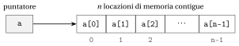

# Introduzione a C++

<div class="info-capitolo" markdown>

**Parte 1 · Fondamenti e algoritmi di base · Capitolo 3** · [:material-file-pdf-box: Dispensa, volume 1 (PDF)](../pdf/dispensa-1-fondamenti.pdf) · [:material-pencil: Esercizi](../esercizi/es-03-introduzione-cpp.md)

</div>

## Introduzione

Nel capitolo «Pseudocodice» gli algoritmi sono scritti in un linguaggio pensato per le persone: è preciso, ma non viene eseguito da un calcolatore. Per eseguire un algoritmo dobbiamo tradurlo in un <strong>linguaggio di programmazione</strong>. In questo capitolo introduciamo il linguaggio di programmazione <code>C++</code>, che usiamo per implementare gli algoritmi del corso.

Il capitolo segue lo stesso percorso del capitolo «Pseudocodice»:

- le caratteristiche principali del linguaggio e la struttura di un programma;

- variabili, tipi di dato e flusso di ingresso e uscita;

- operatori, istruzioni condizionali e cicli;

- gli array, la cui dimensione può essere fissata o decisa durante l'esecuzione;

- le funzioni, con la funzione <code>main</code> come punto di ingresso di ogni programma;

- un algoritmo completo, la ricerca del valore massimo in un array, scritto in pseudocodice e in <code>C++</code>;

- gli operatori bit a bit, che agiscono direttamente sulla rappresentazione binaria dei numeri interi.

Ogni frammento di codice del capitolo è stato compilato con il compilatore <code>g++</code> (standard <code>C++17</code>) ed eseguito: gli output riportati negli esempi sono quelli stampati dai programmi.

!!! chiave ""

    Nello pseudocodice le componenti di un array $a[1..n]$ sono indicizzate da $1$ a $n$; in <code>C++</code> le componenti di un array di dimensione $n$ sono indicizzate da $0$ a $n-1$. La componente $a[i]$ dello pseudocodice corrisponde alla componente <code>a[i-1]</code> del codice <code>C++</code>.

## 3.1 Caratteristiche principali del linguaggio di programmazione

Le caratteristiche principali di <code>C++</code> sono le seguenti.

- <code>C++</code> è un linguaggio <strong>imperativo</strong> che dà accesso diretto alla memoria e alle risorse hardware del calcolatore. È molto efficiente per la programmazione di sistema a basso livello e allo stesso tempo supporta astrazioni di alto livello, il che lo rende versatile sia per le applicazioni in cui le prestazioni sono critiche sia per lo sviluppo software moderno.

- <code>C++</code> supporta le <strong>funzioni</strong>, che permettono un approccio strutturato e modulare alla programmazione. Le funzioni consentono di riutilizzare il codice e di organizzarlo meglio.

- Il linguaggio di programmazione <code>C++</code> comprende un insieme predefinito di <strong>simboli riservati</strong> usati per dichiarare variabili, definire funzioni e specificare le istruzioni eseguibili. Il <strong>codice sorgente</strong> è costituito da una sequenza di <strong>operazioni atomiche</strong> eseguite in ordine, una dopo l'altra, su variabili di <strong>tipi di dato</strong> specifici.

- Il codice sorgente in <code>C++</code> può contenere <strong>commenti</strong>, che servono come documentazione del codice e vengono ignorati dal compilatore. In <code>C++</code>, un commento su una sola riga inizia con il simbolo riservato “<code>//</code>”. I commenti su più righe sono racchiusi fra i simboli riservati “<code>/\*</code>” e “<code>\*/</code>”.

<a id="box-1-cpp-excomments"></a>

!!! esempio "Esempio 3.1: commenti in <code>C++</code>"

    Questo è un esempio di commento su una sola riga:

    ```cpp
    // Questa è una riga di commento
    ```

    Questo è un esempio di commento su più righe:

    ```cpp
    /* This is a
       multi-line comment */
    ```

### 3.1.1 La struttura di un programma

Prima di descrivere le singole istruzioni, osserviamo lo scheletro che ogni programma ha in comune. Un programma <code>C++</code> è un file di testo (con estensione <code>.cpp</code>) che viene tradotto da un <strong>compilatore</strong> in un file eseguibile. L'esecuzione del programma parte dalla funzione <code>main</code>, il punto di ingresso di ogni programma.

<a id="box-2-cpp-exskeleton"></a>

!!! esempio "Esempio 3.2: lo scheletro di un programma"

    ```cpp
    #include <iostream>

    using namespace std;

    int main()
    {
        // Qui si scrivono le istruzioni del programma
        cout << "Ciao, mondo!" << endl;

        return 0;
    }
    ```

    Se il codice sorgente è salvato nel file <code>hello.cpp</code>, lo si compila e lo si esegue con i comandi

    ```bash
    g++ -Wall -std=c++17 -o hello hello.cpp
    ./hello
    ```

    e l'output è

    ```text
    Ciao, mondo!
    ```

Negli esempi seguenti scriviamo solo le istruzioni che contano: a meno che non contengano un programma completo, i frammenti di codice vanno inseriti fra le parentesi graffe di <code>main</code>.

!!! chiave ""

    Ogni istruzione di un codice sorgente <code>C++</code> deve terminare con il simbolo riservato “<code>;</code>”.

## 3.2 Variabili e tipi di dato

Il codice sorgente opera su <strong>variabili</strong>, e ogni variabile ha un <strong>tipo di dato</strong>.

- Le informazioni sono classificate in diversi <strong>tipi di dato</strong>. Le quattro famiglie fondamentali di tipi di dato sono:

    1. Il tipo di dato “<code>int</code>” rappresenta un numero intero, cioè un numero scritto senza la virgola decimale. Comprende i numeri interi positivi e negativi, e lo zero.

    2. Il tipo di dato “<code>bool</code>” rappresenta un valore booleano: <code>true</code> o <code>false</code>.

    3. Il tipo di dato “<code>float</code>” rappresenta un numero in virgola mobile, che comprende i numeri scritti con la virgola decimale. Il tipo di dato “<code>double</code>” rappresenta un numero in virgola mobile a precisione doppia, che offre maggiore accuratezza e un intervallo più ampio di <code>float</code>.

    4. Il tipo di dato “<code>char</code>” rappresenta un singolo carattere, come una lettera, una cifra o un simbolo, racchiuso fra apici singoli (ad esempio <code>'A'</code>, <code>'7'</code>, <code>'!'</code>).

- Una sequenza di caratteri racchiusa fra virgolette doppie (ad esempio <code>"Ada"</code>) è memorizzata in una variabile di tipo “<code>string</code>”, fornito dalla libreria standard <code>&lt;string&gt;</code>.

- Una variabile funziona come un contenitore che memorizza un valore di un tipo di dato specifico per un uso successivo. Ogni variabile ha un nome univoco e contiene un solo valore in ogni istante.

- Alle variabili si assegnano valori con l'operatore di assegnamento “<code>=</code>”. Quando si assegna un nuovo valore, il valore precedente viene sovrascritto.

!!! chiave ""

    Le variabili devono essere dichiarate prima dell'uso, specificandone il tipo di dato.

<a id="box-3-cpp-exvariables"></a>

!!! esempio "Esempio 3.3: dichiarazioni di variabili e assegnamenti di valori"

    ```cpp
    int age = 25; // Variabile intera
    bool isRaining = false; // Variabile booleana
    float smallNumber = 3.14; // Variabile in virgola mobile
    double largeNumber = 123456.789; // Variabile in virgola mobile a doppia precisione
    char character = 'a'; // Variabile carattere
    string name = "Ada"; // Variabile stringa

    age = 26; // Il valore precedente 25 viene sovrascritto
    cout << age << " " << isRaining << " " << smallNumber << " "
         << largeNumber << " " << character << " " << name << endl;
    ```

    <strong>Output:</strong>

    ```text
    26 0 3.14 123457 a Ada
    ```

    Il valore booleano <code>false</code> viene visualizzato come <code>0</code>, e il numero <code>123456.789</code> viene visualizzato come <code>123457</code>: per impostazione predefinita, <code>cout</code> visualizza al più sei cifre significative (il valore memorizzato nella variabile non cambia, e il numero di cifre visualizzate può essere scelto, come vediamo ora).

## 3.3 Flusso di ingresso e uscita

Per visualizzare sullo schermo i valori delle variabili, un programma usa la libreria del <strong>flusso di ingresso e uscita</strong>.

- L'istruzione di inclusione “<code>#include &lt;iostream&gt;</code>” permette di usare in <code>C++</code> la libreria del flusso di ingresso e uscita.

<a id="box-4-cpp-exinclude"></a>

!!! esempio "Esempio 3.4: inclusione"

    ```cpp
    #include <iostream>
    ```

- I valori delle variabili possono essere visualizzati come testo in uscita sullo schermo usando il flusso di uscita “<code>std::cout</code>”. L'operatore di inserimento “<code>&lt; &lt;</code>” serve a inviare i dati al flusso di uscita.

- In una sola istruzione <code>cout</code> si possono visualizzare più valori concatenandoli con l'operatore “<code>&lt; &lt;</code>”. Il testo va racchiuso fra virgolette doppie “<code>"</code>”, mentre i valori delle variabili si scrivono direttamente.

- Il manipolatore “<code>std::endl</code>” si usa con <code>std::cout</code> per andare a capo sullo schermo e svuotare il buffer di uscita.

<a id="box-5-cpp-excout"></a>

!!! esempio "Esempio 3.5: stampe sullo schermo"

    ```cpp
    int n = 7;
    std::cout << "Il valore della variabile è " << n << std::endl;
    ```

    <strong>Output:</strong>

    ```text
    Il valore della variabile è 7
    ```

- L'istruzione “<code>using namespace std;</code>” semplifica l'uso delle funzioni della libreria standard, eliminando la necessità di anteporre <code>std::</code>. D'ora in poi la usiamo sempre, e scriviamo <code>cout</code> e <code>endl</code>.

- L'istruzione di inclusione “<code>#include &lt;iomanip&gt;</code>” fornisce i manipolatori “<code>fixed</code>” e “<code>setprecision(k)</code>”. Quando sono scritti insieme in un'istruzione <code>cout</code>, visualizzano i numeri in virgola mobile che seguono con esattamente $k$ cifre dopo la virgola decimale.

## 3.4 Operatori

Gli operatori sono simboli che eseguono operazioni su variabili e valori. In base alla loro funzione si classificano in cinque categorie principali: operatori aritmetici, di assegnamento, di incremento e decremento, relazionali e logici.

### 3.4.1 Operatori aritmetici

!!! chiave ""

    <strong>Operatori aritmetici</strong>, usati per eseguire le operazioni matematiche di base:

    - <code>+</code> (addizione) $\rightsquigarrow$ somma due valori.

    - <code>-</code> (sottrazione) $\rightsquigarrow$ sottrae un valore da un altro.

    - <code>\*</code> (moltiplicazione) $\rightsquigarrow$ moltiplica due valori.

    - <code>/</code> (divisione) $\rightsquigarrow$ divide un valore per un altro.

    - <code>%</code> (modulo) $\rightsquigarrow$ restituisce il resto di una divisione.

<a id="box-6-cpp-exarith"></a>

!!! esempio "Esempio 3.6: operatori aritmetici"

    ```cpp
    int a = 10, b = 3;

    cout << "Addizione: " << (a + b) << endl;
    cout << "Sottrazione: " << (a - b) << endl;
    cout << "Moltiplicazione: " << (a * b) << endl;
    cout << "Divisione: " << (a / b) << endl; // Divisione intera
    cout << "Resto: " << (a % b) << endl; // Resto della divisione
    ```

    <strong>Output:</strong>

    ```text
    Addizione: 13
    Sottrazione: 7
    Moltiplicazione: 30
    Divisione: 3
    Resto: 1
    ```

- L'operatore di divisione <code>/</code> esegue la divisione intera quando è usato con numeri interi: il risultato di <code>10 / 3</code> è <code>3</code>. Per ottenere un risultato in virgola mobile, almeno un operando deve essere di tipo <code>float</code> o <code>double</code>. Ad esempio, <code>10.0 / 3</code> restituisce <code>3.33333</code> invece di <code>3</code>.

- Un valore di tipo <code>int</code> viene convertito in un valore di tipo <code>double</code> scrivendo “<code>(double)</code>” davanti ad esso (<strong>conversione di tipo</strong>). Ad esempio, se <code>a</code> e <code>b</code> sono variabili di tipo <code>int</code>, l'espressione <code>(double)a / b</code> esegue la divisione in virgola mobile.

<a id="box-7-cpp-exdivision"></a>

!!! esempio "Esempio 3.7: divisione intera e divisione in virgola mobile"

    ```cpp
    int a = 10, b = 3;

    cout << a / b << endl;          // Divisione intera: 3
    cout << 10.0 / 3 << endl;       // Divisione in virgola mobile
    cout << (double)a / b << endl;  // Conversione di a in double
    cout << fixed << setprecision(2) << (double)a / b << endl; // Due cifre decimali
    ```

    <strong>Output</strong> (l'ultima riga richiede <code>#include &lt;iomanip&gt;</code>):

    ```text
    3
    3.33333
    3.33333
    3.33
    ```

### 3.4.2 Operatori di assegnamento

!!! chiave ""

    <strong>Operatori di assegnamento</strong>, usati per assegnare valori alle variabili:

    - <code>=</code> (assegnamento) $\rightsquigarrow$ assegna un valore a una variabile.

    - <code>+=</code> (assegnamento con addizione) $\rightsquigarrow$ somma un valore a una variabile e assegna il risultato.

    - <code>-=</code> (assegnamento con sottrazione) $\rightsquigarrow$ sottrae un valore da una variabile e assegna il risultato.

    - <code>\*=</code> (assegnamento con moltiplicazione) $\rightsquigarrow$ moltiplica una variabile per un valore e assegna il risultato.

    - <code>/=</code> (assegnamento con divisione) $\rightsquigarrow$ divide una variabile per un valore e assegna il risultato.

    - <code>%=</code> (assegnamento con modulo) $\rightsquigarrow$ applica l'operazione di modulo e assegna il risultato.

<a id="box-8-cpp-exassign"></a>

!!! esempio "Esempio 3.8: operatori di assegnamento"

    ```cpp
    int x = 10;  // Assegnamento
    cout << "Valore iniziale: " << x << endl;

    x += 5;  // Equivale a: x = x + 5
    cout << "Dopo += 5: " << x << endl;

    x -= 3;  // Equivale a: x = x - 3
    cout << "Dopo -= 3: " << x << endl;

    x *= 2;  // Equivale a: x = x * 2
    cout << "Dopo *= 2: " << x << endl;

    x /= 4;  // Equivale a: x = x / 4
    cout << "Dopo /= 4: " << x << endl;

    x %= 3;  // Equivale a: x = x % 3
    cout << "Dopo %= 3: " << x << endl;
    ```

    <strong>Output:</strong>

    ```text
    Valore iniziale: 10
    Dopo += 5: 15
    Dopo -= 3: 12
    Dopo *= 2: 24
    Dopo /= 4: 6
    Dopo %= 3: 0
    ```

### 3.4.3 Operatori di incremento e decremento

!!! chiave ""

    <strong>Operatori di incremento e decremento</strong>:

    - <code>++</code> (incremento) $\rightsquigarrow$ aumenta di 1 il valore di una variabile.

    - <code>- -</code> (decremento) $\rightsquigarrow$ diminuisce di 1 il valore di una variabile.

- L'operatore di incremento <code>++</code> si può usare in due forme:

    - pre-incremento (“<code>++x</code>”): incrementa il valore prima di restituirlo;

    - post-incremento (“<code>x++</code>”): restituisce prima il valore, poi lo incrementa.

    La stessa logica vale per l'operatore di decremento (<code>- -x</code> e <code>x- -</code>).

<a id="box-9-cpp-exincdec"></a>

!!! esempio "Esempio 3.9: operatori di incremento e decremento"

    ```cpp
    int x = 5;

    cout << "Valore iniziale: " << x << endl; // Stampa 5

    cout << "Pre-incremento (++x): " << ++x << endl; // Stampa 6

    cout << "Post-incremento (x++): " << x++ << endl; // Stampa 6
    cout << "Valore dopo il post-incremento: " << x << endl; // Stampa 7

    cout << "Pre-decremento (--x): " << --x << endl; // Stampa 6

    cout << "Post-decremento (x--): " << x-- << endl; // Stampa 6
    cout << "Valore dopo il post-decremento: " << x << endl; // Stampa 5
    ```

    <strong>Output:</strong>

    ```text
    Valore iniziale: 5
    Pre-incremento (++x): 6
    Post-incremento (x++): 6
    Valore dopo il post-incremento: 7
    Pre-decremento (--x): 6
    Post-decremento (x--): 6
    Valore dopo il post-decremento: 5
    ```

### 3.4.4 Operatori relazionali

!!! chiave ""

    <strong>Operatori relazionali</strong>, usati per confrontare valori e restituire un risultato booleano:

    - <code>==</code> (uguale a) $\rightsquigarrow$ verifica se due valori sono uguali.

    - <code>!=</code> (diverso da) $\rightsquigarrow$ verifica se due valori sono diversi.

    - <code>&lt;</code> (minore di) $\rightsquigarrow$ verifica se un valore è minore di un altro.

    - <code>&gt;</code> (maggiore di) $\rightsquigarrow$ verifica se un valore è maggiore di un altro.

    - <code>&lt;=</code> (minore o uguale a) $\rightsquigarrow$ verifica se un valore è minore o uguale a un altro.

    - <code>&gt;=</code> (maggiore o uguale a) $\rightsquigarrow$ verifica se un valore è maggiore o uguale a un altro.

- Gli operatori relazionali restituiscono un risultato booleano:

    - <code>true</code> (visualizzato come <code>1</code>) se la condizione è soddisfatta;

    - <code>false</code> (visualizzato come <code>0</code>) se la condizione non è soddisfatta.

    Questi operatori sono usati comunemente nelle <strong>istruzioni condizionali</strong> e nei <strong>cicli</strong>.

<a id="box-10-cpp-exrel"></a>

!!! esempio "Esempio 3.10: operatori relazionali"

    ```cpp
    int a = 10, b = 5;

    cout << "a == b: " << (a == b) << endl;  // Uguale a
    cout << "a != b: " << (a != b) << endl;  // Diverso da
    cout << "a < b: " << (a < b) << endl;    // Minore di
    cout << "a > b: " << (a > b) << endl;    // Maggiore di
    cout << "a <= b: " << (a <= b) << endl;  // Minore o uguale a
    cout << "a >= b: " << (a >= b) << endl;  // Maggiore o uguale a
    ```

    <strong>Output:</strong>

    ```text
    a == b: 0
    a != b: 1
    a < b: 0
    a > b: 1
    a <= b: 0
    a >= b: 1
    ```

### 3.4.5 Operatori logici

!!! chiave ""

    <strong>Operatori logici</strong>, usati per le operazioni logiche, spesso nelle istruzioni condizionali:

    - <code>&amp;&amp;</code> (AND logico) $\rightsquigarrow$ restituisce <code>true</code> se entrambe le condizioni sono vere.

    - <code>||</code> (OR logico) $\rightsquigarrow$ restituisce <code>true</code> se almeno una condizione è vera.

    - <code>!</code> (NOT logico) $\rightsquigarrow$ inverte il valore booleano.

- Come gli operatori relazionali, gli operatori logici restituiscono valori booleani, <code>true</code> (<code>1</code>) o <code>false</code> (<code>0</code>), e sono usati comunemente nelle <strong>istruzioni condizionali</strong> e nei <strong>cicli</strong>.

<a id="box-11-cpp-exlogic"></a>

!!! esempio "Esempio 3.11: operatori logici"

    ```cpp
    bool condition1 = true;
    bool condition2 = false;

    cout << "condition1: " << condition1 << endl;
    cout << "condition2: " << condition2 << endl;

    // AND logico: vero solo se entrambe le condizioni sono vere
    cout << "condition1 && condition2: " << (condition1 && condition2) << endl;

    // OR logico: vero se almeno una condizione è vera
    cout << "condition1 || condition2: " << (condition1 || condition2) << endl;

    // NOT logico: inverte il valore booleano
    cout << "!condition1: " << !condition1 << endl;
    cout << "!condition2: " << !condition2 << endl;
    ```

    <strong>Output:</strong>

    ```text
    condition1: 1
    condition2: 0
    condition1 && condition2: 0
    condition1 || condition2: 1
    !condition1: 0
    !condition2: 1
    ```

## 3.5 Istruzioni condizionali

Gli operatori relazionali e logici producono le condizioni che decidono quali istruzioni vengono eseguite.

- Le istruzioni condizionali permettono di eseguire blocchi di codice diversi in base a condizioni specifiche. L'istruzione <code>if</code> è la struttura di controllo fondamentale di questo tipo.

- L'istruzione <code>if</code> valuta una condizione scritta fra parentesi tonde <code>()</code>. Se la condizione è <strong>vera</strong>, viene eseguito il blocco di codice fra le parentesi graffe <code>{}</code>. Se la condizione è <strong>falsa</strong>, il programma salta il blocco ed esegue il blocco di codice fra le parentesi graffe <code>{}</code> della parte <code>else</code>, se presente.

<a id="box-12-cpp-exif"></a>

!!! esempio "Esempio 3.12: istruzione condizionale"

    ```cpp
    int number = 10;

    // Controlla se il numero è positivo
    if (number > 0)
    {
        cout << "Il numero è positivo." << endl;
    }
    else
    {
        cout << "Il numero non è positivo." << endl;
    }
    ```

    <strong>Output:</strong>

    ```text
    Il numero è positivo.
    ```

### 3.5.1 Operatore ternario (operatore condizionale)

- L'<strong>operatore ternario</strong> <code>?:</code> offre un modo compatto per scrivere semplici istruzioni <code>if-else</code>.

- È l'unico operatore di <code>C++</code> che ha tre operandi.

- Sintassi: <code>condizione ? valore\_se\_vera : valore\_se\_falsa</code>

- Se la condizione è <strong>vera</strong>, l'espressione vale <code>valore\_se\_vera</code>; altrimenti vale <code>valore\_se\_falsa</code>.

<a id="box-13-cpp-extern"></a>

!!! esempio "Esempio 3.13: operatore ternario"

    ```cpp
    int number = 10;

    // Con l'istruzione if-else
    string result1;
    if (number > 0)
        result1 = "positivo";
    else
        result1 = "non positivo";

    cout << "Il numero è " << result1 << endl;

    // Con l'operatore ternario (forma compatta)
    string result2 = (number > 0) ? "positivo" : "non positivo";

    cout << "Il numero è " << result2 << endl;
    ```

    <strong>Output:</strong>

    ```text
    Il numero è positivo
    Il numero è positivo
    ```

<a id="box-14-cpp-exmaxtwo"></a>

!!! esempio "Esempio 3.14: calcolo del massimo fra due numeri"

    ```cpp
    int a = 15, b = 20;

    // Con l'istruzione if-else
    int max1;
    if (a > b)
        max1 = a;
    else
        max1 = b;

    cout << "Massimo (if-else): " << max1 << endl;

    // Con l'operatore ternario (forma compatta)
    int max2 = (a > b) ? a : b;

    cout << "Massimo (ternario): " << max2 << endl;
    ```

    <strong>Output:</strong>

    ```text
    Massimo (if-else): 20
    Massimo (ternario): 20
    ```

<a id="box-15-cpp-exparity"></a>

!!! esempio "Esempio 3.15: verifica se un numero è pari o dispari"

    ```cpp
    int n = 7;

    // Con l'operatore ternario
    string parity = (n % 2 == 0) ? "pari" : "dispari";

    cout << n << " è " << parity << endl;
    ```

    <strong>Output:</strong>

    ```text
    7 è dispari
    ```

<a id="box-16-cpp-exabs"></a>

!!! esempio "Esempio 3.16: assegnamento del valore assoluto"

    ```cpp
    int x = -5;

    // Con l'operatore ternario per calcolare il valore assoluto
    int absValue = (x >= 0) ? x : -x;

    cout << "Il valore assoluto di " << x << " è " << absValue << endl;
    ```

    <strong>Output:</strong>

    ```text
    Il valore assoluto di -5 è 5
    ```

<a id="box-17-cpp-exnested"></a>

!!! esempio "Esempio 3.17: operatori ternari annidati"

    ```cpp
    int score = 85;

    // Operatori ternari annidati per assegnare un voto
    string grade = (score >= 90) ? "A" :
                   (score >= 80) ? "B" :
                   (score >= 70) ? "C" :
                   (score >= 60) ? "D" : "F";

    cout << "Punteggio: " << score << ", Voto: " << grade << endl;
    ```

    <strong>Output:</strong>

    ```text
    Punteggio: 85, Voto: B
    ```

    Le condizioni sono valutate dall'alto verso il basso: <code>score &gt;= 90</code> è falsa e <code>score &gt;= 80</code> è vera, quindi il voto è <code>"B"</code>. Per la leggibilità, le condizioni complesse è meglio gestirle con istruzioni <code>if-else</code>.

## 3.6 Cicli

Le istruzioni condizionali scelgono <em>se</em> un blocco di codice viene eseguito; i cicli decidono <em>quante volte</em> viene eseguito.

- I cicli servono a eseguire ripetutamente un blocco di codice finché una condizione è soddisfatta. Sono essenziali per automatizzare i compiti ripetitivi e ridurre il codice ridondante. In <code>C++</code>, i cicli più usati sono il ciclo <code>while</code> e il ciclo <code>for</code>.

### 3.6.1 Il ciclo <code>while</code>

- Il ciclo <code>while</code> esegue un blocco di codice finché la condizione fra parentesi tonde <code>()</code> vale <strong>vero</strong>. Quando la condizione è falsa, il ciclo termina.

<a id="box-18-cpp-exwhile"></a>

!!! esempio "Esempio 3.18: ciclo <code>while</code>"

    ```cpp
    int i = 1; // Inizializzazione

    while (i <= 5) // Condizione
    {
        cout << "Numero: " << i << endl;
        i++; // Incremento
    }
    ```

    <strong>Output:</strong>

    ```text
    Numero: 1
    Numero: 2
    Numero: 3
    Numero: 4
    Numero: 5
    ```

    La condizione <code>i &lt;= 5</code> viene valutata sei volte: cinque volte è vera, e la sesta volta (<code>i</code> uguale a <code>6</code>) è falsa e il ciclo termina.

### 3.6.2 Il ciclo <code>for</code>

- Il ciclo <code>for</code> è una struttura di ciclo compatta che combina in un'unica istruzione inizializzazione, condizione e incremento (o decremento).

<a id="box-19-cpp-exfor"></a>

!!! esempio "Esempio 3.19: ciclo <code>for</code>"

    ```cpp
    for (int i = 1; i <= 5; i++) // Inizializzazione, condizione, incremento
    {
        cout << "Numero: " << i << endl;
    }
    ```

    L'output è lo stesso del ciclo <code>while</code> dell'[Esempio 3.18](#box-18-cpp-exwhile).

### 3.6.3 Le istruzioni <code>break</code> e <code>continue</code>

- L'istruzione <code>break</code> termina immediatamente il ciclo.

- L'istruzione <code>continue</code> salta il resto dell'iterazione corrente e passa alla successiva.

<a id="box-20-cpp-exbreak"></a>

!!! esempio "Esempio 3.20: <code>break</code> e <code>continue</code>"

    ```cpp
    for (int i = 1; i <= 10; i++)
    {
        if (i % 2 == 0)
        {
            continue; // Salta i numeri pari
        }
        if (i > 7)
        {
            break; // Interrompe il ciclo al primo numero dispari maggiore di 7
        }
        cout << i << " ";
    }
    cout << endl;
    ```

    <strong>Output:</strong>

    ```text
    1 3 5 7
    ```

    I valori pari di <code>i</code> sono saltati da <code>continue</code>; quando <code>i</code> è uguale a <code>9</code> l'istruzione <code>break</code> termina il ciclo, e il valore <code>10</code> non viene mai raggiunto.

## 3.7 Array

I cicli diventano davvero utili quando scorrono collezioni di valori. Una collezione di variabili dello stesso tipo di dato è memorizzata in un <strong>array</strong>.

### 3.7.1 Array di dimensione fissa

- Un array i cui valori sono noti quando si scrive il programma può essere dichiarato elencando i suoi valori fra parentesi graffe. La dimensione dell'array è il numero di valori elencati, e non può cambiare durante l'esecuzione.

- Ogni elemento di un array è identificato dal suo <strong>indice</strong>, che parte da zero, scritto fra parentesi quadre “<code>[]</code>”: gli elementi di un array di dimensione $n$ sono <code>b[0]</code>, <code>b[1]</code>, …, <code>b[n-1]</code>.

<a id="box-21-cpp-exstatic"></a>

!!! esempio "Esempio 3.21: array di dimensione fissa"

    ```cpp
    int b[] = {9, 12, 3, 16}; // Array di 4 interi
    int n = 4;

    b[2] = 5; // Assegna un nuovo valore al terzo elemento

    for (int i = 0; i < n; i++)
    {
        cout << b[i] << " ";
    }
    cout << endl;
    ```

    <strong>Output:</strong>

    ```text
    9 12 5 16
    ```

- Un array bidimensionale di dimensione fissa si dichiara con due dimensioni, il numero di righe e il numero di colonne, e i suoi valori si elencano riga per riga: <code>int c[2][3] = {{3, 1, 4}, {1, 5, 9}};</code> dichiara un array con $2$ righe e $3$ colonne, e <code>c[1][2]</code> è l'elemento della seconda riga e terza colonna, uguale a $9$.

### 3.7.2 Array di dimensione dinamica

- Un <strong>array di dimensione dinamica</strong> è una collezione di variabili dello stesso tipo di dato, memorizzate in locazioni di memoria contigue. La dimensione dell'array viene determinata durante l'esecuzione dell'algoritmo.

- Il simbolo riservato “<code>\*</code>” si usa per dichiarare un <strong>puntatore</strong>, che memorizza l'indirizzo di memoria del primo elemento di un array di dimensione dinamica. L'operatore <code>new</code> si usa per allocare la memoria di un array di dimensione dinamica, e deve specificare il tipo di dato degli elementi insieme alla dimensione dell'array fra parentesi quadre “<code>[]</code>”.

- Ogni elemento di un array di dimensione dinamica è identificato dal suo indice, che parte da zero, scritto fra parentesi quadre “<code>[]</code>”. Un array di dimensione dinamica richiede la deallocazione della memoria con l'operatore <code>delete[]</code>, per liberare la memoria ed evitare perdite di memoria (<em>memory leak</em>).

<a id="box-22-cpp-figarray"></a>

{ .fig loading=lazy  }

<p class="didascalia"><strong>Figura 3.1:</strong> Un array di dimensione dinamica <span class="arithmatex">&#92;(n&#92;)</span>: il puntatore <code>a</code> memorizza l'indirizzo del primo elemento, e gli elementi sono indicizzati da <span class="arithmatex">&#92;(0&#92;)</span> a <span class="arithmatex">&#92;(n-1&#92;)</span>.</p>

<a id="box-23-cpp-exdynamic"></a>

!!! esempio "Esempio 3.22: array di dimensione dinamica"

    ```cpp
    int n = 5; // Dimensione dell'array

    int* a = new int[n]; // Allocazione di un array di dimensione n

    for (int i = 0; i < n; i++)
    {
        a[i] = i * 2; // Esempio di assegnamento di valori
    }

    for (int i = 0; i < n; i++)
    {
        cout << a[i] << " ";
    }
    cout << endl;

    delete[] a;  // Libera la memoria allocata
    ```

    <strong>Output:</strong>

    ```text
    0 2 4 6 8
    ```

- Gli array di dimensione dinamica possono essere multidimensionali. Ad esempio, il simbolo riservato “<code>\*\*</code>” si usa per dichiarare un puntatore a puntatore, che memorizza l'indirizzo di memoria del primo elemento di un array bidimensionale di dimensione dinamica: un array di $m$ puntatori, ciascuno dei quali punta a una riga di $n$ elementi.

- L'operatore <code>new</code> si usa anche per allocare la memoria degli array bidimensionali di dimensione dinamica: prima l'array degli $m$ puntatori alle righe, poi ogni riga. Ogni elemento di un array bidimensionale di dimensione dinamica è identificato da due indici, entrambi a partire da zero, scritti fra parentesi quadre “<code>[][]</code>”. La memoria viene liberata in ordine inverso: prima ogni riga, poi l'array dei puntatori alle righe.

<a id="box-24-cpp-exdynamic2"></a>

!!! esempio "Esempio 3.23: array bidimensionali di dimensione dinamica"

    ```cpp
    int m = 3; // Numero di righe
    int n = 4; // Numero di colonne

    int** matrix = new int*[m]; // Allocazione di una matrice di dimensione m per n
    for (int i = 0; i < m; i++)
    {
        matrix[i] = new int[n]; // Alloca ogni riga
    }

    for (int i = 0; i < m; i++)
    {
        for (int j = 0; j < n; j++)
        {
            matrix[i][j] = i * j; // Esempio di assegnamento di valori
            cout << matrix[i][j] << " ";
        }
        cout << endl;
    }

    for (int i = 0; i < m; i++) // Libera la memoria allocata
    {
        delete[] matrix[i]; // Libera ogni riga
    }
    delete[] matrix; // Libera i puntatori alle righe
    ```

    <strong>Output:</strong>

    ```text
    0 0 0 0
    0 1 2 3
    0 2 4 6
    ```

## 3.8 La funzione <code>main</code> e le funzioni definite dall'utente

Come nello pseudocodice, un algoritmo è scritto come una funzione che riceve l'input e restituisce l'output.

- Le funzioni permettono di scrivere codice modulare e riutilizzabile raggruppando le istruzioni in un'unica unità. Una funzione può essere chiamata più volte per eseguire lo stesso compito, riducendo la ridondanza e migliorando l'organizzazione del codice.

- Di solito le funzioni restituiscono un valore e accettano più parametri in ingresso. Quando si chiama una funzione, gli argomenti vengono passati ai parametri.

- Una funzione in <code>C++</code> è costituita da:

    1. un <strong>tipo di ritorno</strong>: specifica il tipo del valore restituito dalla funzione (<code>void</code> se non viene restituito nulla);

    2. un <strong>nome della funzione</strong>: l'identificatore univoco della funzione;

    3. una <strong>lista dei parametri</strong> (facoltativa): specifica i valori in ingresso della funzione;

    4. un <strong>corpo</strong>: contiene il blocco di codice eseguito quando la funzione viene chiamata;

    5. un'<strong>istruzione di ritorno</strong> (facoltativa): serve a restituire un valore se la funzione restituisce un valore.

- La funzione <code>main</code> è il punto di ingresso di un programma <code>C++</code>. Viene eseguita per prima quando il programma inizia l'esecuzione. Ogni programma <code>C++</code> deve contenere esattamente una funzione <code>main</code>. Il suo valore di ritorno <code>0</code> comunica al sistema operativo che il programma è terminato correttamente.

- Una funzione deve essere definita (o dichiarata) prima del punto in cui viene chiamata: per questo motivo le funzioni definite dall'utente si scrivono prima di <code>main</code>.

- Il codice sorgente <code>C++</code> può anche essere compilato ed eseguito online, ad esempio al seguente indirizzo: [www.mycompiler.io/it/online-c++-compiler](https://www.mycompiler.io/it/online-c++-compiler)

<a id="box-25-cpp-exfunctions"></a>

!!! esempio "Esempio 3.24: funzioni"

    ```cpp
    #include <iostream>

    using namespace std;

    // Definizione della funzione
    int addition(int a, int b)
    {
        return a + b; // Restituisce la somma
    }

    // Definizione della funzione
    int multiplication(int a, int b)
    {
        return a * b; // Restituisce il prodotto
    }

    int main()
    {
        int sum = addition(5, 10); // Chiamata della funzione
        cout << "Somma: " << sum << endl;
        int prod = multiplication(5, 10); // Chiamata della funzione
        cout << "Prodotto: " << prod << endl;

        return 0;
    }
    ```

    <strong>Output:</strong>

    ```text
    Somma: 15
    Prodotto: 50
    ```

### 3.8.1 Parametri passati per valore e per riferimento

Una funzione restituisce al più un valore. Quando una funzione deve produrre più di un risultato, oppure deve modificare una variabile del chiamante, i suoi parametri vengono passati per riferimento.

- Per impostazione predefinita, un parametro è passato <strong>per valore</strong>: la funzione riceve una copia dell'argomento, e le modifiche fatte alla copia non influenzano la variabile del chiamante.

- Un parametro è passato <strong>per riferimento</strong> scrivendo il simbolo riservato “<code>&amp;</code>” dopo il suo tipo di dato (ad esempio <code>int&amp; x</code>): il parametro è un altro nome per la variabile del chiamante, e ogni modifica fatta dalla funzione è visibile al chiamante.

- Un array è passato a una funzione tramite il puntatore al suo primo elemento (ad esempio <code>int \*a</code>), insieme alla sua dimensione: la funzione lavora direttamente sugli elementi dell'array del chiamante.

<a id="box-26-cpp-exreference"></a>

!!! esempio "Esempio 3.25: parametri passati per valore e per riferimento"

    ```cpp
    #include <iostream>

    using namespace std;

    void incrementByValue(int x)
    {
        x = x + 1; // Modifica solo la copia locale
    }

    void incrementByReference(int& x)
    {
        x = x + 1; // Modifica la variabile del chiamante
    }

    void fillWithZeros(int n, int* a)
    {
        for (int i = 0; i < n; i++)
        {
            a[i] = 0; // Modifica l'array del chiamante
        }
    }

    int main()
    {
        int k = 5;
        incrementByValue(k);
        cout << "Dopo incrementByValue: " << k << endl;
        incrementByReference(k);
        cout << "Dopo incrementByReference: " << k << endl;

        int b[] = {4, 7, 1};
        fillWithZeros(3, b);
        cout << "Array: " << b[0] << " " << b[1] << " " << b[2] << endl;

        return 0;
    }
    ```

    <strong>Output:</strong>

    ```text
    Dopo incrementByValue: 5
    Dopo incrementByReference: 6
    Array: 0 0 0
    ```

## 3.9 Un algoritmo completo: il valore massimo in un array

Mettiamo ora insieme tutti i pezzi: una funzione, un ciclo, un'istruzione condizionale e un array di dimensione dinamica.

!!! chiave ""

    Consideriamo il problema di trovare il valore massimo in un array $a$ di $n \ge 1$ numeri interi.

- Questo è lo pseudocodice dell'algoritmo <code>FindMaximum</code> del capitolo «Pseudocodice»: le componenti sono indicizzate da $1$ a $n$.

!!! algoritmo "Algoritmo: FindMaximum"

    <div class="pseudocodice" markdown="0">
    <div class="pc-io"><span class="pc-kw">Input:</span> <span>Un array <span class="arithmatex">&#92;(a&#91;1..n&#93;&#92;)</span> di <span class="arithmatex">&#92;(n &#92;ge 1&#92;)</span> numeri interi</span></div>
    <div class="pc-io"><span class="pc-kw">Output:</span> <span>Il valore massimo nell'array <span class="arithmatex">&#92;(a&#92;)</span></span></div>
    <div class="pc-sep"></div>
    <div class="pc-riga pc-vuota"><span class="pc-n"></span><span class="pc-corpo"></span></div>
    <div class="pc-riga"><span class="pc-n">1</span><span class="pc-corpo"><span class="pc-t"><strong>function</strong> FindMaximum(a, n)</span></span></div>
    <div class="pc-riga"><span class="pc-n">2</span><span class="pc-corpo"><span class="pc-l"></span><span class="pc-t"><span class="arithmatex">&#92;(max := a&#91;1&#93;&#92;)</span></span></span></div>
    <div class="pc-riga"><span class="pc-n">3</span><span class="pc-corpo"><span class="pc-l"></span><span class="pc-t"><strong>for</strong> <span class="arithmatex">&#92;(i := 2&#92;)</span> <strong>to</strong>  <span class="arithmatex">&#92;(n&#92;)</span> <strong>do</strong></span></span></div>
    <div class="pc-riga"><span class="pc-n">4</span><span class="pc-corpo"><span class="pc-l"></span><span class="pc-l"></span><span class="pc-t"><strong>if</strong> <span class="arithmatex">&#92;(a&#91;i&#93; &gt; max&#92;)</span> <strong>then</strong></span></span></div>
    <div class="pc-riga"><span class="pc-n">5</span><span class="pc-corpo"><span class="pc-l"></span><span class="pc-l"></span><span class="pc-l"></span><span class="pc-t"><span class="arithmatex">&#92;(max &#92;leftarrow a&#91;i&#93;&#92;)</span></span></span></div>
    <div class="pc-riga"><span class="pc-n">6</span><span class="pc-corpo"><span class="pc-l"></span><span class="pc-l"></span><span class="pc-t"><strong>end</strong></span></span></div>
    <div class="pc-riga"><span class="pc-n">7</span><span class="pc-corpo"><span class="pc-l"></span><span class="pc-t"><strong>end</strong></span></span></div>
    <div class="pc-riga"><span class="pc-n">8</span><span class="pc-corpo"><span class="pc-l"></span><span class="pc-t"><strong>return</strong> <span class="arithmatex">&#92;(max&#92;)</span></span></span></div>
    <div class="pc-riga"><span class="pc-n">9</span><span class="pc-corpo"><span class="pc-t"><strong>end</strong></span></span></div>
    </div>

- Questa è l'implementazione in <code>C++</code>: le componenti sono indicizzate da $0$ a $n-1$, quindi l'inizializzazione usa <code>a[0]</code> e il ciclo parte da <code>i = 1</code>. La funzione assume $n \ge 1$, come fa lo pseudocodice: per $n = 0$ l'elemento <code>a[0]</code> non esiste.

    ```cpp
    #include <iostream>

    using namespace std;

    // Funzione che trova il valore massimo di un array
    int ArrayMaxValue(int n, int *a)
    {
        int max = a[0]; // Inizializza con il primo elemento

        for (int i = 1; i < n; i++)
        {
            if (a[i] > max)
            {
                max = a[i]; // Aggiorna il massimo
            }
        }

        return max;
    }

    int main()
    {
        int n = 7; // Dimensione dell'array

        int* a = new int[n]; // Allocazione di un array di dimensione n

        int values[] = {9, 12, 3, 16, 19, 11, 12};
        for (int i = 0; i < n; i++)
        {
            a[i] = values[i];
        }

        int max = ArrayMaxValue(n, a);
        cout << "Valore massimo: " << max << endl;

        delete[] a; // Libera la memoria allocata

        return 0;
    }
    ```

    <strong>Output:</strong>

    ```text
    Valore massimo: 19
    ```

<a id="box-27-cpp-extrace"></a>

!!! esempio "Esempio 3.26: esecuzione passo per passo"

    In ogni tabella, la colonna $i$ è l'indice del ciclo <code>C++</code> e la colonna $i+1$ è l'indice corrispondente dello pseudocodice. La prima riga è l'inizializzazione <code>max = a[0]</code>.

    <strong>Istanza 1:</strong> $a = [9, 12, 3, 16, 19, 11, 12]$, $n=7$

    <div class="tabella" markdown="0"><table>
    <tr>
    <th><span class="arithmatex">&#92;(i&#92;)</span> (<code>C++</code>)</th>
    <th><span class="arithmatex">&#92;(i+1&#92;)</span> (pseudocodice)</th>
    <th><code>a[i]</code></th>
    <th><code>a[i] &gt; max</code>?</th>
    <th><code>max</code></th>
    </tr>
    <tr>
    <td>–</td>
    <td>–</td>
    <td>–</td>
    <td>–</td>
    <td><span class="arithmatex">&#92;(9&#92;)</span></td>
    </tr>
    <tr>
    <td><span class="arithmatex">&#92;(1&#92;)</span></td>
    <td><span class="arithmatex">&#92;(2&#92;)</span></td>
    <td><span class="arithmatex">&#92;(12&#92;)</span></td>
    <td>Sì</td>
    <td><span class="arithmatex">&#92;(12&#92;)</span></td>
    </tr>
    <tr>
    <td><span class="arithmatex">&#92;(2&#92;)</span></td>
    <td><span class="arithmatex">&#92;(3&#92;)</span></td>
    <td><span class="arithmatex">&#92;(3&#92;)</span></td>
    <td>No</td>
    <td><span class="arithmatex">&#92;(12&#92;)</span></td>
    </tr>
    <tr>
    <td><span class="arithmatex">&#92;(3&#92;)</span></td>
    <td><span class="arithmatex">&#92;(4&#92;)</span></td>
    <td><span class="arithmatex">&#92;(16&#92;)</span></td>
    <td>Sì</td>
    <td><span class="arithmatex">&#92;(16&#92;)</span></td>
    </tr>
    <tr>
    <td><span class="arithmatex">&#92;(4&#92;)</span></td>
    <td><span class="arithmatex">&#92;(5&#92;)</span></td>
    <td><span class="arithmatex">&#92;(19&#92;)</span></td>
    <td>Sì</td>
    <td><span class="arithmatex">&#92;(19&#92;)</span></td>
    </tr>
    <tr>
    <td><span class="arithmatex">&#92;(5&#92;)</span></td>
    <td><span class="arithmatex">&#92;(6&#92;)</span></td>
    <td><span class="arithmatex">&#92;(11&#92;)</span></td>
    <td>No</td>
    <td><span class="arithmatex">&#92;(19&#92;)</span></td>
    </tr>
    <tr>
    <td><span class="arithmatex">&#92;(6&#92;)</span></td>
    <td><span class="arithmatex">&#92;(7&#92;)</span></td>
    <td><span class="arithmatex">&#92;(12&#92;)</span></td>
    <td>No</td>
    <td><span class="arithmatex">&#92;(19&#92;)</span></td>
    </tr>
    </table></div>

    <strong>Return:</strong> <code>max</code> $= 19$

    <strong>Istanza 2:</strong> $a = [3, 7, 2, 9, 1]$, $n=5$

    <div class="tabella" markdown="0"><table>
    <tr>
    <th><span class="arithmatex">&#92;(i&#92;)</span> (<code>C++</code>)</th>
    <th><span class="arithmatex">&#92;(i+1&#92;)</span> (pseudo-code)</th>
    <th><code>a[i]</code></th>
    <th><code>a[i] &gt; max</code>?</th>
    <th><code>max</code></th>
    </tr>
    <tr>
    <td>–</td>
    <td>–</td>
    <td>–</td>
    <td>–</td>
    <td><span class="arithmatex">&#92;(3&#92;)</span></td>
    </tr>
    <tr>
    <td><span class="arithmatex">&#92;(1&#92;)</span></td>
    <td><span class="arithmatex">&#92;(2&#92;)</span></td>
    <td><span class="arithmatex">&#92;(7&#92;)</span></td>
    <td>Sì</td>
    <td><span class="arithmatex">&#92;(7&#92;)</span></td>
    </tr>
    <tr>
    <td><span class="arithmatex">&#92;(2&#92;)</span></td>
    <td><span class="arithmatex">&#92;(3&#92;)</span></td>
    <td><span class="arithmatex">&#92;(2&#92;)</span></td>
    <td>No</td>
    <td><span class="arithmatex">&#92;(7&#92;)</span></td>
    </tr>
    <tr>
    <td><span class="arithmatex">&#92;(3&#92;)</span></td>
    <td><span class="arithmatex">&#92;(4&#92;)</span></td>
    <td><span class="arithmatex">&#92;(9&#92;)</span></td>
    <td>Sì</td>
    <td><span class="arithmatex">&#92;(9&#92;)</span></td>
    </tr>
    <tr>
    <td><span class="arithmatex">&#92;(4&#92;)</span></td>
    <td><span class="arithmatex">&#92;(5&#92;)</span></td>
    <td><span class="arithmatex">&#92;(1&#92;)</span></td>
    <td>No</td>
    <td><span class="arithmatex">&#92;(9&#92;)</span></td>
    </tr>
    </table></div>

    <strong>Return:</strong> <code>max</code> $= 9$

## 3.10 Operatori bit a bit

I numeri interi gestiti da un programma sono memorizzati in binario, come descritto nel capitolo «Rappresentazione dei numeri». <code>C++</code> fornisce operatori che agiscono direttamente su queste cifre binarie.

- Gli <strong>operatori bit a bit</strong> eseguono operazioni sui singoli bit dei valori interi. Sono essenziali per la programmazione a basso livello, per l'ottimizzazione e per lavorare con le rappresentazioni binarie.

- I bit sono numerati da destra, a partire dalla posizione $0$ (il bit meno significativo).

!!! chiave ""

    <strong>Operatori bit a bit</strong> in <code>C++</code>:

    - <code>&amp;</code> (AND bit a bit) $\rightsquigarrow$ restituisce 1 solo se entrambi i bit corrispondenti sono 1.

    - <code>|</code> (OR bit a bit) $\rightsquigarrow$ restituisce 1 se almeno uno dei bit corrispondenti è 1.

    - <code></code> (XOR bit a bit) $\rightsquigarrow$ restituisce 1 se i bit corrispondenti sono diversi.

    - <code>~</code> (NOT bit a bit) $\rightsquigarrow$ inverte tutti i bit (0 diventa 1, 1 diventa 0).

    - <code>&lt; &lt;</code> (scorrimento a sinistra) $\rightsquigarrow$ sposta i bit a sinistra di un numero specificato di posizioni.

    - <code>&gt; &gt;</code> (scorrimento a destra) $\rightsquigarrow$ sposta i bit a destra di un numero specificato di posizioni.

### 3.10.1 AND bit a bit (<code>&amp;</code>)

- L'operatore AND bit a bit confronta ogni bit di due numeri e restituisce 1 solo se entrambi i bit sono 1.

- Tavola di verità dell'AND:

<div class="tabella" markdown="0"><table>
<tr>
<th>Bit A</th>
<th>Bit B</th>
<th>A &amp; B</th>
</tr>
<tr>
<td>0</td>
<td>0</td>
<td>0</td>
</tr>
<tr>
<td>0</td>
<td>1</td>
<td>0</td>
</tr>
<tr>
<td>1</td>
<td>0</td>
<td>0</td>
</tr>
<tr>
<td>1</td>
<td>1</td>
<td>1</td>
</tr>
</table></div>

<a id="box-28-cpp-exand"></a>

!!! esempio "Esempio 3.27: AND bit a bit"

    ```cpp
    int a = 12;  // Binario: 1100
    int b = 10;  // Binario: 1010
    int result = a & b;  // Binario: 1000 (decimale: 8)

    cout << "a & b = " << result << endl;  // Stampa: 8
    ```

    Operazione bit per bit:

    <div class="tabella" markdown="0"><table>
    <tr>
    <th></th>
    <th colspan="4"></th>
    <th>Decimale</th>
    </tr>
    <tr>
    <td><code>a</code></td>
    <td>1</td>
    <td>1</td>
    <td>0</td>
    <td>0</td>
    <td>12</td>
    </tr>
    <tr>
    <td><code>b</code></td>
    <td>1</td>
    <td>0</td>
    <td>1</td>
    <td>0</td>
    <td>10</td>
    </tr>
    <tr>
    <td><code>a &amp; b</code></td>
    <td>1</td>
    <td>0</td>
    <td>0</td>
    <td>0</td>
    <td>8</td>
    </tr>
    </table></div>

### 3.10.2 OR bit a bit (<code>|</code>)

- L'operatore OR bit a bit confronta ogni bit di due numeri e restituisce 1 se almeno uno dei bit è 1.

- Tavola di verità dell'OR:

<div class="tabella" markdown="0"><table>
<tr>
<th>Bit A</th>
<th>Bit B</th>
<th>A | B</th>
</tr>
<tr>
<td>0</td>
<td>0</td>
<td>0</td>
</tr>
<tr>
<td>0</td>
<td>1</td>
<td>1</td>
</tr>
<tr>
<td>1</td>
<td>0</td>
<td>1</td>
</tr>
<tr>
<td>1</td>
<td>1</td>
<td>1</td>
</tr>
</table></div>

<a id="box-29-cpp-exor"></a>

!!! esempio "Esempio 3.28: OR bit a bit"

    ```cpp
    int a = 12;  // Binario: 1100
    int b = 10;  // Binario: 1010
    int result = a | b;  // Binario: 1110 (decimale: 14)

    cout << "a | b = " << result << endl;  // Stampa: 14
    ```

    Operazione bit per bit:

    <div class="tabella" markdown="0"><table>
    <tr>
    <th></th>
    <th colspan="4"></th>
    <th>Decimale</th>
    </tr>
    <tr>
    <td><code>a</code></td>
    <td>1</td>
    <td>1</td>
    <td>0</td>
    <td>0</td>
    <td>12</td>
    </tr>
    <tr>
    <td><code>b</code></td>
    <td>1</td>
    <td>0</td>
    <td>1</td>
    <td>0</td>
    <td>10</td>
    </tr>
    <tr>
    <td><code>a | b</code></td>
    <td>1</td>
    <td>1</td>
    <td>1</td>
    <td>0</td>
    <td>14</td>
    </tr>
    </table></div>

### 3.10.3 XOR bit a bit (<code></code>)

- L'operatore XOR bit a bit (OR esclusivo) confronta ogni bit di due numeri e restituisce 1 se i bit sono diversi.

- Tavola di verità dello XOR:

<div class="tabella" markdown="0"><table>
<tr>
<th>Bit A</th>
<th>Bit B</th>
<th>A  B</th>
</tr>
<tr>
<td>0</td>
<td>0</td>
<td>0</td>
</tr>
<tr>
<td>0</td>
<td>1</td>
<td>1</td>
</tr>
<tr>
<td>1</td>
<td>0</td>
<td>1</td>
</tr>
<tr>
<td>1</td>
<td>1</td>
<td>0</td>
</tr>
</table></div>

<a id="box-30-cpp-exxor"></a>

!!! esempio "Esempio 3.29: XOR bit a bit"

    ```cpp
    int a = 12;  // Binario: 1100
    int b = 10;  // Binario: 1010
    int result = a ^ b;  // Binario: 0110 (decimale: 6)

    cout << "a ^ b = " << result << endl;  // Stampa: 6
    ```

    Operazione bit per bit:

    <div class="tabella" markdown="0"><table>
    <tr>
    <th></th>
    <th colspan="4"></th>
    <th>Decimale</th>
    </tr>
    <tr>
    <td><code>a</code></td>
    <td>1</td>
    <td>1</td>
    <td>0</td>
    <td>0</td>
    <td>12</td>
    </tr>
    <tr>
    <td><code>b</code></td>
    <td>1</td>
    <td>0</td>
    <td>1</td>
    <td>0</td>
    <td>10</td>
    </tr>
    <tr>
    <td><code>a  b</code></td>
    <td>0</td>
    <td>1</td>
    <td>1</td>
    <td>0</td>
    <td>6</td>
    </tr>
    </table></div>

### 3.10.4 NOT bit a bit (<code>~</code>)

- L'operatore NOT bit a bit inverte tutti i bit di un numero (0 diventa 1, 1 diventa 0).

- Questo è un operatore unario (opera su un solo operando).

- Il risultato dipende dal numero di bit usati per rappresentare l'intero. Nell'esempio usiamo il tipo di dato <code>unsigned char</code>, che memorizza i numeri naturali da $0$ a $255$ con $8$ bit; la conversione <code>(int)</code> visualizza il risultato come numero invece che come carattere.

<a id="box-31-cpp-exnot"></a>

!!! esempio "Esempio 3.30: NOT bit a bit"

    ```cpp
    unsigned char a = 12;  // Binario (8 bit): 00001100
    unsigned char result = ~a;  // Binario: 11110011 (decimale: 243)

    cout << "~a = " << (int)result << endl;  // Stampa: 243
    ```

    Operazione bit per bit (usando la rappresentazione a 8 bit):

    <div class="tabella" markdown="0"><table>
    <tr>
    <th></th>
    <th colspan="8"></th>
    <th>Decimale</th>
    </tr>
    <tr>
    <td><code>a</code></td>
    <td>0</td>
    <td>0</td>
    <td>0</td>
    <td>0</td>
    <td>1</td>
    <td>1</td>
    <td>0</td>
    <td>0</td>
    <td>12</td>
    </tr>
    <tr>
    <td><code>~a</code></td>
    <td>1</td>
    <td>1</td>
    <td>1</td>
    <td>1</td>
    <td>0</td>
    <td>0</td>
    <td>1</td>
    <td>1</td>
    <td>243</td>
    </tr>
    </table></div>

    Infatti $243 = 255 - 12$: invertire tutti gli $8$ bit di un numero $x$ dà $255 - x$.

### 3.10.5 Scorrimento a sinistra (<code>&lt; &lt;</code>)

- L'operatore di scorrimento a sinistra sposta tutti i bit a sinistra di un numero specificato di posizioni.

- Vengono aggiunti zeri sul lato destro.

- Scorrere a sinistra di $k$ posizioni equivale a moltiplicare per $2^k$ (purché il risultato sia rappresentabile dal tipo di dato).

<a id="box-32-cpp-exlshift"></a>

!!! esempio "Esempio 3.31: scorrimento a sinistra"

    ```cpp
    int a = 5;  // Binario: 0101
    int result = a << 2;  // Scorrimento a sinistra di 2 posizioni: 10100 (decimale: 20)

    cout << "a << 2 = " << result << endl;  // Stampa: 20
    // Equivale a: 5 * 2^2 = 5 * 4 = 20
    ```

    Operazione bit per bit:

    <div class="tabella" markdown="0"><table>
    <tr>
    <th></th>
    <th colspan="6"></th>
    <th>Decimale</th>
    <th>Equivalente</th>
    </tr>
    <tr>
    <td><code>a</code></td>
    <td>0</td>
    <td>0</td>
    <td>0</td>
    <td>1</td>
    <td>0</td>
    <td>1</td>
    <td>5</td>
    <td><span class="arithmatex">&#92;(5&#92;)</span></td>
    </tr>
    <tr>
    <td><code>a &lt; &lt; 1</code></td>
    <td>0</td>
    <td>0</td>
    <td>1</td>
    <td>0</td>
    <td>1</td>
    <td>0</td>
    <td>10</td>
    <td><span class="arithmatex">&#92;(5 &#92;times 2^1&#92;)</span></td>
    </tr>
    <tr>
    <td><code>a &lt; &lt; 2</code></td>
    <td>0</td>
    <td>1</td>
    <td>0</td>
    <td>1</td>
    <td>0</td>
    <td>0</td>
    <td>20</td>
    <td><span class="arithmatex">&#92;(5 &#92;times 2^2&#92;)</span></td>
    </tr>
    <tr>
    <td><code>a &lt; &lt; 3</code></td>
    <td>1</td>
    <td>0</td>
    <td>1</td>
    <td>0</td>
    <td>0</td>
    <td>0</td>
    <td>40</td>
    <td><span class="arithmatex">&#92;(5 &#92;times 2^3&#92;)</span></td>
    </tr>
    </table></div>

### 3.10.6 Scorrimento a destra (<code>&gt; &gt;</code>)

- L'operatore di scorrimento a destra sposta tutti i bit a destra di un numero specificato di posizioni; i bit che escono a destra vanno persi.

- Per i numeri interi non negativi, vengono aggiunti zeri sul lato sinistro.

- Per i numeri interi non negativi, scorrere a destra di $k$ posizioni equivale alla divisione intera per $2^k$, cioè a $\lfloor x / 2^k \rfloor$.

<a id="box-33-cpp-exrshift"></a>

!!! esempio "Esempio 3.32: scorrimento a destra"

    ```cpp
    int a = 20;  // Binario: 10100
    int result = a >> 2;  // Scorrimento a destra di 2 posizioni: 00101 (decimale: 5)

    cout << "a >> 2 = " << result << endl;  // Stampa: 5
    // Equivale a: 20 / 2^2 = 20 / 4 = 5
    ```

    Operazione bit per bit:

    <div class="tabella" markdown="0"><table>
    <tr>
    <th></th>
    <th colspan="6"></th>
    <th>Decimale</th>
    <th>Equivalente</th>
    </tr>
    <tr>
    <td><code>a</code></td>
    <td>0</td>
    <td>1</td>
    <td>0</td>
    <td>1</td>
    <td>0</td>
    <td>0</td>
    <td>20</td>
    <td><span class="arithmatex">&#92;(20&#92;)</span></td>
    </tr>
    <tr>
    <td><code>a &gt; &gt; 1</code></td>
    <td>0</td>
    <td>0</td>
    <td>1</td>
    <td>0</td>
    <td>1</td>
    <td>0</td>
    <td>10</td>
    <td><span class="arithmatex">&#92;(20 / 2^1&#92;)</span></td>
    </tr>
    <tr>
    <td><code>a &gt; &gt; 2</code></td>
    <td>0</td>
    <td>0</td>
    <td>0</td>
    <td>1</td>
    <td>0</td>
    <td>1</td>
    <td>5</td>
    <td><span class="arithmatex">&#92;(20 / 2^2&#92;)</span></td>
    </tr>
    <tr>
    <td><code>a &gt; &gt; 3</code></td>
    <td>0</td>
    <td>0</td>
    <td>0</td>
    <td>0</td>
    <td>1</td>
    <td>0</td>
    <td>2</td>
    <td><span class="arithmatex">&#92;(&#92;lfloor 20 / 2^3 &#92;rfloor&#92;)</span></td>
    </tr>
    </table></div>

    Nell'ultima riga $20 / 2^3 = 2.5$, e lo scorrimento a destra dà la parte intera $2$: il bit $1$ in posizione $0$ di <code>a &gt; &gt; 2</code> va perso.

### 3.10.7 Applicazioni pratiche

Gli operatori bit a bit offrono soluzioni brevi e veloci per compiti comuni. Negli esempi seguenti, una <strong>maschera</strong> è un numero la cui rappresentazione binaria ha il bit $1$ solo nelle posizioni su cui vogliamo agire: la maschera <code>1 &lt; &lt; k</code> ha il bit $1$ solo nella posizione $k$.

<a id="box-34-cpp-exoddbit"></a>

!!! esempio "Esempio 3.33: verifica se un numero è pari o dispari"

    ```cpp
    int n = 15;

    if (n & 1)
        cout << n << " è dispari" << endl;
    else
        cout << n << " è pari" << endl;

    // Spiegazione: n & 1 controlla il bit meno significativo
    // Se vale 1 il numero è dispari, se vale 0 è pari
    ```

    <strong>Output:</strong>

    ```text
    15 è dispari
    ```

<a id="box-35-cpp-exswap"></a>

!!! esempio "Esempio 3.34: scambio di due numeri senza una variabile temporanea"

    ```cpp
    int a = 5, b = 9;

    cout << "Prima dello scambio: a = " << a << ", b = " << b << endl;

    a = a ^ b;  // ora a contiene a XOR b
    b = a ^ b;  // b = (a XOR b) XOR b = a
    a = a ^ b;  // a = (a XOR b) XOR a = b

    cout << "Dopo lo scambio: a = " << a << ", b = " << b << endl;
    ```

    <strong>Output:</strong>

    ```text
    Prima dello scambio: a = 5, b = 9
    Dopo lo scambio: a = 9, b = 5
    ```

    Lo scambio funziona perché <code>x  x</code> vale $0$ e <code>x  0</code> vale <code>x</code> per ogni intero <code>x</code>, e lo XOR è commutativo e associativo.

<a id="box-36-cpp-extestbit"></a>

!!! esempio "Esempio 3.35: verifica se un bit specifico è impostato"

    ```cpp
    int n = 12;  // Binario: 1100
    int position = 2;  // Controlla il bit in posizione 2 (da destra, a partire da 0)

    if (n & (1 << position))
        cout << "Il bit " << position << " vale 1" << endl;
    else
        cout << "Il bit " << position << " vale 0" << endl;

    // Spiegazione: (1 << position) crea una maschera in cui è acceso solo il bit in posizione position
    // n & mask controlla se quel bit di n vale 1
    ```

    <strong>Output:</strong>

    ```text
    Il bit 2 vale 1
    ```

<a id="box-37-cpp-exsetbit"></a>

!!! esempio "Esempio 3.36: impostazione di un bit specifico a 1"

    ```cpp
    int n = 12;  // Binario: 1100
    int position = 1;  // Imposta il bit in posizione 1

    n = n | (1 << position);  // Pone il bit in posizione 1 a 1

    cout << "Risultato: " << n << endl;  // Stampa: 14 (binario: 1110)
    ```

<a id="box-38-cpp-exclearbit"></a>

!!! esempio "Esempio 3.37: azzeramento di un bit specifico a 0"

    ```cpp
    int n = 14;  // Binario: 1110
    int position = 1;  // Azzera il bit in posizione 1

    n = n & ~(1 << position);  // Pone il bit in posizione 1 a 0

    cout << "Risultato: " << n << endl;  // Stampa: 12 (binario: 1100)
    ```

    La maschera <code>~(1 &lt; &lt; position)</code> ha il bit $0$ nella posizione data e il bit $1$ in tutte le altre posizioni.

<a id="box-39-cpp-extoggle"></a>

!!! esempio "Esempio 3.38: inversione di un bit specifico"

    ```cpp
    int n = 12;  // Binario: 1100
    int position = 0;  // Inverte il bit in posizione 0

    n = n ^ (1 << position);  // Inverte il bit in posizione 0

    cout << "Risultato: " << n << endl;  // Stampa: 13 (binario: 1101)
    ```

!!! chiave ""

    <strong>Punti chiave del capitolo</strong>

    - Un programma <code>C++</code> viene compilato (ad esempio con <code>g++</code>) e la sua esecuzione parte dalla funzione <code>main</code>; ogni istruzione termina con “<code>;</code>”.

    - Ogni variabile è dichiarata con il suo tipo di dato prima dell'uso; la divisione fra due valori <code>int</code> è la divisione intera.

    - Le istruzioni condizionali (<code>if</code>, <code>else</code>, <code>?:</code>) scelgono quali istruzioni vengono eseguite; i cicli (<code>while</code>, <code>for</code>) le ripetono.

    - Gli array di <code>C++</code> sono indicizzati da $0$ a $n-1$, mentre gli array dello pseudocodice sono indicizzati da $1$ a $n$; un array di dimensione dinamica si alloca con <code>new</code> e si libera con <code>delete[]</code>.

    - Una funzione riceve i suoi parametri per valore (una copia) o per riferimento (<code>&amp;</code>); un array è passato tramite il puntatore al suo primo elemento, insieme alla sua dimensione.

    - Gli operatori bit a bit agiscono sulla rappresentazione binaria dei numeri interi: <code>x &lt; &lt; k</code> moltiplica $x$ per $2^k$ e, per $x \ge 0$, <code>x &gt; &gt; k</code> calcola $\lfloor x/2^k \rfloor$.
