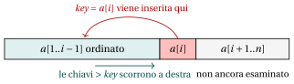
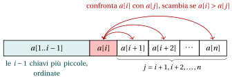
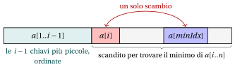

# Algoritmi di ordinamento

<div class="info-capitolo" markdown>

**Parte 1 · Fondamenti e algoritmi di base · Capitolo 4** · [:material-file-pdf-box: Dispensa, volume 1 (PDF)](../pdf/dispensa-1-fondamenti.pdf) · [:material-pencil: Esercizi](../esercizi/es-04-ordinamento.md)

</div>

## Introduzione

L'ordinamento è uno dei compiti più comuni dell'informatica: un elenco ordinato di nomi, di voti o di prezzi è molto più facile da consultare, da confrontare e da leggere di uno non ordinato. In questo capitolo enunciamo con precisione il problema dell'ordinamento, introduciamo i criteri con cui si confrontano gli algoritmi di ordinamento e studiamo tre algoritmi classici che lo risolvono: <strong>Insertion Sort</strong>, <strong>Exchange Sort</strong> e <strong>Selection Sort</strong>.

- I tre algoritmi sono scritti nello pseudocodice del corso, con gli array indicizzati a partire da $1$, e poi implementati in <code>C++</code>, con gli array indicizzati a partire da $0$.

- Per ogni algoritmo mostriamo l'esecuzione passo per passo sugli stessi due array, $[5, 2, 4, 1, 3]$ e $[12, 11, 13, 5, 6]$, in modo che i tre metodi possano essere confrontati direttamente.

- Per ogni algoritmo contiamo i confronti tra chiavi e gli spostamenti di chiavi che esegue, e stabiliamo se è in-place e se è stabile.

## 4.1 Il problema dell'ordinamento

<a id="box-1-srt-problem"></a>

!!! definizione "Definizione 4.1: problema dell'ordinamento"

    Dato un array $a[1..n]$ di $n \in \Z_{\ge 1}$ numeri naturali, il <strong>problema dell'ordinamento</strong> consiste nel riarrangiare gli elementi dell'array in <strong>ordine non decrescente</strong>, cioè in modo che

    \begin{equation*}
    \label{eq:srt:sorted}
    a[1] \le a[2] \le \dots \le a[n]. \tag{4.1}
    \end{equation*}

    Un <strong>riarrangiamento</strong> (o <strong>permutazione</strong>) dell'array è un array che contiene gli stessi elementi, ciascuno con la stessa molteplicità, in un ordine eventualmente diverso. L'output del problema dell'ordinamento è il riarrangiamento dell'array di input che soddisfa $\eqref{eq:srt:sorted}$.

- Ogni elemento $a[i]$ è detto <strong>chiave</strong>: è il valore su cui si basa l'ordinamento, cioè il valore che viene confrontato per decidere la disposizione finale.

- L'ordine è <em>non decrescente</em> e non <em>crescente</em> perché l'array può contenere chiavi uguali, come in $[3, 1, 3]$, il cui riarrangiamento ordinato è $[1, 3, 3]$.

- L'output deve essere un riarrangiamento dell'input: un array come $[0, 0, 0, 0, 0]$ soddisfa $\eqref{eq:srt:sorted}$, ma non è la versione ordinata di $[5, 2, 4, 1, 3]$.

<a id="box-2-ex-srt-problem"></a>

!!! esempio "Esempio 4.1: ordinamento di un array"

    - Array di input: $a = [5, 2, 4, 1, 3]$.

    - Array ordinato: $a = [1, 2, 3, 4, 5]$.

Prima di studiare algoritmi specifici, fissiamo le operazioni che essi possono usare e i criteri con cui li confrontiamo.

### 4.1.1 Ordinamento basato su confronti

<a id="box-3-srt-comparison"></a>

!!! definizione "Definizione 4.2: ordinamento basato su confronti"

    Un algoritmo di ordinamento è <strong>basato su confronti</strong> se accede alle chiavi soltanto confrontandole a due a due e copiandole.

- Le sole operazioni consentite sulle chiavi in un algoritmo di ordinamento basato su confronti sono:

    1. <strong>confrontare due chiavi</strong>: stabilire quale tra $a[i]$ e $a[j]$ è la maggiore (o se sono uguali);

    2. <strong>copiare / assegnare una chiave</strong>: spostare o memorizzare il valore di una chiave, ad esempio $\mathit{tmp} \leftarrow a[i]$.

- Operazioni vietate sulle chiavi:

    1. operazioni aritmetiche sulle chiavi (addizione, moltiplicazione, ecc.);

    2. ispezionare le singole cifre o i singoli bit di una chiave;

    3. qualunque operazione che sfrutti la rappresentazione interna della chiave.

- Tutti gli algoritmi di ordinamento studiati in questo capitolo (Insertion Sort, Exchange Sort, Selection Sort) appartengono a questa classe: decidono come riarrangiare gli elementi soltanto in base ai confronti tra coppie di chiavi.

### 4.1.2 Metriche di prestazione

- Poiché i confronti e le assegnazioni sono le sole operazioni consentite sulle chiavi, valutiamo un algoritmo di ordinamento basato su confronti contando:

    - il <strong>numero di confronti tra chiavi</strong> che esegue;

    - il <strong>numero di assegnazioni di chiavi</strong> (copie) che esegue.

- Il numero di assegnazioni conta nella pratica. Ogni <strong>scambio</strong> (swap) di due elementi dell'array richiede tre assegnazioni:

    $$
    \mathit{tmp} \leftarrow a[i]; \qquad a[i] \leftarrow a[j]; \qquad a[j] \leftarrow \mathit{tmp},
    $$

    quindi gli algoritmi che scambiano meno tendono a essere più veloci.

- Entrambi i numeri dipendono non solo da $n$ ma anche dall'ordine iniziale delle chiavi. Per questo motivo li calcoliamo nel <strong>caso migliore</strong> (l'input che li minimizza) e nel <strong>caso peggiore</strong> (l'input che li massimizza), tra tutti gli array di $n$ elementi.

- Nei conteggi usiamo la somma dei primi $n-1$ interi positivi:

    \begin{equation*}
    \label{eq:srt:gauss}
    \sum_{k=1}^{n-1} k \;=\; 1 + 2 + \dots + (n-1) \;=\; \frac{n(n-1)}{2}. \tag{4.2}
    \end{equation*}

### 4.1.3 Ordinamento in-place e uso della memoria

- Oltre al tempo, ci interessa anche quanta <strong>memoria aggiuntiva</strong> usa un algoritmo, oltre allo spazio già necessario per memorizzare le $n$ chiavi di input.

<a id="box-4-srt-inplace"></a>

!!! definizione "Definizione 4.3: ordinamento in-place"

    Un algoritmo di ordinamento è <strong>in-place</strong> (in loco) se la quantità di memoria aggiuntiva che richiede è <strong>costante</strong>, cioè non cresce con $n$.

- In modo equivalente, un algoritmo di ordinamento in-place ordina riarrangiando gli elementi <em>all'interno</em> dell'array originale, usando al più un numero fisso di variabili ausiliarie (ad esempio, i contatori dei cicli e una variabile temporanea per lo scambio).

- Gli algoritmi in-place riarrangiano tipicamente l'array di input spostando o scambiando elementi, quindi non richiedono spazio aggiuntivo per un altro array che contenga l'output ordinato.

### 4.1.4 Stabilità

- In molte applicazioni le chiavi fanno parte di <strong>record</strong> più grandi (ad esempio, uno studente identificato da un voto e da un nome), e due record diversi possono avere la stessa chiave. Scriviamo un record come una coppia $(\mathit{key},\ \mathit{label})$. Si confrontano solo le chiavi, e ogni etichetta viaggia insieme alla sua chiave.

<a id="box-5-srt-stable"></a>

!!! definizione "Definizione 4.4: ordinamento stabile"

    Un algoritmo di ordinamento è <strong>stabile</strong> se i record con chiavi uguali compaiono nell'output nello stesso ordine relativo in cui compaiono nell'input.

<a id="box-6-ex-srt-stability"></a>

!!! esempio "Esempio 4.2: ordinamento stabile e non stabile"

    - Array di record: $a = [(3,A),\ (1,B),\ (3,C),\ (2,D),\ (1,E)]$.

    - Ordinamento stabile: $a = [(1,B),\ (1,E),\ (2,D),\ (3,A),\ (3,C)]$. I record con chiave $1$ mantengono l'ordine $B, E$ e i record con chiave $3$ mantengono l'ordine $A, C$, come nell'input.

    - Ordinamento non stabile: $a = [(1,E),\ (1,B),\ (2,D),\ (3,C),\ (3,A)]$. Le chiavi sono ordinate, ma entrambe le coppie di record con chiavi uguali risultano invertite.

- La stabilità conta quando i record vengono ordinati più volte rispetto a chiavi diverse: ad esempio, ordinando gli studenti prima per nome e poi, con un algoritmo stabile, per voto, gli studenti con lo stesso voto risultano in ordine alfabetico.

!!! chiave ""

    Un algoritmo di ordinamento basato su confronti si valuta in base al <strong>numero di confronti tra chiavi</strong> e al <strong>numero di assegnazioni di chiavi</strong> che esegue (nel caso migliore e nel caso peggiore), alla <strong>memoria aggiuntiva</strong> che usa (in-place o no) e al fatto di essere <strong>stabile</strong>.

## 4.2 Insertion Sort

- Insertion Sort funziona come molte persone ordinano una mano di carte da gioco: le carte già in mano si tengono ordinate, e ogni nuova carta viene inserita al suo posto tra di esse.

- All'inizio dell'iterazione $i$, il sotto-array $a[1..i-1]$ è ordinato. L'algoritmo prende l'elemento successivo $a[i]$, detto $\mathit{key}$, sposta di una posizione a destra tutti gli elementi di $a[1..i-1]$ maggiori di $\mathit{key}$ e scrive $\mathit{key}$ nella posizione rimasta libera ([Figura 4.1](#box-7-fig-srt-insertion)).

<a id="box-7-fig-srt-insertion"></a>

{ .fig loading=lazy  }

<p class="didascalia"><strong>Figura 4.1:</strong> Iterazione <span class="arithmatex">&#92;(i&#92;)</span> di Insertion Sort: <span class="arithmatex">&#92;(&#92;mathit{key}=a&#91;i&#93;&#92;)</span> viene inserita nel sotto-array ordinato <span class="arithmatex">&#92;(a&#91;1..i-1&#93;&#92;)</span>, dopo aver spostato di una posizione a destra le chiavi maggiori di <span class="arithmatex">&#92;(&#92;mathit{key}&#92;)</span>.</p>

- Questo è lo pseudocodice dell'algoritmo Insertion Sort, che ordina un array $a[1..n]$ di $n$ numeri naturali in ordine non decrescente.

!!! algoritmo "Algoritmo: InsertionSort"

    <div class="pseudocodice" markdown="0">
    <div class="pc-io"><span class="pc-kw">Input:</span> <span>Un array <span class="arithmatex">&#92;(a&#91;1..n&#93;&#92;)</span> di <span class="arithmatex">&#92;(n&#92;)</span> numeri naturali</span></div>
    <div class="pc-io"><span class="pc-kw">Output:</span> <span>L'array <span class="arithmatex">&#92;(a&#92;)</span> ordinato in ordine non decrescente</span></div>
    <div class="pc-sep"></div>
    <div class="pc-riga pc-vuota"><span class="pc-n"></span><span class="pc-corpo"></span></div>
    <div class="pc-riga"><span class="pc-n">1</span><span class="pc-corpo"><span class="pc-t"><strong>function</strong> InsertionSort(a, n)</span></span></div>
    <div class="pc-riga" id="riga-04-ordinamento-line-is-a"><span class="pc-n">2</span><span class="pc-corpo"><span class="pc-l"></span><span class="pc-t"><span class="arithmatex">&#92;(i := 2&#92;)</span></span></span></div>
    <div class="pc-riga" id="riga-04-ordinamento-line-is-b"><span class="pc-n">3</span><span class="pc-corpo"><span class="pc-l"></span><span class="pc-t"><strong>while</strong> <span class="arithmatex">&#92;(i &#92;le n&#92;)</span> <strong>do</strong></span></span></div>
    <div class="pc-riga" id="riga-04-ordinamento-line-is-c"><span class="pc-n">4</span><span class="pc-corpo"><span class="pc-l"></span><span class="pc-l"></span><span class="pc-t"><span class="arithmatex">&#92;(&#92;mathit{key} := a&#91;i&#93;&#92;)</span></span><span class="pc-c">// elemento da inserire</span></span></div>
    <div class="pc-riga" id="riga-04-ordinamento-line-is-d"><span class="pc-n">5</span><span class="pc-corpo"><span class="pc-l"></span><span class="pc-l"></span><span class="pc-t"><span class="arithmatex">&#92;(j := i - 1&#92;)</span></span></span></div>
    <div class="pc-riga" id="riga-04-ordinamento-line-is-e"><span class="pc-n">6</span><span class="pc-corpo"><span class="pc-l"></span><span class="pc-l"></span><span class="pc-t"><strong>while</strong> <span class="arithmatex">&#92;(j &#92;ge 1&#92;)</span> <strong>and</strong> <span class="arithmatex">&#92;(a&#91;j&#93; &gt; &#92;mathit{key}&#92;)</span> <strong>do</strong></span></span></div>
    <div class="pc-riga" id="riga-04-ordinamento-line-is-f"><span class="pc-n">7</span><span class="pc-corpo"><span class="pc-l"></span><span class="pc-l"></span><span class="pc-l"></span><span class="pc-t"><span class="arithmatex">&#92;(a&#91;j+1&#93; &#92;leftarrow a&#91;j&#93;&#92;)</span></span><span class="pc-c">// sposta l'elemento a destra</span></span></div>
    <div class="pc-riga" id="riga-04-ordinamento-line-is-g"><span class="pc-n">8</span><span class="pc-corpo"><span class="pc-l"></span><span class="pc-l"></span><span class="pc-l"></span><span class="pc-t"><span class="arithmatex">&#92;(j &#92;leftarrow j - 1&#92;)</span></span></span></div>
    <div class="pc-riga"><span class="pc-n">9</span><span class="pc-corpo"><span class="pc-l"></span><span class="pc-l"></span><span class="pc-t"><strong>end</strong></span></span></div>
    <div class="pc-riga" id="riga-04-ordinamento-line-is-h"><span class="pc-n">10</span><span class="pc-corpo"><span class="pc-l"></span><span class="pc-l"></span><span class="pc-t"><span class="arithmatex">&#92;(a&#91;j+1&#93; &#92;leftarrow &#92;mathit{key}&#92;)</span></span><span class="pc-c">// inserisce key nella sua posizione</span></span></div>
    <div class="pc-riga" id="riga-04-ordinamento-line-is-i"><span class="pc-n">11</span><span class="pc-corpo"><span class="pc-l"></span><span class="pc-l"></span><span class="pc-t"><span class="arithmatex">&#92;(i &#92;leftarrow i + 1&#92;)</span></span></span></div>
    <div class="pc-riga"><span class="pc-n">12</span><span class="pc-corpo"><span class="pc-l"></span><span class="pc-t"><strong>end</strong></span></span></div>
    <div class="pc-riga"><span class="pc-n">13</span><span class="pc-corpo"><span class="pc-t"><strong>end</strong></span></span></div>
    </div>

- Spiegazione dell'algoritmo:

    - Il ciclo esterno (righe [3](#riga-04-ordinamento-line-is-b)–[11](#riga-04-ordinamento-line-is-i)) scorre l'array a partire dal secondo elemento ($i = 2$): un singolo elemento, $a[1..1]$, è già ordinato.

    - Per ogni elemento $a[i]$ (la $\mathit{key}$), il ciclo interno (righe [6](#riga-04-ordinamento-line-is-e)–[8](#riga-04-ordinamento-line-is-g)) scorre la parte ordinata $a[1..i-1]$ da destra a sinistra e sposta di una posizione a destra tutti gli elementi maggiori di $\mathit{key}$.

    - Il ciclo interno si ferma quando $j=0$ (tutti gli elementi di $a[1..i-1]$ erano maggiori di $\mathit{key}$) oppure quando $a[j] \le \mathit{key}$. La condizione alla riga [6](#riga-04-ordinamento-line-is-e) è valutata da sinistra a destra: quando $j = 0$ il confronto $a[j] > \mathit{key}$ non viene valutato, perché $a[0]$ non esiste.

    - La riga [10](#riga-04-ordinamento-line-is-h) scrive $\mathit{key}$ nella posizione $j+1$ lasciata libera dagli spostamenti.

    - Dopo ogni iterazione del ciclo esterno, il sotto-array $a[1..i]$ è ordinato. Quando l'algoritmo termina, $i = n+1$ e l'intero array $a[1..n]$ è ordinato.

- Nelle tabelle di traccia di questo capitolo, ogni riga mostra lo stato dell'array <em>dopo</em> l'operazione descritta nell'ultima colonna. La chiave corrente è evidenziata in <mark style="background:color-mix(in srgb, #e03131 30%, transparent);color:inherit">rosso</mark>, e le celle modificate da uno spostamento, da un inserimento o da uno scambio sono evidenziate in <mark style="background:color-mix(in srgb, #1971c2 30%, transparent);color:inherit">blu</mark>.

<a id="box-8-ex-srt-is1"></a>

!!! esempio "Esempio 4.3: Insertion Sort su $[5, 2, 4, 1, 3]$"

    Array di input: $a = [5, 2, 4, 1, 3]$, con $n=5$. Il ciclo esterno esegue le iterazioni $i = 2, 3, 4, 5$.

    - Traccia dettagliata (ciclo interno):

    <div class="tabella" markdown="0"><table>
    <tr>
    <th><span class="arithmatex">&#92;(i&#92;)</span></th>
    <th><span class="arithmatex">&#92;(j&#92;)</span></th>
    <th><span class="arithmatex">&#92;(&#92;mathit{key}&#92;)</span></th>
    <th><span class="arithmatex">&#92;(a&#91;1&#93;&#92;)</span></th>
    <th><span class="arithmatex">&#92;(a&#91;2&#93;&#92;)</span></th>
    <th><span class="arithmatex">&#92;(a&#91;3&#93;&#92;)</span></th>
    <th><span class="arithmatex">&#92;(a&#91;4&#93;&#92;)</span></th>
    <th><span class="arithmatex">&#92;(a&#91;5&#93;&#92;)</span></th>
    <th>Azione</th>
    </tr>
    <tr>
    <td><span class="arithmatex">&#92;(-&#92;)</span></td>
    <td><span class="arithmatex">&#92;(-&#92;)</span></td>
    <td><span class="arithmatex">&#92;(-&#92;)</span></td>
    <td>5</td>
    <td>2</td>
    <td>4</td>
    <td>1</td>
    <td>3</td>
    <td>stato iniziale</td>
    </tr>
    <tr>
    <td>2</td>
    <td>1</td>
    <td class="cella-rossa">2</td>
    <td>5</td>
    <td>2</td>
    <td>4</td>
    <td>1</td>
    <td>3</td>
    <td><span class="arithmatex">&#92;(&#92;mathit{key} &#92;leftarrow a&#91;2&#93;=2&#92;)</span>; <span class="arithmatex">&#92;(j &#92;leftarrow 1&#92;)</span></td>
    </tr>
    <tr>
    <td></td>
    <td>0</td>
    <td>2</td>
    <td>5</td>
    <td class="cella-blu">5</td>
    <td>4</td>
    <td>1</td>
    <td>3</td>
    <td><span class="arithmatex">&#92;(a&#91;1&#93;=5&gt;2&#92;)</span>: sposta <span class="arithmatex">&#92;(a&#91;2&#93;&#92;leftarrow 5&#92;)</span>; <span class="arithmatex">&#92;(j&#92;leftarrow 0&#92;)</span></td>
    </tr>
    <tr>
    <td></td>
    <td><span class="arithmatex">&#92;(-&#92;)</span></td>
    <td>2</td>
    <td class="cella-blu">2</td>
    <td>5</td>
    <td>4</td>
    <td>1</td>
    <td>3</td>
    <td><span class="arithmatex">&#92;(j=0&#92;)</span>: esci; inserisci <span class="arithmatex">&#92;(a&#91;1&#93;&#92;leftarrow 2&#92;)</span></td>
    </tr>
    <tr>
    <td>3</td>
    <td>2</td>
    <td class="cella-rossa">4</td>
    <td>2</td>
    <td>5</td>
    <td>4</td>
    <td>1</td>
    <td>3</td>
    <td><span class="arithmatex">&#92;(&#92;mathit{key} &#92;leftarrow a&#91;3&#93;=4&#92;)</span>; <span class="arithmatex">&#92;(j &#92;leftarrow 2&#92;)</span></td>
    </tr>
    <tr>
    <td></td>
    <td>1</td>
    <td>4</td>
    <td>2</td>
    <td>5</td>
    <td class="cella-blu">5</td>
    <td>1</td>
    <td>3</td>
    <td><span class="arithmatex">&#92;(a&#91;2&#93;=5&gt;4&#92;)</span>: sposta <span class="arithmatex">&#92;(a&#91;3&#93;&#92;leftarrow 5&#92;)</span>; <span class="arithmatex">&#92;(j&#92;leftarrow 1&#92;)</span></td>
    </tr>
    <tr>
    <td></td>
    <td><span class="arithmatex">&#92;(-&#92;)</span></td>
    <td>4</td>
    <td>2</td>
    <td class="cella-blu">4</td>
    <td>5</td>
    <td>1</td>
    <td>3</td>
    <td><span class="arithmatex">&#92;(a&#91;1&#93;=2&#92;le 4&#92;)</span>: esci; inserisci <span class="arithmatex">&#92;(a&#91;2&#93;&#92;leftarrow 4&#92;)</span></td>
    </tr>
    <tr>
    <td>4</td>
    <td>3</td>
    <td class="cella-rossa">1</td>
    <td>2</td>
    <td>4</td>
    <td>5</td>
    <td>1</td>
    <td>3</td>
    <td><span class="arithmatex">&#92;(&#92;mathit{key} &#92;leftarrow a&#91;4&#93;=1&#92;)</span>; <span class="arithmatex">&#92;(j &#92;leftarrow 3&#92;)</span></td>
    </tr>
    <tr>
    <td></td>
    <td>2</td>
    <td>1</td>
    <td>2</td>
    <td>4</td>
    <td>5</td>
    <td class="cella-blu">5</td>
    <td>3</td>
    <td><span class="arithmatex">&#92;(a&#91;3&#93;=5&gt;1&#92;)</span>: sposta <span class="arithmatex">&#92;(a&#91;4&#93;&#92;leftarrow 5&#92;)</span>; <span class="arithmatex">&#92;(j&#92;leftarrow 2&#92;)</span></td>
    </tr>
    <tr>
    <td></td>
    <td>1</td>
    <td>1</td>
    <td>2</td>
    <td>4</td>
    <td class="cella-blu">4</td>
    <td>5</td>
    <td>3</td>
    <td><span class="arithmatex">&#92;(a&#91;2&#93;=4&gt;1&#92;)</span>: sposta <span class="arithmatex">&#92;(a&#91;3&#93;&#92;leftarrow 4&#92;)</span>; <span class="arithmatex">&#92;(j&#92;leftarrow 1&#92;)</span></td>
    </tr>
    <tr>
    <td></td>
    <td>0</td>
    <td>1</td>
    <td>2</td>
    <td class="cella-blu">2</td>
    <td>4</td>
    <td>5</td>
    <td>3</td>
    <td><span class="arithmatex">&#92;(a&#91;1&#93;=2&gt;1&#92;)</span>: sposta <span class="arithmatex">&#92;(a&#91;2&#93;&#92;leftarrow 2&#92;)</span>; <span class="arithmatex">&#92;(j&#92;leftarrow 0&#92;)</span></td>
    </tr>
    <tr>
    <td></td>
    <td><span class="arithmatex">&#92;(-&#92;)</span></td>
    <td>1</td>
    <td class="cella-blu">1</td>
    <td>2</td>
    <td>4</td>
    <td>5</td>
    <td>3</td>
    <td><span class="arithmatex">&#92;(j=0&#92;)</span>: esci; inserisci <span class="arithmatex">&#92;(a&#91;1&#93;&#92;leftarrow 1&#92;)</span></td>
    </tr>
    <tr>
    <td>5</td>
    <td>4</td>
    <td class="cella-rossa">3</td>
    <td>1</td>
    <td>2</td>
    <td>4</td>
    <td>5</td>
    <td>3</td>
    <td><span class="arithmatex">&#92;(&#92;mathit{key} &#92;leftarrow a&#91;5&#93;=3&#92;)</span>; <span class="arithmatex">&#92;(j &#92;leftarrow 4&#92;)</span></td>
    </tr>
    <tr>
    <td></td>
    <td>3</td>
    <td>3</td>
    <td>1</td>
    <td>2</td>
    <td>4</td>
    <td>5</td>
    <td class="cella-blu">5</td>
    <td><span class="arithmatex">&#92;(a&#91;4&#93;=5&gt;3&#92;)</span>: sposta <span class="arithmatex">&#92;(a&#91;5&#93;&#92;leftarrow 5&#92;)</span>; <span class="arithmatex">&#92;(j&#92;leftarrow 3&#92;)</span></td>
    </tr>
    <tr>
    <td></td>
    <td>2</td>
    <td>3</td>
    <td>1</td>
    <td>2</td>
    <td>4</td>
    <td class="cella-blu">4</td>
    <td>5</td>
    <td><span class="arithmatex">&#92;(a&#91;3&#93;=4&gt;3&#92;)</span>: sposta <span class="arithmatex">&#92;(a&#91;4&#93;&#92;leftarrow 4&#92;)</span>; <span class="arithmatex">&#92;(j&#92;leftarrow 2&#92;)</span></td>
    </tr>
    <tr>
    <td></td>
    <td><span class="arithmatex">&#92;(-&#92;)</span></td>
    <td>3</td>
    <td>1</td>
    <td>2</td>
    <td class="cella-blu">3</td>
    <td>4</td>
    <td>5</td>
    <td><span class="arithmatex">&#92;(a&#91;2&#93;=2&#92;le 3&#92;)</span>: esci; inserisci <span class="arithmatex">&#92;(a&#91;3&#93;&#92;leftarrow 3&#92;)</span></td>
    </tr>
    </table></div>

    - Stato dell'array dopo ogni iterazione del ciclo esterno:

    <div class="tabella" markdown="0"><table>
    <tr>
    <th><span class="arithmatex">&#92;(i&#92;)</span></th>
    <th><span class="arithmatex">&#92;(&#92;mathit{key}&#92;)</span></th>
    <th><span class="arithmatex">&#92;(a&#91;1&#93;&#92;)</span></th>
    <th><span class="arithmatex">&#92;(a&#91;2&#93;&#92;)</span></th>
    <th><span class="arithmatex">&#92;(a&#91;3&#93;&#92;)</span></th>
    <th><span class="arithmatex">&#92;(a&#91;4&#93;&#92;)</span></th>
    <th><span class="arithmatex">&#92;(a&#91;5&#93;&#92;)</span></th>
    <th>Azione</th>
    </tr>
    <tr>
    <td><span class="arithmatex">&#92;(-&#92;)</span></td>
    <td><span class="arithmatex">&#92;(-&#92;)</span></td>
    <td>5</td>
    <td>2</td>
    <td>4</td>
    <td>1</td>
    <td>3</td>
    <td>stato iniziale</td>
    </tr>
    <tr>
    <td>2</td>
    <td class="cella-rossa">2</td>
    <td class="cella-blu">2</td>
    <td class="cella-blu">5</td>
    <td>4</td>
    <td>1</td>
    <td>3</td>
    <td>inserisci 2 all'inizio</td>
    </tr>
    <tr>
    <td>3</td>
    <td class="cella-rossa">4</td>
    <td>2</td>
    <td class="cella-blu">4</td>
    <td class="cella-blu">5</td>
    <td>1</td>
    <td>3</td>
    <td>inserisci 4 tra 2 e 5</td>
    </tr>
    <tr>
    <td>4</td>
    <td class="cella-rossa">1</td>
    <td class="cella-blu">1</td>
    <td class="cella-blu">2</td>
    <td class="cella-blu">4</td>
    <td class="cella-blu">5</td>
    <td>3</td>
    <td>inserisci 1 all'inizio</td>
    </tr>
    <tr>
    <td>5</td>
    <td class="cella-rossa">3</td>
    <td>1</td>
    <td>2</td>
    <td class="cella-blu">3</td>
    <td class="cella-blu">4</td>
    <td class="cella-blu">5</td>
    <td>inserisci 3 tra 2 e 4</td>
    </tr>
    </table></div>

    - L'array ordinato è $[1, 2, 3, 4, 5]$. L'algoritmo esegue 9 confronti tra chiavi e 7 spostamenti.

<a id="box-9-ex-srt-is2"></a>

!!! esempio "Esempio 4.4: Insertion Sort su $[12, 11, 13, 5, 6]$"

    Array di input: $a = [12, 11, 13, 5, 6]$, con $n=5$.

    - Traccia dettagliata (ciclo interno):

    <div class="tabella" markdown="0"><table>
    <tr>
    <th><span class="arithmatex">&#92;(i&#92;)</span></th>
    <th><span class="arithmatex">&#92;(j&#92;)</span></th>
    <th><span class="arithmatex">&#92;(&#92;mathit{key}&#92;)</span></th>
    <th><span class="arithmatex">&#92;(a&#91;1&#93;&#92;)</span></th>
    <th><span class="arithmatex">&#92;(a&#91;2&#93;&#92;)</span></th>
    <th><span class="arithmatex">&#92;(a&#91;3&#93;&#92;)</span></th>
    <th><span class="arithmatex">&#92;(a&#91;4&#93;&#92;)</span></th>
    <th><span class="arithmatex">&#92;(a&#91;5&#93;&#92;)</span></th>
    <th>Azione</th>
    </tr>
    <tr>
    <td><span class="arithmatex">&#92;(-&#92;)</span></td>
    <td><span class="arithmatex">&#92;(-&#92;)</span></td>
    <td><span class="arithmatex">&#92;(-&#92;)</span></td>
    <td>12</td>
    <td>11</td>
    <td>13</td>
    <td>5</td>
    <td>6</td>
    <td>stato iniziale</td>
    </tr>
    <tr>
    <td>2</td>
    <td>1</td>
    <td class="cella-rossa">11</td>
    <td>12</td>
    <td>11</td>
    <td>13</td>
    <td>5</td>
    <td>6</td>
    <td><span class="arithmatex">&#92;(&#92;mathit{key} &#92;leftarrow a&#91;2&#93;=11&#92;)</span>; <span class="arithmatex">&#92;(j &#92;leftarrow 1&#92;)</span></td>
    </tr>
    <tr>
    <td></td>
    <td>0</td>
    <td>11</td>
    <td>12</td>
    <td class="cella-blu">12</td>
    <td>13</td>
    <td>5</td>
    <td>6</td>
    <td><span class="arithmatex">&#92;(a&#91;1&#93;=12&gt;11&#92;)</span>: sposta <span class="arithmatex">&#92;(a&#91;2&#93;&#92;leftarrow 12&#92;)</span>; <span class="arithmatex">&#92;(j&#92;leftarrow 0&#92;)</span></td>
    </tr>
    <tr>
    <td></td>
    <td><span class="arithmatex">&#92;(-&#92;)</span></td>
    <td>11</td>
    <td class="cella-blu">11</td>
    <td>12</td>
    <td>13</td>
    <td>5</td>
    <td>6</td>
    <td><span class="arithmatex">&#92;(j=0&#92;)</span>: esci; inserisci <span class="arithmatex">&#92;(a&#91;1&#93;&#92;leftarrow 11&#92;)</span></td>
    </tr>
    <tr>
    <td>3</td>
    <td>2</td>
    <td class="cella-rossa">13</td>
    <td>11</td>
    <td>12</td>
    <td>13</td>
    <td>5</td>
    <td>6</td>
    <td><span class="arithmatex">&#92;(&#92;mathit{key} &#92;leftarrow a&#91;3&#93;=13&#92;)</span>; <span class="arithmatex">&#92;(j &#92;leftarrow 2&#92;)</span></td>
    </tr>
    <tr>
    <td></td>
    <td><span class="arithmatex">&#92;(-&#92;)</span></td>
    <td>13</td>
    <td>11</td>
    <td>12</td>
    <td class="cella-blu">13</td>
    <td>5</td>
    <td>6</td>
    <td><span class="arithmatex">&#92;(a&#91;2&#93;=12&#92;le 13&#92;)</span>: esci; inserisci <span class="arithmatex">&#92;(a&#91;3&#93;&#92;leftarrow 13&#92;)</span></td>
    </tr>
    <tr>
    <td>4</td>
    <td>3</td>
    <td class="cella-rossa">5</td>
    <td>11</td>
    <td>12</td>
    <td>13</td>
    <td>5</td>
    <td>6</td>
    <td><span class="arithmatex">&#92;(&#92;mathit{key} &#92;leftarrow a&#91;4&#93;=5&#92;)</span>; <span class="arithmatex">&#92;(j &#92;leftarrow 3&#92;)</span></td>
    </tr>
    <tr>
    <td></td>
    <td>2</td>
    <td>5</td>
    <td>11</td>
    <td>12</td>
    <td>13</td>
    <td class="cella-blu">13</td>
    <td>6</td>
    <td><span class="arithmatex">&#92;(a&#91;3&#93;=13&gt;5&#92;)</span>: sposta <span class="arithmatex">&#92;(a&#91;4&#93;&#92;leftarrow 13&#92;)</span>; <span class="arithmatex">&#92;(j&#92;leftarrow 2&#92;)</span></td>
    </tr>
    <tr>
    <td></td>
    <td>1</td>
    <td>5</td>
    <td>11</td>
    <td>12</td>
    <td class="cella-blu">12</td>
    <td>13</td>
    <td>6</td>
    <td><span class="arithmatex">&#92;(a&#91;2&#93;=12&gt;5&#92;)</span>: sposta <span class="arithmatex">&#92;(a&#91;3&#93;&#92;leftarrow 12&#92;)</span>; <span class="arithmatex">&#92;(j&#92;leftarrow 1&#92;)</span></td>
    </tr>
    <tr>
    <td></td>
    <td>0</td>
    <td>5</td>
    <td>11</td>
    <td class="cella-blu">11</td>
    <td>12</td>
    <td>13</td>
    <td>6</td>
    <td><span class="arithmatex">&#92;(a&#91;1&#93;=11&gt;5&#92;)</span>: sposta <span class="arithmatex">&#92;(a&#91;2&#93;&#92;leftarrow 11&#92;)</span>; <span class="arithmatex">&#92;(j&#92;leftarrow 0&#92;)</span></td>
    </tr>
    <tr>
    <td></td>
    <td><span class="arithmatex">&#92;(-&#92;)</span></td>
    <td>5</td>
    <td class="cella-blu">5</td>
    <td>11</td>
    <td>12</td>
    <td>13</td>
    <td>6</td>
    <td><span class="arithmatex">&#92;(j=0&#92;)</span>: esci; inserisci <span class="arithmatex">&#92;(a&#91;1&#93;&#92;leftarrow 5&#92;)</span></td>
    </tr>
    <tr>
    <td>5</td>
    <td>4</td>
    <td class="cella-rossa">6</td>
    <td>5</td>
    <td>11</td>
    <td>12</td>
    <td>13</td>
    <td>6</td>
    <td><span class="arithmatex">&#92;(&#92;mathit{key} &#92;leftarrow a&#91;5&#93;=6&#92;)</span>; <span class="arithmatex">&#92;(j &#92;leftarrow 4&#92;)</span></td>
    </tr>
    <tr>
    <td></td>
    <td>3</td>
    <td>6</td>
    <td>5</td>
    <td>11</td>
    <td>12</td>
    <td>13</td>
    <td class="cella-blu">13</td>
    <td><span class="arithmatex">&#92;(a&#91;4&#93;=13&gt;6&#92;)</span>: sposta <span class="arithmatex">&#92;(a&#91;5&#93;&#92;leftarrow 13&#92;)</span>; <span class="arithmatex">&#92;(j&#92;leftarrow 3&#92;)</span></td>
    </tr>
    <tr>
    <td></td>
    <td>2</td>
    <td>6</td>
    <td>5</td>
    <td>11</td>
    <td>12</td>
    <td class="cella-blu">12</td>
    <td>13</td>
    <td><span class="arithmatex">&#92;(a&#91;3&#93;=12&gt;6&#92;)</span>: sposta <span class="arithmatex">&#92;(a&#91;4&#93;&#92;leftarrow 12&#92;)</span>; <span class="arithmatex">&#92;(j&#92;leftarrow 2&#92;)</span></td>
    </tr>
    <tr>
    <td></td>
    <td>1</td>
    <td>6</td>
    <td>5</td>
    <td>11</td>
    <td class="cella-blu">11</td>
    <td>12</td>
    <td>13</td>
    <td><span class="arithmatex">&#92;(a&#91;2&#93;=11&gt;6&#92;)</span>: sposta <span class="arithmatex">&#92;(a&#91;3&#93;&#92;leftarrow 11&#92;)</span>; <span class="arithmatex">&#92;(j&#92;leftarrow 1&#92;)</span></td>
    </tr>
    <tr>
    <td></td>
    <td><span class="arithmatex">&#92;(-&#92;)</span></td>
    <td>6</td>
    <td>5</td>
    <td class="cella-blu">6</td>
    <td>11</td>
    <td>12</td>
    <td>13</td>
    <td><span class="arithmatex">&#92;(a&#91;1&#93;=5&#92;le 6&#92;)</span>: esci; inserisci <span class="arithmatex">&#92;(a&#91;2&#93;&#92;leftarrow 6&#92;)</span></td>
    </tr>
    </table></div>

    - Stato dell'array dopo ogni iterazione del ciclo esterno:

    <div class="tabella" markdown="0"><table>
    <tr>
    <th><span class="arithmatex">&#92;(i&#92;)</span></th>
    <th><span class="arithmatex">&#92;(&#92;mathit{key}&#92;)</span></th>
    <th><span class="arithmatex">&#92;(a&#91;1&#93;&#92;)</span></th>
    <th><span class="arithmatex">&#92;(a&#91;2&#93;&#92;)</span></th>
    <th><span class="arithmatex">&#92;(a&#91;3&#93;&#92;)</span></th>
    <th><span class="arithmatex">&#92;(a&#91;4&#93;&#92;)</span></th>
    <th><span class="arithmatex">&#92;(a&#91;5&#93;&#92;)</span></th>
    <th>Azione</th>
    </tr>
    <tr>
    <td><span class="arithmatex">&#92;(-&#92;)</span></td>
    <td><span class="arithmatex">&#92;(-&#92;)</span></td>
    <td>12</td>
    <td>11</td>
    <td>13</td>
    <td>5</td>
    <td>6</td>
    <td>stato iniziale</td>
    </tr>
    <tr>
    <td>2</td>
    <td class="cella-rossa">11</td>
    <td class="cella-blu">11</td>
    <td class="cella-blu">12</td>
    <td>13</td>
    <td>5</td>
    <td>6</td>
    <td>inserisci 11 all'inizio</td>
    </tr>
    <tr>
    <td>3</td>
    <td class="cella-rossa">13</td>
    <td>11</td>
    <td>12</td>
    <td>13</td>
    <td>5</td>
    <td>6</td>
    <td>13 già al suo posto</td>
    </tr>
    <tr>
    <td>4</td>
    <td class="cella-rossa">5</td>
    <td class="cella-blu">5</td>
    <td class="cella-blu">11</td>
    <td class="cella-blu">12</td>
    <td class="cella-blu">13</td>
    <td>6</td>
    <td>inserisci 5 all'inizio</td>
    </tr>
    <tr>
    <td>5</td>
    <td class="cella-rossa">6</td>
    <td>5</td>
    <td class="cella-blu">6</td>
    <td class="cella-blu">11</td>
    <td class="cella-blu">12</td>
    <td class="cella-blu">13</td>
    <td>inserisci 6 tra 5 e 11</td>
    </tr>
    </table></div>

    - L'array ordinato è $[5, 6, 11, 12, 13]$. Nell'iterazione $i=3$ la chiave $13$ è già al suo posto: il ciclo interno si ferma al primo confronto e non viene eseguito alcuno spostamento. L'algoritmo esegue 9 confronti tra chiavi e 7 spostamenti.

### 4.2.1 Proprietà di Insertion Sort

- I due esempi mostrano che il lavoro svolto da Insertion Sort dipende dall'ordine iniziale delle chiavi: una chiave già al suo posto costa un confronto e nessuno spostamento, mentre una chiave più piccola di tutte le precedenti viene spostata lungo l'intera parte ordinata.

<a id="box-10-obs-srt-iscount"></a>

!!! teorema "Osservazione 4.5: confronti e spostamenti di Insertion Sort"

    Dato un array $a[1..n]$ di $n$ numeri naturali, <code>InsertionSort</code> esegue almeno $n-1$ e al più $\frac{n(n-1)}{2}$ confronti tra chiavi, e al più $\frac{n(n-1)}{2}$ spostamenti. Le limitazioni inferiori sono raggiunte quando l'array è già ordinato (non viene eseguito alcuno spostamento), quelle superiori quando è ordinato in senso decrescente con chiavi distinte.

??? dimostrazione "Dimostrazione"

    Consideriamo l'iterazione $i$ del ciclo esterno, con $i \in \{2, 3, \dots, n\}$, e siano $s_i$ e $c_i$ il numero di spostamenti e di confronti tra chiavi che essa esegue. Il ciclo interno parte con $j=i-1 \ge 1$, quindi $c_i \ge 1$. Ogni spostamento (righe [7](#riga-04-ordinamento-line-is-f)–[8](#riga-04-ordinamento-line-is-g)) segue un confronto $a[j] > \mathit{key}$ vero e diminuisce $j$ di $1$; quindi $s_i \le i-1$. Il ciclo interno si ferma poi in uno di due modi:

    - con $j = 0$, dopo $s_i = i-1$ spostamenti e senza un ulteriore confronto: $c_i = s_i = i-1$;

    - dopo un confronto $a[j] > \mathit{key}$ falso, con $j \ge 1$: allora $s_i = i-1-j \le i-2$ e $c_i = s_i + 1 \le i-1$.

    In entrambi i casi $1 \le c_i \le i-1$ e $0 \le s_i \le i-1$. Sommando su $i \in \{2, 3, \dots, n\}$ e usando $\eqref{eq:srt:gauss}$:

    $$
    n-1 \;\le\; \text{confronti tra chiavi} \;\le\; \sum_{i=2}^{n} (i-1) = \frac{n(n-1)}{2},
    \qquad
    \text{spostamenti} \;\le\; \frac{n(n-1)}{2}.
    $$

    Se l'array è ordinato, a ogni iterazione $a[i-1] \le \mathit{key}$: il ciclo interno si ferma al primo confronto, senza spostamenti, e l'algoritmo esegue esattamente $n-1$ confronti. Se le chiavi sono distinte e in ordine decrescente, $\mathit{key}=a[i]$ è minore di tutte le chiavi di $a[1..i-1]$: vengono spostate tutte e il ciclo si ferma con $j=0$, quindi l'iterazione $i$ esegue $i-1$ confronti e $i-1$ spostamenti, e i totali sono entrambi $\frac{n(n-1)}{2}$. <span class="qed">□</span>

- Ogni iterazione esegue inoltre due assegnazioni di chiavi (righe [4](#riga-04-ordinamento-line-is-c) e [10](#riga-04-ordinamento-line-is-h)), quindi il numero di assegnazioni di chiavi è $2(n-1)$ più il numero di spostamenti: tra $2(n-1)$ e $2(n-1) + \frac{n(n-1)}{2}$.

- Insertion Sort non scambia mai due elementi: uno spostamento è una singola assegnazione, il che rende il metodo più economico di una sequenza di scambi che muoverebbe $\mathit{key}$ di una posizione alla volta.

<a id="box-11-obs-srt-isstable"></a>

!!! teorema "Osservazione 4.6: Insertion Sort è in-place e stabile"

    <code>InsertionSort</code> è un algoritmo di ordinamento in-place e stabile.

??? dimostrazione "Dimostrazione"

    Oltre all'array, l'algoritmo usa soltanto le tre variabili $i$, $j$ e $\mathit{key}$, indipendentemente da $n$: è in-place. Una chiave viene spostata a sinistra soltanto oltre chiavi <em>strettamente</em> maggiori di essa (condizione $a[j] > \mathit{key}$ alla riga [6](#riga-04-ordinamento-line-is-e)): il ciclo interno si ferma alla prima chiave $a[j] \le \mathit{key}$, quindi $\mathit{key}$ viene inserita dopo ogni chiave uguale che la precede. Dunque due record con chiavi uguali non vengono mai scambiati, e il loro ordine relativo nell'output è lo stesso dell'input: l'algoritmo è stabile. <span class="qed">□</span>

### 4.2.2 Implementazione in <code>C++</code>

- Questa è un'implementazione in <code>C++</code> dell'algoritmo Insertion Sort. In <code>C++</code> l'array ha indici da $0$ a $n-1$: il ciclo esterno parte da $i=1$, e il ciclo interno si ferma quando $j$ diventa $-1$. L'operatore <code>&amp;&amp;</code> valuta il suo operando destro solo quando quello sinistro è vero, quindi <code>a[j]</code> non viene mai letto con $j=-1$.

<div class="minipage" style="width:100%" markdown>

```cpp
// Ordina un array in-place in ordine non decrescente

void InsertionSort(int n, int *a)
{
    int i, j, key;

    for (i = 1; i < n; i++)
    {
        key = a[i];  // Elemento da inserire
        j = i - 1;

        // Sposta a destra gli elementi maggiori di key
        while (j >= 0 && a[j] > key)
        {
            a[j + 1] = a[j];
            j = j - 1;
        }

        // Inserisce key nella posizione corretta
        a[j + 1] = key;
    }
}
```

</div>

<a id="box-12-ex-srt-iscpp1"></a>

!!! esempio "Esempio 4.5: esecuzione del codice <code>C++</code> su $[5, 2, 4, 1, 3]$"

    La funzione <code>C++</code> viene chiamata con $n=5$ e l'array $a = [5, 2, 4, 1, 3]$, memorizzato in $a[0..4]$. L'esecuzione è quella dell'[Esempio 4.3](#box-8-ex-srt-is1), con tutti gli indici diminuiti di $1$:

    <div class="tabella" markdown="0"><table>
    <tr>
    <th><span class="arithmatex">&#92;(i&#92;)</span></th>
    <th><span class="arithmatex">&#92;(j&#92;)</span></th>
    <th><span class="arithmatex">&#92;(&#92;mathit{key}&#92;)</span></th>
    <th><span class="arithmatex">&#92;(a&#91;0&#93;&#92;)</span></th>
    <th><span class="arithmatex">&#92;(a&#91;1&#93;&#92;)</span></th>
    <th><span class="arithmatex">&#92;(a&#91;2&#93;&#92;)</span></th>
    <th><span class="arithmatex">&#92;(a&#91;3&#93;&#92;)</span></th>
    <th><span class="arithmatex">&#92;(a&#91;4&#93;&#92;)</span></th>
    <th>Azione</th>
    </tr>
    <tr>
    <td><span class="arithmatex">&#92;(-&#92;)</span></td>
    <td><span class="arithmatex">&#92;(-&#92;)</span></td>
    <td><span class="arithmatex">&#92;(-&#92;)</span></td>
    <td>5</td>
    <td>2</td>
    <td>4</td>
    <td>1</td>
    <td>3</td>
    <td>stato iniziale</td>
    </tr>
    <tr>
    <td>1</td>
    <td>0</td>
    <td class="cella-rossa">2</td>
    <td>5</td>
    <td>2</td>
    <td>4</td>
    <td>1</td>
    <td>3</td>
    <td><span class="arithmatex">&#92;(&#92;mathit{key} &#92;leftarrow a&#91;1&#93;=2&#92;)</span>; <span class="arithmatex">&#92;(j &#92;leftarrow 0&#92;)</span></td>
    </tr>
    <tr>
    <td></td>
    <td>\-1</td>
    <td>2</td>
    <td>5</td>
    <td class="cella-blu">5</td>
    <td>4</td>
    <td>1</td>
    <td>3</td>
    <td><span class="arithmatex">&#92;(a&#91;0&#93;=5&gt;2&#92;)</span>: sposta <span class="arithmatex">&#92;(a&#91;1&#93;&#92;leftarrow 5&#92;)</span>; <span class="arithmatex">&#92;(j&#92;leftarrow -1&#92;)</span></td>
    </tr>
    <tr>
    <td></td>
    <td><span class="arithmatex">&#92;(-&#92;)</span></td>
    <td>2</td>
    <td class="cella-blu">2</td>
    <td>5</td>
    <td>4</td>
    <td>1</td>
    <td>3</td>
    <td><span class="arithmatex">&#92;(j=-1&#92;)</span>: esci; inserisci <span class="arithmatex">&#92;(a&#91;0&#93;&#92;leftarrow 2&#92;)</span></td>
    </tr>
    <tr>
    <td>2</td>
    <td>1</td>
    <td class="cella-rossa">4</td>
    <td>2</td>
    <td>5</td>
    <td>4</td>
    <td>1</td>
    <td>3</td>
    <td><span class="arithmatex">&#92;(&#92;mathit{key} &#92;leftarrow a&#91;2&#93;=4&#92;)</span>; <span class="arithmatex">&#92;(j &#92;leftarrow 1&#92;)</span></td>
    </tr>
    <tr>
    <td></td>
    <td>0</td>
    <td>4</td>
    <td>2</td>
    <td>5</td>
    <td class="cella-blu">5</td>
    <td>1</td>
    <td>3</td>
    <td><span class="arithmatex">&#92;(a&#91;1&#93;=5&gt;4&#92;)</span>: sposta <span class="arithmatex">&#92;(a&#91;2&#93;&#92;leftarrow 5&#92;)</span>; <span class="arithmatex">&#92;(j&#92;leftarrow 0&#92;)</span></td>
    </tr>
    <tr>
    <td></td>
    <td><span class="arithmatex">&#92;(-&#92;)</span></td>
    <td>4</td>
    <td>2</td>
    <td class="cella-blu">4</td>
    <td>5</td>
    <td>1</td>
    <td>3</td>
    <td><span class="arithmatex">&#92;(a&#91;0&#93;=2&#92;le 4&#92;)</span>: esci; inserisci <span class="arithmatex">&#92;(a&#91;1&#93;&#92;leftarrow 4&#92;)</span></td>
    </tr>
    <tr>
    <td>3</td>
    <td>2</td>
    <td class="cella-rossa">1</td>
    <td>2</td>
    <td>4</td>
    <td>5</td>
    <td>1</td>
    <td>3</td>
    <td><span class="arithmatex">&#92;(&#92;mathit{key} &#92;leftarrow a&#91;3&#93;=1&#92;)</span>; <span class="arithmatex">&#92;(j &#92;leftarrow 2&#92;)</span></td>
    </tr>
    <tr>
    <td></td>
    <td>1</td>
    <td>1</td>
    <td>2</td>
    <td>4</td>
    <td>5</td>
    <td class="cella-blu">5</td>
    <td>3</td>
    <td><span class="arithmatex">&#92;(a&#91;2&#93;=5&gt;1&#92;)</span>: sposta <span class="arithmatex">&#92;(a&#91;3&#93;&#92;leftarrow 5&#92;)</span>; <span class="arithmatex">&#92;(j&#92;leftarrow 1&#92;)</span></td>
    </tr>
    <tr>
    <td></td>
    <td>0</td>
    <td>1</td>
    <td>2</td>
    <td>4</td>
    <td class="cella-blu">4</td>
    <td>5</td>
    <td>3</td>
    <td><span class="arithmatex">&#92;(a&#91;1&#93;=4&gt;1&#92;)</span>: sposta <span class="arithmatex">&#92;(a&#91;2&#93;&#92;leftarrow 4&#92;)</span>; <span class="arithmatex">&#92;(j&#92;leftarrow 0&#92;)</span></td>
    </tr>
    <tr>
    <td></td>
    <td>\-1</td>
    <td>1</td>
    <td>2</td>
    <td class="cella-blu">2</td>
    <td>4</td>
    <td>5</td>
    <td>3</td>
    <td><span class="arithmatex">&#92;(a&#91;0&#93;=2&gt;1&#92;)</span>: sposta <span class="arithmatex">&#92;(a&#91;1&#93;&#92;leftarrow 2&#92;)</span>; <span class="arithmatex">&#92;(j&#92;leftarrow -1&#92;)</span></td>
    </tr>
    <tr>
    <td></td>
    <td><span class="arithmatex">&#92;(-&#92;)</span></td>
    <td>1</td>
    <td class="cella-blu">1</td>
    <td>2</td>
    <td>4</td>
    <td>5</td>
    <td>3</td>
    <td><span class="arithmatex">&#92;(j=-1&#92;)</span>: esci; inserisci <span class="arithmatex">&#92;(a&#91;0&#93;&#92;leftarrow 1&#92;)</span></td>
    </tr>
    <tr>
    <td>4</td>
    <td>3</td>
    <td class="cella-rossa">3</td>
    <td>1</td>
    <td>2</td>
    <td>4</td>
    <td>5</td>
    <td>3</td>
    <td><span class="arithmatex">&#92;(&#92;mathit{key} &#92;leftarrow a&#91;4&#93;=3&#92;)</span>; <span class="arithmatex">&#92;(j &#92;leftarrow 3&#92;)</span></td>
    </tr>
    <tr>
    <td></td>
    <td>2</td>
    <td>3</td>
    <td>1</td>
    <td>2</td>
    <td>4</td>
    <td>5</td>
    <td class="cella-blu">5</td>
    <td><span class="arithmatex">&#92;(a&#91;3&#93;=5&gt;3&#92;)</span>: sposta <span class="arithmatex">&#92;(a&#91;4&#93;&#92;leftarrow 5&#92;)</span>; <span class="arithmatex">&#92;(j&#92;leftarrow 2&#92;)</span></td>
    </tr>
    <tr>
    <td></td>
    <td>1</td>
    <td>3</td>
    <td>1</td>
    <td>2</td>
    <td>4</td>
    <td class="cella-blu">4</td>
    <td>5</td>
    <td><span class="arithmatex">&#92;(a&#91;2&#93;=4&gt;3&#92;)</span>: sposta <span class="arithmatex">&#92;(a&#91;3&#93;&#92;leftarrow 4&#92;)</span>; <span class="arithmatex">&#92;(j&#92;leftarrow 1&#92;)</span></td>
    </tr>
    <tr>
    <td></td>
    <td><span class="arithmatex">&#92;(-&#92;)</span></td>
    <td>3</td>
    <td>1</td>
    <td>2</td>
    <td class="cella-blu">3</td>
    <td>4</td>
    <td>5</td>
    <td><span class="arithmatex">&#92;(a&#91;1&#93;=2&#92;le 3&#92;)</span>: esci; inserisci <span class="arithmatex">&#92;(a&#91;2&#93;&#92;leftarrow 3&#92;)</span></td>
    </tr>
    </table></div>

    La funzione termina con l'array ordinato $[1, 2, 3, 4, 5]$.

<a id="box-13-ex-srt-iscpp2"></a>

!!! esempio "Esempio 4.6: esecuzione del codice <code>C++</code> su $[12, 11, 13, 5, 6]$"

    La funzione <code>C++</code> viene chiamata con $n=5$ e l'array $a = [12, 11, 13, 5, 6]$, memorizzato in $a[0..4]$:

    <div class="tabella" markdown="0"><table>
    <tr>
    <th><span class="arithmatex">&#92;(i&#92;)</span></th>
    <th><span class="arithmatex">&#92;(j&#92;)</span></th>
    <th><span class="arithmatex">&#92;(&#92;mathit{key}&#92;)</span></th>
    <th><span class="arithmatex">&#92;(a&#91;0&#93;&#92;)</span></th>
    <th><span class="arithmatex">&#92;(a&#91;1&#93;&#92;)</span></th>
    <th><span class="arithmatex">&#92;(a&#91;2&#93;&#92;)</span></th>
    <th><span class="arithmatex">&#92;(a&#91;3&#93;&#92;)</span></th>
    <th><span class="arithmatex">&#92;(a&#91;4&#93;&#92;)</span></th>
    <th>Azione</th>
    </tr>
    <tr>
    <td><span class="arithmatex">&#92;(-&#92;)</span></td>
    <td><span class="arithmatex">&#92;(-&#92;)</span></td>
    <td><span class="arithmatex">&#92;(-&#92;)</span></td>
    <td>12</td>
    <td>11</td>
    <td>13</td>
    <td>5</td>
    <td>6</td>
    <td>stato iniziale</td>
    </tr>
    <tr>
    <td>1</td>
    <td>0</td>
    <td class="cella-rossa">11</td>
    <td>12</td>
    <td>11</td>
    <td>13</td>
    <td>5</td>
    <td>6</td>
    <td><span class="arithmatex">&#92;(&#92;mathit{key} &#92;leftarrow a&#91;1&#93;=11&#92;)</span>; <span class="arithmatex">&#92;(j &#92;leftarrow 0&#92;)</span></td>
    </tr>
    <tr>
    <td></td>
    <td>\-1</td>
    <td>11</td>
    <td>12</td>
    <td class="cella-blu">12</td>
    <td>13</td>
    <td>5</td>
    <td>6</td>
    <td><span class="arithmatex">&#92;(a&#91;0&#93;=12&gt;11&#92;)</span>: sposta <span class="arithmatex">&#92;(a&#91;1&#93;&#92;leftarrow 12&#92;)</span>; <span class="arithmatex">&#92;(j&#92;leftarrow -1&#92;)</span></td>
    </tr>
    <tr>
    <td></td>
    <td><span class="arithmatex">&#92;(-&#92;)</span></td>
    <td>11</td>
    <td class="cella-blu">11</td>
    <td>12</td>
    <td>13</td>
    <td>5</td>
    <td>6</td>
    <td><span class="arithmatex">&#92;(j=-1&#92;)</span>: esci; inserisci <span class="arithmatex">&#92;(a&#91;0&#93;&#92;leftarrow 11&#92;)</span></td>
    </tr>
    <tr>
    <td>2</td>
    <td>1</td>
    <td class="cella-rossa">13</td>
    <td>11</td>
    <td>12</td>
    <td>13</td>
    <td>5</td>
    <td>6</td>
    <td><span class="arithmatex">&#92;(&#92;mathit{key} &#92;leftarrow a&#91;2&#93;=13&#92;)</span>; <span class="arithmatex">&#92;(j &#92;leftarrow 1&#92;)</span></td>
    </tr>
    <tr>
    <td></td>
    <td><span class="arithmatex">&#92;(-&#92;)</span></td>
    <td>13</td>
    <td>11</td>
    <td>12</td>
    <td class="cella-blu">13</td>
    <td>5</td>
    <td>6</td>
    <td><span class="arithmatex">&#92;(a&#91;1&#93;=12&#92;le 13&#92;)</span>: esci; inserisci <span class="arithmatex">&#92;(a&#91;2&#93;&#92;leftarrow 13&#92;)</span></td>
    </tr>
    <tr>
    <td>3</td>
    <td>2</td>
    <td class="cella-rossa">5</td>
    <td>11</td>
    <td>12</td>
    <td>13</td>
    <td>5</td>
    <td>6</td>
    <td><span class="arithmatex">&#92;(&#92;mathit{key} &#92;leftarrow a&#91;3&#93;=5&#92;)</span>; <span class="arithmatex">&#92;(j &#92;leftarrow 2&#92;)</span></td>
    </tr>
    <tr>
    <td></td>
    <td>1</td>
    <td>5</td>
    <td>11</td>
    <td>12</td>
    <td>13</td>
    <td class="cella-blu">13</td>
    <td>6</td>
    <td><span class="arithmatex">&#92;(a&#91;2&#93;=13&gt;5&#92;)</span>: sposta <span class="arithmatex">&#92;(a&#91;3&#93;&#92;leftarrow 13&#92;)</span>; <span class="arithmatex">&#92;(j&#92;leftarrow 1&#92;)</span></td>
    </tr>
    <tr>
    <td></td>
    <td>0</td>
    <td>5</td>
    <td>11</td>
    <td>12</td>
    <td class="cella-blu">12</td>
    <td>13</td>
    <td>6</td>
    <td><span class="arithmatex">&#92;(a&#91;1&#93;=12&gt;5&#92;)</span>: sposta <span class="arithmatex">&#92;(a&#91;2&#93;&#92;leftarrow 12&#92;)</span>; <span class="arithmatex">&#92;(j&#92;leftarrow 0&#92;)</span></td>
    </tr>
    <tr>
    <td></td>
    <td>\-1</td>
    <td>5</td>
    <td>11</td>
    <td class="cella-blu">11</td>
    <td>12</td>
    <td>13</td>
    <td>6</td>
    <td><span class="arithmatex">&#92;(a&#91;0&#93;=11&gt;5&#92;)</span>: sposta <span class="arithmatex">&#92;(a&#91;1&#93;&#92;leftarrow 11&#92;)</span>; <span class="arithmatex">&#92;(j&#92;leftarrow -1&#92;)</span></td>
    </tr>
    <tr>
    <td></td>
    <td><span class="arithmatex">&#92;(-&#92;)</span></td>
    <td>5</td>
    <td class="cella-blu">5</td>
    <td>11</td>
    <td>12</td>
    <td>13</td>
    <td>6</td>
    <td><span class="arithmatex">&#92;(j=-1&#92;)</span>: esci; inserisci <span class="arithmatex">&#92;(a&#91;0&#93;&#92;leftarrow 5&#92;)</span></td>
    </tr>
    <tr>
    <td>4</td>
    <td>3</td>
    <td class="cella-rossa">6</td>
    <td>5</td>
    <td>11</td>
    <td>12</td>
    <td>13</td>
    <td>6</td>
    <td><span class="arithmatex">&#92;(&#92;mathit{key} &#92;leftarrow a&#91;4&#93;=6&#92;)</span>; <span class="arithmatex">&#92;(j &#92;leftarrow 3&#92;)</span></td>
    </tr>
    <tr>
    <td></td>
    <td>2</td>
    <td>6</td>
    <td>5</td>
    <td>11</td>
    <td>12</td>
    <td>13</td>
    <td class="cella-blu">13</td>
    <td><span class="arithmatex">&#92;(a&#91;3&#93;=13&gt;6&#92;)</span>: sposta <span class="arithmatex">&#92;(a&#91;4&#93;&#92;leftarrow 13&#92;)</span>; <span class="arithmatex">&#92;(j&#92;leftarrow 2&#92;)</span></td>
    </tr>
    <tr>
    <td></td>
    <td>1</td>
    <td>6</td>
    <td>5</td>
    <td>11</td>
    <td>12</td>
    <td class="cella-blu">12</td>
    <td>13</td>
    <td><span class="arithmatex">&#92;(a&#91;2&#93;=12&gt;6&#92;)</span>: sposta <span class="arithmatex">&#92;(a&#91;3&#93;&#92;leftarrow 12&#92;)</span>; <span class="arithmatex">&#92;(j&#92;leftarrow 1&#92;)</span></td>
    </tr>
    <tr>
    <td></td>
    <td>0</td>
    <td>6</td>
    <td>5</td>
    <td>11</td>
    <td class="cella-blu">11</td>
    <td>12</td>
    <td>13</td>
    <td><span class="arithmatex">&#92;(a&#91;1&#93;=11&gt;6&#92;)</span>: sposta <span class="arithmatex">&#92;(a&#91;2&#93;&#92;leftarrow 11&#92;)</span>; <span class="arithmatex">&#92;(j&#92;leftarrow 0&#92;)</span></td>
    </tr>
    <tr>
    <td></td>
    <td><span class="arithmatex">&#92;(-&#92;)</span></td>
    <td>6</td>
    <td>5</td>
    <td class="cella-blu">6</td>
    <td>11</td>
    <td>12</td>
    <td>13</td>
    <td><span class="arithmatex">&#92;(a&#91;0&#93;=5&#92;le 6&#92;)</span>: esci; inserisci <span class="arithmatex">&#92;(a&#91;1&#93;&#92;leftarrow 6&#92;)</span></td>
    </tr>
    </table></div>

    La funzione termina con l'array ordinato $[5, 6, 11, 12, 13]$.

## 4.3 Exchange Sort

- Insertion Sort costruisce il prefisso ordinato inserendo ogni nuova chiave tra le precedenti. Exchange Sort segue l'idea opposta: riempie le posizioni $1, 2, \dots, n-1$ una alla volta, ciascuna con la più piccola tra le chiavi rimaste.

- Nell'iterazione $i$, l'algoritmo confronta $a[i]$ con ogni elemento $a[j]$ con $j > i$ e scambia i due elementi ogni volta che $a[i] > a[j]$. Alla fine dell'iterazione $a[i]$ è il minimo di $a[i..n]$ ([Figura 4.2](#box-14-fig-srt-exchange)).

<a id="box-14-fig-srt-exchange"></a>

{ .fig loading=lazy  }

<p class="didascalia"><strong>Figura 4.2:</strong> Iterazione <span class="arithmatex">&#92;(i&#92;)</span> di Exchange Sort: <span class="arithmatex">&#92;(a&#91;i&#93;&#92;)</span> viene confrontato con ogni <span class="arithmatex">&#92;(a&#91;j&#93;&#92;)</span>, <span class="arithmatex">&#92;(j &gt; i&#92;)</span>, e i due elementi vengono scambiati ogni volta che <span class="arithmatex">&#92;(a&#91;i&#93; &gt; a&#91;j&#93;&#92;)</span>; alla fine, <span class="arithmatex">&#92;(a&#91;i&#93; = &#92;min(a&#91;i..n&#93;)&#92;)</span>.</p>

- Questo è lo pseudocodice dell'algoritmo Exchange Sort, che ordina un array $a[1..n]$ di $n$ numeri naturali in ordine non decrescente.

!!! algoritmo "Algoritmo: ExchangeSort"

    <div class="pseudocodice" markdown="0">
    <div class="pc-io"><span class="pc-kw">Input:</span> <span>Un array <span class="arithmatex">&#92;(a&#91;1..n&#93;&#92;)</span> di <span class="arithmatex">&#92;(n&#92;)</span> numeri naturali</span></div>
    <div class="pc-io"><span class="pc-kw">Output:</span> <span>L'array <span class="arithmatex">&#92;(a&#92;)</span> ordinato in ordine non decrescente</span></div>
    <div class="pc-sep"></div>
    <div class="pc-riga pc-vuota"><span class="pc-n"></span><span class="pc-corpo"></span></div>
    <div class="pc-riga"><span class="pc-n">1</span><span class="pc-corpo"><span class="pc-t"><strong>function</strong> ExchangeSort(a, n)</span></span></div>
    <div class="pc-riga" id="riga-04-ordinamento-line-es-a"><span class="pc-n">2</span><span class="pc-corpo"><span class="pc-l"></span><span class="pc-t"><span class="arithmatex">&#92;(i := 1&#92;)</span></span></span></div>
    <div class="pc-riga" id="riga-04-ordinamento-line-es-b"><span class="pc-n">3</span><span class="pc-corpo"><span class="pc-l"></span><span class="pc-t"><strong>while</strong> <span class="arithmatex">&#92;(i &#92;le n-1&#92;)</span> <strong>do</strong></span></span></div>
    <div class="pc-riga" id="riga-04-ordinamento-line-es-c"><span class="pc-n">4</span><span class="pc-corpo"><span class="pc-l"></span><span class="pc-l"></span><span class="pc-t"><span class="arithmatex">&#92;(j := i+1&#92;)</span></span></span></div>
    <div class="pc-riga" id="riga-04-ordinamento-line-es-d"><span class="pc-n">5</span><span class="pc-corpo"><span class="pc-l"></span><span class="pc-l"></span><span class="pc-t"><strong>while</strong> <span class="arithmatex">&#92;(j &#92;le n&#92;)</span> <strong>do</strong></span></span></div>
    <div class="pc-riga" id="riga-04-ordinamento-line-es-e"><span class="pc-n">6</span><span class="pc-corpo"><span class="pc-l"></span><span class="pc-l"></span><span class="pc-l"></span><span class="pc-t"><strong>if</strong> <span class="arithmatex">&#92;(a&#91;i&#93; &gt; a&#91;j&#93;&#92;)</span> <strong>then</strong></span></span></div>
    <div class="pc-riga" id="riga-04-ordinamento-line-es-f"><span class="pc-n">7</span><span class="pc-corpo"><span class="pc-l"></span><span class="pc-l"></span><span class="pc-l"></span><span class="pc-l"></span><span class="pc-t"><span class="arithmatex">&#92;(&#92;mathit{tmp} := a&#91;i&#93;&#92;)</span></span><span class="pc-c">// scambia <span class="arithmatex">&#92;(a&#91;i&#93;&#92;)</span> e <span class="arithmatex">&#92;(a&#91;j&#93;&#92;)</span></span></span></div>
    <div class="pc-riga" id="riga-04-ordinamento-line-es-g"><span class="pc-n">8</span><span class="pc-corpo"><span class="pc-l"></span><span class="pc-l"></span><span class="pc-l"></span><span class="pc-l"></span><span class="pc-t"><span class="arithmatex">&#92;(a&#91;i&#93; &#92;leftarrow a&#91;j&#93;&#92;)</span></span></span></div>
    <div class="pc-riga" id="riga-04-ordinamento-line-es-h"><span class="pc-n">9</span><span class="pc-corpo"><span class="pc-l"></span><span class="pc-l"></span><span class="pc-l"></span><span class="pc-l"></span><span class="pc-t"><span class="arithmatex">&#92;(a&#91;j&#93; &#92;leftarrow &#92;mathit{tmp}&#92;)</span></span></span></div>
    <div class="pc-riga"><span class="pc-n">10</span><span class="pc-corpo"><span class="pc-l"></span><span class="pc-l"></span><span class="pc-l"></span><span class="pc-t"><strong>end</strong></span></span></div>
    <div class="pc-riga" id="riga-04-ordinamento-line-es-i"><span class="pc-n">11</span><span class="pc-corpo"><span class="pc-l"></span><span class="pc-l"></span><span class="pc-l"></span><span class="pc-t"><span class="arithmatex">&#92;(j &#92;leftarrow j + 1&#92;)</span></span></span></div>
    <div class="pc-riga"><span class="pc-n">12</span><span class="pc-corpo"><span class="pc-l"></span><span class="pc-l"></span><span class="pc-t"><strong>end</strong></span></span></div>
    <div class="pc-riga" id="riga-04-ordinamento-line-es-j"><span class="pc-n">13</span><span class="pc-corpo"><span class="pc-l"></span><span class="pc-l"></span><span class="pc-t"><span class="arithmatex">&#92;(i &#92;leftarrow i + 1&#92;)</span></span></span></div>
    <div class="pc-riga"><span class="pc-n">14</span><span class="pc-corpo"><span class="pc-l"></span><span class="pc-t"><strong>end</strong></span></span></div>
    <div class="pc-riga"><span class="pc-n">15</span><span class="pc-corpo"><span class="pc-t"><strong>end</strong></span></span></div>
    </div>

- Spiegazione dell'algoritmo:

    - Il ciclo esterno scorre con l'indice $i$ da $1$ a $n-1$.

    - Per ogni $i$, il ciclo interno confronta $a[i]$ con ogni elemento $a[j]$ per $j \in \{i+1, i+2, \dots, n\}$.

    - Ogni volta che $a[i] > a[j]$, i due elementi vengono scambiati (righe [7](#riga-04-ordinamento-line-es-f)–[9](#riga-04-ordinamento-line-es-h)), quindi $a[i]$ contiene sempre la più piccola chiave incontrata finora in $a[i..n]$.

    - Dopo l'iterazione $i$ del ciclo esterno, $a[i]$ è il minimo di $a[i..n]$ e il sotto-array $a[1..i]$ contiene le $i$ chiavi più piccole dell'array, ordinate. Dopo l'iterazione $n-1$, l'ultimo elemento $a[n]$ è la chiave maggiore, e l'intero array è ordinato.

<a id="box-15-ex-srt-es1"></a>

!!! esempio "Esempio 4.7: Exchange Sort su $[5, 2, 4, 1, 3]$"

    Array di input: $a = [5, 2, 4, 1, 3]$, con $n=5$. Il ciclo esterno esegue le iterazioni $i = 1, 2, 3, 4$.

    - Traccia dettagliata (ciclo interno):

    <div class="tabella" markdown="0"><table>
    <tr>
    <th><span class="arithmatex">&#92;(i&#92;)</span></th>
    <th><span class="arithmatex">&#92;(j&#92;)</span></th>
    <th><span class="arithmatex">&#92;(a&#91;1&#93;&#92;)</span></th>
    <th><span class="arithmatex">&#92;(a&#91;2&#93;&#92;)</span></th>
    <th><span class="arithmatex">&#92;(a&#91;3&#93;&#92;)</span></th>
    <th><span class="arithmatex">&#92;(a&#91;4&#93;&#92;)</span></th>
    <th><span class="arithmatex">&#92;(a&#91;5&#93;&#92;)</span></th>
    <th>Azione</th>
    </tr>
    <tr>
    <td><span class="arithmatex">&#92;(-&#92;)</span></td>
    <td><span class="arithmatex">&#92;(-&#92;)</span></td>
    <td>5</td>
    <td>2</td>
    <td>4</td>
    <td>1</td>
    <td>3</td>
    <td>stato iniziale</td>
    </tr>
    <tr>
    <td>1</td>
    <td>2</td>
    <td class="cella-blu">2</td>
    <td class="cella-blu">5</td>
    <td>4</td>
    <td>1</td>
    <td>3</td>
    <td><span class="arithmatex">&#92;(a&#91;1&#93;=5&gt;a&#91;2&#93;=2&#92;)</span>: scambia <span class="arithmatex">&#92;(a&#91;1&#93;&#92;leftrightarrow a&#91;2&#93;&#92;)</span></td>
    </tr>
    <tr>
    <td></td>
    <td>3</td>
    <td>2</td>
    <td>5</td>
    <td>4</td>
    <td>1</td>
    <td>3</td>
    <td><span class="arithmatex">&#92;(a&#91;1&#93;=2&#92;le a&#91;3&#93;=4&#92;)</span>: nessuno scambio</td>
    </tr>
    <tr>
    <td></td>
    <td>4</td>
    <td class="cella-blu">1</td>
    <td>5</td>
    <td>4</td>
    <td class="cella-blu">2</td>
    <td>3</td>
    <td><span class="arithmatex">&#92;(a&#91;1&#93;=2&gt;a&#91;4&#93;=1&#92;)</span>: scambia <span class="arithmatex">&#92;(a&#91;1&#93;&#92;leftrightarrow a&#91;4&#93;&#92;)</span></td>
    </tr>
    <tr>
    <td></td>
    <td>5</td>
    <td>1</td>
    <td>5</td>
    <td>4</td>
    <td>2</td>
    <td>3</td>
    <td><span class="arithmatex">&#92;(a&#91;1&#93;=1&#92;le a&#91;5&#93;=3&#92;)</span>: nessuno scambio</td>
    </tr>
    <tr>
    <td>2</td>
    <td>3</td>
    <td>1</td>
    <td class="cella-blu">4</td>
    <td class="cella-blu">5</td>
    <td>2</td>
    <td>3</td>
    <td><span class="arithmatex">&#92;(a&#91;2&#93;=5&gt;a&#91;3&#93;=4&#92;)</span>: scambia <span class="arithmatex">&#92;(a&#91;2&#93;&#92;leftrightarrow a&#91;3&#93;&#92;)</span></td>
    </tr>
    <tr>
    <td></td>
    <td>4</td>
    <td>1</td>
    <td class="cella-blu">2</td>
    <td>5</td>
    <td class="cella-blu">4</td>
    <td>3</td>
    <td><span class="arithmatex">&#92;(a&#91;2&#93;=4&gt;a&#91;4&#93;=2&#92;)</span>: scambia <span class="arithmatex">&#92;(a&#91;2&#93;&#92;leftrightarrow a&#91;4&#93;&#92;)</span></td>
    </tr>
    <tr>
    <td></td>
    <td>5</td>
    <td>1</td>
    <td>2</td>
    <td>5</td>
    <td>4</td>
    <td>3</td>
    <td><span class="arithmatex">&#92;(a&#91;2&#93;=2&#92;le a&#91;5&#93;=3&#92;)</span>: nessuno scambio</td>
    </tr>
    <tr>
    <td>3</td>
    <td>4</td>
    <td>1</td>
    <td>2</td>
    <td class="cella-blu">4</td>
    <td class="cella-blu">5</td>
    <td>3</td>
    <td><span class="arithmatex">&#92;(a&#91;3&#93;=5&gt;a&#91;4&#93;=4&#92;)</span>: scambia <span class="arithmatex">&#92;(a&#91;3&#93;&#92;leftrightarrow a&#91;4&#93;&#92;)</span></td>
    </tr>
    <tr>
    <td></td>
    <td>5</td>
    <td>1</td>
    <td>2</td>
    <td class="cella-blu">3</td>
    <td>5</td>
    <td class="cella-blu">4</td>
    <td><span class="arithmatex">&#92;(a&#91;3&#93;=4&gt;a&#91;5&#93;=3&#92;)</span>: scambia <span class="arithmatex">&#92;(a&#91;3&#93;&#92;leftrightarrow a&#91;5&#93;&#92;)</span></td>
    </tr>
    <tr>
    <td>4</td>
    <td>5</td>
    <td>1</td>
    <td>2</td>
    <td>3</td>
    <td class="cella-blu">4</td>
    <td class="cella-blu">5</td>
    <td><span class="arithmatex">&#92;(a&#91;4&#93;=5&gt;a&#91;5&#93;=4&#92;)</span>: scambia <span class="arithmatex">&#92;(a&#91;4&#93;&#92;leftrightarrow a&#91;5&#93;&#92;)</span></td>
    </tr>
    </table></div>

    - Stato dell'array dopo ogni iterazione del ciclo esterno:

    <div class="tabella" markdown="0"><table>
    <tr>
    <th><span class="arithmatex">&#92;(i&#92;)</span></th>
    <th><span class="arithmatex">&#92;(a&#91;1&#93;&#92;)</span></th>
    <th><span class="arithmatex">&#92;(a&#91;2&#93;&#92;)</span></th>
    <th><span class="arithmatex">&#92;(a&#91;3&#93;&#92;)</span></th>
    <th><span class="arithmatex">&#92;(a&#91;4&#93;&#92;)</span></th>
    <th><span class="arithmatex">&#92;(a&#91;5&#93;&#92;)</span></th>
    <th>Azione</th>
    </tr>
    <tr>
    <td><span class="arithmatex">&#92;(-&#92;)</span></td>
    <td>5</td>
    <td>2</td>
    <td>4</td>
    <td>1</td>
    <td>3</td>
    <td>stato iniziale</td>
    </tr>
    <tr>
    <td>1</td>
    <td class="cella-blu">1</td>
    <td class="cella-blu">5</td>
    <td>4</td>
    <td class="cella-blu">2</td>
    <td>3</td>
    <td><span class="arithmatex">&#92;(a&#91;1&#93;=&#92;min(a&#91;1..5&#93;)=1&#92;)</span> (2 scambi)</td>
    </tr>
    <tr>
    <td>2</td>
    <td>1</td>
    <td class="cella-blu">2</td>
    <td class="cella-blu">5</td>
    <td class="cella-blu">4</td>
    <td>3</td>
    <td><span class="arithmatex">&#92;(a&#91;2&#93;=&#92;min(a&#91;2..5&#93;)=2&#92;)</span> (2 scambi)</td>
    </tr>
    <tr>
    <td>3</td>
    <td>1</td>
    <td>2</td>
    <td class="cella-blu">3</td>
    <td class="cella-blu">5</td>
    <td class="cella-blu">4</td>
    <td><span class="arithmatex">&#92;(a&#91;3&#93;=&#92;min(a&#91;3..5&#93;)=3&#92;)</span> (2 scambi)</td>
    </tr>
    <tr>
    <td>4</td>
    <td>1</td>
    <td>2</td>
    <td>3</td>
    <td class="cella-blu">4</td>
    <td class="cella-blu">5</td>
    <td><span class="arithmatex">&#92;(a&#91;4&#93;=&#92;min(a&#91;4..5&#93;)=4&#92;)</span> (1 scambio)</td>
    </tr>
    </table></div>

    - L'array ordinato è $[1, 2, 3, 4, 5]$. L'algoritmo esegue 10 confronti tra chiavi e 7 scambi.

<a id="box-16-ex-srt-es2"></a>

!!! esempio "Esempio 4.8: Exchange Sort su $[12, 11, 13, 5, 6]$"

    Array di input: $a = [12, 11, 13, 5, 6]$, con $n=5$.

    - Traccia dettagliata (ciclo interno):

    <div class="tabella" markdown="0"><table>
    <tr>
    <th><span class="arithmatex">&#92;(i&#92;)</span></th>
    <th><span class="arithmatex">&#92;(j&#92;)</span></th>
    <th><span class="arithmatex">&#92;(a&#91;1&#93;&#92;)</span></th>
    <th><span class="arithmatex">&#92;(a&#91;2&#93;&#92;)</span></th>
    <th><span class="arithmatex">&#92;(a&#91;3&#93;&#92;)</span></th>
    <th><span class="arithmatex">&#92;(a&#91;4&#93;&#92;)</span></th>
    <th><span class="arithmatex">&#92;(a&#91;5&#93;&#92;)</span></th>
    <th>Azione</th>
    </tr>
    <tr>
    <td><span class="arithmatex">&#92;(-&#92;)</span></td>
    <td><span class="arithmatex">&#92;(-&#92;)</span></td>
    <td>12</td>
    <td>11</td>
    <td>13</td>
    <td>5</td>
    <td>6</td>
    <td>stato iniziale</td>
    </tr>
    <tr>
    <td>1</td>
    <td>2</td>
    <td class="cella-blu">11</td>
    <td class="cella-blu">12</td>
    <td>13</td>
    <td>5</td>
    <td>6</td>
    <td><span class="arithmatex">&#92;(a&#91;1&#93;=12&gt;a&#91;2&#93;=11&#92;)</span>: scambia <span class="arithmatex">&#92;(a&#91;1&#93;&#92;leftrightarrow a&#91;2&#93;&#92;)</span></td>
    </tr>
    <tr>
    <td></td>
    <td>3</td>
    <td>11</td>
    <td>12</td>
    <td>13</td>
    <td>5</td>
    <td>6</td>
    <td><span class="arithmatex">&#92;(a&#91;1&#93;=11&#92;le a&#91;3&#93;=13&#92;)</span>: nessuno scambio</td>
    </tr>
    <tr>
    <td></td>
    <td>4</td>
    <td class="cella-blu">5</td>
    <td>12</td>
    <td>13</td>
    <td class="cella-blu">11</td>
    <td>6</td>
    <td><span class="arithmatex">&#92;(a&#91;1&#93;=11&gt;a&#91;4&#93;=5&#92;)</span>: scambia <span class="arithmatex">&#92;(a&#91;1&#93;&#92;leftrightarrow a&#91;4&#93;&#92;)</span></td>
    </tr>
    <tr>
    <td></td>
    <td>5</td>
    <td>5</td>
    <td>12</td>
    <td>13</td>
    <td>11</td>
    <td>6</td>
    <td><span class="arithmatex">&#92;(a&#91;1&#93;=5&#92;le a&#91;5&#93;=6&#92;)</span>: nessuno scambio</td>
    </tr>
    <tr>
    <td>2</td>
    <td>3</td>
    <td>5</td>
    <td>12</td>
    <td>13</td>
    <td>11</td>
    <td>6</td>
    <td><span class="arithmatex">&#92;(a&#91;2&#93;=12&#92;le a&#91;3&#93;=13&#92;)</span>: nessuno scambio</td>
    </tr>
    <tr>
    <td></td>
    <td>4</td>
    <td>5</td>
    <td class="cella-blu">11</td>
    <td>13</td>
    <td class="cella-blu">12</td>
    <td>6</td>
    <td><span class="arithmatex">&#92;(a&#91;2&#93;=12&gt;a&#91;4&#93;=11&#92;)</span>: scambia <span class="arithmatex">&#92;(a&#91;2&#93;&#92;leftrightarrow a&#91;4&#93;&#92;)</span></td>
    </tr>
    <tr>
    <td></td>
    <td>5</td>
    <td>5</td>
    <td class="cella-blu">6</td>
    <td>13</td>
    <td>12</td>
    <td class="cella-blu">11</td>
    <td><span class="arithmatex">&#92;(a&#91;2&#93;=11&gt;a&#91;5&#93;=6&#92;)</span>: scambia <span class="arithmatex">&#92;(a&#91;2&#93;&#92;leftrightarrow a&#91;5&#93;&#92;)</span></td>
    </tr>
    <tr>
    <td>3</td>
    <td>4</td>
    <td>5</td>
    <td>6</td>
    <td class="cella-blu">12</td>
    <td class="cella-blu">13</td>
    <td>11</td>
    <td><span class="arithmatex">&#92;(a&#91;3&#93;=13&gt;a&#91;4&#93;=12&#92;)</span>: scambia <span class="arithmatex">&#92;(a&#91;3&#93;&#92;leftrightarrow a&#91;4&#93;&#92;)</span></td>
    </tr>
    <tr>
    <td></td>
    <td>5</td>
    <td>5</td>
    <td>6</td>
    <td class="cella-blu">11</td>
    <td>13</td>
    <td class="cella-blu">12</td>
    <td><span class="arithmatex">&#92;(a&#91;3&#93;=12&gt;a&#91;5&#93;=11&#92;)</span>: scambia <span class="arithmatex">&#92;(a&#91;3&#93;&#92;leftrightarrow a&#91;5&#93;&#92;)</span></td>
    </tr>
    <tr>
    <td>4</td>
    <td>5</td>
    <td>5</td>
    <td>6</td>
    <td>11</td>
    <td class="cella-blu">12</td>
    <td class="cella-blu">13</td>
    <td><span class="arithmatex">&#92;(a&#91;4&#93;=13&gt;a&#91;5&#93;=12&#92;)</span>: scambia <span class="arithmatex">&#92;(a&#91;4&#93;&#92;leftrightarrow a&#91;5&#93;&#92;)</span></td>
    </tr>
    </table></div>

    - Stato dell'array dopo ogni iterazione del ciclo esterno:

    <div class="tabella" markdown="0"><table>
    <tr>
    <th><span class="arithmatex">&#92;(i&#92;)</span></th>
    <th><span class="arithmatex">&#92;(a&#91;1&#93;&#92;)</span></th>
    <th><span class="arithmatex">&#92;(a&#91;2&#93;&#92;)</span></th>
    <th><span class="arithmatex">&#92;(a&#91;3&#93;&#92;)</span></th>
    <th><span class="arithmatex">&#92;(a&#91;4&#93;&#92;)</span></th>
    <th><span class="arithmatex">&#92;(a&#91;5&#93;&#92;)</span></th>
    <th>Azione</th>
    </tr>
    <tr>
    <td><span class="arithmatex">&#92;(-&#92;)</span></td>
    <td>12</td>
    <td>11</td>
    <td>13</td>
    <td>5</td>
    <td>6</td>
    <td>stato iniziale</td>
    </tr>
    <tr>
    <td>1</td>
    <td class="cella-blu">5</td>
    <td class="cella-blu">12</td>
    <td>13</td>
    <td class="cella-blu">11</td>
    <td>6</td>
    <td><span class="arithmatex">&#92;(a&#91;1&#93;=&#92;min(a&#91;1..5&#93;)=5&#92;)</span> (2 scambi)</td>
    </tr>
    <tr>
    <td>2</td>
    <td>5</td>
    <td class="cella-blu">6</td>
    <td>13</td>
    <td class="cella-blu">12</td>
    <td class="cella-blu">11</td>
    <td><span class="arithmatex">&#92;(a&#91;2&#93;=&#92;min(a&#91;2..5&#93;)=6&#92;)</span> (2 scambi)</td>
    </tr>
    <tr>
    <td>3</td>
    <td>5</td>
    <td>6</td>
    <td class="cella-blu">11</td>
    <td class="cella-blu">13</td>
    <td class="cella-blu">12</td>
    <td><span class="arithmatex">&#92;(a&#91;3&#93;=&#92;min(a&#91;3..5&#93;)=11&#92;)</span> (2 scambi)</td>
    </tr>
    <tr>
    <td>4</td>
    <td>5</td>
    <td>6</td>
    <td>11</td>
    <td class="cella-blu">12</td>
    <td class="cella-blu">13</td>
    <td><span class="arithmatex">&#92;(a&#91;4&#93;=&#92;min(a&#91;4..5&#93;)=12&#92;)</span> (1 scambio)</td>
    </tr>
    </table></div>

    - L'array ordinato è $[5, 6, 11, 12, 13]$. L'algoritmo esegue 10 confronti tra chiavi e 7 scambi.

### 4.3.1 Proprietà di Exchange Sort

- A differenza di Insertion Sort, Exchange Sort confronta ogni coppia di posizioni $i < j$ esattamente una volta, qualunque sia l'ordine iniziale delle chiavi: solo il numero di scambi dipende dall'input.

<a id="box-17-obs-srt-escount"></a>

!!! teorema "Osservazione 4.7: confronti e scambi di Exchange Sort"

    Dato un array $a[1..n]$ di $n$ numeri naturali, <code>ExchangeSort</code> esegue esattamente $\frac{n(n-1)}{2}$ confronti tra chiavi e al più $\frac{n(n-1)}{2}$ scambi. Non viene eseguito alcuno scambio quando l'array è già ordinato, e vengono eseguiti $\frac{n(n-1)}{2}$ scambi quando è ordinato in senso decrescente con chiavi distinte.

??? dimostrazione "Dimostrazione"

    Nell'iterazione $i$ del ciclo esterno, $i \in \{1, 2, \dots, n-1\}$, il ciclo interno esegue la riga [6](#riga-04-ordinamento-line-es-e) una volta per ogni $j \in \{i+1, i+2, \dots, n\}$, cioè $n-i$ volte. Per $\eqref{eq:srt:gauss}$, il numero totale di confronti tra chiavi è

    $$
    \sum_{i=1}^{n-1} (n-i) = (n-1) + (n-2) + \dots + 1 = \frac{n(n-1)}{2}.
    $$

    Ogni confronto provoca al più uno scambio, quindi gli scambi sono al più $\frac{n(n-1)}{2}$.

    Se l'array è ordinato, $a[i] \le a[j]$ per ogni $i < j$: il primo confronto non provoca alcuno scambio, l'array non cambia, e lo stesso vale per tutti i confronti successivi.

    Se le chiavi sono distinte e in ordine decrescente, sia $b[1..n]$ l'array di input, quindi $b[1] > b[2] > \dots > b[n]$. Nell'iterazione $1$, prima del confronto con $j \in \{2, 3, \dots, n\}$ il valore corrente di $a[1]$ è $b[j-1]$ (l'ultima chiave scambiata in posizione $1$), che è maggiore di $a[j] = b[j]$: ogni confronto provoca uno scambio, che porta $b[j-1]$ in posizione $j$. Alla fine dell'iterazione $1$, $a[1] = b[n]$ e $a[2..n] = [b[1], b[2], \dots, b[n-1]]$, che è di nuovo in ordine decrescente: ad esempio, $[6, 5, 4, 3, 2, 1]$ diventa $[1, 6, 5, 4, 3, 2]$. Ripetendo il ragionamento su $a[i..n]$ per $i = 2, 3, \dots, n-1$, tutti i $\frac{n(n-1)}{2}$ confronti provocano uno scambio. <span class="qed">□</span>

- Su un array in ordine decrescente con chiavi distinte, Exchange Sort esegue $\frac{n(n-1)}{2}$ scambi, cioè $\frac{3n(n-1)}{2}$ assegnazioni di chiavi, mentre Insertion Sort sposta le chiavi con $\frac{n(n-1)}{2}$ spostamenti, di una assegnazione ciascuno.

<a id="box-18-obs-srt-esstable"></a>

!!! teorema "Osservazione 4.8: Exchange Sort è in-place ma non stabile"

    <code>ExchangeSort</code> è un algoritmo di ordinamento in-place, ma non è stabile.

??? dimostrazione "Dimostrazione"

    Oltre all'array, l'algoritmo usa soltanto le tre variabili $i$, $j$ e $\mathit{tmp}$: è in-place. Per mostrare che non è stabile basta esibire un input su cui l'ordine relativo di due chiavi uguali cambia. Consideriamo l'array di record $[(2,A),\ (2,B),\ (1,C)]$. Per $i=1$: il confronto con $j=2$ dà $2 > 2$ falso, quindi nessuno scambio; il confronto con $j=3$ dà $2 > 1$, quindi $a[1]$ e $a[3]$ vengono scambiati, ottenendo $[(1,C),\ (2,B),\ (2,A)]$. Per $i=2$: $2 > 2$ è falso, quindi nessuno scambio. L'output è $[(1,C),\ (2,B),\ (2,A)]$: il record $(2,A)$, che nell'input precedeva $(2,B)$, ora lo segue. <span class="qed">□</span>

### 4.3.2 Implementazione in <code>C++</code>

- Questa è un'implementazione in <code>C++</code> dell'algoritmo Exchange Sort, con indici da $0$ a $n-1$.

<div class="minipage" style="width:100%" markdown>

```cpp
// Ordina un array in-place in ordine non decrescente

void ExchangeSort(int n, int *a)
{
    for (int i = 0; i < n-1; i++)
    {
        for (int j = i+1; j < n; j++)
        {
            if (a[i] > a[j])
            {
                int tmp = a[i];
                a[i] = a[j];
                a[j] = tmp;
            }
        }
    }
}
```

</div>

<a id="box-19-ex-srt-escpp1"></a>

!!! esempio "Esempio 4.9: esecuzione del codice <code>C++</code> su $[5, 2, 4, 1, 3]$"

    La funzione <code>C++</code> viene chiamata con $n=5$ e l'array $a = [5, 2, 4, 1, 3]$, memorizzato in $a[0..4]$. La tabella mostra soltanto i confronti che provocano uno scambio, con lo stato dell'array dopo ogni scambio:

    <div class="tabella" markdown="0"><table>
    <tr>
    <th><span class="arithmatex">&#92;(i&#92;)</span></th>
    <th><span class="arithmatex">&#92;(j&#92;)</span></th>
    <th><span class="arithmatex">&#92;(a&#91;0&#93;&#92;)</span></th>
    <th><span class="arithmatex">&#92;(a&#91;1&#93;&#92;)</span></th>
    <th><span class="arithmatex">&#92;(a&#91;2&#93;&#92;)</span></th>
    <th><span class="arithmatex">&#92;(a&#91;3&#93;&#92;)</span></th>
    <th><span class="arithmatex">&#92;(a&#91;4&#93;&#92;)</span></th>
    <th>Azione</th>
    </tr>
    <tr>
    <td><span class="arithmatex">&#92;(-&#92;)</span></td>
    <td><span class="arithmatex">&#92;(-&#92;)</span></td>
    <td>5</td>
    <td>2</td>
    <td>4</td>
    <td>1</td>
    <td>3</td>
    <td>stato iniziale</td>
    </tr>
    <tr>
    <td>0</td>
    <td>1</td>
    <td class="cella-blu">2</td>
    <td class="cella-blu">5</td>
    <td>4</td>
    <td>1</td>
    <td>3</td>
    <td><span class="arithmatex">&#92;(a&#91;0&#93;=5&gt;a&#91;1&#93;=2&#92;)</span>: scambia <span class="arithmatex">&#92;(a&#91;0&#93;&#92;leftrightarrow a&#91;1&#93;&#92;)</span></td>
    </tr>
    <tr>
    <td></td>
    <td>3</td>
    <td class="cella-blu">1</td>
    <td>5</td>
    <td>4</td>
    <td class="cella-blu">2</td>
    <td>3</td>
    <td><span class="arithmatex">&#92;(a&#91;0&#93;=2&gt;a&#91;3&#93;=1&#92;)</span>: scambia <span class="arithmatex">&#92;(a&#91;0&#93;&#92;leftrightarrow a&#91;3&#93;&#92;)</span></td>
    </tr>
    <tr>
    <td>1</td>
    <td>2</td>
    <td>1</td>
    <td class="cella-blu">4</td>
    <td class="cella-blu">5</td>
    <td>2</td>
    <td>3</td>
    <td><span class="arithmatex">&#92;(a&#91;1&#93;=5&gt;a&#91;2&#93;=4&#92;)</span>: scambia <span class="arithmatex">&#92;(a&#91;1&#93;&#92;leftrightarrow a&#91;2&#93;&#92;)</span></td>
    </tr>
    <tr>
    <td></td>
    <td>3</td>
    <td>1</td>
    <td class="cella-blu">2</td>
    <td>5</td>
    <td class="cella-blu">4</td>
    <td>3</td>
    <td><span class="arithmatex">&#92;(a&#91;1&#93;=4&gt;a&#91;3&#93;=2&#92;)</span>: scambia <span class="arithmatex">&#92;(a&#91;1&#93;&#92;leftrightarrow a&#91;3&#93;&#92;)</span></td>
    </tr>
    <tr>
    <td>2</td>
    <td>3</td>
    <td>1</td>
    <td>2</td>
    <td class="cella-blu">4</td>
    <td class="cella-blu">5</td>
    <td>3</td>
    <td><span class="arithmatex">&#92;(a&#91;2&#93;=5&gt;a&#91;3&#93;=4&#92;)</span>: scambia <span class="arithmatex">&#92;(a&#91;2&#93;&#92;leftrightarrow a&#91;3&#93;&#92;)</span></td>
    </tr>
    <tr>
    <td></td>
    <td>4</td>
    <td>1</td>
    <td>2</td>
    <td class="cella-blu">3</td>
    <td>5</td>
    <td class="cella-blu">4</td>
    <td><span class="arithmatex">&#92;(a&#91;2&#93;=4&gt;a&#91;4&#93;=3&#92;)</span>: scambia <span class="arithmatex">&#92;(a&#91;2&#93;&#92;leftrightarrow a&#91;4&#93;&#92;)</span></td>
    </tr>
    <tr>
    <td>3</td>
    <td>4</td>
    <td>1</td>
    <td>2</td>
    <td>3</td>
    <td class="cella-blu">4</td>
    <td class="cella-blu">5</td>
    <td><span class="arithmatex">&#92;(a&#91;3&#93;=5&gt;a&#91;4&#93;=4&#92;)</span>: scambia <span class="arithmatex">&#92;(a&#91;3&#93;&#92;leftrightarrow a&#91;4&#93;&#92;)</span></td>
    </tr>
    </table></div>

    La funzione termina con l'array ordinato $[1, 2, 3, 4, 5]$.

<a id="box-20-ex-srt-escpp2"></a>

!!! esempio "Esempio 4.10: esecuzione del codice <code>C++</code> su $[12, 11, 13, 5, 6]$"

    La funzione <code>C++</code> viene chiamata con $n=5$ e l'array $a = [12, 11, 13, 5, 6]$, memorizzato in $a[0..4]$. Anche qui sono mostrati soltanto i confronti che provocano uno scambio:

    <div class="tabella" markdown="0"><table>
    <tr>
    <th><span class="arithmatex">&#92;(i&#92;)</span></th>
    <th><span class="arithmatex">&#92;(j&#92;)</span></th>
    <th><span class="arithmatex">&#92;(a&#91;0&#93;&#92;)</span></th>
    <th><span class="arithmatex">&#92;(a&#91;1&#93;&#92;)</span></th>
    <th><span class="arithmatex">&#92;(a&#91;2&#93;&#92;)</span></th>
    <th><span class="arithmatex">&#92;(a&#91;3&#93;&#92;)</span></th>
    <th><span class="arithmatex">&#92;(a&#91;4&#93;&#92;)</span></th>
    <th>Azione</th>
    </tr>
    <tr>
    <td><span class="arithmatex">&#92;(-&#92;)</span></td>
    <td><span class="arithmatex">&#92;(-&#92;)</span></td>
    <td>12</td>
    <td>11</td>
    <td>13</td>
    <td>5</td>
    <td>6</td>
    <td>stato iniziale</td>
    </tr>
    <tr>
    <td>0</td>
    <td>1</td>
    <td class="cella-blu">11</td>
    <td class="cella-blu">12</td>
    <td>13</td>
    <td>5</td>
    <td>6</td>
    <td><span class="arithmatex">&#92;(a&#91;0&#93;=12&gt;a&#91;1&#93;=11&#92;)</span>: scambia <span class="arithmatex">&#92;(a&#91;0&#93;&#92;leftrightarrow a&#91;1&#93;&#92;)</span></td>
    </tr>
    <tr>
    <td></td>
    <td>3</td>
    <td class="cella-blu">5</td>
    <td>12</td>
    <td>13</td>
    <td class="cella-blu">11</td>
    <td>6</td>
    <td><span class="arithmatex">&#92;(a&#91;0&#93;=11&gt;a&#91;3&#93;=5&#92;)</span>: scambia <span class="arithmatex">&#92;(a&#91;0&#93;&#92;leftrightarrow a&#91;3&#93;&#92;)</span></td>
    </tr>
    <tr>
    <td>1</td>
    <td>3</td>
    <td>5</td>
    <td class="cella-blu">11</td>
    <td>13</td>
    <td class="cella-blu">12</td>
    <td>6</td>
    <td><span class="arithmatex">&#92;(a&#91;1&#93;=12&gt;a&#91;3&#93;=11&#92;)</span>: scambia <span class="arithmatex">&#92;(a&#91;1&#93;&#92;leftrightarrow a&#91;3&#93;&#92;)</span></td>
    </tr>
    <tr>
    <td></td>
    <td>4</td>
    <td>5</td>
    <td class="cella-blu">6</td>
    <td>13</td>
    <td>12</td>
    <td class="cella-blu">11</td>
    <td><span class="arithmatex">&#92;(a&#91;1&#93;=11&gt;a&#91;4&#93;=6&#92;)</span>: scambia <span class="arithmatex">&#92;(a&#91;1&#93;&#92;leftrightarrow a&#91;4&#93;&#92;)</span></td>
    </tr>
    <tr>
    <td>2</td>
    <td>3</td>
    <td>5</td>
    <td>6</td>
    <td class="cella-blu">12</td>
    <td class="cella-blu">13</td>
    <td>11</td>
    <td><span class="arithmatex">&#92;(a&#91;2&#93;=13&gt;a&#91;3&#93;=12&#92;)</span>: scambia <span class="arithmatex">&#92;(a&#91;2&#93;&#92;leftrightarrow a&#91;3&#93;&#92;)</span></td>
    </tr>
    <tr>
    <td></td>
    <td>4</td>
    <td>5</td>
    <td>6</td>
    <td class="cella-blu">11</td>
    <td>13</td>
    <td class="cella-blu">12</td>
    <td><span class="arithmatex">&#92;(a&#91;2&#93;=12&gt;a&#91;4&#93;=11&#92;)</span>: scambia <span class="arithmatex">&#92;(a&#91;2&#93;&#92;leftrightarrow a&#91;4&#93;&#92;)</span></td>
    </tr>
    <tr>
    <td>3</td>
    <td>4</td>
    <td>5</td>
    <td>6</td>
    <td>11</td>
    <td class="cella-blu">12</td>
    <td class="cella-blu">13</td>
    <td><span class="arithmatex">&#92;(a&#91;3&#93;=13&gt;a&#91;4&#93;=12&#92;)</span>: scambia <span class="arithmatex">&#92;(a&#91;3&#93;&#92;leftrightarrow a&#91;4&#93;&#92;)</span></td>
    </tr>
    </table></div>

    La funzione termina con l'array ordinato $[5, 6, 11, 12, 13]$.

## 4.4 Selection Sort

- Exchange Sort può scambiare molte volte nella stessa iterazione solo per portare il minimo di $a[i..n]$ nella posizione $i$. Selection Sort ottiene lo stesso risultato con al più uno scambio per iterazione: prima <em>seleziona</em> la posizione del minimo di $a[i..n]$, e poi lo scambia con $a[i]$ ([Figura 4.3](#box-21-fig-srt-selection)).

<a id="box-21-fig-srt-selection"></a>

{ .fig loading=lazy  }

<p class="didascalia"><strong>Figura 4.3:</strong> Iterazione <span class="arithmatex">&#92;(i&#92;)</span> di Selection Sort: il ciclo interno trova la posizione <span class="arithmatex">&#92;(&#92;mathit{minIdx}&#92;)</span> del minimo di <span class="arithmatex">&#92;(a&#91;i..n&#93;&#92;)</span>, e poi <span class="arithmatex">&#92;(a&#91;i&#93;&#92;)</span> e <span class="arithmatex">&#92;(a&#91;&#92;mathit{minIdx}&#93;&#92;)</span> vengono scambiati (se <span class="arithmatex">&#92;(&#92;mathit{minIdx} &#92;neq i&#92;)</span>).</p>

- Questo è lo pseudocodice dell'algoritmo Selection Sort, che ordina un array $a[1..n]$ di $n$ numeri naturali in ordine non decrescente.

!!! algoritmo "Algoritmo: SelectionSort"

    <div class="pseudocodice" markdown="0">
    <div class="pc-io"><span class="pc-kw">Input:</span> <span>Un array <span class="arithmatex">&#92;(a&#91;1..n&#93;&#92;)</span> di <span class="arithmatex">&#92;(n&#92;)</span> numeri naturali</span></div>
    <div class="pc-io"><span class="pc-kw">Output:</span> <span>L'array <span class="arithmatex">&#92;(a&#92;)</span> ordinato in ordine non decrescente</span></div>
    <div class="pc-sep"></div>
    <div class="pc-riga pc-vuota"><span class="pc-n"></span><span class="pc-corpo"></span></div>
    <div class="pc-riga"><span class="pc-n">1</span><span class="pc-corpo"><span class="pc-t"><strong>function</strong> SelectionSort(a, n)</span></span></div>
    <div class="pc-riga" id="riga-04-ordinamento-line-ss-a"><span class="pc-n">2</span><span class="pc-corpo"><span class="pc-l"></span><span class="pc-t"><span class="arithmatex">&#92;(i := 1&#92;)</span></span></span></div>
    <div class="pc-riga" id="riga-04-ordinamento-line-ss-b"><span class="pc-n">3</span><span class="pc-corpo"><span class="pc-l"></span><span class="pc-t"><strong>while</strong> <span class="arithmatex">&#92;(i &#92;le n-1&#92;)</span> <strong>do</strong></span></span></div>
    <div class="pc-riga" id="riga-04-ordinamento-line-ss-c"><span class="pc-n">4</span><span class="pc-corpo"><span class="pc-l"></span><span class="pc-l"></span><span class="pc-t"><span class="arithmatex">&#92;(&#92;mathit{minIdx} := i&#92;)</span></span><span class="pc-c">// indice del minimo in <span class="arithmatex">&#92;(a&#91;i..n&#93;&#92;)</span></span></span></div>
    <div class="pc-riga" id="riga-04-ordinamento-line-ss-d"><span class="pc-n">5</span><span class="pc-corpo"><span class="pc-l"></span><span class="pc-l"></span><span class="pc-t"><span class="arithmatex">&#92;(j := i+1&#92;)</span></span></span></div>
    <div class="pc-riga" id="riga-04-ordinamento-line-ss-e"><span class="pc-n">6</span><span class="pc-corpo"><span class="pc-l"></span><span class="pc-l"></span><span class="pc-t"><strong>while</strong> <span class="arithmatex">&#92;(j &#92;le n&#92;)</span> <strong>do</strong></span></span></div>
    <div class="pc-riga" id="riga-04-ordinamento-line-ss-f"><span class="pc-n">7</span><span class="pc-corpo"><span class="pc-l"></span><span class="pc-l"></span><span class="pc-l"></span><span class="pc-t"><strong>if</strong> <span class="arithmatex">&#92;(a&#91;j&#93; &lt; a&#91;&#92;mathit{minIdx}&#93;&#92;)</span> <strong>then</strong></span></span></div>
    <div class="pc-riga" id="riga-04-ordinamento-line-ss-g"><span class="pc-n">8</span><span class="pc-corpo"><span class="pc-l"></span><span class="pc-l"></span><span class="pc-l"></span><span class="pc-l"></span><span class="pc-t"><span class="arithmatex">&#92;(&#92;mathit{minIdx} &#92;leftarrow j&#92;)</span></span><span class="pc-c">// trovato un nuovo minimo</span></span></div>
    <div class="pc-riga"><span class="pc-n">9</span><span class="pc-corpo"><span class="pc-l"></span><span class="pc-l"></span><span class="pc-l"></span><span class="pc-t"><strong>end</strong></span></span></div>
    <div class="pc-riga" id="riga-04-ordinamento-line-ss-h"><span class="pc-n">10</span><span class="pc-corpo"><span class="pc-l"></span><span class="pc-l"></span><span class="pc-l"></span><span class="pc-t"><span class="arithmatex">&#92;(j &#92;leftarrow j + 1&#92;)</span></span></span></div>
    <div class="pc-riga"><span class="pc-n">11</span><span class="pc-corpo"><span class="pc-l"></span><span class="pc-l"></span><span class="pc-t"><strong>end</strong></span></span></div>
    <div class="pc-riga" id="riga-04-ordinamento-line-ss-i"><span class="pc-n">12</span><span class="pc-corpo"><span class="pc-l"></span><span class="pc-l"></span><span class="pc-t"><strong>if</strong> <span class="arithmatex">&#92;(&#92;mathit{minIdx} &#92;neq i&#92;)</span> <strong>then</strong></span></span></div>
    <div class="pc-riga" id="riga-04-ordinamento-line-ss-j"><span class="pc-n">13</span><span class="pc-corpo"><span class="pc-l"></span><span class="pc-l"></span><span class="pc-l"></span><span class="pc-t"><span class="arithmatex">&#92;(&#92;mathit{tmp} := a&#91;i&#93;&#92;)</span></span><span class="pc-c">// scambia <span class="arithmatex">&#92;(a&#91;i&#93;&#92;)</span> e <span class="arithmatex">&#92;(a&#91;&#92;mathit{minIdx}&#93;&#92;)</span></span></span></div>
    <div class="pc-riga" id="riga-04-ordinamento-line-ss-k"><span class="pc-n">14</span><span class="pc-corpo"><span class="pc-l"></span><span class="pc-l"></span><span class="pc-l"></span><span class="pc-t"><span class="arithmatex">&#92;(a&#91;i&#93; &#92;leftarrow a&#91;&#92;mathit{minIdx}&#93;&#92;)</span></span></span></div>
    <div class="pc-riga" id="riga-04-ordinamento-line-ss-l"><span class="pc-n">15</span><span class="pc-corpo"><span class="pc-l"></span><span class="pc-l"></span><span class="pc-l"></span><span class="pc-t"><span class="arithmatex">&#92;(a&#91;&#92;mathit{minIdx}&#93; &#92;leftarrow &#92;mathit{tmp}&#92;)</span></span></span></div>
    <div class="pc-riga"><span class="pc-n">16</span><span class="pc-corpo"><span class="pc-l"></span><span class="pc-l"></span><span class="pc-t"><strong>end</strong></span></span></div>
    <div class="pc-riga" id="riga-04-ordinamento-line-ss-m"><span class="pc-n">17</span><span class="pc-corpo"><span class="pc-l"></span><span class="pc-l"></span><span class="pc-t"><span class="arithmatex">&#92;(i &#92;leftarrow i + 1&#92;)</span></span></span></div>
    <div class="pc-riga"><span class="pc-n">18</span><span class="pc-corpo"><span class="pc-l"></span><span class="pc-t"><strong>end</strong></span></span></div>
    <div class="pc-riga"><span class="pc-n">19</span><span class="pc-corpo"><span class="pc-t"><strong>end</strong></span></span></div>
    </div>

- Spiegazione dell'algoritmo:

    - Il ciclo esterno scorre con l'indice $i$ da $1$ a $n-1$.

    - Per ogni $i$, il ciclo interno scandisce $a[i+1..n]$ e mantiene in $\mathit{minIdx}$ l'indice della più piccola chiave incontrata finora. Poiché il confronto alla riga [7](#riga-04-ordinamento-line-ss-f) è stretto, in caso di parità $\mathit{minIdx}$ è l'indice del <em>primo</em> minimo.

    - Dopo il ciclo interno, se $\mathit{minIdx} \neq i$, il minimo $a[\mathit{minIdx}]$ viene scambiato con $a[i]$: al più <strong>uno scambio</strong> per iterazione del ciclo esterno, a differenza di Exchange Sort.

    - Dopo l'iterazione $i$ del ciclo esterno, il sotto-array $a[1..i]$ è ordinato e contiene le $i$ chiavi più piccole dell'array.

<a id="box-22-ex-srt-ss1"></a>

!!! esempio "Esempio 4.11: Selection Sort su $[5, 2, 4, 1, 3]$"

    Array di input: $a = [5, 2, 4, 1, 3]$, con $n=5$. Il ciclo esterno esegue le iterazioni $i = 1, 2, 3, 4$.

    - Traccia dettagliata (ciclo interno):

    <div class="tabella" markdown="0"><table>
    <tr>
    <th><span class="arithmatex">&#92;(i&#92;)</span></th>
    <th><span class="arithmatex">&#92;(j&#92;)</span></th>
    <th><span class="arithmatex">&#92;(&#92;mathit{minIdx}&#92;)</span></th>
    <th><span class="arithmatex">&#92;(a&#91;1&#93;&#92;)</span></th>
    <th><span class="arithmatex">&#92;(a&#91;2&#93;&#92;)</span></th>
    <th><span class="arithmatex">&#92;(a&#91;3&#93;&#92;)</span></th>
    <th><span class="arithmatex">&#92;(a&#91;4&#93;&#92;)</span></th>
    <th><span class="arithmatex">&#92;(a&#91;5&#93;&#92;)</span></th>
    <th>Azione</th>
    </tr>
    <tr>
    <td><span class="arithmatex">&#92;(-&#92;)</span></td>
    <td><span class="arithmatex">&#92;(-&#92;)</span></td>
    <td><span class="arithmatex">&#92;(-&#92;)</span></td>
    <td>5</td>
    <td>2</td>
    <td>4</td>
    <td>1</td>
    <td>3</td>
    <td>stato iniziale</td>
    </tr>
    <tr>
    <td>1</td>
    <td><span class="arithmatex">&#92;(-&#92;)</span></td>
    <td>1</td>
    <td>5</td>
    <td>2</td>
    <td>4</td>
    <td>1</td>
    <td>3</td>
    <td><span class="arithmatex">&#92;(&#92;mathit{minIdx}:=1&#92;)</span> (<span class="arithmatex">&#92;(a&#91;1&#93;=5&#92;)</span>)</td>
    </tr>
    <tr>
    <td></td>
    <td>2</td>
    <td>2</td>
    <td>5</td>
    <td>2</td>
    <td>4</td>
    <td>1</td>
    <td>3</td>
    <td><span class="arithmatex">&#92;(a&#91;2&#93;=2&lt;a&#91;1&#93;=5&#92;)</span>: <span class="arithmatex">&#92;(&#92;mathit{minIdx}&#92;leftarrow 2&#92;)</span></td>
    </tr>
    <tr>
    <td></td>
    <td>3</td>
    <td>2</td>
    <td>5</td>
    <td>2</td>
    <td>4</td>
    <td>1</td>
    <td>3</td>
    <td><span class="arithmatex">&#92;(a&#91;3&#93;=4&#92;ge a&#91;2&#93;=2&#92;)</span>: nessun aggiornamento</td>
    </tr>
    <tr>
    <td></td>
    <td>4</td>
    <td>4</td>
    <td>5</td>
    <td>2</td>
    <td>4</td>
    <td>1</td>
    <td>3</td>
    <td><span class="arithmatex">&#92;(a&#91;4&#93;=1&lt;a&#91;2&#93;=2&#92;)</span>: <span class="arithmatex">&#92;(&#92;mathit{minIdx}&#92;leftarrow 4&#92;)</span></td>
    </tr>
    <tr>
    <td></td>
    <td>5</td>
    <td>4</td>
    <td>5</td>
    <td>2</td>
    <td>4</td>
    <td>1</td>
    <td>3</td>
    <td><span class="arithmatex">&#92;(a&#91;5&#93;=3&#92;ge a&#91;4&#93;=1&#92;)</span>: nessun aggiornamento</td>
    </tr>
    <tr>
    <td></td>
    <td><span class="arithmatex">&#92;(-&#92;)</span></td>
    <td><span class="arithmatex">&#92;(-&#92;)</span></td>
    <td class="cella-blu">1</td>
    <td>2</td>
    <td>4</td>
    <td class="cella-blu">5</td>
    <td>3</td>
    <td><span class="arithmatex">&#92;(&#92;mathit{minIdx}=4&#92;ne 1&#92;)</span>: scambia <span class="arithmatex">&#92;(a&#91;1&#93;&#92;leftrightarrow a&#91;4&#93;&#92;)</span></td>
    </tr>
    <tr>
    <td>2</td>
    <td><span class="arithmatex">&#92;(-&#92;)</span></td>
    <td>2</td>
    <td>1</td>
    <td>2</td>
    <td>4</td>
    <td>5</td>
    <td>3</td>
    <td><span class="arithmatex">&#92;(&#92;mathit{minIdx}:=2&#92;)</span> (<span class="arithmatex">&#92;(a&#91;2&#93;=2&#92;)</span>)</td>
    </tr>
    <tr>
    <td></td>
    <td>3</td>
    <td>2</td>
    <td>1</td>
    <td>2</td>
    <td>4</td>
    <td>5</td>
    <td>3</td>
    <td><span class="arithmatex">&#92;(a&#91;3&#93;=4&#92;ge a&#91;2&#93;=2&#92;)</span>: nessun aggiornamento</td>
    </tr>
    <tr>
    <td></td>
    <td>4</td>
    <td>2</td>
    <td>1</td>
    <td>2</td>
    <td>4</td>
    <td>5</td>
    <td>3</td>
    <td><span class="arithmatex">&#92;(a&#91;4&#93;=5&#92;ge a&#91;2&#93;=2&#92;)</span>: nessun aggiornamento</td>
    </tr>
    <tr>
    <td></td>
    <td>5</td>
    <td>2</td>
    <td>1</td>
    <td>2</td>
    <td>4</td>
    <td>5</td>
    <td>3</td>
    <td><span class="arithmatex">&#92;(a&#91;5&#93;=3&#92;ge a&#91;2&#93;=2&#92;)</span>: nessun aggiornamento</td>
    </tr>
    <tr>
    <td></td>
    <td><span class="arithmatex">&#92;(-&#92;)</span></td>
    <td><span class="arithmatex">&#92;(-&#92;)</span></td>
    <td>1</td>
    <td>2</td>
    <td>4</td>
    <td>5</td>
    <td>3</td>
    <td><span class="arithmatex">&#92;(&#92;mathit{minIdx}=2&#92;)</span>: nessuno scambio</td>
    </tr>
    <tr>
    <td>3</td>
    <td><span class="arithmatex">&#92;(-&#92;)</span></td>
    <td>3</td>
    <td>1</td>
    <td>2</td>
    <td>4</td>
    <td>5</td>
    <td>3</td>
    <td><span class="arithmatex">&#92;(&#92;mathit{minIdx}:=3&#92;)</span> (<span class="arithmatex">&#92;(a&#91;3&#93;=4&#92;)</span>)</td>
    </tr>
    <tr>
    <td></td>
    <td>4</td>
    <td>3</td>
    <td>1</td>
    <td>2</td>
    <td>4</td>
    <td>5</td>
    <td>3</td>
    <td><span class="arithmatex">&#92;(a&#91;4&#93;=5&#92;ge a&#91;3&#93;=4&#92;)</span>: nessun aggiornamento</td>
    </tr>
    <tr>
    <td></td>
    <td>5</td>
    <td>5</td>
    <td>1</td>
    <td>2</td>
    <td>4</td>
    <td>5</td>
    <td>3</td>
    <td><span class="arithmatex">&#92;(a&#91;5&#93;=3&lt;a&#91;3&#93;=4&#92;)</span>: <span class="arithmatex">&#92;(&#92;mathit{minIdx}&#92;leftarrow 5&#92;)</span></td>
    </tr>
    <tr>
    <td></td>
    <td><span class="arithmatex">&#92;(-&#92;)</span></td>
    <td><span class="arithmatex">&#92;(-&#92;)</span></td>
    <td>1</td>
    <td>2</td>
    <td class="cella-blu">3</td>
    <td>5</td>
    <td class="cella-blu">4</td>
    <td><span class="arithmatex">&#92;(&#92;mathit{minIdx}=5&#92;ne 3&#92;)</span>: scambia <span class="arithmatex">&#92;(a&#91;3&#93;&#92;leftrightarrow a&#91;5&#93;&#92;)</span></td>
    </tr>
    <tr>
    <td>4</td>
    <td><span class="arithmatex">&#92;(-&#92;)</span></td>
    <td>4</td>
    <td>1</td>
    <td>2</td>
    <td>3</td>
    <td>5</td>
    <td>4</td>
    <td><span class="arithmatex">&#92;(&#92;mathit{minIdx}:=4&#92;)</span> (<span class="arithmatex">&#92;(a&#91;4&#93;=5&#92;)</span>)</td>
    </tr>
    <tr>
    <td></td>
    <td>5</td>
    <td>5</td>
    <td>1</td>
    <td>2</td>
    <td>3</td>
    <td>5</td>
    <td>4</td>
    <td><span class="arithmatex">&#92;(a&#91;5&#93;=4&lt;a&#91;4&#93;=5&#92;)</span>: <span class="arithmatex">&#92;(&#92;mathit{minIdx}&#92;leftarrow 5&#92;)</span></td>
    </tr>
    <tr>
    <td></td>
    <td><span class="arithmatex">&#92;(-&#92;)</span></td>
    <td><span class="arithmatex">&#92;(-&#92;)</span></td>
    <td>1</td>
    <td>2</td>
    <td>3</td>
    <td class="cella-blu">4</td>
    <td class="cella-blu">5</td>
    <td><span class="arithmatex">&#92;(&#92;mathit{minIdx}=5&#92;ne 4&#92;)</span>: scambia <span class="arithmatex">&#92;(a&#91;4&#93;&#92;leftrightarrow a&#91;5&#93;&#92;)</span></td>
    </tr>
    </table></div>

    - Stato dell'array dopo ogni iterazione del ciclo esterno:

    <div class="tabella" markdown="0"><table>
    <tr>
    <th><span class="arithmatex">&#92;(i&#92;)</span></th>
    <th><span class="arithmatex">&#92;(&#92;mathit{minIdx}&#92;)</span></th>
    <th><span class="arithmatex">&#92;(a&#91;1&#93;&#92;)</span></th>
    <th><span class="arithmatex">&#92;(a&#91;2&#93;&#92;)</span></th>
    <th><span class="arithmatex">&#92;(a&#91;3&#93;&#92;)</span></th>
    <th><span class="arithmatex">&#92;(a&#91;4&#93;&#92;)</span></th>
    <th><span class="arithmatex">&#92;(a&#91;5&#93;&#92;)</span></th>
    <th>Azione</th>
    </tr>
    <tr>
    <td><span class="arithmatex">&#92;(-&#92;)</span></td>
    <td><span class="arithmatex">&#92;(-&#92;)</span></td>
    <td>5</td>
    <td>2</td>
    <td>4</td>
    <td>1</td>
    <td>3</td>
    <td>stato iniziale</td>
    </tr>
    <tr>
    <td>1</td>
    <td>4</td>
    <td class="cella-blu">1</td>
    <td>2</td>
    <td>4</td>
    <td class="cella-blu">5</td>
    <td>3</td>
    <td>scambia <span class="arithmatex">&#92;(a&#91;1&#93;&#92;leftrightarrow a&#91;4&#93;&#92;)</span>: <span class="arithmatex">&#92;(a&#91;1&#93;=&#92;min(a&#91;1..5&#93;)=1&#92;)</span></td>
    </tr>
    <tr>
    <td>2</td>
    <td>2</td>
    <td>1</td>
    <td>2</td>
    <td>4</td>
    <td>5</td>
    <td>3</td>
    <td>nessuno scambio: <span class="arithmatex">&#92;(a&#91;2&#93;=&#92;min(a&#91;2..5&#93;)=2&#92;)</span></td>
    </tr>
    <tr>
    <td>3</td>
    <td>5</td>
    <td>1</td>
    <td>2</td>
    <td class="cella-blu">3</td>
    <td>5</td>
    <td class="cella-blu">4</td>
    <td>scambia <span class="arithmatex">&#92;(a&#91;3&#93;&#92;leftrightarrow a&#91;5&#93;&#92;)</span>: <span class="arithmatex">&#92;(a&#91;3&#93;=&#92;min(a&#91;3..5&#93;)=3&#92;)</span></td>
    </tr>
    <tr>
    <td>4</td>
    <td>5</td>
    <td>1</td>
    <td>2</td>
    <td>3</td>
    <td class="cella-blu">4</td>
    <td class="cella-blu">5</td>
    <td>scambia <span class="arithmatex">&#92;(a&#91;4&#93;&#92;leftrightarrow a&#91;5&#93;&#92;)</span>: <span class="arithmatex">&#92;(a&#91;4&#93;=&#92;min(a&#91;4..5&#93;)=4&#92;)</span></td>
    </tr>
    </table></div>

    - L'array ordinato è $[1, 2, 3, 4, 5]$. L'algoritmo esegue 10 confronti tra chiavi e 3 scambi.

<a id="box-23-ex-srt-ss2"></a>

!!! esempio "Esempio 4.12: Selection Sort su $[12, 11, 13, 5, 6]$"

    Array di input: $a = [12, 11, 13, 5, 6]$, con $n=5$.

    - Traccia dettagliata (ciclo interno):

    <div class="tabella" markdown="0"><table>
    <tr>
    <th><span class="arithmatex">&#92;(i&#92;)</span></th>
    <th><span class="arithmatex">&#92;(j&#92;)</span></th>
    <th><span class="arithmatex">&#92;(&#92;mathit{minIdx}&#92;)</span></th>
    <th><span class="arithmatex">&#92;(a&#91;1&#93;&#92;)</span></th>
    <th><span class="arithmatex">&#92;(a&#91;2&#93;&#92;)</span></th>
    <th><span class="arithmatex">&#92;(a&#91;3&#93;&#92;)</span></th>
    <th><span class="arithmatex">&#92;(a&#91;4&#93;&#92;)</span></th>
    <th><span class="arithmatex">&#92;(a&#91;5&#93;&#92;)</span></th>
    <th>Azione</th>
    </tr>
    <tr>
    <td><span class="arithmatex">&#92;(-&#92;)</span></td>
    <td><span class="arithmatex">&#92;(-&#92;)</span></td>
    <td><span class="arithmatex">&#92;(-&#92;)</span></td>
    <td>12</td>
    <td>11</td>
    <td>13</td>
    <td>5</td>
    <td>6</td>
    <td>stato iniziale</td>
    </tr>
    <tr>
    <td>1</td>
    <td><span class="arithmatex">&#92;(-&#92;)</span></td>
    <td>1</td>
    <td>12</td>
    <td>11</td>
    <td>13</td>
    <td>5</td>
    <td>6</td>
    <td><span class="arithmatex">&#92;(&#92;mathit{minIdx}:=1&#92;)</span> (<span class="arithmatex">&#92;(a&#91;1&#93;=12&#92;)</span>)</td>
    </tr>
    <tr>
    <td></td>
    <td>2</td>
    <td>2</td>
    <td>12</td>
    <td>11</td>
    <td>13</td>
    <td>5</td>
    <td>6</td>
    <td><span class="arithmatex">&#92;(a&#91;2&#93;=11&lt;a&#91;1&#93;=12&#92;)</span>: <span class="arithmatex">&#92;(&#92;mathit{minIdx}&#92;leftarrow 2&#92;)</span></td>
    </tr>
    <tr>
    <td></td>
    <td>3</td>
    <td>2</td>
    <td>12</td>
    <td>11</td>
    <td>13</td>
    <td>5</td>
    <td>6</td>
    <td><span class="arithmatex">&#92;(a&#91;3&#93;=13&#92;ge a&#91;2&#93;=11&#92;)</span>: nessun aggiornamento</td>
    </tr>
    <tr>
    <td></td>
    <td>4</td>
    <td>4</td>
    <td>12</td>
    <td>11</td>
    <td>13</td>
    <td>5</td>
    <td>6</td>
    <td><span class="arithmatex">&#92;(a&#91;4&#93;=5&lt;a&#91;2&#93;=11&#92;)</span>: <span class="arithmatex">&#92;(&#92;mathit{minIdx}&#92;leftarrow 4&#92;)</span></td>
    </tr>
    <tr>
    <td></td>
    <td>5</td>
    <td>4</td>
    <td>12</td>
    <td>11</td>
    <td>13</td>
    <td>5</td>
    <td>6</td>
    <td><span class="arithmatex">&#92;(a&#91;5&#93;=6&#92;ge a&#91;4&#93;=5&#92;)</span>: nessun aggiornamento</td>
    </tr>
    <tr>
    <td></td>
    <td><span class="arithmatex">&#92;(-&#92;)</span></td>
    <td><span class="arithmatex">&#92;(-&#92;)</span></td>
    <td class="cella-blu">5</td>
    <td>11</td>
    <td>13</td>
    <td class="cella-blu">12</td>
    <td>6</td>
    <td><span class="arithmatex">&#92;(&#92;mathit{minIdx}=4&#92;ne 1&#92;)</span>: scambia <span class="arithmatex">&#92;(a&#91;1&#93;&#92;leftrightarrow a&#91;4&#93;&#92;)</span></td>
    </tr>
    <tr>
    <td>2</td>
    <td><span class="arithmatex">&#92;(-&#92;)</span></td>
    <td>2</td>
    <td>5</td>
    <td>11</td>
    <td>13</td>
    <td>12</td>
    <td>6</td>
    <td><span class="arithmatex">&#92;(&#92;mathit{minIdx}:=2&#92;)</span> (<span class="arithmatex">&#92;(a&#91;2&#93;=11&#92;)</span>)</td>
    </tr>
    <tr>
    <td></td>
    <td>3</td>
    <td>2</td>
    <td>5</td>
    <td>11</td>
    <td>13</td>
    <td>12</td>
    <td>6</td>
    <td><span class="arithmatex">&#92;(a&#91;3&#93;=13&#92;ge a&#91;2&#93;=11&#92;)</span>: nessun aggiornamento</td>
    </tr>
    <tr>
    <td></td>
    <td>4</td>
    <td>2</td>
    <td>5</td>
    <td>11</td>
    <td>13</td>
    <td>12</td>
    <td>6</td>
    <td><span class="arithmatex">&#92;(a&#91;4&#93;=12&#92;ge a&#91;2&#93;=11&#92;)</span>: nessun aggiornamento</td>
    </tr>
    <tr>
    <td></td>
    <td>5</td>
    <td>5</td>
    <td>5</td>
    <td>11</td>
    <td>13</td>
    <td>12</td>
    <td>6</td>
    <td><span class="arithmatex">&#92;(a&#91;5&#93;=6&lt;a&#91;2&#93;=11&#92;)</span>: <span class="arithmatex">&#92;(&#92;mathit{minIdx}&#92;leftarrow 5&#92;)</span></td>
    </tr>
    <tr>
    <td></td>
    <td><span class="arithmatex">&#92;(-&#92;)</span></td>
    <td><span class="arithmatex">&#92;(-&#92;)</span></td>
    <td>5</td>
    <td class="cella-blu">6</td>
    <td>13</td>
    <td>12</td>
    <td class="cella-blu">11</td>
    <td><span class="arithmatex">&#92;(&#92;mathit{minIdx}=5&#92;ne 2&#92;)</span>: scambia <span class="arithmatex">&#92;(a&#91;2&#93;&#92;leftrightarrow a&#91;5&#93;&#92;)</span></td>
    </tr>
    <tr>
    <td>3</td>
    <td><span class="arithmatex">&#92;(-&#92;)</span></td>
    <td>3</td>
    <td>5</td>
    <td>6</td>
    <td>13</td>
    <td>12</td>
    <td>11</td>
    <td><span class="arithmatex">&#92;(&#92;mathit{minIdx}:=3&#92;)</span> (<span class="arithmatex">&#92;(a&#91;3&#93;=13&#92;)</span>)</td>
    </tr>
    <tr>
    <td></td>
    <td>4</td>
    <td>4</td>
    <td>5</td>
    <td>6</td>
    <td>13</td>
    <td>12</td>
    <td>11</td>
    <td><span class="arithmatex">&#92;(a&#91;4&#93;=12&lt;a&#91;3&#93;=13&#92;)</span>: <span class="arithmatex">&#92;(&#92;mathit{minIdx}&#92;leftarrow 4&#92;)</span></td>
    </tr>
    <tr>
    <td></td>
    <td>5</td>
    <td>5</td>
    <td>5</td>
    <td>6</td>
    <td>13</td>
    <td>12</td>
    <td>11</td>
    <td><span class="arithmatex">&#92;(a&#91;5&#93;=11&lt;a&#91;4&#93;=12&#92;)</span>: <span class="arithmatex">&#92;(&#92;mathit{minIdx}&#92;leftarrow 5&#92;)</span></td>
    </tr>
    <tr>
    <td></td>
    <td><span class="arithmatex">&#92;(-&#92;)</span></td>
    <td><span class="arithmatex">&#92;(-&#92;)</span></td>
    <td>5</td>
    <td>6</td>
    <td class="cella-blu">11</td>
    <td>12</td>
    <td class="cella-blu">13</td>
    <td><span class="arithmatex">&#92;(&#92;mathit{minIdx}=5&#92;ne 3&#92;)</span>: scambia <span class="arithmatex">&#92;(a&#91;3&#93;&#92;leftrightarrow a&#91;5&#93;&#92;)</span></td>
    </tr>
    <tr>
    <td>4</td>
    <td><span class="arithmatex">&#92;(-&#92;)</span></td>
    <td>4</td>
    <td>5</td>
    <td>6</td>
    <td>11</td>
    <td>12</td>
    <td>13</td>
    <td><span class="arithmatex">&#92;(&#92;mathit{minIdx}:=4&#92;)</span> (<span class="arithmatex">&#92;(a&#91;4&#93;=12&#92;)</span>)</td>
    </tr>
    <tr>
    <td></td>
    <td>5</td>
    <td>4</td>
    <td>5</td>
    <td>6</td>
    <td>11</td>
    <td>12</td>
    <td>13</td>
    <td><span class="arithmatex">&#92;(a&#91;5&#93;=13&#92;ge a&#91;4&#93;=12&#92;)</span>: nessun aggiornamento</td>
    </tr>
    <tr>
    <td></td>
    <td><span class="arithmatex">&#92;(-&#92;)</span></td>
    <td><span class="arithmatex">&#92;(-&#92;)</span></td>
    <td>5</td>
    <td>6</td>
    <td>11</td>
    <td>12</td>
    <td>13</td>
    <td><span class="arithmatex">&#92;(&#92;mathit{minIdx}=4&#92;)</span>: nessuno scambio</td>
    </tr>
    </table></div>

    - Stato dell'array dopo ogni iterazione del ciclo esterno:

    <div class="tabella" markdown="0"><table>
    <tr>
    <th><span class="arithmatex">&#92;(i&#92;)</span></th>
    <th><span class="arithmatex">&#92;(&#92;mathit{minIdx}&#92;)</span></th>
    <th><span class="arithmatex">&#92;(a&#91;1&#93;&#92;)</span></th>
    <th><span class="arithmatex">&#92;(a&#91;2&#93;&#92;)</span></th>
    <th><span class="arithmatex">&#92;(a&#91;3&#93;&#92;)</span></th>
    <th><span class="arithmatex">&#92;(a&#91;4&#93;&#92;)</span></th>
    <th><span class="arithmatex">&#92;(a&#91;5&#93;&#92;)</span></th>
    <th>Azione</th>
    </tr>
    <tr>
    <td><span class="arithmatex">&#92;(-&#92;)</span></td>
    <td><span class="arithmatex">&#92;(-&#92;)</span></td>
    <td>12</td>
    <td>11</td>
    <td>13</td>
    <td>5</td>
    <td>6</td>
    <td>stato iniziale</td>
    </tr>
    <tr>
    <td>1</td>
    <td>4</td>
    <td class="cella-blu">5</td>
    <td>11</td>
    <td>13</td>
    <td class="cella-blu">12</td>
    <td>6</td>
    <td>scambia <span class="arithmatex">&#92;(a&#91;1&#93;&#92;leftrightarrow a&#91;4&#93;&#92;)</span>: <span class="arithmatex">&#92;(a&#91;1&#93;=&#92;min(a&#91;1..5&#93;)=5&#92;)</span></td>
    </tr>
    <tr>
    <td>2</td>
    <td>5</td>
    <td>5</td>
    <td class="cella-blu">6</td>
    <td>13</td>
    <td>12</td>
    <td class="cella-blu">11</td>
    <td>scambia <span class="arithmatex">&#92;(a&#91;2&#93;&#92;leftrightarrow a&#91;5&#93;&#92;)</span>: <span class="arithmatex">&#92;(a&#91;2&#93;=&#92;min(a&#91;2..5&#93;)=6&#92;)</span></td>
    </tr>
    <tr>
    <td>3</td>
    <td>5</td>
    <td>5</td>
    <td>6</td>
    <td class="cella-blu">11</td>
    <td>12</td>
    <td class="cella-blu">13</td>
    <td>scambia <span class="arithmatex">&#92;(a&#91;3&#93;&#92;leftrightarrow a&#91;5&#93;&#92;)</span>: <span class="arithmatex">&#92;(a&#91;3&#93;=&#92;min(a&#91;3..5&#93;)=11&#92;)</span></td>
    </tr>
    <tr>
    <td>4</td>
    <td>4</td>
    <td>5</td>
    <td>6</td>
    <td>11</td>
    <td>12</td>
    <td>13</td>
    <td>nessuno scambio: <span class="arithmatex">&#92;(a&#91;4&#93;=&#92;min(a&#91;4..5&#93;)=12&#92;)</span></td>
    </tr>
    </table></div>

    - L'array ordinato è $[5, 6, 11, 12, 13]$. L'algoritmo esegue 10 confronti tra chiavi e 3 scambi.

### 4.4.1 Proprietà di Selection Sort

<a id="box-24-obs-srt-sscount"></a>

!!! teorema "Osservazione 4.9: confronti e scambi di Selection Sort"

    Dato un array $a[1..n]$ di $n$ numeri naturali, <code>SelectionSort</code> esegue esattamente $\frac{n(n-1)}{2}$ confronti tra chiavi e al più $n-1$ scambi. Non viene eseguito alcuno scambio quando l'array è già ordinato, e vengono eseguiti $n-1$ scambi, ad esempio, sull'array $[2, 3, \dots, n, 1]$.

??? dimostrazione "Dimostrazione"

    Come per Exchange Sort, nell'iterazione $i \in \{1, 2, \dots, n-1\}$ il confronto alla riga [7](#riga-04-ordinamento-line-ss-f) viene eseguito una volta per ogni $j \in \{i+1, i+2, \dots, n\}$, quindi il numero totale di confronti tra chiavi è $\sum_{i=1}^{n-1}(n-i) = \frac{n(n-1)}{2}$ per $\eqref{eq:srt:gauss}$. Ciascuna delle $n-1$ iterazioni del ciclo esterno esegue al più uno scambio (righe [13](#riga-04-ordinamento-line-ss-j)–[15](#riga-04-ordinamento-line-ss-l)), quindi gli scambi sono al più $n-1$.

    Se l'array è ordinato, il minimo di $a[i..n]$ è $a[i]$ e, per il confronto stretto alla riga [7](#riga-04-ordinamento-line-ss-f), $\mathit{minIdx}$ resta uguale a $i$: non viene eseguito alcuno scambio. Su $[2, 3, \dots, n, 1]$, l'iterazione $1$ trova il minimo $1$ in posizione $n$ e lo scambia con $a[1]=2$, ottenendo $[1, 3, 4, \dots, n, 2]$; in generale, all'inizio dell'iterazione $i$ l'array è $[1, 2, \dots, i-1, i+1, \dots, n, i]$, il minimo $i$ di $a[i..n]$ è in posizione $n \neq i$, e lo scambio produce $[1, 2, \dots, i, i+2, \dots, n, i+1]$. Dunque ciascuna delle $n-1$ iterazioni esegue uno scambio. <span class="qed">□</span>

- Selection Sort esegue al più $3(n-1)$ assegnazioni di chiavi, il minor numero di assegnazioni di chiavi nel caso peggiore tra i tre algoritmi di questo capitolo, mentre il suo numero di confronti, $\frac{n(n-1)}{2}$, non dipende dall'input.

<a id="box-25-obs-srt-ssstable"></a>

!!! teorema "Osservazione 4.10: Selection Sort è in-place ma non stabile"

    <code>SelectionSort</code> è un algoritmo di ordinamento in-place, ma non è stabile.

??? dimostrazione "Dimostrazione"

    Oltre all'array, l'algoritmo usa soltanto le quattro variabili $i$, $j$, $\mathit{minIdx}$ e $\mathit{tmp}$: è in-place. Consideriamo l'array di record $[(2,A),\ (2,B),\ (1,C)]$. Per $i=1$, il minimo è $(1,C)$, con $\mathit{minIdx}=3$, e lo scambio di $a[1]$ e $a[3]$ dà $[(1,C),\ (2,B),\ (2,A)]$. Per $i=2$, il confronto $2 < 2$ è falso, quindi $\mathit{minIdx}=2$ e non viene eseguito alcuno scambio. Nell'output $(2,A)$ segue $(2,B)$, mentre nell'input lo precedeva: lo scambio ha spostato $(2,A)$ oltre la chiave uguale $(2,B)$. <span class="qed">□</span>

### 4.4.2 Implementazione in <code>C++</code>

- Questa è un'implementazione in <code>C++</code> dell'algoritmo Selection Sort, con indici da $0$ a $n-1$.

<div class="minipage" style="width:100%" markdown>

```cpp
// Ordina un array in-place in ordine non decrescente

void SelectionSort(int n, int *a)
{
    for (int i = 0; i < n-1; i++)
    {
        int minIdx = i;
        for (int j = i+1; j < n; j++)
        {
            if (a[j] < a[minIdx])
            {
                minIdx = j;
            }
        }
        if (minIdx != i)
        {
            int tmp = a[i];
            a[i] = a[minIdx];
            a[minIdx] = tmp;
        }
    }
}
```

</div>

<a id="box-26-ex-srt-sscpp1"></a>

!!! esempio "Esempio 4.13: esecuzione del codice <code>C++</code> su $[5, 2, 4, 1, 3]$"

    La funzione <code>C++</code> viene chiamata con $n=5$ e l'array $a = [5, 2, 4, 1, 3]$, memorizzato in $a[0..4]$. L'esecuzione è quella dell'[Esempio 4.11](#box-22-ex-srt-ss1), con tutti gli indici diminuiti di $1$:

    <div class="tabella" markdown="0"><table>
    <tr>
    <th><span class="arithmatex">&#92;(i&#92;)</span></th>
    <th><span class="arithmatex">&#92;(j&#92;)</span></th>
    <th><span class="arithmatex">&#92;(&#92;mathit{minIdx}&#92;)</span></th>
    <th><span class="arithmatex">&#92;(a&#91;0&#93;&#92;)</span></th>
    <th><span class="arithmatex">&#92;(a&#91;1&#93;&#92;)</span></th>
    <th><span class="arithmatex">&#92;(a&#91;2&#93;&#92;)</span></th>
    <th><span class="arithmatex">&#92;(a&#91;3&#93;&#92;)</span></th>
    <th><span class="arithmatex">&#92;(a&#91;4&#93;&#92;)</span></th>
    <th>Azione</th>
    </tr>
    <tr>
    <td><span class="arithmatex">&#92;(-&#92;)</span></td>
    <td><span class="arithmatex">&#92;(-&#92;)</span></td>
    <td><span class="arithmatex">&#92;(-&#92;)</span></td>
    <td>5</td>
    <td>2</td>
    <td>4</td>
    <td>1</td>
    <td>3</td>
    <td>stato iniziale</td>
    </tr>
    <tr>
    <td>0</td>
    <td><span class="arithmatex">&#92;(-&#92;)</span></td>
    <td>0</td>
    <td>5</td>
    <td>2</td>
    <td>4</td>
    <td>1</td>
    <td>3</td>
    <td><span class="arithmatex">&#92;(&#92;mathit{minIdx}:=0&#92;)</span> (<span class="arithmatex">&#92;(a&#91;0&#93;=5&#92;)</span>)</td>
    </tr>
    <tr>
    <td></td>
    <td>1</td>
    <td>1</td>
    <td>5</td>
    <td>2</td>
    <td>4</td>
    <td>1</td>
    <td>3</td>
    <td><span class="arithmatex">&#92;(a&#91;1&#93;=2&lt;a&#91;0&#93;=5&#92;)</span>: <span class="arithmatex">&#92;(&#92;mathit{minIdx}&#92;leftarrow 1&#92;)</span></td>
    </tr>
    <tr>
    <td></td>
    <td>2</td>
    <td>1</td>
    <td>5</td>
    <td>2</td>
    <td>4</td>
    <td>1</td>
    <td>3</td>
    <td><span class="arithmatex">&#92;(a&#91;2&#93;=4&#92;ge a&#91;1&#93;=2&#92;)</span>: nessun aggiornamento</td>
    </tr>
    <tr>
    <td></td>
    <td>3</td>
    <td>3</td>
    <td>5</td>
    <td>2</td>
    <td>4</td>
    <td>1</td>
    <td>3</td>
    <td><span class="arithmatex">&#92;(a&#91;3&#93;=1&lt;a&#91;1&#93;=2&#92;)</span>: <span class="arithmatex">&#92;(&#92;mathit{minIdx}&#92;leftarrow 3&#92;)</span></td>
    </tr>
    <tr>
    <td></td>
    <td>4</td>
    <td>3</td>
    <td>5</td>
    <td>2</td>
    <td>4</td>
    <td>1</td>
    <td>3</td>
    <td><span class="arithmatex">&#92;(a&#91;4&#93;=3&#92;ge a&#91;3&#93;=1&#92;)</span>: nessun aggiornamento</td>
    </tr>
    <tr>
    <td></td>
    <td><span class="arithmatex">&#92;(-&#92;)</span></td>
    <td><span class="arithmatex">&#92;(-&#92;)</span></td>
    <td class="cella-blu">1</td>
    <td>2</td>
    <td>4</td>
    <td class="cella-blu">5</td>
    <td>3</td>
    <td><span class="arithmatex">&#92;(&#92;mathit{minIdx}=3&#92;ne 0&#92;)</span>: scambia <span class="arithmatex">&#92;(a&#91;0&#93;&#92;leftrightarrow a&#91;3&#93;&#92;)</span></td>
    </tr>
    <tr>
    <td>1</td>
    <td><span class="arithmatex">&#92;(-&#92;)</span></td>
    <td>1</td>
    <td>1</td>
    <td>2</td>
    <td>4</td>
    <td>5</td>
    <td>3</td>
    <td><span class="arithmatex">&#92;(&#92;mathit{minIdx}:=1&#92;)</span> (<span class="arithmatex">&#92;(a&#91;1&#93;=2&#92;)</span>)</td>
    </tr>
    <tr>
    <td></td>
    <td>2</td>
    <td>1</td>
    <td>1</td>
    <td>2</td>
    <td>4</td>
    <td>5</td>
    <td>3</td>
    <td><span class="arithmatex">&#92;(a&#91;2&#93;=4&#92;ge a&#91;1&#93;=2&#92;)</span>: nessun aggiornamento</td>
    </tr>
    <tr>
    <td></td>
    <td>3</td>
    <td>1</td>
    <td>1</td>
    <td>2</td>
    <td>4</td>
    <td>5</td>
    <td>3</td>
    <td><span class="arithmatex">&#92;(a&#91;3&#93;=5&#92;ge a&#91;1&#93;=2&#92;)</span>: nessun aggiornamento</td>
    </tr>
    <tr>
    <td></td>
    <td>4</td>
    <td>1</td>
    <td>1</td>
    <td>2</td>
    <td>4</td>
    <td>5</td>
    <td>3</td>
    <td><span class="arithmatex">&#92;(a&#91;4&#93;=3&#92;ge a&#91;1&#93;=2&#92;)</span>: nessun aggiornamento</td>
    </tr>
    <tr>
    <td></td>
    <td><span class="arithmatex">&#92;(-&#92;)</span></td>
    <td><span class="arithmatex">&#92;(-&#92;)</span></td>
    <td>1</td>
    <td>2</td>
    <td>4</td>
    <td>5</td>
    <td>3</td>
    <td><span class="arithmatex">&#92;(&#92;mathit{minIdx}=1&#92;)</span>: nessuno scambio</td>
    </tr>
    <tr>
    <td>2</td>
    <td><span class="arithmatex">&#92;(-&#92;)</span></td>
    <td>2</td>
    <td>1</td>
    <td>2</td>
    <td>4</td>
    <td>5</td>
    <td>3</td>
    <td><span class="arithmatex">&#92;(&#92;mathit{minIdx}:=2&#92;)</span> (<span class="arithmatex">&#92;(a&#91;2&#93;=4&#92;)</span>)</td>
    </tr>
    <tr>
    <td></td>
    <td>3</td>
    <td>2</td>
    <td>1</td>
    <td>2</td>
    <td>4</td>
    <td>5</td>
    <td>3</td>
    <td><span class="arithmatex">&#92;(a&#91;3&#93;=5&#92;ge a&#91;2&#93;=4&#92;)</span>: nessun aggiornamento</td>
    </tr>
    <tr>
    <td></td>
    <td>4</td>
    <td>4</td>
    <td>1</td>
    <td>2</td>
    <td>4</td>
    <td>5</td>
    <td>3</td>
    <td><span class="arithmatex">&#92;(a&#91;4&#93;=3&lt;a&#91;2&#93;=4&#92;)</span>: <span class="arithmatex">&#92;(&#92;mathit{minIdx}&#92;leftarrow 4&#92;)</span></td>
    </tr>
    <tr>
    <td></td>
    <td><span class="arithmatex">&#92;(-&#92;)</span></td>
    <td><span class="arithmatex">&#92;(-&#92;)</span></td>
    <td>1</td>
    <td>2</td>
    <td class="cella-blu">3</td>
    <td>5</td>
    <td class="cella-blu">4</td>
    <td><span class="arithmatex">&#92;(&#92;mathit{minIdx}=4&#92;ne 2&#92;)</span>: scambia <span class="arithmatex">&#92;(a&#91;2&#93;&#92;leftrightarrow a&#91;4&#93;&#92;)</span></td>
    </tr>
    <tr>
    <td>3</td>
    <td><span class="arithmatex">&#92;(-&#92;)</span></td>
    <td>3</td>
    <td>1</td>
    <td>2</td>
    <td>3</td>
    <td>5</td>
    <td>4</td>
    <td><span class="arithmatex">&#92;(&#92;mathit{minIdx}:=3&#92;)</span> (<span class="arithmatex">&#92;(a&#91;3&#93;=5&#92;)</span>)</td>
    </tr>
    <tr>
    <td></td>
    <td>4</td>
    <td>4</td>
    <td>1</td>
    <td>2</td>
    <td>3</td>
    <td>5</td>
    <td>4</td>
    <td><span class="arithmatex">&#92;(a&#91;4&#93;=4&lt;a&#91;3&#93;=5&#92;)</span>: <span class="arithmatex">&#92;(&#92;mathit{minIdx}&#92;leftarrow 4&#92;)</span></td>
    </tr>
    <tr>
    <td></td>
    <td><span class="arithmatex">&#92;(-&#92;)</span></td>
    <td><span class="arithmatex">&#92;(-&#92;)</span></td>
    <td>1</td>
    <td>2</td>
    <td>3</td>
    <td class="cella-blu">4</td>
    <td class="cella-blu">5</td>
    <td><span class="arithmatex">&#92;(&#92;mathit{minIdx}=4&#92;ne 3&#92;)</span>: scambia <span class="arithmatex">&#92;(a&#91;3&#93;&#92;leftrightarrow a&#91;4&#93;&#92;)</span></td>
    </tr>
    </table></div>

    La funzione termina con l'array ordinato $[1, 2, 3, 4, 5]$.

<a id="box-27-ex-srt-sscpp2"></a>

!!! esempio "Esempio 4.14: esecuzione del codice <code>C++</code> su $[12, 11, 13, 5, 6]$"

    La funzione <code>C++</code> viene chiamata con $n=5$ e l'array $a = [12, 11, 13, 5, 6]$, memorizzato in $a[0..4]$. Qui mostriamo soltanto lo stato dell'array dopo ogni iterazione del ciclo esterno:

    <div class="tabella" markdown="0"><table>
    <tr>
    <th><span class="arithmatex">&#92;(i&#92;)</span></th>
    <th><span class="arithmatex">&#92;(&#92;mathit{minIdx}&#92;)</span></th>
    <th><span class="arithmatex">&#92;(a&#91;0&#93;&#92;)</span></th>
    <th><span class="arithmatex">&#92;(a&#91;1&#93;&#92;)</span></th>
    <th><span class="arithmatex">&#92;(a&#91;2&#93;&#92;)</span></th>
    <th><span class="arithmatex">&#92;(a&#91;3&#93;&#92;)</span></th>
    <th><span class="arithmatex">&#92;(a&#91;4&#93;&#92;)</span></th>
    <th>Azione</th>
    </tr>
    <tr>
    <td><span class="arithmatex">&#92;(-&#92;)</span></td>
    <td><span class="arithmatex">&#92;(-&#92;)</span></td>
    <td>12</td>
    <td>11</td>
    <td>13</td>
    <td>5</td>
    <td>6</td>
    <td>stato iniziale</td>
    </tr>
    <tr>
    <td>0</td>
    <td>3</td>
    <td class="cella-blu">5</td>
    <td>11</td>
    <td>13</td>
    <td class="cella-blu">12</td>
    <td>6</td>
    <td>scambia <span class="arithmatex">&#92;(a&#91;0&#93;&#92;leftrightarrow a&#91;3&#93;&#92;)</span>: <span class="arithmatex">&#92;(a&#91;0&#93;=&#92;min(a&#91;0..4&#93;)=5&#92;)</span></td>
    </tr>
    <tr>
    <td>1</td>
    <td>4</td>
    <td>5</td>
    <td class="cella-blu">6</td>
    <td>13</td>
    <td>12</td>
    <td class="cella-blu">11</td>
    <td>scambia <span class="arithmatex">&#92;(a&#91;1&#93;&#92;leftrightarrow a&#91;4&#93;&#92;)</span>: <span class="arithmatex">&#92;(a&#91;1&#93;=&#92;min(a&#91;1..4&#93;)=6&#92;)</span></td>
    </tr>
    <tr>
    <td>2</td>
    <td>4</td>
    <td>5</td>
    <td>6</td>
    <td class="cella-blu">11</td>
    <td>12</td>
    <td class="cella-blu">13</td>
    <td>scambia <span class="arithmatex">&#92;(a&#91;2&#93;&#92;leftrightarrow a&#91;4&#93;&#92;)</span>: <span class="arithmatex">&#92;(a&#91;2&#93;=&#92;min(a&#91;2..4&#93;)=11&#92;)</span></td>
    </tr>
    <tr>
    <td>3</td>
    <td>3</td>
    <td>5</td>
    <td>6</td>
    <td>11</td>
    <td>12</td>
    <td>13</td>
    <td>nessuno scambio: <span class="arithmatex">&#92;(a&#91;3&#93;=&#92;min(a&#91;3..4&#93;)=12&#92;)</span></td>
    </tr>
    </table></div>

    La funzione termina con l'array ordinato $[5, 6, 11, 12, 13]$.

## 4.5 Confronto dei tre algoritmi

- La Tabella [Definizione 4.2](#box-3-srt-comparison) raccoglie i risultati delle sei Osservazioni di questo capitolo, per un array di $n$ chiavi. Gli “spostamenti” sono gli spostamenti (shift) per Insertion Sort e gli scambi (swap) per gli altri due algoritmi.

[h!tb]

<div class="tabella" markdown="0"><table>
<tr>
<th></th>
<th colspan="2">confronti tra chiavi</th>
<th colspan="2">spostamenti</th>
<th></th>
<th></th>
</tr>
<tr>
<td>algoritmo</td>
<td>migliore</td>
<td>peggiore</td>
<td>migliore</td>
<td>peggiore</td>
<td>in-place</td>
<td>stabile</td>
</tr>
<tr>
<td>Insertion Sort</td>
<td><span class="arithmatex">&#92;(n-1&#92;)</span></td>
<td><span class="arithmatex">&#92;(&#92;frac{n(n-1)}{2}&#92;)</span></td>
<td><span class="arithmatex">&#92;(0&#92;)</span> shift</td>
<td><span class="arithmatex">&#92;(&#92;frac{n(n-1)}{2}&#92;)</span> shift</td>
<td>sì</td>
<td>sì</td>
</tr>
<tr>
<td>Exchange Sort</td>
<td><span class="arithmatex">&#92;(&#92;frac{n(n-1)}{2}&#92;)</span></td>
<td><span class="arithmatex">&#92;(&#92;frac{n(n-1)}{2}&#92;)</span></td>
<td><span class="arithmatex">&#92;(0&#92;)</span> scambi</td>
<td><span class="arithmatex">&#92;(&#92;frac{n(n-1)}{2}&#92;)</span> scambi</td>
<td>sì</td>
<td>no</td>
</tr>
<tr>
<td>Selection Sort</td>
<td><span class="arithmatex">&#92;(&#92;frac{n(n-1)}{2}&#92;)</span></td>
<td><span class="arithmatex">&#92;(&#92;frac{n(n-1)}{2}&#92;)</span></td>
<td><span class="arithmatex">&#92;(0&#92;)</span> scambi</td>
<td><span class="arithmatex">&#92;(n-1&#92;)</span> scambi</td>
<td>sì</td>
<td>no</td>
</tr>
</table></div>

<a id="tab:srt:comparison"></a>

<a id="box-28-ex-srt-compare"></a>

!!! esempio "Esempio 4.15: i tre algoritmi sugli stessi array"

    Sui due array usati in tutto il capitolo, i tre algoritmi eseguono i seguenti numeri di confronti tra chiavi e di spostamenti.

    <div class="tabella" markdown="0"><table>
    <tr>
    <th></th>
    <th colspan="2"><span class="arithmatex">&#92;(&#91;5, 2, 4, 1, 3&#93;&#92;)</span></th>
    <th colspan="2"><span class="arithmatex">&#92;(&#91;12, 11, 13, 5, 6&#93;&#92;)</span></th>
    </tr>
    <tr>
    <td>algoritmo</td>
    <td>confronti</td>
    <td>spostamenti</td>
    <td>confronti</td>
    <td>spostamenti</td>
    </tr>
    <tr>
    <td>Insertion Sort</td>
    <td>9</td>
    <td>7 shift</td>
    <td>9</td>
    <td>7 shift</td>
    </tr>
    <tr>
    <td>Exchange Sort</td>
    <td>10</td>
    <td>7 scambi</td>
    <td>10</td>
    <td>7 scambi</td>
    </tr>
    <tr>
    <td>Selection Sort</td>
    <td>10</td>
    <td>3 scambi</td>
    <td>10</td>
    <td>3 scambi</td>
    </tr>
    </table></div>

!!! chiave ""

    - Insertion Sort, Exchange Sort e Selection Sort sono basati su confronti e in-place, e nel caso peggiore tutti e tre eseguono $\frac{n(n-1)}{2}$ confronti tra chiavi.

    - Insertion Sort si adatta all'input: su un array già ordinato esegue soltanto $n-1$ confronti e nessuno spostamento. È l'unico algoritmo stabile dei tre.

    - Exchange Sort e Selection Sort eseguono sempre $\frac{n(n-1)}{2}$ confronti, ma Selection Sort esegue al più $n-1$ scambi, contro i $\frac{n(n-1)}{2}$ scambi di Exchange Sort nel caso peggiore.

<!-- laboratorio-interattivo: sezione generata da interattivi.py -->

## Laboratorio interattivo { #laboratorio-interattivo }

L'algoritmo del capitolo, un passo alla volta: muovi i cursori e premi ▶.
Tutti i grafici del corso sono nel [laboratorio interattivo](../laboratorio/index.md#cap-4).

<div class="gi" data-grafico="ordinamento"></div>
