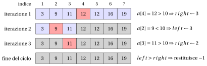

# Ricerca lineare e binaria

<div class="info-capitolo" markdown>

**Parte 1 · Fondamenti e algoritmi di base · Capitolo 5** · [:material-file-pdf-box: Dispensa, volume 1 (PDF)](../pdf/dispensa-1-fondamenti.pdf) · [:material-pencil: Esercizi](../esercizi/es-05-ricerca.md)

</div>

## 5.1 Il problema della ricerca

- Cercare un valore in una collezione di dati è una delle operazioni più frequenti eseguite da un calcolatore: un nome in una rubrica, un codice in una tabella di prodotti, una parola in un dizionario.

- In questo capitolo la collezione è un array di numeri naturali, e presentiamo due algoritmi che risolvono il problema:

    - la <strong>ricerca lineare</strong>, che funziona su ogni array;

    - la <strong>ricerca binaria</strong>, che funziona solo su array ordinati in modo non decrescente, ma che è molto più veloce della ricerca lineare su array lunghi.

<a id="box-1-defSearchProblem"></a>

!!! definizione "Definizione 5.1: problema della ricerca"

    Dati un array $a[1..n]$ di $n$ numeri naturali e un numero naturale $m$ da cercare, il <strong>problema della ricerca</strong> consiste nel determinare se $m$ è uno degli elementi dell'array, cioè se esiste un indice $k \in \{1, 2, \dots, n\}$ tale che

    $$
    a[k] = m.
    $$

    Un algoritmo per il problema della ricerca restituisce tale indice $k$ se esiste, e il valore $-1$ altrimenti.

- Il valore $-1$ non è mai un indice valido dell'array $a[1..n]$ (né di un array <code>C++</code>, i cui indici partono da $0$): per questo motivo può essere usato per segnalare che il valore cercato non è stato trovato.

## 5.2 Ricerca lineare

!!! chiave ""

    Dati un array $a[1..n]$ di $n$ numeri naturali e un numero naturale $m$ da cercare, consideriamo il problema di determinare se $m$ è uno degli elementi dell'array.

- L'idea più semplice è confrontare il valore cercato $m$ con gli elementi dell'array uno dopo l'altro, dal primo all'ultimo, e fermarsi non appena si trova un elemento uguale a $m$.

- Questo è lo pseudocodice dell'algoritmo di ricerca lineare (Linear Search) che determina se un valore $m$ è presente in un array $a[1..n]$ di $n$ numeri naturali:

!!! algoritmo "Algoritmo: LinearSearch"

    <div class="pseudocodice" markdown="0">
    <div class="pc-io"><span class="pc-kw">Input:</span> <span>Un array <span class="arithmatex">&#92;(a&#91;1..n&#93;&#92;)</span> di <span class="arithmatex">&#92;(n&#92;)</span> numeri naturali e un valore <span class="arithmatex">&#92;(m&#92;)</span> da cercare</span></div>
    <div class="pc-io"><span class="pc-kw">Output:</span> <span>Indice di <span class="arithmatex">&#92;(m&#92;)</span> in <span class="arithmatex">&#92;(a&#92;)</span>, oppure <span class="arithmatex">&#92;(-1&#92;)</span> se non trovato</span></div>
    <div class="pc-sep"></div>
    <div class="pc-riga pc-vuota"><span class="pc-n"></span><span class="pc-corpo"></span></div>
    <div class="pc-riga"><span class="pc-n">1</span><span class="pc-corpo"><span class="pc-t"><strong>function</strong> LinearSearch(a, n, m)</span></span></div>
    <div class="pc-riga" id="riga-05-ricerca-line-ls-a"><span class="pc-n">2</span><span class="pc-corpo"><span class="pc-l"></span><span class="pc-t"><span class="arithmatex">&#92;(i := 1&#92;)</span></span></span></div>
    <div class="pc-riga" id="riga-05-ricerca-line-ls-b"><span class="pc-n">3</span><span class="pc-corpo"><span class="pc-l"></span><span class="pc-t"><strong>while</strong> <span class="arithmatex">&#92;(i &#92;le n&#92;)</span> <strong>do</strong></span></span></div>
    <div class="pc-riga" id="riga-05-ricerca-line-ls-c"><span class="pc-n">4</span><span class="pc-corpo"><span class="pc-l"></span><span class="pc-l"></span><span class="pc-t"><strong>if</strong> <span class="arithmatex">&#92;(a&#91;i&#93; = m&#92;)</span> <strong>then</strong></span></span></div>
    <div class="pc-riga" id="riga-05-ricerca-line-ls-d"><span class="pc-n">5</span><span class="pc-corpo"><span class="pc-l"></span><span class="pc-l"></span><span class="pc-l"></span><span class="pc-t"><strong>return</strong> <span class="arithmatex">&#92;(i&#92;)</span></span><span class="pc-c">// Elemento trovato all'indice <span class="arithmatex">&#92;(i&#92;)</span></span></span></div>
    <div class="pc-riga"><span class="pc-n">6</span><span class="pc-corpo"><span class="pc-l"></span><span class="pc-l"></span><span class="pc-t"><strong>end</strong></span></span></div>
    <div class="pc-riga" id="riga-05-ricerca-line-ls-e"><span class="pc-n">7</span><span class="pc-corpo"><span class="pc-l"></span><span class="pc-l"></span><span class="pc-t"><span class="arithmatex">&#92;(i &#92;leftarrow i + 1&#92;)</span></span></span></div>
    <div class="pc-riga"><span class="pc-n">8</span><span class="pc-corpo"><span class="pc-l"></span><span class="pc-t"><strong>end</strong></span></span></div>
    <div class="pc-riga pc-vuota"><span class="pc-n"></span><span class="pc-corpo"><span class="pc-l"></span></span></div>
    <div class="pc-riga" id="riga-05-ricerca-line-ls-f"><span class="pc-n">9</span><span class="pc-corpo"><span class="pc-l"></span><span class="pc-t"><strong>return</strong> <span class="arithmatex">&#92;(-1&#92;)</span></span><span class="pc-c">// Elemento non trovato</span></span></div>
    <div class="pc-riga"><span class="pc-n">10</span><span class="pc-corpo"><span class="pc-t"><strong>end</strong></span></span></div>
    </div>

- Spiegazione dell'algoritmo:

    - L'algoritmo scorre l'array sequenzialmente dall'indice $1$ a $n$.

    - A ogni iterazione confronta l'elemento $a[i]$ con il valore cercato $m$ (riga [4](#riga-05-ricerca-line-ls-c)).

    - Se $a[i] = m$, l'elemento è trovato e viene restituito l'indice $i$ (riga [5](#riga-05-ricerca-line-ls-d)).

    - Se il ciclo termina senza trovare corrispondenze, l'elemento non è nell'array e viene restituito $-1$ (riga [9](#riga-05-ricerca-line-ls-f)).

- Se $m$ compare più di una volta nell'array, l'algoritmo si ferma alla prima corrispondenza: l'indice restituito è il <strong>più piccolo</strong> indice $k$ tale che $a[k]=m$.

<a id="box-2-exLinearSearch"></a>

!!! esempio "Esempio 5.1: Ricerca lineare"

    Consideriamo l'array $a = [4, 2, 7, 1, 5, 9, 3]$ con $n=7$.

    - Ricerca di $m = 5$:

        <div class="tabella" markdown="0"><table>
        <tr>
        <th>iterazione</th>
        <th><span class="arithmatex">&#92;(i&#92;)</span></th>
        <th><span class="arithmatex">&#92;(a&#91;i&#93;&#92;)</span></th>
        <th>azione</th>
        </tr>
        <tr>
        <td><span class="arithmatex">&#92;(1&#92;)</span></td>
        <td>1</td>
        <td>4</td>
        <td><span class="arithmatex">&#92;(a&#91;i&#93; &#92;neq m&#92;)</span></td>
        </tr>
        <tr>
        <td><span class="arithmatex">&#92;(2&#92;)</span></td>
        <td>2</td>
        <td>2</td>
        <td><span class="arithmatex">&#92;(a&#91;i&#93; &#92;neq m&#92;)</span></td>
        </tr>
        <tr>
        <td><span class="arithmatex">&#92;(3&#92;)</span></td>
        <td>3</td>
        <td>7</td>
        <td><span class="arithmatex">&#92;(a&#91;i&#93; &#92;neq m&#92;)</span></td>
        </tr>
        <tr>
        <td><span class="arithmatex">&#92;(4&#92;)</span></td>
        <td>4</td>
        <td>1</td>
        <td><span class="arithmatex">&#92;(a&#91;i&#93; &#92;neq m&#92;)</span></td>
        </tr>
        <tr>
        <td><span class="arithmatex">&#92;(5&#92;)</span></td>
        <td>5</td>
        <td>5</td>
        <td><span class="arithmatex">&#92;(a&#91;i&#93; = m&#92;)</span> <span class="arithmatex">&#92;(&#92;Rightarrow&#92;)</span> Trovato!</td>
        </tr>
        </table></div>

        Quindi, l'elemento 5 si trova all'indice 5.

    - Ricerca di $m = 6$:

        <div class="tabella" markdown="0"><table>
        <tr>
        <th>iterazione</th>
        <th><span class="arithmatex">&#92;(i&#92;)</span></th>
        <th><span class="arithmatex">&#92;(a&#91;i&#93;&#92;)</span></th>
        <th>azione</th>
        </tr>
        <tr>
        <td><span class="arithmatex">&#92;(1&#92;)</span></td>
        <td>1</td>
        <td>4</td>
        <td><span class="arithmatex">&#92;(a&#91;i&#93; &#92;neq m&#92;)</span></td>
        </tr>
        <tr>
        <td><span class="arithmatex">&#92;(2&#92;)</span></td>
        <td>2</td>
        <td>2</td>
        <td><span class="arithmatex">&#92;(a&#91;i&#93; &#92;neq m&#92;)</span></td>
        </tr>
        <tr>
        <td><span class="arithmatex">&#92;(3&#92;)</span></td>
        <td>3</td>
        <td>7</td>
        <td><span class="arithmatex">&#92;(a&#91;i&#93; &#92;neq m&#92;)</span></td>
        </tr>
        <tr>
        <td><span class="arithmatex">&#92;(4&#92;)</span></td>
        <td>4</td>
        <td>1</td>
        <td><span class="arithmatex">&#92;(a&#91;i&#93; &#92;neq m&#92;)</span></td>
        </tr>
        <tr>
        <td><span class="arithmatex">&#92;(5&#92;)</span></td>
        <td>5</td>
        <td>5</td>
        <td><span class="arithmatex">&#92;(a&#91;i&#93; &#92;neq m&#92;)</span></td>
        </tr>
        <tr>
        <td><span class="arithmatex">&#92;(6&#92;)</span></td>
        <td>6</td>
        <td>9</td>
        <td><span class="arithmatex">&#92;(a&#91;i&#93; &#92;neq m&#92;)</span></td>
        </tr>
        <tr>
        <td><span class="arithmatex">&#92;(7&#92;)</span></td>
        <td>7</td>
        <td>3</td>
        <td><span class="arithmatex">&#92;(a&#91;i&#93; &#92;neq m&#92;)</span></td>
        </tr>
        <tr>
        <td><span class="arithmatex">&#92;(-&#92;)</span></td>
        <td>8</td>
        <td><span class="arithmatex">&#92;(-&#92;)</span></td>
        <td><span class="arithmatex">&#92;(i &gt; n&#92;)</span> <span class="arithmatex">&#92;(&#92;Rightarrow&#92;)</span> il ciclo termina, non trovato!</td>
        </tr>
        </table></div>

        Quindi, l'elemento 6 non è presente nell'array (restituisce $-1$).

- Il lavoro svolto dalla ricerca lineare si misura con il numero di confronti $a[i]=m$ alla riga [4](#riga-05-ricerca-line-ls-c): nell'esempio servono $5$ confronti per trovare $m=5$, e tutti gli $n=7$ elementi vengono confrontati per concludere che $m=6$ non è nell'array.

<a id="box-3-obsLinearComparisons"></a>

!!! teorema "Osservazione 5.2: numero di confronti della ricerca lineare"

    Dati un array $a[1..n]$ di $n$ numeri naturali e un valore $m$ da cercare:

    - se $k$ è il più piccolo indice tale che $a[k]=m$, allora <code>LinearSearch</code> esegue esattamente $k$ confronti alla riga [4](#riga-05-ricerca-line-ls-c) e restituisce $k$;

    - se $m$ non è nell'array, allora <code>LinearSearch</code> esegue esattamente $n$ confronti alla riga [4](#riga-05-ricerca-line-ls-c) e restituisce $-1$.

??? dimostrazione "Dimostrazione"

    La variabile $i$ assume i valori $1, 2, 3, \dots$ in quest'ordine, e per ogni valore $i \le n$ viene eseguito esattamente un confronto $a[i]=m$.

    - Se $k$ è il più piccolo indice con $a[k]=m$, allora $a[i] \neq m$ per $i \in \{1, 2, \dots, k-1\}$, quindi l'algoritmo non si ferma per questi valori di $i$; per $i=k$ il confronto è vero e l'algoritmo restituisce $k$. I confronti sono quelli con $i = 1, 2, \dots, k$, cioè $k$ confronti.

    - Se $m$ non è nell'array, ogni confronto è falso, quindi il ciclo viene eseguito per $i = 1, 2, \dots, n$ e si ferma quando $i = n+1$. I confronti sono $n$, e l'algoritmo restituisce $-1$ alla riga [9](#riga-05-ricerca-line-ls-f).

    <p class="qed-riga"><span class="qed">□</span></p>

!!! chiave ""

    La ricerca lineare non fa alcuna ipotesi sull'ordine degli elementi. Il suo prezzo è che, quando il valore cercato è assente (o si trova nell'ultima posizione), tutti gli $n$ elementi dell'array devono essere esaminati.

### 5.2.1 Implementazione in <code>C++</code>

- Questa è un'implementazione in <code>C++</code> dell'algoritmo di ricerca lineare. In <code>C++</code> gli indici di un array di $n$ elementi vanno da $0$ a $n-1$: l'indice restituito dalla funzione è quindi l'indice dello pseudocodice meno $1$.

```cpp
// Restituisce l'indice di m nell'array a, oppure -1 se m non c'è

int LinearSearch(int n, int *a, int m)
{
    for (int i = 0; i < n; i++)
    {
        if (a[i] == m)
        {
            return i;  // Elemento trovato all'indice i
        }
    }

    return -1;  // Elemento non trovato
}
```

- La funzione può essere chiamata, per esempio, dal seguente <code>main</code>:

```cpp
#include <iostream>
using namespace std;

int main()
{
    int a[] = {4, 2, 7, 1, 5, 9, 3};
    int n = 7;

    cout << LinearSearch(n, a, 5) << endl;  // stampa 4
    cout << LinearSearch(n, a, 6) << endl;  // stampa -1

    return 0;
}
```

<a id="box-4-exLinearSearchCpp"></a>

!!! esempio "Esempio 5.2: esecuzione dell'implementazione in <code>C++</code> della ricerca lineare"

    Consideriamo l'array dell'[Esempio 5.1](#box-2-exLinearSearch), memorizzato in <code>C++</code> con indici da $0$ a $6$:

    $$
    \begin{array}{c|c|c|c|c|c|c|c|}
    {a[j]} & {j=0} & {j=1} & {j=2} & {j=3} & {j=4} & {j=5} & {j=6} \\
    & 4 & 2 & 7 & 1 & 5 & 9 & 3
    \end{array}
    $$

    - Ricerca di $m=5$:

        <div class="tabella" markdown="0"><table>
        <tr>
        <th>iterazione</th>
        <th><span class="arithmatex">&#92;(i&#92;)</span></th>
        <th>confronto</th>
        <th>azione</th>
        </tr>
        <tr>
        <td><span class="arithmatex">&#92;(1&#92;)</span></td>
        <td>0</td>
        <td><span class="arithmatex">&#92;(a&#91;0&#93; = 4 &#92;neq 5&#92;)</span></td>
        <td>continua</td>
        </tr>
        <tr>
        <td><span class="arithmatex">&#92;(2&#92;)</span></td>
        <td>1</td>
        <td><span class="arithmatex">&#92;(a&#91;1&#93; = 2 &#92;neq 5&#92;)</span></td>
        <td>continua</td>
        </tr>
        <tr>
        <td><span class="arithmatex">&#92;(3&#92;)</span></td>
        <td>2</td>
        <td><span class="arithmatex">&#92;(a&#91;2&#93; = 7 &#92;neq 5&#92;)</span></td>
        <td>continua</td>
        </tr>
        <tr>
        <td><span class="arithmatex">&#92;(4&#92;)</span></td>
        <td>3</td>
        <td><span class="arithmatex">&#92;(a&#91;3&#93; = 1 &#92;neq 5&#92;)</span></td>
        <td>continua</td>
        </tr>
        <tr>
        <td><span class="arithmatex">&#92;(5&#92;)</span></td>
        <td>4</td>
        <td><span class="arithmatex">&#92;(a&#91;4&#93; = 5 = m&#92;)</span></td>
        <td><strong>Trovato! Restituisce 4</strong></td>
        </tr>
        </table></div>

        La funzione restituisce $4$: l'elemento si trova all'indice $4$ di <code>C++</code>, cioè all'indice $5$ dello pseudocodice.

    - Ricerca di $m=6$:

        <div class="tabella" markdown="0"><table>
        <tr>
        <th>iterazione</th>
        <th><span class="arithmatex">&#92;(i&#92;)</span></th>
        <th>confronto</th>
        <th>azione</th>
        </tr>
        <tr>
        <td><span class="arithmatex">&#92;(1&#92;)</span></td>
        <td>0</td>
        <td><span class="arithmatex">&#92;(a&#91;0&#93; = 4 &#92;neq 6&#92;)</span></td>
        <td>continua</td>
        </tr>
        <tr>
        <td><span class="arithmatex">&#92;(2&#92;)</span></td>
        <td>1</td>
        <td><span class="arithmatex">&#92;(a&#91;1&#93; = 2 &#92;neq 6&#92;)</span></td>
        <td>continua</td>
        </tr>
        <tr>
        <td><span class="arithmatex">&#92;(3&#92;)</span></td>
        <td>2</td>
        <td><span class="arithmatex">&#92;(a&#91;2&#93; = 7 &#92;neq 6&#92;)</span></td>
        <td>continua</td>
        </tr>
        <tr>
        <td><span class="arithmatex">&#92;(4&#92;)</span></td>
        <td>3</td>
        <td><span class="arithmatex">&#92;(a&#91;3&#93; = 1 &#92;neq 6&#92;)</span></td>
        <td>continua</td>
        </tr>
        <tr>
        <td><span class="arithmatex">&#92;(5&#92;)</span></td>
        <td>4</td>
        <td><span class="arithmatex">&#92;(a&#91;4&#93; = 5 &#92;neq 6&#92;)</span></td>
        <td>continua</td>
        </tr>
        <tr>
        <td><span class="arithmatex">&#92;(6&#92;)</span></td>
        <td>5</td>
        <td><span class="arithmatex">&#92;(a&#91;5&#93; = 9 &#92;neq 6&#92;)</span></td>
        <td>continua</td>
        </tr>
        <tr>
        <td><span class="arithmatex">&#92;(7&#92;)</span></td>
        <td>6</td>
        <td><span class="arithmatex">&#92;(a&#91;6&#93; = 3 &#92;neq 6&#92;)</span></td>
        <td>continua</td>
        </tr>
        </table></div>

        Il ciclo <code>for</code> termina con $i = n = 7$: l'elemento non è stato trovato e la funzione restituisce $-1$.

## 5.3 Ricerca binaria

- Pensiamo a come si cerca una parola in un dizionario cartaceo: nessuno lo legge dalla prima pagina. Lo apriamo a metà e, poiché le parole sono in ordine alfabetico, sappiamo in quale metà proseguire. La ricerca binaria applica la stessa idea a un array ordinato.

<a id="box-5-defSortedArray"></a>

!!! definizione "Definizione 5.3: array ordinato"

    Un array $a[1..n]$ di $n$ numeri naturali è <strong>ordinato in modo non decrescente</strong> se

    $$
    a[1] \le a[2] \le \cdots \le a[n].
    $$

!!! chiave ""

    Dati un array $a[1..n]$ di $n$ numeri naturali ordinato in modo non decrescente e un numero naturale $m$ da cercare, consideriamo il problema di determinare se $m$ è uno degli elementi dell'array.

- La ricerca binaria mantiene una porzione $a[left..right]$ dell'array, detta <strong>intervallo di ricerca</strong>, che è l'unica porzione che può ancora contenere $m$. All'inizio l'intervallo di ricerca è l'intero array.

- A ogni iterazione il valore cercato $m$ viene confrontato con l'elemento $a[mid]$ al centro dell'intervallo di ricerca:

    - se $a[mid] < m$, allora, poiché l'array è ordinato, tutti gli elementi $a[left], \dots, a[mid]$ sono minori di $m$, e la ricerca prosegue nella metà destra $a[mid+1..right]$;

    - se $a[mid] > m$, allora tutti gli elementi $a[mid], \dots, a[right]$ sono maggiori di $m$, e la ricerca prosegue nella metà sinistra $a[left..mid-1]$.

- Questo è lo pseudocodice dell'algoritmo di ricerca binaria (Binary Search) che determina se un valore $m$ è presente in un array $a[1..n]$ di $n$ numeri naturali ordinato in modo non decrescente:

!!! algoritmo "Algoritmo: BinarySearch"

    <div class="pseudocodice" markdown="0">
    <div class="pc-io"><span class="pc-kw">Input:</span> <span>Un array <span class="arithmatex">&#92;(a&#91;1..n&#93;&#92;)</span> di <span class="arithmatex">&#92;(n&#92;)</span> numeri naturali ordinato in modo non decrescente e un valore <span class="arithmatex">&#92;(m&#92;)</span> da cercare</span></div>
    <div class="pc-io"><span class="pc-kw">Output:</span> <span>Indice di <span class="arithmatex">&#92;(m&#92;)</span> in <span class="arithmatex">&#92;(a&#92;)</span>, oppure <span class="arithmatex">&#92;(-1&#92;)</span> se non trovato</span></div>
    <div class="pc-sep"></div>
    <div class="pc-riga pc-vuota"><span class="pc-n"></span><span class="pc-corpo"></span></div>
    <div class="pc-riga"><span class="pc-n">1</span><span class="pc-corpo"><span class="pc-t"><strong>function</strong> BinarySearch(a, n, m)</span></span></div>
    <div class="pc-riga" id="riga-05-ricerca-line-bs-a"><span class="pc-n">2</span><span class="pc-corpo"><span class="pc-l"></span><span class="pc-t"><span class="arithmatex">&#92;(left&#92;)</span> := <span class="arithmatex">&#92;(1&#92;)</span></span><span class="pc-c">// Estremo sinistro</span></span></div>
    <div class="pc-riga" id="riga-05-ricerca-line-bs-b"><span class="pc-n">3</span><span class="pc-corpo"><span class="pc-l"></span><span class="pc-t"><span class="arithmatex">&#92;(right&#92;)</span> := <span class="arithmatex">&#92;(n&#92;)</span></span><span class="pc-c">// Estremo destro</span></span></div>
    <div class="pc-riga pc-vuota"><span class="pc-n"></span><span class="pc-corpo"><span class="pc-l"></span></span></div>
    <div class="pc-riga" id="riga-05-ricerca-line-bs-c"><span class="pc-n">4</span><span class="pc-corpo"><span class="pc-l"></span><span class="pc-t"><strong>while</strong> <span class="arithmatex">&#92;(left &#92;le right&#92;)</span> <strong>do</strong></span></span></div>
    <div class="pc-riga" id="riga-05-ricerca-line-bs-d"><span class="pc-n">5</span><span class="pc-corpo"><span class="pc-l"></span><span class="pc-l"></span><span class="pc-t"><span class="arithmatex">&#92;(mid&#92;)</span> := <span class="arithmatex">&#92;(left + &#92;lfloor (right - left) / 2 &#92;rfloor&#92;)</span></span><span class="pc-c">// Indice centrale</span></span></div>
    <div class="pc-riga pc-vuota"><span class="pc-n"></span><span class="pc-corpo"><span class="pc-l"></span><span class="pc-l"></span></span></div>
    <div class="pc-riga" id="riga-05-ricerca-line-bs-e"><span class="pc-n">6</span><span class="pc-corpo"><span class="pc-l"></span><span class="pc-l"></span><span class="pc-t"><strong>if</strong> <span class="arithmatex">&#92;(a&#91;mid&#93; = m&#92;)</span> <strong>then</strong></span></span></div>
    <div class="pc-riga" id="riga-05-ricerca-line-bs-f"><span class="pc-n">7</span><span class="pc-corpo"><span class="pc-l"></span><span class="pc-l"></span><span class="pc-l"></span><span class="pc-t"><strong>return</strong> <span class="arithmatex">&#92;(mid&#92;)</span></span><span class="pc-c">// Elemento trovato</span></span></div>
    <div class="pc-riga"><span class="pc-n">8</span><span class="pc-corpo"><span class="pc-l"></span><span class="pc-l"></span><span class="pc-t"><strong>end</strong></span></span></div>
    <div class="pc-riga pc-vuota"><span class="pc-n"></span><span class="pc-corpo"><span class="pc-l"></span><span class="pc-l"></span></span></div>
    <div class="pc-riga" id="riga-05-ricerca-line-bs-g"><span class="pc-n">9</span><span class="pc-corpo"><span class="pc-l"></span><span class="pc-l"></span><span class="pc-t"><strong>if</strong> <span class="arithmatex">&#92;(a&#91;mid&#93; &lt; m&#92;)</span> <strong>then</strong></span></span></div>
    <div class="pc-riga" id="riga-05-ricerca-line-bs-h"><span class="pc-n">10</span><span class="pc-corpo"><span class="pc-l"></span><span class="pc-l"></span><span class="pc-l"></span><span class="pc-t"><span class="arithmatex">&#92;(left&#92;)</span> <span class="arithmatex">&#92;(&#92;leftarrow&#92;)</span> <span class="arithmatex">&#92;(mid + 1&#92;)</span></span><span class="pc-c">// Cerca nella metà destra</span></span></div>
    <div class="pc-riga"><span class="pc-n">11</span><span class="pc-corpo"><span class="pc-l"></span><span class="pc-l"></span><span class="pc-t"><strong>end</strong></span></span></div>
    <div class="pc-riga"><span class="pc-n">12</span><span class="pc-corpo"><span class="pc-l"></span><span class="pc-l"></span><span class="pc-t"><strong>else</strong></span></span></div>
    <div class="pc-riga" id="riga-05-ricerca-line-bs-i"><span class="pc-n">13</span><span class="pc-corpo"><span class="pc-l"></span><span class="pc-l"></span><span class="pc-l"></span><span class="pc-t"><span class="arithmatex">&#92;(right&#92;)</span> <span class="arithmatex">&#92;(&#92;leftarrow&#92;)</span> <span class="arithmatex">&#92;(mid - 1&#92;)</span></span><span class="pc-c">// Cerca nella metà sinistra</span></span></div>
    <div class="pc-riga"><span class="pc-n">14</span><span class="pc-corpo"><span class="pc-l"></span><span class="pc-l"></span><span class="pc-t"><strong>end</strong></span></span></div>
    <div class="pc-riga"><span class="pc-n">15</span><span class="pc-corpo"><span class="pc-l"></span><span class="pc-t"><strong>end</strong></span></span></div>
    <div class="pc-riga pc-vuota"><span class="pc-n"></span><span class="pc-corpo"><span class="pc-l"></span></span></div>
    <div class="pc-riga" id="riga-05-ricerca-line-bs-j"><span class="pc-n">16</span><span class="pc-corpo"><span class="pc-l"></span><span class="pc-t"><strong>return</strong> <span class="arithmatex">&#92;(-1&#92;)</span></span><span class="pc-c">// Elemento non trovato</span></span></div>
    <div class="pc-riga"><span class="pc-n">17</span><span class="pc-corpo"><span class="pc-t"><strong>end</strong></span></span></div>
    </div>

- Spiegazione dell'algoritmo:

    - L'algoritmo mantiene due indici, $left$ e $right$, che definiscono l'intervallo di ricerca $a[left..right]$, il quale contiene $right-left+1$ elementi.

    - A ogni iterazione calcola l'indice centrale $mid$ (riga [5](#riga-05-ricerca-line-bs-d)) e confronta $a[mid]$ con il valore cercato $m$.

    - Se $a[mid] = m$, l'elemento è trovato e ne viene restituito l'indice (riga [7](#riga-05-ricerca-line-bs-f)).

    - Se $a[mid] < m$, la ricerca prosegue nella metà destra aggiornando $left \leftarrow mid + 1$ (riga [10](#riga-05-ricerca-line-bs-h)).

    - Se $a[mid] > m$, la ricerca prosegue nella metà sinistra aggiornando $right \leftarrow mid - 1$ (riga [13](#riga-05-ricerca-line-bs-i)).

    - Se l'intervallo di ricerca diventa vuoto ($left > right$), l'elemento non è nell'array e viene restituito $-1$ (riga [16](#riga-05-ricerca-line-bs-j)).

- Poiché $0 \le \lfloor (right-left)/2 \rfloor \le right-left$, l'indice $mid$ appartiene sempre all'intervallo di ricerca: $left \le mid \le right$.

<a id="box-6-exBinarySearch"></a>

!!! esempio "Esempio 5.3: Ricerca binaria"

    Consideriamo l'array ordinato $a = [3, 9, 11, 12, 12, 16, 19]$ con $n=7$.

    - Ricerca di $m = 12$:

        <div class="tabella" markdown="0"><table>
        <tr>
        <th>iterazione</th>
        <th><span class="arithmatex">&#92;(left&#92;)</span></th>
        <th><span class="arithmatex">&#92;(right&#92;)</span></th>
        <th><span class="arithmatex">&#92;(mid&#92;)</span></th>
        <th><span class="arithmatex">&#92;(a&#91;mid&#93;&#92;)</span></th>
        <th>azione</th>
        </tr>
        <tr>
        <td><span class="arithmatex">&#92;(1&#92;)</span></td>
        <td>1</td>
        <td>7</td>
        <td>4</td>
        <td>12</td>
        <td><span class="arithmatex">&#92;(a&#91;mid&#93; = m&#92;)</span> <span class="arithmatex">&#92;(&#92;Rightarrow&#92;)</span> Trovato!</td>
        </tr>
        </table></div>

        Quindi, l'elemento 12 si trova all'indice 4.

    - Ricerca di $m = 10$:

        <div class="tabella" markdown="0"><table>
        <tr>
        <th>iterazione</th>
        <th><span class="arithmatex">&#92;(left&#92;)</span></th>
        <th><span class="arithmatex">&#92;(right&#92;)</span></th>
        <th><span class="arithmatex">&#92;(mid&#92;)</span></th>
        <th><span class="arithmatex">&#92;(a&#91;mid&#93;&#92;)</span></th>
        <th>azione</th>
        </tr>
        <tr>
        <td><span class="arithmatex">&#92;(1&#92;)</span></td>
        <td>1</td>
        <td>7</td>
        <td>4</td>
        <td>12</td>
        <td><span class="arithmatex">&#92;(a&#91;mid&#93; &gt; m&#92;)</span> <span class="arithmatex">&#92;(&#92;Rightarrow&#92;)</span> <span class="arithmatex">&#92;(right &#92;leftarrow 3&#92;)</span></td>
        </tr>
        <tr>
        <td><span class="arithmatex">&#92;(2&#92;)</span></td>
        <td>1</td>
        <td>3</td>
        <td>2</td>
        <td>9</td>
        <td><span class="arithmatex">&#92;(a&#91;mid&#93; &lt; m&#92;)</span> <span class="arithmatex">&#92;(&#92;Rightarrow&#92;)</span> <span class="arithmatex">&#92;(left &#92;leftarrow 3&#92;)</span></td>
        </tr>
        <tr>
        <td><span class="arithmatex">&#92;(3&#92;)</span></td>
        <td>3</td>
        <td>3</td>
        <td>3</td>
        <td>11</td>
        <td><span class="arithmatex">&#92;(a&#91;mid&#93; &gt; m&#92;)</span> <span class="arithmatex">&#92;(&#92;Rightarrow&#92;)</span> <span class="arithmatex">&#92;(right &#92;leftarrow 2&#92;)</span></td>
        </tr>
        <tr>
        <td><span class="arithmatex">&#92;(-&#92;)</span></td>
        <td>3</td>
        <td>2</td>
        <td><span class="arithmatex">&#92;(-&#92;)</span></td>
        <td><span class="arithmatex">&#92;(-&#92;)</span></td>
        <td><span class="arithmatex">&#92;(left &gt; right&#92;)</span> <span class="arithmatex">&#92;(&#92;Rightarrow&#92;)</span> Non trovato!</td>
        </tr>
        </table></div>

        Quindi, l'elemento 10 non è presente nell'array (restituisce $-1$).

    - Ricerca di $m = 3$:

        <div class="tabella" markdown="0"><table>
        <tr>
        <th>iterazione</th>
        <th><span class="arithmatex">&#92;(left&#92;)</span></th>
        <th><span class="arithmatex">&#92;(right&#92;)</span></th>
        <th><span class="arithmatex">&#92;(mid&#92;)</span></th>
        <th><span class="arithmatex">&#92;(a&#91;mid&#93;&#92;)</span></th>
        <th>azione</th>
        </tr>
        <tr>
        <td><span class="arithmatex">&#92;(1&#92;)</span></td>
        <td>1</td>
        <td>7</td>
        <td>4</td>
        <td>12</td>
        <td><span class="arithmatex">&#92;(a&#91;mid&#93; &gt; m&#92;)</span> <span class="arithmatex">&#92;(&#92;Rightarrow&#92;)</span> <span class="arithmatex">&#92;(right &#92;leftarrow 3&#92;)</span></td>
        </tr>
        <tr>
        <td><span class="arithmatex">&#92;(2&#92;)</span></td>
        <td>1</td>
        <td>3</td>
        <td>2</td>
        <td>9</td>
        <td><span class="arithmatex">&#92;(a&#91;mid&#93; &gt; m&#92;)</span> <span class="arithmatex">&#92;(&#92;Rightarrow&#92;)</span> <span class="arithmatex">&#92;(right &#92;leftarrow 1&#92;)</span></td>
        </tr>
        <tr>
        <td><span class="arithmatex">&#92;(3&#92;)</span></td>
        <td>1</td>
        <td>1</td>
        <td>1</td>
        <td>3</td>
        <td><span class="arithmatex">&#92;(a&#91;mid&#93; = m&#92;)</span> <span class="arithmatex">&#92;(&#92;Rightarrow&#92;)</span> Trovato!</td>
        </tr>
        </table></div>

        Quindi, l'elemento 3 si trova all'indice 1.

    - Ricerca di $m = 19$:

        <div class="tabella" markdown="0"><table>
        <tr>
        <th>iterazione</th>
        <th><span class="arithmatex">&#92;(left&#92;)</span></th>
        <th><span class="arithmatex">&#92;(right&#92;)</span></th>
        <th><span class="arithmatex">&#92;(mid&#92;)</span></th>
        <th><span class="arithmatex">&#92;(a&#91;mid&#93;&#92;)</span></th>
        <th>azione</th>
        </tr>
        <tr>
        <td><span class="arithmatex">&#92;(1&#92;)</span></td>
        <td>1</td>
        <td>7</td>
        <td>4</td>
        <td>12</td>
        <td><span class="arithmatex">&#92;(a&#91;mid&#93; &lt; m&#92;)</span> <span class="arithmatex">&#92;(&#92;Rightarrow&#92;)</span> <span class="arithmatex">&#92;(left &#92;leftarrow 5&#92;)</span></td>
        </tr>
        <tr>
        <td><span class="arithmatex">&#92;(2&#92;)</span></td>
        <td>5</td>
        <td>7</td>
        <td>6</td>
        <td>16</td>
        <td><span class="arithmatex">&#92;(a&#91;mid&#93; &lt; m&#92;)</span> <span class="arithmatex">&#92;(&#92;Rightarrow&#92;)</span> <span class="arithmatex">&#92;(left &#92;leftarrow 7&#92;)</span></td>
        </tr>
        <tr>
        <td><span class="arithmatex">&#92;(3&#92;)</span></td>
        <td>7</td>
        <td>7</td>
        <td>7</td>
        <td>19</td>
        <td><span class="arithmatex">&#92;(a&#91;mid&#93; = m&#92;)</span> <span class="arithmatex">&#92;(&#92;Rightarrow&#92;)</span> Trovato!</td>
        </tr>
        </table></div>

        Quindi, l'elemento 19 si trova all'indice 7.

- La figura seguente mostra l'intervallo di ricerca a ogni iterazione della ricerca di $m=10$: gli elementi fuori dall'intervallo di ricerca (grigi) sono scartati, e l'elemento $a[mid]$ confrontato con $m$ è evidenziato in rosso.

<a id="box-7-figBinarySearch"></a>

{ .fig loading=lazy  }

<p class="didascalia"><strong>Figura 5.1:</strong> Intervalli di ricerca di <code>BinarySearch</code> per <span class="arithmatex">&#92;(m=10&#92;)</span> in <span class="arithmatex">&#92;(a=&#91;3, 9, 11, 12, 12, 16, 19&#93;&#92;)</span>: le celle blu formano l'intervallo di ricerca <span class="arithmatex">&#92;(a&#91;left..right&#93;&#92;)</span>, la cella rossa è <span class="arithmatex">&#92;(a&#91;mid&#93;&#92;)</span>, le celle grigie sono state scartate.</p>

- Se $m$ compare più di una volta nell'array, la ricerca binaria restituisce l'indice di <strong>una</strong> delle sue occorrenze, non necessariamente la prima. Per esempio, per $a=[1, 2, 2, 2, 2, 2, 3]$ e $m=2$, la prima iterazione calcola $mid = 1 + \lfloor 6/2 \rfloor = 4$ e, poiché $a[4] = 2 = m$, l'algoritmo restituisce $4$, mentre <code>LinearSearch</code> restituisce $2$.

### 5.3.1 Numero di iterazioni

- Ogni iterazione che non trova $m$ scarta l'elemento $a[mid]$ e almeno metà dei restanti elementi dell'intervallo di ricerca. Per questo la ricerca binaria è veloce: la lunghezza dell'intervallo di ricerca si (almeno) dimezza a ogni iterazione.

<a id="box-8-obsBinaryIterations"></a>

!!! teorema "Osservazione 5.4: numero di iterazioni della ricerca binaria"

    Dati un array $a[1..n]$ di $n \ge 1$ numeri naturali ordinato in modo non decrescente e un valore $m$ da cercare, il ciclo while di <code>BinarySearch</code> esegue al più

    $$
    \lfloor \log_2 n \rfloor + 1
    $$

    iterazioni.

??? dimostrazione "Dimostrazione"

    Sia $L = right - left + 1 \ge 1$ il numero di elementi dell'intervallo di ricerca all'inizio di un'iterazione che non restituisce. Poiché $mid = left + \lfloor (L-1)/2 \rfloor$, il nuovo intervallo di ricerca ha:

    - $mid - left = \lfloor (L-1)/2 \rfloor$ elementi, se $right \leftarrow mid-1$;

    - $right - mid = (L-1) - \lfloor (L-1)/2 \rfloor = \lceil (L-1)/2 \rceil$ elementi, se $left \leftarrow mid+1$.

    In entrambi i casi il nuovo numero di elementi è al più $\lceil (L-1)/2 \rceil = \lfloor L/2 \rfloor \le L/2$.

    All'inizio $L = n$. Quindi, dopo $k$ iterazioni che non restituiscono, l'intervallo di ricerca ha al più $n/2^k$ elementi. Un'iterazione viene eseguita solo se l'intervallo di ricerca non è vuoto, quindi l'iterazione $k+1$ viene eseguita solo se

    $$
    1 \le \frac{n}{2^k}, \qquad \text{cioè} \qquad k \le \log_2 n.
    $$

    Poiché $k$ è un intero, $k \le \lfloor \log_2 n \rfloor$, e il numero $k+1$ di una qualsiasi iterazione eseguita è al più $\lfloor \log_2 n \rfloor + 1$. <span class="qed">□</span>

- Nell'[Esempio 5.3](#box-6-exBinarySearch), $n = 7$ e $\lfloor \log_2 7 \rfloor + 1 = 3$: le ricerche di $m=10$, $m=3$ e $m=19$ eseguono esattamente $3$ iterazioni, quindi il limite viene raggiunto.

- La differenza con la ricerca lineare cresce molto rapidamente con $n$. La tabella seguente confronta il numero di confronti della ricerca lineare quando $m$ non è nell'array ([Osservazione 5.2](#box-3-obsLinearComparisons)) con il numero massimo di iterazioni della ricerca binaria:

<div class="tabella" markdown="0"><table>
<tr>
<th><span class="arithmatex">&#92;(n&#92;)</span></th>
<th>ricerca lineare</th>
<th>ricerca binaria</th>
</tr>
<tr>
<td></td>
<td><span class="arithmatex">&#92;(n&#92;)</span> confronti</td>
<td>al più <span class="arithmatex">&#92;(&#92;lfloor &#92;log&#95;2 n &#92;rfloor + 1&#92;)</span> iterazioni</td>
</tr>
<tr>
<td><span class="arithmatex">&#92;(1&#92;,000&#92;)</span></td>
<td><span class="arithmatex">&#92;(1&#92;,000&#92;)</span></td>
<td><span class="arithmatex">&#92;(10&#92;)</span></td>
</tr>
<tr>
<td><span class="arithmatex">&#92;(1&#92;,000&#92;,000&#92;)</span></td>
<td><span class="arithmatex">&#92;(1&#92;,000&#92;,000&#92;)</span></td>
<td><span class="arithmatex">&#92;(20&#92;)</span></td>
</tr>
<tr>
<td><span class="arithmatex">&#92;(1&#92;,000&#92;,000&#92;,000&#92;)</span></td>
<td><span class="arithmatex">&#92;(1&#92;,000&#92;,000&#92;,000&#92;)</span></td>
<td><span class="arithmatex">&#92;(30&#92;)</span></td>
</tr>
</table></div>

!!! chiave ""

    La ricerca binaria richiede che l'array sia ordinato in modo non decrescente. Su un array ordinato di $n$ elementi esegue al più $\lfloor \log_2 n \rfloor + 1$ iterazioni, mentre la ricerca lineare può richiedere $n$ confronti. Se l'array non è ordinato, la ricerca binaria può scartare erroneamente la metà che contiene $m$, e si deve usare la ricerca lineare.

### 5.3.2 Implementazione in <code>C++</code>

- Questa è un'implementazione in <code>C++</code> dell'algoritmo di ricerca binaria. L'intervallo di ricerca iniziale è $a[0..n-1]$.

```cpp
// Restituisce l'indice di m nell'array a, oppure -1 se m non c'è
// L'array a deve essere ordinato in ordine non decrescente

int BinarySearch(int n, int *a, int m)
{
    int left = 0;
    int right = n - 1;

    while (left <= right)
    {
        int mid = left + (right - left) / 2;

        if (a[mid] == m)
        {
            return mid;  // Elemento trovato all'indice mid
        }

        if (a[mid] < m)
        {
            left = mid + 1;  // Cerca nella metà destra
        }
        else
        {
            right = mid - 1;  // Cerca nella metà sinistra
        }
    }

    return -1;  // Elemento non trovato
}
```

- La divisione fra due valori <code>int</code> con $right - left \ge 0$ scarta la parte frazionaria, quindi $(right-left)/2$ è esattamente $\lfloor (right-left)/2 \rfloor$.

- L'indice centrale è calcolato come $left + (right-left)/2$ invece che $(left+right)/2$: le due espressioni hanno lo stesso valore, ma la somma $left+right$ può superare il massimo valore di un <code>int</code> quando l'array è molto lungo, mentre $left + (right-left)/2$ non supera mai $right$.

- La funzione può essere chiamata, per esempio, dal seguente <code>main</code>:

```cpp
#include <iostream>
using namespace std;

int main()
{
    int a[] = {3, 9, 11, 12, 12, 16, 19};
    int n = 7;

    cout << BinarySearch(n, a, 12) << endl;  // stampa 3
    cout << BinarySearch(n, a, 10) << endl;  // stampa -1
    cout << BinarySearch(n, a, 3) << endl;   // stampa 0
    cout << BinarySearch(n, a, 19) << endl;  // stampa 6

    return 0;
}
```

<a id="box-9-exBinarySearchCpp"></a>

!!! esempio "Esempio 5.4: esecuzione dell'implementazione in <code>C++</code> della ricerca binaria"

    Consideriamo l'array ordinato dell'[Esempio 5.3](#box-6-exBinarySearch), memorizzato in <code>C++</code> con indici da $0$ a $6$:

    $$
    \begin{array}{c|c|c|c|c|c|c|c|}
    {a[j]} & {j=0} & {j=1} & {j=2} & {j=3} & {j=4} & {j=5} & {j=6} \\
    & 3 & 9 & 11 & 12 & 12 & 16 & 19
    \end{array}
    $$

    All'inizio $left = 0$ e $right = 6$.

    - Ricerca di $m=12$:

        <div class="tabella" markdown="0"><table>
        <tr>
        <th>iterazione</th>
        <th><span class="arithmatex">&#92;(left&#92;)</span></th>
        <th><span class="arithmatex">&#92;(right&#92;)</span></th>
        <th><span class="arithmatex">&#92;(mid&#92;)</span></th>
        <th>confronto e aggiornamento</th>
        </tr>
        <tr>
        <td><span class="arithmatex">&#92;(1&#92;)</span></td>
        <td>0</td>
        <td>6</td>
        <td><span class="arithmatex">&#92;(0 + (6-0)/2 = 3&#92;)</span></td>
        <td><span class="arithmatex">&#92;(a&#91;3&#93; = 12 = m&#92;)</span> <span class="arithmatex">&#92;(&#92;Rightarrow&#92;)</span> <strong>Trovato! Restituisce 3</strong></td>
        </tr>
        </table></div>

    - Ricerca di $m=10$:

        <div class="tabella" markdown="0"><table>
        <tr>
        <th>iterazione</th>
        <th><span class="arithmatex">&#92;(left&#92;)</span></th>
        <th><span class="arithmatex">&#92;(right&#92;)</span></th>
        <th><span class="arithmatex">&#92;(mid&#92;)</span></th>
        <th>confronto e aggiornamento</th>
        </tr>
        <tr>
        <td><span class="arithmatex">&#92;(1&#92;)</span></td>
        <td>0</td>
        <td>6</td>
        <td><span class="arithmatex">&#92;(0 + (6-0)/2 = 3&#92;)</span></td>
        <td><span class="arithmatex">&#92;(a&#91;3&#93; = 12 &gt; 10&#92;)</span> <span class="arithmatex">&#92;(&#92;Rightarrow&#92;)</span> <span class="arithmatex">&#92;(right = 3 - 1 = 2&#92;)</span></td>
        </tr>
        <tr>
        <td><span class="arithmatex">&#92;(2&#92;)</span></td>
        <td>0</td>
        <td>2</td>
        <td><span class="arithmatex">&#92;(0 + (2-0)/2 = 1&#92;)</span></td>
        <td><span class="arithmatex">&#92;(a&#91;1&#93; = 9 &lt; 10&#92;)</span> <span class="arithmatex">&#92;(&#92;Rightarrow&#92;)</span> <span class="arithmatex">&#92;(left = 1 + 1 = 2&#92;)</span></td>
        </tr>
        <tr>
        <td><span class="arithmatex">&#92;(3&#92;)</span></td>
        <td>2</td>
        <td>2</td>
        <td><span class="arithmatex">&#92;(2 + (2-2)/2 = 2&#92;)</span></td>
        <td><span class="arithmatex">&#92;(a&#91;2&#93; = 11 &gt; 10&#92;)</span> <span class="arithmatex">&#92;(&#92;Rightarrow&#92;)</span> <span class="arithmatex">&#92;(right = 2 - 1 = 1&#92;)</span></td>
        </tr>
        <tr>
        <td><span class="arithmatex">&#92;(-&#92;)</span></td>
        <td>2</td>
        <td>1</td>
        <td><span class="arithmatex">&#92;(-&#92;)</span></td>
        <td><span class="arithmatex">&#92;(left &gt; right&#92;)</span> <span class="arithmatex">&#92;(&#92;Rightarrow&#92;)</span> <strong>Restituisce <span class="arithmatex">&#92;(-1&#92;)</span></strong></td>
        </tr>
        </table></div>

    - Ricerca di $m=3$:

        <div class="tabella" markdown="0"><table>
        <tr>
        <th>iterazione</th>
        <th><span class="arithmatex">&#92;(left&#92;)</span></th>
        <th><span class="arithmatex">&#92;(right&#92;)</span></th>
        <th><span class="arithmatex">&#92;(mid&#92;)</span></th>
        <th>confronto e aggiornamento</th>
        </tr>
        <tr>
        <td><span class="arithmatex">&#92;(1&#92;)</span></td>
        <td>0</td>
        <td>6</td>
        <td><span class="arithmatex">&#92;(0 + (6-0)/2 = 3&#92;)</span></td>
        <td><span class="arithmatex">&#92;(a&#91;3&#93; = 12 &gt; 3&#92;)</span> <span class="arithmatex">&#92;(&#92;Rightarrow&#92;)</span> <span class="arithmatex">&#92;(right = 3 - 1 = 2&#92;)</span></td>
        </tr>
        <tr>
        <td><span class="arithmatex">&#92;(2&#92;)</span></td>
        <td>0</td>
        <td>2</td>
        <td><span class="arithmatex">&#92;(0 + (2-0)/2 = 1&#92;)</span></td>
        <td><span class="arithmatex">&#92;(a&#91;1&#93; = 9 &gt; 3&#92;)</span> <span class="arithmatex">&#92;(&#92;Rightarrow&#92;)</span> <span class="arithmatex">&#92;(right = 1 - 1 = 0&#92;)</span></td>
        </tr>
        <tr>
        <td><span class="arithmatex">&#92;(3&#92;)</span></td>
        <td>0</td>
        <td>0</td>
        <td><span class="arithmatex">&#92;(0 + (0-0)/2 = 0&#92;)</span></td>
        <td><span class="arithmatex">&#92;(a&#91;0&#93; = 3 = m&#92;)</span> <span class="arithmatex">&#92;(&#92;Rightarrow&#92;)</span> <strong>Trovato! Restituisce 0</strong></td>
        </tr>
        </table></div>

    - Ricerca di $m=19$:

        <div class="tabella" markdown="0"><table>
        <tr>
        <th>iterazione</th>
        <th><span class="arithmatex">&#92;(left&#92;)</span></th>
        <th><span class="arithmatex">&#92;(right&#92;)</span></th>
        <th><span class="arithmatex">&#92;(mid&#92;)</span></th>
        <th>confronto e aggiornamento</th>
        </tr>
        <tr>
        <td><span class="arithmatex">&#92;(1&#92;)</span></td>
        <td>0</td>
        <td>6</td>
        <td><span class="arithmatex">&#92;(0 + (6-0)/2 = 3&#92;)</span></td>
        <td><span class="arithmatex">&#92;(a&#91;3&#93; = 12 &lt; 19&#92;)</span> <span class="arithmatex">&#92;(&#92;Rightarrow&#92;)</span> <span class="arithmatex">&#92;(left = 3 + 1 = 4&#92;)</span></td>
        </tr>
        <tr>
        <td><span class="arithmatex">&#92;(2&#92;)</span></td>
        <td>4</td>
        <td>6</td>
        <td><span class="arithmatex">&#92;(4 + (6-4)/2 = 5&#92;)</span></td>
        <td><span class="arithmatex">&#92;(a&#91;5&#93; = 16 &lt; 19&#92;)</span> <span class="arithmatex">&#92;(&#92;Rightarrow&#92;)</span> <span class="arithmatex">&#92;(left = 5 + 1 = 6&#92;)</span></td>
        </tr>
        <tr>
        <td><span class="arithmatex">&#92;(3&#92;)</span></td>
        <td>6</td>
        <td>6</td>
        <td><span class="arithmatex">&#92;(6 + (6-6)/2 = 6&#92;)</span></td>
        <td><span class="arithmatex">&#92;(a&#91;6&#93; = 19 = m&#92;)</span> <span class="arithmatex">&#92;(&#92;Rightarrow&#92;)</span> <strong>Trovato! Restituisce 6</strong></td>
        </tr>
        </table></div>

    Ogni indice <code>C++</code> è il corrispondente indice dell'[Esempio 5.3](#box-6-exBinarySearch) meno $1$.

!!! chiave ""

    <strong>Punti chiave del capitolo</strong>

    - Il problema della ricerca richiede un indice $k$ tale che $a[k]=m$, oppure $-1$ se tale indice non esiste.

    - La ricerca lineare funziona su ogni array, restituisce la prima occorrenza di $m$ ed esegue fino a $n$ confronti.

    - La ricerca binaria funziona solo su array ordinati in modo non decrescente; dimezza l'intervallo di ricerca $a[left..right]$ a ogni iterazione ed esegue al più $\lfloor \log_2 n \rfloor + 1$ iterazioni.

    - Nello pseudocodice gli indici vanno da $1$ a $n$, in <code>C++</code> da $0$ a $n-1$: gli indici restituiti differiscono di $1$.

<!-- laboratorio-interattivo: sezione generata da interattivi.py -->

## Laboratorio interattivo { #laboratorio-interattivo }

L'algoritmo del capitolo, un passo alla volta: muovi i cursori e premi ▶.
Tutti i grafici del corso sono nel [laboratorio interattivo](../laboratorio/index.md#cap-5).

<div class="gi" data-grafico="ricerca"></div>
