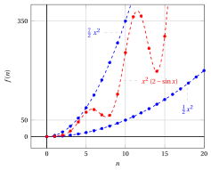
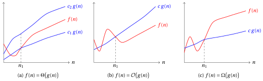
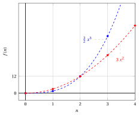
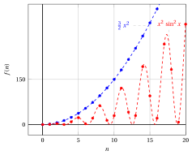
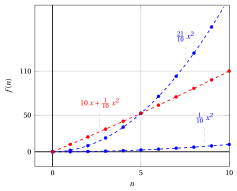
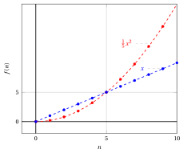
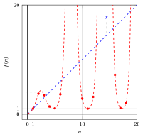

# Notazione asintotica

**Parte 3 · Notazione e crescita asintotica · Capitolo 9** · [:material-file-pdf-box: Dispensa, volume 3 (PDF)](../pdf/dispensa-3-notazione-asintotica.pdf) · [:material-pencil: Esercizi: Notazione asintotica](../esercizi/es-09-notazione-asintotica.md)

## Introduzione

Il numero di passi eseguiti da un algoritmo è una funzione di un numero naturale: la dimensione del suo input. Due algoritmi che risolvono lo stesso problema si confrontano guardando quanto velocemente crescono queste funzioni al crescere dell'input, trascurando i fattori costanti e i valori su poche piccole istanze. In questo capitolo diamo il linguaggio preciso con cui si esprimono questi confronti: le <strong>notazioni asintotiche</strong> $\Theta$, $\bigO$, $\Omega$, $o$ e $\omega$.

!!! chiave ""

    <strong>Prerequisiti.</strong> Le funzioni di variabile naturale sono le <strong>successioni</strong> del corso di <em>Analisi Matematica 1</em> ([fabiofurini.github.io/analisi-matematica-1/](https://fabiofurini.github.io/analisi-matematica-1/), versione inglese [fabiofurini.github.io/mathematical-analysis-1/](https://fabiofurini.github.io/mathematical-analysis-1/)). I loro limiti, e i teoremi usati per calcolarli, non vengono rispiegati in questo capitolo: usiamo la definizione di limite e le regole di calcolo dei limiti della parte <em>Limiti di successioni</em> di quel corso.

Il capitolo è organizzato così.

- Nella Sezione [9.1](#sez-sec-an-theta) definiamo le notazioni $\Theta$, $\bigO$ e $\Omega$, le interpretiamo graficamente e dimostriamo che $\Theta$ equivale a $\bigO$ e $\Omega$ insieme. Studiamo anche la somma e il massimo di due funzioni.

- Nella Sezione [9.2](#sez-sec-an-small) definiamo le notazioni $o$ e $\omega$, che esprimono limitazioni che <strong>non</strong> sono asintoticamente strette.

- Nella Sezione [9.3](#sez-sec-an-limits) collegiamo le cinque notazioni al limite del rapporto $\frac{f(n)}{g(n)}$. Quando il limite esiste, il suo valore decide quali delle cinque notazioni valgono ([Proposizione 9.18](#box-33-propLimitCriterion), il <strong>criterio del limite</strong>); quando non esiste, si usano le definizioni.

- Nella Sezione [9.4](#sez-sec-an-relational) dimostriamo le proprietà relazionali delle notazioni (transitività, riflessività, simmetria e simmetria trasposta), che rendono il confronto asintotico di due funzioni simile al confronto di due numeri reali, con una differenza importante.

- Nella Sezione [9.5](#sez-sec-an-algorithms) vediamo come si usa la notazione nell'analisi degli algoritmi dei capitoli «Dimensione dell'input» e «Tempo di esecuzione».

Ogni costante ($c$, $c_1$, $c_2$, $n_1$) usata negli esempi del capitolo è stata controllata numericamente con uno script, per tutti i valori di $n$ dalla soglia $n_1$ fino ad almeno $2 \cdot 10^5$.

In tutto il capitolo usiamo la seguente terminologia.

!!! definizione "Definizione 9.1: funzioni asintoticamente non negative e asintoticamente positive"

    Una funzione $f$ di variabile naturale è <strong>asintoticamente non negativa</strong> se esiste $\tilde n \in \N$ tale che $f(n) \ge 0$ per ogni $n \ge \tilde n$. È <strong>asintoticamente positiva</strong> se esiste $\tilde n \in \N$ tale che $f(n) > 0$ per ogni $n \ge \tilde n$.

## 9.1 Notazioni $\Theta$, $\bigO$ e $\Omega$ { #sez-sec-an-theta }

### 9.1.1 Definizioni

!!! definizione "Definizione 9.2: notazione $\Theta$"

    Date due funzioni $f$ e $g$ di variabile naturale, scriviamo $f(n)=\Theta\big(g(n)\big)$ se esistono $c_1,c_2 \in \R_{>0}$ e $n_1 \in \N$ tali che

    \begin{equation*}
    \label{eq:an-theta}
    0 \le c_1 \: g(n) \le f(n) \le c_2 \: g(n),\qquad \forall n \ge n_1. \tag{9.1}
    \end{equation*}

- Se $f(n)= \Theta\big(g(n)\big)$, allora, per valori sufficientemente grandi di $n$, la funzione $f$ è limitata dall'alto e dal basso dalla funzione $g$ moltiplicata per due costanti positive.

- In questo caso diciamo che la funzione $g$ è una <strong>limitazione asintotica stretta</strong> per la funzione $f$.

- Scriviamo $f(n)=\Theta(1)$ per dire che i valori $f(n)$ sono, per $n$ sufficientemente grande, limitati dall'alto e dal basso da due costanti positive (qui $g$ è la funzione costante $g(n)=1$).

!!! definizione "Definizione 9.3: notazione $\bigO$"

    Date due funzioni $f$ e $g$ di variabile naturale, scriviamo $f(n)=\bigO\big(g(n)\big)$ se esistono $c \in \R_{>0}$ e $n_1 \in \N$ tali che

    \begin{equation*}
    \label{eq:an-bigo}
    0 \le f(n) \le c \: g(n),\qquad \forall n \ge n_1. \tag{9.2}
    \end{equation*}

- Se $f(n)= \bigO\big(g(n)\big)$, allora, per valori sufficientemente grandi di $n$, la funzione $f$ è limitata dall'alto dalla funzione $g$ moltiplicata per una costante positiva.

- In questo caso diciamo che la funzione $g$ è una <strong>limitazione superiore asintotica</strong> per la funzione $f$.

!!! definizione "Definizione 9.4: notazione $\Omega$"

    Date due funzioni $f$ e $g$ di variabile naturale, scriviamo $f(n)=\Omega\big(g(n)\big)$ se esistono $c \in \R_{>0}$ e $n_1 \in \N$ tali che

    \begin{equation*}
    \label{eq:an-omega}
    0 \le c \: g(n) \le f(n),\qquad \forall n \ge n_1. \tag{9.3}
    \end{equation*}

- Se $f(n)= \Omega\big(g(n)\big)$, allora, per valori sufficientemente grandi di $n$, la funzione $f$ è limitata dal basso dalla funzione $g$ moltiplicata per una costante positiva.

- In questo caso diciamo che la funzione $g$ è una <strong>limitazione inferiore asintotica</strong> per la funzione $f$.

!!! chiave ""

    Se $f(n) = \Theta\big(g(n)\big)$, $f(n) = \bigO\big(g(n)\big)$ oppure $f(n) = \Omega\big(g(n)\big)$ allora, poiché le costanti $c_1$ e $c$ sono positive, si ha $g(n) \ge 0$ e $f(n) \ge 0$ per ogni $n \ge n_1$ (per $\bigO$, la disuguaglianza $0 \le f(n) \le c\,g(n)$ dà anche $g(n) \ge 0$). Quindi le due funzioni $f$ e $g$ sono <strong>asintoticamente non negative</strong>.

- Per dimostrare una di queste affermazioni <strong>determiniamo</strong> le costanti ($c$, oppure $c_1$ e $c_2$) e la soglia $n_1$. In generale la soglia $n_1$ non è la più piccola possibile e le costanti non sono uniche: anche qualunque soglia più grande, qualunque $c_1$ più piccola e qualunque $c_2$ più grande (o $c$ nella definizione di $\bigO$) funzionano.

- Per dimostrare che un'affermazione è falsa procediamo per assurdo: supponiamo che le costanti esistano e ricaviamo una disuguaglianza che non può valere per $n$ arbitrariamente grande.

### 9.1.2 Esempi di limitazioni asintotiche strette

!!! esempio "Esempio 9.1: limitazione asintotica stretta"

    - Per dimostrare che

        $$
        - 3\: n + \frac{1}{2} \: n^2 = \Theta(n^2)
        $$

        determiniamo $c_1,c_2 \in \R_{>0}$ e $n_1 \in \N$ tali che

        $$
        0 \le c_1 \: n^2 \le - 3\: n + \frac{1}{2} \: n^2 \le c_2 \: n^2,\qquad \forall n \ge n_1.
        $$

        Con $n \ge 1$, dividendo per $n^2$ e poiché $c_1 > 0$, questo equivale a

        $$
        0 < c_1 \le \frac{1}{2} - \frac{3}{n} \le c_2,\qquad \forall n \ge n_1.
        $$

        Il termine centrale cresce con $n$ ed è sempre minore di $\frac{1}{2}$. Quindi, scegliendo per esempio $c_1 = \frac{1}{14}$, $c_2=\frac{1}{2}$ e $n_1=7$ (abbiamo scelto $\frac{1}{14}$ poiché $\frac{1}{14}= \frac{1}{2} - \frac{3}{7}$), si ha

        $$
        0 \le \frac{1}{14} \: n^2 \le - 3\: n + \frac{1}{2} \: n^2 \le \frac{1}{2} \: n^2,\qquad \forall n \ge 7.
        $$

        Per $n = 6$ la limitazione inferiore non vale, poiché $-18 + 18 = 0 < \frac{36}{14}$.

        { .fig .ovale loading=lazy style="width:75%" }

    - La dimostrazione precedente dimostra anche che

        $$
        - 3\: n + \frac{1}{2} \: n^2 = \bigO(n^2) \qquad\text{e}\qquad - 3\: n + \frac{1}{2} \: n^2 = \Omega(n^2).
        $$

!!! esempio "Esempio 9.2: limitazione asintotica stretta"

    - Per dimostrare che

        $$
        n^2\; (2 - \sin n) = \Theta(n^2)
        $$

        determiniamo $c_1,c_2 \in \R_{>0}$ e $n_1 \in \N$ tali che

        $$
        0 \le c_1 \: n^2 \le n^2\; (2 - \sin n) \le c_2 \: n^2,\qquad \forall n \ge n_1.
        $$

        Con $n \ge 1$, dividendo per $n^2$ e poiché $c_1 > 0$, questo equivale a

        $$
        0 < c_1 \le 2 - \sin n \le c_2,\qquad \forall n \ge n_1.
        $$

        Poiché $-1 \le \sin n \le 1$, si ha $1 \le 2 - \sin n \le 3$. Quindi, scegliendo per esempio $c_1=\frac{1}{2}$, $c_2=\frac{7}{2}$ e $n_1=1$, si ha

        $$
        0 \le \frac{1}{2}\;n^2 \le n^2\; (2 - \sin n) \le \frac{7}{2}\;n^2,\qquad \forall n \ge 1.
        $$

        { .fig .ovale loading=lazy style="width:75%" }

    - La dimostrazione precedente dimostra anche che

        $$
        n^2\; (2 - \sin n) = \bigO(n^2) \qquad\text{e}\qquad n^2\; (2 - \sin n) = \Omega(n^2).
        $$

### 9.1.3 Interpretazione grafica

La figura seguente dà un'interpretazione grafica delle tre notazioni.

{ .fig .ovale loading=lazy style="width:95%" }

- In (a), da $n_1$ in poi, i valori di $f$ stanno fra $c_1\,g(n)$ e $c_2\,g(n)$; in (b) stanno sotto $c\,g(n)$; in (c) stanno sopra $c\,g(n)$. Prima di $n_1$ non si richiede nulla.

- Nella figura $n_1$ è la soglia più piccola possibile, ma anche qualunque valore più grande andrebbe bene. La figura illustra inoltre una possibile scelta delle costanti $c_1, c_2$ e $c$, ma esistono altre scelte valide.

### 9.1.4 $\Theta$ rispetto a $\bigO$ e $\Omega$

!!! teorema "Osservazione 9.5: $\Theta$ equivale a $\bigO$ e $\Omega$"

    Date due funzioni $f$ e $g$ di variabile naturale, si ha

    \begin{equation*}
    \label{eq:an-theta-iff}
    f(n)= \Theta\big(g(n)\big) \quad\Longleftrightarrow\quad f(n)= \bigO\big(g(n)\big) \ \text{ e } \ f(n)= \Omega\big(g(n)\big). \tag{9.4}
    \end{equation*}

    In particolare,

    \begin{equation*}
    \label{eq:an-theta-o}
    f(n)= \Theta\big(g(n)\big) ~~\Longrightarrow~~ f(n)= \bigO\big(g(n)\big)
    \qquad\text{e}\qquad
    f(n)= \Theta\big(g(n)\big) ~~\Longrightarrow~~ f(n)= \Omega\big(g(n)\big). \tag{9.5}
    \end{equation*}

??? dimostrazione "Dimostrazione"

    Se $f(n) = \Theta\big(g(n)\big)$, le due disuguaglianze $0 \le f(n) \le c_2\, g(n)$ e $0 \le c_1\, g(n) \le f(n)$ contenute in $\eqref{eq:an-theta}$ danno $f(n) = \bigO\big(g(n)\big)$ (con $c = c_2$) e $f(n) = \Omega\big(g(n)\big)$ (con $c = c_1$), con la stessa soglia $n_1$.

    Viceversa, sia $0 \le f(n) \le c'\, g(n)$ per ogni $n \ge n_1'$, e $0 \le c''\, g(n) \le f(n)$ per ogni $n \ge n_1''$. Scegliendo $c_1 = c''$, $c_2 = c'$ e $n_1 = \max\{n_1', n_1''\}$, otteniamo

    $$
    0 \le c_1\, g(n) \le f(n) \le c_2\, g(n), \qquad \forall n \ge n_1,
    $$

    cioè $f(n) = \Theta\big(g(n)\big)$. □

- Ne segue che «$f(n) = \Theta\big(g(n)\big)$» è una condizione sufficiente per «$f(n) = \bigO\big(g(n)\big)$», e «$f(n) = \bigO\big(g(n)\big)$» è una condizione necessaria per «$f(n) = \Theta\big(g(n)\big)$». Per contrapposizione si ha anche

    $$
    f(n) \neq \bigO\big(g(n)\big) ~~\Longrightarrow~~ f(n) \neq \Theta\big(g(n)\big).
    $$

    L'implicazione non vale nell'altro verso (si vedano i due esempi seguenti), cioè

    $$
    f(n) = \bigO\big(g(n)\big) ~~\nRightarrow~~ f(n) = \Theta\big(g(n)\big).
    $$

- Allo stesso modo, «$f(n) = \Theta\big(g(n)\big)$» è una condizione sufficiente per «$f(n) = \Omega\big(g(n)\big)$», e «$f(n) = \Omega\big(g(n)\big)$» è una condizione necessaria per «$f(n) = \Theta\big(g(n)\big)$». Per contrapposizione si ha anche

    $$
    f(n) \neq \Omega\big(g(n)\big) ~~\Longrightarrow~~ f(n) \neq \Theta\big(g(n)\big),
    $$

    e l'implicazione non vale nell'altro verso (si veda il terzo esempio più avanti):

    $$
    f(n) = \Omega\big(g(n)\big) ~~\nRightarrow~~ f(n) = \Theta\big(g(n)\big).
    $$

!!! esempio "Esempio 9.3: limitazione superiore asintotica non stretta"

    - Per dimostrare che

        $$
        3 \: n^2 = \bigO(n^3)
        $$

        determiniamo $c \in \R_{> 0}$ e $n_1 \in \N$ tali che

        $$
        0 \le 3\; n^2 \le c \: n^3,\qquad \forall n \ge n_1.
        $$

        Con $n \ge 1$, dividendo per $n^3$, questo equivale a

        $$
        0 \le \frac{3}{n} \le c,\qquad \forall n \ge n_1.
        $$

        Quindi, scegliendo per esempio $c=\frac{3}{2}$ e $n_1=2$, si ha

        $$
        0 \le 3\;n^2 \le \frac{3}{2}\;n^3,\qquad \forall n \ge 2.
        $$

        (Per $n=1$ la disuguaglianza non vale, poiché $3 > \frac{3}{2}$.)

        { .fig .ovale loading=lazy style="width:65%" }

    - Per dimostrare che

        $$
        3 \: n^2 \neq \Theta(n^3)
        $$

        procediamo per assurdo e supponiamo che esistano $c_1 \in \R_{>0}$ e $n_1 \in \N$ tali che

        $$
        0 \le c_1\; n^3 \le 3 \; n^2,\qquad \forall n \ge n_1.
        $$

        Con $n \ge 1$, dividendo per $n^3$ e poiché $c_1 > 0$, questo equivale a

        $$
        0 < c_1 \le \frac{3}{n},\qquad \forall n \ge n_1,
        $$

        che non può valere per $n$ arbitrariamente grande, poiché $c_1$ è una costante positiva (non vale per ogni $n > \frac{3}{c_1}$).

!!! esempio "Esempio 9.4: limitazione superiore asintotica non stretta"

    - Per dimostrare che

        $$
        n^2\;\sin^2 n = \bigO(n^2)
        $$

        determiniamo $c \in \R_{>0}$ e $n_1 \in \N$ tali che

        $$
        0 \le n^2\;\sin^2 n \le c \: n^2,\qquad \forall n \ge n_1.
        $$

        Con $n \ge 1$, dividendo per $n^2$, questo equivale a

        $$
        0 \le \sin^2 n \le c,\qquad \forall n \ge n_1.
        $$

        Poiché $0 \le \sin^2 n \le 1$, scegliendo per esempio $c=\frac{3}{2}$ e $n_1=1$ si ha

        $$
        0 \le n^2\;\sin^2 n\le \frac{3}{2} \;n^2,\qquad \forall n \ge 1.
        $$

        { .fig .ovale loading=lazy style="width:65%" }

    - Per dimostrare che

        $$
        n^2\;\sin^2 n \neq \Theta(n^2)
        $$

        procediamo per assurdo e supponiamo che esistano $c_1 \in \R_{>0}$ e $n_1 \in \N$ tali che

        $$
        0 \le c_1\; n^2 \le n^2\;\sin^2 n,\qquad \forall n \ge n_1.
        $$

        Con $n \ge 1$, dividendo per $n^2$ e poiché $c_1 > 0$, questo equivale a

        $$
        0 < c_1 \le \sin^2 n,\qquad \forall n \ge n_1,
        $$

        che non può valere per $n$ arbitrariamente grande, poiché $c_1$ è una costante positiva.[^1]

!!! esempio "Esempio 9.5: limitazione inferiore asintotica non stretta"

    - Per dimostrare che

        $$
        2 \: n^3 = \Omega(n^2)
        $$

        determiniamo $c \in \R_{>0}$ e $n_1 \in \N$ tali che

        $$
        0 \le c\; n^2 \le 2 \: n^3,\qquad \forall n \ge n_1.
        $$

        Con $n \ge 1$, dividendo per $n^2$ e poiché $c > 0$, questo equivale a

        $$
        0 < c \le 2 \;n,\qquad \forall n \ge n_1.
        $$

        Quindi, scegliendo per esempio $c=\frac{3}{2}$ e $n_1=1$, si ha

        $$
        0 \le \frac{3}{2}\;n^2 \le 2\;n^3,\qquad \forall n \ge 1.
        $$

        { .fig .ovale loading=lazy style="width:65%" }

    - Per dimostrare che

        $$
        2 \: n^3 \neq \Theta(n^2)
        $$

        procediamo per assurdo e supponiamo che esistano $c_2 \in \R_{>0}$ e $n_1 \in \N$ tali che

        $$
        0 \le 2\; n^3 \le c_2 \; n^2,\qquad \forall n \ge n_1.
        $$

        Con $n \ge 1$, dividendo per $n^2$, questo equivale a

        $$
        0 \le 2\;n \le c_2,\qquad \forall n \ge n_1,
        $$

        che non può valere per $n$ arbitrariamente grande, poiché $c_2$ è una costante (non vale per ogni $n > \frac{c_2}{2}$).

### 9.1.5 Somma e massimo di due funzioni

!!! teorema "Osservazione 9.6: aggiungere la limitazione alla funzione"

    Date due funzioni $f$ e $g$ di variabile naturale, si ha

    \begin{equation*}
    \label{eq:an-addbound}
    f(n)= \Theta\big(g(n)\big) ~~\Longrightarrow~~ f(n) + g(n) = \Theta\big(g(n)\big). \tag{9.6}
    \end{equation*}

??? dimostrazione "Dimostrazione"

    Se $f(n) = \Theta\big(g(n)\big)$, esistono $c_1, c_2 \in \R_{>0}$ e $n_1 \in \N$ tali che

    $$
    0 \le c_1\, g(n) \le f(n) \le c_2\, g(n), \qquad \forall n \ge n_1.
    $$

    Inoltre, poiché $c_1>0$, si ha $g(n) \ge 0$ per ogni $n \ge n_1$. Allora, sommando $g(n)$, otteniamo

    $$
    0 \le \underbrace{c_1\: g(n) + g(n)}_{=\underbrace{(c_1+1)}_{>0}\;g(n)} \le f(n)+ g(n) \le \underbrace{c_2\: g(n) + g(n)}_{=\underbrace{(c_2+1)}_{>0}\;g(n)}, \qquad \forall n \ge n_1.
    $$

    Di conseguenza $f(n)+g(n)= \Theta\big(g(n)\big)$, con le costanti $c_1+1$ e $c_2+1$ e la stessa soglia $n_1$. □

!!! esempio "Esempio 9.6: limitazione asintotica stretta di una somma"

    - Nell'[Esempio 9.1](#box-5-ex-an-tight1) abbiamo dimostrato che

        $$
        - 3\: n + \frac{1}{2} \: n^2 = \Theta(n^2)
        $$

        con $c_1=\frac{1}{14}$, $c_2=\frac{1}{2}$ e $n_1=7$. Allora, per $\eqref{eq:an-addbound}$, si ha

        $$
        - 3\: n + \frac{1}{2} \: n^2 + n^2 = \Theta(n^2),
        $$

        con le costanti $c_1+1=\frac{15}{14}$, $c_2+1=\frac{3}{2}$ e $n_1=7$.

    - Nell'[Esempio 9.2](#box-6-ex-an-tight2) abbiamo dimostrato che

        $$
        n^2\; (2 - \sin n) = \Theta(n^2)
        $$

        con $c_1=\frac{1}{2}$, $c_2=\frac{7}{2}$ e $n_1=1$. Allora, per $\eqref{eq:an-addbound}$, si ha

        $$
        n^2\; (2 - \sin n)+ n^2 = \Theta(n^2),
        $$

        con le costanti $\frac{3}{2}$, $\frac{9}{2}$ e $n_1=1$.

- Per l'implicazione $\eqref{eq:an-addbound}$, l'affermazione «$f(n) = \Theta\big(g(n)\big)$» è una condizione sufficiente per «$f(n) + g(n)= \Theta\big(g(n)\big)$», e «$f(n) + g(n)= \Theta\big(g(n)\big)$» è una condizione necessaria per «$f(n) = \Theta\big(g(n)\big)$». Per contrapposizione di $\eqref{eq:an-addbound}$ si ha anche

    $$
    f(n) + g(n) \neq \Theta\big(g(n)\big) ~~\Longrightarrow~~ f(n) \neq \Theta\big(g(n)\big).
    $$

    L'implicazione $\eqref{eq:an-addbound}$ non vale nell'altro verso (si veda il controesempio seguente), cioè

    $$
    f(n) + g(n)= \Theta\big(g(n)\big) ~~\nRightarrow~~ f(n) = \Theta\big(g(n)\big).
    $$

!!! esempio "Esempio 9.7: l'inverso dell'[Osservazione 9.6](#box-11-obsAddBound) è falso"

    Siano $f(n) = 10\:n$ e $g(n) = \frac{1}{10}\:n^2$.

    - Per dimostrare che

        $$
        f(n) + g(n) = 10 \: n + \frac{1}{10}\: n^2 = \Theta\Big(\frac{1}{10}\:n^2\Big) = \Theta\big(g(n)\big)
        $$

        determiniamo $c_1,c_2 \in \R_{>0}$ e $n_1 \in \N$ tali che

        $$
        0 \le c_1 \: \frac{1}{10}\:n^2 \le 10 \: n + \frac{1}{10}\: n^2 \le c_2 \: \frac{1}{10}\:n^2,\qquad \forall n \ge n_1.
        $$

        Con $n \ge 1$, dividendo per $\frac{1}{10}\:n^2$ e poiché $c_1 > 0$, questo equivale a

        $$
        0 < c_1 \le \frac{100}{n} + 1 \le c_2,\qquad \forall n \ge n_1.
        $$

        Il termine centrale decresce con $n$ ed è sempre maggiore di $1$; per $n = 5$ è uguale a $21$. Quindi, scegliendo per esempio $c_1 = 1$, $c_2=21$ e $n_1=5$, si ha

        $$
        0 \le \frac{1}{10} \: n^2 \le 10 \: n + \frac{1}{10}\: n^2 \le \frac{21}{10} \: n^2,\qquad \forall n \ge 5.
        $$

        { .fig .ovale loading=lazy style="width:65%" }

    - Per dimostrare che

        $$
        f(n) = 10 \: n \neq \Theta\Big(\frac{1}{10}\:n^2\Big) = \Theta\big(g(n)\big)
        $$

        procediamo per assurdo e supponiamo che esistano $c_1 \in \R_{>0}$ e $n_1 \in \N$ tali che

        $$
        0 \le c_1 \; \frac{1}{10}\:n^2 \le 10\; n ,\qquad \forall n \ge n_1.
        $$

        Con $n \ge 1$, dividendo per $\frac{1}{10}\:n^2$ e poiché $c_1 > 0$, questo equivale a

        $$
        0 < c_1 \le \frac{100}{n} ,\qquad \forall n \ge n_1,
        $$

        che non può valere per $n$ arbitrariamente grande, poiché $c_1$ è una costante positiva.

Quando sommiamo due funzioni, il comportamento asintotico della somma è determinato dalla maggiore delle due. Le due osservazioni seguenti lo precisano.

!!! teorema "Osservazione 9.7: somma e massimo (1)"

    Date due funzioni $f$ e $g$ di variabile naturale asintoticamente non negative, si ha

    $$
    f(n) + g(n) = \Theta\big( \max\big\{f(n), g(n)\big\} \big).
    $$

??? dimostrazione "Dimostrazione"

    Poiché $f$ e $g$ sono asintoticamente non negative, esiste $\tilde{n} \in \N$ tale che $f(n) \ge 0$ e $g(n) \ge 0$ per ogni $n \ge \tilde{n}$. Allora la somma è almeno il maggiore dei due termini e al più il doppio del maggiore dei due termini:

    $$
    0 \le \max\big\{f(n), g(n)\big\} \le f(n) + g(n) \le 2 \; \max\big\{f(n), g(n)\big\}, \qquad \forall n \ge \tilde{n}.
    $$

    Questo mostra che le costanti $c_1 = 1$, $c_2 = 2$ e $n_1 = \tilde{n}$ soddisfano

    $$
    0 \le c_1 \; \max\big\{f(n), g(n)\big\} \le f(n) + g(n) \le c_2 \; \max\big\{f(n), g(n)\big\}, \qquad \forall n \ge n_1.
    $$

    Quindi $f(n) + g(n) = \Theta\big( \max\{f(n), g(n)\} \big)$. □

!!! teorema "Osservazione 9.8: somma e massimo (2)"

    Date due funzioni $f$ e $g$ di variabile naturale asintoticamente non negative, si ha

    $$
    \max\big\{f(n), g(n)\big\} = \Theta\big( f(n) + g(n) \big).
    $$

??? dimostrazione "Dimostrazione"

    Sia $\tilde{n} \in \N$ tale che $f(n) \ge 0$ e $g(n) \ge 0$ per ogni $n \ge \tilde{n}$. Il maggiore di due numeri non negativi è almeno la loro media e al più la loro somma:

    $$
    0 \le \frac{1}{2} \; \big(f(n) + g(n)\big) \le \max\big\{f(n), g(n)\big\} \le f(n) + g(n), \qquad \forall n \ge \tilde{n}.
    $$

    Questo mostra che le costanti $c_1 = \frac{1}{2}$, $c_2 = 1$ e $n_1 = \tilde{n}$ soddisfano

    $$
    0 \le c_1 \; \big(f(n) + g(n)\big) \le \max\big\{f(n), g(n)\big\} \le c_2 \; \big(f(n) + g(n)\big), \qquad \forall n \ge n_1.
    $$

    Quindi $\max\{f(n), g(n)\} = \Theta\big( f(n) + g(n) \big)$. □

!!! esempio "Esempio 9.8: somma e massimo"

    Per le Osservazioni [9.7](#box-14-obsSumMax1) e [Osservazione 9.8](#box-15-obsSumMax2) si ha

    $$
    \frac{1}{2} \: n^2 + 2^n = \Theta \left( \max \left\{ \frac{1}{2} \: n^2 , 2^n \right\} \right)
    \qquad\text{e}\qquad
    \max \left\{ \frac{1}{2} \: n^2 , 2^n \right\} = \Theta \left( \frac{1}{2} \: n^2 + 2^n \right).
    $$

    In questo caso $\max\left\{ \frac{1}{2} \: n^2 , 2^n \right\} = 2^n$ per ogni $n \in \N$, così che $\frac{1}{2} \: n^2 + 2^n = \Theta(2^n)$, con $c_1=1$, $c_2=2$ e $n_1=0$.

## 9.2 Notazioni $o$ e $\omega$ { #sez-sec-an-small }

Le limitazioni asintotiche espresse dalle notazioni $\bigO$ e $\Omega$ possono essere o non essere asintoticamente strette. Usiamo la notazione $o$ per indicare una limitazione superiore asintotica che <strong>non è asintoticamente stretta</strong>, e la notazione $\omega$ per indicare una limitazione inferiore asintotica che <strong>non è asintoticamente stretta</strong>.

!!! esempio "Esempio 9.9: limitazioni superiori asintoticamente strette e non strette"

    - Si ha $3n^3 = \bigO(n^3)$ e $3n^3 = \Theta(n^3)$: $n^3$ è una limitazione superiore asintotica per $3n^3$, ed è anche una limitazione asintoticamente stretta.

    - Si ha $3n^3 = \bigO(n^4)$ ma $3n^3 \ne \Theta(n^4)$: $n^4$ è una limitazione superiore asintotica per $3n^3$, ma non è una limitazione asintoticamente stretta.

!!! definizione "Definizione 9.9: notazione $o$"

    Date due funzioni $f$ e $g$ di variabile naturale, scriviamo $f(n)=o\big(g(n)\big)$ se per ogni $c \in \R_{>0}$ esiste $n_1 \in \N$ tale che

    \begin{equation*}
    \label{eq:an-smallo}
    0 \le f(n) < c \: g(n),\qquad \forall n \ge n_1. \tag{9.7}
    \end{equation*}

- Se $f(n)= o\big(g(n)\big)$, allora, per valori sufficientemente grandi di $n$, la funzione $f$ è limitata dall'alto dalla funzione $g$ moltiplicata per <strong>qualunque</strong> costante positiva, cioè la funzione $f$ diventa trascurabile rispetto alla funzione $g$.

- In questo caso diciamo che la funzione $g$ è una <strong>limitazione superiore asintotica non stretta</strong> per la funzione $f$.

- La differenza con la notazione $\bigO$ sta nel quantificatore sulla costante: per $\bigO$ la disuguaglianza deve valere per <strong>una</strong> costante $c$, per $o$ deve valere per <strong>ogni</strong> costante $c$. La soglia $n_1$ dipende da $c$: più piccola è $c$, più grande è, in generale, $n_1$.

!!! definizione "Definizione 9.10: notazione $\omega$"

    Date due funzioni $f$ e $g$ di variabile naturale, scriviamo $f(n)=\omega\big(g(n)\big)$ se per ogni $c \in \R_{>0}$ esiste $n_1 \in \N$ tale che

    \begin{equation*}
    \label{eq:an-smallomega}
    0 \le c \: g(n) < f(n),\qquad \forall n \ge n_1. \tag{9.8}
    \end{equation*}

- Se $f(n)= \omega\big(g(n)\big)$, allora, per valori sufficientemente grandi di $n$, la funzione $f$ è limitata dal basso dalla funzione $g$ moltiplicata per <strong>qualunque</strong> costante positiva, cioè la funzione $f$ diventa arbitrariamente grande rispetto alla funzione $g$.

- In questo caso diciamo che la funzione $g$ è una <strong>limitazione inferiore asintotica non stretta</strong> per la funzione $f$.

!!! chiave ""

    Se $f(n) = o\big(g(n)\big)$ oppure $f(n) = \omega\big(g(n)\big)$ allora, poiché $c > 0$, si ha $g(n) \ge 0$ e $f(n) \ge 0$ per ogni $n \ge n_1$. Quindi le due funzioni $f$ e $g$ sono <strong>asintoticamente non negative</strong>.

!!! esempio "Esempio 9.10: limitazione superiore asintotica non stretta"

    - Per dimostrare che

        $$
        3n = o(n^2)
        $$

        dobbiamo verificare che per ogni $c \in \R_{>0}$ esiste $n_1 \in \N$ tale che

        $$
        0 \le 3n < c\, n^2, \qquad \forall n \ge n_1.
        $$

        Per $n \ge 1$, dividendo per $n^2$, la condizione equivale a

        $$
        0 \le \frac{3}{n} < c, \qquad \forall n \ge n_1.
        $$

        Questo vale ogni volta che $n > \frac{3}{c}$, quindi possiamo scegliere qualunque $n_1 > \frac{3}{c}$, per esempio $n_1 = \big\lfloor \frac{3}{c} \big\rfloor + 1$. Per esempio, $c = 1$ dà $n_1 = 4$, $c = \frac{1}{2}$ dà $n_1 = 7$ e $c = \frac{1}{10}$ dà $n_1 = 31$.

        { .fig .ovale loading=lazy style="width:65%" }

    - La dimostrazione precedente dimostra anche che

        $$
        3n = \bigO(n^2)
        $$

        (basta prendere un valore di $c$, per esempio $c=1$ con $n_1=4$).

    - Per dimostrare che

        $$
        3\: n \neq \Theta(n^2)
        $$

        procediamo per assurdo e supponiamo che esistano $c_1 \in \R_{>0}$ e $n_1 \in \N$ tali che

        $$
        0 \le c_1\; n^2 \le 3 \; n,\qquad \forall n \ge n_1.
        $$

        Con $n \ge 1$, dividendo per $n^2$ e poiché $c_1 > 0$, questo equivale a

        $$
        0 < c_1 \le \frac{3}{n},\qquad \forall n \ge n_1,
        $$

        che non può valere per $n$ arbitrariamente grande, poiché $c_1$ è una costante positiva.

!!! esempio "Esempio 9.11: limitazione inferiore asintotica non stretta"

    - Per dimostrare che

        $$
        \frac{1}{5}\, n^2 = \omega(n)
        $$

        dobbiamo verificare che per ogni $c \in \R_{>0}$ esiste $n_1 \in \N$ tale che

        $$
        0 \le c\,n < \frac{1}{5}\,n^2, \qquad \forall n \ge n_1.
        $$

        Per $n \ge 1$, dividendo per $n$, la condizione equivale a

        $$
        0 < c < \frac{1}{5}\,n, \qquad \forall n \ge n_1.
        $$

        Questo vale ogni volta che $n > 5c$, quindi possiamo scegliere qualunque $n_1 > 5c$, per esempio $n_1 = \lfloor 5c \rfloor + 1$. Per esempio, $c = 1$ dà $n_1 = 6$ e $c = 10$ dà $n_1 = 51$.

        { .fig .ovale loading=lazy style="width:60%" }

    - La dimostrazione precedente dimostra anche che

        $$
        \frac{1}{5}\,n^2 = \Omega(n).
        $$

    - Per dimostrare che

        $$
        \frac{1}{5}\,n^2 \neq \Theta(n)
        $$

        procediamo per assurdo e supponiamo che esistano $c_2 \in \R_{>0}$ e $n_1 \in \N$ tali che

        $$
        0 \le \frac{1}{5}\, n^2 \le c_2\; n,\qquad \forall n \ge n_1.
        $$

        Con $n \ge 1$, dividendo per $n$, questo equivale a

        $$
        0 \le \frac{n}{5} \le c_2,\qquad \forall n \ge n_1,
        $$

        che non può valere per $n$ arbitrariamente grande, poiché $c_2$ è una costante.

## 9.3 Limiti e notazioni asintotiche { #sez-sec-an-limits }

Quando il rapporto $\frac{f(n)}{g(n)}$ ha un limite, il suo valore ci dice subito quali notazioni valgono. In questa sezione le funzioni $f$ e $g$ sono <strong>asintoticamente positive</strong>, così che il rapporto è definito per ogni $n$ sufficientemente grande. I limiti si calcolano con le regole di Analisi Matematica 1.

### 9.3.1 Limiti e notazioni $o$ e $\omega$

!!! teorema "Osservazione 9.11: limite uguale a zero"

    Date due funzioni $f$ e $g$ di variabile naturale asintoticamente positive, si ha

    \begin{equation*}
    \label{eq:an-limzero}
    \lim_{n \rr +\infty} \frac{f(n)}{g(n)} =0^+ ~~\Longleftrightarrow~~ f(n)= o\big(g(n)\big). \tag{9.9}
    \end{equation*}

??? dimostrazione "Dimostrazione"

    Sia $\tilde n \in \N$ tale che $f(n) > 0$ e $g(n) > 0$ per ogni $n \ge \tilde n$.

    - Se $\displaystyle\lim_{n \rr +\infty} \frac{f(n)}{g(n)} =0^+$, allora per ogni $\varepsilon \in \R_{>0}$ esiste $n(\varepsilon)\in \N$, che possiamo prendere con $n(\varepsilon) \ge \tilde n$, tale che

        $$
        0 \le \frac{f(n)}{g(n)} < \varepsilon,\quad\forall n \ge n(\varepsilon) \qquad\Longrightarrow\qquad 0 \le f(n) < \varepsilon \; g(n), \quad\forall n \ge n(\varepsilon),
        $$

        dove abbiamo moltiplicato per $g(n) > 0$. Scegliendo $c = \varepsilon$ e $n_1 = n(\varepsilon)$, questa è la definizione $\eqref{eq:an-smallo}$, quindi $f(n)= o\big(g(n)\big)$.

    - Se $f(n)= o\big(g(n)\big)$, allora per ogni $c \in \R_{>0}$ esiste $n_1 \in \N$, che possiamo prendere con $n_1 \ge \tilde n$, tale che

        $$
        0 \le f(n) < c\; g(n),\quad\forall n \ge n_1 \qquad\Longrightarrow\qquad 0 \le \frac{f(n)}{g(n)} < c, \quad\forall n \ge n_1,
        $$

        dove abbiamo diviso per $g(n) > 0$. Poiché $c$ è arbitrario, questa è la definizione di $\displaystyle\lim_{n \rr +\infty} \frac{f(n)}{g(n)} =0^+$.

    
□

- Se le funzioni $f$ e $g$ sono asintoticamente positive, «$\lim_{n \rr +\infty} \frac{f(n)}{g(n)} =0^+$» è una condizione necessaria e sufficiente per «$f(n) = o\big(g(n)\big)$».

!!! teorema "Osservazione 9.12: $o$ implica $\bigO$"

    Date due funzioni $f$ e $g$ di variabile naturale, si ha

    \begin{equation*}
    \label{eq:an-smallo-bigo}
    f(n)= o\big(g(n)\big) ~~\Longrightarrow~~ f(n)= \bigO\big(g(n)\big). \tag{9.10}
    \end{equation*}

??? dimostrazione "Dimostrazione"

    La definizione $\eqref{eq:an-smallo}$ vale per ogni $c \in \R_{>0}$; in particolare vale per $c=1$: esiste $n_1 \in \N$ tale che $0 \le f(n) < g(n) \le 1 \cdot g(n)$ per ogni $n \ge n_1$. Questa è la definizione $\eqref{eq:an-bigo}$ con $c = 1$. □

- Ne segue che «$f(n) = o\big(g(n)\big)$» è una condizione sufficiente per «$f(n) = \bigO\big(g(n)\big)$», e «$f(n) = \bigO\big(g(n)\big)$» è una condizione necessaria per «$f(n) = o\big(g(n)\big)$». Per contrapposizione di $\eqref{eq:an-smallo-bigo}$ si ha anche

    $$
    f(n) \neq \bigO\big(g(n)\big) ~~\Longrightarrow~~ f(n) \neq o\big(g(n)\big).
    $$

    L'implicazione non vale nell'altro verso (si veda il controesempio seguente), cioè

    $$
    f(n) = \bigO\big(g(n)\big) ~~\nRightarrow~~ f(n) = o\big(g(n)\big).
    $$

!!! esempio "Esempio 9.12: una limitazione superiore che non è un $o$"

    - Per dimostrare che

        $$
        3 \: n^3 = \bigO(n^3)
        $$

        determiniamo $c \in \R_{>0}$ e $n_1 \in \N$ tali che

        $$
        0 \le 3\; n^3 \le c \: n^3,\qquad \forall n \ge n_1.
        $$

        Con $n \ge 1$, dividendo per $n^3$, questo equivale a

        $$
        0 \le 3 \le c ,\qquad \forall n \ge n_1.
        $$

        Quindi, scegliendo per esempio $c=\frac{7}{2}$ e $n_1=1$, si ha

        $$
        0 \le 3\;n^3 \le \frac{7}{2}\;n^3,\qquad \forall n \ge 1.
        $$

    - Per dimostrare che

        $$
        3 \: n^3 \neq o(n^3)
        $$

        calcoliamo il limite

        $$
        \lim_{n \rr +\infty} \frac{3\;n^3}{n^3} =3 \neq 0^+
        $$

        e applichiamo $\eqref{eq:an-limzero}$.

!!! teorema "Osservazione 9.13: limite uguale a $+\infty$"

    Date due funzioni $f$ e $g$ di variabile naturale asintoticamente positive, si ha

    \begin{equation*}
    \label{eq:an-liminf}
    \lim_{n \rr +\infty} \frac{f(n)}{g(n)} =+\infty ~~\Longleftrightarrow~~ f(n)= \omega\big(g(n)\big). \tag{9.11}
    \end{equation*}

??? dimostrazione "Dimostrazione"

    Sia $\tilde n \in \N$ tale che $f(n) > 0$ e $g(n) > 0$ per ogni $n \ge \tilde n$.

    - Se $\displaystyle\lim_{n \rr +\infty} \frac{f(n)}{g(n)} =+\infty$, allora per ogni $\lambda \in \R_{>0}$ esiste $n(\lambda) \in \N$, che possiamo prendere con $n(\lambda) \ge \tilde n$, tale che

        $$
        \frac{f(n)}{g(n)} > \lambda ,\quad\forall n \ge n(\lambda) \qquad\Longrightarrow\qquad 0 \le \lambda \; g(n) < f(n) , \quad\forall n \ge n(\lambda).
        $$

        Scegliendo $c = \lambda$ e $n_1 = n(\lambda)$, questa è la definizione $\eqref{eq:an-smallomega}$, quindi $f(n)= \omega\big(g(n)\big)$.

    - Se $f(n)= \omega\big(g(n)\big)$, allora per ogni $c \in \R_{>0}$ esiste $n_1 \in \N$, che possiamo prendere con $n_1 \ge \tilde n$, tale che

        $$
        0 \le c\; g(n) < f(n),\quad\forall n \ge n_1 \qquad\Longrightarrow\qquad \frac{f(n)}{g(n)} > c , \quad\forall n \ge n_1.
        $$

        Poiché $c$ è arbitrario, questa è la definizione di $\displaystyle\lim_{n \rr +\infty} \frac{f(n)}{g(n)} =+ \infty$.

    
□

- Se le funzioni $f$ e $g$ sono asintoticamente positive, «$\lim_{n \rr +\infty} \frac{f(n)}{g(n)} =+ \infty$» è una condizione necessaria e sufficiente per «$f(n) = \omega\big(g(n)\big)$».

!!! teorema "Osservazione 9.14: $\omega$ implica $\Omega$"

    Date due funzioni $f$ e $g$ di variabile naturale, si ha

    \begin{equation*}
    \label{eq:an-smallomega-omega}
    f(n)= \omega\big(g(n)\big) ~~\Longrightarrow~~ f(n)= \Omega\big(g(n)\big). \tag{9.12}
    \end{equation*}

??? dimostrazione "Dimostrazione"

    La definizione $\eqref{eq:an-smallomega}$ vale per ogni $c \in \R_{>0}$; in particolare vale per $c=1$: esiste $n_1 \in \N$ tale che $0 \le 1 \cdot g(n) < f(n)$ per ogni $n \ge n_1$. Questa è la definizione $\eqref{eq:an-omega}$ con $c = 1$. □

- Ne segue che «$f(n) = \omega\big(g(n)\big)$» è una condizione sufficiente per «$f(n) = \Omega\big(g(n)\big)$», e «$f(n) = \Omega\big(g(n)\big)$» è una condizione necessaria per «$f(n) = \omega\big(g(n)\big)$». Per contrapposizione di $\eqref{eq:an-smallomega-omega}$ si ha anche

    $$
    f(n) \neq \Omega\big(g(n)\big) ~~\Longrightarrow~~ f(n) \neq \omega\big(g(n)\big).
    $$

    L'implicazione non vale nell'altro verso (si veda il controesempio seguente), cioè

    $$
    f(n) = \Omega\big(g(n)\big) ~~\nRightarrow~~ f(n) = \omega\big(g(n)\big).
    $$

!!! esempio "Esempio 9.13: una limitazione inferiore che non è un $\omega$"

    - Per dimostrare che

        $$
        3 \: n^3 = \Omega(n^3)
        $$

        determiniamo $c \in \R_{>0}$ e $n_1 \in \N$ tali che

        $$
        0 \le c\; n^3 \le 3 \: n^3,\qquad \forall n \ge n_1.
        $$

        Con $n \ge 1$, dividendo per $n^3$ e poiché $c > 0$, questo equivale a

        $$
        0 < c \le 3 ,\qquad \forall n \ge n_1.
        $$

        Quindi, scegliendo per esempio $c=\frac{5}{2}$ e $n_1=1$, si ha

        $$
        0 \le \frac{5}{2}\;n^3 \le 3\;n^3,\qquad \forall n \ge 1.
        $$

    - Per dimostrare che

        $$
        3 \: n^3 \neq \omega(n^3)
        $$

        calcoliamo il limite

        $$
        \lim_{n \rr +\infty} \frac{3\;n^3}{n^3} =3 \neq +\infty
        $$

        e applichiamo $\eqref{eq:an-liminf}$.

### 9.3.2 Limiti e notazioni $\Theta$, $\bigO$ e $\Omega$

!!! teorema "Osservazione 9.15: limite finito positivo"

    Date due funzioni $f$ e $g$ di variabile naturale asintoticamente positive, si ha

    \begin{equation*}
    \label{eq:an-limfinite}
    \lim_{n \rr +\infty} \frac{f(n)}{g(n)} = \ell \in \R_{> 0} ~~\Longrightarrow~~ f(n)= \Theta\big(g(n)\big). \tag{9.13}
    \end{equation*}

??? dimostrazione "Dimostrazione"

    Se $\displaystyle\lim_{n \rr +\infty} \frac{f(n)}{g(n)} = \ell \in \R_{>0}$, allora per ogni $\varepsilon \in \R_{>0}$ esiste $n(\varepsilon) \in \N$ tale che $g(n) > 0$ e

    $$
    \ell-\varepsilon < \frac{f(n)}{g(n)} < \ell + \varepsilon, \qquad \forall n \ge n(\varepsilon).
    $$

    Poiché $\ell > 0$, possiamo scegliere $\varepsilon$ abbastanza piccolo da avere $\ell-\varepsilon >0$, per esempio $\varepsilon = \frac{\ell}{2}$. Ponendo $c_1=\ell-\varepsilon = \frac{\ell}{2} >0$ e $c_2=\ell+\varepsilon = \frac{3\ell}{2} >0$, e moltiplicando per $g(n) > 0$, si ha

    $$
    0 < c_1 \; g(n) < f(n) < c_2 \; g(n), \qquad \forall n \ge n(\varepsilon),
    $$

    e, di conseguenza, $f(n)= \Theta\big(g(n)\big)$ con $n_1 = n(\varepsilon)$. □

- Ne segue che «$\lim_{n \rr +\infty} \frac{f(n)}{g(n)} = \ell \in \R_{> 0}$» è una condizione sufficiente per «$f(n) = \Theta\big(g(n)\big)$», e «$f(n) = \Theta\big(g(n)\big)$» è una condizione necessaria per «$\lim_{n \rr +\infty} \frac{f(n)}{g(n)} = \ell \in \R_{> 0}$». Per contrapposizione di $\eqref{eq:an-limfinite}$ si ha anche

    $$
    f(n) \neq \Theta\big(g(n)\big) ~~\Longrightarrow~~ \text{il limite di } \frac{f(n)}{g(n)} \text{ non è un numero } \ell \in \R_{> 0}.
    $$

    L'implicazione non vale nell'altro verso. Un controesempio è dato dall'[Esempio 9.2](#box-6-ex-an-tight2):

    $$
    n^2\; (2 - \sin n) = \Theta(n^2), \qquad\text{ma}\qquad \lim_{n \to +\infty} \frac{n^2\; (2 - \sin n)}{n^2} = \lim_{n \to +\infty} (2 - \sin n) \text{ non esiste}.
    $$

    Di conseguenza, si ha

    $$
    f(n) = \Theta\big(g(n)\big) ~~\nRightarrow~~ \lim_{n \rr +\infty} \frac{f(n)}{g(n)} = \ell \in \R_{>0}.
    $$

!!! chiave ""

    È possibile che $f(n)= \Theta\big(g(n)\big)$ anche se $\frac{f(n)}{g(n)}$ non converge a un limite. In questo caso il criterio del limite non si può applicare, e si usa la definizione.

!!! esempio "Esempio 9.14: limitazione asintotica stretta senza limite"

    Per dimostrare che

    $$
    (2 + (-1)^n) \: n^2 = \Theta(n^2)
    $$

    determiniamo $c_1,c_2 \in \R_{>0}$ e $n_1 \in \N$ tali che

    $$
    0 \le c_1 \: n^2 \le (2 + (-1)^n) \: n^2 \le c_2 \: n^2,\qquad \forall n \ge n_1.
    $$

    Poiché

    $$
    2 + (-1)^n =
    \begin{cases}
    1 & \text{se } n \text{ è dispari,} \\
    3 & \text{se } n \text{ è pari,}
    \end{cases}
    \qquad\text{abbiamo}\qquad
    (2 + (-1)^n) \: n^2 =
    \begin{cases}
    n^2 & \text{se } n \text{ è dispari,} \\
    3\:n^2 & \text{se } n \text{ è pari.}
    \end{cases}
    $$

    Quindi, scegliendo per esempio $c_1 = \frac{1}{2}$, $c_2=\frac{7}{2}$ e $n_1=1$, si ha

    $$
    0 \le\frac{1}{2} \;n^2 \le (2 + (-1)^n) \: n^2 \le \frac{7}{2} \: n^2,\qquad \forall n \ge 1.
    $$

    { .fig .ovale loading=lazy style="width:70%" }

    D'altra parte,

    $$
    \lim_{n \to +\infty} \frac{(2 + (-1)^n) \: n^2}{n^2} = \lim_{n \to +\infty} (2 + (-1)^n) \text{ non esiste,}
    $$

    poiché il rapporto vale $1$ per ogni $n$ dispari e $3$ per ogni $n$ pari.

!!! teorema "Osservazione 9.16: criterio del limite per $\bigO$"

    Date due funzioni $f$ e $g$ di variabile naturale asintoticamente positive, si ha

    \begin{equation*}
    \label{eq:an-limbigo}
    \lim_{n \rr +\infty} \frac{f(n)}{g(n)} = \ell \in \R_{> 0} \ \text{ oppure } \ 0^+ ~~\Longrightarrow~~ f(n)= \bigO\big(g(n)\big). \tag{9.14}
    \end{equation*}

??? dimostrazione "Dimostrazione"

    Per le Osservazioni [9.15](#box-28-obsLimFinite), [Osservazione 9.5](#box-7-obsThetaOOmega), [Osservazione 9.11](#box-22-obsLimZero) e [Osservazione 9.12](#box-23-obsSmallOBigO), si ha

    $$
    \lim_{n \rr +\infty} \frac{f(n)}{g(n)} = \ell \in \R_{>0} ~~\Longrightarrow~~ f(n)= \Theta\big(g(n)\big) ~~\Longrightarrow~~ f(n)= \bigO\big(g(n)\big),
    $$

    $$
    \lim_{n \rr +\infty} \frac{f(n)}{g(n)} = 0^+ ~~\Longleftrightarrow~~ f(n)= o\big(g(n)\big) ~~\Longrightarrow~~ f(n)= \bigO\big(g(n)\big).
    $$

    In entrambi i casi $f(n)= \bigO\big(g(n)\big)$. □

- Ne segue che «$\lim_{n \rr +\infty} \frac{f(n)}{g(n)} = \ell \in \R_{> 0}$ oppure $0^+$» è una condizione sufficiente per «$f(n) = \bigO\big(g(n)\big)$». Per contrapposizione di $\eqref{eq:an-limbigo}$ si ha anche

    $$
    f(n) \neq \bigO\big(g(n)\big) ~~\Longrightarrow~~ \text{il limite di } \frac{f(n)}{g(n)} \text{ non è né un numero } \ell \in \R_{>0} \text{ né } 0^+.
    $$

    L'implicazione non vale nell'altro verso. Un controesempio è dato dall'[Esempio 9.4](#box-9-ex-an-upper2):

    $$
    n^2\;\sin^2 n = \bigO(n^2), \qquad\text{ma}\qquad \lim_{n \to +\infty} \frac{n^2\;\sin^2 n}{n^2} = \lim_{n \to +\infty} \sin^2 n \text{ non esiste}.
    $$

    Di conseguenza, si ha

    $$
    f(n) = \bigO\big(g(n)\big) ~~\nRightarrow~~ \lim_{n \rr +\infty} \frac{f(n)}{g(n)} = \ell \in \R_{> 0} \text{ oppure } 0^+.
    $$

!!! chiave ""

    È possibile che $f(n)= \bigO\big(g(n)\big)$ anche se $\frac{f(n)}{g(n)}$ non converge a un limite.

!!! teorema "Osservazione 9.17: criterio del limite per $\Omega$"

    Date due funzioni $f$ e $g$ di variabile naturale asintoticamente positive, si ha

    \begin{equation*}
    \label{eq:an-limomega}
    \lim_{n \rr +\infty} \frac{f(n)}{g(n)} = \ell \in \R_{>0} \ \text{ oppure } \ +\infty ~~\Longrightarrow~~ f(n)= \Omega\big(g(n)\big). \tag{9.15}
    \end{equation*}

??? dimostrazione "Dimostrazione"

    Per le Osservazioni [9.15](#box-28-obsLimFinite), [Osservazione 9.5](#box-7-obsThetaOOmega), [Osservazione 9.13](#box-25-obsLimInf) e [Osservazione 9.14](#box-26-obsSmallOmegaOmega), si ha

    $$
    \lim_{n \rr +\infty} \frac{f(n)}{g(n)} = \ell \in \R_{>0} ~~\Longrightarrow~~ f(n)= \Theta\big(g(n)\big) ~~\Longrightarrow~~ f(n)= \Omega\big(g(n)\big),
    $$

    $$
    \lim_{n \rr +\infty} \frac{f(n)}{g(n)} = +\infty ~~\Longleftrightarrow~~ f(n)= \omega\big(g(n)\big) ~~\Longrightarrow~~ f(n)= \Omega\big(g(n)\big).
    $$

    In entrambi i casi $f(n)= \Omega\big(g(n)\big)$. □

- Ne segue che «$\lim_{n \rr +\infty} \frac{f(n)}{g(n)} = \ell \in \R_{>0}$ oppure $+\infty$» è una condizione sufficiente per «$f(n) = \Omega\big(g(n)\big)$». Per contrapposizione di $\eqref{eq:an-limomega}$ si ha anche

    $$
    f(n) \neq \Omega\big(g(n)\big) ~~\Longrightarrow~~ \text{il limite di } \frac{f(n)}{g(n)} \text{ non è né un numero } \ell \in \R_{>0} \text{ né } +\infty.
    $$

    L'implicazione non vale nell'altro verso. Un controesempio è dato dall'[Esempio 9.14](#box-29-ex-an-alternating): poiché $(2 + (-1)^n) \: n^2 = \Theta(n^2)$, per l'[Osservazione 9.5](#box-7-obsThetaOOmega) si ha

    $$
    (2 + (-1)^n) \: n^2 = \Omega(n^2), \qquad\text{ma}\qquad \lim_{n \to +\infty} \frac{(2 + (-1)^n) \: n^2}{n^2} = \lim_{n \to +\infty} (2 + (-1)^n) \text{ non esiste}.
    $$

    Di conseguenza, si ha

    $$
    f(n) = \Omega\big(g(n)\big) ~~\nRightarrow~~ \lim_{n \rr +\infty} \frac{f(n)}{g(n)} = \ell \in \R_{>0} \text{ oppure } +\infty.
    $$

!!! chiave ""

    È possibile che $f(n)= \Omega\big(g(n)\big)$ anche se $\frac{f(n)}{g(n)}$ non converge a un limite.

!!! esempio "Esempio 9.15: limitazioni asintotiche dai limiti"

    - Si ha

        $$
        \lim_{n \rr +\infty} \frac{6\;n - n^3 + 2 \;n^4}{n^4}=\lim_{n \rr +\infty} \left( \underbrace{\frac{6}{n^3}}_{\rr 0} - \underbrace{\frac{1}{n}}_{\rr 0} + 2 \right) = 2 \in \R_{>0}.
        $$

        Allora, per $\eqref{eq:an-limbigo}$, si ha $6\;n - n^3 + 2 \;n^4 = \bigO(n^4)$ e, per $\eqref{eq:an-limomega}$, si ha $6\;n - n^3 + 2 \;n^4 = \Omega(n^4)$. Infine, per $\eqref{eq:an-limfinite}$, si ha anche $6\;n - n^3 + 2 \;n^4 = \Theta(n^4)$.

    - Si ha

        $$
        \lim_{n \rr +\infty} \frac{n+3\;n^3}{n^4} =\lim_{n \rr +\infty} \left( \underbrace{\frac{1} {n^3}}_{\rr 0} + \underbrace{\frac{3}{n}}_{\rr 0}\right)=0^+.
        $$

        Allora, per $\eqref{eq:an-limzero}$, si ha $n+3\;n^3=o(n^4)$. Inoltre, per $\eqref{eq:an-smallo-bigo}$ o per $\eqref{eq:an-limbigo}$, si ha $n + 3\;n^3=\bigO(n^4)$.

    - Si ha

        $$
        \lim_{n \rr +\infty} \frac{n+3\;n^4}{n^3} = \lim_{n \rr +\infty} \left( \underbrace{\frac{1}{n^2}}_{\rr 0} + 3 \;n \right) =+\infty.
        $$

        Allora, per $\eqref{eq:an-liminf}$, si ha $n+3\;n^4=\omega(n^3)$. Inoltre, per $\eqref{eq:an-smallomega-omega}$ o per $\eqref{eq:an-limomega}$, si ha $n+3\;n^4=\Omega(n^3)$.

### 9.3.3 Il criterio del limite

Quando il limite del rapporto esiste, le osservazioni precedenti si possono invertire: il valore del limite dice esattamente quali delle cinque notazioni valgono e quali no.

!!! teorema "Proposizione 9.18: criterio del limite"

    Siano $f$ e $g$ due funzioni di variabile naturale asintoticamente positive tali che il limite

    $$
    L = \lim_{n \rr +\infty} \frac{f(n)}{g(n)}
    $$

    esista (uguale a $0^+$, a un numero $\ell \in \R_{>0}$, oppure a $+\infty$). Allora:

    \begin{align*}
    \label{eq:an-crit-smallo}
    f(n)= o\big(g(n)\big) &~~\Longleftrightarrow~~ L = 0^+, \tag{9.16}\\
    \label{eq:an-crit-bigo}
    f(n)= \bigO\big(g(n)\big) &~~\Longleftrightarrow~~ L = 0^+ \ \text{ oppure } \ L \in \R_{>0}, \tag{9.17}\\
    \label{eq:an-crit-theta}
    f(n)= \Theta\big(g(n)\big) &~~\Longleftrightarrow~~ L \in \R_{>0}, \tag{9.18}\\
    \label{eq:an-crit-omega}
    f(n)= \Omega\big(g(n)\big) &~~\Longleftrightarrow~~ L \in \R_{>0} \ \text{ oppure } \ L = +\infty, \tag{9.19}\\
    \label{eq:an-crit-smallomega}
    f(n)= \omega\big(g(n)\big) &~~\Longleftrightarrow~~ L = +\infty. \tag{9.20}
    \end{align*}

??? dimostrazione "Dimostrazione"

    Le implicazioni da destra a sinistra sono $\eqref{eq:an-limzero}$, $\eqref{eq:an-limbigo}$, $\eqref{eq:an-limfinite}$, $\eqref{eq:an-limomega}$ e $\eqref{eq:an-liminf}$, e $\eqref{eq:an-crit-smallo}$ e $\eqref{eq:an-crit-smallomega}$ sono $\eqref{eq:an-limzero}$ e $\eqref{eq:an-liminf}$. Per le altre implicazioni osserviamo prima che $f(n)= \bigO\big(g(n)\big)$ e $f(n)= \omega\big(g(n)\big)$ non possono valere insieme. Infatti, se $0 \le f(n) \le c\, g(n)$ per ogni $n \ge n_1'$, la definizione $\eqref{eq:an-smallomega}$ con la stessa costante $c$ dà $n_1''$ tale che $c\, g(n) < f(n)$ per ogni $n \ge n_1''$, e per $n \ge \max\{n_1', n_1''\}$ avremmo $c\, g(n) < f(n) \le c\, g(n)$, il che è impossibile. Allo stesso modo, $f(n)= \Omega\big(g(n)\big)$ e $f(n)= o\big(g(n)\big)$ non possono valere insieme, perché darebbero $c\, g(n) \le f(n) < c\, g(n)$. Poiché il limite esiste, vale esattamente uno dei tre casi $L = 0^+$, $L \in \R_{>0}$ e $L = +\infty$.

    - Se $f(n)= \bigO\big(g(n)\big)$, allora $L \neq +\infty$, perché altrimenti $f(n)= \omega\big(g(n)\big)$ per $\eqref{eq:an-liminf}$. Quindi $L = 0^+$ oppure $L \in \R_{>0}$.

    - Se $f(n)= \Omega\big(g(n)\big)$, allora $L \neq 0^+$, perché altrimenti $f(n)= o\big(g(n)\big)$ per $\eqref{eq:an-limzero}$. Quindi $L \in \R_{>0}$ oppure $L = +\infty$.

    - Se $f(n)= \Theta\big(g(n)\big)$, allora $f(n)= \bigO\big(g(n)\big)$ e $f(n)= \Omega\big(g(n)\big)$ per l'[Osservazione 9.5](#box-7-obsThetaOOmega), e per i due punti precedenti $L \in \R_{>0}$.

    
□

!!! chiave ""

    Per due funzioni asintoticamente positive $f$ e $g$ il cui rapporto ha un limite $L$, il criterio del limite dice:

    - se $L = 0^+$, allora $f(n) = o\big(g(n)\big)$ e $f(n) = \bigO\big(g(n)\big)$, e le altre tre notazioni non valgono;

    - se $L \in \R_{>0}$, allora $f(n) = \Theta\big(g(n)\big)$, $f(n) = \bigO\big(g(n)\big)$ e $f(n) = \Omega\big(g(n)\big)$, mentre $f(n) \neq o\big(g(n)\big)$ e $f(n) \neq \omega\big(g(n)\big)$;

    - se $L = +\infty$, allora $f(n) = \omega\big(g(n)\big)$ e $f(n) = \Omega\big(g(n)\big)$, e le altre tre notazioni non valgono.

    Se il rapporto non ha limite, il criterio non si può applicare, e si usano le definizioni (Esempi [9.2](#box-6-ex-an-tight2) e [Esempio 9.14](#box-29-ex-an-alternating)).

!!! esempio "Esempio 9.16: il criterio del limite"

    - Nel corso di <em>Analisi Matematica 1</em> (capitolo <em>Gerarchie degli infiniti e criterio del rapporto</em>) si dimostra che

        $$
        \lim_{n \rr +\infty} \frac{\ln n}{n} = 0^+.
        $$

        Per la [Proposizione 9.18](#box-33-propLimitCriterion), si ha $\ln n = o(n)$ e $\ln n = \bigO(n)$, mentre $\ln n \neq \Theta(n)$, $\ln n \neq \Omega(n)$ e $\ln n \neq \omega(n)$.

    - Nello stesso capitolo di quel corso si dimostra che $\lim_{n \rr +\infty} \frac{n^2}{2^n} = 0^+$, quindi

        $$
        \lim_{n \rr +\infty} \frac{2^n + n^2}{2^n} = \lim_{n \rr +\infty} \Big( 1 + \underbrace{\frac{n^2}{2^n}}_{\rr\, 0^+} \Big) = 1 \in \R_{>0}.
        $$

        Per la [Proposizione 9.18](#box-33-propLimitCriterion), si ha $2^n + n^2 = \Theta(2^n)$, $2^n + n^2 = \bigO(2^n)$ e $2^n + n^2 = \Omega(2^n)$, mentre $2^n + n^2 \neq o(2^n)$ e $2^n + n^2 \neq \omega(2^n)$.

## 9.4 Proprietà relazionali delle notazioni asintotiche { #sez-sec-an-relational }

!!! teorema "Proposizione 9.19: proprietà relazionali"

    Date tre funzioni $f$, $g$ e $h$ di variabile naturale, valgono le seguenti proprietà.

    1. <strong>Transitività</strong>:

        \begin{align*}
        &f(n)= o\big(g(n)\big) \ \text{ e } \ g(n) = o\big({h(n)}\big) ~~\Longrightarrow~~ f(n)= o\big({h(n)}\big),\\
        &f(n)= \bigO\big(g(n)\big) \ \text{ e } \ g(n) = \bigO\big({h(n)}\big) ~~\Longrightarrow~~ f(n)= \bigO\big({h(n)}\big),\\
        &f(n)= \Theta\big(g(n)\big) \ \text{ e } \ g(n) = \Theta\big({h(n)}\big) ~~\Longrightarrow~~ f(n)= \Theta\big({h(n)}\big),\\
        &f(n)= \Omega\big(g(n)\big) \ \text{ e } \ g(n) = \Omega\big({h(n)}\big) ~~\Longrightarrow~~ f(n)= \Omega\big({h(n)}\big),\\
        &f(n)= \omega\big(g(n)\big) \ \text{ e } \ g(n) = \omega\big({h(n)}\big) ~~\Longrightarrow~~ f(n)= \omega\big({h(n)}\big).
        \end{align*}

    2. <strong>Riflessività</strong> (per una funzione $f$ asintoticamente non negativa):

        $$
        f(n)= \Theta\big(f(n)\big),\qquad f(n)= \bigO\big(f(n)\big),\qquad f(n)= \Omega\big(f(n)\big).
        $$

    3. <strong>Simmetria</strong>:

        $$
        f(n)= \Theta\big(g(n)\big) ~~\Longleftrightarrow~~ g(n) = \Theta\big(f(n)\big).
        $$

    4. <strong>Simmetria trasposta</strong>:

        \begin{align*}
        &f(n)= \bigO\big(g(n)\big) ~~\Longleftrightarrow~~ g(n) = \Omega\big(f(n)\big),\\
        &f(n)= o\big(g(n)\big) ~~\Longleftrightarrow~~ g(n) = \omega\big(f(n)\big).
        \end{align*}

??? dimostrazione "Dimostrazione"

    <strong>Transitività.</strong> Sia $0 \le f(n) \le c'\, g(n)$ per $n \ge n_1'$ e $0 \le g(n) \le c''\, h(n)$ per $n \ge n_1''$. Allora $0 \le f(n) \le c' c''\, h(n)$ per ogni $n \ge \max\{n_1',n_1''\}$, e $f(n)= \bigO\big(h(n)\big)$ con $c = c'c'' > 0$. Le dimostrazioni per $\Omega$ e $\Theta$ sono uguali, con i prodotti delle costanti. Per $o$, sia $c \in \R_{>0}$: la definizione di $f(n)=o\big(g(n)\big)$ con la costante $1$ e la definizione di $g(n)=o\big(h(n)\big)$ con la costante $c$ danno due soglie $n_1'$ e $n_1''$ tali che

    $$
    0 \le f(n) < g(n) < c\, h(n), \qquad \forall n \ge \max\{n_1',n_1''\}.
    $$

    Poiché $c$ è arbitraria, $f(n)=o\big(h(n)\big)$. La dimostrazione per $\omega$ è la stessa, con $0 \le c\,h(n) < g(n) < f(n)$.

    <strong>Riflessività.</strong> Sia $\tilde n$ tale che $f(n) \ge 0$ per ogni $n \ge \tilde n$. Allora $0 \le 1\cdot f(n) \le f(n) \le 1 \cdot f(n)$ per ogni $n \ge \tilde n$: le definizioni di $\Theta$, $\bigO$ e $\Omega$ valgono con tutte le costanti uguali a $1$ e $n_1 = \tilde n$.

    <strong>Simmetria.</strong> Se $0 \le c_1\, g(n) \le f(n) \le c_2\, g(n)$ per ogni $n \ge n_1$, dividendo la disuguaglianza di sinistra per $c_1$ e quella di destra per $c_2$ otteniamo

    $$
    0 \le \frac{1}{c_2}\, f(n) \le g(n) \le \frac{1}{c_1}\, f(n), \qquad \forall n \ge n_1,
    $$

    cioè $g(n) = \Theta\big(f(n)\big)$. Scambiando i ruoli di $f$ e $g$ otteniamo l'altro verso.

    <strong>Simmetria trasposta.</strong> Si ha $0 \le f(n) \le c\, g(n)$ se e solo se $0 \le \frac{1}{c}\, f(n) \le g(n)$: la prima disuguaglianza definisce $f(n)=\bigO\big(g(n)\big)$ con la costante $c$, la seconda definisce $g(n)=\Omega\big(f(n)\big)$ con la costante $\frac{1}{c}$, e la soglia è la stessa. Per $o$ e $\omega$, sia $f(n)=o\big(g(n)\big)$ e sia $c \in \R_{>0}$. La definizione di $f(n)=o\big(g(n)\big)$ con la costante $\frac{1}{c}$ dà $n_1$ tale che $0 \le f(n) < \frac{1}{c}\, g(n)$, cioè $0 \le c\, f(n) < g(n)$, per ogni $n \ge n_1$. Poiché $c$ è arbitraria, $g(n)=\omega\big(f(n)\big)$. L'altro verso si dimostra allo stesso modo. □

!!! chiave ""

    Poiché queste proprietà relazionali valgono per le notazioni asintotiche, possiamo stabilire un'analogia fra il <strong>confronto asintotico</strong> di due funzioni e il confronto di due numeri reali $a$ e $b$:

    \begin{align*}
    f(n) = o\big(g(n)\big) &\quad \text{è come} \quad a < b, \\[1ex]
    f(n) = \bigO\big(g(n)\big) &\quad \text{è come} \quad a \le b, \\[1ex]
    f(n) = \Theta\big(g(n)\big) &\quad \text{è come} \quad a = b, \\[1ex]
    f(n) = \Omega\big(g(n)\big) &\quad \text{è come} \quad a \ge b, \\[1ex]
    f(n) = \omega\big(g(n)\big) &\quad \text{è come} \quad a > b.
    \end{align*}

- Per due numeri reali qualsiasi $a$ e $b$, vale esattamente uno dei tre casi seguenti:

    $$
    a < b, \qquad a = b, \qquad a > b \qquad \text{(proprietà di tricotomia).}
    $$

- La proprietà analoga <strong>non vale</strong> per il confronto asintotico di due funzioni: esistono due funzioni $f$ e $g$ tali che nessuna delle cinque notazioni vale, come mostra l'esempio seguente.

!!! esempio "Esempio 9.17: due funzioni che non si possono confrontare"

    Consideriamo la funzione asintoticamente positiva

    $$
    f: \N \rr \R, \qquad f: n \mapsto n^{1 + \sin n}
    $$

    e la funzione $g(n) = n$. Per ogni $n \ge 1$ si ha $\frac{f(n)}{g(n)} = n^{\sin n}$. Poiché $\pi$ è irrazionale, i valori $n \bmod 2\pi$, $n \in \N$, sono densi in $[0,2\pi]$. Quindi esistono interi $n$ arbitrariamente grandi con $\sin n > \frac12$, per i quali

    $$
    n^{\sin n} \ge n^{1/2} = \sqrt n,
    $$

    e interi $m$ arbitrariamente grandi con $\sin m < -\frac12$, per i quali

    $$
    m^{\sin m} \le m^{-1/2} = \frac{1}{\sqrt m}.
    $$

    - Per dimostrare che

        $$
        n^{1 + \sin n} \neq \bigO(n),
        $$

        procediamo per assurdo e supponiamo che esistano $c \in \R_{>0}$ e $n_1 \in \N$ tali che $0 \le n^{1+\sin n} \le c\,n$, cioè $n^{\sin n} \le c$, per ogni $n \ge n_1$. Questo è falso per gli interi $n$ arbitrariamente grandi con $\sin n > \frac12$ e $\sqrt n > c$.

    - Per dimostrare che

        $$
        n^{1 + \sin n} \neq \Omega(n),
        $$

        procediamo per assurdo e supponiamo che esistano $c \in \R_{>0}$ e $n_1 \in \N$ tali che $0 \le c\,n \le n^{1+\sin n}$, cioè $c \le n^{\sin n}$, per ogni $n \ge n_1$. Questo è falso per gli interi $m$ arbitrariamente grandi con $\sin m < -\frac12$ e $\frac{1}{\sqrt m} < c$.

    - Per l'[Osservazione 9.5](#box-7-obsThetaOOmega), ne segue che

        $$
        n^{1 + \sin n} \neq \Theta(n).
        $$

    - Per le contrapposizioni di $\eqref{eq:an-smallo-bigo}$ e $\eqref{eq:an-smallomega-omega}$, ne segue anche che

        $$
        n^{1 + \sin n} \neq o(n) \qquad\text{e}\qquad n^{1 + \sin n} \neq \omega(n).
        $$

        La stessa conclusione segue dal limite

        $$
        \lim_{n \rr +\infty} \frac{ n^{1 + \sin n} }{n} = \lim_{n \rr +\infty} n^{\sin n} = \lim_{n \rr +\infty} e^{\sin n \, \ln n},
        $$

        che non esiste (lungo gli interi $n$ con $\sin n > \frac12$ il rapporto tende a $+\infty$, lungo gli interi $m$ con $\sin m < -\frac12$ tende a $0^+$): il limite non è né $0^+$ né $+\infty$, e applichiamo $\eqref{eq:an-limzero}$ e $\eqref{eq:an-liminf}$.

    Quindi nessuna delle cinque notazioni vale fra $n^{1+\sin n}$ e $n$. Osserviamo che questo è un fallimento più forte del fallimento della tricotomia: non valgono nemmeno gli analoghi di $a \le b$ o $a \ge b$.

!!! esempio "Esempio 9.18: il grafico di $n^{1+\sin n}$"

    Questo è il grafico della funzione

    $$
    f: \N \rr \R, \qquad f: n \mapsto n^{1 + \sin n},
    $$

    insieme al grafico della funzione $g: \R_{\ge 0} \rr \R$, $g: x \mapsto x$. I valori $f(n)$ stanno alternativamente sopra e sotto la retta $g$, sempre più lontani da essa.

    { .fig .ovale loading=lazy style="width:80%" }

## 9.5 Notazione asintotica nell'analisi degli algoritmi { #sez-sec-an-algorithms }

Nei capitoli «Dimensione dell'input» e «Tempo di esecuzione» misuriamo la dimensione $|I|$ dell'input di un algoritmo e contiamo il numero di passi $S(n)$ che l'algoritmo esegue nel caso peggiore, in funzione di un parametro naturale $n$. L'espressione esatta di $S(n)$ dipende dalle convenzioni usate per contare i passi, e il tempo di un passo dipende dal calcolatore. La notazione asintotica conserva solo ciò che non dipende da questi dettagli: l'<strong>ordine di crescita</strong>.

- <strong>I fattori costanti non contano.</strong> Se $f(n) = \Theta\big(g(n)\big)$ e $\lambda \in \R_{>0}$, allora $\lambda\, f(n) = \Theta\big(g(n)\big)$, con le costanti $\lambda c_1$ e $\lambda c_2$ e la stessa soglia. Per esempio, un algoritmo che esegue $4n$ passi e un algoritmo che esegue $n$ passi hanno entrambi un numero di passi $\Theta(n)$.

- <strong>I termini di ordine inferiore non contano.</strong> Lo precisa l'osservazione seguente, che discende dall'[Osservazione 9.7](#box-14-obsSumMax1).

!!! teorema "Osservazione 9.20: trascurare i termini di ordine inferiore"

    Date due funzioni $f$ e $g$ di variabile naturale asintoticamente non negative, si ha

    $$
    g(n) = \bigO\big(f(n)\big) ~~\Longrightarrow~~ f(n) + g(n) = \Theta\big(f(n)\big).
    $$

??? dimostrazione "Dimostrazione"

    Sia $0 \le g(n) \le c\, f(n)$ per ogni $n \ge n_1'$, e sia $f(n) \ge 0$ per ogni $n \ge n_1''$. Allora, per ogni $n \ge n_1 = \max\{n_1', n_1''\}$,

    $$
    0 \le 1 \cdot f(n) \le f(n) + g(n) \le f(n) + c\, f(n) = (1 + c)\, f(n),
    $$

    cioè $f(n) + g(n) = \Theta\big(f(n)\big)$ con le costanti $c_1 = 1$ e $c_2 = 1 + c$. □

!!! esempio "Esempio 9.19: il numero di passi di due algoritmi"

    Nel capitolo «Tempo di esecuzione» contiamo i passi di due algoritmi su un array di $n$ componenti.

    - <code>FindMaximum</code> esegue $S(n) = 4n$ passi. Scegliendo $c_1 = c_2 = 4$ e $n_1 = 1$ si ha $0 \le 4\,n \le S(n) \le 4\,n$ per ogni $n \ge 1$, quindi $S(n) = \Theta(n)$: il numero di passi è <strong>lineare</strong> in $n$.

    - <code>InsertionSort</code> esegue, nel caso peggiore,

        $$
        S(n) = \frac{3n^2+9n-8}{2}
        $$

        passi. Per dimostrare che $S(n) = \Theta(n^2)$ determiniamo $c_1,c_2 \in \R_{>0}$ e $n_1 \in \N$ tali che

        $$
        0 \le c_1\, n^2 \le \frac{3n^2+9n-8}{2} \le c_2\, n^2, \qquad \forall n \ge n_1.
        $$

        Per la limitazione inferiore, $9n - 8 \ge 0$ per ogni $n \ge 1$, quindi $\frac{3n^2+9n-8}{2} \ge \frac{3}{2}\, n^2$. Per la limitazione superiore, $9n - 8 \le 9n \le 9n^2$ per ogni $n \ge 1$, quindi $\frac{3n^2+9n-8}{2} \le \frac{12\, n^2}{2} = 6\, n^2$. Scegliendo $c_1 = \frac{3}{2}$, $c_2 = 6$ e $n_1 = 1$, si ha

        $$
        0 \le \frac{3}{2}\, n^2 \le \frac{3n^2+9n-8}{2} \le 6\, n^2, \qquad \forall n \ge 1.
        $$

        Lo stesso risultato segue dal limite $\lim_{n \rr +\infty} \frac{3n^2+9n-8}{2n^2} = \frac{3}{2} \in \R_{>0}$ e da $\eqref{eq:an-limfinite}$. Il numero di passi è <strong>quadratico</strong> in $n$.

    - Poiché $n = o(n^2)$, per array grandi <code>InsertionSort</code> esegue, nel caso peggiore, molti più passi di <code>FindMaximum</code>: per l'[Osservazione 9.11](#box-22-obsLimZero), il rapporto $\frac{4n}{(3n^2+9n-8)/2}$ tende a $0^+$.

- Le tre notazioni $\bigO$, $\Omega$ e $\Theta$ dicono cose diverse sul numero di passi $S(n)$ nel caso peggiore. Se $S(n) = \bigO\big(g(n)\big)$, allora, per ogni $n \ge n_1$, l'algoritmo esegue al più $c\, g(n)$ passi su <strong>ogni</strong> input con parametro $n$. Se $S(n) = \Omega\big(g(n)\big)$, allora, per ogni $n \ge n_1$, esiste <strong>almeno un</strong> input con parametro $n$ su cui l'algoritmo esegue almeno $c\, g(n)$ passi. L'affermazione $S(n) = \Theta\big(g(n)\big)$ li fornisce entrambi, ed è la più informativa.

- Nel capitolo «Tempo di esecuzione» l'ordine di crescita di $S(n)$ viene poi espresso in funzione della dimensione dell'input $|I|$, usando l'ordine di crescita di $|I|$ ottenuto nel capitolo «Dimensione dell'input».

## Riepilogo

!!! chiave ""

    - $f(n) = \Theta\big(g(n)\big)$, $\bigO\big(g(n)\big)$, $\Omega\big(g(n)\big)$: esistono costanti positive ($c_1$ e $c_2$, oppure $c$) e una soglia $n_1$ tali che, per ogni $n \ge n_1$, $f(n)$ sta fra $c_1 g(n)$ e $c_2 g(n)$, sotto $c\, g(n)$, sopra $c\, g(n)$. Per dimostrare queste affermazioni si determinano le costanti.

    - $f(n) = o\big(g(n)\big)$, $\omega\big(g(n)\big)$: la disuguaglianza $f(n) < c\, g(n)$, oppure $c\, g(n) < f(n)$, vale per <strong>ogni</strong> $c > 0$ da una soglia $n_1$ che dipende da $c$.

    - $\Theta$ equivale a $\bigO$ e $\Omega$ insieme; $o$ implica $\bigO$ e $\omega$ implica $\Omega$. Nessuna di queste implicazioni si può invertire.

    - Criterio del limite: per funzioni asintoticamente positive il cui rapporto $\frac{f(n)}{g(n)}$ ha un limite, decide il limite: $0^+$ dà $o$ e $\bigO$, un numero $\ell > 0$ dà $\Theta$, $\bigO$ e $\Omega$, $+\infty$ dà $\omega$ e $\Omega$, e in ogni caso le altre notazioni non valgono. Quando il limite non esiste, come per $2 - \sin n$ o $2 + (-1)^n$, si usano le definizioni.

    - Le notazioni sono transitive; $\Theta$, $\bigO$, $\Omega$ sono riflessive; $\Theta$ è simmetrica; $\bigO$ e $\Omega$, e $o$ e $\omega$, sono a simmetria trasposta. A differenza dei numeri reali, due funzioni possono non essere affatto confrontabili, come $n^{1+\sin n}$ e $n$.

    - Nell'analisi degli algoritmi, la notazione trascura i fattori costanti e i termini di ordine inferiore e conserva l'ordine di crescita del numero di passi.

---

**Esercizi su questo capitolo:** [:material-pencil: Notazione asintotica](../esercizi/es-09-notazione-asintotica.md)

[^1]: Poiché $\pi$ è irrazionale, i valori $n \bmod \pi$, $n \in \N$, sono densi in $[0,\pi]$. Quindi, per ogni $\varepsilon \in \R_{>0}$ esistono interi $n$ arbitrariamente grandi tali che $|\sin n|<\varepsilon$. Scegliendo $\varepsilon=\frac{\sqrt{c_1}}{2}$, otteniamo $\sin^2 n < \frac{c_1}{4} < c_1$, il che contraddice $c_1 \le \sin^2 n$ per ogni $n$ sufficientemente grande.
