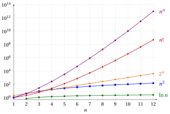
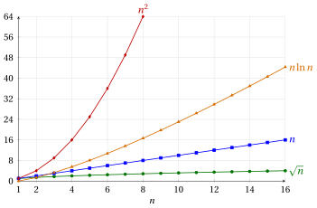

# Crescita asintotica

**Parte 3 · Notazione e crescita asintotica · Capitolo 10** · [:material-file-pdf-box: Dispensa, volume 3 (PDF)](../pdf/dispensa-3-notazione-asintotica.pdf) · [:material-pencil: Esercizi](../esercizi/es-10-crescita-asintotica.md)

## Introduzione

Il numero di passi eseguiti da un algoritmo è una funzione di un numero naturale: la dimensione del suo input. Due algoritmi che risolvono lo stesso problema si confrontano guardando quanto velocemente crescono queste funzioni al crescere dell'input, e non i loro valori su poche piccole istanze. In questo capitolo studiamo le funzioni di variabile naturale che compaiono nell'analisi degli algoritmi e ne confrontiamo gli <strong>ordini di crescita</strong> con le notazioni asintotiche $o$, $\bigO$, $\Theta$, $\Omega$ e $\omega$ introdotte nel capitolo 9 «Notazione asintotica».

Il capitolo è organizzato così.

- Nella Sezione [10.1](#sez-gr-sec-families) introduciamo le cinque famiglie di funzioni crescenti di variabile naturale usate nel corso: le funzioni logaritmiche, potenza, esponenziali, fattoriale e autopotenza.

- Nella Sezione [10.2](#sez-gr-sec-limits) richiamiamo i quattro limiti che mettono in ordine queste famiglie (la <strong>gerarchia degli infiniti</strong>).

- Nella Sezione [10.3](#sez-gr-sec-comparison) esprimiamo il confronto fra due ordini di crescita con la notazione asintotica, attraverso il criterio del limite del capitolo 9 «Notazione asintotica». Ricaviamo poi la gerarchia degli ordini di crescita, una classificazione degli ordini di crescita e le proprietà delle funzioni logaritmiche, potenza, polinomiali ed esponenziali che si usano nell'analisi degli algoritmi.

!!! chiave ""

    <strong>Prerequisiti.</strong> Le funzioni di variabile naturale sono le <strong>successioni</strong> del corso di <em>Analisi Matematica 1</em> ([fabiofurini.github.io/analisi-matematica-1/](https://fabiofurini.github.io/analisi-matematica-1/), versione inglese [fabiofurini.github.io/mathematical-analysis-1/](https://fabiofurini.github.io/mathematical-analysis-1/)). I loro limiti, e i teoremi usati per calcolarli, non vengono rispiegati in questo capitolo: li usiamo, e rimandiamo alla parte <em>Limiti di successioni</em> di quel corso, in particolare ai capitoli <em>Calcolo dei limiti delle successioni</em> (teorema del confronto), <em>Il numero di Nepero</em> e <em>Gerarchie degli infiniti e criterio del rapporto</em>.

## 10.1 Famiglie di funzioni crescenti di variabile naturale { #sez-gr-sec-families }

Una funzione di variabile naturale è definita su un insieme di numeri naturali della forma $\N_{\ge n_0} = \{n_0, n_0+1, n_0+2, \dots\}$, e nell'analisi degli algoritmi conta solo il suo comportamento per valori grandi di $n$. Nel capitolo 9 «Notazione asintotica» abbiamo chiamato <strong>asintoticamente positiva</strong> una funzione tale che $f(n) > 0$ per ogni $n$ da un certo valore in poi: nel corso di <em>Analisi Matematica 1</em> si dice che proprietà come questa valgono <em>definitivamente</em>. La definizione seguente descrive un'altra proprietà dello stesso tipo.

!!! definizione "Definizione 10.1: funzione asintoticamente crescente"

    Una funzione di variabile naturale $f: \N_{\ge n_0} \rightarrow \R$ è <strong>asintoticamente crescente</strong> se esiste $n_1 \in \N_{\ge n_0}$ tale che:

    \begin{equation*}
    f(n) < f(n+1), \quad \forall n \in \N_{\ge n_1} \tag{10.1}
    \end{equation*}

- Le principali famiglie di funzioni di variabile naturale asintoticamente crescenti sono le seguenti.

    1. Le funzioni <strong>logaritmiche</strong> di variabile naturale:

        \begin{equation*}
        f: \N_{\ge 1} \rightarrow \R,~~~ f:n \mapsto \log_a n \quad \forall a \in \R_{>1} \tag{10.2}
        \end{equation*}

    2. Le funzioni <strong>potenza</strong> di variabile naturale:

        \begin{equation*}
        f: \N \rightarrow \R,~~~ f:n \mapsto n^{\alpha} \quad \forall \alpha \in \R_{>0} \tag{10.3}
        \end{equation*}

    3. Le funzioni <strong>esponenziali</strong> di variabile naturale:

        \begin{equation*}
        f: \N \rightarrow \R,~~~ f:n \mapsto b^{n} \quad \forall b \in \R_{>1} \tag{10.4}
        \end{equation*}

    4. La funzione <strong>fattoriale</strong> di variabile naturale:

        \begin{equation*}
        f: \N \rightarrow \R,~~~ f:n \mapsto n! \tag{10.5}
        \end{equation*}

    5. La funzione <strong>autopotenza</strong> di variabile naturale:

        \begin{equation*}
        f: \N \rightarrow \R,~~~ f:n \mapsto n^n \tag{10.6}
        \end{equation*}

        dove, per convenzione, poniamo $0^0 = 1$.

- Tutte queste funzioni sono asintoticamente positive, e tutte divergono a $\ip$ per $n \rr \ip$. Le funzioni fattoriale e autopotenza non sono crescenti su tutto il dominio, poiché $0! = 1! = 1$ e $0^0 = 1^1 = 1$, ma sono strettamente crescenti da $n = 1$ in poi: per questo parliamo di funzioni <em>asintoticamente</em> crescenti.

- In queste note $\ln n = \log_e n$ indica il logaritmo naturale, dove $e$ è il numero di Nepero.

!!! esempio "Esempio 10.1: funzioni crescenti di variabile naturale"

    La tabella riporta i valori di alcune funzioni crescenti di variabile naturale, calcolati aumentando $n$ di un ordine di grandezza alla volta, da $1$ a $100$ milioni. I valori di $\ln n$ e i fattori iniziali di $2^n$ e $n!$ sono arrotondati a una cifra decimale; i valori di $n^2$ e $n^n$ sono esatti.

    
<table>
    <tr>
    <th>&#92;(n&#92;)</th>
    <th>&#92;(&#92;ln n&#92;)</th>
    <th>&#92;(n^2&#92;)</th>
    <th>&#92;(2^n&#92;)</th>
    <th>&#92;(n!&#92;)</th>
    <th>&#92;(n^n&#92;)</th>
    </tr>
    <tr>
    <td>&#92;(1=10^0&#92;)</td>
    <td>&#92;(0&#92;)</td>
    <td>&#92;(1&#92;)</td>
    <td>&#92;(2&#92;)</td>
    <td>&#92;(1&#92;)</td>
    <td>&#92;(1&#92;)</td>
    </tr>
    <tr>
    <td>&#92;(10=10^1&#92;)</td>
    <td>&#92;(&#92;approx 2.3&#92;)</td>
    <td>&#92;(10^2&#92;)</td>
    <td>&#92;(&#92;approx 1.0 &#92;cdot 10^{3}&#92;)</td>
    <td>&#92;(&#92;approx 3.6&#92;cdot 10^{6}&#92;)</td>
    <td>&#92;(10^{10}&#92;)</td>
    </tr>
    <tr>
    <td>&#92;(100=10^2&#92;)</td>
    <td>&#92;(&#92;approx 4.6&#92;)</td>
    <td>&#92;(10^4&#92;)</td>
    <td>&#92;(&#92;approx 1.3 &#92;cdot 10^{30}&#92;)</td>
    <td>&#92;(&#92;approx 9.3&#92;cdot 10^{157}&#92;)</td>
    <td>&#92;(10^{200}&#92;)</td>
    </tr>
    <tr>
    <td>&#92;(1{,}000=10^3&#92;)</td>
    <td>&#92;(&#92;approx 6.9&#92;)</td>
    <td>&#92;(10^6&#92;)</td>
    <td>&#92;(&#92;approx 1.1 &#92;cdot 10^{301}&#92;)</td>
    <td>&#92;(&#92;approx 4.0&#92;cdot 10^{2{,}567}&#92;)</td>
    <td>&#92;(10^{3{,}000}&#92;)</td>
    </tr>
    <tr>
    <td>&#92;(10{,}000=10^4&#92;)</td>
    <td>&#92;(&#92;approx 9.2&#92;)</td>
    <td>&#92;(10^8&#92;)</td>
    <td>&#92;(&#92;approx 2.0 &#92;cdot 10^{3{,}010}&#92;)</td>
    <td>&#92;(&#92;approx 2.8&#92;cdot 10^{35{,}659}&#92;)</td>
    <td>&#92;(10^{40{,}000}&#92;)</td>
    </tr>
    <tr>
    <td>&#92;(100{,}000=10^5&#92;)</td>
    <td>&#92;(&#92;approx 11.5&#92;)</td>
    <td>&#92;(10^{10}&#92;)</td>
    <td>&#92;(&#92;approx 1.0 &#92;cdot 10^{30{,}103}&#92;)</td>
    <td>&#92;(&#92;approx 2.8&#92;cdot 10^{456{,}573}&#92;)</td>
    <td>&#92;(10^{500{,}000}&#92;)</td>
    </tr>
    <tr>
    <td>&#92;(10^6&#92;)</td>
    <td>&#92;(&#92;approx 13.8&#92;)</td>
    <td>&#92;(10^{12}&#92;)</td>
    <td>&#92;(&#92;approx 9.9 &#92;cdot 10^{301{,}029}&#92;)</td>
    <td>&#92;(&#92;approx 8.3&#92;cdot 10^{5{,}565{,}708}&#92;)</td>
    <td>&#92;(10^{6{,}000{,}000}&#92;)</td>
    </tr>
    <tr>
    <td>&#92;(10^7&#92;)</td>
    <td>&#92;(&#92;approx 16.1&#92;)</td>
    <td>&#92;(10^{14}&#92;)</td>
    <td>&#92;(&#92;approx 9.0 &#92;cdot 10^{3{,}010{,}299}&#92;)</td>
    <td>&#92;(&#92;approx 1.2&#92;cdot 10^{65{,}657{,}059}&#92;)</td>
    <td>&#92;(10^{70{,}000{,}000}&#92;)</td>
    </tr>
    <tr>
    <td>&#92;(10^8&#92;)</td>
    <td>&#92;(&#92;approx 18.4&#92;)</td>
    <td>&#92;(10^{16}&#92;)</td>
    <td>&#92;(&#92;approx 3.7 &#92;cdot 10^{30{,}102{,}999}&#92;)</td>
    <td>&#92;(&#92;approx 1.6&#92;cdot 10^{756{,}570{,}556}&#92;)</td>
    <td>&#92;(10^{800{,}000{,}000}&#92;)</td>
    </tr>
    </table>

    Per apprezzare questi numeri, ricordiamo che il numero di atomi dell'universo osservabile è stimato in circa $10^{82}$, e che un personal computer del 2024 esegue circa $10 \cdot 10^9 = 10^{10}$ operazioni al secondo ($10$ GFLOPS). Un algoritmo che esegue $2^n$ operazioni su un input con $n = 100$ impiega

    $$
    \frac{2^{100}}{10^{10}} \text{ secondi} \approx 1.3 \cdot 10^{20} \text{ secondi} \approx 4.0 \cdot 10^{12} \text{ anni},
    $$

    mentre un algoritmo che esegue $n^2$ operazioni ne impiega $10^{4}/10^{10} = 10^{-6}$ secondi.

- La [Figura 10.1](#box-3-gr-figFamilies) mostra i primi valori delle stesse funzioni. Poiché i valori crescono molto velocemente, l'asse verticale è in scala logaritmica: ogni linea orizzontale della griglia corrisponde a una moltiplicazione per $100$.

{ .fig loading=lazy  }

<strong>Figura 10.1:</strong> I valori di &#92;(&#92;ln n&#92;), &#92;(n^2&#92;), &#92;(2^n&#92;), &#92;(n!&#92;) e &#92;(n^n&#92;) per &#92;(n &#92;in &#92;{1, 2, &#92;dots, 12&#92;}&#92;) (asse verticale in scala logaritmica; i punti sono uniti da segmenti solo per leggibilità). Per piccoli valori di &#92;(n&#92;) l'ordine delle funzioni può essere diverso da quello finale: &#92;(2^3 = 8 &lt; 9 = 3^2&#92;), e &#92;(2^n &gt; n!&#92;) per &#92;(n &#92;in &#92;{1, 2, 3&#92;}&#92;).

## 10.2 La gerarchia degli infiniti { #sez-gr-sec-limits }

Le cinque famiglie della Sezione [10.1](#sez-gr-sec-families) divergono tutte a $\ip$. Per decidere quale diverge più velocemente, calcoliamo il limite del rapporto di due di esse. I limiti di questa sezione sono la <em>gerarchia degli infiniti</em> per le successioni del corso di <em>Analisi Matematica 1</em> (capitolo <em>Gerarchie degli infiniti e criterio del rapporto</em>), dove sono dimostrati; qui li richiamiamo, insieme all'idea delle dimostrazioni, ed estendiamo il primo alle potenze dei logaritmi.

- Dati $a \in \R_{>1}$ e $\beta \in \R_{>0}$, la funzione di variabile naturale asintoticamente crescente

    \begin{equation*}
    f: \N_{\ge 1} \rightarrow \R,~~~ f:n \mapsto \log^{\beta}_a n = \big(\log_a n\big)^{\beta} \tag{10.7}
    \end{equation*}

    è detta funzione <strong>polilogaritmica</strong> di variabile naturale.

!!! teorema "Proposizione 10.2: logaritmi e potenze"

    Per ogni $\alpha \in \R_{>0}$, $\beta \in \R_{>0}$ e $a \in \R_{>1}$, si ha:

    \begin{equation*}
    \lim_{n \rr \ip} \frac{\log_a^\beta n}{n^\alpha} = 0^+ \tag{10.8}
    \end{equation*}

??? dimostrazione "Dimostrazione"

    Per $\beta = 1$ questa è la gerarchia degli infiniti (parte I) del corso di <em>Analisi Matematica 1</em>:

    $$
    \lim_{n \rr \ip} \frac{\log_a n}{n^\alpha} = 0^+, \quad \forall \alpha \in \R_{>0},~ \forall a \in \R_{>1}.
    $$

    Si dimostra con la disuguaglianza $\log_a x < x \, \log_a 2$, valida per ogni $x \in \R_{>0}$ (conseguenza della disuguaglianza di Bernoulli), applicata a $x = n^{\alpha/2}$, e con il teorema del confronto.

    Per ogni $\beta \in \R_{>0}$, poiché $\frac{\alpha}{\beta} \in \R_{>0}$, si ha allora:

    $$
    \lim_{n \rr \ip} \frac{\log_a^\beta n}{n^\alpha}
    = \lim_{n \rr \ip} \Bigg( \underbrace{\frac{\log_a n}{n^{\alpha/\beta}}}_{\rr\, 0^+} \Bigg)^{\beta}
    = 0^+
    $$

    
□

!!! teorema "Proposizione 10.3: potenze ed esponenziali"

    Per ogni $\alpha \in \R_{>0}$ e $b \in \R_{>1}$, si ha:

    \begin{equation*}
    \lim_{n \rr \ip} \frac{n^{\alpha}}{b^{n}} = 0^+ \tag{10.9}
    \end{equation*}

- Questa è la gerarchia degli infiniti (parte II). Segue dalla [Proposizione 10.2](#box-4-grPropLogPower) sostituendo $n$ con $2^n$, il che dà $\frac{n}{(2^{\mu})^n} \rr 0^+$ per ogni $\mu \in \R_{>0}$, quindi $\frac{n}{b^n} \rr 0^+$ per ogni $b \in \R_{>1}$ (si sceglie $\mu$ tale che $2^{\mu} = b$); il caso generale segue dall'identità

    $$
    \frac{n^\alpha}{b^n} = \left( \frac{n}{\big(b^{1/\alpha}\big)^n} \right)^{\alpha}, \qquad b^{1/\alpha} \in \R_{>1}.
    $$

!!! teorema "Proposizione 10.4: esponenziali e fattoriale"

    Per ogni $b \in \R_{>1}$, si ha:

    \begin{equation*}
    \lim_{n \rr \ip} \frac{b^{n}}{n!} = 0^+ \tag{10.10}
    \end{equation*}

- Questa è la gerarchia degli infiniti (parte III). Segue dal criterio del rapporto, poiché

    $$
    \frac{b^{n+1}}{(n+1)!} \; \frac{n!}{b^n} = \frac{b}{n+1} \rr 0^+ < 1.
    $$

!!! teorema "Proposizione 10.5: fattoriale e autopotenza"

    \begin{equation*}
    \lim_{n \rr \ip} \frac{n!}{n^n} = 0^+ \tag{10.11}
    \end{equation*}

- Questa è la gerarchia degli infiniti (parte IV). Segue dal criterio del rapporto, poiché

    $$
    \frac{(n+1)!}{(n+1)^{n+1}} \; \frac{n^n}{n!} = \left( \frac{n}{n+1}\right)^n = \frac{1}{\left( 1 + \frac{1}{n} \right)^n} \rr \frac{1}{e} < 1.
    $$

!!! chiave ""

    Le funzioni polilogaritmiche (con base maggiore di uno) divergono più lentamente delle funzioni potenza (con esponente positivo), che divergono più lentamente delle funzioni esponenziali (con base maggiore di uno), che divergono più lentamente della funzione fattoriale, che diverge più lentamente della funzione autopotenza.

## 10.3 Confronto fra ordini di crescita { #sez-gr-sec-comparison }

- L'<strong>ordine di crescita</strong> di una funzione di variabile naturale asintoticamente crescente descrive quanto rapidamente crescono i suoi valori rispetto ai valori di un'altra funzione di variabile naturale asintoticamente crescente.

- Confrontiamo gli ordini di crescita con le notazioni asintotiche $o$, $\bigO$, $\Theta$, $\Omega$ e $\omega$ del capitolo 9 «Notazione asintotica». Per le funzioni di questo capitolo il rapporto $\frac{f(n)}{g(n)}$ ha sempre un limite, e le notazioni che valgono sono decise dal <strong>criterio del limite</strong> dimostrato là, che richiamiamo.

!!! teorema "Proposizione 10.6: criterio del limite"

    Siano $f$ e $g$ due funzioni di variabile naturale asintoticamente positive tali che il limite

    $$
    L = \lim_{n \rr \ip} \frac{f(n)}{g(n)}
    $$

    esista ($L = 0^+$, $L \in \R_{>0}$ oppure $L = \ip$). Allora:

    \begin{align*}
    f(n) = o\big(g(n)\big) &~~\Longleftrightarrow~~ L = 0^+,\\
    f(n) = \bigO\big(g(n)\big) &~~\Longleftrightarrow~~ L = 0^+ \ \text{ oppure } \ L \in \R_{>0},\\
    f(n) = \Theta\big(g(n)\big) &~~\Longleftrightarrow~~ L \in \R_{>0},\\
    f(n) = \Omega\big(g(n)\big) &~~\Longleftrightarrow~~ L \in \R_{>0} \ \text{ oppure } \ L = \ip,\\
    f(n) = \omega\big(g(n)\big) &~~\Longleftrightarrow~~ L = \ip.
    \end{align*}

- La dimostrazione è nel capitolo 9 «Notazione asintotica» (Proposizione «criterio del limite»), dove le cinque notazioni sono definite attraverso costanti positive e una soglia. In questo capitolo calcoliamo il limite del rapporto e applichiamo la [Proposizione 10.6](#box-8-grPropLimit).

!!! chiave ""

    Date due funzioni di variabile naturale asintoticamente crescenti $f$ e $g$:

    - se $f(n) = o\big(g(n)\big)$, $f$ ha un <strong>ordine di crescita strettamente minore</strong> di quello di $g$, $\rightsquigarrow$ la funzione $f$ <strong>cresce più lentamente</strong> della funzione $g$;

    - se $f(n) = \bigO\big(g(n)\big)$, $f$ ha un <strong>ordine di crescita minore o uguale</strong> a quello di $g$, $\rightsquigarrow$ la funzione $f$ <strong>cresce al più quanto</strong> la funzione $g$;

    - se $f(n) = \Theta\big(g(n)\big)$, $f$ ha lo <strong>stesso ordine di crescita</strong> di $g$, $\rightsquigarrow$ la funzione $f$ <strong>cresce come</strong> la funzione $g$;

    - se $f(n) = \Omega\big(g(n)\big)$, $f$ ha un <strong>ordine di crescita maggiore o uguale</strong> a quello di $g$, $\rightsquigarrow$ la funzione $f$ <strong>cresce almeno quanto</strong> la funzione $g$;

    - se $f(n) = \omega\big(g(n)\big)$, $f$ ha un <strong>ordine di crescita strettamente maggiore</strong> di quello di $g$, $\rightsquigarrow$ la funzione $f$ <strong>cresce più velocemente</strong> della funzione $g$.

- Le notazioni non dipendono dai valori di $f$ e $g$ su un numero finito di numeri naturali: cambiarli non cambia né il limite del rapporto né, con una soglia più grande, le disuguaglianze delle definizioni.

- Per le proprietà relazionali del capitolo 9 «Notazione asintotica» (simmetria e simmetria trasposta), scambiare le due funzioni scambia $o$ con $\omega$ e $\bigO$ con $\Omega$, mentre $\Theta$ non cambia:

    $$
    f(n) = o\big(g(n)\big) \iff g(n) = \omega\big(f(n)\big), \qquad
    f(n) = \Theta\big(g(n)\big) \iff g(n) = \Theta\big(f(n)\big).
    $$

    Tutte e cinque le notazioni sono anche transitive: per esempio, $f(n) = o\big(g(n)\big)$ e $g(n) = o\big(h(n)\big)$ danno $f(n) = o\big(h(n)\big)$.

!!! esempio "Esempio 10.2: il limite del rapporto"

    Confrontiamo tre coppie di funzioni; i tre rapporti sono disegnati in [Figura 10.2](#box-10-gr-figRatios).

    - Si ha $\ln n = o\big(\sqrt{n}\big)$, poiché per la [Proposizione 10.2](#box-4-grPropLogPower) (con $a = e$, $\beta = 1$, $\alpha = \frac{1}{2}$):

        $$
        \lim_{n \rr \ip} \frac{\ln n}{\sqrt n} = 0^+
        $$

    - Si ha $2n^2 + 3n = \Theta(n^2)$, poiché:

        $$
        \lim_{n \rr \ip} \frac{2n^2+3n}{n^2} = \lim_{n \rr \ip} \Big( 2 + \underbrace{\frac{3}{n}}_{\rr\, 0} \Big) = 2 \in \R_{>0}
        $$

    - Si ha $n \ln n = \omega(n)$, poiché:

        $$
        \lim_{n \rr \ip} \frac{n \ln n}{n} = \lim_{n \rr \ip} \ln n = \ip
        $$

    Il primo rapporto non è monotono: cresce fino al suo valore massimo, circa $0.74$, raggiunto per $n = 7$, e solo dopo decresce verso $0$.

{ .fig loading=lazy  }

<strong>Figura 10.2:</strong> I tre rapporti dell'[Esempio 10.2](#box-9-gr-exRatios) per &#92;(n &#92;in &#92;{1, 2, &#92;dots, 100&#92;}&#92;) (i punti sono uniti da segmenti). Il primo tende a &#92;(0&#92;), il secondo a &#92;(2&#92;) (retta tratteggiata), il terzo diverge a &#92;(&#92;ip&#92;).

- La [Proposizione 10.6](#box-8-grPropLimit) richiede che il limite del rapporto esista. Per esempio, per $f(n) = n$ se $n$ è pari e $f(n) = 2n$ se $n$ è dispari, il rapporto $\frac{f(n)}{n}$ assume alternativamente i valori $1$ e $2$ e non ha limite; ciò nonostante $f(n) = \Theta(n)$, per la definizione del capitolo 9 «Notazione asintotica» con $c_1 = 1$, $c_2 = 2$ e $n_1 = 0$, poiché $0 \le n \le f(n) \le 2n$ per ogni $n \in \N$. Tutti i confronti di questo capitolo sono fatti fra funzioni il cui rapporto ha limite.

### 10.3.1 Gerarchia degli ordini di crescita { #sez-gr-sec-hierarchy }

Per la [Proposizione 10.6](#box-8-grPropLimit), i limiti della Sezione [10.2](#sez-gr-sec-limits) si traducono direttamente in relazioni $o$ fra le famiglie.

- Ogni funzione polilogaritmica di variabile naturale con base strettamente maggiore di uno è $o$ di ogni funzione potenza di variabile naturale con esponente positivo.

!!! teorema "Osservazione 10.7: polilogaritmi e potenze"

    Per ogni $\alpha \in \R_{>0}$, $\beta \in \R_{>0}$ e $a \in \R_{>1}$, si ha $\log^{\beta}_a n = o(n^{\alpha})$.

??? dimostrazione "Dimostrazione"

    Per la [Proposizione 10.2](#box-4-grPropLogPower), per ogni $\alpha \in \R_{>0}$, $\beta \in \R_{>0}$ e $a \in \R_{>1}$, si ha:

    $$
    \lim_{n \rr \ip} \frac{\log^{\beta}_a n}{n^{\alpha}} = 0^+
    $$

    e la tesi segue dalla [Proposizione 10.6](#box-8-grPropLimit). □

- Ogni funzione potenza di variabile naturale con esponente positivo è $o$ di ogni funzione esponenziale di variabile naturale con base strettamente maggiore di uno.

!!! teorema "Osservazione 10.8: potenze ed esponenziali"

    Per ogni $\alpha \in \R_{>0}$ e $b \in \R_{>1}$, si ha $n^{\alpha} = o(b^{n})$.

??? dimostrazione "Dimostrazione"

    Per la [Proposizione 10.3](#box-5-grPropPowerExp), per ogni $\alpha \in \R_{>0}$ e $b \in \R_{>1}$, si ha:

    $$
    \lim_{n \rr \ip} \frac{n^{\alpha}}{b^{n}} = 0^+
    $$

    e la tesi segue dalla [Proposizione 10.6](#box-8-grPropLimit). □

!!! esempio "Esempio 10.3: confronto fra ordini di crescita"

    - Si ha $\ln^6 n + 2 + 2^{1/n} + 3^{-n} + 9\,n^2 = o(n^3)$, poiché:

        $$
        \lim_{n \rr \ip} \frac{\ln^6 n + 2 + 2^{1/n} + 3^{-n} + 9\,n^2}{n^3}
        = \lim_{n \rr \ip} \Bigg( \underbrace{\frac{\ln^6 n}{n^3}}_{\rr\, 0^+} + \underbrace{\frac{2}{n^3}}_{\rr\, 0^+} + \underbrace{\frac{2^{1/n}}{n^3}}_{\rr\, 0^+} + \underbrace{\frac{3^{-n}}{n^3}}_{\rr\, 0^+} + \underbrace{\frac{9}{n}}_{\rr\, 0^+} \Bigg) = 0^+
        $$

    - Si ha $3n^2 + \sqrt{n} + \ln n + 5 + 4^{-n} + 10\,n^{1/3} = o(n^3)$, poiché:

        $$
        \lim_{n \rr \ip} \frac{3n^2 + \sqrt{n} + \ln n + 5 + 4^{-n} + 10\,n^{1/3}}{n^3}
        = \lim_{n \rr \ip} \Bigg(
        \underbrace{\frac{3}{n}}_{\rr\, 0^+} +
        \underbrace{\frac{1}{n^{5/2}}}_{\rr\, 0^+} +
        \underbrace{\frac{\ln n}{n^3}}_{\rr\, 0^+} +
        \underbrace{\frac{5}{n^3}}_{\rr\, 0^+} +
        \underbrace{\frac{4^{-n}}{n^3}}_{\rr\, 0^+} +
        \underbrace{\frac{10}{n^{8/3}}}_{\rr\, 0^+}
        \Bigg) = 0^+
        $$

    - Si ha $n^{1/4} + \ln^2 n + \frac{7}{\sqrt{n}} + e^{-n} + 20\,n^{1/2} = o(n^2)$, poiché:

        $$
        \lim_{n \rr \ip} \frac{n^{1/4} + \ln^2 n + \frac{7}{\sqrt{n}} + e^{-n} + 20\,n^{1/2}}{n^2}
        = \lim_{n \rr \ip} \Bigg(
        \underbrace{\frac{1}{n^{7/4}}}_{\rr\, 0^+} +
        \underbrace{\frac{\ln^2 n}{n^2}}_{\rr\, 0^+} +
        \underbrace{\frac{7}{n^{5/2}}}_{\rr\, 0^+} +
        \underbrace{\frac{e^{-n}}{n^2}}_{\rr\, 0^+} +
        \underbrace{\frac{20}{n^{3/2}}}_{\rr\, 0^+}
        \Bigg) = 0^+
        $$

    In ciascun caso i termini con un logaritmo tendono a $0^+$ per la [Proposizione 10.2](#box-4-grPropLogPower), gli altri termini per limiti elementari, e la tesi segue dalla [Proposizione 10.6](#box-8-grPropLimit).

- Ogni funzione esponenziale di variabile naturale con base strettamente maggiore di uno è $o$ della funzione fattoriale di variabile naturale.

!!! teorema "Osservazione 10.9: esponenziali e fattoriale"

    Per ogni $b \in \R_{>1}$, si ha $b^{n} = o(n!)$.

??? dimostrazione "Dimostrazione"

    Per la [Proposizione 10.4](#box-6-grPropExpFact), per ogni $b \in \R_{>1}$, si ha:

    $$
    \lim_{n \rr \ip} \frac{b^{n}}{n!} = 0^+
    $$

    e la tesi segue dalla [Proposizione 10.6](#box-8-grPropLimit). □

- La funzione fattoriale di variabile naturale è $o$ della funzione autopotenza di variabile naturale.

!!! teorema "Osservazione 10.10: fattoriale e autopotenza"

    Si ha $n! = o(n^n)$.

??? dimostrazione "Dimostrazione"

    Per la [Proposizione 10.5](#box-7-grPropFactSelf), si ha:

    $$
    \lim_{n \rr \ip} \frac{n!}{n^n} = 0^+
    $$

    e la tesi segue dalla [Proposizione 10.6](#box-8-grPropLimit). □

!!! esempio "Esempio 10.4: confronto con la funzione autopotenza"

    Si ha $n! + 2^n + \sqrt{n} + \ln^3 n + n^{n-1} + \frac{1}{n} = o(n^n)$, poiché:

    $$
    \lim_{n \rr \ip} \frac{n! + 2^n + \sqrt{n} + \ln^3 n + n^{n-1} + \frac{1}{n}}{n^{n}}
    = \lim_{n \rr \ip} \Bigg(
    \underbrace{\frac{n!}{n^{n}}}_{\rr\, 0^+} +
    \underbrace{\frac{2^n}{n^{n}}}_{\rr\, 0^+} +
    \underbrace{\frac{\sqrt{n}}{n^{n}}}_{\rr\, 0^+} +
    \underbrace{\frac{\ln^3 n}{n^{n}}}_{\rr\, 0^+} +
    \underbrace{\frac{1}{n}}_{\rr\, 0^+} +
    \underbrace{\frac{1}{n^{n+1}}}_{\rr\, 0^+}
    \Bigg) = 0^+
    $$

    Per esempio, $\frac{2^n}{n^n} = \frac{2^n}{n!} \, \frac{n!}{n^n}$ è il prodotto di due funzioni che tendono a $0^+$, per le Proposizioni [10.4](#box-6-grPropExpFact) e [Proposizione 10.5](#box-7-grPropFactSelf).

!!! chiave ""

    <strong>Gerarchia degli ordini di crescita.</strong> Per ogni $a \in \R_{>1}$, $\beta \in \R_{>0}$, $\alpha \in \R_{>0}$ e $b \in \R_{>1}$, si ha

    $$
    \log_a^\beta n = o(n^\alpha), \qquad n^\alpha = o(b^n), \qquad b^n = o(n!), \qquad n! = o(n^n).
    $$

    Per la transitività di $o$ (capitolo 9 «Notazione asintotica»), ogni funzione della catena è $o$ di tutte le funzioni che la seguono, per esempio $\log_a^\beta n = o(n!)$.

### 10.3.2 Classificazione degli ordini di crescita { #sez-gr-sec-classification }

Le famiglie della gerarchia si usano come metri di paragone per classificare l'ordine di crescita di qualunque altra funzione.

!!! definizione "Definizione 10.11: ordini di crescita limitati"

    Una funzione di variabile naturale asintoticamente crescente $f$ ha:

    - un <strong>ordine di crescita limitato polilogaritmicamente</strong>, se esiste $\beta \in \R_{>0}$ tale che $f(n) = \bigO(\ln^{\beta} n)$; e un <strong>ordine di crescita limitato logaritmicamente</strong>, se $f(n) = \bigO(\ln n)$;

    - un <strong>ordine di crescita limitato polinomialmente</strong>, se esiste $\alpha \in \R_{>0}$ tale che $f(n) = \bigO(n^{\alpha})$;

    - un <strong>ordine di crescita limitato esponenzialmente</strong>, se esiste $b \in \R_{>1}$ tale che $f(n) = \bigO(b^{n})$;

    - un <strong>ordine di crescita limitato fattorialmente</strong>, se $f(n) = \bigO(n!)$.

!!! definizione "Definizione 10.12: ordine di crescita lineare, sub-lineare e super-lineare"

    Una funzione di variabile naturale asintoticamente crescente $f$ ha:

    - un <strong>ordine di crescita sub-lineare</strong>, se $f(n) = o(n)$;

    - un <strong>ordine di crescita lineare</strong>, se $f(n) = \Theta(n)$;

    - un <strong>ordine di crescita super-lineare</strong>, se $f(n) = \omega(n)$.

- Per la gerarchia degli ordini di crescita, una funzione con ordine di crescita limitato polilogaritmicamente ha anche un ordine di crescita limitato polinomialmente, che a sua volta è anche limitato esponenzialmente e fattorialmente. Per esempio, $f(n) = \bigO(\ln^{\beta} n)$ e $\ln^{\beta} n = o(n)$ danno $f(n) = \bigO(n)$, perché $o$ implica $\bigO$ e $\bigO$ è transitiva (capitolo 9 «Notazione asintotica»).

!!! esempio "Esempio 10.5: classificazione degli ordini di crescita"

    Classifichiamo quattro funzioni, disegnate in [Figura 10.3](#box-20-gr-figLinear).

    - $\sqrt n = o(n)$, poiché $\frac{\sqrt n}{n} = \frac{1}{\sqrt n} \rr 0^+$: un ordine di crescita sub-lineare. Ha un ordine di crescita limitato polinomialmente, poiché $\sqrt n = \bigO(n^{1/2})$, ma non limitato polilogaritmicamente: poiché $\frac{\ln^{\beta} n}{\sqrt n} \rr 0^+$ ([Proposizione 10.2](#box-4-grPropLogPower)), si ha $\frac{\sqrt n}{\ln^{\beta} n} \rr \ip$, cioè $\sqrt n = \omega(\ln^{\beta} n)$ e $\sqrt n \neq \bigO(\ln^{\beta} n)$ per ogni $\beta \in \R_{>0}$ ([Proposizione 10.6](#box-8-grPropLimit)).

    - $n = \Theta(n)$: un ordine di crescita lineare.

    - $n \ln n = \omega(n)$, poiché $\frac{n \ln n}{n} = \ln n \rr \ip$: un ordine di crescita super-lineare. Ha un ordine di crescita limitato polinomialmente, poiché $\frac{n \ln n}{n^2} = \frac{\ln n}{n} \rr 0^+$, così che $n \ln n = o(n^2)$ e $n \ln n = \bigO(n^2)$.

    - $n^2 = \omega(n)$, poiché $\frac{n^2}{n} = n \rr \ip$: un ordine di crescita super-lineare. Ha un ordine di crescita limitato polinomialmente, poiché $n^2 = \bigO(n^2)$.

{ .fig loading=lazy  }

<strong>Figura 10.3:</strong> Una funzione sub-lineare (&#92;(&#92;sqrt n&#92;)), la funzione lineare &#92;(n&#92;) e due funzioni super-lineari (&#92;(n &#92;ln n&#92;) e &#92;(n^2&#92;)) per &#92;(n &#92;in &#92;{1, 2, &#92;dots, 16&#92;}&#92;) (&#92;(n^2&#92;) solo fino a &#92;(n = 8&#92;), dove raggiunge &#92;(64&#92;); i punti sono uniti da segmenti).

### 10.3.3 Proprietà delle funzioni logaritmiche { #sez-gr-sec-log }

Nelle dimostrazioni di questa sottosezione e delle seguenti calcoliamo il limite del rapporto delle due funzioni e applichiamo la [Proposizione 10.6](#box-8-grPropLimit).

- Due funzioni logaritmiche di variabile naturale con basi strettamente maggiori di uno sono ciascuna $\Theta$ dell'altra; anche moltiplicare l'argomento per una costante positiva non cambia l'ordine di crescita.

!!! teorema "Osservazione 10.13: cambio di base"

    Per ogni $a \in \R_{>1}$, $c \in \R_{>1}$ e $\lambda \in \R_{>0}$, si ha $\log_{a} (\lambda\, n) = \Theta(\log_{c} n)$.

??? dimostrazione "Dimostrazione"

    Per ogni $a,c \in \R_{>1}$ e $\lambda \in \R_{>0}$, poiché $\log_a (\lambda\, n) = \log_a \lambda + \log_a n$ e $\log_a n = \frac{\log_c n}{\log_c a}$, si ha:

    $$
    \lim_{n \rr \ip} \frac{\log_{a}(\lambda\, n)}{\log_c n}
    = \lim_{n \rr \ip} \Bigg( \underbrace{\frac{\log_a \lambda}{\log_c n}}_{\rr\, 0} + \frac{\frac{\log_c n}{\log_c a}}{\log_c n} \Bigg)
    = \frac{1}{\log_c a} \in \R_{>0}
    $$

    
□

- Per questo motivo, quando conta solo l'ordine di crescita, la base di un logaritmo si omette spesso. Per esempio, $\log_2 n = \Theta(\ln n)$, e $\lim_{n \rr \ip} \frac{\log_2 n}{\ln n} = \frac{1}{\ln 2} \approx 1.44$.

- Sommare una costante positiva all'argomento di una funzione logaritmica di variabile naturale non ne cambia l'ordine di crescita.

!!! teorema "Osservazione 10.14: traslazione dell'argomento"

    Per ogni $a \in \R_{>1}$ e $\lambda \in \R_{>0}$, si ha $\log_{a} (n+\lambda) = \Theta(\log_{a} n)$.

??? dimostrazione "Dimostrazione"

    Per ogni $a \in \R_{>1}$ e $\lambda \in \R_{>0}$, si ha:

    $$
    \lim_{n \rr \ip} \frac{\log_a (n+\lambda)}{\log_a n}
    = \lim_{n \rr \ip} \frac{\log_a \left(n \left(1 + \frac{\lambda}{n} \right)\right)}{\log_a n}
    = \lim_{n \rr \ip} \frac{\log_a n + \overbrace{\log_a \left(1+\frac{\lambda}{n}\right)}^{\rr\, 0}}{\log_a n}
    = 1
    $$

    
□

- La funzione <strong>quasi-lineare</strong> di variabile naturale $n \mapsto n \log_a n$ è $o$ di ogni funzione potenza di variabile naturale con esponente strettamente maggiore di uno.

!!! teorema "Osservazione 10.15: funzione quasi-lineare e potenze"

    Per ogni $\alpha \in \R_{>1}$ e $a \in \R_{>1}$, si ha $n \log_a n = o(n^{\alpha})$.

??? dimostrazione "Dimostrazione"

    Per ogni $\alpha \in \R_{>1}$ e $a \in \R_{>1}$, si ha $\alpha - 1 \in \R_{>0}$ e, per la [Proposizione 10.2](#box-4-grPropLogPower):

    $$
    \lim_{n \rr \ip} \frac{n \log_a n}{n^{\alpha}} = \lim_{n \rr \ip} \frac{\log_a n}{n^{\alpha-1}} = 0^+
    $$

    
□

- La funzione quasi-lineare di variabile naturale $n \mapsto n \log_a n$ è $\omega$ della funzione lineare di variabile naturale: ha un ordine di crescita super-lineare.

!!! teorema "Osservazione 10.16: funzione quasi-lineare e funzione lineare"

    Per ogni $a \in \R_{>1}$, si ha $n \log_a n = \omega(n)$.

??? dimostrazione "Dimostrazione"

    Per ogni $a \in \R_{>1}$, si ha:

    $$
    \lim_{n \rr \ip} \frac{n \log_a n}{n} = \lim_{n \rr \ip} \log_a n = \ip
    $$

    
□

### 10.3.4 Proprietà delle funzioni potenza { #sez-gr-sec-power }

- Sommare una costante positiva all'argomento di una funzione potenza di variabile naturale non ne cambia l'ordine di crescita.

!!! teorema "Osservazione 10.17: traslazione dell'argomento"

    Per ogni $\alpha \in \R_{>0}$ e $\lambda \in \R_{>0}$, si ha $(n+\lambda)^{\alpha} = \Theta(n^{\alpha})$.

??? dimostrazione "Dimostrazione"

    Per ogni $\alpha \in \R_{>0}$ e $\lambda \in \R_{>0}$, si ha:

    $$
    \lim_{n \rr \ip} \frac{(n+\lambda)^{\alpha}}{n^{\alpha}} = \lim_{n \rr \ip} \Big(1 + \underbrace{\frac{\lambda}{n}}_{\rr\, 0} \Big)^{\alpha} = 1
    $$

    
□

- Moltiplicare l'argomento di una funzione potenza di variabile naturale per una costante positiva non ne cambia l'ordine di crescita.

!!! teorema "Osservazione 10.18: scalatura dell'argomento"

    Per ogni $\alpha \in \R_{>0}$ e $\lambda \in \R_{>0}$, si ha $(\lambda\, n)^{\alpha} = \Theta(n^{\alpha})$.

??? dimostrazione "Dimostrazione"

    Per ogni $\alpha \in \R_{>0}$ e $\lambda \in \R_{>0}$, si ha:

    $$
    \lim_{n \rr \ip} \frac{(\lambda\, n)^{\alpha}}{n^{\alpha}} = \lim_{n \rr \ip} \frac{\lambda^{\alpha}\, n^{\alpha}}{n^{\alpha}} = \lambda^{\alpha} \in \R_{>0}
    $$

    
□

- L'ordine di crescita di una funzione potenza di variabile naturale, confrontato con quello della funzione lineare di variabile naturale, dipende dal fatto che l'esponente sia maggiore o minore di uno.

!!! teorema "Osservazione 10.19: potenze e funzione lineare"

    Per ogni $\alpha \in \R_{>0}$, si ha:

    - $n^{\alpha} = \omega(n)$ (ordine di crescita super-lineare), se $\alpha > 1$;

    - $n^{\alpha} = o(n)$ (ordine di crescita sub-lineare), se $\alpha < 1$.

??? dimostrazione "Dimostrazione"

    Per ogni $\alpha \in \R_{>0}$, si ha:

    $$
    \lim_{n \rr \ip} \frac{n^{\alpha}}{n} = \lim_{n \rr \ip} n^{\alpha - 1} =
    \begin{cases}
    \ip & \text{se} ~~~ \alpha > 1\\[1ex]
    0^+ & \text{se} ~~~ \alpha < 1
    \end{cases}
    $$

    
□

### 10.3.5 Proprietà delle funzioni polinomiali { #sez-gr-sec-poly }

- Ogni funzione polinomiale di variabile naturale di grado $k$ con coefficiente direttivo positivo è $\Theta(n^k)$: ha lo stesso ordine di crescita del suo termine di grado massimo.

!!! teorema "Osservazione 10.20: polinomi"

    Per ogni $k \in \N_{\ge 1}$ e ogni $a_0, a_1, \dots, a_k \in \R$ con $a_k \in \R_{>0}$, si ha $\sum_{i=0}^{k} a_i \, n^i = \Theta(n^k)$.

??? dimostrazione "Dimostrazione"

    Si ha:

    $$
    \lim_{n \rr \ip} \frac{\sum_{i=0}^{k} a_i \, n^i}{n^{k}} = a_k + \lim_{n \rr \ip} \sum_{i=0}^{k-1} \underbrace{\frac{a_i}{n^{k-i}}}_{\rr\, 0} = a_k \in \R_{>0}
    $$

    In particolare, il polinomio è asintoticamente positivo, quindi si applica la [Proposizione 10.6](#box-8-grPropLimit). □

### 10.3.6 Proprietà delle funzioni esponenziali { #sez-gr-sec-exp }

- Ogni funzione esponenziale di variabile naturale con base strettamente maggiore di uno è $\omega$ delle funzioni esponenziali di variabile naturale con base minore, e $o$ delle funzioni esponenziali di variabile naturale con base maggiore.

!!! teorema "Osservazione 10.21: basi diverse"

    Per ogni $b \in \R_{>1}$ e $c \in \R_{>1}$, si ha:

    - $b^n = \omega(c^n)$, se $b > c$;

    - $b^n = o(c^n)$, se $b < c$.

??? dimostrazione "Dimostrazione"

    Per ogni $b \in \R_{>1}$ e $c \in \R_{>1}$, poiché $b = c^{\log_c b}$, si ha:

    $$
    \lim_{n \rr \ip} \frac{b^n}{c^n} = \lim_{n \rr \ip} \frac{c^{n \log_c b}}{c^n} = \lim_{n \rr \ip} \Big(c^{\log_c b-1}\Big)^{n} =
    \begin{cases}
    \ip & \text{se} ~~~ b > c\\[1ex]
    0^+ & \text{se} ~~~ b < c
    \end{cases}
    $$

    poiché $c^{\log_c b - 1} = \frac{b}{c}$ è maggiore di uno se $b > c$ e appartiene a $(0,1)$ se $b < c$ (limite della progressione geometrica). □

- Moltiplicare l'esponente di una funzione esponenziale di variabile naturale per una costante positiva ne cambia l'ordine di crescita, a meno che la costante sia uguale a uno.

!!! teorema "Osservazione 10.22: scalatura dell'esponente"

    Per ogni $b \in \R_{>1}$ e $\lambda \in \R_{>0}$, si ha:

    - $b^{\lambda n} = \omega(b^n)$, se $\lambda > 1$;

    - $b^{\lambda n} = o(b^n)$, se $0 < \lambda < 1$.

??? dimostrazione "Dimostrazione"

    Per ogni $b \in \R_{>1}$ e $\lambda \in \R_{>0}$, si ha:

    $$
    \lim_{n \rr \ip} \frac{b^{\lambda n}}{b^n}
    = \lim_{n \rr \ip} \left(\frac{b^{\lambda}}{b}\right)^n
    = \lim_{n \rr \ip} \left(b^{\lambda-1}\right)^n
    =
    \begin{cases}
    \ip & \text{se} ~~~ \lambda > 1\\[1ex]
    0^+ & \text{se} ~~~ 0 < \lambda < 1
    \end{cases}
    $$

    
□

- Una dimostrazione alternativa si basa sul fatto che

    $$
    b^{\lambda n} = \big( b^{\lambda} \big)^n
    \qquad \text{e} \qquad
    b^{\lambda}
    \begin{cases}
    > b & \text{se} ~~~ \lambda > 1\\[1ex]
    < b & \text{se} ~~~ 0 < \lambda < 1
    \end{cases}
    $$

    Di conseguenza, per l'[Osservazione 10.21](#box-29-grObsExpBase) applicata alle basi $b^{\lambda}$ e $b$, si ha $b^{\lambda n} = \omega(b^n)$ se $\lambda > 1$, e $b^{\lambda n} = o(b^n)$ se $0 < \lambda < 1$.

!!! esempio "Esempio 10.6: scalatura dell'esponente"

    - Si ha $2^{n/2} = o(2^n)$, poiché

        $$
        2^{n/2} = \big(2^{1/2}\big)^{n} \qquad \text{e} \qquad 2^{1/2} = \sqrt 2 < 2.
        $$

    - Si ha $2^{3n/2} = \omega(2^n)$, poiché

        $$
        2^{3n/2} = \big(2^{3/2}\big)^{n} \qquad \text{e} \qquad 2^{3/2} = 2\sqrt 2 > 2.
        $$

- Traslare l'esponente di una funzione esponenziale di variabile naturale di una costante non ne cambia l'ordine di crescita.

!!! teorema "Osservazione 10.23: traslazione dell'esponente"

    Per ogni $b \in \R_{>1}$ e $\lambda \in \R$, si ha $b^{n+\lambda} = \Theta(b^{n})$.

??? dimostrazione "Dimostrazione"

    Per ogni $b \in \R_{>1}$ e $\lambda \in \R$, si ha:

    $$
    \lim_{n \rr \ip} \frac{b^{n+\lambda}}{b^n} = \lim_{n \rr \ip} \frac{b^{n}\, b^{\lambda}}{b^n} = b^{\lambda} \in \R_{>0}
    $$

    
□

- Per esempio, $2^{n+10} = 1024 \cdot 2^n = \Theta(2^n)$, mentre $2^{2n} = 4^n = \omega(2^n)$: una costante sommata all'esponente è un fattore costante, un fattore costante nell'esponente cambia la base.

!!! chiave ""

    <strong>Punti chiave del capitolo</strong>

    - Le funzioni di variabile naturale usate nell'analisi degli algoritmi sono le funzioni logaritmiche ($\log_a n$), potenza ($n^\alpha$), esponenziali ($b^n$), fattoriale ($n!$) e autopotenza ($n^n$), insieme alle loro somme e ai loro prodotti.

    - Gli ordini di crescita si confrontano con la notazione asintotica del capitolo 9 «Notazione asintotica». Quando il limite di $\frac{f(n)}{g(n)}$ esiste, decide il limite (criterio del limite): $0^+$ dà $f(n) = o\big(g(n)\big)$, un numero reale positivo dà $f(n) = \Theta\big(g(n)\big)$, $\ip$ dà $f(n) = \omega\big(g(n)\big)$.

    - Gerarchia (con $a, b > 1$ e $\alpha, \beta > 0$): $\log_a^\beta n = o(n^\alpha)$, $n^\alpha = o(b^n)$, $b^n = o(n!)$, $n! = o(n^n)$.

    - La base di un logaritmo, una costante sommata all'argomento di un logaritmo o di una potenza, un fattore costante nell'argomento di una potenza e una costante sommata all'esponente di un esponenziale non cambiano l'ordine di crescita (le due funzioni sono ciascuna $\Theta$ dell'altra); un polinomio di grado $k$ con coefficiente direttivo positivo è $\Theta(n^k)$.

    - Un fattore costante nell'esponente di un esponenziale, e una base diversa di un esponenziale, cambiano invece l'ordine di crescita: per esempio $2^{n/2} = o(2^n)$ e $3^n = \omega(2^n)$.

    - Una funzione ha un ordine di crescita sub-lineare, lineare o super-lineare se è $o(n)$, $\Theta(n)$ oppure $\omega(n)$; per esempio $\sqrt n$, $5n+3$ e $n \ln n$ sono rispettivamente sub-lineare, lineare e super-lineare.

<!-- laboratorio-interattivo: sezione generata da interattivi.py -->

## Laboratorio interattivo { #laboratorio-interattivo }

L'algoritmo del capitolo, un passo alla volta: muovi i cursori e premi ▶.
Lo stesso grafico a tutta pagina, con gli altri del corso, è nel [laboratorio interattivo](../laboratorio/crescita.md).

