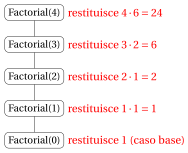
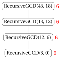
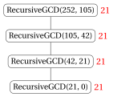
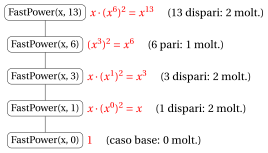
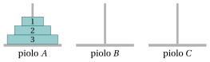
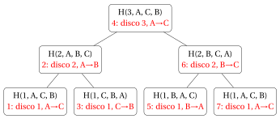

# Ricorsione

**Parte 5 · Ricorsione · Capitolo 14** · [:material-file-pdf-box: Dispensa, volume 5 (PDF)](../pdf/dispensa-5-ricorsione.pdf) · [:material-pencil: Esercizi: Ricorsione](../esercizi/es-14-ricorsione.md) · [:material-gesture-tap: App: Alberi delle chiamate ricorsive](../laboratorio/alberi-ricorsione.md)

Nei capitoli precedenti ogni algoritmo era <strong>iterativo</strong>: una sequenza di istruzioni e di cicli, di cui abbiamo contato i passi riga per riga (capitolo «Tempo di esecuzione») e di cui abbiamo dimostrato la correttezza con gli invarianti di ciclo (capitolo «Correttezza»). In questo capitolo studiamo un modo diverso di progettare gli algoritmi: un algoritmo può <strong>richiamare se stesso</strong> su istanze più piccole dello stesso problema.

Il piano del capitolo è il seguente.

- Nella Sezione [14.1](#sez-sec-rec-def) definiamo gli algoritmi ricorsivi, i casi base e i passi ricorsivi, e vediamo perché un algoritmo ricorsivo termina.

- Nella Sezione [14.2](#sez-sec-rec-tree) descriviamo come viene eseguito un algoritmo ricorsivo: l'<strong>albero delle chiamate ricorsive</strong> (che determina il numero di passi) e il <strong>call stack</strong> (che determina la memoria).

- Nella Sezione [14.3](#sez-sec-rec-correct) mostriamo che la correttezza di un algoritmo ricorsivo si dimostra per <strong>induzione forte</strong>.

- Nelle Sezioni [14.4](#sez-sec-factorial)–[14.8](#sez-sec-hanoi) applichiamo questi strumenti a cinque classici algoritmi ricorsivi: il fattoriale, i numeri di Fibonacci, il massimo comun divisore, l'elevamento a potenza veloce e le Torri di Hanoi. Per ciascuno di essi dimostriamo la correttezza, contiamo il numero di passi srotolando un'equazione di ricorrenza; le implementazioni in Python, <code>C++</code> e Java sono nei notebook Colab del capitolo.

## 14.1 Algoritmi ricorsivi { #sez-sec-rec-def }

- Molti problemi hanno una struttura <strong>autosimile</strong> naturale: la soluzione di un'istanza si ottiene facilmente dalla soluzione di una o più <strong>istanze più piccole dello stesso problema</strong>.

- Per esempio, per ogni numero naturale $n \ge 1$,

    $$
    n! = n \cdot (n-1)!
    $$

    cioè il fattoriale di $n$ si ottiene dal fattoriale del numero più piccolo $n-1$.

- Gli algoritmi che sfruttano questa struttura si chiamano algoritmi ricorsivi.

!!! definizione "Definizione 14.1: algoritmo ricorsivo"

    Un <strong>algoritmo ricorsivo</strong> è un algoritmo che risolve un'istanza di un problema <strong>richiamando se stesso</strong> su una o più <strong>istanze più piccole</strong> dello stesso problema, e combinando poi i risultati di queste chiamate.

- Ogni algoritmo ricorsivo è composto da due parti:

    1. <strong>Caso/i base</strong>: una o più istanze abbastanza piccole da essere risolte direttamente, senza alcuna chiamata ricorsiva (per esempio, $0! = 1$).

    2. <strong>Passo ricorsivo</strong>: su ogni altra istanza, l'algoritmo richiama se stesso su istanze più piccole e combina i risultati restituiti (per esempio, $n! = n \cdot (n-1)!$).

- Ogni esecuzione dell'algoritmo su un dato input si chiama <strong>chiamata</strong> (o invocazione). Una chiamata effettuata dall'interno di un'altra chiamata è una <strong>chiamata ricorsiva</strong>.

- Per misurare quanto sia “piccola” un'istanza, associamo a ogni input una <strong>dimensione</strong>, che è un numero naturale (per esempio il valore $n$ del numero in input, oppure il numero $n$ di elementi di un array $a[1..n]$).

### 14.1.1 Terminazione

- Un algoritmo ricorsivo termina soltanto se la catena delle chiamate ricorsive raggiunge prima o poi un caso base.

- Se la dimensione dell'istanza diminuisce strettamente a ogni chiamata ricorsiva, otteniamo una successione strettamente decrescente di numeri naturali

    $$
    n_0 > n_1 > n_2 > \cdots
    $$

- Non esiste alcuna successione infinita strettamente decrescente di numeri naturali (per la proprietà del buon ordinamento di $\N$): dopo al più $n_0$ chiamate la dimensione non può più diminuire. Quindi, se ogni istanza che non è un caso base viene ridotta a istanze strettamente più piccole, un caso base viene necessariamente raggiunto dopo un numero finito di chiamate.

!!! chiave ""

    <strong>Idea chiave della ricorsione.</strong>

    - Risolvere direttamente i <strong>casi base</strong>.

    - Ridurre ogni altra istanza a una o più istanze <strong>strettamente più piccole</strong> dello stesso problema, risolverle con chiamate ricorsive e combinare i loro risultati.

    - Poiché la dimensione è un numero naturale che <strong>diminuisce strettamente</strong> a ogni chiamata ricorsiva, un caso base viene sempre raggiunto e l'algoritmo <strong>termina</strong>.

!!! esempio "Esempio 14.1: Che cosa può andare storto"

    - <strong>Caso base mancante.</strong> Consideriamo la funzione <code>WrongFactorial</code>$(n)$ che restituisce $n \cdot \texttt{WrongFactorial}(n-1)$, senza alcun caso base. La chiamata <code>WrongFactorial</code>$(2)$ richiama <code>WrongFactorial</code>$(1)$, che richiama <code>WrongFactorial</code>$(0)$, che richiama <code>WrongFactorial</code>$(-1)$, e così via all'infinito: la ricorsione non si ferma mai.

    - <strong>Dimensione che non diminuisce.</strong> Una funzione che, sull'input $n$, richiama se stessa sull'input $n$ (oppure $n+1$) non raggiunge mai un caso base $n=0$ quando $n \ge 1$.

    - In pratica, una ricorsione infinita viene fermata dal calcolatore quando la memoria riservata alle chiamate si esaurisce (un errore di <strong>stack overflow</strong>).

- Per contare il numero di passi di un algoritmo ricorsivo usiamo le stesse convenzioni del capitolo «Tempo di esecuzione»: ogni esecuzione di una riga di pseudocodice è <strong>un passo</strong>. Una riga che contiene una chiamata ricorsiva conta come un passo <strong>più</strong> tutti i passi eseguiti da quella chiamata ricorsiva.

- Di conseguenza, il numero di passi $S(n)$ di un algoritmo ricorsivo si esprime naturalmente in termini del numero di passi su istanze più piccole, cioè mediante un'<strong>equazione di ricorrenza</strong>, come

    $$
    S(n) = S(n-1) + 2.
    $$

!!! chiave ""

    In questo capitolo risolviamo le equazioni di ricorrenza dei conteggi dei passi per <strong>semplice srotolamento</strong> (detto anche <strong>espansione</strong>): sostituiamo ripetutamente $S(\cdot)$ con la sua definizione fino a raggiungere un caso base.

## 14.2 Albero delle chiamate ricorsive e call stack { #sez-sec-rec-tree }

### 14.2.1 Albero delle chiamate ricorsive

!!! definizione "Definizione 14.2: albero delle chiamate ricorsive"

    L'<strong>albero delle chiamate ricorsive</strong> di un algoritmo ricorsivo su un dato input è l'albero radicato in cui:

    - ogni nodo è una chiamata dell'algoritmo;

    - la radice è la chiamata iniziale;

    - i figli di un nodo sono le chiamate ricorsive effettuate direttamente da quella chiamata, da sinistra a destra nell'ordine in cui vengono eseguite.

    Le foglie dell'albero sono le chiamate che non effettuano chiamate ricorsive (tipicamente i casi base).

- Il numero totale di chiamate eseguite dall'algoritmo è il <strong>numero di nodi</strong> dell'albero.

- Se ogni chiamata esegue un numero costante di passi (esclusi i passi delle sue chiamate ricorsive), allora il numero di passi dell'algoritmo è proporzionale al numero di nodi dell'albero.

- Le chiamate vengono eseguite seguendo una visita <strong>in profondità</strong> dell'albero: una chiamata inizia, esegue completamente la sua prima chiamata ricorsiva (e l'intero sottoalbero sottostante), poi la seconda, e così via; restituisce il suo risultato solo quando tutte le sue chiamate ricorsive sono terminate.

!!! esempio "Esempio 14.2: Due forme di alberi delle chiamate ricorsive"

    - Se ogni chiamata effettua <strong>una</strong> sola chiamata ricorsiva (come per $n! = n\cdot(n-1)!$), l'albero è un <strong>cammino</strong> (a sinistra).

    - Se ogni chiamata effettua <strong>due</strong> chiamate ricorsive (come per i numeri di Fibonacci, definiti da $F(n) = F(n-1)+F(n-2)$ con $F(0)=0$ e $F(1)=1$), l'albero si <strong>ramifica</strong> e il numero di nodi può crescere molto rapidamente (a destra).

    

    { .fig loading=lazy  }

    

    

    { .fig loading=lazy  }

    

### 14.2.2 Call stack

- Quando una chiamata inizia, il calcolatore riserva un pezzo di memoria, detto <strong>stack frame</strong> (o record di attivazione), che contiene i parametri della chiamata, le sue variabili locali e il punto del programma in cui l'esecuzione deve proseguire quando la chiamata termina.

- I frame sono memorizzati in un'area di memoria organizzata come una <strong>pila</strong> (lo <strong>stack</strong> delle chiamate, o <strong>call stack</strong>):

    - quando una chiamata inizia, il suo frame viene inserito (<strong>push</strong>) in cima alla pila;

    - quando una chiamata termina, il suo frame viene rimosso (<strong>pop</strong>) dalla cima della pila, e l'esecuzione prosegue nella chiamata il cui frame è ora in cima.

- In ogni momento, i frame nella pila sono esattamente le chiamate sul cammino dalla radice dell'albero delle chiamate ricorsive fino alla chiamata attualmente in esecuzione.

!!! definizione "Definizione 14.3: profondità della ricorsione"

    La <strong>profondità della ricorsione</strong> di un algoritmo ricorsivo su un dato input è il massimo numero di chiamate simultaneamente attive, cioè il massimo numero di nodi su un cammino dalla radice a una foglia dell'albero delle chiamate ricorsive.

!!! chiave ""

    Il massimo numero di stack frame simultaneamente in memoria è uguale alla <strong>profondità della ricorsione</strong>. Se ogni frame usa una quantità costante di memoria, la memoria usata dal call stack è

    $$
    \Theta(\text{profondità della ricorsione}).
    $$

- Si noti la differenza: il <strong>numero di passi</strong> dipende dal <strong>numero di nodi</strong> dell'albero, mentre la <strong>memoria</strong> usata dal call stack dipende solo dalla sua <strong>profondità</strong>.

- Per l'albero di <code>Fib(4)</code> mostrato sopra, ci sono $9$ chiamate, ma al più $4$ di esse sono contemporaneamente nella pila (per esempio <code>Fib(4)</code>, <code>Fib(3)</code>, <code>Fib(2)</code>, <code>Fib(1)</code>).

!!! esempio "Esempio 14.3: Evoluzione del call stack per Fact(3)"

    La figura mostra il call stack (la cima della pila è in alto) dopo ogni push e dopo ogni pop, durante il calcolo di $3!$ con la ricorsione $n! = n \cdot (n-1)!$, $0!=1$.

    { .fig loading=lazy  }

    - Vengono inseriti quattro frame: <code>Fact(3)</code>, <code>Fact(2)</code>, <code>Fact(1)</code>, <code>Fact(0)</code>.

    - <code>Fact(0)</code> è un caso base: restituisce $1$ e il suo frame viene rimosso. Poi <code>Fact(1)</code> restituisce $1\cdot 1 = 1$, <code>Fact(2)</code> restituisce $2 \cdot 1 = 2$ e, infine, <code>Fact(3)</code> restituisce $3 \cdot 2 = 6$ e la pila diventa vuota.

    - La profondità della ricorsione è $4$.

- La dimensione del call stack è limitata (tipicamente alcuni megabyte). Una ricorsione molto profonda (per esempio, milioni di chiamate annidate) causa uno <strong>stack overflow</strong>, anche se l'algoritmo è corretto e termina.

## 14.3 Correttezza degli algoritmi ricorsivi { #sez-sec-rec-correct }

- Lo strumento naturale per dimostrare la correttezza di un algoritmo ricorsivo è l'<strong>induzione matematica</strong> sulla dimensione dell'input.

- Poiché una chiamata ricorsiva può essere effettuata su una qualunque istanza più piccola (non soltanto sull'istanza di dimensione $n-1$), usiamo l'<strong>induzione forte</strong>.

!!! chiave ""

    <strong>Induzione forte.</strong> Sia $P(n)$ un'affermazione che dipende da $n \in \N$, e sia $n_0 \in \N$. Se

    1. <strong>caso base</strong>: $P(n_0)$ è vera, e

    2. <strong>passo induttivo</strong>: per ogni $n > n_0$, se $P(k)$ è vera per ogni $k$ con $n_0 \le k < n$ (<strong>ipotesi induttiva</strong>), allora $P(n)$ è vera,

    allora $P(n)$ è vera per ogni numero naturale $n \ge n_0$.

- A volte conviene dimostrare più di un caso base (per esempio $n=0$ e $n=1$), e poi il passo induttivo solo per $n$ maggiore di tutti i casi base.

- La struttura di un algoritmo ricorsivo rispecchia la struttura di una dimostrazione per induzione:

    - i <strong>casi base</strong> dell'algoritmo corrispondono ai <strong>casi base</strong> dell'induzione;

    - nel <strong>passo ricorsivo</strong> possiamo assumere (ipotesi induttiva) che le chiamate ricorsive, effettuate su input più piccoli, restituiscano risultati corretti, e dobbiamo soltanto mostrare che i risultati vengano <strong>combinati</strong> correttamente.

!!! teorema "Osservazione 14.4: correttezza degli algoritmi ricorsivi"

    Consideriamo un algoritmo ricorsivo in cui ogni input ha una dimensione in $\N$. Supponiamo che:

    1. su ogni input che è un caso base, l'algoritmo restituisca l'output corretto;

    2. su ogni altro input di dimensione $n$, l'algoritmo effettui un numero finito di chiamate ricorsive, tutte su input di dimensione strettamente minore di $n$, e restituisca l'output corretto ogniqualvolta tutte queste chiamate ricorsive restituiscono l'output corretto.

    Allora l'algoritmo termina e restituisce l'output corretto su ogni input.

??? dimostrazione "Dimostrazione"

    Sia $P(n)$ l'affermazione: “su ogni input di dimensione $n$ l'algoritmo termina e restituisce l'output corretto”. Dimostriamo $P(n)$ per ogni $n \in \N$ per induzione forte.

    Sia $n \in \N$ e supponiamo che $P(k)$ sia vera per ogni $k < n$ (per $n=0$ questa ipotesi è vuota). Consideriamo un input di dimensione $n$.

    - Se l'input è un caso base, allora l'algoritmo termina e restituisce l'output corretto per l'ipotesi 1.

    - Altrimenti, per l'ipotesi 2, l'algoritmo effettua un numero finito di chiamate ricorsive su input di dimensione $k < n$. Per l'ipotesi induttiva, ciascuna di queste chiamate termina e restituisce l'output corretto. Quindi l'algoritmo termina e, per l'ipotesi 2, restituisce l'output corretto.

    Quindi $P(n)$ è vera, e per induzione forte $P(n)$ è vera per ogni $n \in \N$. □

### 14.3.1 Legame con gli invarianti di ciclo

- Nel capitolo «Correttezza» abbiamo dimostrato la correttezza degli algoritmi iterativi per mezzo degli <strong>invarianti di ciclo</strong>, che hanno anch'essi la struttura di una dimostrazione per induzione.

- Le tre proprietà di un invariante di ciclo corrispondono alle parti della dimostrazione per induzione di un algoritmo ricorsivo:

<table>
<tr>
<th><strong>Invariante di ciclo</strong> (algoritmo iterativo)</th>
<th><strong>Induzione</strong> (algoritmo ricorsivo)</th>
</tr>
<tr>
<td>Inizializzazione: vero prima della prima iterazione</td>
<td>Caso base (o casi base) della ricorsione</td>
</tr>
<tr>
<td>Conservazione: preservato da ogni iterazione</td>
<td>Passo induttivo: corretta combinazione dei risultati</td>
</tr>
<tr>
<td>Terminazione: il ciclo si ferma</td>
<td>La dimensione diminuisce strettamente verso un caso base</td>
</tr>
</table>

- La differenza principale è la direzione: un algoritmo iterativo costruisce la soluzione “dal basso” (dall'inizializzazione verso l'ultima iterazione), mentre un algoritmo ricorsivo parte “dall'alto” (l'istanza originale) e la riduce a istanze più piccole fino a raggiungere un caso base.

## 14.4 Fattoriale { #sez-sec-factorial }

!!! chiave ""

    Dato un numero naturale $n$, consideriamo il problema di calcolare il <strong>fattoriale</strong> di $n$:

    $$
    n! = 1 \cdot 2 \cdot \ldots \cdot n \qquad \text{con } 0! = 1.
    $$

- Poiché $n! = n \cdot (n-1)!$ per ogni $n \ge 1$, il fattoriale ha la seguente definizione ricorsiva:

    $$
    n! =
    \begin{cases}
    1 & \text{se } n = 0 \\
    n \cdot (n-1)! & \text{se } n \ge 1
    \end{cases}
    $$

- Questo è lo pseudocodice dell'algoritmo ricorsivo <code>Factorial</code>:

!!! algoritmo "Algoritmo: Factorial"

    

    
Input: Un numero naturale &#92;(n&#92;)

    
Output: Il fattoriale &#92;(n!&#92;)

    

    

    
1<strong>function</strong> Factorial(n)

    
2<strong>if</strong> &#92;(n = 0&#92;) <strong>then</strong>

    
3<strong>return</strong> &#92;(1&#92;)// caso base

    
4<strong>end</strong>

    
5<strong>return</strong> &#92;(n &#92;cdot&#92;) Factorial&#92;((n-1)&#92;)// passo ricorsivo

    
6<strong>end</strong>

    

Esegui in Colab:

- Spiegazione dell'algoritmo:

    - Il caso base è $n=0$, per il quale l'algoritmo restituisce $0! = 1$.

    - Per $n \ge 1$, l'algoritmo richiama se stesso sull'input più piccolo $n-1$ e moltiplica il risultato per $n$.

    - La dimensione dell'input è il valore $n$, che diminuisce di uno a ogni chiamata ricorsiva. Quindi il caso base viene raggiunto dopo $n$ chiamate ricorsive.

!!! esempio "Esempio 14.4: Albero delle chiamate ricorsive di Factorial(4)"

    L'albero è un cammino con $5$ nodi. Il valore restituito da ciascuna chiamata è scritto in rosso accanto alla chiamata.

    { .fig loading=lazy  }

    Le chiamate vengono effettuate dall'alto verso il basso; i risultati vengono restituiti dal basso verso l'alto. La profondità della ricorsione è $5$.

### 14.4.1 Correttezza

!!! teorema "Osservazione 14.5: correttezza di Factorial"

    Per ogni numero naturale $n$, la chiamata <code>Factorial</code>$(n)$ termina e restituisce $n!$.

??? dimostrazione "Dimostrazione"

    Procediamo per induzione su $n$.

    - <strong>Caso base</strong> ($n=0$): la condizione della riga [2](#riga-14-ricorsione-line-fact-a) è vera e l'algoritmo restituisce $1 = 0!$ alla riga [3](#riga-14-ricorsione-line-fact-b).

    - <strong>Passo induttivo</strong> ($n \ge 1$): supponiamo che <code>Factorial</code>$(n-1)$ termini e restituisca $(n-1)!$ (ipotesi induttiva). Poiché $n \ne 0$, l'algoritmo esegue la riga [5](#riga-14-ricorsione-line-fact-c) e restituisce

        $$
        n \cdot \texttt{Factorial}(n-1) = n \cdot (n-1)! = n!.
        $$

    Quindi <code>Factorial</code>$(n)$ restituisce $n!$ per ogni $n \in \N$. □

### 14.4.2 Numero di passi

- Sia $S(n)$ il numero di passi eseguiti da <code>Factorial</code> sull'input $n$ (per ogni valore di $n$ c'è un solo input, quindi questo è anche il caso peggiore).

- Se $n = 0$, le righe [2](#riga-14-ricorsione-line-fact-a) e [3](#riga-14-ricorsione-line-fact-b) vengono eseguite una volta ciascuna:

    $$
    S(0) = 2.
    $$

- Se $n \ge 1$, le righe [2](#riga-14-ricorsione-line-fact-a) e [5](#riga-14-ricorsione-line-fact-c) vengono eseguite una volta ciascuna, e la riga [5](#riga-14-ricorsione-line-fact-c) esegue anche tutti i passi della chiamata <code>Factorial</code>$(n-1)$:

    $$
    S(n) = S(n-1) + 2.
    $$

- Risolviamo l'equazione di ricorrenza srotolandola:

    \begin{align*}
    S(n) &= S(n-1) + 2 \\
    &= \big(S(n-2) + 2\big) + 2 = S(n-2) + 2\cdot 2 \\
    &= \big(S(n-3) + 2\big) + 2 \cdot 2 = S(n-3) + 3 \cdot 2 \\
    &\;\;\vdots \\
    &= S(n-k) + k \cdot 2 \qquad \forall k \in \{1, 2, \dots, n\}.
    \end{align*}

    Scegliendo $k = n$ (caso base), otteniamo

    $$
    S(n) = S(0) + 2n = 2n + 2.
    $$

- Quindi,

    $$
    S(n) = 2n + 2 = \Theta(n),
    $$

    poiché

    $$
    \lim_{n \to \infty} \frac{2n+2}{n} = \lim_{n \to \infty} \left(2 + \frac{2}{n}\right) = 2 \in \R_{>0}.
    $$

- La profondità della ricorsione è $n+1$ (le chiamate con input $n, n-1, \dots, 0$ sono tutte contemporaneamente nella pila), quindi il call stack usa una memoria $\Theta(n)$. L'algoritmo iterativo che calcola $n!$ con un ciclo <code>while</code> usa soltanto una quantità costante di memoria.

- Esprimiamo ora il numero di passi in funzione della dimensione dell'input $|I|$. Come nel capitolo «Tempo di esecuzione», contiamo ogni moltiplicazione come un passo. L'input è il numero naturale $n$, che richiede $\lfloor \log_2 n\rfloor + 1$ bit (per $n \ge 1$), quindi

    $$
    |I| = \Theta(\log_2 n).
    $$

    Questo significa che esistono costanti $c_1, c_2 > 0$ tali che, per ogni $n$ sufficientemente grande,

    $$
    c_1 \log_2 n \le |I| \le c_2 \log_2 n \qquad \Longleftrightarrow \qquad 2^{\frac{1}{c_2}|I|} \le n \le 2^{\frac{1}{c_1}|I|}.
    $$

    Poiché $S(n) = \Theta(n)$, esistono costanti $a_1, a_2 > 0$ tali che $a_1 n \le S(n) \le a_2 n$ per ogni $n$ sufficientemente grande, e quindi

    $$
    a_1 2^{\frac{1}{c_2}|I|} \le S(n) \le a_2 2^{\frac{1}{c_1}|I|},
    $$

    cioè $T(|I|) = 2^{\Theta(|I|)}$.

!!! chiave ""

    Il numero di passi dell'algoritmo <code>Factorial</code> è $S(n) = 2n+2 = \Theta(n)$, e la sua profondità di ricorsione è $n+1$. In funzione della dimensione dell'input $|I| = \Theta(\log_2 n)$, il tempo di esecuzione nel caso peggiore è

    $$
    T(|I|) = 2^{\Theta(|I|)},
    $$

    cioè è lineare nel valore numerico $n$, ma esponenziale nella dimensione dell'input $|I|$.

## 14.5 Numeri di Fibonacci { #sez-sec-fibonacci }

!!! chiave ""

    Dato un numero naturale $n$, consideriamo il problema di calcolare l'$n$-esimo <strong>numero di Fibonacci</strong> $F(n)$, definito come

    $$
    F(n) =
    \begin{cases}
    n & \text{se } n \in \{0, 1\} \\
    F(n-1) + F(n-2) & \text{se } n \ge 2
    \end{cases}
    $$

- I primi numeri di Fibonacci sono:

    
<table>
    <tr>
    <th>&#92;(n&#92;)</th>
    <th>0</th>
    <th>1</th>
    <th>2</th>
    <th>3</th>
    <th>4</th>
    <th>5</th>
    <th>6</th>
    <th>7</th>
    <th>8</th>
    <th>9</th>
    <th>10</th>
    </tr>
    <tr>
    <td>&#92;(F(n)&#92;)</td>
    <td>0</td>
    <td>1</td>
    <td>1</td>
    <td>2</td>
    <td>3</td>
    <td>5</td>
    <td>8</td>
    <td>13</td>
    <td>21</td>
    <td>34</td>
    <td>55</td>
    </tr>
    </table>

- La definizione è essa stessa ricorsiva, e fornisce direttamente il seguente algoritmo ricorsivo (ingenuo) <code>Fib</code>, con <strong>due</strong> casi base e <strong>due</strong> chiamate ricorsive:

!!! algoritmo "Algoritmo: Fib"

    

    
Input: Un numero naturale &#92;(n&#92;)

    
Output: Il numero di Fibonacci &#92;(F(n)&#92;)

    

    

    
1<strong>function</strong> Fib(n)

    
2<strong>if</strong> &#92;(n &#92;le 1&#92;) <strong>then</strong>

    
3<strong>return</strong> &#92;(n&#92;)// casi base

    
4<strong>end</strong>

    
5<strong>return</strong> Fib&#92;((n-1)&#92;) &#92;(+&#92;) Fib&#92;((n-2)&#92;)// passo ricorsivo

    
6<strong>end</strong>

    

Esegui in Colab:

!!! teorema "Osservazione 14.6: correttezza di Fib"

    Per ogni numero naturale $n$, la chiamata <code>Fib</code>$(n)$ termina e restituisce $F(n)$.

??? dimostrazione "Dimostrazione"

    Procediamo per induzione forte su $n$.

    - <strong>Casi base</strong> ($n \in \{0,1\}$): l'algoritmo restituisce $n = F(n)$ alla riga [3](#riga-14-ricorsione-line-fib-b).

    - <strong>Passo induttivo</strong> ($n \ge 2$): per ipotesi induttiva le due chiamate sugli input più piccoli $n-1$ e $n-2$ restituiscono $F(n-1)$ e $F(n-2)$, e la riga [5](#riga-14-ricorsione-line-fib-c) restituisce la loro somma $F(n)$.

    Qui servono due casi base, perché il passo induttivo per $n$ usa sia $n-1$ sia $n-2$. □

!!! esempio "Esempio 14.6: Albero delle chiamate ricorsive di Fib(5)"

    Ogni nodo è una chiamata; il valore restituito dalla chiamata è scritto in rosso sotto di essa.

    { .fig loading=lazy  }

    - L'albero ha $15$ nodi: l'algoritmo effettua $15$ chiamate per calcolare $F(5) = 5$.

    - Gli stessi sottoproblemi vengono risolti molte volte: <code>Fib(3)</code> viene calcolato $2$ volte, <code>Fib(2)</code> $3$ volte, <code>Fib(1)</code> $5$ volte e <code>Fib(0)</code> $3$ volte.

    - La profondità della ricorsione è $5$ (per esempio, il cammino <code>Fib(5)</code>, <code>Fib(4)</code>, <code>Fib(3)</code>, <code>Fib(2)</code>, <code>Fib(1)</code>).

### 14.5.1 Numero di chiamate e numero di passi

- Sia $C(n)$ il numero di chiamate (nodi dell'albero) eseguite da <code>Fib</code>$(n)$. Ogni chiamata con $n \ge 2$ genera una chiamata su $n-1$ e una chiamata su $n-2$, quindi

    $$
    C(n) =
    \begin{cases}
    1 & \text{se } n \in \{0, 1\} \\
    C(n-1) + C(n-2) + 1 & \text{se } n \ge 2
    \end{cases}
    $$

- I primi valori sono $C(0)=1$, $C(1)=1$, $C(2)=3$, $C(3)=5$, $C(4)=9$, $C(5)=15$, $C(6)=25$. Sono legati ai numeri di Fibonacci stessi:

!!! teorema "Osservazione 14.7: numero di chiamate di Fib"

    Per ogni numero naturale $n$,

    $$
    C(n) = 2F(n+1) - 1.
    $$

??? dimostrazione "Dimostrazione"

    Procediamo per induzione forte su $n$.

    - <strong>Casi base</strong>: $C(0) = 1 = 2 \cdot 1 - 1 = 2F(1) - 1$ e $C(1) = 1 = 2 \cdot 1 - 1 = 2F(2) - 1$.

    - <strong>Passo induttivo</strong> ($n \ge 2$): supponiamo $C(k) = 2F(k+1)-1$ per ogni $k < n$. Allora

        \begin{align*}
        C(n) &= C(n-1) + C(n-2) + 1 \\
        &= \big(2F(n) - 1\big) + \big(2F(n-1) - 1\big) + 1 \\
        &= 2\big(F(n) + F(n-1)\big) - 1 = 2F(n+1) - 1.
        \end{align*}

    
□

- Per esempio, $C(5) = 2F(6) - 1 = 2 \cdot 8 - 1 = 15$, come nell'[Esempio 14.6](#box-12-exFibTree).

- Ogni chiamata esegue esattamente $2$ righe (le righe [2](#riga-14-ricorsione-line-fib-a)–[3](#riga-14-ricorsione-line-fib-b) per un caso base, le righe [2](#riga-14-ricorsione-line-fib-a) e [5](#riga-14-ricorsione-line-fib-c) altrimenti), quindi il numero di passi $S(n)$ soddisfa

    $$
    S(n) = S(n-1) + S(n-2) + 2 \quad (n \ge 2), \qquad S(0) = S(1) = 2,
    $$

    e perciò $S(n) = 2C(n) = 4F(n+1) - 2$.

- Il numero di chiamate cresce <strong>esponenzialmente</strong> in $n$:

!!! teorema "Osservazione 14.8: numero esponenziale di chiamate di Fib"

    Per ogni numero naturale $n \ge 2$,

    $$
    2^{n/2} \le C(n) \le 2^n.
    $$

??? dimostrazione "Dimostrazione"

    <strong>Limite inferiore.</strong> Procediamo per induzione forte su $n \ge 2$.

    - <strong>Casi base</strong>: $C(2) = 3 \ge 2 = 2^{2/2}$ e $C(3) = 5 \ge 2\sqrt{2} = 2^{3/2}$.

    - <strong>Passo induttivo</strong> ($n \ge 4$): supponiamo l'affermazione vera per ogni $k$ con $2 \le k < n$; in particolare per $k = n-2 \ge 2$. Poiché $C(n-1) \ge C(n-2)$ (la successione $C$ è non decrescente),

        $$
        C(n) = C(n-1) + C(n-2) + 1 > 2\,C(n-2) \ge 2 \cdot 2^{(n-2)/2} = 2^{n/2}.
        $$

    <strong>Limite superiore.</strong> Anche per induzione forte: $C(2) = 3 \le 4$, $C(3) = 5 \le 8$ e, per $n \ge 4$,

    $$
    C(n) = C(n-1) + C(n-2) + 1 \le 2^{n-1} + 2^{n-2} + 2^{n-2} = 2^n,
    $$

    dove abbiamo usato $1 \le 2^{n-2}$. □

- Si noti che $C(1) = 1 < 2^{1/2}$: per questo il limite inferiore è enunciato per $n \ge 2$.

- Quindi $S(n) = 2C(n) = 2^{\Theta(n)}$: l'algoritmo ricorsivo ingenuo è <strong>esponenziale</strong> in $n$. Per esempio, il calcolo di $F(30) = 832040$ richiede $C(30) = 2F(31) - 1 = 2 \cdot 1346269 - 1 = 2692537$ chiamate.

- (Si può dimostrare che $F(n)$ cresce come $\varphi^n/\sqrt{5}$, dove $\varphi = \frac{1+\sqrt{5}}{2} \approx 1.618$ è la sezione aurea; quindi $C(n) = \Theta(\varphi^n)$.)

### 14.5.2 Un algoritmo iterativo

- La ragione del numero esponenziale di chiamate è che l'algoritmo ingenuo <strong>risolve più e più volte gli stessi sottoproblemi</strong> (si veda l'[Esempio 14.6](#box-12-exFibTree)). Un algoritmo iterativo calcola ciascun numero di Fibonacci una sola volta, a partire da $F(0)$ e $F(1)$ in su, conservando soltanto gli ultimi due valori:

!!! algoritmo "Algoritmo: IterativeFib"

    

    
Input: Un numero naturale &#92;(n&#92;)

    
Output: Il numero di Fibonacci &#92;(F(n)&#92;)

    

    

    
1<strong>function</strong> IterativeFib(n)

    
2<strong>if</strong> &#92;(n &#92;le 1&#92;) <strong>then</strong>

    
3<strong>return</strong> &#92;(n&#92;)

    
4<strong>end</strong>

    
5&#92;(prev := 0&#92;)

    
6&#92;(curr := 1&#92;)

    
7&#92;(i := 2&#92;)

    
8<strong>while</strong> &#92;(i &#92;le n&#92;) <strong>do</strong>

    
9&#92;(next := prev + curr&#92;)

    
10&#92;(prev &#92;leftarrow curr&#92;)

    
11&#92;(curr &#92;leftarrow next&#92;)

    
12&#92;(i &#92;leftarrow i + 1&#92;)

    
13<strong>end</strong>

    
14<strong>return</strong> &#92;(curr&#92;)

    
15<strong>end</strong>

    

Esegui in Colab:

- Per $n \ge 2$: le righe [2](#riga-14-ricorsione-line-itfib-a), [5](#riga-14-ricorsione-line-itfib-c), [6](#riga-14-ricorsione-line-itfib-d), [7](#riga-14-ricorsione-line-itfib-e), [14](#riga-14-ricorsione-line-itfib-k) vengono eseguite una volta, la riga [8](#riga-14-ricorsione-line-itfib-f) viene eseguita $n$ volte e le righe [9](#riga-14-ricorsione-line-itfib-g)–[12](#riga-14-ricorsione-line-itfib-j) vengono eseguite $n-1$ volte. Quindi

    $$
    S(n) = 5 + n + 4(n-1) = 5n + 1 = \Theta(n).
    $$

- (Invariante di ciclo: prima di ogni verifica della riga [8](#riga-14-ricorsione-line-itfib-f), $prev = F(i-2)$ e $curr = F(i-1)$; alla fine $i = n+1$ e $curr = F(n)$.)

<table>
<tr>
<th>&#92;(n&#92;)</th>
<th>&#92;(F(n)&#92;)</th>
<th>passi di <code>Fib</code>: &#92;(4F(n+1)-2&#92;)</th>
<th>passi di <code>IterativeFib</code>: &#92;(5n+1&#92;)</th>
</tr>
<tr>
<td>&#92;(5&#92;)</td>
<td>&#92;(5&#92;)</td>
<td>&#92;(30&#92;)</td>
<td>&#92;(26&#92;)</td>
</tr>
<tr>
<td>&#92;(10&#92;)</td>
<td>&#92;(55&#92;)</td>
<td>&#92;(354&#92;)</td>
<td>&#92;(51&#92;)</td>
</tr>
<tr>
<td>&#92;(20&#92;)</td>
<td>&#92;(6765&#92;)</td>
<td>&#92;(43782&#92;)</td>
<td>&#92;(101&#92;)</td>
</tr>
<tr>
<td>&#92;(30&#92;)</td>
<td>&#92;(832040&#92;)</td>
<td>&#92;(5385074&#92;)</td>
<td>&#92;(151&#92;)</td>
</tr>
</table>

!!! chiave ""

    L'algoritmo ricorsivo ingenuo <code>Fib</code> esegue $S(n) = 4F(n+1) - 2 = 2^{\Theta(n)}$ passi (esponenziale in $n$), mentre <code>IterativeFib</code> esegue $S(n) = 5n+1 = \Theta(n)$ passi (lineare in $n$). Poiché $|I| = \Theta(\log_2 n)$, in funzione della dimensione dell'input l'algoritmo ingenuo è addirittura doppiamente esponenziale, mentre quello iterativo è esponenziale (come <code>Factorial</code>).

- La ricorsione in sé non è il problema: il problema è la <strong>ripetizione di sottoproblemi identici</strong>. Memorizzare la soluzione di ciascun sottoproblema la prima volta che viene risolto, e riutilizzarla in seguito, è l'idea chiave della tecnica chiamata <strong>Programmazione Dinamica</strong>.

## 14.6 Massimo comun divisore { #sez-sec-gcd }

!!! chiave ""

    Dati due numeri naturali $n, m$ con $n \ge 1$ e $m \ge 0$, consideriamo il problema di calcolare il loro massimo comun divisore $\gcd(n,m)$ (con $\gcd(n,0) = n$).

- Nel capitolo «Algoritmi numerici» abbiamo dimostrato che, per tutti i numeri naturali $n \ge 1$ e $m \ge 1$,

    $$
    \gcd(n,m) = \gcd(m,\ n \bmod m),
    $$

    e abbiamo ottenuto l'algoritmo iterativo <code>EuclideanAlgorithm</code>: esso sostituisce la coppia $(n,m)$ con la coppia $(m,\ n \bmod m)$ più e più volte, finché $m = 0$.

- La stessa proprietà, insieme a $\gcd(n,0) = n$, è una definizione ricorsiva:

    $$
    \gcd(n,m) =
    \begin{cases}
    n & \text{se } m = 0 \\
    \gcd(m,\ n \bmod m) & \text{se } m \ge 1
    \end{cases}
    $$

- Questo dà la versione ricorsiva dell'algoritmo di Euclide:

!!! algoritmo "Algoritmo: RecursiveGCD"

    

    
Input: Due numeri naturali &#92;(n &#92;ge 1&#92;) e &#92;(m &#92;ge 0&#92;)

    
Output: &#92;(&#92;gcd(n,m)&#92;)

    

    

    
1<strong>function</strong> RecursiveGCD(n, m)

    
2<strong>if</strong> &#92;(m = 0&#92;) <strong>then</strong>

    
3<strong>return</strong> &#92;(n&#92;)// caso base

    
4<strong>end</strong>

    
5<strong>return</strong> RecursiveGCD&#92;((m,&#92; n &#92;bmod m)&#92;)// passo ricorsivo

    
6<strong>end</strong>

    

Esegui in Colab:

- La dimensione dell'input è il secondo argomento $m$. Poiché $0 \le n \bmod m < m$, il secondo argomento diminuisce strettamente a ogni chiamata ricorsiva, quindi il caso base $m = 0$ viene sempre raggiunto.

!!! esempio "Esempio 14.8: Alberi delle chiamate ricorsive di RecursiveGCD"

    Ogni chiamata effettua al più una chiamata ricorsiva, quindi gli alberi sono cammini.

    

    { .fig loading=lazy  }

    

    

    { .fig loading=lazy  }

    

    - $48 \bmod 18 = 12$, $18 \bmod 12 = 6$, $12 \bmod 6 = 0$: quindi $\gcd(48,18) = 6$.

    - $252 \bmod 105 = 42$, $105 \bmod 42 = 21$, $42 \bmod 21 = 0$: quindi $\gcd(252,105) = 21$.

    - Il valore trovato dal caso base viene restituito invariato da tutte le chiamate.

### 14.6.1 Correttezza

!!! teorema "Osservazione 14.9: correttezza di RecursiveGCD"

    Per ogni coppia di numeri naturali $n \ge 1$ e $m \ge 0$, la chiamata <code>RecursiveGCD</code>$(n,m)$ termina e restituisce $\gcd(n,m)$.

??? dimostrazione "Dimostrazione"

    Procediamo per induzione forte su $m$.

    - <strong>Caso base</strong> ($m = 0$): l'algoritmo restituisce $n = \gcd(n, 0)$ alla riga [3](#riga-14-ricorsione-line-gcd-b).

    - <strong>Passo induttivo</strong> ($m \ge 1$): supponiamo l'affermazione vera per ogni secondo argomento $k < m$ e per ogni primo argomento $\ge 1$. L'algoritmo richiama <code>RecursiveGCD</code>$(m,\ n \bmod m)$, dove $m \ge 1$ e $n \bmod m < m$. Per ipotesi induttiva, questa chiamata restituisce $\gcd(m,\ n \bmod m)$, che è uguale a $\gcd(n,m)$ per la proprietà $\gcd(n,m) = \gcd(m,\ n \bmod m)$ richiamata all'inizio di questa sezione.

    
□

### 14.6.2 Ricorsione in coda

!!! definizione "Definizione 14.10: ricorsione in coda"

    Una chiamata ricorsiva è una <strong>chiamata in coda</strong> (<strong>tail call</strong>) se è l'ultima operazione eseguita dalla funzione chiamante e il suo risultato viene restituito invariato. Un algoritmo ricorsivo le cui chiamate ricorsive sono tutte chiamate in coda è <strong>ricorsivo in coda</strong>.

- <code>RecursiveGCD</code> è ricorsivo in coda: la riga [5](#riga-14-ricorsione-line-gcd-c) restituisce direttamente il risultato della chiamata ricorsiva, senza alcuna ulteriore operazione.

- <code>Factorial</code> <strong>non</strong> è ricorsivo in coda: dopo che la chiamata ricorsiva <code>Factorial</code>$(n-1)$ è terminata, il risultato deve ancora essere moltiplicato per $n$, quindi il frame del chiamante deve essere conservato nella pila.

!!! chiave ""

    Un algoritmo ricorsivo in coda può sempre essere trasformato in un ciclo <code>while</code>: la chiamata in coda viene sostituita dall'aggiornamento dei parametri, e il ciclo continua finché non si raggiunge il caso base. Applicando questa trasformazione a <code>RecursiveGCD</code>, con l'aggiornamento $(n,m) \leftarrow (m,\ n \bmod m)$, otteniamo esattamente l'<code>EuclideanAlgorithm</code> iterativo, che usa una quantità costante di memoria. Molti compilatori applicano automaticamente questa trasformazione (<strong>tail-call optimization</strong>).

### 14.6.3 Numero di passi

- Ogni chiamata esegue esattamente $2$ righe (le righe [2](#riga-14-ricorsione-line-gcd-a)–[3](#riga-14-ricorsione-line-gcd-b), oppure le righe [2](#riga-14-ricorsione-line-gcd-a) e [5](#riga-14-ricorsione-line-gcd-c)), quindi il numero di passi è il doppio del numero di chiamate. Limitiamo il numero di chiamate.

- Sia $m_0 = m$ e siano $m_0, m_1, m_2, \dots, m_K = 0$ i secondi argomenti delle chiamate successive. La chiamata $k \ge 1$ è <code>RecursiveGCD</code>$(m_{k-1}, m_k)$ e quindi

    $$
    m_{k+1} = m_{k-1} \bmod m_k, \qquad m_{k+1} < m_k.
    $$

!!! teorema "Osservazione 14.11: il secondo argomento si dimezza ogni due chiamate"

    Per ogni $k$ tale che $m_{k+2}$ sia definito,

    $$
    m_{k+2} < \frac{m_k}{2}.
    $$

??? dimostrazione "Dimostrazione"

    Abbiamo $m_{k+2} = m_k \bmod m_{k+1}$ con $m_{k+1} < m_k$. Distinguiamo due casi.

    - Se $m_{k+1} \le m_k/2$, allora $m_{k+2} < m_{k+1} \le m_k / 2$.

    - Se $m_{k+1} > m_k/2$, allora $m_k < 2m_{k+1}$, quindi il quoziente della divisione di $m_k$ per $m_{k+1}$ è $1$ e $m_{k+2} = m_k - m_{k+1} < m_k - m_k/2 = m_k/2$.

    
□

- Sia $m \ge 1$ e $j = \lfloor \log_2 m \rfloor + 1$, in modo che $2^j > m$. Applicando l'Osservazione $j$ volte, se $m_{2j}$ è definito allora

    $$
    m_{2j} < \frac{m}{2^j} < 1 \quad \Longrightarrow \quad m_{2j} = 0.
    $$

    Quindi $K \le 2j$ e il numero di chiamate ($K+1$) è al più $2\lfloor \log_2 m \rfloor + 3$. Perciò

    $$
    S(n,m) \le 2\big(2\lfloor \log_2 m \rfloor + 3\big) = O(\log_2 m).
    $$

- L'input è costituito dai due numeri $n$ e $m$, quindi $|I| = \Omega(\log_2 m)$ (per $m \ge 2$) e, come per <code>ChangeToBase2</code> nel capitolo «Tempo di esecuzione», $S(n,m) = O(|I|)$.

!!! chiave ""

    L'algoritmo <code>RecursiveGCD</code> effettua al più $2\lfloor \log_2 m \rfloor + 3$ chiamate, e il suo tempo di esecuzione nel caso peggiore è

    $$
    T(|I|) = O(|I|),
    $$

    cioè è al più lineare nella dimensione dell'input. (Si può dimostrare che il caso peggiore si verifica per due numeri di Fibonacci consecutivi: per esempio $\gcd(89, 55)$ richiede $10$ chiamate, contro il limite $2\lfloor \log_2 55 \rfloor + 3 = 13$.)

## 14.7 Elevamento a potenza veloce { #sez-sec-fastpower }

!!! chiave ""

    Dati un numero $x$ e un numero naturale $n$, consideriamo il problema di calcolare la potenza $x^n$ (con $x^0 = 1$).

- L'algoritmo ingenuo moltiplica $n$ volte per $x$:

    $$
    p := 1, \qquad p \leftarrow p \cdot x \quad (n \text{ volte}),
    $$

    che richiede $n$ moltiplicazioni e $\Theta(n)$ passi.

- Un algoritmo molto più veloce si ottiene mediante <strong>elevamento al quadrato</strong>. Poiché $n = 2\lfloor n/2 \rfloor$ se $n$ è pari, e $n = 2\lfloor n/2 \rfloor + 1$ se $n$ è dispari,

    $$
    x^n =
    \begin{cases}
    1 & \text{se } n = 0 \\
    \left(x^{\lfloor n/2 \rfloor}\right)^2 & \text{se } n \ge 1 \text{ è pari} \\
    x \cdot \left(x^{\lfloor n/2 \rfloor}\right)^2 & \text{se } n \text{ è dispari}
    \end{cases}
    $$

    (per $n$ dispari, $\lfloor n/2 \rfloor = (n-1)/2$). La dimensione dell'esponente si dimezza a ogni chiamata ricorsiva.

!!! algoritmo "Algoritmo: FastPower"

    

    
Input: Un numero &#92;(x&#92;) e un numero naturale &#92;(n&#92;)

    
Output: La potenza &#92;(x^n&#92;)

    

    

    
1<strong>function</strong> FastPower(x, n)

    
2<strong>if</strong> &#92;(n = 0&#92;) <strong>then</strong>

    
3<strong>return</strong> &#92;(1&#92;)// caso base

    
4<strong>end</strong>

    
5&#92;(y :=&#92;) FastPower&#92;((x, &#92;lfloor n/2 &#92;rfloor)&#92;)// una chiamata ricorsiva

    
6<strong>if</strong> &#92;(n &#92;bmod 2 = 0&#92;) <strong>then</strong>

    
7<strong>return</strong> &#92;(y &#92;cdot y&#92;)// &#92;(n&#92;) pari

    
8<strong>else</strong>

    
9<strong>return</strong> &#92;(x &#92;cdot y &#92;cdot y&#92;)// &#92;(n&#92;) dispari

    
10<strong>end</strong>

    
11<strong>end</strong>

    

Esegui in Colab:

- Si noti che il risultato della chiamata ricorsiva è memorizzato nella variabile $y$ e usato due volte: scrivere <code>FastPower</code>$(x, \lfloor n/2 \rfloor) \cdot$ <code>FastPower</code>$(x, \lfloor n/2 \rfloor)$ produrrebbe <strong>due</strong> chiamate ricorsive identiche e distruggerebbe l'efficienza dell'algoritmo (questa variante è analizzata negli esercizi del capitolo).

!!! esempio "Esempio 14.10: Albero delle chiamate ricorsive di FastPower(x, 13)"

    Gli esponenti delle chiamate sono $13, 6, 3, 1, 0$ ($\lfloor 13/2 \rfloor = 6$, $\lfloor 6/2 \rfloor = 3$, $\lfloor 3/2 \rfloor = 1$, $\lfloor 1/2 \rfloor = 0$). A destra di ciascuna chiamata: il valore restituito e il numero di moltiplicazioni eseguite da quella chiamata.

    { .fig loading=lazy  }

    - Numero totale di moltiplicazioni: $2 + 1 + 2 + 2 + 0 = 7$, contro le $13$ moltiplicazioni dell'algoritmo ingenuo.

    - Si noti che $13 = (1101)_2$: gli esponenti dispari/pari incontrati salendo da <code>FastPower</code>$(x,1)$ a <code>FastPower</code>$(x,13)$ (dispari, dispari, pari, dispari) sono esattamente le cifre binarie $1,1,0,1$ di $13$ lette a partire dalla più significativa. In generale, il numero di moltiplicazioni è il numero di cifre binarie di $n$ più il numero di cifre uguali a $1$: qui $4 + 3 = 7$.

### 14.7.1 Correttezza

!!! teorema "Osservazione 14.12: correttezza di FastPower"

    Per ogni numero $x$ e ogni numero naturale $n$, la chiamata <code>FastPower</code>$(x,n)$ termina e restituisce $x^n$.

??? dimostrazione "Dimostrazione"

    Procediamo per induzione forte su $n$.

    - <strong>Caso base</strong> ($n=0$): l'algoritmo restituisce $1 = x^0$ alla riga [3](#riga-14-ricorsione-line-pow-b).

    - <strong>Passo induttivo</strong> ($n \ge 1$): supponiamo che <code>FastPower</code>$(x,k)$ restituisca $x^k$ per ogni $k < n$. Poiché $n \ge 1$, si ha $\lfloor n/2 \rfloor < n$, quindi per ipotesi induttiva la riga [5](#riga-14-ricorsione-line-pow-c) assegna $y = x^{\lfloor n/2 \rfloor}$.

        - Se $n$ è pari, allora $n = 2\lfloor n/2 \rfloor$ e la riga [7](#riga-14-ricorsione-line-pow-e) restituisce $y \cdot y = x^{2\lfloor n/2 \rfloor} = x^n$.

        - Se $n$ è dispari, allora $n = 2\lfloor n/2 \rfloor + 1$ e la riga [9](#riga-14-ricorsione-line-pow-f) restituisce $x \cdot y \cdot y = x^{2\lfloor n/2 \rfloor + 1} = x^n$.

    Si noti che serve l'induzione forte: l'ipotesi induttiva viene usata per $k = \lfloor n/2 \rfloor$, non per $k = n-1$. □

### 14.7.2 Numero di passi

- Sia $S(n)$ il numero di passi di <code>FastPower</code> sull'esponente $n$. Se $n = 0$, vengono eseguite le righe [2](#riga-14-ricorsione-line-pow-a)–[3](#riga-14-ricorsione-line-pow-b): $S(0) = 2$. Se $n \ge 1$, le righe [2](#riga-14-ricorsione-line-pow-a), [5](#riga-14-ricorsione-line-pow-c), [6](#riga-14-ricorsione-line-pow-d) e una delle righe [7](#riga-14-ricorsione-line-pow-e), [9](#riga-14-ricorsione-line-pow-f) vengono eseguite una volta ciascuna, più i passi della chiamata su $\lfloor n/2 \rfloor$:

    $$
    S(n) = S(\lfloor n/2 \rfloor) + 4 \qquad (n \ge 1).
    $$

- Risolviamo l'equazione di ricorrenza srotolandola. Poiché $\big\lfloor \lfloor n/2^{k} \rfloor / 2 \big\rfloor = \lfloor n/2^{k+1} \rfloor$,

    \begin{align*}
    S(n) &= S(\lfloor n/2 \rfloor) + 4 \\
    &= S(\lfloor n/4 \rfloor) + 2 \cdot 4 \\
    &\;\;\vdots \\
    &= S(\lfloor n/2^k \rfloor) + k \cdot 4,
    \end{align*}

    fintanto che $\lfloor n/2^{k-1} \rfloor \ge 1$. Ora, $\lfloor n/2^k \rfloor \ge 1$ se e solo se $2^k \le n$, cioè $k \le \lfloor \log_2 n \rfloor$. Quindi, per $n \ge 1$, gli esponenti $n, \lfloor n/2 \rfloor, \dots, \lfloor n/2^{\lfloor \log_2 n \rfloor}\rfloor = 1$ sono tutti $\ge 1$, e il successivo è $0$. Scegliendo $k = \lfloor \log_2 n \rfloor + 1$:

    $$
    S(n) = S(0) + 4\big(\lfloor \log_2 n \rfloor + 1\big) = 4\lfloor \log_2 n \rfloor + 6.
    $$

- Per esempio, $S(13) = 4 \cdot 3 + 6 = 18$. Come mostrato per <code>ChangeToBase2</code> nel capitolo «Tempo di esecuzione»,

    $$
    \lim_{n \to \infty} \frac{4\lfloor \log_2 n \rfloor + 6}{\log_2 n} = 4 \in \R_{>0}, \qquad \text{quindi} \qquad S(n) = \Theta(\log_2 n).
    $$

- Per $n \ge 1$, il numero di chiamate, e quindi la profondità della ricorsione, è $\lfloor \log_2 n \rfloor + 2$ (il numero di cifre binarie di $n$, più la chiamata con esponente $0$).

- Il numero di moltiplicazioni è al più $2(\lfloor \log_2 n \rfloor + 1)$, contro le $n$ dell'algoritmo ingenuo. Per esempio, per $n = 1000 = (1111101000)_2$: $10 + 6 = 16$ moltiplicazioni invece di $1000$.

- Supponiamo che $x$ e tutti i risultati intermedi usino un numero costante di bit (così ogni moltiplicazione è un passo). La dimensione dell'input è $|I| = \Theta(\log_2 n)$, quindi, come per <code>ChangeToBase2</code> nel capitolo «Tempo di esecuzione», da $S(n) = \Theta(\log_2 n)$ segue $T(|I|) = \Theta(|I|)$.

!!! chiave ""

    Il numero di passi dell'algoritmo <code>FastPower</code> è $S(n) = 4\lfloor \log_2 n \rfloor + 6 = \Theta(\log_2 n)$, e il suo tempo di esecuzione nel caso peggiore è

    $$
    T(|I|) = \Theta(|I|),
    $$

    cioè è lineare nella dimensione dell'input. L'algoritmo ingenuo esegue $\Theta(n)$ passi, cioè è esponenziale nella dimensione dell'input.

## 14.8 Torri di Hanoi { #sez-sec-hanoi }

!!! chiave ""

    Ci sono tre pioli $A$, $B$, $C$ e $n \ge 1$ dischi di dimensioni diverse, numerati $1, 2, \dots, n$ dal più piccolo al più grande. Inizialmente tutti i dischi sono impilati sul piolo $A$, in ordine decrescente di dimensione dal basso verso l'alto. Consideriamo il problema di spostare tutti i dischi sul piolo $C$, con le regole seguenti:

    - si sposta un solo disco alla volta, prendendo il disco in cima a un piolo e posandolo in cima a un altro piolo;

    - un disco non può mai essere posato sopra un disco più piccolo.

{ .fig loading=lazy  }

- <strong>Idea ricorsiva.</strong> Per spostare $n$ dischi dal piolo $A$ al piolo $C$ usando il piolo $B$ come piolo ausiliario:

    1. spostare gli $n-1$ dischi più piccoli da $A$ a $B$ (usando $C$ come piolo ausiliario), ricorsivamente;

    2. spostare il disco più grande $n$ da $A$ a $C$;

    3. spostare gli $n-1$ dischi più piccoli da $B$ a $C$ (usando $A$ come piolo ausiliario), ricorsivamente.

- Durante i passi 1 e 3, il disco $n$ si trova in fondo a un piolo ed è più grande di tutti i dischi spostati, quindi non viola mai le regole: gli $n-1$ dischi possono essere spostati come se il disco $n$ non ci fosse.

!!! algoritmo "Algoritmo: Hanoi"

    

    
Input: Il numero di dischi &#92;(n &#92;ge 1&#92;), il piolo di partenza &#92;(from&#92;), il piolo di arrivo &#92;(to&#92;), il piolo ausiliario &#92;(aux&#92;)

    
Output: La sequenza di mosse che trasferisce i dischi &#92;(1,2,&#92;dots,n&#92;) da &#92;(from&#92;) a &#92;(to&#92;)

    

    

    
1<strong>function</strong> Hanoi(n, from, to, aux)

    
2<strong>if</strong> &#92;(n = 1&#92;) <strong>then</strong>

    
3sposta il disco &#92;(1&#92;) da &#92;(from&#92;) a &#92;(to&#92;)// caso base

    
4<strong>else</strong>

    
5Hanoi&#92;((n-1, from, aux, to)&#92;)

    
6sposta il disco &#92;(n&#92;) da &#92;(from&#92;) a &#92;(to&#92;)

    
7Hanoi&#92;((n-1, aux, to, from)&#92;)

    
8<strong>end</strong>

    
9<strong>end</strong>

    

Esegui in Colab:

- La chiamata iniziale è <code>Hanoi</code>$(n, A, C, B)$.

!!! teorema "Osservazione 14.13: correttezza di Hanoi"

    Per ogni numero naturale $n \ge 1$, se i dischi $1, 2, \dots, n$ sono gli $n$ dischi in cima al piolo $from$ e tutti i dischi sui pioli $to$ e $aux$ sono più grandi di $n$, allora <code>Hanoi</code>$(n, from, to, aux)$ sposta i dischi $1, 2, \dots, n$ in cima al piolo $to$, rispettando le regole.

??? dimostrazione "Dimostrazione"

    Procediamo per induzione su $n$.

    - <strong>Caso base</strong> ($n = 1$): l'unica mossa del disco $1$ è valida, poiché il disco $1$ è il disco più piccolo.

    - <strong>Passo induttivo</strong> ($n \ge 2$): per ipotesi induttiva, la chiamata della riga [5](#riga-14-ricorsione-line-hanoi-c) sposta correttamente la torre degli $n-1$ dischi più piccoli da $from$ a $aux$ (il disco $n$ e i dischi sotto di esso sono più grandi, quindi non interferiscono). Allora il disco $n$ è in cima al piolo $from$, e ogni disco sul piolo $to$ è più grande di $n$: la riga [6](#riga-14-ricorsione-line-hanoi-d) sposta correttamente il disco $n$. Infine, per ipotesi induttiva, la chiamata della riga [7](#riga-14-ricorsione-line-hanoi-e) sposta gli $n-1$ dischi più piccoli da $aux$ in cima al disco $n$.

    
□

!!! esempio "Esempio 14.12: Albero delle chiamate ricorsive di Hanoi(3, A, C, B)"

    Ogni nodo mostra la chiamata (con argomenti $n$, $from$, $to$, $aux$) e, in rosso, la mossa eseguita dalla chiamata stessa (riga [3](#riga-14-ricorsione-line-hanoi-b) o riga [6](#riga-14-ricorsione-line-hanoi-d)), numerata nell'ordine di esecuzione.

    { .fig loading=lazy  }

    Le mosse vengono eseguite nell'ordine di una visita <strong>simmetrica</strong> (<strong>in-order</strong>) dell'albero (sottoalbero sinistro, nodo, sottoalbero destro):

    
<table>
    <tr>
    <th>mossa</th>
    <th>disco</th>
    <th>da</th>
    <th>a</th>
    </tr>
    <tr>
    <td>1</td>
    <td>1</td>
    <td>A</td>
    <td>C</td>
    </tr>
    <tr>
    <td>2</td>
    <td>2</td>
    <td>A</td>
    <td>B</td>
    </tr>
    <tr>
    <td>3</td>
    <td>1</td>
    <td>C</td>
    <td>B</td>
    </tr>
    <tr>
    <td>4</td>
    <td>3</td>
    <td>A</td>
    <td>C</td>
    </tr>
    <tr>
    <td>5</td>
    <td>1</td>
    <td>B</td>
    <td>A</td>
    </tr>
    <tr>
    <td>6</td>
    <td>2</td>
    <td>B</td>
    <td>C</td>
    </tr>
    <tr>
    <td>7</td>
    <td>1</td>
    <td>A</td>
    <td>C</td>
    </tr>
    </table>

    L'albero ha $7$ nodi e ogni nodo esegue esattamente una mossa: $7$ mosse in totale.

### 14.8.1 Numero di mosse

- Sia $M(n)$ il numero di mosse eseguite da <code>Hanoi</code> con $n$ dischi. Dallo pseudocodice,

    $$
    M(n) =
    \begin{cases}
    1 & \text{se } n = 1 \\
    2M(n-1) + 1 & \text{se } n \ge 2
    \end{cases}
    $$

- Srotolando: $M(n) = 2M(n-1) + 1 = 4M(n-2) + 2 + 1 = 8M(n-3) + 4 + 2 + 1 = \dots = 2^{n-1}M(1) + 2^{n-2} + \dots + 2 + 1 = 2^n - 1.$ Lo dimostriamo formalmente:

!!! teorema "Osservazione 14.14: numero di mosse di Hanoi"

    Per ogni numero naturale $n \ge 1$,

    $$
    M(n) = 2^n - 1.
    $$

??? dimostrazione "Dimostrazione"

    Procediamo per induzione su $n$.

    - <strong>Caso base</strong> ($n = 1$): $M(1) = 1 = 2^1 - 1$.

    - <strong>Passo induttivo</strong> ($n \ge 2$): supponiamo $M(n-1) = 2^{n-1} - 1$. Allora

        $$
        M(n) = 2M(n-1) + 1 = 2\big(2^{n-1} - 1\big) + 1 = 2^n - 2 + 1 = 2^n - 1.
        $$

    
□

- Il numero di passi soddisfa $S(1) = 2$ (righe [2](#riga-14-ricorsione-line-hanoi-a)–[3](#riga-14-ricorsione-line-hanoi-b)) e $S(n) = 2S(n-1) + 4$ per $n \ge 2$ (righe [2](#riga-14-ricorsione-line-hanoi-a), [5](#riga-14-ricorsione-line-hanoi-c), [6](#riga-14-ricorsione-line-hanoi-d), [7](#riga-14-ricorsione-line-hanoi-e), più le due chiamate ricorsive). Srotolando come sopra,

    $$
    S(n) = 2^{n-1}S(1) + 4\big(2^{n-2} + \dots + 2 + 1\big) = 2^n + 4\big(2^{n-1} - 1\big) = 3 \cdot 2^n - 4 = \Theta(2^n),
    $$

    poiché $\lim_{n\to\infty} (3\cdot 2^n - 4)/2^n = 3 \in \R_{>0}$.

- La profondità della ricorsione è solo $n$: la memoria usata dal call stack è $\Theta(n)$.

### 14.8.2 Ottimalità

- Il numero esponenziale di mosse non è una debolezza dell'algoritmo: <strong>nessun</strong> algoritmo può risolvere il problema con meno mosse.

!!! teorema "Osservazione 14.15: ottimalità di Hanoi"

    Sia $M^*(n)$ il minimo numero di mosse necessarie per trasferire una torre di $n \ge 1$ dischi da un piolo a un altro. Allora

    $$
    M^*(n) = 2^n - 1.
    $$

??? dimostrazione "Dimostrazione (Traccia della dimostrazione)"

    Poiché l'algoritmo <code>Hanoi</code> usa $2^n - 1$ mosse, $M^*(n) \le 2^n - 1$. Dimostriamo $M^*(n) \ge 2^n - 1$ per induzione su $n$. Per $n=1$ serve almeno una mossa.

    Sia $n \ge 2$. Il disco più grande $n$ deve essere spostato <strong>almeno una volta</strong>. Consideriamo la sua prima mossa, dal piolo di partenza a un altro piolo $P$: in quel momento il disco $n$ è l'unico disco sul piolo di partenza e il piolo $P$ è vuoto, quindi gli $n-1$ dischi più piccoli sono tutti impilati sul terzo piolo. Spostarli lì dal piolo di partenza ha richiesto almeno $M^*(n-1)$ mosse.

    Consideriamo ora l'ultima mossa del disco $n$, verso il piolo di arrivo. Dopo questa mossa, gli $n-1$ dischi più piccoli sono tutti impilati su un piolo diverso da quello di arrivo, e devono ancora essere trasferiti in cima al disco $n$: ciò richiede almeno altre $M^*(n-1)$ mosse.

    Questi due gruppi di mosse sono distinti (uno avviene prima della prima mossa del disco $n$, l'altro dopo la sua ultima mossa), quindi

    $$
    M^*(n) \ge M^*(n-1) + 1 + M^*(n-1) = 2M^*(n-1) + 1 \ge 2\big(2^{n-1}-1\big) + 1 = 2^n - 1.
    $$

    
□

!!! chiave ""

    L'algoritmo <code>Hanoi</code> esegue $M(n) = 2^n - 1$ mosse e $S(n) = 3 \cdot 2^n - 4 = \Theta(2^n)$ passi, con profondità di ricorsione $n$. Il numero di mosse è <strong>ottimo</strong>: ogni algoritmo deve produrre in output $2^n - 1$ mosse, quindi il tempo di esecuzione di qualunque algoritmo per questo problema è esponenziale in $n$ (e quindi doppiamente esponenziale nella dimensione dell'input $|I| = \Theta(\log_2 n)$).

- Con $n = 64$ dischi (la leggenda originale) e una mossa al secondo, $2^{64} - 1$ secondi sono più di $5.8 \cdot 10^{11}$ anni.

## 14.9 Riepilogo

<table>
<tr>
<th>algoritmo</th>
<th>equazione di ricorrenza per &#92;(S(n)&#92;)</th>
<th>&#92;(S(n)&#92;)</th>
<th>chiamate</th>
<th>profondità</th>
</tr>
<tr>
<td><code>Factorial</code></td>
<td>&#92;(S(n) = S(n-1) + 2&#92;)</td>
<td>&#92;(2n+2 = &#92;Theta(n)&#92;)</td>
<td>&#92;(n+1&#92;)</td>
<td>&#92;(n+1&#92;)</td>
</tr>
<tr>
<td><code>Fib</code> (naive)</td>
<td>&#92;(S(n) = S(n-1) + S(n-2) + 2&#92;)</td>
<td>&#92;(4F(n+1)-2 = 2^{&#92;Theta(n)}&#92;)</td>
<td>&#92;(2F(n+1)-1&#92;)</td>
<td>&#92;(&#92;max(n,1)&#92;)</td>
</tr>
<tr>
<td><code>RecursiveGCD</code></td>
<td>&#92;(m&#95;{k+2} &lt; m&#95;k/2&#92;) (Oss. [Osservazione 14.11](#box-19-obsGCDHalving))</td>
<td>&#92;(O(&#92;log&#95;2 m)&#92;)</td>
<td>&#92;(&#92;le 2&#92;lfloor &#92;log&#95;2 m&#92;rfloor + 3&#92;)</td>
<td>= chiamate</td>
</tr>
<tr>
<td><code>FastPower</code></td>
<td>&#92;(S(n) = S(&#92;lfloor n/2 &#92;rfloor) + 4&#92;)</td>
<td>&#92;(4&#92;lfloor &#92;log&#95;2 n&#92;rfloor + 6 = &#92;Theta(&#92;log&#95;2 n)&#92;)</td>
<td>&#92;(&#92;lfloor &#92;log&#95;2 n&#92;rfloor + 2&#92;)</td>
<td>= chiamate</td>
</tr>
<tr>
<td><code>Hanoi</code></td>
<td>&#92;(S(n) = 2S(n-1) + 4&#92;)</td>
<td>&#92;(3&#92;cdot 2^n - 4 = &#92;Theta(2^n)&#92;)</td>
<td>&#92;(2^n - 1&#92;)</td>
<td>&#92;(n&#92;)</td>
</tr>
</table>

!!! chiave ""

    - Un <strong>algoritmo ricorsivo</strong> risolve direttamente i <strong>casi base</strong> e riduce ogni altra istanza a istanze <strong>strettamente più piccole</strong> dello stesso problema; questo garantisce la terminazione.

    - L'esecuzione è descritta dall'<strong>albero delle chiamate ricorsive</strong>: il numero di passi dipende dal <strong>numero di nodi</strong>, la memoria usata dal <strong>call stack</strong> dalla <strong>profondità</strong> dell'albero.

    - La correttezza si dimostra per <strong>induzione (forte)</strong> sulla dimensione dell'input: casi base $\leftrightarrow$ base dell'induzione, passo ricorsivo $\leftrightarrow$ passo induttivo (come inizializzazione e conservazione per gli invarianti di ciclo).

    - Il numero di passi è descritto da un'<strong>equazione di ricorrenza</strong> per $S(n)$: una diminuzione di uno con lavoro costante dà $\Theta(n)$ (<code>Factorial</code>); un dimezzamento con lavoro costante dà $\Theta(\log_2 n)$ (<code>FastPower</code>); due chiamate su $n-1$ danno $\Theta(2^n)$ (<code>Hanoi</code>).

    - La ricorsione può essere molto inefficiente quando gli <strong>stessi sottoproblemi</strong> vengono risolti molte volte (<code>Fib</code> ingenuo): questo motiva la <strong>Programmazione Dinamica</strong>.

    - Un algoritmo <strong>ricorsivo in coda</strong> (<code>RecursiveGCD</code>) può essere riscritto direttamente come un ciclo.

---

**Esercizi su questo capitolo:** [:material-pencil: Ricorsione](../esercizi/es-14-ricorsione.md)

<!-- laboratorio-interattivo: sezione generata da interattivi.py -->

## Laboratorio interattivo { #laboratorio-interattivo }

L'algoritmo del capitolo, un passo alla volta: muovi i cursori e premi ▶.
Lo stesso grafico a tutta pagina, con gli altri del corso, è nel [laboratorio interattivo](../laboratorio/alberi-ricorsione.md).

