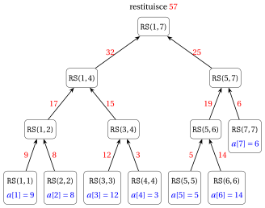
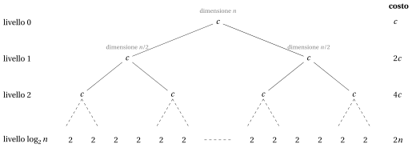
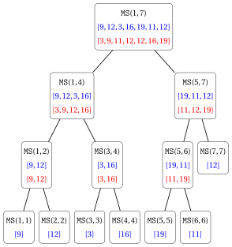
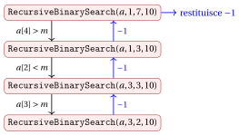
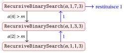
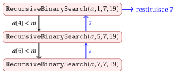
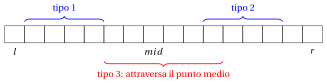
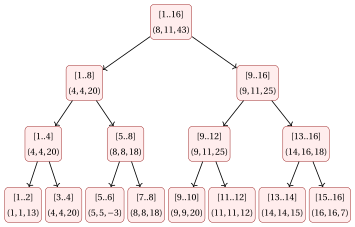
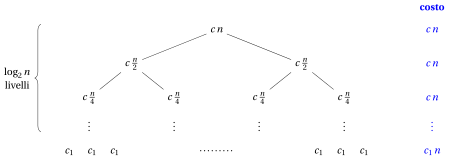

# Algoritmi ricorsivi

**Parte 5 · Ricorsione · Capitolo 17** · [:material-file-pdf-box: Dispensa, volume 5 (PDF)](../pdf/dispensa-5-ricorsione.pdf) · [:material-pencil: Esercizi](../esercizi/es-17-algoritmi-ricorsivi.md)

## Introduzione

Nei capitoli «Ricorsione», «Equazioni di ricorrenza» e «Il Master theorem» abbiamo imparato come viene eseguito un algoritmo ricorsivo, come se ne descrive il numero di passi con un'equazione di ricorrenza e come si risolve tale equazione. In questo capitolo mettiamo al lavoro questi strumenti su quattro problemi classici sugli array:

- la <strong>somma</strong> degli elementi di un array, il problema più semplice possibile, su cui confrontiamo un algoritmo iterativo e due algoritmi ricorsivi;

- l'<strong>ordinamento</strong>, con il <strong>Merge Sort</strong>, il primo algoritmo del corso che batte gli algoritmi di ordinamento $\Theta(n^2)$;

- la <strong>ricerca</strong> in un array ordinato, con la <strong>ricerca binaria ricorsiva</strong>;

- il problema del <strong>sotto-array di somma massima</strong>, in cui un algoritmo divide et impera migliora la forza bruta, e un algoritmo iterativo ingegnoso migliora entrambi.

Tutti gli algoritmi sono studiati con lo stesso schema, che è lo schema dell'analisi di ogni algoritmo ricorsivo.

!!! chiave ""

    Per ogni algoritmo ricorsivo:

    1. scriviamo lo pseudocodice e lo eseguiamo su un piccolo esempio, disegnando l'<strong>albero delle chiamate</strong>;

    2. dimostriamo che è <strong>corretto</strong>, per induzione (forte) sulla dimensione del sottoproblema;

    3. descriviamo il suo numero di passi con un'<strong>equazione di ricorrenza</strong> e la risolviamo, con l'albero di ricorsione e con il Master theorem;

    4. esprimiamo il <strong>tempo di esecuzione</strong> nel caso peggiore in funzione della dimensione $|I|$ dell'input;

    5. misuriamo la <strong>memoria aggiuntiva</strong>, che per un algoritmo ricorsivo comprende la pila delle chiamate;

    6. lo eseguiamo in Python, <code>C++</code> e Java, nei notebook Colab del capitolo (array indicizzati da $0$, mentre nello pseudocodice sono indicizzati da $1$).

Tre dei quattro algoritmi seguono il paradigma <strong>divide et impera</strong>: il problema su un sotto-array $a[l..r]$ viene suddiviso in sottoproblemi sulle due metà $a[l..m]$ e $a[m+1..r]$ (<em>divide</em>), i sottoproblemi vengono risolti ricorsivamente (<em>impera</em>), e le loro soluzioni vengono messe insieme (<em>combina</em>). La ricerca binaria ricorsiva, invece, effettua una sola chiamata ricorsiva su una metà.

## 17.1 La somma degli elementi di un array

### 17.1.1 Il problema

!!! chiave ""

    Dato un array $a[1..n]$ di $n \ge 1$ numeri interi, consideriamo il problema di calcolare la somma dei suoi elementi:

    $$
    \sum_{i=1}^{n} a[i] = a[1]+a[2]+\cdots+a[n].
    $$

- Questo è uno dei problemi più semplici sugli array, ed è il problema ideale per confrontare un algoritmo <strong>iterativo</strong> e un algoritmo <strong>ricorsivo</strong> che risolvono lo stesso problema.

- Scriviamo l'algoritmo ricorsivo, dimostriamo che è corretto, descriviamo il suo numero di passi con un'equazione di ricorrenza e risolviamo l'equazione, usando gli strumenti dei capitoli «Ricorsione», «Equazioni di ricorrenza» e «Il Master theorem».

!!! esempio "Esempio 17.1: somma di un array"

    Consideriamo il seguente array di $n=7$ numeri interi:

    $$
    \begin{array}{c|c|c|c|c|c|c|c|}
    {a[i]} & {i=1} & {i=2} & {i=3} & {i=4} & {i=5} & {i=6} & {i=7} \\
    & 9 & 8 & 12 & 3 & 5 & 14 & 6
    \end{array}
    $$

    La somma dei suoi elementi è

    $$
    9+8+12+3+5+14+6 = 57.
    $$

### 17.1.2 Algoritmo iterativo

- Partiamo dall'ovvio algoritmo iterativo <code>SumIterative</code>, che scorre l'array da sinistra a destra e accumula le somme parziali nella variabile $s$:

!!! algoritmo "Algoritmo: SumIterative"

    

    
Input: Un array &#92;(a&#91;1..n&#93;&#92;) di &#92;(n&#92;) numeri interi

    
Output: La somma &#92;(a&#91;1&#93;+a&#91;2&#93;+&#92;cdots+a&#91;n&#93;&#92;)

    

    

    
1<strong>function</strong> SumIterative(a, n)

    
2&#92;(s := 0&#92;)

    
3&#92;(i := 1&#92;)

    

    
4<strong>while</strong> &#92;(i &#92;le n&#92;) <strong>do</strong>

    
5&#92;(s &#92;leftarrow s + a&#91;i&#93;&#92;)

    
6&#92;(i &#92;leftarrow i + 1&#92;)

    
7<strong>end</strong>

    

    
8<strong>return</strong> &#92;(s&#92;)

    
9<strong>end</strong>

    

Esegui in Colab:

- Sia $S(n)$ il numero di passi eseguiti da <code>SumIterative</code> su un array di $n$ elementi (non c'è differenza tra caso migliore e caso peggiore: l'algoritmo esegue sempre le stesse operazioni). Il numero di volte che ciascuna riga di codice viene eseguita è:

    - La riga [2](#riga-17-algoritmi-ricorsivi-line-sumit-a) viene eseguita $1$ volta

    - La riga [3](#riga-17-algoritmi-ricorsivi-line-sumit-b) viene eseguita $1$ volta

    - La riga [4](#riga-17-algoritmi-ricorsivi-line-sumit-c) viene eseguita $n+1$ volte

    - La riga [5](#riga-17-algoritmi-ricorsivi-line-sumit-d) viene eseguita $n$ volte

    - La riga [6](#riga-17-algoritmi-ricorsivi-line-sumit-e) viene eseguita $n$ volte

    - La riga [8](#riga-17-algoritmi-ricorsivi-line-sumit-f) viene eseguita $1$ volta

    Quindi,

    $$
    S(n) = 1+1+(n+1)+n+n+1 = 3n+4 = \Theta(n),
    \qquad\text{poiché}\qquad
    \lim_{n\to\infty}\frac{3n+4}{n}=\lim_{n\to\infty}\left(3+\frac{4}{n}\right)=3\in\R_{>0}.
    $$

- Oltre all'array in ingresso, l'algoritmo usa solo le due variabili $s$ e $i$: la <strong>memoria aggiuntiva</strong> è $\Theta(1)$.

### 17.1.3 Algoritmo ricorsivo (divide et impera)

- La stessa somma si può calcolare ricorsivamente. La somma degli elementi di un sotto-array $a[l..r]$ si ottiene con il metodo <strong>divide et impera</strong>:

    1. <strong>Divide</strong>: si suddivide $a[l..r]$ nelle due metà $a[l..m]$ e $a[m+1..r]$, dove $m=\lfloor (l+r)/2\rfloor$;

    2. <strong>Impera</strong>: si calcolano ricorsivamente la somma $s_1$ di $a[l..m]$ e la somma $s_2$ di $a[m+1..r]$;

    3. <strong>Combina</strong>: si restituisce $s_1+s_2$.

- Il <strong>caso base</strong> è un sotto-array con un solo elemento ($l=r$): la sua somma è l'elemento $a[l]$ stesso.

- Questo è lo pseudocodice dell'algoritmo ricorsivo <code>RecursiveSum</code>. Per sommare l'intero array chiamiamo <code>RecursiveSum</code>$(a,1,n)$.

!!! algoritmo "Algoritmo: RecursiveSum"

    

    
Input: Un array &#92;(a&#92;) e due indici &#92;(l &#92;le r&#92;)

    
Output: La somma &#92;(a&#91;l&#93;+a&#91;l+1&#93;+&#92;cdots+a&#91;r&#93;&#92;)

    

    

    
1<strong>function</strong> RecursiveSum(a, l, r)

    
2<strong>if</strong> &#92;(l = r&#92;) <strong>then</strong>

    
3<strong>return</strong> &#92;(a&#91;l&#93;&#92;)// Caso base

    
4<strong>end</strong>

    
5&#92;(m := &#92;lfloor (l+r)/2 &#92;rfloor&#92;)// Divide

    
6&#92;(s&#95;1 :=&#92;) RecursiveSum&#92;((a, l, m)&#92;)// Impera (metà sinistra)

    
7&#92;(s&#95;2 :=&#92;) RecursiveSum&#92;((a, m+1, r)&#92;)// Impera (metà destra)

    
8<strong>return</strong> &#92;(s&#95;1 + s&#95;2&#92;)// Combina

    
9<strong>end</strong>

    

Esegui in Colab:

- Sia $k = r-l+1$ il numero di elementi di $a[l..r]$. Se $k\ge 2$, le due metà hanno

    $$
    m-l+1 = \left\lceil \frac{k}{2}\right\rceil
    \qquad\text{e}\qquad
    r-m = \left\lfloor \frac{k}{2}\right\rfloor
    $$

    elementi, rispettivamente. Entrambi i numeri sono almeno $1$ e strettamente minori di $k$: ogni chiamata ricorsiva lavora su un sotto-array più piccolo, e la ricorsione raggiunge sempre il caso base.

### 17.1.4 Albero delle chiamate

- L'esecuzione di un algoritmo ricorsivo è rappresentata dal suo <strong>albero delle chiamate</strong>: ogni nodo è una chiamata, e i figli di un nodo sono le chiamate che esso effettua. Il valore restituito da una chiamata viene rimandato al padre.

!!! esempio "Esempio 17.2: albero delle chiamate di RecursiveSum"

    Consideriamo l'array dell'[Esempio 17.1](#box-1-exSumInstance), cioè $a=[9,8,12,3,5,14,6]$ e $n=7$. Questo è l'albero delle chiamate di <code>RecursiveSum</code>$(a,1,7)$, in cui ogni nodo <code>RS</code>$(l,r)$ è una chiamata sul sotto-array $a[l..r]$. In blu gli elementi dell'array restituiti dai casi base, in rosso i valori restituiti ai padri dalle chiamate (lungo le frecce):

    { .fig loading=lazy  }

    - La radice <code>RS</code>$(1,7)$ calcola $m=\lfloor 8/2\rfloor = 4$ e chiama <code>RS</code>$(1,4)$ e <code>RS</code>$(5,7)$.

    - <code>RS</code>$(1,4)$ calcola $m=2$ e restituisce $17+15=32$; <code>RS</code>$(5,7)$ calcola $m=6$ e restituisce $19+6=25$.

    - La radice restituisce $32+25=57$, che è la somma degli elementi dell'array.

    - Ci sono $13 = 2\cdot 7-1$ chiamate: $7$ foglie (casi base, una per ogni elemento) e $6$ nodi interni, ciascuno dei quali esegue un'addizione, quindi in totale ci sono $6=n-1$ addizioni.

- Le chiamate vengono eseguite in ordine di <strong>visita in profondità</strong>: una chiamata termina solo dopo che sono terminati entrambi i suoi figli. Nell'esempio le chiamate terminano nell'ordine

    $$
    (1,1),\ (2,2),\ (1,2),\ (3,3),\ (4,4),\ (3,4),\ (1,4),\ (5,5),\ (6,6),\ (5,6),\ (7,7),\ (5,7),\ (1,7).
    $$

### 17.1.5 Correttezza

- La correttezza di un algoritmo ricorsivo si dimostra per <strong>induzione forte</strong> sulla dimensione del sottoproblema: si assume che le chiamate ricorsive, che lavorano su sotto-array più piccoli, siano corrette, e si mostra che la chiamata combina correttamente i loro risultati.

!!! teorema "Osservazione 17.1: correttezza di RecursiveSum"

    Per ogni coppia di indici $l \le r$, la chiamata <code>RecursiveSum</code>$(a,l,r)$ termina e restituisce

    $$
    \sum_{i=l}^{r} a[i].
    $$

??? dimostrazione "Dimostrazione"

    Usiamo l'induzione forte sul numero $k=r-l+1 \ge 1$ di elementi del sotto-array.

    <strong>Caso base</strong> ($k=1$). Allora $l=r$, la condizione della riga [2](#riga-17-algoritmi-ricorsivi-line-rsum-a) è vera e l'algoritmo restituisce $a[l] = \sum_{i=l}^{l} a[i]$.

    <strong>Passo induttivo</strong> ($k \ge 2$). Supponiamo che l'enunciato valga per tutti i sotto-array con meno di $k$ elementi (<em>ipotesi induttiva</em>). Poiché $l<r$, l'algoritmo calcola $m=\lfloor (l+r)/2\rfloor$, con $l \le m < r$. I sotto-array $a[l..m]$ e $a[m+1..r]$ hanno $\lceil k/2\rceil$ e $\lfloor k/2\rfloor$ elementi, entrambi compresi tra $1$ e $k-1$. Per l'ipotesi induttiva, le due chiamate ricorsive terminano e

    $$
    s_1 = \sum_{i=l}^{m} a[i], \qquad s_2 = \sum_{i=m+1}^{r} a[i].
    $$

    Quindi, l'algoritmo restituisce

    $$
    s_1+s_2 = \sum_{i=l}^{m} a[i] + \sum_{i=m+1}^{r} a[i] = \sum_{i=l}^{r} a[i].
    $$

    
□

- Con $l=1$ e $r=n$, la chiamata <code>RecursiveSum</code>$(a,1,n)$ restituisce la somma di tutti gli elementi dell'array.

### 17.1.6 Numero di passi di <code>RecursiveSum</code>

#### L'equazione di ricorrenza

- Sia $S(n)$ il numero di passi eseguiti da <code>RecursiveSum</code> su un sotto-array di $n=r-l+1$ elementi. Come per l'algoritmo iterativo, il numero di passi dipende solo da $n$ (e non dai valori degli elementi).

- Contiamo le righe di codice eseguite <strong>da una singola chiamata</strong>. Una riga che contiene una chiamata ricorsiva conta $1$ passo (la chiamata stessa) <strong>più</strong> tutti i passi eseguiti dalla funzione chiamata, che esprimiamo ancora con $S$.

- Se $n=1$, le righe [2](#riga-17-algoritmi-ricorsivi-line-rsum-a) e [3](#riga-17-algoritmi-ricorsivi-line-rsum-b) vengono eseguite $1$ volta ciascuna, e quindi $S(1)=2$.

- If $n\ge 2$:

    - La riga [2](#riga-17-algoritmi-ricorsivi-line-rsum-a) viene eseguita $1$ volta

    - La riga [3](#riga-17-algoritmi-ricorsivi-line-rsum-b) non viene eseguita

    - La riga [5](#riga-17-algoritmi-ricorsivi-line-rsum-c) viene eseguita $1$ volta

    - La riga [6](#riga-17-algoritmi-ricorsivi-line-rsum-d) viene eseguita $1$ volta, più i $S(\lceil n/2\rceil)$ passi della chiamata su $a[l..m]$

    - La riga [7](#riga-17-algoritmi-ricorsivi-line-rsum-e) viene eseguita $1$ volta, più i $S(\lfloor n/2\rfloor)$ passi della chiamata su $a[m+1..r]$

    - La riga [8](#riga-17-algoritmi-ricorsivi-line-rsum-f) viene eseguita $1$ volta

    e quindi $S(n) = S(\lceil n/2\rceil)+S(\lfloor n/2\rfloor)+5$.

!!! chiave ""

    Il numero di passi di <code>RecursiveSum</code> è descritto dall'equazione di ricorrenza

    $$
    S(n)=
    \begin{cases}
    2 & \text{se } n=1,\\[1mm]
    S\big(\lceil n/2\rceil\big)+S\big(\lfloor n/2\rfloor\big)+c & \text{se } n\ge 2,
    \end{cases}
    $$

    con $c=5$. Come di consueto, nell'analisi asintotica la scriviamo semplicemente come

    $$
    S(n) = 2\,S(n/2) + c .
    $$

#### Soluzione con l'albero di ricorsione

- Nell'<strong>albero di ricorsione</strong> ogni nodo rappresenta una chiamata e contiene il numero di passi eseguiti da quella chiamata <em>esclusi</em> i passi delle sue chiamate ricorsive: $c$ per un nodo interno, $2$ per una foglia. $S(n)$ è la somma dei valori di tutti i nodi.

- Per semplicità, supponiamo dapprima che $n=2^h$ sia una potenza esatta di $2$. Allora ogni sotto-array viene suddiviso in due metà di uguale dimensione, e l'albero è:

{ .fig loading=lazy style="width:95%" }

- Il livello $i$ contiene $2^i$ chiamate su sotto-array di $n/2^i$ elementi. Le foglie sono al livello $\log_2 n$, dove i sotto-array hanno $n/2^{\log_2 n}=1$ elemento: ci sono $2^{\log_2 n}=n$ foglie.

- I livelli interni $0,1,\dots,\log_2 n-1$ contengono

    $$
    \sum_{i=0}^{\log_2 n-1} 2^i = 2^{\log_2 n}-1 = n-1
    $$

    nodi (somma di una serie geometrica). Quindi il numero totale di passi è

    $$
    S(n) = c\,(n-1) + 2n = 5(n-1)+2n = 7n-5.
    $$

- Il costo dei livelli <strong>raddoppia</strong> da un livello al successivo: il totale è dominato dalle foglie, che sono $n$. Questa è esattamente la situazione del caso 1 del Master theorem.

- Lo stesso conteggio vale per <strong>ogni</strong> $n$, non solo per le potenze di $2$: il fatto chiave è che l'albero ha esattamente $n$ foglie e $n-1$ nodi interni, come mostra la prossima osservazione.

!!! teorema "Osservazione 17.2: chiamate e passi di RecursiveSum"

    Per ogni $n\ge 1$, la chiamata <code>RecursiveSum</code>$(a,l,r)$ su un sotto-array di $n=r-l+1$ elementi genera esattamente

    $$
    2n-1
    $$

    chiamate (compresa la prima): $n$ di esse sono casi base e $n-1$ eseguono un'addizione. Inoltre, $S(n)=7n-5$.

??? dimostrazione "Dimostrazione"

    Sia $C(n)$ il numero di chiamate. Abbiamo $C(1)=1$ e, per $n\ge 2$,

    $$
    C(n) = 1 + C(\lceil n/2\rceil) + C(\lfloor n/2\rfloor).
    $$

    Dimostriamo che $C(n)=2n-1$ per induzione forte su $n$. Per $n=1$: $C(1)=1=2\cdot 1-1$. Per $n \ge 2$, per l'ipotesi induttiva applicata a $\lceil n/2\rceil<n$ e $\lfloor n/2\rfloor<n$,

    $$
    C(n) = 1 + \big(2\lceil n/2\rceil-1\big) + \big(2\lfloor n/2\rfloor-1\big)
    = 2\big(\lceil n/2\rceil+\lfloor n/2\rfloor\big) - 1 = 2n-1,
    $$

    perché $\lceil n/2\rceil+\lfloor n/2\rfloor=n$ per ogni numero naturale $n$.

    Ogni caso base corrisponde esattamente a un elemento del sotto-array (i sotto-array delle foglie sono disgiunti e ricoprono $a[l..r]$), quindi ci sono $n$ casi base e $2n-1-n=n-1$ chiamate che eseguono la riga [8](#riga-17-algoritmi-ricorsivi-line-rsum-f).

    Allo stesso modo, $S(1)=2=7\cdot 1-5$ e, per $n\ge 2$,

    $$
    S(n) = \big(7\lceil n/2\rceil-5\big) + \big(7\lfloor n/2\rfloor-5\big) + 5 = 7n-5.
    $$

    
□

- Di conseguenza,

    $$
    S(n)=7n-5=\Theta(n),
    \qquad\text{poiché}\qquad
    \lim_{n\to\infty}\frac{7n-5}{n}=7\in\R_{>0}.
    $$

    Per l'array dell'[Esempio 17.2](#box-2-exSumCallTree), $S(7)=44$: $7$ foglie con $2$ passi ciascuna e $6$ nodi interni con $5$ passi ciascuno.

#### Soluzione con il Master theorem

- Possiamo ottenere l'ordine di crescita di $S(n)$ direttamente dal Master theorem, senza calcolare $S(n)$ esattamente. Ricordiamo il caso 1 del Master theorem:

!!! chiave ""

    Sia $S(n)=a\,S(n/b)+f(n)$, con $a\ge 1$ e $b>1$ costanti e $f(n)$ asintoticamente positiva. Se $f(n)=O\big(n^{\log_b a-\varepsilon}\big)$ per una qualche costante $\varepsilon>0$, allora

    $$
    S(n)=\Theta\big(n^{\log_b a}\big).
    $$

- $S(n)=2\,S(n/2)+c$ $\quad\rightarrow\quad$ $a=2$, $b=2$, $f(n)=c$.

- $n^{\log_b a}=n^{\log_2 2}=n^1=n$.

- Confronto: $f(n)=c$ cresce polinomialmente più lentamente di $n$ $\quad\rightarrow\quad$ caso 1.

- Ipotesi: $f(n)=c=O\big(n^{1-\varepsilon}\big)$ con $\varepsilon=1$, poiché $c = c\cdot n^{0}$.

- Conclusione: $S(n)=\Theta\big(n^{\log_2 2}\big)=\Theta(n)$.

Come previsto, il risultato è in accordo con la soluzione esatta $S(n)=7n-5$.

#### Tempo di esecuzione nel caso peggiore

- Come nel capitolo «Tempo di esecuzione», facciamo l'ipotesi che ogni elemento dell'array sia memorizzato usando un numero costante fissato di bit. Allora $|I|=\Theta(n)$, cioè esistono costanti $c_1,c_2>0$ tali che $c_1 n\le |I| \le c_2 n$ per ogni $n$ sufficientemente grande, e

    $$
    \frac{1}{c_2}|I| \le n \le \frac{1}{c_1}|I|.
    $$

    Poiché $S(n)=7n-5=\Theta(n)$, esistono costanti $a_1,a_2>0$ tali che $a_1 n\le S(n) \le a_2 n$ per ogni $n$ sufficientemente grande, e quindi

    $$
    \frac{a_1}{c_2}|I| \le S(n) \le \frac{a_2}{c_1}|I|.
    $$

!!! chiave ""

    Se tutti i valori in ingresso usano un numero costante fissato di bit, allora il tempo di esecuzione nel caso peggiore dell'algoritmo <code>RecursiveSum</code> (e anche dell'algoritmo <code>SumIterative</code>) è

    $$
    T(|I|)=\Theta(|I|).
    $$

    Quindi, entrambi gli algoritmi sono lineari nella dimensione dell'input.

- La ricorsione non rende l'algoritmo più veloce: entrambi gli algoritmi leggono ogni elemento una volta ed eseguono $n-1$ (ricorsivo) oppure $n$ (iterativo) addizioni. La versione ricorsiva esegue anzi più passi ($7n-5$ contro $3n+4$), a causa del sovraccarico delle chiamate.

### 17.1.7 Memoria aggiuntiva: la pila delle chiamate

- Il tempo non è l'unica risorsa. Ogni chiamata attiva di una funzione ricorsiva richiede un proprio <strong>record di attivazione</strong> nella <strong>pila delle chiamate</strong> (<em>call stack</em>), che contiene i suoi parametri, le sue variabili locali e l'indirizzo di ritorno. In <code>RecursiveSum</code> i parametri e le variabili locali sono $l$, $r$, $m$, $s_1$, $s_2$: ogni record di attivazione ha dimensione costante.

- Una chiamata è attiva dal momento in cui inizia fino a quando termina. Poiché le chiamate vengono eseguite in profondità, le chiamate attive in ogni istante formano un cammino dalla radice dell'albero delle chiamate al nodo corrente. Quindi:

!!! chiave ""

    Il massimo numero di chiamate contemporaneamente attive (la <strong>profondità della ricorsione</strong>) è uguale all'altezza dell'albero delle chiamate più uno. La memoria aggiuntiva usata da un algoritmo ricorsivo è (almeno) proporzionale alla profondità della ricorsione.

!!! teorema "Osservazione 17.3: profondità della ricorsione di RecursiveSum"

    Per ogni $n\ge 1$, l'albero delle chiamate di <code>RecursiveSum</code> su un sotto-array di $n$ elementi ha altezza $\lceil \log_2 n\rceil$. Quindi la profondità della ricorsione è $\lceil \log_2 n\rceil+1$ e la memoria aggiuntiva usata da <code>RecursiveSum</code> è $\Theta(\log_2 n)$.

??? dimostrazione "Dimostrazione"

    Sia $h(n)$ l'altezza dell'albero delle chiamate. Allora $h(1)=0$ e, per $n\ge 2$,

    $$
    h(n)=1+\max\big\{h(\lceil n/2\rceil),\,h(\lfloor n/2\rfloor)\big\}.
    $$

    Dimostriamo che $h(n)=\lceil \log_2 n\rceil$ per induzione forte. Per $n=1$, $\lceil \log_2 1\rceil = 0$. Sia $n\ge 2$. Poiché $\lceil \log_2 x\rceil$ è non decrescente in $x$, per l'ipotesi induttiva il massimo è raggiunto dalla metà più grande, e $h(n)=1+\lceil \log_2 \lceil n/2\rceil\rceil$.

    Sia $k=\lceil \log_2 n\rceil\ge 1$, cioè $2^{k-1}<n\le 2^k$. Dividendo per $2$, otteniamo $2^{k-2}<n/2\le 2^{k-1}$; poiché $2^{k-1}$ è un intero, anche $2^{k-2}<\lceil n/2\rceil\le 2^{k-1}$, cioè $\lceil \log_2\lceil n/2\rceil\rceil=k-1$. Quindi $h(n)=1+(k-1)=k=\lceil \log_2 n\rceil$.

    Ogni record di attivazione ha dimensione costante, quindi la memoria aggiuntiva è $\Theta(\lceil \log_2 n\rceil+1)=\Theta(\log_2 n)$. □

- Nell'[Esempio 17.2](#box-2-exSumCallTree), $n=7$ e la profondità della ricorsione è $\lceil \log_2 7\rceil+1=3+1=4$: per esempio, quando viene eseguita <code>RS</code>$(1,1)$, le chiamate attive sono <code>RS</code>$(1,7)$, <code>RS</code>$(1,4)$, <code>RS</code>$(1,2)$ e <code>RS</code>$(1,1)$.

!!! chiave ""

    
<table>
    <tr>
    <th>algoritmo</th>
    <th>numero di passi</th>
    <th>memoria aggiuntiva</th>
    </tr>
    <tr>
    <td><code>SumIterative</code></td>
    <td>&#92;(3n+4=&#92;Theta(n)&#92;)</td>
    <td>&#92;(&#92;Theta(1)&#92;)</td>
    </tr>
    <tr>
    <td><code>RecursiveSum</code></td>
    <td>&#92;(7n-5=&#92;Theta(n)&#92;)</td>
    <td>&#92;(&#92;Theta(&#92;log&#95;2 n)&#92;)</td>
    </tr>
    </table>

### 17.1.8 Una ricorsione diversa: decremento di uno

- Dimezzare non è l'unico modo di sommare un array ricorsivamente. L'array può anche essere suddiviso in modo <strong>sbilanciato</strong>: la somma di $a[1..n]$ è la somma di $a[1..n-1]$ più $a[n]$. Questa è una ricorsione per <em>decremento di uno</em>:

!!! algoritmo "Algoritmo: RecursiveSumLinear"

    

    
Input: Un array &#92;(a&#91;1..n&#93;&#92;) di &#92;(n &#92;ge 1&#92;) numeri interi

    
Output: La somma &#92;(a&#91;1&#93;+a&#91;2&#93;+&#92;cdots+a&#91;n&#93;&#92;)

    

    

    
1<strong>function</strong> RecursiveSumLinear(a, n)

    
2<strong>if</strong> &#92;(n = 1&#92;) <strong>then</strong>

    
3<strong>return</strong> &#92;(a&#91;1&#93;&#92;)// Caso base

    
4<strong>end</strong>

    
5&#92;(s :=&#92;) RecursiveSumLinear&#92;((a, n-1)&#92;)

    
6<strong>return</strong> &#92;(s + a&#91;n&#93;&#92;)

    
7<strong>end</strong>

    

Esegui in Colab:

- La correttezza segue per induzione (semplice) su $n$: per $n=1$ l'algoritmo restituisce $a[1]$; per $n\ge 2$, per l'ipotesi induttiva $s=a[1]+\cdots+a[n-1]$, e l'algoritmo restituisce $s+a[n]=a[1]+\cdots+a[n]$.

- Se $n=1$, le righe [2](#riga-17-algoritmi-ricorsivi-line-rsuml-a) e [3](#riga-17-algoritmi-ricorsivi-line-rsuml-b) vengono eseguite una volta: $S(1)=2$. Se $n\ge 2$, le righe [2](#riga-17-algoritmi-ricorsivi-line-rsuml-a), [5](#riga-17-algoritmi-ricorsivi-line-rsuml-c) e [6](#riga-17-algoritmi-ricorsivi-line-rsuml-d) vengono eseguite una volta, più i $S(n-1)$ passi della chiamata ricorsiva:

    $$
    S(n)=
    \begin{cases}
    2 & \text{se } n=1,\\
    S(n-1)+3 & \text{se } n\ge 2.
    \end{cases}
    $$

- Il Master theorem <strong>non</strong> si può applicare, perché la dimensione del sottoproblema è $n-1$ e non $n/b$ per una costante $b>1$. Risolviamo l'equazione per iterazione (srotolamento):

    $$
    S(n) = S(n-1)+3 = S(n-2)+2\cdot 3 = \cdots = S(1)+(n-1)\cdot 3 = 3n-1 = \Theta(n).
    $$

- L'albero delle chiamate è un <strong>cammino</strong> di $n$ nodi: <code>RecursiveSumLinear</code>$(a,n)$ chiama <code>RecursiveSumLinear</code>$(a,n-1)$, che chiama <code>RecursiveSumLinear</code>$(a,n-2)$, e così via, fino a $n=1$. Quando si raggiunge il caso base, tutte le $n$ chiamate sono attive.

!!! chiave ""

    <code>RecursiveSumLinear</code> esegue $S(n)=3n-1=\Theta(n)$ passi, ma la sua profondità di ricorsione è $n$: richiede $\Theta(n)$ di memoria aggiuntiva per la pila delle chiamate (contro $\Theta(\log_2 n)$ di <code>RecursiveSum</code> e $\Theta(1)$ di <code>SumIterative</code>). In pratica, per $n$ grande (ad esempio $n=10^7$) la versione per decremento di uno può esaurire la pila delle chiamate (<em>stack overflow</em>), mentre <code>RecursiveSum</code> richiede solo $\lceil\log_2 10^7\rceil+1=25$ chiamate attive.

!!! chiave ""

    <strong>Punti chiave sulla somma di un array.</strong>

    - <code>RecursiveSum</code> è corretto (induzione forte), effettua $2n-1$ chiamate ed esegue $7n-5=\Theta(n)$ passi: la ricorsione non riduce il lavoro, che è lineare perché ogni elemento deve essere letto.

    - L'equazione di ricorrenza $S(n)=2S(n/2)+c$ ricade nel caso 1 del Master theorem: il costo è dominato dalle $n$ foglie.

    - La pila delle chiamate costa memoria: $\Theta(\log_2 n)$ per la ricorsione per dimezzamento, $\Theta(n)$ per la ricorsione per decremento di uno, $\Theta(1)$ per il ciclo.

## 17.2 Merge Sort

Per la somma di un array, il divide et impera non ha dato alcun guadagno in termini di tempo. Incontriamo ora un problema in cui fa la differenza: l'ordinamento.

### 17.2.1 Il problema dell'ordinamento

!!! chiave ""

    Dato un array $a[1..n]$ di $n$ numeri naturali, consideriamo il problema di riordinare gli elementi dell'array in ordine non decrescente in modo che:

    $$
    a[1] \le a[2] \le \cdots \le a[n].
    $$

- Il problema è stato introdotto nel capitolo «Algoritmi di ordinamento», dove abbiamo studiato Insertion Sort, Exchange Sort e Selection Sort. Nel capitolo «Tempo di esecuzione» abbiamo dimostrato che il numero di passi di <code>InsertionSort</code> nel caso peggiore è $S(n)=\frac{3n^2+9n-8}{2}=\Theta(n^2)$.

- In questa sezione studiamo il <strong>Merge Sort</strong>, un algoritmo di ordinamento ricorsivo basato sui confronti e sul paradigma <strong>divide et impera</strong>, il cui numero di passi è $\Theta(n\log_2 n)$ nel caso peggiore.

!!! esempio "Esempio 17.4: un'istanza di ordinamento"

    Consideriamo il seguente array di $n=7$ numeri naturali:

    $$
    \begin{array}{c|c|c|c|c|c|c|c|}
    {a[i]} & {i=1} & {i=2} & {i=3} & {i=4} & {i=5} & {i=6} & {i=7} \\
    & 9 & 12 & 3 & 16 & 19 & 11 & 12
    \end{array}
    $$

    L'array ordinato è:

    $$
    \begin{array}{c|c|c|c|c|c|c|c|}
    {a[i]} & {i=1} & {i=2} & {i=3} & {i=4} & {i=5} & {i=6} & {i=7} \\
    & 3 & 9 & 11 & 12 & 12 & 16 & 19
    \end{array}
    $$

### 17.2.2 L'algoritmo Merge Sort

#### Divide et impera

- Il Merge Sort ordina un sotto-array $a[l..r]$ come segue:

    1. <strong>Divide</strong>: si suddivide $a[l..r]$ nelle due metà $a[l..m]$ e $a[m+1..r]$, dove $m=\lfloor (l+r)/2\rfloor$;

    2. <strong>Impera</strong>: si ordinano ricorsivamente le due metà;

    3. <strong>Combina</strong>: si <strong>fondono</strong> (<em>merge</em>) le due metà ordinate in un unico sotto-array ordinato $a[l..r]$.

- Il <strong>caso base</strong> è un sotto-array con un solo elemento ($l=r$), che è già ordinato: non occorre fare nulla.

- Tutto il lavoro è svolto nel passo <strong>combina</strong>, dalla procedura <code>Merge</code>. L'osservazione chiave è che due sequenze <em>ordinate</em> si possono fondere in modo molto efficiente: il più piccolo elemento del risultato è il minore tra i due primi elementi, e così via.

#### Pseudocodice

- Questo è lo pseudocodice dell'algoritmo <code>MergeSort</code>. Per ordinare l'intero array $a[1..n]$, chiamiamo <code>MergeSort</code>$(a,1,n)$.

!!! algoritmo "Algoritmo: MergeSort"

    

    
Input: Un array &#92;(a&#92;) e due indici &#92;(l &#92;le r&#92;)

    
Output: Il sotto-array &#92;(a&#91;l..r&#93;&#92;) ordinato in ordine non decrescente

    

    

    
1<strong>function</strong> MergeSort(a, l, r)

    
2<strong>if</strong> &#92;(l &lt; r&#92;) <strong>then</strong>

    
3&#92;(m := &#92;lfloor (l+r)/2 &#92;rfloor&#92;)// Divide

    
4MergeSort&#92;((a, l, m)&#92;)// Impera (metà sinistra)

    
5MergeSort&#92;((a, m+1, r)&#92;)// Impera (metà destra)

    
6Merge&#92;((a, l, m, r)&#92;)// Combina

    
7<strong>end</strong>

    
8<strong>end</strong>

    

Esegui in Colab:

- Se $k=r-l+1\ge 2$, le due metà $a[l..m]$ e $a[m+1..r]$ hanno $\lceil k/2\rceil$ e $\lfloor k/2\rfloor$ elementi, entrambi compresi tra $1$ e $k-1$: la ricorsione raggiunge sempre il caso base.

- La procedura <code>Merge</code>$(a,l,m,r)$ suppone che $a[l..m]$ e $a[m+1..r]$ siano ordinati. Li copia in due array ausiliari $L$ e $R$, e poi sposta ripetutamente in $a$ il minore tra i primi due elementi non ancora copiati:

!!! algoritmo "Algoritmo: Merge"

    

    
Input: Un array &#92;(a&#92;) e indici &#92;(l&#92;le m&lt;r&#92;) tali che &#92;(a&#91;l..m&#93;&#92;) e &#92;(a&#91;m+1..r&#93;&#92;) siano ordinati

    
Output: Il sotto-array &#92;(a&#91;l..r&#93;&#92;) ordinato in ordine non decrescente

    

    

    
1<strong>function</strong> Merge(a, l, m, r)

    
2&#92;(n&#95;1 := m-l+1&#92;)

    
3&#92;(n&#95;2 := r-m&#92;)

    
4&#92;(L :=&#92;) nuovo array&#92;(&#91;1..n&#95;1&#93;&#92;), &#92;(R :=&#92;) nuovo array&#92;(&#91;1..n&#95;2&#93;&#92;)

    
5<strong>for</strong> &#92;(i := 1&#92;) <strong>to</strong>  &#92;(n&#95;1&#92;) <strong>do</strong>

    
6&#92;(L&#91;i&#93; := a&#91;l+i-1&#93;&#92;)

    
7<strong>end</strong>

    
8<strong>for</strong> &#92;(j := 1&#92;) <strong>to</strong>  &#92;(n&#95;2&#92;) <strong>do</strong>

    
9&#92;(R&#91;j&#93; := a&#91;m+j&#93;&#92;)

    
10<strong>end</strong>

    
11&#92;(i := 1&#92;)

    
12&#92;(j := 1&#92;)

    
13&#92;(k := l&#92;)

    
14<strong>while</strong> &#92;(i &#92;le n&#95;1&#92;) <strong>and</strong> &#92;(j &#92;le n&#95;2&#92;) <strong>do</strong>

    
15<strong>if</strong> &#92;(L&#91;i&#93; &#92;le R&#91;j&#93;&#92;) <strong>then</strong>

    
16&#92;(a&#91;k&#93; &#92;leftarrow L&#91;i&#93;&#92;)

    
17&#92;(i &#92;leftarrow i+1&#92;)

    
18<strong>else</strong>

    
19&#92;(a&#91;k&#93; &#92;leftarrow R&#91;j&#93;&#92;)

    
20&#92;(j &#92;leftarrow j+1&#92;)

    
21<strong>end</strong>

    
22&#92;(k &#92;leftarrow k+1&#92;)

    
23<strong>end</strong>

    
24<strong>while</strong> ( <strong>do</strong>

    

    
25<strong>end</strong>

    
26*[f]Copia il resto di &#92;(L&#92;))&#92;(i &#92;le n&#95;1&#92;)
            &#92;(a&#91;k&#93; &#92;leftarrow L&#91;i&#93;&#92;) 
            &#92;(i &#92;leftarrow i+1&#92;) 
            &#92;(k &#92;leftarrow k+1&#92;)

    
27<strong>while</strong> ( <strong>do</strong>

    

    
28<strong>end</strong>

    
29*[f]Copia il resto di &#92;(R&#92;))&#92;(j &#92;le n&#95;2&#92;)
            &#92;(a&#91;k&#93; &#92;leftarrow R&#91;j&#93;&#92;) 
            &#92;(j &#92;leftarrow j+1&#92;) 
            &#92;(k &#92;leftarrow k+1&#92;)

    
30<strong>end</strong>

    

Esegui in Colab:

- Spiegazione di <code>Merge</code>:

    - Le righe [2](#riga-17-algoritmi-ricorsivi-line-merge-a)–[9](#riga-17-algoritmi-ricorsivi-line-merge-g) copiano $a[l..m]$ in $L[1..n_1]$ e $a[m+1..r]$ in $R[1..n_2]$. Le copie sono necessarie, perché le posizioni $a[l..r]$ vengono sovrascritte durante la fusione.

    - Gli indici $i$ e $j$ puntano ai primi elementi di $L$ e $R$ non ancora ricopiati, e $k$ punta alla prossima posizione di $a$ da riempire.

    - Il primo ciclo while (riga [14](#riga-17-algoritmi-ricorsivi-line-merge-k)) confronta $L[i]$ e $R[j]$ e copia il minore in $a[k]$ (in caso di parità, viene copiato per primo l'elemento di $L$: questo rende il Merge Sort <strong>stabile</strong>).

    - Non appena uno dei due array si esaurisce, gli elementi rimanenti dell'altro (che sono già ordinati, e non più piccoli di quelli già copiati) vengono copiati in $a$ dal ciclo while della riga [26](#riga-17-algoritmi-ricorsivi-line-merge-r) o da quello della riga [29](#riga-17-algoritmi-ricorsivi-line-merge-v). Solo uno di questi due cicli esegue almeno un'iterazione.

#### Esempi

Eseguiamo ora il Merge Sort sull'array dell'[Esempio 17.4](#box-7-exMsortInstance): guardiamo prima l'intero albero delle chiamate, poi le due fasi dell'algoritmo, e infine una singola chiamata di <code>Merge</code>.

!!! esempio "Esempio 17.5: albero delle chiamate di MergeSort"

    Consideriamo l'array dell'[Esempio 17.4](#box-7-exMsortInstance), cioè $a=[9,12,3,16,19,11,12]$. Questo è l'albero delle chiamate di <code>MergeSort</code>$(a,1,7)$, in cui ogni nodo <code>MS</code>$(l,r)$ è una chiamata sul sotto-array $a[l..r]$. In ogni nodo, in blu il sotto-array ricevuto dalla chiamata e in rosso il sotto-array ordinato prodotto dalla chiamata (dopo la sua <code>Merge</code>):

    { .fig loading=lazy  }

    Le chiamate di <code>Merge</code> vengono eseguite nel seguente ordine (in profondità), e questo è il contenuto dell'array dopo ciascuna di esse (il sotto-array modificato da ciascuna chiamata è in rosso):

    
<table>
    <tr>
    <th>chiamata</th>
    <th>sotto-array fusi</th>
    <th>array &#92;(a&#92;) dopo la chiamata</th>
    </tr>
    <tr>
    <td><code>Merge</code>&#92;((a,1,1,2)&#92;)</td>
    <td>&#92;(&#91;9&#93;&#92;) e &#92;(&#91;12&#93;&#92;)</td>
    <td>&#92;(&#91;&#92;red{9,12},3,16,19,11,12&#93;&#92;)</td>
    </tr>
    <tr>
    <td><code>Merge</code>&#92;((a,3,3,4)&#92;)</td>
    <td>&#92;(&#91;3&#93;&#92;) e &#92;(&#91;16&#93;&#92;)</td>
    <td>&#92;(&#91;9,12,&#92;red{3,16},19,11,12&#93;&#92;)</td>
    </tr>
    <tr>
    <td><code>Merge</code>&#92;((a,1,2,4)&#92;)</td>
    <td>&#92;(&#91;9,12&#93;&#92;) e &#92;(&#91;3,16&#93;&#92;)</td>
    <td>&#92;(&#91;&#92;red{3,9,12,16},19,11,12&#93;&#92;)</td>
    </tr>
    <tr>
    <td><code>Merge</code>&#92;((a,5,5,6)&#92;)</td>
    <td>&#92;(&#91;19&#93;&#92;) e &#92;(&#91;11&#93;&#92;)</td>
    <td>&#92;(&#91;3,9,12,16,&#92;red{11,19},12&#93;&#92;)</td>
    </tr>
    <tr>
    <td><code>Merge</code>&#92;((a,5,6,7)&#92;)</td>
    <td>&#92;(&#91;11,19&#93;&#92;) e &#92;(&#91;12&#93;&#92;)</td>
    <td>&#92;(&#91;3,9,12,16,&#92;red{11,12,19}&#93;&#92;)</td>
    </tr>
    <tr>
    <td><code>Merge</code>&#92;((a,1,4,7)&#92;)</td>
    <td>&#92;(&#91;3,9,12,16&#93;&#92;) e &#92;(&#91;11,12,19&#93;&#92;)</td>
    <td>&#92;(&#91;&#92;red{3,9,11,12,12,16,19}&#93;&#92;)</td>
    </tr>
    </table>

!!! esempio "Esempio 17.6: fasi di divisione e di combinazione di MergeSort"

    Consideriamo di nuovo l'array dell'[Esempio 17.4](#box-7-exMsortInstance). La parte superiore della figura mostra la fase di <strong>divisione</strong> (frecce viola): ogni sotto-array viene suddiviso nella sua metà sinistra (in rosso) e nella sua metà destra (in blu), fino a ottenere sotto-array di un elemento. La parte inferiore mostra la fase di <strong>combinazione</strong> (frecce arancioni): coppie di sotto-array ordinati vengono fuse in un sotto-array ordinato.

    { .fig loading=lazy style="width:85%" }

!!! esempio "Esempio 17.7: traccia di Merge"

    Consideriamo l'ultima chiamata <code>Merge</code>$(a,1,4,7)$ dell'[Esempio 17.5](#box-8-exMsortCallTree). Prima della chiamata $a=[3,9,12,16,11,12,19]$, con $a[1..4]$ e $a[5..7]$ ordinati. Allora $n_1=4$, $n_2=3$ e

    $$
    L=[3,9,12,16], \qquad R=[11,12,19].
    $$

    Questa è l'esecuzione dei cicli while (una riga per ogni elemento copiato in $a$):

    
<table>
    <tr>
    <th>&#92;(k&#92;)</th>
    <th>&#92;(i&#92;)</th>
    <th>&#92;(j&#92;)</th>
    <th>&#92;(L&#91;i&#93;&#92;)</th>
    <th>&#92;(R&#91;j&#93;&#92;)</th>
    <th>confronto</th>
    <th>azione</th>
    </tr>
    <tr>
    <td>1</td>
    <td>1</td>
    <td>1</td>
    <td>3</td>
    <td>11</td>
    <td>&#92;(3 &#92;le 11&#92;)</td>
    <td>&#92;(a&#91;1&#93;&#92;leftarrow 3&#92;), &#92;(i=2&#92;)</td>
    </tr>
    <tr>
    <td>2</td>
    <td>2</td>
    <td>1</td>
    <td>9</td>
    <td>11</td>
    <td>&#92;(9 &#92;le 11&#92;)</td>
    <td>&#92;(a&#91;2&#93;&#92;leftarrow 9&#92;), &#92;(i=3&#92;)</td>
    </tr>
    <tr>
    <td>3</td>
    <td>3</td>
    <td>1</td>
    <td>12</td>
    <td>11</td>
    <td>&#92;(12 &gt; 11&#92;)</td>
    <td>&#92;(a&#91;3&#93;&#92;leftarrow 11&#92;), &#92;(j=2&#92;)</td>
    </tr>
    <tr>
    <td>4</td>
    <td>3</td>
    <td>2</td>
    <td>12</td>
    <td>12</td>
    <td>&#92;(12 &#92;le 12&#92;)</td>
    <td>&#92;(a&#91;4&#93;&#92;leftarrow 12&#92;) (da &#92;(L&#92;)), &#92;(i=4&#92;)</td>
    </tr>
    <tr>
    <td>5</td>
    <td>4</td>
    <td>2</td>
    <td>16</td>
    <td>12</td>
    <td>&#92;(16 &gt; 12&#92;)</td>
    <td>&#92;(a&#91;5&#93;&#92;leftarrow 12&#92;) (da &#92;(R&#92;)), &#92;(j=3&#92;)</td>
    </tr>
    <tr>
    <td>6</td>
    <td>4</td>
    <td>3</td>
    <td>16</td>
    <td>19</td>
    <td>&#92;(16 &#92;le 19&#92;)</td>
    <td>&#92;(a&#91;6&#93;&#92;leftarrow 16&#92;), &#92;(i=5&#92;)</td>
    </tr>
    <tr>
    <td>7</td>
    <td>5</td>
    <td>3</td>
    <td>–</td>
    <td>19</td>
    <td>&#92;(L&#92;) esaurito</td>
    <td>&#92;(a&#91;7&#93;&#92;leftarrow 19&#92;), &#92;(j=4&#92;)</td>
    </tr>
    </table>

    Dopo $6$ iterazioni del primo ciclo while (e $6$ confronti), $i=5>n_1$: l'array $L$ è esaurito, e l'ultimo elemento di $R$ viene copiato dal ciclo while della riga [29](#riga-17-algoritmi-ricorsivi-line-merge-v). Il risultato è $a=[3,9,11,12,12,16,19]$.

### 17.2.3 Correttezza

La correttezza del Merge Sort poggia su due fatti: <code>Merge</code> fonde correttamente due sotto-array ordinati (una proprietà di un ciclo, dimostrata con un'invariante di ciclo), e la ricorsione è corretta (dimostrata per induzione forte, come per <code>RecursiveSum</code>).

#### Correttezza di <code>Merge</code>

- Dimostriamo la correttezza di <code>Merge</code> con un'<strong>invariante di ciclo</strong>, cioè una proprietà che vale all'inizio di ogni iterazione di un ciclo. Come nel capitolo «Correttezza», mostriamo che l'invariante vale prima della prima iterazione (<em>inizializzazione</em>), che se vale prima di un'iterazione vale anche prima della successiva (<em>mantenimento</em>), e che cosa ci fornisce quando il ciclo termina (<em>terminazione</em>).

!!! teorema "Osservazione 17.4: invariante di ciclo di Merge"

    Siano $a[l..m]$ e $a[m+1..r]$ ordinati. All'inizio di ogni iterazione del ciclo while della riga [14](#riga-17-algoritmi-ricorsivi-line-merge-k) di <code>Merge</code>:

    - **(I1)** il sotto-array $a[l..k-1]$ contiene i $k-l$ elementi di $L[1..i-1]$ e $R[1..j-1]$, in ordine non decrescente;

    - **(I2)** ogni elemento di $a[l..k-1]$ è minore o uguale a ogni elemento di $L[i..n_1]$ e di $R[j..n_2]$.

    Alla fine, <code>Merge</code> termina e $a[l..r]$ contiene gli elementi originariamente in $a[l..r]$, ordinati in ordine non decrescente.

??? dimostrazione "Dimostrazione"

    Dopo le righe [2](#riga-17-algoritmi-ricorsivi-line-merge-a)–[9](#riga-17-algoritmi-ricorsivi-line-merge-g), $L[1..n_1]$ e $R[1..n_2]$ sono copie dei sotto-array ordinati $a[l..m]$ e $a[m+1..r]$, quindi sono ordinati.

    <strong>Inizializzazione.</strong> Prima della prima iterazione $k=l$, $i=1$, $j=1$: il sotto-array $a[l..k-1]$ è vuoto, e (I1) e (I2) valgono banalmente.

    <strong>Mantenimento.</strong> Supponiamo (I1) e (I2) all'inizio di un'iterazione, e sia $L[i]\le R[j]$ (l'altro caso è simmetrico). Poiché $L$ e $R$ sono ordinati, $L[i]\le L[i+1..n_1]$ e $L[i]\le R[j]\le R[j+1..n_2]$: $L[i]$ è il più piccolo elemento non ancora copiato. Per (I2), $L[i]$ è maggiore o uguale a tutti gli elementi di $a[l..k-1]$, quindi dopo $a[k]\leftarrow L[i]$ il sotto-array $a[l..k]$ è ordinato e contiene $L[1..i]$ e $R[1..j-1]$. Dopo $i\leftarrow i+1$ e $k\leftarrow k+1$, (I1) vale di nuovo. Vale anche (I2), perché gli elementi non ancora copiati sono un sottoinsieme dei precedenti, e il nuovo elemento $a[k-1]=L[i-1]$ è minore o uguale a tutti loro.

    <strong>Terminazione.</strong> Ogni iterazione aumenta $i+j$ di uno, quindi il ciclo termina dopo al più $n_1+n_2$ iterazioni, con $i=n_1+1$ oppure $j=n_2+1$. Supponiamo $i=n_1+1$ (l'altro caso è simmetrico). Il ciclo della riga [26](#riga-17-algoritmi-ricorsivi-line-merge-r) viene saltato, e il ciclo della riga [29](#riga-17-algoritmi-ricorsivi-line-merge-v) copia $R[j..n_2]$, in questo ordine, in $a[k..r]$. Poiché $R[j..n_2]$ è ordinato e, per (I2), i suoi elementi non sono più piccoli di quelli di $a[l..k-1]$, l'intero sotto-array $a[l..r]$ è ordinato. Per (I1), contiene esattamente gli elementi di $L$ e $R$, cioè gli elementi originariamente in $a[l..r]$. □

#### Correttezza di <code>MergeSort</code>

!!! teorema "Osservazione 17.5: correttezza di MergeSort"

    Per ogni coppia di indici $l\le r$, la chiamata <code>MergeSort</code>$(a,l,r)$ termina e riordina gli elementi di $a[l..r]$ in ordine non decrescente (senza modificare il resto dell'array).

??? dimostrazione "Dimostrazione"

    Usiamo l'induzione forte sul numero $k=r-l+1\ge 1$ di elementi del sotto-array.

    <strong>Caso base</strong> ($k=1$). Allora $l=r$, la condizione della riga [2](#riga-17-algoritmi-ricorsivi-line-msort-a) è falsa e non si fa nulla: un sotto-array di un elemento è ordinato.

    <strong>Passo induttivo</strong> ($k\ge 2$). Supponiamo che l'enunciato valga per tutti i sotto-array con meno di $k$ elementi. Poiché $l<r$, l'algoritmo calcola $m=\lfloor (l+r)/2\rfloor$, con $l\le m<r$. I sotto-array $a[l..m]$ e $a[m+1..r]$ hanno $\lceil k/2\rceil$ e $\lfloor k/2\rfloor$ elementi, entrambi compresi tra $1$ e $k-1$. Per l'ipotesi induttiva, dopo le righe [4](#riga-17-algoritmi-ricorsivi-line-msort-c) e [5](#riga-17-algoritmi-ricorsivi-line-msort-d) sia $a[l..m]$ sia $a[m+1..r]$ sono ordinati (e contengono gli stessi elementi di prima). Quindi l'ipotesi di <code>Merge</code> è soddisfatta, e per l'[Osservazione 17.4](#box-11-obsMergeInvariant), dopo la riga [6](#riga-17-algoritmi-ricorsivi-line-msort-e) il sotto-array $a[l..r]$ è ordinato. □

### 17.2.4 Numero di passi

#### Numero di passi di <code>Merge</code>

- Sia $n=r-l+1=n_1+n_2$ il numero di elementi da fondere, e sia $t$ il numero di iterazioni del ciclo while della riga [14](#riga-17-algoritmi-ricorsivi-line-merge-k). Tra queste, $t_L$ copiano un elemento di $L$ e $t_R$ copiano un elemento di $R$, con $t_L+t_R=t$. L'intestazione di un ciclo for da $1$ a $n_1$ viene eseguita $n_1+1$ volte (l'ultimo test fallisce). La riga <code>else</code> fa parte dell'<code>if</code> della riga [15](#riga-17-algoritmi-ricorsivi-line-merge-l) e non viene contata separatamente.

    Il numero di volte che ciascuna riga di codice viene eseguita è:

    - Le righe [2](#riga-17-algoritmi-ricorsivi-line-merge-a), [3](#riga-17-algoritmi-ricorsivi-line-merge-b), [4](#riga-17-algoritmi-ricorsivi-line-merge-c) vengono eseguite $1$ volta ciascuna

    - La riga [5](#riga-17-algoritmi-ricorsivi-line-merge-d) viene eseguita $n_1+1$ volte e la riga [6](#riga-17-algoritmi-ricorsivi-line-merge-e) $n_1$ volte

    - La riga [8](#riga-17-algoritmi-ricorsivi-line-merge-f) viene eseguita $n_2+1$ volte e la riga [9](#riga-17-algoritmi-ricorsivi-line-merge-g) $n_2$ volte

    - Le righe [11](#riga-17-algoritmi-ricorsivi-line-merge-h), [12](#riga-17-algoritmi-ricorsivi-line-merge-i), [13](#riga-17-algoritmi-ricorsivi-line-merge-j) vengono eseguite $1$ volta ciascuna

    - La riga [14](#riga-17-algoritmi-ricorsivi-line-merge-k) viene eseguita $t+1$ volte

    - La riga [15](#riga-17-algoritmi-ricorsivi-line-merge-l) viene eseguita $t$ volte

    - Le righe [16](#riga-17-algoritmi-ricorsivi-line-merge-m), [17](#riga-17-algoritmi-ricorsivi-line-merge-n) vengono eseguite $t_L$ volte ciascuna

    - Le righe [19](#riga-17-algoritmi-ricorsivi-line-merge-o), [20](#riga-17-algoritmi-ricorsivi-line-merge-p) vengono eseguite $t_R$ volte ciascuna

    - La riga [22](#riga-17-algoritmi-ricorsivi-line-merge-q) viene eseguita $t$ volte

    - La riga [26](#riga-17-algoritmi-ricorsivi-line-merge-r) viene eseguita $(n_1-t_L)+1$ volte e le righe [26](#riga-17-algoritmi-ricorsivi-line-merge-r), [26](#riga-17-algoritmi-ricorsivi-line-merge-r), [26](#riga-17-algoritmi-ricorsivi-line-merge-r) $n_1-t_L$ volte ciascuna

    - La riga [29](#riga-17-algoritmi-ricorsivi-line-merge-v) viene eseguita $(n_2-t_R)+1$ volte e le righe [29](#riga-17-algoritmi-ricorsivi-line-merge-v), [29](#riga-17-algoritmi-ricorsivi-line-merge-v), [29](#riga-17-algoritmi-ricorsivi-line-merge-v) $n_2-t_R$ volte ciascuna

    Quindi, il numero totale di passi di <code>Merge</code> è

    \begin{align*}
    & 3 + (2n_1+1) + (2n_2+1) + 3 + (t+1) + t + 2t_L + 2t_R + t + 4(n_1-t_L)+1 + 4(n_2-t_R)+1 \\[1ex]
    &= 11 + 2n + 5t + 4(n-t) = 6n + t + 11.
    \end{align*}

- Ogni iterazione del primo ciclo while copia un elemento in $a$, quindi $t\le n$. Più precisamente:

    - il ciclo si ferma non appena uno dei due array si esaurisce, quindi $t\ge \min\{n_1,n_2\}$;

    - quando il ciclo si ferma, l'altro array contiene ancora almeno un elemento, quindi $t\le n-1$.

    Quindi il numero di passi di <code>Merge</code> su $n$ elementi è compreso tra $6n+11+\min\{n_1,n_2\}$ e $7n+10$; in particolare, è compreso tra $6n+11$ e $7n+10$. Il caso peggiore $t=n-1$ si verifica, per esempio, nell'[Esempio 17.7](#box-10-exMergeTrace) ($n=7$, $t=6$, $6\cdot 7+6+11=59$ passi).

!!! chiave ""

    Il numero di passi di <code>Merge</code> su $n=r-l+1$ elementi è $6n+t+11$ e soddisfa

    $$
    6n+11 \;\le\; S_{\texttt{Merge}}(n) \;\le\; 7n+10,
    \qquad\text{quindi}\qquad
    S_{\texttt{Merge}}(n)=\Theta(n).
    $$

    Il numero di confronti tra elementi (riga [15](#riga-17-algoritmi-ricorsivi-line-merge-l)) è $t$, con $\min\{n_1,n_2\}\le t\le n-1$.

#### L'equazione di ricorrenza di <code>MergeSort</code>

- Sia $S(n)$ il numero di passi eseguiti da <code>MergeSort</code> nel caso peggiore su un sotto-array di $n=r-l+1$ elementi. Come per la somma di un array, una riga che contiene una chiamata conta $1$ passo più i passi della funzione chiamata.

- Se $n=1$, viene eseguita solo la riga [2](#riga-17-algoritmi-ricorsivi-line-msort-a): $S(1)=1$.

- If $n\ge 2$:

    - La riga [2](#riga-17-algoritmi-ricorsivi-line-msort-a) viene eseguita $1$ volta

    - La riga [3](#riga-17-algoritmi-ricorsivi-line-msort-b) viene eseguita $1$ volta

    - La riga [4](#riga-17-algoritmi-ricorsivi-line-msort-c) viene eseguita $1$ volta, più i $S(\lceil n/2\rceil)$ passi della chiamata

    - La riga [5](#riga-17-algoritmi-ricorsivi-line-msort-d) viene eseguita $1$ volta, più i $S(\lfloor n/2\rfloor)$ passi della chiamata

    - La riga [6](#riga-17-algoritmi-ricorsivi-line-msort-e) viene eseguita $1$ volta, più i $S_{\texttt{Merge}}(n)$ passi di <code>Merge</code>

    e quindi

    $$
    S(n)=S(\lceil n/2\rceil)+S(\lfloor n/2\rfloor)+f(n),
    \qquad f(n)=5+S_{\texttt{Merge}}(n).
    $$

- Dall'analisi di <code>Merge</code>, $6n+16\le f(n)\le 7n+15$. Poiché $7n+15\le 15n$ per $n\ge 2$, abbiamo

    $$
    6n \le f(n) \le 15\,n \qquad \text{per ogni } n\ge 2,
    \qquad\text{cioè}\qquad f(n)=\Theta(n).
    $$

!!! chiave ""

    Il numero di passi di <code>MergeSort</code> è descritto dall'equazione di ricorrenza

    $$
    S(n)=
    \begin{cases}
    1 & \text{se } n=1,\\[1mm]
    S\big(\lceil n/2\rceil\big)+S\big(\lfloor n/2\rfloor\big)+\Theta(n) & \text{se } n\ge 2,
    \end{cases}
    $$

    che, ignorando le parti intere inferiori e superiori, scriviamo come

    $$
    S(n)=2\,S(n/2)+\Theta(n).
    $$

#### Soluzione con l'albero di ricorsione

- Supponiamo che $n=2^h$ sia una potenza esatta di $2$, e sia $c=15$ la costante tale che $f(n)\le c\,n$ (con $S(1)=1\le c$). Limitiamo dapprima $S(n)$ dall'alto con l'albero di ricorsione di

    $$
    S(n)\le 2\,S(n/2)+c\,n,
    $$

    dove ogni nodo contiene il costo di una chiamata, escluso il costo delle sue chiamate ricorsive:

{ .fig loading=lazy style="width:100%" }

- Il livello superiore ha costo $c\,n$; il livello successivo ha costo $c\frac{n}{2}+c\frac{n}{2}=c\,n$; quello dopo ha costo $4\cdot c\frac{n}{4}=c\,n$, e così via. In generale, il livello $i$ ha $2^i$ nodi, ciascuno corrispondente a un sotto-array di $n/2^i$ elementi e con un contributo di costo al più $c\,n/2^i$, quindi ogni livello costa al più

    $$
    2^i\cdot c\,\frac{n}{2^i} = c\,n.
    $$

- Il livello più basso $\log_2 n$ ha $n$ foglie (sotto-array di un elemento), ciascuna con costo $S(1)=1\le c$: il suo costo è al più $c\,n$.

- I livelli sono $0,1,\dots,\log_2 n$, cioè $\log_2 n+1$. Sommando i costi di tutti i livelli:

    $$
    S(n)\le c\,n\,(\log_2 n+1) = c\,n\log_2 n + c\,n .
    $$

- Allo stesso modo, usando $f(n)\ge 6n$, ogni livello interno costa almeno $6n$, e ci sono $\log_2 n$ livelli interni: $S(n)\ge 6\,n\log_2 n$.

- Quindi, per $n$ potenza di $2$,

    $$
    6\,n\log_2 n \;\le\; S(n) \;\le\; 15\,n\log_2 n+15\,n,
    \qquad\text{cioè}\qquad S(n)=\Theta(n\log_2 n),
    $$

    poiché

    $$
    \lim_{n\to\infty}\frac{15\,n\log_2 n+15\,n}{n\log_2 n}=\lim_{n\to\infty}\left(15+\frac{15}{\log_2 n}\right)=15\in\R_{>0}.
    $$

- A differenza dell'albero di ricorsione della somma di un array, in cui il costo dei livelli raddoppia a ogni livello, qui <strong>tutti i livelli hanno lo stesso costo</strong> $c\,n$: il totale è il costo di un livello per il numero di livelli. Questa è esattamente la situazione del caso 2 del Master theorem.

#### Soluzione con il Master theorem

- Ricordiamo il caso 2 del Master theorem:

!!! chiave ""

    Sia $S(n)=a\,S(n/b)+f(n)$, con $a\ge 1$ e $b>1$ costanti e $f(n)$ asintoticamente positiva. Se $f(n)=\Theta\big(n^{\log_b a}\log^k n\big)$ per una qualche costante $k\ge 0$, allora

    $$
    S(n)=\Theta\big(n^{\log_b a}\log^{k+1} n\big).
    $$

- $S(n)=2\,S(n/2)+\Theta(n)$ $\quad\rightarrow\quad$ $a=2$, $b=2$, $f(n)=\Theta(n)$.

- $n^{\log_b a}=n^{\log_2 2}=n$.

- Confronto: $f(n)$ e $n^{\log_b a}$ crescono allo stesso modo $\quad\rightarrow\quad$ caso 2.

- Ipotesi: $f(n)=\Theta(n)=\Theta\big(n^{\log_2 2}\log^0 n\big)$ con $k=0$.

- Conclusione: $S(n)=\Theta\big(n^{\log_2 2}\log^{1} n\big)=\Theta(n\log n)$.

La base del logaritmo è irrilevante all'interno di $\Theta$, perché $\log_b n=\frac{\log_2 n}{\log_2 b}$ differisce da $\log_2 n$ per un fattore costante. Quindi $S(n)=\Theta(n\log_2 n)$, in accordo con l'albero di ricorsione.

#### Tempo di esecuzione nel caso peggiore

- Facciamo l'ipotesi che ogni elemento dell'array sia memorizzato usando un numero costante fissato di bit. Allora $|I|=\Theta(n)$: esistono costanti $c_1,c_2>0$ tali che, per ogni $n$ sufficientemente grande,

    $$
    \frac{1}{c_2}|I| \le n \le \frac{1}{c_1}|I|.
    $$

    Passando ai logaritmi, $\log_2|I|-\log_2 c_2\le \log_2 n\le \log_2|I|-\log_2 c_1$, quindi, per $|I|$ sufficientemente grande,

    $$
    \frac{1}{2}\log_2|I| \le \log_2 n \le 2\log_2|I|.
    $$

    Moltiplicando le due catene di disuguaglianze (tutti i termini sono positivi),

    $$
    \frac{1}{2c_2}\,|I|\log_2|I| \;\le\; n\log_2 n \;\le\; \frac{2}{c_1}\,|I|\log_2|I|,
    $$

    cioè $n\log_2 n=\Theta(|I|\log_2|I|)$. Poiché $S(n)=\Theta(n\log_2 n)$, otteniamo $S(n)=\Theta(|I|\log_2|I|)$.

!!! chiave ""

    Se tutti i valori in ingresso usano un numero costante fissato di bit, allora il tempo di esecuzione nel caso peggiore dell'algoritmo <code>MergeSort</code> è

    $$
    T(|I|)=\Theta(|I|\log |I|).
    $$

### 17.2.5 Memoria aggiuntiva

- <code>Merge</code>$(a,l,m,r)$ alloca gli array ausiliari $L$ e $R$, con $n_1+n_2=r-l+1$ elementi in totale, che vengono rilasciati quando <code>Merge</code> termina.

- <code>Merge</code> viene chiamata solo dopo che entrambe le chiamate ricorsive sono terminate, quindi in ogni istante è attiva al più una <code>Merge</code>, e gli array ausiliari più grandi sono quelli della prima chiamata <code>MergeSort</code>$(a,1,n)$, con $n$ elementi in totale.

- Inoltre, la pila delle chiamate contiene al più $\lceil\log_2 n\rceil+1$ record di attivazione di dimensione costante (l'albero delle chiamate ha la stessa forma di quello di <code>RecursiveSum</code>, [Osservazione 17.3](#box-5-obsRecSumDepth)): memoria $\Theta(\log_2 n)$.

!!! chiave ""

    <code>MergeSort</code> usa $\Theta(n)+\Theta(\log_2 n)=\Theta(n)$ di memoria aggiuntiva: <strong>non</strong> è un algoritmo di ordinamento <em>in place</em>. Al contrario, <code>InsertionSort</code> ordina sul posto, con $\Theta(1)$ di memoria aggiuntiva.

### 17.2.6 Confronto con Insertion Sort

- Nel caso peggiore, <code>InsertionSort</code> esegue $\Theta(n^2)$ passi, mentre <code>MergeSort</code> esegue $\Theta(n\log_2 n)$ passi. Poiché

    $$
    \lim_{n\to\infty}\frac{n\log_2 n}{n^2}=\lim_{n\to\infty}\frac{\log_2 n}{n}=0,
    $$

    il Merge Sort è asintoticamente molto più veloce.

- Per farsi un'idea della differenza, ignoriamo le costanti moltiplicative e supponiamo che un calcolatore esegua $10^9$ passi al secondo:

<table>
<tr>
<th>&#92;(n&#92;)</th>
<th>&#92;(n^2&#92;)</th>
<th>&#92;(n&#92;log&#95;2 n&#92;)</th>
<th>tempo per &#92;(n^2&#92;) passi</th>
<th>tempo per &#92;(n&#92;log&#95;2 n&#92;) passi</th>
</tr>
<tr>
<td>&#92;(10&#92;)</td>
<td>&#92;(100&#92;)</td>
<td>&#92;(&#92;approx 33&#92;)</td>
<td>&#92;(10^{-7}&#92;) s</td>
<td>&#92;(&#92;approx 3.3&#92;cdot 10^{-8}&#92;) s</td>
</tr>
<tr>
<td>&#92;(10^3&#92;)</td>
<td>&#92;(10^6&#92;)</td>
<td>&#92;(&#92;approx 9&#92;,966&#92;)</td>
<td>&#92;(10^{-3}&#92;) s</td>
<td>&#92;(&#92;approx 10^{-5}&#92;) s</td>
</tr>
<tr>
<td>&#92;(10^6&#92;)</td>
<td>&#92;(10^{12}&#92;)</td>
<td>&#92;(&#92;approx 1.99&#92;cdot 10^{7}&#92;)</td>
<td>&#92;(10^{3}&#92;) s &#92;(&#92;approx 16.7&#92;) min</td>
<td>&#92;(&#92;approx 0.02&#92;) s</td>
</tr>
</table>

- Per array piccoli la differenza è trascurabile (e, a causa delle costanti e del costo delle chiamate ricorsive, <code>InsertionSort</code> può anche essere più veloce). Per array grandi, il Merge Sort è enormemente più veloce: con $n=10^6$ elementi è circa $50\,000$ volte più veloce.

!!! chiave ""

    <strong>Punti chiave sul Merge Sort.</strong>

    - Tutto il lavoro è svolto da <code>Merge</code>, che fonde due sotto-array ordinati di dimensione totale $n$ in $6n+t+11=\Theta(n)$ passi.

    - L'equazione di ricorrenza $S(n)=2S(n/2)+\Theta(n)$ ricade nel caso 2 del Master theorem: $\log_2 n+1$ livelli di costo $\Theta(n)$ ciascuno, $S(n)=\Theta(n\log_2 n)$.

    - Il prezzo è la memoria: $\Theta(n)$ per gli array ausiliari.

    
<table>
    <tr>
    <th>algoritmo</th>
    <th>numero di passi nel caso peggiore</th>
    <th>memoria aggiuntiva</th>
    </tr>
    <tr>
    <td><code>InsertionSort</code></td>
    <td>&#92;(&#92;Theta(n^2)&#92;)</td>
    <td>&#92;(&#92;Theta(1)&#92;)</td>
    </tr>
    <tr>
    <td><code>MergeSort</code></td>
    <td>&#92;(&#92;Theta(n&#92;log&#95;2 n)&#92;)</td>
    <td>&#92;(&#92;Theta(n)&#92;)</td>
    </tr>
    </table>

## 17.3 Ricerca binaria ricorsiva

Il Merge Sort effettua due chiamate ricorsive sulle due metà. Il prossimo algoritmo ne effettua soltanto <strong>una</strong>: dopo un solo confronto, una delle due metà può essere scartata.

### 17.3.1 L'algoritmo

!!! chiave ""

    Dato un array $a[1..n]$ di $n$ numeri naturali ordinati in ordine non decrescente e un numero naturale $m$ da cercare, consideriamo il problema di determinare se $m$ è uno degli elementi dell'array.

- Nel capitolo «Ricerca lineare e binaria» abbiamo risolto questo problema con l'algoritmo <strong>iterativo</strong> <code>BinarySearch</code>: l'algoritmo mantiene un intervallo di ricerca $a[left..right]$, inizialmente $a[1..n]$, e a ogni iterazione confronta il valore cercato $m$ con l'elemento centrale

    $$
    a[mid], \qquad mid = left + \left\lfloor \frac{right-left}{2} \right\rfloor .
    $$

    Se $a[mid]=m$ l'elemento è stato trovato; altrimenti, poiché l'array è ordinato, metà dell'intervallo può essere scartata.

- L'osservazione chiave è che, dopo il confronto con $a[mid]$, il problema che resta da risolvere è <strong>lo stesso problema</strong> (cercare $m$ in un array ordinato) su un sotto-array <strong>più piccolo</strong>:

    - se $a[mid] < m$, allora $m$ può trovarsi solo in $a[mid+1..right]$;

    - se $a[mid] > m$, allora $m$ può trovarsi solo in $a[left..mid-1]$.

- Questa è esattamente la struttura richiesta da un algoritmo ricorsivo: risolviamo il problema su $a[left..right]$ risolvendo lo stesso problema su un sotto-array di dimensione (circa) metà. I <strong>casi base</strong> sono l'intervallo vuoto ($left > right$), in cui $m$ certamente non è presente, e il caso $a[mid]=m$, in cui $m$ viene trovato.

- A differenza della versione iterativa, i limiti $left$ e $right$ sono ora <strong>parametri</strong> della funzione. Per cercare $m$ nell'intero array, chiamiamo

    $$
    \texttt{RecursiveBinarySearch}(a,1,n,m).
    $$

- Questo è lo pseudocodice dell'algoritmo di ricerca binaria ricorsiva:

!!! algoritmo "Algoritmo: RecursiveBinarySearch"

    

    
Input: Un array &#92;(a&#91;1..n&#93;&#92;) di &#92;(n&#92;) numeri naturali ordinati in ordine non decrescente, due indici &#92;(left&#92;) e &#92;(right&#92;), e un valore da cercare &#92;(m&#92;)

    
Output: Un indice &#92;(i &#92;in &#92;{left,&#92;dots,right&#92;}&#92;) tale che &#92;(a&#91;i&#93;=m&#92;), oppure &#92;(-1&#92;) se &#92;(m&#92;) non è in &#92;(a&#91;left..right&#93;&#92;)

    

    

    
1<strong>function</strong> RecursiveBinarySearch(a, left, right, m)

    
2<strong>if</strong> &#92;(left &gt; right&#92;) <strong>then</strong>

    
3<strong>return</strong> &#92;(-1&#92;)// Intervallo vuoto: non trovato

    
4<strong>end</strong>

    

    
5&#92;(mid := left + &#92;lfloor (right - left) / 2 &#92;rfloor&#92;)// Indice centrale

    

    
6<strong>if</strong> &#92;(a&#91;mid&#93; = m&#92;) <strong>then</strong>

    
7<strong>return</strong> &#92;(mid&#92;)// Elemento trovato

    
8<strong>end</strong>

    

    
9<strong>if</strong> &#92;(a&#91;mid&#93; &lt; m&#92;) <strong>then</strong>

    
10<strong>return</strong> RecursiveBinarySearch(&#92;(a&#92;), &#92;(mid+1&#92;), &#92;(right&#92;), &#92;(m&#92;))

    
11<strong>end</strong>

    

    
12<strong>return</strong> RecursiveBinarySearch(&#92;(a&#92;), &#92;(left&#92;), &#92;(mid-1&#92;), &#92;(m&#92;))

    
13<strong>end</strong>

    

Esegui in Colab:

- Spiegazione dell'algoritmo:

    - Righe [2](#riga-17-algoritmi-ricorsivi-line-rbs-a)–[3](#riga-17-algoritmi-ricorsivi-line-rbs-b): se l'intervallo è vuoto ($left > right$), l'elemento non è presente e viene restituito $-1$ (<strong>caso base</strong>).

    - Riga [5](#riga-17-algoritmi-ricorsivi-line-rbs-c): l'indice centrale $mid$ viene calcolato con la stessa formula dell'algoritmo iterativo.

    - Righe [6](#riga-17-algoritmi-ricorsivi-line-rbs-d)–[7](#riga-17-algoritmi-ricorsivi-line-rbs-e): se $a[mid] = m$, l'elemento è stato trovato e il suo indice viene restituito (<strong>caso base</strong>).

    - Righe [9](#riga-17-algoritmi-ricorsivi-line-rbs-f)–[10](#riga-17-algoritmi-ricorsivi-line-rbs-g): se $a[mid] < m$, la ricerca prosegue <strong>ricorsivamente</strong> nella metà destra $a[mid+1..right]$.

    - Riga [12](#riga-17-algoritmi-ricorsivi-line-rbs-h): altrimenti $a[mid] > m$, e la ricerca prosegue <strong>ricorsivamente</strong> nella metà sinistra $a[left..mid-1]$.

    - Il valore restituito dalla chiamata ricorsiva viene restituito invariato al chiamante.

- Ogni chiamata di <code>RecursiveBinarySearch</code> effettua <strong>al più una</strong> chiamata ricorsiva. Quindi, l'<strong>albero delle chiamate</strong> è un <strong>cammino</strong>: non ha ramificazioni. Questo è molto diverso dal Merge Sort, in cui ogni chiamata su un array con almeno due elementi genera due chiamate ricorsive.

### 17.3.2 Esempi

- Consideriamo le stesse ricerche eseguite nel capitolo «Ricerca lineare e binaria» con l'algoritmo iterativo. Per ogni ricerca riportiamo una riga per ogni chiamata: i valori di $left$, $right$, $mid$, $a[mid]$ e l'azione eseguita. Poi disegniamo l'albero delle chiamate: una freccia nera è una chiamata ricorsiva, una freccia blu è il valore restituito al chiamante.

!!! esempio "Esempio 17.9: ricerca binaria ricorsiva su un array ordinato"

    Cerchiamo quattro valori nell'array ordinato $a = [3, 9, 11, 12, 12, 16, 19]$ ($n=7$).

    - <strong>Ricerca di $m = 12$</strong>. Prima chiamata <code>RecursiveBinarySearch</code>$(a,1,7,12)$:

        
<table>
        <tr>
        <th>chiamata</th>
        <th>&#92;(left&#92;)</th>
        <th>&#92;(right&#92;)</th>
        <th>&#92;(mid&#92;)</th>
        <th>&#92;(a&#91;mid&#93;&#92;)</th>
        <th>azione</th>
        </tr>
        <tr>
        <td>&#92;(1&#92;)</td>
        <td>1</td>
        <td>7</td>
        <td>4</td>
        <td>12</td>
        <td>&#92;(a&#91;mid&#93; = m&#92;) &#92;(&#92;Rightarrow&#92;) Trovato! Ritorna &#92;(4&#92;)</td>
        </tr>
        </table>

        { .fig loading=lazy  }

        L'elemento 12 viene trovato all'indice 4 con una sola chiamata (nessuna ricorsione).

    - <strong>Ricerca di $m = 10$</strong>. Prima chiamata <code>RecursiveBinarySearch</code>$(a,1,7,10)$:

        
<table>
        <tr>
        <th>chiamata</th>
        <th>&#92;(left&#92;)</th>
        <th>&#92;(right&#92;)</th>
        <th>&#92;(mid&#92;)</th>
        <th>&#92;(a&#91;mid&#93;&#92;)</th>
        <th>azione</th>
        </tr>
        <tr>
        <td>&#92;(1&#92;)</td>
        <td>1</td>
        <td>7</td>
        <td>4</td>
        <td>12</td>
        <td>&#92;(a&#91;mid&#93; &gt; m&#92;) &#92;(&#92;Rightarrow&#92;) chiama &#92;(left=1&#92;), &#92;(right = 3&#92;)</td>
        </tr>
        <tr>
        <td>&#92;(2&#92;)</td>
        <td>1</td>
        <td>3</td>
        <td>2</td>
        <td>9</td>
        <td>&#92;(a&#91;mid&#93; &lt; m&#92;) &#92;(&#92;Rightarrow&#92;) chiama &#92;(left=3&#92;), &#92;(right = 3&#92;)</td>
        </tr>
        <tr>
        <td>&#92;(3&#92;)</td>
        <td>3</td>
        <td>3</td>
        <td>3</td>
        <td>11</td>
        <td>&#92;(a&#91;mid&#93; &gt; m&#92;) &#92;(&#92;Rightarrow&#92;) chiama &#92;(left=3&#92;), &#92;(right = 2&#92;)</td>
        </tr>
        <tr>
        <td>&#92;(4&#92;)</td>
        <td>3</td>
        <td>2</td>
        <td>–</td>
        <td>–</td>
        <td>&#92;(left &gt; right&#92;) &#92;(&#92;Rightarrow&#92;) Non trovato! Ritorna &#92;(-1&#92;)</td>
        </tr>
        </table>

        { .fig loading=lazy  }

        L'elemento 10 non è nell'array: l'ultima chiamata è su un intervallo vuoto e restituisce $-1$, e questo valore viene propagato fino alla prima chiamata.

    - <strong>Ricerca di $m = 3$</strong>. Prima chiamata <code>RecursiveBinarySearch</code>$(a,1,7,3)$:

        
<table>
        <tr>
        <th>chiamata</th>
        <th>&#92;(left&#92;)</th>
        <th>&#92;(right&#92;)</th>
        <th>&#92;(mid&#92;)</th>
        <th>&#92;(a&#91;mid&#93;&#92;)</th>
        <th>azione</th>
        </tr>
        <tr>
        <td>&#92;(1&#92;)</td>
        <td>1</td>
        <td>7</td>
        <td>4</td>
        <td>12</td>
        <td>&#92;(a&#91;mid&#93; &gt; m&#92;) &#92;(&#92;Rightarrow&#92;) chiama &#92;(left=1&#92;), &#92;(right = 3&#92;)</td>
        </tr>
        <tr>
        <td>&#92;(2&#92;)</td>
        <td>1</td>
        <td>3</td>
        <td>2</td>
        <td>9</td>
        <td>&#92;(a&#91;mid&#93; &gt; m&#92;) &#92;(&#92;Rightarrow&#92;) chiama &#92;(left=1&#92;), &#92;(right = 1&#92;)</td>
        </tr>
        <tr>
        <td>&#92;(3&#92;)</td>
        <td>1</td>
        <td>1</td>
        <td>1</td>
        <td>3</td>
        <td>&#92;(a&#91;mid&#93; = m&#92;) &#92;(&#92;Rightarrow&#92;) Trovato! Ritorna &#92;(1&#92;)</td>
        </tr>
        </table>

        { .fig loading=lazy  }

        L'elemento 3 viene trovato all'indice 1.

    - <strong>Ricerca di $m = 19$</strong>. Prima chiamata <code>RecursiveBinarySearch</code>$(a,1,7,19)$:

        
<table>
        <tr>
        <th>chiamata</th>
        <th>&#92;(left&#92;)</th>
        <th>&#92;(right&#92;)</th>
        <th>&#92;(mid&#92;)</th>
        <th>&#92;(a&#91;mid&#93;&#92;)</th>
        <th>azione</th>
        </tr>
        <tr>
        <td>&#92;(1&#92;)</td>
        <td>1</td>
        <td>7</td>
        <td>4</td>
        <td>12</td>
        <td>&#92;(a&#91;mid&#93; &lt; m&#92;) &#92;(&#92;Rightarrow&#92;) chiama &#92;(left=5&#92;), &#92;(right = 7&#92;)</td>
        </tr>
        <tr>
        <td>&#92;(2&#92;)</td>
        <td>5</td>
        <td>7</td>
        <td>6</td>
        <td>16</td>
        <td>&#92;(a&#91;mid&#93; &lt; m&#92;) &#92;(&#92;Rightarrow&#92;) chiama &#92;(left=7&#92;), &#92;(right = 7&#92;)</td>
        </tr>
        <tr>
        <td>&#92;(3&#92;)</td>
        <td>7</td>
        <td>7</td>
        <td>7</td>
        <td>19</td>
        <td>&#92;(a&#91;mid&#93; = m&#92;) &#92;(&#92;Rightarrow&#92;) Trovato! Ritorna &#92;(7&#92;)</td>
        </tr>
        </table>

        { .fig loading=lazy  }

        L'elemento 19 viene trovato all'indice 7.

- La successione dei valori $(left, right, mid)$ è <strong>esattamente la stessa</strong> prodotta dall'algoritmo iterativo: ogni chiamata dell'algoritmo ricorsivo corrisponde a un'iterazione del ciclo <code>while</code> dell'algoritmo iterativo.

- Si noti che la seconda occorrenza di $12$ (indice 5) non viene mai trovata cercando $m=12$: come nella versione iterativa, l'algoritmo restituisce <strong>un</strong> indice $i$ con $a[i]=m$, non necessariamente il primo.

### 17.3.3 Correttezza

- Come per gli algoritmi precedenti, la correttezza si dimostra per <strong>induzione forte</strong> sulla dimensione dell'input della chiamata. La dimensione della chiamata <code>RecursiveBinarySearch</code>$(a,left,right,m)$ è il numero di elementi dell'intervallo:

    $$
    k = right - left + 1 .
    $$

    Per un intervallo vuoto ($left = right+1$) si ha $k=0$.

!!! teorema "Teorema 17.6: correttezza della ricerca binaria ricorsiva"

    Sia $a[1..n]$ ordinato in ordine non decrescente e siano $1 \le left \le right+1 \le n+1$. Allora <code>RecursiveBinarySearch</code>$(a,left,right,m)$ termina e restituisce:

    - un indice $i \in \{left,\dots,right\}$ tale che $a[i]=m$, se $m$ è uno degli elementi di $a[left..right]$;

    - $-1$, altrimenti.

??? dimostrazione "Dimostrazione"

    Procediamo per induzione forte su $k = right-left+1 \ge 0$.

    <strong>Caso base</strong> $k=0$. Allora $left > right$, l'intervallo è vuoto e $m$ non è uno dei suoi elementi. L'algoritmo esegue le righe [2](#riga-17-algoritmi-ricorsivi-line-rbs-a)–[3](#riga-17-algoritmi-ricorsivi-line-rbs-b) e restituisce $-1$, il che è corretto.

    <strong>Passo induttivo.</strong> Sia $k \ge 1$ e supponiamo (ipotesi induttiva) che l'enunciato valga per ogni chiamata il cui intervallo ha dimensione $k' < k$. Poiché $left \le right$, l'algoritmo calcola

    $$
    mid = left + \left\lfloor \frac{right-left}{2} \right\rfloor, \qquad left \le mid \le right .
    $$

    - Se $a[mid]=m$, l'algoritmo restituisce $mid \in \{left,\dots,right\}$, il che è corretto.

    - Se $a[mid] < m$, allora, poiché l'array è ordinato, $a[i] \le a[mid] < m$ per ogni $i \in \{left,\dots,mid\}$. Quindi $m$ è in $a[left..right]$ se e solo se è in $a[mid+1..right]$. Questo intervallo ha dimensione $right-mid < k$ (perché $mid \ge left$), quindi per l'ipotesi induttiva la chiamata <code>RecursiveBinarySearch</code>$(a,mid+1,right,m)$ termina e restituisce una risposta corretta, che viene restituita invariata.

    - Se $a[mid] > m$, allora $a[i] \ge a[mid] > m$ per ogni $i \in \{mid,\dots,right\}$. Quindi $m$ è in $a[left..right]$ se e solo se è in $a[left..mid-1]$, un intervallo di dimensione $mid-left < k$ (perché $mid \le right$). Per l'ipotesi induttiva, la chiamata ricorsiva restituisce una risposta corretta.

    In tutti i casi la chiamata termina e restituisce una risposta corretta. □

- Applicando il [Teorema 17.6](#box-15-theoRbsCorrectness) con $left=1$ e $right=n$, otteniamo che <code>RecursiveBinarySearch</code>$(a,1,n,m)$ risolve il problema.

### 17.3.4 Tempo di esecuzione nel caso peggiore

#### L'equazione di ricorrenza

- Sia $S(n)$ il numero di passi eseguiti da <code>RecursiveBinarySearch</code> nel caso peggiore su un intervallo di $n = right-left+1$ elementi (compresi i passi eseguiti da tutte le chiamate ricorsive).

- Il numero di passi eseguiti da una singola chiamata, <strong>senza</strong> contare i passi della chiamata ricorsiva, è:

    - intervallo vuoto: righe [2](#riga-17-algoritmi-ricorsivi-line-rbs-a) e [3](#riga-17-algoritmi-ricorsivi-line-rbs-b) $\Rightarrow$ $2$ passi;

    - elemento trovato: righe [2](#riga-17-algoritmi-ricorsivi-line-rbs-a), [5](#riga-17-algoritmi-ricorsivi-line-rbs-c), [6](#riga-17-algoritmi-ricorsivi-line-rbs-d), [7](#riga-17-algoritmi-ricorsivi-line-rbs-e) $\Rightarrow$ $4$ passi;

    - chiamata ricorsiva: righe [2](#riga-17-algoritmi-ricorsivi-line-rbs-a), [5](#riga-17-algoritmi-ricorsivi-line-rbs-c), [6](#riga-17-algoritmi-ricorsivi-line-rbs-d), [9](#riga-17-algoritmi-ricorsivi-line-rbs-f) e riga [10](#riga-17-algoritmi-ricorsivi-line-rbs-g) (oppure [12](#riga-17-algoritmi-ricorsivi-line-rbs-h)) $\Rightarrow$ $5$ passi.

- <strong>Dimensione dei sottoproblemi.</strong> Sia $n = right-left+1 \ge 1$. Poiché $mid - left = \lfloor (n-1)/2 \rfloor$:

    - l'intervallo sinistro $a[left..mid-1]$ ha $mid-left = \left\lfloor \frac{n-1}{2}\right\rfloor$ elementi;

    - l'intervallo destro $a[mid+1..right]$ ha $right-mid = (n-1) - \left\lfloor \frac{n-1}{2}\right\rfloor = \left\lceil \frac{n-1}{2}\right\rceil = \left\lfloor \frac{n}{2}\right\rfloor$ elementi.

    Per esempio, per $n=7$ entrambe le metà hanno $3$ elementi; per $n=8$ la metà sinistra ha $3$ elementi e la metà destra ne ha $4$.

- Nel caso peggiore l'elemento non viene trovato prima che l'intervallo diventi vuoto, e la ricorsione prosegue sulla metà più grande, che ha $\lfloor n/2 \rfloor$ elementi (si verifica facilmente per induzione che $S$ è non decrescente). Quindi, $S(n)$ soddisfa l'equazione di ricorrenza

    $$
    S(n) =
    \begin{cases}
    2 & \text{se } n = 0,\\[2mm]
    S\big(\lfloor n/2 \rfloor\big) + 5 & \text{se } n \ge 1.
    \end{cases}
    $$

    Questo caso peggiore si verifica, per esempio, quando $m > a[n]$: l'algoritmo prosegue sempre nella metà destra, finché l'intervallo diventa vuoto.

- In generale, scriviamo

    $$
    S(n) = S\big(\lfloor n/2 \rfloor\big) + c ,
    $$

    dove $c$ è una costante (qui $c=5$): un algoritmo ricorsivo che riduce il problema a <strong>un</strong> sottoproblema di dimensione <strong>metà</strong>, svolgendo una quantità <strong>costante</strong> di lavoro aggiuntivo.

#### Soluzione per espansione

- Espandiamo l'equazione di ricorrenza, usando la proprietà $\big\lfloor \lfloor n/2^i \rfloor / 2 \big\rfloor = \lfloor n/2^{i+1} \rfloor$:

    $$
    \begin{aligned}
    S(n) &= S\big(\lfloor n/2 \rfloor\big) + 5 \\
    &= S\big(\lfloor n/4 \rfloor\big) + 5 + 5 \\
    &= S\big(\lfloor n/8 \rfloor\big) + 5\cdot 3 \\
    &\;\;\vdots \\
    &= S\big(\lfloor n/2^j \rfloor\big) + 5\, j .
    \end{aligned}
    $$

- L'espansione si ferma al primo $j$ tale che $\lfloor n/2^j \rfloor = 0$, cioè $2^j > n$. Per $n\ge 1$, questo è

    $$
    j = \lfloor \log_2 n \rfloor + 1 ,
    $$

    perché $2^{\lfloor \log_2 n\rfloor} \le n < 2^{\lfloor \log_2 n \rfloor +1}$. Quindi, per ogni $n \ge 1$,

    $$
    S(n) = 5\big(\lfloor \log_2 n \rfloor + 1\big) + 2 .
    $$

- Per esempio, $S(7) = 5\cdot(2+1)+2 = 17$: nella ricerca di $m=10$ dell'[Esempio 17.9](#box-14-exRbsExamples), le tre chiamate su intervalli non vuoti eseguono $5$ passi ciascuna e l'ultima chiamata (intervallo vuoto) ne esegue $2$.

- Poiché $\log_2 n - 1 < \lfloor \log_2 n \rfloor \le \log_2 n$, abbiamo

    $$
    \lim_{n\to\infty}\frac{S(n)}{\log_2 n} = \lim_{n\to\infty}\frac{5\lfloor \log_2 n \rfloor + 7}{\log_2 n} = 5 \in \R_{>0},
    \qquad\text{quindi}\qquad
    S(n) = \Theta(\log_2 n).
    $$

#### Soluzione con il Master theorem

- Lo stesso risultato si ottiene immediatamente con il Master theorem, applicato a

    $$
    S(n) = S(n/2) + c
    $$

    (come di consueto, le parti intere inferiori non cambiano la soluzione asintotica).

    - <strong>Identificare</strong> $a$, $b$, $f(n)$: $a = 1$, $b = 2$, $f(n) = c$.

    - <strong>Calcolare</strong> $n^{\log_b a} = n^{\log_2 1} = n^0 = 1$.

    - <strong>Confrontare</strong>: $f(n) = c = \Theta(1) = \Theta\big(n^{\log_2 1}\log^0 n\big)$.

    - <strong>Verificare l'ipotesi</strong>: siamo nel caso 2 del Master theorem con $k = 0$.

    - <strong>Concludere</strong>:

        $$
        S(n) = \Theta\big(n^{\log_2 1}\log^{0+1} n\big) = \Theta(\log n) = \Theta(\log_2 n).
        $$

#### Numero di chiamate ricorsive

- Ogni chiamata su un intervallo non vuoto confronta $m$ con esattamente un elemento $a[mid]$. Quindi, il numero di chiamate su un intervallo non vuoto è il numero di elementi dell'array esaminati dall'algoritmo (esattamente come il numero di iterazioni del ciclo <code>while</code> dell'algoritmo iterativo).

!!! teorema "Osservazione 17.7: numero di chiamate della ricerca binaria ricorsiva"

    Per $n \ge 1$, la chiamata <code>RecursiveBinarySearch</code>$(a,1,n,m)$ esegue al più

    $$
    \lfloor \log_2 n \rfloor + 1
    $$

    chiamate su un intervallo non vuoto, e questo limite viene raggiunto (per esempio quando $m > a[n]$). Contando anche l'ultima chiamata su un intervallo vuoto, il numero totale di chiamate è al più $\lfloor \log_2 n \rfloor + 2$.

??? dimostrazione "Dimostrazione"

    Sia $n_i$ la dimensione dell'intervallo della $i$-esima chiamata ($i=1$ è la prima chiamata, quindi $n_1 = n$). Per l'analisi dei sottoproblemi, $n_{i+1} \le \lfloor n_i/2 \rfloor$. Per induzione su $i$,

    $$
    n_i \le \left\lfloor \frac{n}{2^{i-1}} \right\rfloor :
    $$

    vale per $i=1$, e se vale per $i$ allora $n_{i+1} \le \lfloor n_i/2\rfloor \le \big\lfloor \lfloor n/2^{i-1}\rfloor/2\big\rfloor = \lfloor n/2^{i}\rfloor$.

    Se la $i$-esima chiamata è su un intervallo non vuoto, allora $n_i \ge 1$, quindi $n/2^{i-1} \ge 1$, cioè $2^{i-1} \le n$ e $i-1 \le \log_2 n$. Poiché $i-1$ è un intero, $i-1 \le \lfloor \log_2 n \rfloor$, cioè

    $$
    i \le \lfloor \log_2 n \rfloor + 1 .
    $$

    Quindi, al più $\lfloor \log_2 n \rfloor + 1$ chiamate sono su un intervallo non vuoto, e può seguirne al più un'altra (su un intervallo vuoto, che non effettua chiamate ricorsive).

    Se $m > a[n]$, l'algoritmo prosegue sempre nella metà destra, la cui dimensione è esattamente $\lfloor n_i/2 \rfloor$. Quindi $n_i = \lfloor n/2^{i-1} \rfloor$, che è $\ge 1$ per $i = \lfloor \log_2 n\rfloor + 1$: il limite viene raggiunto, ed è seguito da una chiamata su un intervallo vuoto. □

- Per esempio, per $n = 7$ si ha $\lfloor \log_2 7 \rfloor + 1 = 3$: nella ricerca di $m = 10$ ci sono $3$ chiamate su intervalli non vuoti, più l'ultima chiamata sull'intervallo vuoto $left=3$, $right=2$.

- Lo stesso ragionamento mostra che anche l'algoritmo iterativo esegue al più $\lfloor \log_2 n \rfloor + 1$ iterazioni del ciclo <code>while</code>.

#### Tempo di esecuzione nel caso peggiore in funzione della dimensione dell'input

- L'input dell'algoritmo è costituito dall'array $a[1..n]$ e dal valore cercato $m$. Sotto l'ipotesi che ogni valore usi un numero costante di bit, la dimensione dell'input soddisfa

    $$
    |I| = \Theta(n),
    $$

    cioè esistono costanti $c_1,c_2>0$ tali che $c_1 n \le |I| \le c_2 n$ per ogni $n$ sufficientemente grande. Passando ai logaritmi,

    $$
    \log_2 |I| - \log_2 c_2 \le \log_2 n \le \log_2 |I| - \log_2 c_1 ,
    $$

    quindi $\log_2 n = \Theta(\log_2 |I|)$ (le costanti additive sono trascurabili rispetto a $\log_2 |I|$).

- Poiché $S(n) = \Theta(\log_2 n)$, otteniamo $S(n) = \Theta(\log_2 |I|)$.

!!! chiave ""

    Se tutti i valori in ingresso usano un numero costante fissato di bit, allora il tempo di esecuzione nel caso peggiore dell'algoritmo <code>RecursiveBinarySearch</code> è

    $$
    T(|I|) = \Theta(\log |I|).
    $$

    Quindi, come la versione iterativa, l'algoritmo è logaritmico nella dimensione dell'input: <strong>non</strong> è necessario leggere l'intero input per risolvere il problema, perché l'array è ordinato.

### 17.3.5 Spazio: ricerca binaria ricorsiva contro iterativa

- L'algoritmo ricorsivo e quello iterativo eseguono gli stessi confronti e hanno lo stesso tempo di esecuzione nel caso peggiore. Differiscono per la <strong>memoria</strong> usata.

- Ogni chiamata che non è ancora terminata mantiene in memoria una propria copia dei parametri e delle variabili locali ($left$, $right$, $m$, $mid$, un riferimento all'array e l'indirizzo di ritorno). Queste informazioni sono memorizzate nella <strong>pila delle chiamate</strong>, e occupano una quantità costante di memoria per chiamata.

- In <code>RecursiveBinarySearch</code> nessuna chiamata termina prima che sia terminata la sua chiamata ricorsiva. Quindi, quando è in esecuzione l'ultima chiamata, <strong>tutte</strong> le chiamate del cammino sono nella pila delle chiamate. Per l'[Osservazione 17.7](#box-16-obsRbsNumberOfCalls), nel caso peggiore sono $\lfloor \log_2 n \rfloor + 2$, e la memoria aggiuntiva usata è

    $$
    \Theta(\log n).
    $$

- L'algoritmo iterativo usa solo le variabili $left$, $right$ e $mid$: la sua memoria aggiuntiva è

    $$
    \Theta(1).
    $$

!!! definizione "Definizione 17.8: ricorsione in coda"

    Una chiamata ricorsiva è una <strong>chiamata in coda</strong> (<em>tail call</em>) se è l'ultima operazione eseguita dalla funzione chiamante, cioè il valore che restituisce viene restituito direttamente dal chiamante senza ulteriori calcoli. Una funzione le cui chiamate ricorsive sono tutte chiamate in coda si dice <strong>ricorsiva in coda</strong> (<em>tail recursive</em>).

- <code>RecursiveBinarySearch</code> è ricorsiva in coda: nelle righe [10](#riga-17-algoritmi-ricorsivi-line-rbs-g) e [12](#riga-17-algoritmi-ricorsivi-line-rbs-h) il valore della chiamata ricorsiva viene restituito così com'è.

- Una chiamata in coda si può sostituire aggiornando i parametri e tornando all'inizio della funzione:

    - la riga [10](#riga-17-algoritmi-ricorsivi-line-rbs-g) diventa $left \leftarrow mid+1$;

    - la riga [12](#riga-17-algoritmi-ricorsivi-line-rbs-h) diventa $right \leftarrow mid-1$;

    - il test della riga [2](#riga-17-algoritmi-ricorsivi-line-rbs-a) diventa la condizione di un ciclo <code>while</code> «<strong>while</strong> $left \le right$».

    Il risultato di questa trasformazione è <strong>esattamente</strong> l'algoritmo iterativo <code>BinarySearch</code>. Ecco perché i due algoritmi producono la stessa successione di valori di $left$, $right$ e $mid$.

- Molti compilatori eseguono automaticamente questa trasformazione (<strong>eliminazione delle chiamate in coda</strong>, <em>tail-call elimination</em>), in modo che la versione ricorsiva usi solo $\Theta(1)$ di memoria aggiuntiva. Per esempio, il compilatore <code>g++</code> 15.2 elimina le chiamate ricorsive di un'implementazione <code>C++</code> dell'algoritmo con l'opzione <code>-O2</code>, ma non con <code>-O0</code>. Tuttavia, questo non è garantito dallo standard <code>C++</code>.

!!! chiave ""

    La ricerca binaria ricorsiva e quella iterativa hanno lo stesso tempo di esecuzione nel caso peggiore $\Theta(\log n)$, ma la versione ricorsiva usa $\Theta(\log n)$ di memoria aggiuntiva per la pila delle chiamate, mentre la versione iterativa usa $\Theta(1)$ di memoria aggiuntiva. Ogni algoritmo ricorsivo in coda può essere trasformato in uno iterativo.

!!! chiave ""

    <strong>Punti chiave sulla ricerca binaria ricorsiva.</strong>

    - Una chiamata ricorsiva su (al più) metà dell'intervallo: l'albero delle chiamate è un cammino, con al più $\lfloor\log_2 n\rfloor+2$ chiamate.

    - $S(n)=S(\lfloor n/2\rfloor)+5$, cioè $S(n)=5(\lfloor\log_2 n\rfloor+1)+2=\Theta(\log n)$ (caso 2 del Master theorem con $a=1$).

    - L'algoritmo è ricorsivo in coda: eliminando la ricorsione si ottiene l'algoritmo iterativo <code>BinarySearch</code>, con $\Theta(1)$ di memoria aggiuntiva invece di $\Theta(\log n)$.

## 17.4 Il problema del sotto-array di somma massima

L'ultimo problema del capitolo mostra il divide et impera al lavoro su un problema meno ovvio, in cui il passo <em>combina</em> è la parte interessante. Mostra anche che un algoritmo ricorsivo che migliora la forza bruta non è necessariamente il migliore possibile.

### 17.4.1 Motivazione: comprare e vendere un'azione

- Supponiamo di conoscere in anticipo il prezzo di un'azione per i giorni successivi. Possiamo comprare un'unità di azione <strong>una volta</strong> e venderla <strong>una volta</strong>, in un giorno successivo. Vogliamo massimizzare il profitto (prezzo di vendita meno prezzo di acquisto).

- Questo è un esempio[^1]: $p[d]$ è il prezzo al giorno $d$, e $a[d] = p[d]-p[d-1]$ è la <strong>variazione giornaliera</strong> del prezzo.

<table>
<tr>
<th>giorno &#92;(d&#92;)</th>
<th>0</th>
<th>1</th>
<th>2</th>
<th>3</th>
<th>4</th>
<th>5</th>
<th>6</th>
<th>7</th>
<th>8</th>
<th>9</th>
<th>10</th>
<th>11</th>
<th>12</th>
<th>13</th>
<th>14</th>
<th>15</th>
<th>16</th>
</tr>
<tr>
<td>prezzo &#92;(p&#91;d&#93;&#92;)</td>
<td>100</td>
<td>113</td>
<td>110</td>
<td>85</td>
<td>105</td>
<td>102</td>
<td>86</td>
<td>63</td>
<td>81</td>
<td>101</td>
<td>94</td>
<td>106</td>
<td>101</td>
<td>79</td>
<td>94</td>
<td>90</td>
<td>97</td>
</tr>
<tr>
<td>variazione &#92;(a&#91;d&#93;&#92;)</td>
<td></td>
<td>13</td>
<td>&#92;(-3&#92;)</td>
<td>&#92;(-25&#92;)</td>
<td>20</td>
<td>&#92;(-3&#92;)</td>
<td>&#92;(-16&#92;)</td>
<td>&#92;(-23&#92;)</td>
<td>18</td>
<td>20</td>
<td>&#92;(-7&#92;)</td>
<td>12</td>
<td>&#92;(-5&#92;)</td>
<td>&#92;(-22&#92;)</td>
<td>15</td>
<td>&#92;(-4&#92;)</td>
<td>7</td>
</tr>
</table>

- Se compriamo al giorno $l-1$ e vendiamo al giorno $r \ge l$, il profitto è

    $$
    p[r]-p[l-1] = \big(p[l]-p[l-1]\big) + \big(p[l+1]-p[l]\big) + \cdots + \big(p[r]-p[r-1]\big) = a[l]+a[l+1]+\cdots+a[r],
    $$

    cioè la somma delle variazioni giornaliere consecutive $a[l..r]$. Quindi, massimizzare il profitto equivale a trovare la porzione consecutiva dell'array $a[1..16]$ con la somma più grande.

- Si noti che <strong>non</strong> basta comprare al prezzo più basso o vendere al prezzo più alto: il prezzo più basso ($63$, giorno $7$) viene dopo il prezzo più alto ($113$, giorno $1$). In questo esempio la scelta migliore è comprare al giorno $7$ (prezzo $63$) e vendere al giorno $11$ (prezzo $106$), con profitto

    $$
    106 - 63 = 43 = a[8]+a[9]+a[10]+a[11] = 18+20-7+12 .
    $$

### 17.4.2 Il problema

!!! chiave ""

    Dato un array $a[1..n]$ di $n$ numeri interi, consideriamo il problema di trovare due indici $l \le r$ tali che la somma

    $$
    a[l] + a[l+1] + \cdots + a[r] = \sum_{k=l}^{r} a[k]
    $$

    sia massima. Il sotto-array $a[l..r]$ si chiama <strong>sotto-array di somma massima</strong> di $a$.

- Un sotto-array è sempre <strong>non vuoto</strong> ($l \le r$) e formato da elementi <strong>consecutivi</strong>.

- Il problema è interessante solo se l'array contiene numeri negativi: se tutti gli elementi sono non negativi, l'intero array $a[1..n]$ è un sotto-array di somma massima. Se tutti gli elementi sono negativi, un sotto-array di somma massima è formato da un solo elemento, il più grande.

- Un sotto-array di somma massima non è necessariamente unico: ne cerchiamo <strong>uno</strong>.

- Il numero di sotto-array di $a[1..n]$ è il numero di coppie $(l,r)$ con $1 \le l \le r \le n$:

    $$
    \sum_{l=1}^{n} (n-l+1) = n + (n-1) + \cdots + 1 = \frac{n(n+1)}{2}.
    $$

### 17.4.3 Un algoritmo di forza bruta

- L'algoritmo più semplice considera tutti gli $n(n+1)/2$ sotto-array $a[l..r]$ e tiene il migliore. Per un $l$ fissato, le somme di $a[l..r]$ per $r = l, l+1, \dots, n$ si calcolano in modo incrementale: la somma di $a[l..r]$ è la somma di $a[l..r-1]$ più $a[r]$.

- Questo è lo pseudocodice dell'algoritmo <code>BruteForceMaximumSubarray</code>:

!!! algoritmo "Algoritmo: BruteForceMaximumSubarray"

    

    
Input: Un array &#92;(a&#91;1..n&#93;&#92;) di &#92;(n&#92;) numeri interi

    
Output: Indici &#92;(bl &#92;le br&#92;) di un sotto-array di somma massima e la sua somma &#92;(best&#92;)

    

    

    
1<strong>function</strong> BruteForceMaximumSubarray(a, n)

    
2&#92;(best := a&#91;1&#93;&#92;)

    
3&#92;(bl := 1&#92;)

    
4&#92;(br := 1&#92;)

    
5&#92;(l := 1&#92;)

    
6<strong>while</strong> &#92;(l &#92;le n&#92;) <strong>do</strong>

    
7&#92;(sum := 0&#92;)

    
8&#92;(r := l&#92;)

    
9<strong>while</strong> &#92;(r &#92;le n&#92;) <strong>do</strong>

    
10&#92;(sum &#92;leftarrow sum + a&#91;r&#93;&#92;)// somma di &#92;(a&#91;l..r&#93;&#92;)

    
11<strong>if</strong> &#92;(sum &gt; best&#92;) <strong>then</strong>

    
12&#92;(best &#92;leftarrow sum&#92;)

    
13&#92;(bl &#92;leftarrow l&#92;)

    
14&#92;(br &#92;leftarrow r&#92;)

    
15<strong>end</strong>

    
16&#92;(r &#92;leftarrow r + 1&#92;)

    
17<strong>end</strong>

    
18&#92;(l &#92;leftarrow l + 1&#92;)

    
19<strong>end</strong>

    
20<strong>return</strong> &#92;((bl, br, best)&#92;)

    
21<strong>end</strong>

    

Esegui in Colab:

!!! esempio "Esempio 17.11: algoritmo di forza bruta"

    Consideriamo $a = [-2, 5, -1, 3]$. L'algoritmo parte con $best = a[1] = -2$ ed esamina i $4\cdot 5/2 = 10$ sotto-array in quest'ordine:

    
<table>
    <tr>
    <th>&#92;(l&#92;)</th>
    <th>&#92;(r&#92;)</th>
    <th>&#92;(sum&#92;)</th>
    <th>azione</th>
    </tr>
    <tr>
    <td>1</td>
    <td>1</td>
    <td>&#92;(-2&#92;)</td>
    <td>&#92;(sum &#92;le best = -2&#92;)</td>
    </tr>
    <tr>
    <td>1</td>
    <td>2</td>
    <td>&#92;(3&#92;)</td>
    <td>&#92;(sum &gt; best&#92;) &#92;(&#92;Rightarrow&#92;) &#92;(best = 3&#92;), &#92;(bl=1&#92;), &#92;(br=2&#92;)</td>
    </tr>
    <tr>
    <td>1</td>
    <td>3</td>
    <td>&#92;(2&#92;)</td>
    <td></td>
    </tr>
    <tr>
    <td>1</td>
    <td>4</td>
    <td>&#92;(5&#92;)</td>
    <td>&#92;(sum &gt; best&#92;) &#92;(&#92;Rightarrow&#92;) &#92;(best = 5&#92;), &#92;(bl=1&#92;), &#92;(br=4&#92;)</td>
    </tr>
    <tr>
    <td>2</td>
    <td>2</td>
    <td>&#92;(5&#92;)</td>
    <td>&#92;(sum &#92;le best = 5&#92;)</td>
    </tr>
    <tr>
    <td>2</td>
    <td>3</td>
    <td>&#92;(4&#92;)</td>
    <td></td>
    </tr>
    <tr>
    <td>2</td>
    <td>4</td>
    <td>&#92;(7&#92;)</td>
    <td>&#92;(sum &gt; best&#92;) &#92;(&#92;Rightarrow&#92;) &#92;(best = 7&#92;), &#92;(bl=2&#92;), &#92;(br=4&#92;)</td>
    </tr>
    <tr>
    <td>3</td>
    <td>3</td>
    <td>&#92;(-1&#92;)</td>
    <td></td>
    </tr>
    <tr>
    <td>3</td>
    <td>4</td>
    <td>&#92;(2&#92;)</td>
    <td></td>
    </tr>
    <tr>
    <td>4</td>
    <td>4</td>
    <td>&#92;(3&#92;)</td>
    <td></td>
    </tr>
    </table>

    L'algoritmo restituisce $(2,4,7)$: il sotto-array di somma massima è $a[2..4] = [5,-1,3]$ con somma $7$.

#### Tempo di esecuzione nel caso peggiore

- Sia $S(n)$ il numero di passi eseguiti da <code>BruteForceMaximumSubarray</code> nel caso peggiore, dove $n$ è la dimensione dell'array.

- L'esecuzione delle righe [12](#riga-17-algoritmi-ricorsivi-line-bf-k)–[14](#riga-17-algoritmi-ricorsivi-line-bf-m) dipende dall'input. Definiamo una funzione $t(l,r) \in \{0,1\}$, per $1 \le l \le r \le n$, dove $t(l,r)=1$ se le righe [12](#riga-17-algoritmi-ricorsivi-line-bf-k)–[14](#riga-17-algoritmi-ricorsivi-line-bf-m) vengono eseguite quando il ciclo interno esamina la coppia $(l,r)$, e $t(l,r)=0$ altrimenti.

- Per un $l$ fissato, il ciclo interno esegue $n-l+1$ iterazioni, e la sua condizione viene verificata $n-l+2$ volte. Quindi

    $$
    \sum_{l=1}^{n}(n-l+1) = \frac{n(n+1)}{2},
    \qquad
    \sum_{l=1}^{n}(n-l+2) = \frac{n(n+1)}{2} + n .
    $$

- Il numero di volte che ciascuna riga di codice viene eseguita è:

    - Le righe [2](#riga-17-algoritmi-ricorsivi-line-bf-a), [3](#riga-17-algoritmi-ricorsivi-line-bf-b), [4](#riga-17-algoritmi-ricorsivi-line-bf-c), [5](#riga-17-algoritmi-ricorsivi-line-bf-d) vengono eseguite $1$ volta ciascuna

    - La riga [6](#riga-17-algoritmi-ricorsivi-line-bf-e) viene eseguita $n+1$ volte

    - Le righe [7](#riga-17-algoritmi-ricorsivi-line-bf-f) e [8](#riga-17-algoritmi-ricorsivi-line-bf-g) vengono eseguite $n$ volte ciascuna

    - La riga [9](#riga-17-algoritmi-ricorsivi-line-bf-h) viene eseguita $\frac{n(n+1)}{2} + n$ volte

    - Le righe [10](#riga-17-algoritmi-ricorsivi-line-bf-i), [11](#riga-17-algoritmi-ricorsivi-line-bf-j) e [16](#riga-17-algoritmi-ricorsivi-line-bf-n) vengono eseguite $\frac{n(n+1)}{2}$ volte ciascuna

    - Le righe [12](#riga-17-algoritmi-ricorsivi-line-bf-k), [13](#riga-17-algoritmi-ricorsivi-line-bf-l), [14](#riga-17-algoritmi-ricorsivi-line-bf-m) vengono eseguite $\sum_{l=1}^{n}\sum_{r=l}^{n} t(l,r)$ volte ciascuna

    - La riga [18](#riga-17-algoritmi-ricorsivi-line-bf-o) viene eseguita $n$ volte

    - La riga [20](#riga-17-algoritmi-ricorsivi-line-bf-p) viene eseguita $1$ volta

- Quindi, il numero totale di passi è

    $$
    \begin{aligned}
    &4 + (n+1) + 2n + \frac{n(n+1)}{2} + n + 3\,\frac{n(n+1)}{2} + n + 1 + 3\sum_{l=1}^{n}\sum_{r=l}^{n} t(l,r)\\[1ex]
    &= 2n^2 + 7n + 6 + 3\sum_{l=1}^{n}\sum_{r=l}^{n} t(l,r).
    \end{aligned}
    $$

    Nell'[Esempio 17.11](#box-19-exMaxSubBruteForce) ci sono $3$ aggiornamenti e l'algoritmo esegue $2\cdot 16+7\cdot 4+6+3\cdot 3=75$ passi.

- Poiché $0 \le t(l,r) \le 1$, la somma doppia è compresa tra $0$ e $n(n+1)/2$. Quindi, per ogni input di dimensione $n$, il numero di passi è compreso tra

    $$
    2n^2+7n+6 \qquad\text{e}\qquad 2n^2+7n+6+\frac{3n(n+1)}{2} = \frac{7}{2}n^2 + \frac{17}{2}n + 6 ,
    $$

    e lo stesso vale per il numero di passi nel caso peggiore $S(n)$. Entrambi i limiti sono $\Theta(n^2)$; per esempio,

    $$
    \lim_{n\to\infty}\frac{2n^2+7n+6}{n^2} = 2 \in \R_{>0},
    \qquad
    \lim_{n\to\infty}\frac{\frac{7}{2}n^2+\frac{17}{2}n+6}{n^2} = \frac{7}{2} \in \R_{>0}.
    $$

    Quindi,

    $$
    S(n) = \Theta(n^2).
    $$

    Si noti che, per <strong>ogni</strong> input (non solo nel caso peggiore), l'algoritmo esegue $\Theta(n^2)$ passi, poiché esamina sempre tutti gli $n(n+1)/2$ sotto-array.

- Sotto l'ipotesi che ogni elemento usi un numero costante di bit, $|I| = \Theta(n)$, e quindi $S(n) = \Theta(|I|^2)$.

!!! chiave ""

    Se tutti i valori in ingresso usano un numero costante fissato di bit, allora il tempo di esecuzione nel caso peggiore dell'algoritmo <code>BruteForceMaximumSubarray</code> è

    $$
    T(|I|) = \Theta(|I|^2).
    $$

    Quindi, l'algoritmo di forza bruta è quadratico nella dimensione dell'input.

### 17.4.4 Un algoritmo divide et impera

- Progettiamo ora un algoritmo ricorsivo basato sull'approccio <strong>divide et impera</strong>, come per il Merge Sort. Risolviamo il problema su un sotto-array $a[l..r]$, e lo chiamiamo inizialmente con $l=1$ e $r=n$.

- <strong>Divide</strong>: si suddivide $a[l..r]$ in due metà $a[l..mid]$ e $a[mid+1..r]$, dove

    $$
    mid = \left\lfloor \frac{l+r}{2} \right\rfloor \quad \Big(= l + \left\lfloor \frac{r-l}{2} \right\rfloor\Big).
    $$

- Ogni sotto-array $a[i..j]$ di $a[l..r]$ (con $l \le i \le j \le r$) si trova in una e una sola di queste tre situazioni:

    1. si trova interamente nella metà sinistra: $l \le i \le j \le mid$;

    2. si trova interamente nella metà destra: $mid+1 \le i \le j \le r$;

    3. <strong>attraversa il punto medio</strong>: $l \le i \le mid < j \le r$.

- <strong>Impera</strong>: un sotto-array di somma massima di tipo 1 e uno di tipo 2 si trovano <strong>ricorsivamente</strong>, poiché sono sotto-array di somma massima di $a[l..mid]$ e $a[mid+1..r]$, rispettivamente.

- <strong>Combina</strong>: un sotto-array di somma massima di tipo 3 si trova con una procedura non ricorsiva, <code>FindMaxCrossingSubarray</code>, descritta qui sotto. La risposta è il migliore dei tre sotto-array.

{ .fig loading=lazy  }

#### Sotto-array di somma massima che attraversa il punto medio

- Un sotto-array che attraversa il punto medio è formato da due parti: $a[i..mid]$, che <strong>termina</strong> in $mid$, e $a[mid+1..j]$, che <strong>inizia</strong> in $mid+1$:

    $$
    \sum_{k=i}^{j} a[k] = \sum_{k=i}^{mid} a[k] + \sum_{k=mid+1}^{j} a[k] .
    $$

    Il primo termine dipende solo da $i$, il secondo solo da $j$: le due parti si possono scegliere <strong>indipendentemente</strong>. Quindi, basta trovare il miglior $i$ (scorrendo la metà sinistra da $mid$ fino a $l$) e il miglior $j$ (scorrendo la metà destra da $mid+1$ fino a $r$).

- Questo è lo pseudocodice dell'algoritmo <code>FindMaxCrossingSubarray</code> (dallo stesso libro di testo dell'esempio sull'azione):

!!! algoritmo "Algoritmo: FindMaxCrossingSubarray"

    

    
Input: Un array &#92;(a&#92;) e tre indici &#92;(l &#92;le mid &lt; r&#92;)

    
Output: Indici &#92;(maxleft &#92;le mid &lt; maxright&#92;) di un sotto-array di somma massima che attraversa il punto medio, e la sua somma

    

    

    
1<strong>function</strong> FindMaxCrossingSubarray(a, l, mid, r)

    
2&#92;(leftsum := -&#92;infty&#92;)

    
3&#92;(sum := 0&#92;)

    
4<strong>for</strong> &#92;(i := mid&#92;) <strong>downto</strong>  &#92;(l&#92;) <strong>do</strong>

    
5&#92;(sum &#92;leftarrow sum + a&#91;i&#93;&#92;)// somma di &#92;(a&#91;i..mid&#93;&#92;)

    
6<strong>if</strong> &#92;(sum &gt; leftsum&#92;) <strong>then</strong>

    
7&#92;(leftsum &#92;leftarrow sum&#92;)

    
8&#92;(maxleft &#92;leftarrow i&#92;)

    
9<strong>end</strong>

    
10<strong>end</strong>

    

    
11&#92;(rightsum := -&#92;infty&#92;)

    
12&#92;(sum &#92;leftarrow 0&#92;)

    
13<strong>for</strong> &#92;(j := mid+1&#92;) <strong>to</strong>  &#92;(r&#92;) <strong>do</strong>

    
14&#92;(sum &#92;leftarrow sum + a&#91;j&#93;&#92;)// somma di &#92;(a&#91;mid+1..j&#93;&#92;)

    
15<strong>if</strong> &#92;(sum &gt; rightsum&#92;) <strong>then</strong>

    
16&#92;(rightsum &#92;leftarrow sum&#92;)

    
17&#92;(maxright &#92;leftarrow j&#92;)

    
18<strong>end</strong>

    
19<strong>end</strong>

    

    
20<strong>return</strong> &#92;((maxleft, maxright, leftsum + rightsum)&#92;)

    
21<strong>end</strong>

    

Esegui in Colab:

!!! teorema "Lemma 17.9: sotto-array che attraversa il punto medio"

    Sia $l \le mid < r$. <code>FindMaxCrossingSubarray</code>$(a,l,mid,r)$ restituisce $(maxleft, maxright, s)$ con $l \le maxleft \le mid < maxright \le r$ e

    $$
    s = \sum_{k=maxleft}^{maxright} a[k] = \max\left\{ \sum_{k=i}^{j} a[k] \;:\; l \le i \le mid < j \le r \right\}.
    $$

    Inoltre, esegue $\Theta(n)$ passi, dove $n = r-l+1$.

??? dimostrazione "Dimostrazione"

    <strong>Ciclo sinistro.</strong> Alla fine dell'iterazione con indice $i$, la variabile $sum$ è uguale a $L(i) = \sum_{k=i}^{mid} a[k]$, e $leftsum$ è il massimo tra $L(mid), L(mid-1), \dots, L(i)$, raggiunto in $maxleft$ (per induzione sulle iterazioni: a ogni iterazione $sum$ viene confrontato con il miglior valore trovato finora, che inizialmente è $-\infty$, quindi il primo confronto ha sempre successo). Alla fine del ciclo,

    $$
    leftsum = \max_{l \le i \le mid} L(i) = L(maxleft).
    $$

    <strong>Ciclo destro.</strong> Allo stesso modo, con $R(j) = \sum_{k=mid+1}^{j} a[k]$,

    $$
    rightsum = \max_{mid+1 \le j \le r} R(j) = R(maxright).
    $$

    <strong>Combinazione.</strong> Per ogni sotto-array che attraversa il punto medio, $\sum_{k=i}^{j} a[k] = L(i) + R(j)$. Poiché $i$ e $j$ si possono scegliere indipendentemente,

    $$
    \max_{l \le i \le mid < j \le r} \big(L(i)+R(j)\big) = \max_{l \le i \le mid} L(i) + \max_{mid < j \le r} R(j) = leftsum + rightsum ,
    $$

    che è il valore restituito, raggiunto da $a[maxleft..maxright]$.

    <strong>Tempo di esecuzione.</strong> I due cicli eseguono $(mid-l+1) + (r-mid) = r-l+1 = n$ iterazioni in totale, ciascuna con un numero costante di passi (tra $3$ e $5$ righe, contando il test del ciclo), più un numero costante di passi fuori dai cicli. Quindi il numero di passi è compreso tra $c_1 n$ e $c_2 n$ per due costanti $c_1, c_2 > 0$, cioè $\Theta(n)$. □

- Si noti che il sotto-array che attraversa il punto medio contiene sempre sia $a[mid]$ sia $a[mid+1]$, anche se sono negativi: i sotto-array di tipo 1 e 2 si occupano degli altri casi.

#### L'algoritmo ricorsivo

- Questo è lo pseudocodice dell'algoritmo <code>FindMaximumSubarray</code>. Per risolvere il problema sull'intero array chiamiamo <code>FindMaximumSubarray</code>$(a,1,n)$.

!!! algoritmo "Algoritmo: FindMaximumSubarray"

    

    
Input: Un array &#92;(a&#92;) e due indici &#92;(l &#92;le r&#92;)

    
Output: Indici &#92;(i &#92;le j&#92;) di un sotto-array di somma massima di &#92;(a&#91;l..r&#93;&#92;) e la sua somma

    

    

    
1<strong>function</strong> FindMaximumSubarray(a, l, r)

    
2<strong>if</strong> &#92;(l = r&#92;) <strong>then</strong>

    
3<strong>return</strong> &#92;((l, r, a&#91;l&#93;)&#92;)// Caso base: un elemento

    
4<strong>end</strong>

    
5&#92;(mid := &#92;lfloor (l + r)/2 &#92;rfloor&#92;)

    
6&#92;((ll, lr, lsum) :=&#92;) FindMaximumSubarray(&#92;(a&#92;), &#92;(l&#92;), &#92;(mid&#92;))

    
7&#92;((rl, rr, rsum) :=&#92;) FindMaximumSubarray(&#92;(a&#92;), &#92;(mid+1&#92;), &#92;(r&#92;))

    
8&#92;((cl, cr, csum) :=&#92;) FindMaxCrossingSubarray(&#92;(a&#92;), &#92;(l&#92;), &#92;(mid&#92;), &#92;(r&#92;))

    

    
9<strong>if</strong> &#92;(lsum &#92;ge rsum&#92;) <strong>and</strong> &#92;(lsum &#92;ge csum&#92;) <strong>then</strong>

    
10<strong>return</strong> &#92;((ll, lr, lsum)&#92;)

    
11<strong>end</strong>

    
12<strong>if</strong> &#92;(rsum &#92;ge lsum&#92;) <strong>and</strong> &#92;(rsum &#92;ge csum&#92;) <strong>then</strong>

    
13<strong>return</strong> &#92;((rl, rr, rsum)&#92;)

    
14<strong>end</strong>

    
15<strong>return</strong> &#92;((cl, cr, csum)&#92;)

    
16<strong>end</strong>

    

Esegui in Colab:

- Spiegazione dell'algoritmo:

    - Righe [2](#riga-17-algoritmi-ricorsivi-line-fms-a)–[3](#riga-17-algoritmi-ricorsivi-line-fms-b): se il sotto-array ha un solo elemento, il suo unico sotto-array è $a[l..l]$ (<strong>caso base</strong>).

    - Riga [5](#riga-17-algoritmi-ricorsivi-line-fms-c): <strong>divide</strong> il sotto-array in $a[l..mid]$ e $a[mid+1..r]$.

    - Righe [6](#riga-17-algoritmi-ricorsivi-line-fms-d)–[7](#riga-17-algoritmi-ricorsivi-line-fms-e): <strong>impera</strong>, cioè trova ricorsivamente un sotto-array di somma massima in ciascuna metà.

    - Riga [8](#riga-17-algoritmi-ricorsivi-line-fms-f): trova un sotto-array di somma massima che attraversa il punto medio.

    - Righe [9](#riga-17-algoritmi-ricorsivi-line-fms-g)–[15](#riga-17-algoritmi-ricorsivi-line-fms-k): <strong>combina</strong>, cioè restituisce il migliore dei tre (in caso di parità, si preferisce quello di sinistra, poi quello di destra).

- A differenza della ricerca binaria ricorsiva, ogni chiamata su almeno due elementi effettua <strong>due</strong> chiamate ricorsive: l'albero delle chiamate è un albero binario con $n$ foglie (una per ogni elemento) e $n-1$ nodi interni, cioè $2n-1$ chiamate in totale, esattamente come per <code>RecursiveSum</code> ([Osservazione 17.2](#box-4-obsRecSumCalls)).

#### Esempio

!!! esempio "Esempio 17.12: divide et impera sull'esempio dell'azione in borsa"

    Consideriamo l'array delle variazioni giornaliere dell'esempio dell'azione:

    $$
    \begin{array}{c|c|c|c|c|c|c|c|c|c|c|c|c|c|c|c|c|}
    {i} & 1 & 2 & 3 & 4 & 5 & 6 & 7 & 8 & 9 & 10 & 11 & 12 & 13 & 14 & 15 & 16 \\
    {a[i]} & 13 & {-3} & {-25} & 20 & {-3} & {-16} & {-23} & 18 & 20 & {-7} & 12 & {-5} & {-22} & 15 & {-4} & 7
    \end{array}
    $$

    - <strong>Passo 1: l'albero delle chiamate.</strong> Chiamiamo <code>FindMaximumSubarray</code>$(a,1,16)$. Nel seguente albero, ogni nodo è una chiamata su $a[l..r]$, scritta come $[l..r]$, insieme alla terna $(i,j,s)$ che restituisce. Le $16$ foglie (chiamate su un elemento $[k..k]$, che restituiscono $(k,k,a[k])$) non sono disegnate.

    { .fig loading=lazy  }

    - <strong>Passo 2: i risultati delle chiamate.</strong> Per ogni chiamata su almeno due elementi, riportiamo le terne restituite dalla chiamata ricorsiva sinistra, dalla chiamata ricorsiva destra e da <code>FindMaxCrossingSubarray</code>, e la terna restituita (la migliore delle tre).

    
<table>
    <tr>
    <th>chiamata</th>
    <th>&#92;(mid&#92;)</th>
    <th>sinistra</th>
    <th>destra</th>
    <th>attraversante</th>
    <th>restituita</th>
    </tr>
    <tr>
    <td>&#92;(&#91;1..16&#93;&#92;)</td>
    <td>8</td>
    <td>&#92;((4,4,20)&#92;)</td>
    <td>&#92;((9,11,25)&#92;)</td>
    <td>&#92;((8,11,43)&#92;)</td>
    <td>&#92;((8,11,43)&#92;)</td>
    </tr>
    <tr>
    <td>&#92;(&#91;1..8&#93;&#92;)</td>
    <td>4</td>
    <td>&#92;((4,4,20)&#92;)</td>
    <td>&#92;((8,8,18)&#92;)</td>
    <td>&#92;((4,5,17)&#92;)</td>
    <td>&#92;((4,4,20)&#92;)</td>
    </tr>
    <tr>
    <td>&#92;(&#91;9..16&#93;&#92;)</td>
    <td>12</td>
    <td>&#92;((9,11,25)&#92;)</td>
    <td>&#92;((14,16,18)&#92;)</td>
    <td>&#92;((9,16,16)&#92;)</td>
    <td>&#92;((9,11,25)&#92;)</td>
    </tr>
    <tr>
    <td>&#92;(&#91;1..4&#93;&#92;)</td>
    <td>2</td>
    <td>&#92;((1,1,13)&#92;)</td>
    <td>&#92;((4,4,20)&#92;)</td>
    <td>&#92;((1,4,5)&#92;)</td>
    <td>&#92;((4,4,20)&#92;)</td>
    </tr>
    <tr>
    <td>&#92;(&#91;5..8&#93;&#92;)</td>
    <td>6</td>
    <td>&#92;((5,5,-3)&#92;)</td>
    <td>&#92;((8,8,18)&#92;)</td>
    <td>&#92;((6,8,-21)&#92;)</td>
    <td>&#92;((8,8,18)&#92;)</td>
    </tr>
    <tr>
    <td>&#92;(&#91;9..12&#93;&#92;)</td>
    <td>10</td>
    <td>&#92;((9,9,20)&#92;)</td>
    <td>&#92;((11,11,12)&#92;)</td>
    <td>&#92;((9,11,25)&#92;)</td>
    <td>&#92;((9,11,25)&#92;)</td>
    </tr>
    <tr>
    <td>&#92;(&#91;13..16&#93;&#92;)</td>
    <td>14</td>
    <td>&#92;((14,14,15)&#92;)</td>
    <td>&#92;((16,16,7)&#92;)</td>
    <td>&#92;((14,16,18)&#92;)</td>
    <td>&#92;((14,16,18)&#92;)</td>
    </tr>
    <tr>
    <td>&#92;(&#91;1..2&#93;&#92;)</td>
    <td>1</td>
    <td>&#92;((1,1,13)&#92;)</td>
    <td>&#92;((2,2,-3)&#92;)</td>
    <td>&#92;((1,2,10)&#92;)</td>
    <td>&#92;((1,1,13)&#92;)</td>
    </tr>
    <tr>
    <td>&#92;(&#91;3..4&#93;&#92;)</td>
    <td>3</td>
    <td>&#92;((3,3,-25)&#92;)</td>
    <td>&#92;((4,4,20)&#92;)</td>
    <td>&#92;((3,4,-5)&#92;)</td>
    <td>&#92;((4,4,20)&#92;)</td>
    </tr>
    <tr>
    <td>&#92;(&#91;5..6&#93;&#92;)</td>
    <td>5</td>
    <td>&#92;((5,5,-3)&#92;)</td>
    <td>&#92;((6,6,-16)&#92;)</td>
    <td>&#92;((5,6,-19)&#92;)</td>
    <td>&#92;((5,5,-3)&#92;)</td>
    </tr>
    <tr>
    <td>&#92;(&#91;7..8&#93;&#92;)</td>
    <td>7</td>
    <td>&#92;((7,7,-23)&#92;)</td>
    <td>&#92;((8,8,18)&#92;)</td>
    <td>&#92;((7,8,-5)&#92;)</td>
    <td>&#92;((8,8,18)&#92;)</td>
    </tr>
    <tr>
    <td>&#92;(&#91;9..10&#93;&#92;)</td>
    <td>9</td>
    <td>&#92;((9,9,20)&#92;)</td>
    <td>&#92;((10,10,-7)&#92;)</td>
    <td>&#92;((9,10,13)&#92;)</td>
    <td>&#92;((9,9,20)&#92;)</td>
    </tr>
    <tr>
    <td>&#92;(&#91;11..12&#93;&#92;)</td>
    <td>11</td>
    <td>&#92;((11,11,12)&#92;)</td>
    <td>&#92;((12,12,-5)&#92;)</td>
    <td>&#92;((11,12,7)&#92;)</td>
    <td>&#92;((11,11,12)&#92;)</td>
    </tr>
    <tr>
    <td>&#92;(&#91;13..14&#93;&#92;)</td>
    <td>13</td>
    <td>&#92;((13,13,-22)&#92;)</td>
    <td>&#92;((14,14,15)&#92;)</td>
    <td>&#92;((13,14,-7)&#92;)</td>
    <td>&#92;((14,14,15)&#92;)</td>
    </tr>
    <tr>
    <td>&#92;(&#91;15..16&#93;&#92;)</td>
    <td>15</td>
    <td>&#92;((15,15,-4)&#92;)</td>
    <td>&#92;((16,16,7)&#92;)</td>
    <td>&#92;((15,16,3)&#92;)</td>
    <td>&#92;((16,16,7)&#92;)</td>
    </tr>
    </table>

    - <strong>Passo 3: i calcoli dei sotto-array che attraversano il punto medio per le due chiamate del livello 1.</strong> Chiamata $[1..8]$, $mid = 4$:

    
<table>
    <tr>
    <th>&#92;(i&#92;)</th>
    <th>&#92;(a&#91;i&#93;&#92;)</th>
    <th>&#92;(sum&#92;)</th>
    <th>&#92;(leftsum&#92;)</th>
    <th>&#92;(maxleft&#92;)</th>
    </tr>
    <tr>
    <td>4</td>
    <td>20</td>
    <td>20</td>
    <td>20</td>
    <td>4</td>
    </tr>
    <tr>
    <td>3</td>
    <td>&#92;(-25&#92;)</td>
    <td>&#92;(-5&#92;)</td>
    <td>20</td>
    <td>4</td>
    </tr>
    <tr>
    <td>2</td>
    <td>&#92;(-3&#92;)</td>
    <td>&#92;(-8&#92;)</td>
    <td>20</td>
    <td>4</td>
    </tr>
    <tr>
    <td>1</td>
    <td>13</td>
    <td>5</td>
    <td>20</td>
    <td>4</td>
    </tr>
    </table>

    
<table>
    <tr>
    <th>&#92;(j&#92;)</th>
    <th>&#92;(a&#91;j&#93;&#92;)</th>
    <th>&#92;(sum&#92;)</th>
    <th>&#92;(rightsum&#92;)</th>
    <th>&#92;(maxright&#92;)</th>
    </tr>
    <tr>
    <td>5</td>
    <td>&#92;(-3&#92;)</td>
    <td>&#92;(-3&#92;)</td>
    <td>&#92;(-3&#92;)</td>
    <td>5</td>
    </tr>
    <tr>
    <td>6</td>
    <td>&#92;(-16&#92;)</td>
    <td>&#92;(-19&#92;)</td>
    <td>&#92;(-3&#92;)</td>
    <td>5</td>
    </tr>
    <tr>
    <td>7</td>
    <td>&#92;(-23&#92;)</td>
    <td>&#92;(-42&#92;)</td>
    <td>&#92;(-3&#92;)</td>
    <td>5</td>
    </tr>
    <tr>
    <td>8</td>
    <td>18</td>
    <td>&#92;(-24&#92;)</td>
    <td>&#92;(-3&#92;)</td>
    <td>5</td>
    </tr>
    </table>

    Il sotto-array che attraversa il punto medio è $a[4..5]$ con somma $20 + (-3) = 17$. Chiamata $[9..16]$, $mid = 12$:

    
<table>
    <tr>
    <th>&#92;(i&#92;)</th>
    <th>&#92;(a&#91;i&#93;&#92;)</th>
    <th>&#92;(sum&#92;)</th>
    <th>&#92;(leftsum&#92;)</th>
    <th>&#92;(maxleft&#92;)</th>
    </tr>
    <tr>
    <td>12</td>
    <td>&#92;(-5&#92;)</td>
    <td>&#92;(-5&#92;)</td>
    <td>&#92;(-5&#92;)</td>
    <td>12</td>
    </tr>
    <tr>
    <td>11</td>
    <td>12</td>
    <td>7</td>
    <td>7</td>
    <td>11</td>
    </tr>
    <tr>
    <td>10</td>
    <td>&#92;(-7&#92;)</td>
    <td>0</td>
    <td>7</td>
    <td>11</td>
    </tr>
    <tr>
    <td>9</td>
    <td>20</td>
    <td>20</td>
    <td>20</td>
    <td>9</td>
    </tr>
    </table>

    
<table>
    <tr>
    <th>&#92;(j&#92;)</th>
    <th>&#92;(a&#91;j&#93;&#92;)</th>
    <th>&#92;(sum&#92;)</th>
    <th>&#92;(rightsum&#92;)</th>
    <th>&#92;(maxright&#92;)</th>
    </tr>
    <tr>
    <td>13</td>
    <td>&#92;(-22&#92;)</td>
    <td>&#92;(-22&#92;)</td>
    <td>&#92;(-22&#92;)</td>
    <td>13</td>
    </tr>
    <tr>
    <td>14</td>
    <td>15</td>
    <td>&#92;(-7&#92;)</td>
    <td>&#92;(-7&#92;)</td>
    <td>14</td>
    </tr>
    <tr>
    <td>15</td>
    <td>&#92;(-4&#92;)</td>
    <td>&#92;(-11&#92;)</td>
    <td>&#92;(-7&#92;)</td>
    <td>14</td>
    </tr>
    <tr>
    <td>16</td>
    <td>7</td>
    <td>&#92;(-4&#92;)</td>
    <td>&#92;(-4&#92;)</td>
    <td>16</td>
    </tr>
    </table>

    Il sotto-array che attraversa il punto medio è $a[9..16]$ con somma $20 + (-4) = 16$.

    - <strong>Passo 4: il calcolo del sotto-array che attraversa il punto medio per la prima chiamata</strong> $[1..16]$, $mid = 8$:

    
<table>
    <tr>
    <th>&#92;(i&#92;)</th>
    <th>&#92;(a&#91;i&#93;&#92;)</th>
    <th>&#92;(sum&#92;)</th>
    <th>&#92;(leftsum&#92;)</th>
    <th>&#92;(maxleft&#92;)</th>
    </tr>
    <tr>
    <td>8</td>
    <td>18</td>
    <td>18</td>
    <td>18</td>
    <td>8</td>
    </tr>
    <tr>
    <td>7</td>
    <td>&#92;(-23&#92;)</td>
    <td>&#92;(-5&#92;)</td>
    <td>18</td>
    <td>8</td>
    </tr>
    <tr>
    <td>6</td>
    <td>&#92;(-16&#92;)</td>
    <td>&#92;(-21&#92;)</td>
    <td>18</td>
    <td>8</td>
    </tr>
    <tr>
    <td>5</td>
    <td>&#92;(-3&#92;)</td>
    <td>&#92;(-24&#92;)</td>
    <td>18</td>
    <td>8</td>
    </tr>
    <tr>
    <td>4</td>
    <td>20</td>
    <td>&#92;(-4&#92;)</td>
    <td>18</td>
    <td>8</td>
    </tr>
    <tr>
    <td>3</td>
    <td>&#92;(-25&#92;)</td>
    <td>&#92;(-29&#92;)</td>
    <td>18</td>
    <td>8</td>
    </tr>
    <tr>
    <td>2</td>
    <td>&#92;(-3&#92;)</td>
    <td>&#92;(-32&#92;)</td>
    <td>18</td>
    <td>8</td>
    </tr>
    <tr>
    <td>1</td>
    <td>13</td>
    <td>&#92;(-19&#92;)</td>
    <td>18</td>
    <td>8</td>
    </tr>
    </table>

    
<table>
    <tr>
    <th>&#92;(j&#92;)</th>
    <th>&#92;(a&#91;j&#93;&#92;)</th>
    <th>&#92;(sum&#92;)</th>
    <th>&#92;(rightsum&#92;)</th>
    <th>&#92;(maxright&#92;)</th>
    </tr>
    <tr>
    <td>9</td>
    <td>20</td>
    <td>20</td>
    <td>20</td>
    <td>9</td>
    </tr>
    <tr>
    <td>10</td>
    <td>&#92;(-7&#92;)</td>
    <td>13</td>
    <td>20</td>
    <td>9</td>
    </tr>
    <tr>
    <td>11</td>
    <td>12</td>
    <td>25</td>
    <td>25</td>
    <td>11</td>
    </tr>
    <tr>
    <td>12</td>
    <td>&#92;(-5&#92;)</td>
    <td>20</td>
    <td>25</td>
    <td>11</td>
    </tr>
    <tr>
    <td>13</td>
    <td>&#92;(-22&#92;)</td>
    <td>&#92;(-2&#92;)</td>
    <td>25</td>
    <td>11</td>
    </tr>
    <tr>
    <td>14</td>
    <td>15</td>
    <td>13</td>
    <td>25</td>
    <td>11</td>
    </tr>
    <tr>
    <td>15</td>
    <td>&#92;(-4&#92;)</td>
    <td>9</td>
    <td>25</td>
    <td>11</td>
    </tr>
    <tr>
    <td>16</td>
    <td>7</td>
    <td>16</td>
    <td>25</td>
    <td>11</td>
    </tr>
    </table>

    Il sotto-array che attraversa il punto medio è $a[8..11]$ con somma $18 + 25 = 43$.

    Nella prima chiamata, la metà sinistra dà $20$, la metà destra dà $25$ e il sotto-array che attraversa il punto medio dà $43$: l'algoritmo restituisce $(8,11,43)$, cioè si compra al giorno $7$ e si vende al giorno $11$, con profitto $43$. Si noti che il sotto-array ottimo viene trovato solo all'ultimo passo, da <code>FindMaxCrossingSubarray</code>: non si trova né nella metà sinistra né nella metà destra.

### 17.4.5 Correttezza

!!! teorema "Teorema 17.10: correttezza di FindMaximumSubarray"

    Per ogni $l \le r$, <code>FindMaximumSubarray</code>$(a,l,r)$ restituisce $(i,j,s)$ con $l \le i \le j \le r$ e

    $$
    s = \sum_{k=i}^{j} a[k] = \max\left\{ \sum_{k=i'}^{j'} a[k] \;:\; l \le i' \le j' \le r \right\}.
    $$

??? dimostrazione "Dimostrazione"

    Procediamo per induzione forte sul numero di elementi $n = r-l+1 \ge 1$.

    <strong>Caso base</strong> $n = 1$. Allora $l = r$, l'unico sotto-array è $a[l..l]$, e l'algoritmo restituisce $(l,l,a[l])$, il che è corretto.

    <strong>Passo induttivo.</strong> Sia $n \ge 2$ e supponiamo (ipotesi induttiva) che l'enunciato valga per ogni sotto-array con $n' < n$ elementi. Poiché $l < r$, si ha $l \le mid < r$, e le due metà $a[l..mid]$ e $a[mid+1..r]$ hanno $\lceil n/2 \rceil$ e $\lfloor n/2 \rfloor$ elementi, entrambi almeno $1$ e minori di $n$. Per l'ipotesi induttiva:

    - $lsum$ è la somma massima di un sotto-array di tipo 1 (contenuto in $a[l..mid]$), raggiunta da $a[ll..lr]$;

    - $rsum$ è la somma massima di un sotto-array di tipo 2 (contenuto in $a[mid+1..r]$), raggiunta da $a[rl..rr]$.

    Per il [Lemma 17.9](#box-20-lemMaxCrossingSubarray), $csum$ è la somma massima di un sotto-array di tipo 3 (che attraversa il punto medio), raggiunta da $a[cl..cr]$.

    Ogni sotto-array di $a[l..r]$ è di tipo 1, 2 o 3. Quindi la somma massima di un sotto-array di $a[l..r]$ è

    $$
    \max\{lsum, rsum, csum\},
    $$

    e le righe [9](#riga-17-algoritmi-ricorsivi-line-fms-g)–[15](#riga-17-algoritmi-ricorsivi-line-fms-k) restituiscono esattamente una terna che raggiunge questo massimo. □

### 17.4.6 Tempo di esecuzione nel caso peggiore

#### L'equazione di ricorrenza

- Sia $S(n)$ il numero di passi eseguiti da <code>FindMaximumSubarray</code> nel caso peggiore su un sotto-array di $n = r-l+1$ elementi.

- Se $n = 1$, vengono eseguite solo le righe [2](#riga-17-algoritmi-ricorsivi-line-fms-a)–[3](#riga-17-algoritmi-ricorsivi-line-fms-b): $S(1) = c_1$, una costante.

- If $n \ge 2$:

    - le righe [2](#riga-17-algoritmi-ricorsivi-line-fms-a), [5](#riga-17-algoritmi-ricorsivi-line-fms-c) e [9](#riga-17-algoritmi-ricorsivi-line-fms-g)–[15](#riga-17-algoritmi-ricorsivi-line-fms-k) eseguono un numero costante di passi;

    - le chiamate ricorsive delle righe [6](#riga-17-algoritmi-ricorsivi-line-fms-d) e [7](#riga-17-algoritmi-ricorsivi-line-fms-e) eseguono $S(\lceil n/2 \rceil)$ e $S(\lfloor n/2 \rfloor)$ passi;

    - la riga [8](#riga-17-algoritmi-ricorsivi-line-fms-f) esegue $\Theta(n)$ passi ([Lemma 17.9](#box-20-lemMaxCrossingSubarray)).

- Quindi,

    $$
    S(n) =
    \begin{cases}
    c_1 & \text{if } n = 1,\\[2mm]
    S\big(\lceil n/2 \rceil\big) + S\big(\lfloor n/2 \rfloor\big) + \Theta(n) & \text{if } n \ge 2.
    \end{cases}
    $$

    Ignorando le parti intere inferiori e superiori (che non cambiano la soluzione asintotica), otteniamo la stessa equazione di ricorrenza del Merge Sort:

    $$
    S(n) = 2\,S(n/2) + \Theta(n).
    $$

- Si noti che il tempo di esecuzione non dipende dai valori nell'array, ma solo da $n$: ogni input di dimensione $n$ è un caso peggiore.

#### Soluzione con il Master theorem

- <strong>Identificare</strong> $a$, $b$, $f(n)$: $a = 2$, $b = 2$, $f(n) = \Theta(n)$.

- <strong>Calcolare</strong> $n^{\log_b a} = n^{\log_2 2} = n$.

- <strong>Confrontare</strong>: $f(n) = \Theta(n) = \Theta\big(n^{\log_2 2}\log^0 n\big)$.

- <strong>Verificare l'ipotesi</strong>: siamo nel caso 2 del Master theorem con $k=0$.

- <strong>Concludere</strong>:

    $$
    S(n) = \Theta\big(n^{\log_2 2}\log^{0+1} n\big) = \Theta(n \log n).
    $$

#### Soluzione con l'albero di ricorsione

- Sia $n = 2^k$ una potenza di $2$, e sia $c\,n$ il costo della parte non ricorsiva di una chiamata su $n \ge 2$ elementi. Nell'albero di ricorsione, il livello $h$ (per $h = 0, 1, \dots, k-1$) contiene $2^h$ chiamate su $n/2^h$ elementi ciascuna, con costo totale

    $$
    2^h \cdot c\,\frac{n}{2^h} = c\,n .
    $$

    L'ultimo livello ($h = k = \log_2 n$) contiene le $n$ foglie, con costo totale $c_1 n$.

{ .fig loading=lazy  }

- Sommando su tutti i livelli:

    $$
    S(n) = \underbrace{c\,n + c\,n + \cdots + c\,n}_{\log_2 n \text{ volte}} + c_1 n = c\,n\log_2 n + c_1 n = \Theta(n \log n).
    $$

- L'albero di ricorsione spiega anche il risultato: ci sono $\log_2 n$ livelli e ogni livello costa $\Theta(n)$, perché i calcoli dei sotto-array che attraversano il punto medio, per le chiamate di un livello, scorrono tutti insieme l'intero array una sola volta.

#### Tempo di esecuzione nel caso peggiore in funzione della dimensione dell'input

- Sotto l'ipotesi che ogni elemento usi un numero costante di bit, $|I| = \Theta(n)$, e anche $\log n = \Theta(\log |I|)$ (come mostrato per la ricerca binaria ricorsiva). Quindi

    $$
    S(n) = \Theta(n\log n) = \Theta(|I| \log |I|).
    $$

!!! chiave ""

    Se tutti i valori in ingresso usano un numero costante fissato di bit, allora il tempo di esecuzione nel caso peggiore dell'algoritmo <code>FindMaximumSubarray</code> è

    $$
    T(|I|) = \Theta(|I| \log |I|).
    $$

    Quindi, l'algoritmo divide et impera è asintoticamente più veloce dell'algoritmo di forza bruta, il cui tempo di esecuzione nel caso peggiore è $\Theta(|I|^2)$.

### 17.4.7 Osservazione: un algoritmo iterativo lineare

- L'algoritmo divide et impera è molto meglio dell'algoritmo di forza bruta. Tuttavia, il problema del sotto-array di somma massima si può risolvere ancora più velocemente, con un semplice algoritmo <strong>iterativo</strong> dovuto a J. Kadane, che scorre l'array una <strong>sola</strong> volta.

- <strong>Idea</strong>: per ogni posizione $i$, sia $M(i)$ la somma massima di un sotto-array che <strong>termina in</strong> posizione $i$. Un sotto-array che termina in $i$ è o il solo $a[i]$, oppure un sotto-array che termina in $i-1$ esteso con $a[i]$. Quindi,

    $$
    M(1) = a[1], \qquad M(i) = a[i] + \max\{0, M(i-1)\} \quad (i \ge 2).
    $$

    A parole: se il miglior sotto-array che termina in $i-1$ ha somma negativa, conviene <strong>ripartire</strong> da $a[i]$; altrimenti, conviene <strong>estenderlo</strong>. La risposta al problema è il massimo tra $M(1), \dots, M(n)$.

- Questo è lo pseudocodice dell'algoritmo <code>Kadane</code>. La variabile $cur$ memorizza $M(i)$ e $cl$ il primo indice del sotto-array corrispondente.

!!! algoritmo "Algoritmo: Kadane"

    

    
Input: Un array &#92;(a&#91;1..n&#93;&#92;) di &#92;(n&#92;) numeri interi

    
Output: Indici &#92;(bl &#92;le br&#92;) di un sotto-array di somma massima e la sua somma &#92;(best&#92;)

    

    

    
1<strong>function</strong> Kadane(a, n)

    
2&#92;(best := a&#91;1&#93;&#92;);  &#92;(bl := 1&#92;);  &#92;(br := 1&#92;)

    
3&#92;(cur := a&#91;1&#93;&#92;);  &#92;(cl := 1&#92;)

    
4&#92;(i := 2&#92;)

    
5<strong>while</strong> &#92;(i &#92;le n&#92;) <strong>do</strong>

    
6<strong>if</strong> &#92;(cur &lt; 0&#92;) <strong>then</strong>

    
7&#92;(cur &#92;leftarrow a&#91;i&#93;&#92;);  &#92;(cl &#92;leftarrow i&#92;)// ripartire

    
8<strong>else</strong>

    
9&#92;(cur &#92;leftarrow cur + a&#91;i&#93;&#92;)// estendere

    
10<strong>end</strong>

    
11<strong>if</strong> &#92;(cur &gt; best&#92;) <strong>then</strong>

    
12&#92;(best &#92;leftarrow cur&#92;);  &#92;(bl &#92;leftarrow cl&#92;);  &#92;(br &#92;leftarrow i&#92;)

    
13<strong>end</strong>

    
14&#92;(i &#92;leftarrow i + 1&#92;)

    
15<strong>end</strong>

    
16<strong>return</strong> &#92;((bl, br, best)&#92;)

    
17<strong>end</strong>

    

Esegui in Colab:

!!! teorema "Lemma 17.11: invariante di ciclo di Kadane"

    All'inizio di ogni iterazione del ciclo <code>while</code> (e quando il ciclo termina), con indice corrente $i$:

    1. $cur = \sum_{k=cl}^{i-1} a[k]$ è la somma massima di un sotto-array che <strong>termina in</strong> posizione $i-1$;

    2. $best = \sum_{k=bl}^{br} a[k]$ è la somma massima di un sotto-array di $a[1..i-1]$.

??? dimostrazione "Dimostrazione"

    <strong>Inizializzazione</strong> ($i = 2$). L'unico sotto-array che termina in $1$ è $a[1..1]$, ed è anche l'unico sotto-array di $a[1..1]$: $cur = best = a[1]$ con $cl = bl = br = 1$.

    <strong>Mantenimento.</strong> Supponiamo che l'invariante valga all'inizio dell'iterazione con indice $i$. Un sotto-array che termina in $i$ è o $a[i..i]$, con somma $a[i]$, oppure $a[k..i]$ con $k < i$, la cui somma è $\sum_{h=k}^{i-1}a[h] + a[i] \le cur + a[i]$ (per la parte 1), con uguaglianza per $k = cl$. Quindi la somma massima di un sotto-array che termina in $i$ è $\max\{a[i], cur + a[i]\}$, che è $a[i]$ se $cur < 0$ e $cur + a[i]$ altrimenti: è esattamente ciò che calcolano le righe [6](#riga-17-algoritmi-ricorsivi-line-kad-e)–[9](#riga-17-algoritmi-ricorsivi-line-kad-g). Quindi la parte 1 vale per $i+1$.

    Un sotto-array di $a[1..i]$ o è un sotto-array di $a[1..i-1]$ (somma migliore: $best$, per la parte 2) oppure termina in $i$ (somma migliore: il nuovo $cur$). Le righe [11](#riga-17-algoritmi-ricorsivi-line-kad-h)–[12](#riga-17-algoritmi-ricorsivi-line-kad-i) mantengono il maggiore dei due, quindi la parte 2 vale per $i+1$.

    <strong>Terminazione.</strong> Il ciclo termina con $i = n+1$: per la parte 2, $best$ è la somma massima di un sotto-array di $a[1..n]$, raggiunta da $a[bl..br]$. □

- <strong>Tempo di esecuzione.</strong> Il ciclo <code>while</code> esegue $n-1$ iterazioni, ciascuna con un numero costante di passi. Quindi $S(n) = \Theta(n)$ e, se ogni elemento usa un numero costante di bit, $T(|I|) = \Theta(|I|)$. Poiché qualunque algoritmo deve leggere tutti gli elementi dell'array, nessun algoritmo può essere asintoticamente più veloce.

!!! esempio "Esempio 17.13: algoritmo di Kadane sull'esempio dell'azione"

    Esecuzione di <code>Kadane</code> su $a = [13,-3,-25,20,-3,-16,-23,18,20,-7,12,-5,-22,15,-4,7]$. Ogni riga riporta i valori alla fine dell'iterazione con indice $i$ (riga $i=1$: inizializzazione).

    
<table>
    <tr>
    <th>&#92;(i&#92;)</th>
    <th>&#92;(a&#91;i&#93;&#92;)</th>
    <th>azione</th>
    <th>&#92;(cur&#92;)</th>
    <th>&#92;(cl&#92;)</th>
    <th>&#92;(best&#92;)</th>
    <th>&#92;((bl,br)&#92;)</th>
    </tr>
    <tr>
    <td>1</td>
    <td>13</td>
    <td>inizializzazione</td>
    <td>13</td>
    <td>1</td>
    <td>13</td>
    <td>&#92;((1,1)&#92;)</td>
    </tr>
    <tr>
    <td>2</td>
    <td>&#92;(-3&#92;)</td>
    <td>estensione</td>
    <td>10</td>
    <td>1</td>
    <td>13</td>
    <td>&#92;((1,1)&#92;)</td>
    </tr>
    <tr>
    <td>3</td>
    <td>&#92;(-25&#92;)</td>
    <td>estensione</td>
    <td>&#92;(-15&#92;)</td>
    <td>1</td>
    <td>13</td>
    <td>&#92;((1,1)&#92;)</td>
    </tr>
    <tr>
    <td>4</td>
    <td>20</td>
    <td>ripartenza (&#92;(cur&lt;0&#92;))</td>
    <td>20</td>
    <td>4</td>
    <td><strong>20</strong></td>
    <td>&#92;((4,4)&#92;)</td>
    </tr>
    <tr>
    <td>5</td>
    <td>&#92;(-3&#92;)</td>
    <td>estensione</td>
    <td>17</td>
    <td>4</td>
    <td>20</td>
    <td>&#92;((4,4)&#92;)</td>
    </tr>
    <tr>
    <td>6</td>
    <td>&#92;(-16&#92;)</td>
    <td>estensione</td>
    <td>1</td>
    <td>4</td>
    <td>20</td>
    <td>&#92;((4,4)&#92;)</td>
    </tr>
    <tr>
    <td>7</td>
    <td>&#92;(-23&#92;)</td>
    <td>estensione</td>
    <td>&#92;(-22&#92;)</td>
    <td>4</td>
    <td>20</td>
    <td>&#92;((4,4)&#92;)</td>
    </tr>
    <tr>
    <td>8</td>
    <td>18</td>
    <td>ripartenza (&#92;(cur&lt;0&#92;))</td>
    <td>18</td>
    <td>8</td>
    <td>20</td>
    <td>&#92;((4,4)&#92;)</td>
    </tr>
    <tr>
    <td>9</td>
    <td>20</td>
    <td>estensione</td>
    <td>38</td>
    <td>8</td>
    <td><strong>38</strong></td>
    <td>&#92;((8,9)&#92;)</td>
    </tr>
    <tr>
    <td>10</td>
    <td>&#92;(-7&#92;)</td>
    <td>estensione</td>
    <td>31</td>
    <td>8</td>
    <td>38</td>
    <td>&#92;((8,9)&#92;)</td>
    </tr>
    <tr>
    <td>11</td>
    <td>12</td>
    <td>estensione</td>
    <td>43</td>
    <td>8</td>
    <td><strong>43</strong></td>
    <td>&#92;((8,11)&#92;)</td>
    </tr>
    <tr>
    <td>12</td>
    <td>&#92;(-5&#92;)</td>
    <td>estensione</td>
    <td>38</td>
    <td>8</td>
    <td>43</td>
    <td>&#92;((8,11)&#92;)</td>
    </tr>
    <tr>
    <td>13</td>
    <td>&#92;(-22&#92;)</td>
    <td>estensione</td>
    <td>16</td>
    <td>8</td>
    <td>43</td>
    <td>&#92;((8,11)&#92;)</td>
    </tr>
    <tr>
    <td>14</td>
    <td>15</td>
    <td>estensione</td>
    <td>31</td>
    <td>8</td>
    <td>43</td>
    <td>&#92;((8,11)&#92;)</td>
    </tr>
    <tr>
    <td>15</td>
    <td>&#92;(-4&#92;)</td>
    <td>estensione</td>
    <td>27</td>
    <td>8</td>
    <td>43</td>
    <td>&#92;((8,11)&#92;)</td>
    </tr>
    <tr>
    <td>16</td>
    <td>7</td>
    <td>estensione</td>
    <td>34</td>
    <td>8</td>
    <td>43</td>
    <td>&#92;((8,11)&#92;)</td>
    </tr>
    </table>

    L'algoritmo restituisce $(8,11,43)$, lo stesso sotto-array di somma massima trovato dall'algoritmo divide et impera, dopo un'unica scansione dell'array.

!!! chiave ""

    <strong>Punti chiave sul problema del sotto-array di somma massima.</strong>

    - algoritmo di forza bruta: $\Theta(n^2)$;

    - algoritmo divide et impera (ricorsivo): $\Theta(n \log n)$, con la stessa equazione di ricorrenza del Merge Sort;

    - algoritmo di Kadane (iterativo): $\Theta(n)$.

    Un algoritmo ricorsivo divide et impera non è necessariamente il migliore possibile: qui, un semplice algoritmo iterativo che sfrutta la struttura del problema ($M(i)$ dipende solo da $M(i-1)$) è asintoticamente più veloce. Torneremo su questa lezione nel capitolo «Algoritmi ricorsivi contro iterativi».

## 17.5 Riepilogo

I quattro problemi del capitolo coprono le tre forme tipiche di un algoritmo ricorsivo sugli array: due chiamate sulle metà con lavoro di combinazione costante (somma), due chiamate sulle metà con lavoro di combinazione lineare (Merge Sort, sotto-array di somma massima), una chiamata su una metà (ricerca binaria).

!!! chiave ""

    
<table>
    <tr>
    <th>algoritmo</th>
    <th>ricorrenza</th>
    <th>numero di passi</th>
    <th>memoria extra</th>
    </tr>
    <tr>
    <td><code>RecursiveSum</code></td>
    <td>&#92;(S(n)=2S(n/2)+c&#92;)</td>
    <td>&#92;(7n-5=&#92;Theta(n)&#92;)</td>
    <td>&#92;(&#92;Theta(&#92;log&#95;2 n)&#92;)</td>
    </tr>
    <tr>
    <td><code>RecursiveSumLinear</code></td>
    <td>&#92;(S(n)=S(n-1)+3&#92;)</td>
    <td>&#92;(3n-1=&#92;Theta(n)&#92;)</td>
    <td>&#92;(&#92;Theta(n)&#92;)</td>
    </tr>
    <tr>
    <td><code>MergeSort</code></td>
    <td>&#92;(S(n)=2S(n/2)+&#92;Theta(n)&#92;)</td>
    <td>&#92;(&#92;Theta(n&#92;log&#95;2 n)&#92;)</td>
    <td>&#92;(&#92;Theta(n)&#92;)</td>
    </tr>
    <tr>
    <td><code>RecursiveBinarySearch</code></td>
    <td>&#92;(S(n)=S(&#92;lfloor n/2&#92;rfloor)+5&#92;)</td>
    <td>&#92;(5(&#92;lfloor&#92;log&#95;2 n&#92;rfloor+1)+2=&#92;Theta(&#92;log&#95;2 n)&#92;)</td>
    <td>&#92;(&#92;Theta(&#92;log&#95;2 n)&#92;)</td>
    </tr>
    <tr>
    <td><code>FindMaximumSubarray</code></td>
    <td>&#92;(S(n)=2S(n/2)+&#92;Theta(n)&#92;)</td>
    <td>&#92;(&#92;Theta(n&#92;log&#95;2 n)&#92;)</td>
    <td>&#92;(&#92;Theta(&#92;log&#95;2 n)&#92;)</td>
    </tr>
    </table>

    - Correttezza: sempre per induzione forte sulla dimensione del sottoproblema; le parti non ricorsive (<code>Merge</code>, <code>FindMaxCrossingSubarray</code>, <code>Kadane</code>) con invarianti di ciclo.

    - La ricorsione dà un guadagno asintotico solo quando il lavoro del passo di combinazione, sommato su un livello, è piccolo rispetto a quello che fa un algoritmo iterativo (il Merge Sort rispetto agli algoritmi di ordinamento $\Theta(n^2)$). Per la somma e per la ricerca non dà alcun guadagno in tempo e costa memoria; per il sotto-array di somma massima il miglior algoritmo è iterativo.

[^1]: L'esempio è tratto dal libro di testo di T. H. Cormen, C. E. Leiserson, R. L. Rivest e C. Stein, <em>Introduction to Algorithms</em>, Sezione 4.1.

<!-- laboratorio-interattivo: sezione generata da interattivi.py -->

## Laboratorio interattivo { #laboratorio-interattivo }

L'algoritmo del capitolo, un passo alla volta: muovi i cursori e premi ▶.
Lo stesso grafico a tutta pagina, con gli altri del corso, è nel [laboratorio interattivo](../laboratorio/merge-sort.md).

